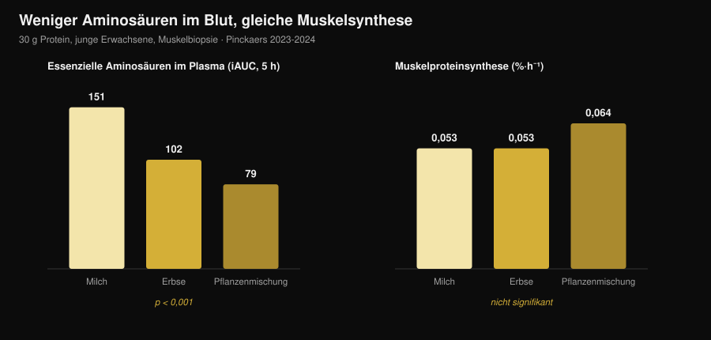
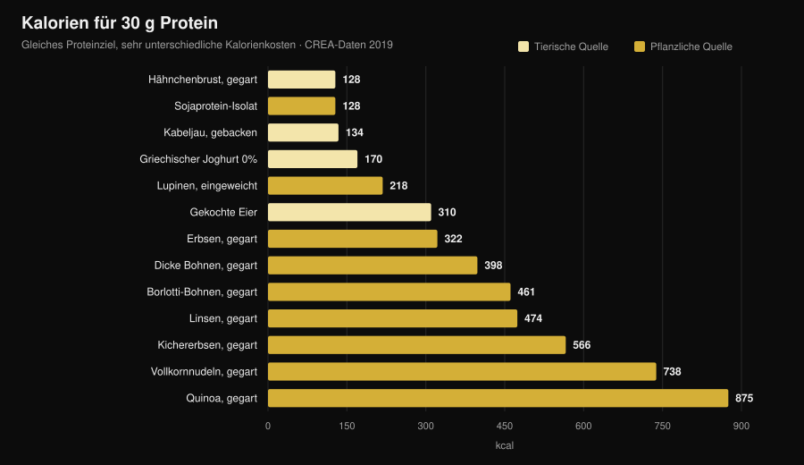

# Pflanzliches oder tierisches Protein für Muskeln?

Von [Giammaria Loi](/autore/giammaria-loi) · aktualisiert am 31. Oktober 2026

„Pflanzliches Protein ist unvollständig, davon wächst kein Muskel." Einer der meistgesagten Sätze im Studio – und der Mechanismus dahinter klingt plausibel: weniger Leucin, weniger Muskelproteinsynthese. Dann hat es jemand tatsächlich gemessen, mit Muskelbiopsien, und das Ergebnis ist nicht das erwartete. Es gibt aber eine zweite Zahl, die fast niemand nennt, und dort wird die Entscheidung konkret.

## Das Wichtigste

- **Fünf Studien mit Muskelbiopsie, fünf Unentschieden.** Dreißig Gramm Protein aus Erbse, Weizen, Mais, Kartoffel oder einer Pflanzenmischung erzeugen dieselbe Muskelproteinsynthese wie 30 g Milchprotein (Gruppe Maastricht, 2021-2024).
- **Der Mechanismus „mehr Leucin nötig" hält der Messung nicht stand.** Mit der Pflanzenmischung liegen die essenziellen Aminosäuren im Blut fast halb so hoch (iAUC 79 statt 151) – die Synthese ist identisch.
- **Langfristig dasselbe Bild.** Vier Studien über 10 bis 16 Wochen an Veganern, Vegetarierinnen und mit Pflanzenmischungen finden keinen Unterschied bei Masse, Muskeldicke oder Kraft.
- **Die größte Metaanalyse sieht einen kleinen Vorteil für tierisches Protein** (SMD −0,20 bei der Muskelmasse), der aber aus Nicht-Soja-Quellen und rein pflanzlichen Ernährungsweisen stammt, nicht aus dem Vergleich Soja/Milch.
- **Der eigentliche Preis sind Kalorien.** Für 30 g Protein braucht es 99 g gegarte Hähnchenbrust und 128 kcal – oder 435 g gegarte Linsen und 474 kcal (CREA-Tabellen). Fast das Vierfache.

## Woher der Zweifel kommt

Protein ist kein einheitlicher Block, sondern eine Kette von Aminosäuren, von denen der Körper neun nicht selbst herstellen kann (die essenziellen). Eine davon, **Leucin**, wirkt wie ein Schalter: Oberhalb einer bestimmten Blutkonzentration startet sie die Maschinerie, die Muskelprotein aufbaut.

Pflanzliche Quellen enthalten im Mittel weniger Leucin und weniger essenzielle Aminosäuren pro Gramm als Fleisch, Eier, Fisch und Milchprodukte, und einige werden etwas schlechter verdaut. Daraus folgt der logische Schluss: weniger Leucin → weniger Synthese → weniger Muskel.

Die Logik stimmt. Nur ist eine stimmige Logik kein Ergebnis – sie muss gemessen werden.

## Das Experiment, das wirklich misst

Zwischen 2021 und 2024 veröffentlichte die Gruppe um Luc van Loon an der Universität Maastricht **fünf randomisierte Doppelblindstudien** mit demselben Design: junge Erwachsene, Infusion mit markiertem Phenylalanin, wiederholte Muskelbiopsien über 5 Stunden, 30 g pflanzliches Protein gegen 30 g Milchprotein.

| Getestetes Pflanzenprotein | Synthese pflanzlich | Milch | Ergebnis |
|---|---|---|---|
| Weizen (Pinckaers 2021) | 0,056 %·h⁻¹ | 0,053 %·h⁻¹ | p = 0,56 |
| Kartoffel (Pinckaers 2022) | 0,053 %·h⁻¹ | 0,050 %·h⁻¹ | p = 0,54 |
| Mischung Weizen+Mais+Erbse (Pinckaers 2023) | 0,064 %·h⁻¹ | 0,053 %·h⁻¹ | p = 0,08 |
| Erbse (Pinckaers 2024) | 0,053 %·h⁻¹ | 0,053 %·h⁻¹ | p = 0,96 |
| Mais (Pinckaers 2024) | 0,053 %·h⁻¹ | 0,053 %·h⁻¹ | p = 0,90 |

Fünf verschiedene pflanzliche Quellen, fünf Unentschieden. In der Kartoffelstudie wurde zusätzlich **nach einer Krafteinheit** gemessen: 0,069 gegen 0,064 %·h⁻¹ zugunsten der Kartoffel, p = 0,52. Auch in genau der Situation, die Trainierende interessiert, kein Unterschied.

Die Grafik zeigt den Befund, der den Mechanismus zerlegt. Die essenziellen Aminosäuren, die in den 5 Stunden nach der Mahlzeit ins Blut gelangen (iAUC), liegen bei **151 mmol·300 min·L⁻¹** mit Milch, **102** mit Erbse und **79** mit der Pflanzenmischung – ein riesiger, statistisch sehr belastbarer Unterschied (p < 0,001 in beiden Vergleichen). Die Muskelsynthese bewegt sich trotzdem nicht.

Übersetzt: Bei 30 Gramm Protein ist die Schwelle in allen Fällen bereits überschritten. Die „Leucinspitze" zählt bei kleinen Dosen; bei einer realen Portion entscheidet sie nicht mehr.

## Und über Monate?

Die über 5 Stunden gemessene Synthese ist ein Hinweis, kein Ergebnis. Muskel zeigt sich über Monate. Dazu gibt es vier Studien, die man zusammen lesen sollte.

**Veganer gegen Omnivoren, 12 Wochen** (Hevia-Larraín 2021, *Sports Medicine*). Neunzehn gewohnheitsmäßige Veganer und 19 Omnivoren, Proteinzufuhr auf 1,6 g pro kg und Tag gebracht – Soja auf der einen, Whey auf der anderen Seite –, zwei betreute Einheiten pro Woche. Magermasse des Beins +1,2 kg in beiden Gruppen; Querschnitt des Rectus femoris +1,0 gegen +0,9 cm²; Beinpresse-1RM +97 gegen +117 kg. Kein signifikanter Unterschied.

**Proteinreiche vegane Ernährung, 10 Wochen** (Monteyne 2023, *Journal of Nutrition*). Hohes Volumen, 5 Einheiten pro Woche, rund 2 g/kg. Magermasse +2,6 kg bei Omnivoren und +3,1 kg in der veganen Gruppe; Oberschenkelvolumen +8,3 % in beiden Gruppen; Faserquerschnitt +33 % gegen +32 %.

**Pflanzenmischung gegen Whey, 12 Wochen** (Santini 2025, *JISSN*). Vierundvierzig untrainierte junge Männer, 45 g Supplement täglich auf drei Mahlzeiten verteilt. Gesamtmagermasse +2,4 gegen +2,5 kg, Vastus-lateralis-Querschnitt +0,9 gegen +1,3 cm², Beinpresse-1RM +64 gegen +63 kg. Kein signifikanter Gruppenunterschied.

**Streng vegetarische Frauen, 16 Wochen** (Martini 2026, *Scandinavian Journal of Medicine & Science in Sports*). Fünfundzwanzig Vegetarierinnen und 20 Nicht-Vegetarierinnen, zwei Einheiten pro Woche, **ohne Supplement**. Oberschenkeldicke von 81,2 auf 85,6 mm gegen 80,8 auf 87,3 mm; zusammengesetzte Maximalkraft von 106,9 auf 132,6 kg gegen 107,9 auf 133,1 kg. Kein Gruppenunterschied – und das, obwohl die Vegetarierinnen **weniger Protein** aßen: 1,0 gegen 1,3 g/kg (p = 0,002).

Dieser letzte Befund ist zugleich der interessanteste und der schwächste: Es handelt sich um eine **nicht randomisierte** Studie (niemand wird per Los Vegetarier) an untrainierten Frauen. Sie erlaubt nicht den Schluss, dass 1 g/kg für hart Trainierende reicht.

## Warum die Metaanalysen etwas anderes sagen

Die umfassendste systematische Übersichtsarbeit (Reid-McCann 2025, *Nutrition Reviews*, 43 randomisierte Studien, 30 in der Metaanalyse) findet, dass pflanzliches Protein gegenüber tierischem **weniger Muskelmasse** zurücklässt: SMD −0,20 (95 %-KI −0,37 / −0,03; p = 0,02), konzentriert bei unter 60-Jährigen und über 60 nicht vorhanden.

Dieselbe Analyse zeigt aufgeschlüsselt genau, wo der Unterschied sitzt:

- **Soja gegen Milchprotein: kein Unterschied** (SMD −0,02; KI −0,20 / 0,16; p = 0,80), über 17 Studien;
- **tierisch gegen pflanzliche Quellen außer Soja** (Reis, Chia, Hafer, Kartoffel): −0,58 (KI −1,06 / −0,09), über 5 Studien;
- **tierisch gegen rein pflanzliche Ernährungsweisen**: −0,51 (KI −0,91 / −0,11), über 7 Studien;
- **Muskelkraft: kein Unterschied** (14 Studien). **Körperliche Leistung: kein Unterschied** (5 Studien).

Die frühere Metaanalyse (Lim 2021, *Nutrients*, 16 Studien) landet am selben Punkt: kein Effekt der Quelle auf absolute Magermasse und Kraft, kleiner tierischer Vorteil beim **Anteil** Magermasse und bei unter 50-Jährigen +0,41 kg (KI 0,08-0,74).

Ehrlich gelesen: Der Unterschied existiert, er ist klein, er betrifft die Masse und nicht die Kraft, und er verschwindet beim Vergleich zweier guter isolierter Proteine. Wieder auf taucht er bei rein pflanzlichen **Ernährungsweisen** – also dann, wenn es nicht mehr um Qualität geht, sondern um die Menge, die man tatsächlich schafft.

## Das eigentliche Problem: die Kalorienrechnung

Ich habe die Lebensmitteltabellen des CREA genommen und ausgerechnet, wie viel Lebensmittel und wie viele Kalorien es braucht, um auf 30 g Protein zu kommen – die Portion aus allen oben genannten Studien.

| Lebensmittel (verzehrfertig) | Gramm für 30 g Protein | kcal | Ballaststoffe |
|---|---|---|---|
| Hähnchenbrust, gegart | 99 g | 128 | 0 g |
| Sojaprotein-Isolat | 35 g | 128 | 0 g |
| Kabeljau, aus dem Ofen | 171 g | 134 | 0 g |
| Griechischer Joghurt 0% | 333 g | 170 | 0 g |
| Lupinen, eingeweicht | 183 g | 218 | 5 g |
| Gekochte Eier (≈5) | 242 g | 310 | 0 g |
| Erbsen, gegart | 309 g | 322 | 20 g |
| Dicke Bohnen, geschält, gegart | 273 g | 398 | 8 g |
| Borlotti-Bohnen, gegart | 435 g | 461 | 30 g |
| Linsen, gegart | 435 g | 474 | 36 g |
| Kichererbsen, gegart | 429 g | 566 | 25 g |
| Vollkornnudeln, gegart | 405 g | 738 | 14 g |
| Quinoa, gegart | 625 g | 875 | 23 g |

Eine Mahlzeit mit 30 g Protein kostet **128 kcal** mit Hähnchen und **474 kcal** mit Linsen. Dreimal täglich sind das über **1.000 kcal** Unterschied: in der Diät schlicht unmöglich, und selbst im Erhalt füllt es den Teller mit Kohlenhydraten, die man vielleicht anders ausgeben wollte.

Dazu kommt das Volumen: 435 g gegarte Linsen sind zwei volle Teller und bringen **36 g Ballaststoffe** mit, mehr als das Doppelte der Tagesempfehlung auf einen Schlag. Kein Gesundheitsproblem, aber ein Magen- und Planungsproblem.

Zwei Ausnahmen verdienen Aufmerksamkeit, und sie schließen den Kreis zu den Studien. **Sojaprotein-Isolat** kostet 128 kcal pro 30 g Protein, genau wie Hähnchenbrust: ausgerechnet das pflanzliche Protein, das in den Metaanalysen nie gegen Milch verliert. Und **Lupinen** liegen bei 218 kcal – das beste unverarbeitete pflanzliche Lebensmittel der Tabelle.

Wer das Protein im Defizit einstellt, folgt derselben Logik wie bei [der Proteinmenge in der Diät](/de/blog/protein-in-der-diaet): das Gramm ändert sich nicht, das Drumherum schon.

## Was die Forschung wirklich sagt

**Widerlegt – „pflanzliches Protein aktiviert die Muskelsynthese nicht wie tierisches".** Fünf Biopsie-Studien, fünf Unentschieden: Weizen p = 0,56, Kartoffel p = 0,54, Erbse p = 0,96, Mais p = 0,90, Mischung p = 0,08 (zugunsten pflanzlich).

**Widerlegt – „ohne genug Leucin baut man keinen Muskel auf".** Mit der Pflanzenmischung sind die essenziellen Aminosäuren im Blut 48 % niedriger (79 statt 151 iAUC, p < 0,001), die Synthese identisch.

**Widerlegt – „als Vegetarier oder Veganer kann man nicht wachsen".** Vier Studien über 10 bis 16 Wochen ohne Unterschied bei Masse, Dicke, Querschnitt oder Kraft.

**Zu präzisieren – „die Quelle spielt überhaupt keine Rolle".** Die größte Metaanalyse findet SMD −0,20 bei der Masse zuungunsten pflanzlich, bei unter 60-Jährigen. Klein, aber nicht null.

**Zu präzisieren – „einfach mehr pflanzliches Protein essen".** Auf dem Papier ja; auf dem Teller kommt dieses Protein mit dem 3- bis 4-Fachen an Kalorien und viel mehr Ballaststoffen.

**Bestätigt – „Soja hält dem Vergleich mit Milch stand".** Über 17 randomisierte Studien SMD −0,02 (KI −0,20 / 0,16): nicht von null zu unterscheiden.

**Widerlegt – „Soja senkt den Testosteronspiegel bei Männern".** Metaanalyse von 41 klinischen Studien, Gesamttestosteron bei 1.753 Männern gemessen: kein Effekt auf Gesamt- und freies Testosteron, Östradiol, Östron oder SHBG, unabhängig von Dosis und Dauer (Reed 2021).

**Nicht überprüfbar – „Getreide und Hülsenfrüchte müssen in jeder Mahlzeit kombiniert werden".** In den Maastricht-Studien zieht eine einzelne pflanzliche Quelle ohne jede Kombination mit Milch gleich; ein direkter Vergleich „pro Mahlzeit kombinieren" gegen „über den Tag kombinieren" auf Hypertrophie fehlt.

## So setzt du es um

1. **Schau auf die Tagessumme, nicht auf die Quelle.** Alle Studien mit Gleichstand arbeiten mit 1,6-2 g pro kg Körpergewicht und Tag.
2. **Erhöhe die Dosis pro Mahlzeit bei pflanzlichen Quellen.** Die Studien nutzen 30 g echtes Protein pro Portion, nicht 15-20 g.
3. **Baue auf Soja und Lupinen.** Die beiden pflanzlichen Quellen mit den geringsten Kalorienkosten pro Gramm Protein.
4. **Rechne die mitgelieferten Kalorien mit.** Kostet eine pflanzliche Proteinmahlzeit 400 statt 130 kcal, musst du sie woanders einsparen.
5. **Steigere Ballaststoffe langsam.** Von 15 auf 35 g pro Tag in einer Woche rächt sich: schrittweise erhöhen und Hülsenfrüchte verteilen.
6. **Bleibt die Summe niedrig, supplementiere.** Sojaisolat oder Soja-Erbsen-Mischung: In den Studien erreichten 45 g pro Tag dasselbe wie Whey.
7. **Achte auf B12 und Eisen, nicht auf das Protein.** Bei einer Ernährung ohne tierische Lebensmittel sind das die Werte, die ärztlich im Blick bleiben sollten.

### Nurvan ausprobieren – Protein auf Basis der CREA-Datenbank

Der Punkt dieses Artikels: Gramm Protein allein reichen nicht, es zählen die Kalorien und das Volumen, die mitkommen. In Nurvan arbeitet der Ernährungsbereich mit den offiziellen CREA-Tabellen – trägst du 200 g gegarte Linsen ein, siehst du Protein, Kalorien und Ballaststoffe genau dieses Lebensmittels, keinen Internet-Durchschnitt. Du setzt dein Proteinziel in g/kg, und die App zeigt, wie weit du bist und was der Weg dorthin kostet; daneben stehen Gewichte, RIR und Maße, damit du siehst, ob aus dem Protein tatsächlich Muskel wird. [Nurvan ausprobieren](https://nurvan.app).

## Häufige Fragen

**Baut pflanzliches Protein genauso Muskeln auf wie tierisches?**
Ja, bei gleicher Menge. Fünf randomisierte Biopsie-Studien zeigen dieselbe Synthese mit 30 g Protein aus Weizen, Kartoffel, Erbse, Mais oder Pflanzenmischung wie mit 30 g Milchprotein, und vier Studien über 10 bis 16 Wochen finden keinen Unterschied bei Masse und Kraft.

**Wie viel Protein pro Tag bei vegetarischer oder veganer Ernährung?**
Die Studien mit Ergebnissen wie bei Omnivoren nutzten 1,6-2 g pro kg Körpergewicht und Tag. Eine Studie an wenig trainierten Vegetarierinnen fand selbst bei 1,0 g/kg keinen Unterschied – allerdings bei nur zwei Einheiten pro Woche.

**Muss man Getreide und Hülsenfrüchte in derselben Mahlzeit kombinieren?**
Für die Muskelsynthese offenbar nicht: In den Maastricht-Studien zieht eine einzelne pflanzliche Quelle mit 30 g mit Milch gleich. Quellen über den Tag zu variieren bleibt trotzdem sinnvoll.

**Senkt Sojaprotein den Testosteronspiegel?**
Nein. Die aktuellste Metaanalyse fasste 41 klinische Studien zusammen, Gesamttestosteron bei 1.753 Männern gemessen, und fand keinen Effekt auf Testosteron, Östradiol, Östron oder SHBG.

## Lies auch

- [Wie viel Protein in der Diät](/de/blog/protein-in-der-diaet) – die Proteinmenge, wenn die Kalorien knapp sind.
- [Ernährung bei einer Verletzung](/de/blog/ernaehrung-bei-verletzung) – Protein und Kalorien in den Wochen der Pause.
- [Körperrekomposition: Fett verlieren, Muskeln aufbauen](/de/blog/koerperrekomposition-fett-verlieren-muskeln-aufbauen) – wie Protein und Defizit zusammenpassen.

## Quellen

1. Pinckaers PJM, Kouw IWK, Hendriks FK, et al., 2021. *No differences in muscle protein synthesis rates following ingestion of wheat protein, milk protein, and their protein blend in healthy, young males.* British Journal of Nutrition 126(12):1832-1842. PMID [33597056](https://pubmed.ncbi.nlm.nih.gov/33597056/) · DOI [10.1017/S0007114521000635](https://doi.org/10.1017/S0007114521000635)
2. Pinckaers PJM, Hendriks FK, Hermans WJH, et al., 2022. *Potato Protein Ingestion Increases Muscle Protein Synthesis Rates at Rest and during Recovery from Exercise in Humans.* Medicine & Science in Sports & Exercise 54(9):1572-1581. PMID [35438672](https://pubmed.ncbi.nlm.nih.gov/35438672/) · DOI [10.1249/MSS.0000000000002937](https://doi.org/10.1249/MSS.0000000000002937)
3. Pinckaers PJM, Kouw IWK, Gorissen SHM, et al., 2023. *The Muscle Protein Synthetic Response to the Ingestion of a Plant-Derived Protein Blend Does Not Differ from an Equivalent Amount of Milk Protein in Healthy Young Males.* The Journal of Nutrition 152(12):2734-2743. PMID [36170964](https://pubmed.ncbi.nlm.nih.gov/36170964/) · DOI [10.1093/jn/nxac222](https://doi.org/10.1093/jn/nxac222)
4. Pinckaers PJM, Smeets JSJ, Kouw IWK, et al., 2024. *Post-prandial muscle protein synthesis rates following the ingestion of pea-derived protein do not differ from ingesting an equivalent amount of milk-derived protein in healthy, young males.* European Journal of Nutrition 63(3):893-904. PMID [38228945](https://pubmed.ncbi.nlm.nih.gov/38228945/) · DOI [10.1007/s00394-023-03295-6](https://doi.org/10.1007/s00394-023-03295-6)
5. Pinckaers PJM, Weijzen MEG, Houben LHP, et al., 2024. *The muscle protein synthetic response following corn protein ingestion does not differ from milk protein in healthy, young adults.* Amino Acids 56(1):8. PMID [38315260](https://pubmed.ncbi.nlm.nih.gov/38315260/) · DOI [10.1007/s00726-023-03377-z](https://doi.org/10.1007/s00726-023-03377-z)
6. Hevia-Larraín V, Gualano B, Longobardi I, et al., 2021. *High-Protein Plant-Based Diet Versus a Protein-Matched Omnivorous Diet to Support Resistance Training Adaptations: A Comparison Between Habitual Vegans and Omnivores.* Sports Medicine 51(6):1317-1330. PMID [33599941](https://pubmed.ncbi.nlm.nih.gov/33599941/) · DOI [10.1007/s40279-021-01434-9](https://doi.org/10.1007/s40279-021-01434-9)
7. Monteyne AJ, Coelho MOC, Murton AJ, et al., 2023. *Vegan and Omnivorous High Protein Diets Support Comparable Daily Myofibrillar Protein Synthesis Rates and Skeletal Muscle Hypertrophy in Young Adults.* The Journal of Nutrition 153(6):1680-1695. PMID [36822394](https://pubmed.ncbi.nlm.nih.gov/36822394/) · DOI [10.1016/j.tjnut.2023.02.023](https://doi.org/10.1016/j.tjnut.2023.02.023)
8. Santini MH, Erwig Leitão A, Mazzolani BC, et al., 2025. *Similar effects between animal-based and plant-based protein blend as complementary dietary protein on muscle adaptations to resistance training: findings from a randomized clinical trial.* Journal of the International Society of Sports Nutrition 22(1):2568047. PMID [41059835](https://pubmed.ncbi.nlm.nih.gov/41059835/) · DOI [10.1080/15502783.2025.2568047](https://doi.org/10.1080/15502783.2025.2568047)
9. Martini GL, Schemes MB, Strey B, et al., 2026. *No Differences in Muscular Adaptations to Long-Term Resistance Training Between Young Strict Vegetarian and Non-Vegetarian Women.* Scandinavian Journal of Medicine & Science in Sports 36(2):e70224. PMID [41684167](https://pubmed.ncbi.nlm.nih.gov/41684167/) · DOI [10.1111/sms.70224](https://doi.org/10.1111/sms.70224)
10. Reid-McCann RJ, Brennan SF, Ward NA, et al., 2025. *Effect of Plant Versus Animal Protein on Muscle Mass, Strength, Physical Performance, and Sarcopenia: A Systematic Review and Meta-analysis of Randomized Controlled Trials.* Nutrition Reviews 83(7):e1581-e1603. PMID [39813010](https://pubmed.ncbi.nlm.nih.gov/39813010/) · DOI [10.1093/nutrit/nuae200](https://doi.org/10.1093/nutrit/nuae200)
11. Lim MT, Pan BJ, Toh DWK, et al., 2021. *Animal Protein versus Plant Protein in Supporting Lean Mass and Muscle Strength: A Systematic Review and Meta-Analysis of Randomized Controlled Trials.* Nutrients 13(2):661. PMID [33670701](https://pubmed.ncbi.nlm.nih.gov/33670701/) · DOI [10.3390/nu13020661](https://doi.org/10.3390/nu13020661)
12. Reed KE, Camargo J, Hamilton-Reeves J, et al., 2021. *Neither soy nor isoflavone intake affects male reproductive hormones: An expanded and updated meta-analysis of clinical studies.* Reproductive Toxicology 100:60-67. PMID [33383165](https://pubmed.ncbi.nlm.nih.gov/33383165/) · DOI [10.1016/j.reprotox.2020.12.019](https://doi.org/10.1016/j.reprotox.2020.12.019)

Daten zur Lebensmittelzusammensetzung: CREA – italienisches Forschungszentrum für Lebensmittel und Ernährung, *Tabellen zur Lebensmittelzusammensetzung*, Stand 2019 ([alimentinutrizione.it](https://www.alimentinutrizione.it/tabelle-nutrizionali/ricerca-per-ordine-alfabetico)). Die wissenschaftlichen Quellen wurden über PubMed recherchiert.

Trendsignal hinter diesem Artikel: Im Oktober 2026 erscheinen binnen weniger Tage zwei viel zitierte Arbeiten zum Vergleich pflanzlich/tierisch (Martini 2026 und Santini 2025), während die Suchnachfrage zu Körperrekomposition und pflanzlichem Protein weiter steigt (Exploding Topics, Daten bis 17. Oktober 2026).

---

**Giammaria Loi** ist der Gründer von Nurvan. Er trainiert seit 2012 mit Gewichten, arbeitet seit 2013 als FIPE-zertifizierter Personal Trainer und Coach und startet seit 2018 auf nationaler Ebene im Powerlifting. Jeder Artikel, den er zeichnet, beginnt bei den Studien und endet bei dem, was im Studio wirklich funktioniert.

> Hinweis: informativer Inhalt, kein Ersatz für ärztlichen oder fachlichen Rat. Bei einer Ernährung ohne tierische Lebensmittel sprich mit deiner Ärztin oder deinem Arzt über die Kontrolle von Vitamin B12, Eisen und Vitamin D.
