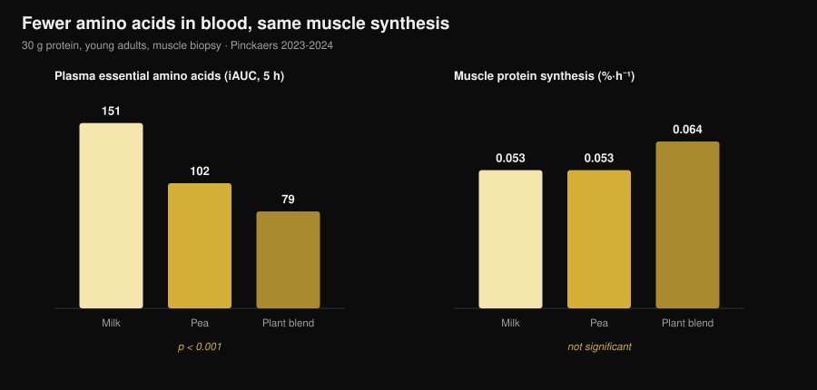
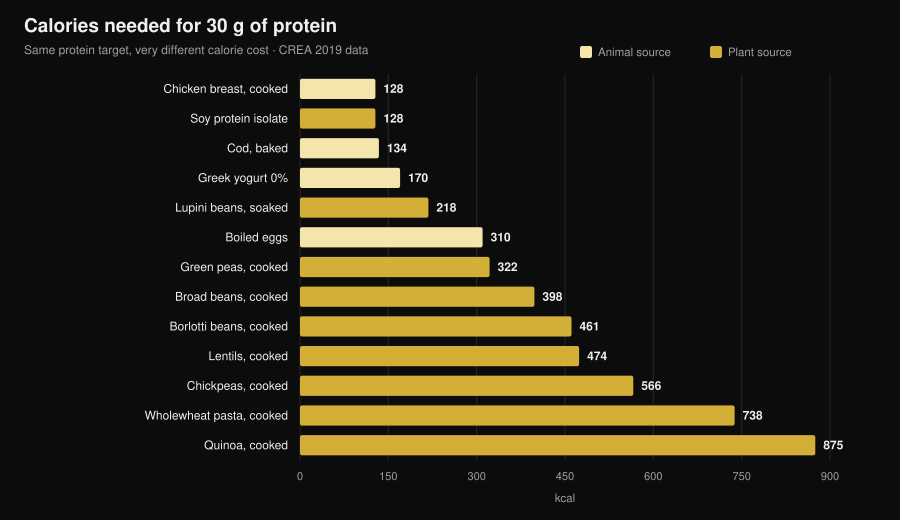

# Plant vs animal protein for muscle: the data

By [Giammaria Loi](/autore/giammaria-loi) · updated 31 October 2026

"Plant proteins are incomplete, they don't build muscle." It's one of the most repeated lines in any gym, and the mechanism behind it looks sound: less leucine, less muscle protein synthesis. Then somebody went and measured it, with muscle biopsies, and the answer isn't the one you'd expect. But there's a second number nobody puts on the table, and that's where the choice actually gets made.

## Key points

- **Five muscle-biopsy trials, five ties.** Thirty grams of protein from pea, wheat, corn, potato or a plant blend produced the same muscle protein synthesis as 30 g of milk protein (Maastricht group, 2021-2024).
- **The "you need more leucine" mechanism fails the test.** With the plant blend, essential amino acids in the blood were roughly half those of milk (iAUC 79 vs 151), and synthesis was identical.
- **Same story long-term.** Four trials of 10-16 weeks in vegans, vegetarian women and plant-blend users found no difference in mass, muscle thickness or strength.
- **The largest meta-analysis does see a small edge for animal protein** (SMD −0.20 for muscle mass), but it comes from non-soy plant sources and whole plant-based diets, not from the soy-vs-milk comparison.
- **The real cost is calories.** Thirty grams of protein means 99 g of cooked chicken breast and 128 kcal, or 435 g of cooked lentils and 474 kcal (CREA food tables). Nearly four times the energy.

## Where the doubt comes from

Protein isn't one single block: it's a chain of amino acids, nine of which your body can't make (the essential ones). One in particular, **leucine**, works like a switch: above a certain concentration in the blood it turns on the machinery that builds muscle protein.

Plant sources, on average, carry less leucine and fewer essential amino acids per gram than meat, eggs, fish and dairy, and several of them are digested slightly less well. Hence the logical conclusion: less leucine → less synthesis → less muscle.

The reasoning is sound. The problem is that sound reasoning isn't a result. It has to be measured.

## The experiment that actually measures it

Between 2021 and 2024, Luc van Loon's group at Maastricht University published **five randomised double-blind trials** with the same design: young adults, labelled phenylalanine infusion, repeated muscle biopsies over 5 hours, 30 g of plant protein against 30 g of milk protein.

| Plant protein tested | Plant synthesis rate | Milk | Result |
|---|---|---|---|
| Wheat (Pinckaers 2021) | 0.056 %·h⁻¹ | 0.053 %·h⁻¹ | p = 0.56 |
| Potato (Pinckaers 2022) | 0.053 %·h⁻¹ | 0.050 %·h⁻¹ | p = 0.54 |
| Wheat + corn + pea blend (Pinckaers 2023) | 0.064 %·h⁻¹ | 0.053 %·h⁻¹ | p = 0.08 |
| Pea (Pinckaers 2024) | 0.053 %·h⁻¹ | 0.053 %·h⁻¹ | p = 0.96 |
| Corn (Pinckaers 2024) | 0.053 %·h⁻¹ | 0.053 %·h⁻¹ | p = 0.90 |

Five different plant sources, five ties. And in the potato trial the measurement was also taken **after a bout of resistance exercise**: 0.069 vs 0.064 %·h⁻¹ in favour of potato, p = 0.52. Even in the condition that matters to lifters, no difference.

The chart shows the finding that dismantles the mechanism. Essential amino acids reaching the bloodstream over the 5 hours after the meal (iAUC) were **151 mmol·300 min·L⁻¹** with milk, **102** with pea and **79** with the plant blend — a huge, rock-solid difference (p < 0.001 in both comparisons). Muscle synthesis didn't budge.

Translated: at 30 grams of protein, everyone is already over the threshold. The "leucine spike" matters when the dose is small; at a real-world serving it stops being the deciding factor.

## What about months of training?

Synthesis measured over 5 hours is a clue, not an outcome. Muscle shows up over months. Four trials are available here, and they should be read together.

**Vegans vs omnivores, 12 weeks** (Hevia-Larraín 2021, *Sports Medicine*). Nineteen habitual vegans and 19 omnivores, protein brought to 1.6 g per kg per day with soy on one side and whey on the other, two supervised sessions a week. Leg lean mass +1.2 kg in both groups; rectus femoris cross-sectional area +1.0 vs +0.9 cm²; leg-press 1RM +97 vs +117 kg. No significant difference on any variable.

**High-protein vegan diet, 10 weeks** (Monteyne 2023, *Journal of Nutrition*). High-volume programme, 5 sessions a week, around 2 g/kg. Lean mass +2.6 kg in omnivores and +3.1 kg in the vegan group; thigh muscle volume +8.3% in both; fibre cross-sectional area +33% vs +32%. The same study had already shown, with deuterium oxide, that daily myofibrillar synthesis rates didn't differ.

**Plant blend vs whey, 12 weeks** (Santini 2025, *JISSN*). Forty-four untrained young men, 45 g a day of supplemental protein split across three meals — soy and pea on one side, whey on the other. Total lean mass +2.4 vs +2.5 kg, vastus lateralis cross-sectional area +0.9 vs +1.3 cm², leg-press 1RM +64 vs +63 kg. No between-group difference was significant.

**Strict vegetarian women, 16 weeks** (Martini 2026, *Scandinavian Journal of Medicine & Science in Sports*). Twenty-five vegetarians and 20 non-vegetarians, two sessions a week, **no supplementation**, habitual diets. Thigh muscle thickness went from 81.2 to 85.6 mm in the vegetarians and from 80.8 to 87.3 mm in the others; composite maximal strength from 106.9 to 132.6 kg vs 107.9 to 133.1 kg. No difference between groups — and that despite the vegetarians eating **less protein**: 1.0 vs 1.3 g/kg (p = 0.002).

That last result is the most interesting and the most fragile at once. It suggests that in lightly trained people, with two sessions a week, even 1.0 g/kg is enough to lose nothing. But it is a **non-randomised** study (nobody is randomly assigned to be vegetarian) in untrained women: it does not license the claim that 1 g/kg is enough for anyone training hard.

## Why the meta-analyses say something slightly different

This is where the picture gets more complicated, and it's only fair to say so.

The largest systematic review on the topic (Reid-McCann 2025, *Nutrition Reviews*, 43 randomised trials, 30 pooled) finds that compared with animal protein, **plant protein leaves less muscle mass**: SMD −0.20 (95% CI −0.37 to −0.03; p = 0.02), with the effect concentrated in under-60s and absent over 60.

But the same analysis, broken down, says exactly where that difference lives:

- **soy vs milk protein: no difference** (SMD −0.02; CI −0.20 to 0.16; p = 0.80), across 17 trials;
- **animal vs non-soy plant proteins** (rice, chia, oat, potato): −0.58 (CI −1.06 to −0.09), across 5 trials;
- **animal vs whole plant-based diets**: −0.51 (CI −0.91 to −0.11), across 7 trials;
- **muscle strength: no difference** (14 trials). **Physical performance: no difference** (5 trials).

The earlier meta-analysis (Lim 2021, *Nutrients*, 16 trials) lands in the same place: no effect of source on absolute lean mass or strength, a small animal advantage on **percentage** lean mass, and in under-50s +0.41 kg of lean mass (CI 0.08-0.74).

The honest read: the difference exists, it's small, it concerns mass and not strength, and it disappears when you compare two good isolated proteins. Where it reappears is in whole plant-based **diets** — which is to say, when the issue is no longer protein quality but how much protein you can actually eat.

## The real problem: the calorie bill

Here is the number almost nobody puts in the comparison. I took the CREA Italian food composition tables and worked out how much food, and how many calories, it takes to reach 30 g of protein — the serving used in every study above.

| Food (as eaten) | Grams for 30 g protein | kcal | Fibre |
|---|---|---|---|
| Chicken breast, pan-cooked | 99 g | 128 | 0 g |
| Soy protein isolate | 35 g | 128 | 0 g |
| Cod, baked from frozen | 171 g | 134 | 0 g |
| Greek yogurt 0% | 333 g | 170 | 0 g |
| Lupini beans, soaked | 183 g | 218 | 5 g |
| Boiled eggs | 242 g (≈5 eggs) | 310 | 0 g |
| Green peas, cooked | 309 g | 322 | 20 g |
| Broad beans, cooked | 273 g | 398 | 8 g |
| Borlotti beans, cooked | 435 g | 461 | 30 g |
| Lentils, cooked | 435 g | 474 | 36 g |
| Chickpeas, cooked | 429 g | 566 | 25 g |
| Wholewheat pasta, cooked | 405 g | 738 | 14 g |
| Quinoa, cooked | 625 g | 875 | 23 g |

A 30 g protein meal costs **128 kcal** with chicken and **474 kcal** with lentils. Do that three times a day and the gap is over **1,000 kcal**: in a cut that's simply impossible, and even at maintenance it fills the plate with carbohydrate you may have wanted to spend elsewhere.

Then there's volume. Four hundred and thirty-five grams of cooked lentils is two full plates, and it brings **36 g of fibre** with it — more than double the usual daily recommendation in one sitting. That's not a health problem, it's a stomach and logistics problem.

Two exceptions deserve attention, and they're exactly the ones that close the loop with the trials. **Soy protein isolate** costs 128 kcal per 30 g of protein, precisely the same as chicken breast: it's the plant protein that never loses to milk in the meta-analyses, and the one that costs no extra energy. And **lupini beans**, barely used outside Mediterranean street food, sit at 218 kcal — the best whole plant food in the table.

If you're setting protein during a calorie deficit, the logic is the one we used when discussing [how much protein you need when cutting](/en/blog/protein-intake-cutting): the gram doesn't change, what comes with it does.

## What the research actually says

**Debunked — "plant protein doesn't trigger muscle synthesis like animal protein".** Five biopsy trials, five ties: wheat p = 0.56, potato p = 0.54, pea p = 0.96, corn p = 0.90, blend p = 0.08 (favouring plant).

**Debunked — "without enough leucine you don't build muscle".** With the plant blend, blood essential amino acids were 48% lower than with milk (79 vs 151 iAUC, p < 0.001) and synthesis was identical. At 30 g the threshold is already cleared.

**Debunked — "you can't grow as a vegetarian or vegan".** Four trials of 10-16 weeks in vegans, vegetarian women and plant-blend users found no difference in mass, thickness, cross-sectional area or strength.

**Needs nuance — "the source doesn't matter at all".** The largest meta-analysis finds SMD −0.20 for mass against plant protein, concentrated in under-60s. Small, but not zero.

**Needs nuance — "just eat more plant protein".** On paper, yes; on the plate, that protein arrives with 3-4 times the calories and far more fibre.

**Confirmed — "soy holds its own against milk protein".** Across 17 randomised trials, SMD −0.02 (CI −0.20 to 0.16): indistinguishable from zero.

**Debunked — "soy lowers testosterone in men".** A meta-analysis of 41 clinical studies, with total testosterone measured in 1,753 men, found no effect of soy protein or isoflavones on total or free testosterone, estradiol, estrone or SHBG, at any dose or duration (Reed 2021).

**Unverifiable — "you must combine grains and legumes at every meal".** In the Maastricht trials a single plant source matched milk with no combining at all, but no study has directly compared "combine at every meal" with "combine across the day" on hypertrophy outcomes.

## How to apply it

1. **Watch the daily total, not the source.** Every trial that ties does so at 1.6-2 g per kg of body weight per day. That's the number that decides.
2. **Raise the per-meal dose with plant sources.** The trials use 30 g of actual protein per serving. With plant foods aim there, not at 15-20 g.
3. **Build around soy and lupini.** They're the two plant sources with the lowest calorie cost per gram of protein, and soy is the only one with a direct, neutral head-to-head against milk.
4. **Count the calories that come along.** If a plant protein meal costs you 400 kcal instead of 130, take those calories from somewhere else or the budget breaks.
5. **Ramp fibre up slowly.** Going from 15 to 35 g of fibre a day in one week has a cost. Increase gradually and spread legumes across meals.
6. **If the total stays low, supplement.** Soy isolate or a soy-pea blend: in the trials, 45 g a day matched whey.
7. **Worry about B12 and iron, not protein.** On a diet with no animal foods, those are the nutrients to monitor with your doctor — not whether you're building muscle.

### Try Nurvan — protein counted on the CREA database

The point of this article is that grams of protein aren't enough: what matters is the calories and the volume that come with them. In Nurvan, the nutrition section runs on the official CREA food tables, so when you log 200 g of cooked lentils you see that food's real protein, calories and fibre — not an internet average. You set your protein target in g/kg and the app shows how close you are and what getting there costs you; alongside it sit your loads, RIR and measurements, so you can see whether that protein is actually turning into muscle. [Try Nurvan](https://nurvan.app).

## FAQ

**Does plant protein build muscle as well as animal protein?**
Yes, at matched amounts. Five randomised muscle-biopsy trials show the same synthesis rate from 30 g of wheat, potato, pea, corn or plant-blend protein as from 30 g of milk protein, and four trials of 10-16 weeks find no difference in mass or strength. The largest meta-analysis sees a small edge for animal protein on mass (SMD −0.20) but not on strength, and no difference between soy and milk.

**How much protein per day on a vegetarian or vegan diet?**
The trials showing results identical to omnivores used 1.6-2 g per kg of body weight per day. One trial in lightly trained vegetarian women found no difference even at 1.0 g/kg, but with only two sessions a week and a low starting point — not a figure to transfer to someone training hard.

**Do I need to combine grains and legumes in the same meal?**
It doesn't appear necessary for muscle synthesis: in the Maastricht trials a single plant source (pea, wheat, corn or potato) at 30 g matched milk with no combining. Varying sources across the day is still a good idea for the overall amino acid profile.

**Does soy protein lower testosterone?**
No. The most up-to-date meta-analysis pooled 41 clinical studies, with total testosterone measured in 1,753 men and free testosterone in 752, and found no effect of soy protein or isoflavones on testosterone, estradiol, estrone or SHBG, regardless of dose and duration.

## Read next

- [How much protein you really need when cutting](/en/blog/protein-intake-cutting) — protein when calories are tight.
- [What to eat when you're injured](/en/blog/what-to-eat-when-injured) — protein and calories during weeks off.
- [Body recomposition: losing fat and gaining muscle](/en/blog/body-recomposition-lose-fat-gain-muscle) — how protein and a deficit fit together.

## Sources

1. Pinckaers PJM, Kouw IWK, Hendriks FK, et al., 2021. *No differences in muscle protein synthesis rates following ingestion of wheat protein, milk protein, and their protein blend in healthy, young males.* British Journal of Nutrition 126(12):1832-1842. PMID [33597056](https://pubmed.ncbi.nlm.nih.gov/33597056/) · DOI [10.1017/S0007114521000635](https://doi.org/10.1017/S0007114521000635)
2. Pinckaers PJM, Hendriks FK, Hermans WJH, et al., 2022. *Potato Protein Ingestion Increases Muscle Protein Synthesis Rates at Rest and during Recovery from Exercise in Humans.* Medicine & Science in Sports & Exercise 54(9):1572-1581. PMID [35438672](https://pubmed.ncbi.nlm.nih.gov/35438672/) · DOI [10.1249/MSS.0000000000002937](https://doi.org/10.1249/MSS.0000000000002937)
3. Pinckaers PJM, Kouw IWK, Gorissen SHM, et al., 2023. *The Muscle Protein Synthetic Response to the Ingestion of a Plant-Derived Protein Blend Does Not Differ from an Equivalent Amount of Milk Protein in Healthy Young Males.* The Journal of Nutrition 152(12):2734-2743. PMID [36170964](https://pubmed.ncbi.nlm.nih.gov/36170964/) · DOI [10.1093/jn/nxac222](https://doi.org/10.1093/jn/nxac222)
4. Pinckaers PJM, Smeets JSJ, Kouw IWK, et al., 2024. *Post-prandial muscle protein synthesis rates following the ingestion of pea-derived protein do not differ from ingesting an equivalent amount of milk-derived protein in healthy, young males.* European Journal of Nutrition 63(3):893-904. PMID [38228945](https://pubmed.ncbi.nlm.nih.gov/38228945/) · DOI [10.1007/s00394-023-03295-6](https://doi.org/10.1007/s00394-023-03295-6)
5. Pinckaers PJM, Weijzen MEG, Houben LHP, et al., 2024. *The muscle protein synthetic response following corn protein ingestion does not differ from milk protein in healthy, young adults.* Amino Acids 56(1):8. PMID [38315260](https://pubmed.ncbi.nlm.nih.gov/38315260/) · DOI [10.1007/s00726-023-03377-z](https://doi.org/10.1007/s00726-023-03377-z)
6. Hevia-Larraín V, Gualano B, Longobardi I, et al., 2021. *High-Protein Plant-Based Diet Versus a Protein-Matched Omnivorous Diet to Support Resistance Training Adaptations: A Comparison Between Habitual Vegans and Omnivores.* Sports Medicine 51(6):1317-1330. PMID [33599941](https://pubmed.ncbi.nlm.nih.gov/33599941/) · DOI [10.1007/s40279-021-01434-9](https://doi.org/10.1007/s40279-021-01434-9)
7. Monteyne AJ, Coelho MOC, Murton AJ, et al., 2023. *Vegan and Omnivorous High Protein Diets Support Comparable Daily Myofibrillar Protein Synthesis Rates and Skeletal Muscle Hypertrophy in Young Adults.* The Journal of Nutrition 153(6):1680-1695. PMID [36822394](https://pubmed.ncbi.nlm.nih.gov/36822394/) · DOI [10.1016/j.tjnut.2023.02.023](https://doi.org/10.1016/j.tjnut.2023.02.023)
8. Santini MH, Erwig Leitão A, Mazzolani BC, et al., 2025. *Similar effects between animal-based and plant-based protein blend as complementary dietary protein on muscle adaptations to resistance training: findings from a randomized clinical trial.* Journal of the International Society of Sports Nutrition 22(1):2568047. PMID [41059835](https://pubmed.ncbi.nlm.nih.gov/41059835/) · DOI [10.1080/15502783.2025.2568047](https://doi.org/10.1080/15502783.2025.2568047)
9. Martini GL, Schemes MB, Strey B, et al., 2026. *No Differences in Muscular Adaptations to Long-Term Resistance Training Between Young Strict Vegetarian and Non-Vegetarian Women.* Scandinavian Journal of Medicine & Science in Sports 36(2):e70224. PMID [41684167](https://pubmed.ncbi.nlm.nih.gov/41684167/) · DOI [10.1111/sms.70224](https://doi.org/10.1111/sms.70224)
10. Reid-McCann RJ, Brennan SF, Ward NA, et al., 2025. *Effect of Plant Versus Animal Protein on Muscle Mass, Strength, Physical Performance, and Sarcopenia: A Systematic Review and Meta-analysis of Randomized Controlled Trials.* Nutrition Reviews 83(7):e1581-e1603. PMID [39813010](https://pubmed.ncbi.nlm.nih.gov/39813010/) · DOI [10.1093/nutrit/nuae200](https://doi.org/10.1093/nutrit/nuae200)
11. Lim MT, Pan BJ, Toh DWK, et al., 2021. *Animal Protein versus Plant Protein in Supporting Lean Mass and Muscle Strength: A Systematic Review and Meta-Analysis of Randomized Controlled Trials.* Nutrients 13(2):661. PMID [33670701](https://pubmed.ncbi.nlm.nih.gov/33670701/) · DOI [10.3390/nu13020661](https://doi.org/10.3390/nu13020661)
12. Reed KE, Camargo J, Hamilton-Reeves J, et al., 2021. *Neither soy nor isoflavone intake affects male reproductive hormones: An expanded and updated meta-analysis of clinical studies.* Reproductive Toxicology 100:60-67. PMID [33383165](https://pubmed.ncbi.nlm.nih.gov/33383165/) · DOI [10.1016/j.reprotox.2020.12.019](https://doi.org/10.1016/j.reprotox.2020.12.019)

Food composition data: CREA — Italian Council for Agricultural Research and Economics, *Food Composition Tables*, 2019 update ([alimentinutrizione.it](https://www.alimentinutrizione.it/tabelle-nutrizionali/ricerca-per-ordine-alfabetico)). Scientific sources were retrieved via PubMed.

Trend signal behind this article: in October 2026 two widely covered papers on the plant-vs-animal comparison landed days apart (Martini 2026 and Santini 2025) and search demand around body recomposition and plant protein keeps climbing (Exploding Topics, data to 17 October 2026).

---

**Giammaria Loi** is the founder of Nurvan. He has been lifting since 2012, has worked as a FIPE-certified personal trainer and coach since 2013, and has competed in powerlifting at national level since 2018. Every article he writes starts from the research and ends with what actually works in the gym.

> Note: educational content, not a substitute for advice from a doctor or qualified professional. If you follow a diet with no animal foods, discuss monitoring of vitamin B12, iron and vitamin D with your doctor.
