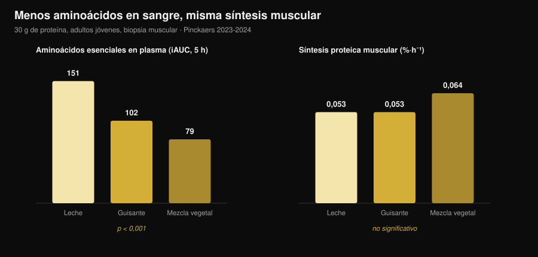
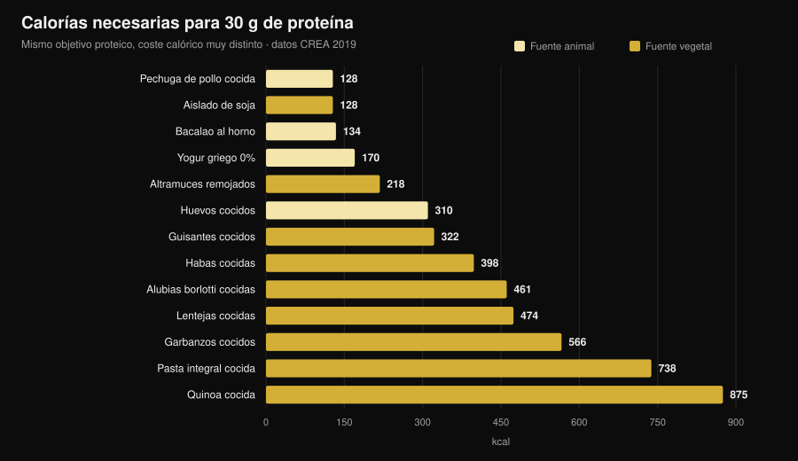

# ¿Proteína vegetal o animal para el músculo?

Por [Giammaria Loi](/autore/giammaria-loi) · actualizado el 31 de octubre de 2026

"La proteína vegetal es incompleta, no construye músculo." Es una de las frases más repetidas en cualquier gimnasio, y el mecanismo que hay detrás parece sólido: menos leucina, menos síntesis proteica. Luego alguien fue a medirlo de verdad, con biopsias musculares, y el resultado no es el que esperarías. Pero hay un segundo número que casi nadie pone sobre la mesa, y ahí es donde la decisión se vuelve concreta.

## En resumen

- **Cinco ensayos con biopsia muscular, cinco empates.** Treinta gramos de proteína de guisante, trigo, maíz, patata o de una mezcla vegetal producen la misma síntesis proteica muscular que 30 g de proteína de leche (grupo de Maastricht, 2021-2024).
- **El mecanismo de "hace falta más leucina" no supera la prueba.** Con la mezcla vegetal los aminoácidos esenciales en sangre son casi la mitad (iAUC 79 frente a 151) y la síntesis es idéntica.
- **A largo plazo, lo mismo.** Cuatro ensayos de 10 a 16 semanas en veganos, mujeres vegetarianas y mezclas vegetales no encuentran diferencias en masa, grosor muscular ni fuerza.
- **El metaanálisis más grande sí ve una pequeña ventaja animal** (DME −0,20 en masa muscular), pero procede de fuentes vegetales distintas de la soja y de dietas íntegramente vegetales, no de la comparación soja/leche.
- **El coste real son las calorías.** Para 30 g de proteína hacen falta 99 g de pechuga de pollo y 128 kcal, o 435 g de lentejas cocidas y 474 kcal (tablas CREA). Casi cuatro veces más energía.

## De dónde viene la duda

La proteína no es un bloque único: es una cadena de aminoácidos, y nueve de ellos el cuerpo no sabe fabricarlos (los esenciales). Uno en particular, la **leucina**, funciona como un interruptor: por encima de cierta concentración en sangre enciende la maquinaria que construye proteína muscular.

Las fuentes vegetales, de media, tienen menos leucina y menos aminoácidos esenciales por gramo que la carne, los huevos, el pescado y los lácteos, y varias se digieren algo peor. De ahí la conclusión lógica: menos leucina → menos síntesis → menos músculo.

El razonamiento es correcto. El problema es que un razonamiento correcto no es un resultado: hay que medirlo.

## El experimento que lo mide de verdad

Entre 2021 y 2024 el grupo de Luc van Loon, en la Universidad de Maastricht, publicó **cinco ensayos aleatorizados a doble ciego** con el mismo diseño: adultos jóvenes, infusión de fenilalanina marcada, biopsias musculares repetidas durante 5 horas, 30 g de proteína vegetal frente a 30 g de proteína de leche.

| Proteína vegetal probada | Síntesis vegetal | Leche | Resultado |
|---|---|---|---|
| Trigo (Pinckaers 2021) | 0,056 %·h⁻¹ | 0,053 %·h⁻¹ | p = 0,56 |
| Patata (Pinckaers 2022) | 0,053 %·h⁻¹ | 0,050 %·h⁻¹ | p = 0,54 |
| Mezcla trigo+maíz+guisante (Pinckaers 2023) | 0,064 %·h⁻¹ | 0,053 %·h⁻¹ | p = 0,08 |
| Guisante (Pinckaers 2024) | 0,053 %·h⁻¹ | 0,053 %·h⁻¹ | p = 0,96 |
| Maíz (Pinckaers 2024) | 0,053 %·h⁻¹ | 0,053 %·h⁻¹ | p = 0,90 |

Cinco fuentes vegetales distintas, cinco empates. Y en el estudio de la patata la medición se hizo también **después de una sesión de pesas**: 0,069 frente a 0,064 %·h⁻¹ a favor de la patata, p = 0,52. Incluso en la condición que le interesa a quien entrena, ninguna diferencia.

El gráfico enseña el dato que desmonta el mecanismo. Los aminoácidos esenciales que llegan a la sangre en las 5 horas posteriores (iAUC) son **151 mmol·300 min·L⁻¹** con leche, **102** con guisante y **79** con la mezcla vegetal: una diferencia enorme y muy sólida (p < 0,001 en ambas comparaciones). La síntesis muscular, en cambio, no se mueve.

Traducido: con 30 gramos de proteína, el umbral ya está superado en todos los casos. El "pico de leucina" cuenta cuando la dosis es pequeña; en una ración real deja de decidir.

## ¿Y a lo largo de los meses?

La síntesis medida en 5 horas es un indicio, no un resultado. El músculo se ve en meses. Aquí hay cuatro ensayos y conviene leerlos juntos.

**Veganos frente a omnívoros, 12 semanas** (Hevia-Larraín 2021, *Sports Medicine*). Diecinueve veganos habituales y 19 omnívoros, proteína llevada a 1,6 g por kg al día con soja de un lado y whey del otro, dos sesiones supervisadas por semana. Masa magra de la pierna +1,2 kg en ambos grupos; sección del recto femoral +1,0 frente a +0,9 cm²; 1RM en prensa +97 frente a +117 kg. Ninguna diferencia significativa.

**Dieta vegana alta en proteína, 10 semanas** (Monteyne 2023, *Journal of Nutrition*). Programa de volumen alto, 5 sesiones semanales, unos 2 g/kg. Masa magra +2,6 kg en omnívoros y +3,1 kg en el grupo vegano; volumen del muslo +8,3% en ambos; sección de las fibras +33% frente a +32%.

**Mezcla vegetal frente a whey, 12 semanas** (Santini 2025, *JISSN*). Cuarenta y cuatro chicos no entrenados, 45 g diarios de suplemento repartidos en tres comidas. Masa magra total +2,4 frente a +2,5 kg, sección del vasto lateral +0,9 frente a +1,3 cm², 1RM en prensa +64 frente a +63 kg. Ninguna diferencia significativa entre grupos.

**Mujeres vegetarianas estrictas, 16 semanas** (Martini 2026, *Scandinavian Journal of Medicine & Science in Sports*). Veinticinco vegetarianas y 20 no vegetarianas, dos sesiones semanales, **sin suplementación**. Grosor del muslo de 81,2 a 85,6 mm frente a 80,8 a 87,3 mm; fuerza máxima compuesta de 106,9 a 132,6 kg frente a 107,9 a 133,1 kg. Sin diferencias entre grupos, y eso que las vegetarianas comían **menos proteína**: 1,0 frente a 1,3 g/kg (p = 0,002).

Este último dato es a la vez el más interesante y el más frágil: es un estudio **no aleatorizado** (nadie elige al azar ser vegetariano) en mujeres no entrenadas, así que no autoriza a decir que 1 g/kg baste para quien entrena duro.

## Por qué los metaanálisis dicen algo algo distinto

La revisión sistemática más amplia (Reid-McCann 2025, *Nutrition Reviews*, 43 ensayos aleatorizados, 30 en el metaanálisis) encuentra que, frente a la proteína animal, **la vegetal deja menos masa muscular**: DME −0,20 (IC 95% −0,37 / −0,03; p = 0,02), con el efecto concentrado en los menores de 60 años y ausente por encima.

Pero la misma análisis, desglosada, dice exactamente dónde está la diferencia:

- **soja frente a proteína de leche: ninguna diferencia** (DME −0,02; IC −0,20 / 0,16; p = 0,80), en 17 ensayos;
- **animal frente a vegetales distintos de la soja** (arroz, chía, avena, patata): −0,58 (IC −1,06 / −0,09), en 5 ensayos;
- **animal frente a dietas íntegramente vegetales**: −0,51 (IC −0,91 / −0,11), en 7 ensayos;
- **fuerza muscular: ninguna diferencia** (14 ensayos). **Rendimiento físico: ninguna diferencia** (5 ensayos).

El metaanálisis previo (Lim 2021, *Nutrients*, 16 ensayos) llega al mismo sitio: ningún efecto de la fuente sobre masa magra absoluta y fuerza, pequeña ventaja animal en el **porcentaje** de masa magra y, en menores de 50 años, +0,41 kg (IC 0,08-0,74).

La lectura honesta: la diferencia existe, es pequeña, afecta a la masa y no a la fuerza, y desaparece cuando se comparan dos proteínas aisladas de calidad. Donde reaparece es en las **dietas** íntegramente vegetales, es decir, cuando el problema ya no es la calidad sino la cantidad que se consigue comer.

## El problema real: la factura calórica

He tomado las tablas de composición de alimentos del CREA y calculado cuánta comida, y con cuántas calorías, hace falta para llegar a 30 g de proteína, la ración usada en todos los estudios anteriores.

| Alimento (tal como se come) | Gramos para 30 g de proteína | kcal | Fibra |
|---|---|---|---|
| Pechuga de pollo cocida | 99 g | 128 | 0 g |
| Aislado de proteína de soja | 35 g | 128 | 0 g |
| Bacalao al horno | 171 g | 134 | 0 g |
| Yogur griego 0% | 333 g | 170 | 0 g |
| Altramuces remojados | 183 g | 218 | 5 g |
| Huevos cocidos (≈5) | 242 g | 310 | 0 g |
| Guisantes cocidos | 309 g | 322 | 20 g |
| Habas secas peladas cocidas | 273 g | 398 | 8 g |
| Alubias borlotti cocidas | 435 g | 461 | 30 g |
| Lentejas cocidas | 435 g | 474 | 36 g |
| Garbanzos cocidos | 429 g | 566 | 25 g |
| Pasta integral cocida | 405 g | 738 | 14 g |
| Quinoa cocida | 625 g | 875 | 23 g |

Una comida de 30 g de proteína cuesta **128 kcal** con pollo y **474 kcal** con lentejas. Si haces tres al día, la diferencia supera las **1.000 kcal**: en definición es sencillamente imposible, y en mantenimiento llena el plato de hidratos que quizá querías gastar en otra cosa.

Y luego está el volumen: 435 g de lentejas cocidas son dos platos llenos y traen **36 g de fibra**, más del doble de la recomendación diaria de una sentada. No es un problema de salud, es un problema de estómago y de logística.

Dos excepciones merecen atención, y son justo las que cierran el círculo con los ensayos. El **aislado de proteína de soja** cuesta 128 kcal por 30 g de proteína, exactamente igual que la pechuga de pollo: es la proteína vegetal que nunca pierde contra la leche en los metaanálisis. Y los **altramuces** se quedan en 218 kcal: el mejor alimento vegetal entero de la tabla.

Si estás ajustando la proteína en déficit, el razonamiento es el mismo que vimos al hablar de [cuánta proteína hace falta en definición](/es/blog/proteinas-en-definicion): no cambia el gramo, cambia lo que viene con él.

## Qué dice realmente la investigación

**Desmentido — "la proteína vegetal no activa la síntesis muscular como la animal".** Cinco ensayos con biopsia, cinco empates: trigo p = 0,56, patata p = 0,54, guisante p = 0,96, maíz p = 0,90, mezcla p = 0,08 (a favor del vegetal).

**Desmentido — "sin suficiente leucina no se construye músculo".** Con la mezcla vegetal los aminoácidos esenciales en sangre son un 48% más bajos (79 frente a 151 iAUC, p < 0,001) y la síntesis es idéntica.

**Desmentido — "siendo vegetariano o vegano no puedes crecer".** Cuatro ensayos de 10 a 16 semanas sin diferencias en masa, grosor, sección ni fuerza.

**Matizado — "la fuente no cuenta en absoluto".** El metaanálisis más grande encuentra DME −0,20 en masa en contra de lo vegetal, concentrado en menores de 60. Pequeño, pero no cero.

**Matizado — "basta con comer más proteína vegetal".** Sobre el papel sí; en el plato esa proteína llega con 3-4 veces las calorías y mucha más fibra.

**Confirmado — "la soja aguanta la comparación con la leche".** En 17 ensayos aleatorizados, DME −0,02 (IC −0,20 / 0,16): indistinguible de cero.

**Desmentido — "la soja baja la testosterona en los hombres".** Metaanálisis de 41 estudios clínicos, testosterona total medida en 1.753 hombres: ningún efecto sobre testosterona total y libre, estradiol, estrona ni SHBG, a cualquier dosis y duración (Reed 2021).

**No verificable — "hay que combinar cereales y legumbres en cada comida".** En los ensayos de Maastricht una sola fuente vegetal empata con la leche sin combinar nada, pero ningún trabajo ha comparado directamente "combinar en cada comida" frente a "combinar a lo largo del día" en hipertrofia.

## Cómo aplicarlo

1. **Mira el total diario, no la fuente.** Todos los ensayos que empatan lo hacen con 1,6-2 g por kg de peso al día.
2. **Sube la dosis por comida con fuentes vegetales.** Los estudios usan 30 g de proteína real por ración, no 15-20 g.
3. **Construye sobre soja y altramuces.** Son las dos fuentes vegetales con menor coste calórico por gramo de proteína.
4. **Cuenta las calorías que vienen detrás.** Si una comida proteica vegetal te cuesta 400 kcal en lugar de 130, quítalas de otro sitio.
5. **Sube la fibra poco a poco.** Pasar de 15 a 35 g al día en una semana se paga: aumenta gradualmente y reparte las legumbres.
6. **Si el total se queda corto, suplementa.** Aislado de soja o mezcla soja-guisante: en los ensayos, 45 g al día igualaron a la whey.
7. **Vigila la B12 y el hierro, no la proteína.** En una dieta sin alimentos animales, esos son los nutrientes a controlar con tu médico.

### Prueba Nurvan — la proteína contada sobre la base de datos CREA

El punto de este artículo es que el gramo de proteína no basta: cuentan las calorías y el volumen que llegan con él. En Nurvan la sección de nutrición trabaja sobre las tablas oficiales CREA, así que cuando registras 200 g de lentejas cocidas ves la proteína, las calorías y la fibra reales de ese alimento, no una media de internet. Fijas el objetivo proteico en g/kg y la app te dice a qué distancia estás y cuánto te cuesta llegar; al lado tienes cargas, RIR y medidas, para ver si esa proteína se está convirtiendo en músculo. [Prueba Nurvan](https://nurvan.app).

## Preguntas frecuentes

**¿La proteína vegetal construye músculo igual que la animal?**
Sí, a igualdad de cantidad. Cinco ensayos aleatorizados con biopsia muestran la misma síntesis con 30 g de proteína de trigo, patata, guisante, maíz o mezcla vegetal que con 30 g de proteína de leche, y cuatro ensayos de 10 a 16 semanas no encuentran diferencias en masa ni fuerza.

**¿Cuánta proteína al día con dieta vegetariana o vegana?**
Los ensayos con resultados idénticos a los omnívoros usaban 1,6-2 g por kg de peso al día. Un ensayo en mujeres vegetarianas poco entrenadas no halló diferencias ni con 1,0 g/kg, pero con solo dos sesiones semanales y un nivel de partida bajo.

**¿Hay que combinar cereales y legumbres en la misma comida?**
No parece necesario para la síntesis muscular: en los ensayos de Maastricht una sola fuente vegetal a 30 g empata con la leche. Variar las fuentes a lo largo del día sigue siendo buena idea.

**¿La proteína de soja baja la testosterona?**
No. El metaanálisis más actualizado reunió 41 estudios clínicos, con testosterona total medida en 1.753 hombres, y no encontró ningún efecto sobre testosterona, estradiol, estrona ni SHBG.

## Lee también

- [Cuánta proteína hace falta en definición](/es/blog/proteinas-en-definicion) — la cuota proteica cuando las calorías escasean.
- [Qué comer cuando estás lesionado](/es/blog/que-comer-cuando-estas-lesionado) — proteína y calorías en las semanas de parón.
- [Recomposición corporal: perder grasa y ganar músculo](/es/blog/recomposicion-corporal-perder-grasa-ganar-musculo) — cómo encajan proteína y déficit.

## Fuentes

1. Pinckaers PJM, Kouw IWK, Hendriks FK, et al., 2021. *No differences in muscle protein synthesis rates following ingestion of wheat protein, milk protein, and their protein blend in healthy, young males.* British Journal of Nutrition 126(12):1832-1842. PMID [33597056](https://pubmed.ncbi.nlm.nih.gov/33597056/) · DOI [10.1017/S0007114521000635](https://doi.org/10.1017/S0007114521000635)
2. Pinckaers PJM, Hendriks FK, Hermans WJH, et al., 2022. *Potato Protein Ingestion Increases Muscle Protein Synthesis Rates at Rest and during Recovery from Exercise in Humans.* Medicine & Science in Sports & Exercise 54(9):1572-1581. PMID [35438672](https://pubmed.ncbi.nlm.nih.gov/35438672/) · DOI [10.1249/MSS.0000000000002937](https://doi.org/10.1249/MSS.0000000000002937)
3. Pinckaers PJM, Kouw IWK, Gorissen SHM, et al., 2023. *The Muscle Protein Synthetic Response to the Ingestion of a Plant-Derived Protein Blend Does Not Differ from an Equivalent Amount of Milk Protein in Healthy Young Males.* The Journal of Nutrition 152(12):2734-2743. PMID [36170964](https://pubmed.ncbi.nlm.nih.gov/36170964/) · DOI [10.1093/jn/nxac222](https://doi.org/10.1093/jn/nxac222)
4. Pinckaers PJM, Smeets JSJ, Kouw IWK, et al., 2024. *Post-prandial muscle protein synthesis rates following the ingestion of pea-derived protein do not differ from ingesting an equivalent amount of milk-derived protein in healthy, young males.* European Journal of Nutrition 63(3):893-904. PMID [38228945](https://pubmed.ncbi.nlm.nih.gov/38228945/) · DOI [10.1007/s00394-023-03295-6](https://doi.org/10.1007/s00394-023-03295-6)
5. Pinckaers PJM, Weijzen MEG, Houben LHP, et al., 2024. *The muscle protein synthetic response following corn protein ingestion does not differ from milk protein in healthy, young adults.* Amino Acids 56(1):8. PMID [38315260](https://pubmed.ncbi.nlm.nih.gov/38315260/) · DOI [10.1007/s00726-023-03377-z](https://doi.org/10.1007/s00726-023-03377-z)
6. Hevia-Larraín V, Gualano B, Longobardi I, et al., 2021. *High-Protein Plant-Based Diet Versus a Protein-Matched Omnivorous Diet to Support Resistance Training Adaptations: A Comparison Between Habitual Vegans and Omnivores.* Sports Medicine 51(6):1317-1330. PMID [33599941](https://pubmed.ncbi.nlm.nih.gov/33599941/) · DOI [10.1007/s40279-021-01434-9](https://doi.org/10.1007/s40279-021-01434-9)
7. Monteyne AJ, Coelho MOC, Murton AJ, et al., 2023. *Vegan and Omnivorous High Protein Diets Support Comparable Daily Myofibrillar Protein Synthesis Rates and Skeletal Muscle Hypertrophy in Young Adults.* The Journal of Nutrition 153(6):1680-1695. PMID [36822394](https://pubmed.ncbi.nlm.nih.gov/36822394/) · DOI [10.1016/j.tjnut.2023.02.023](https://doi.org/10.1016/j.tjnut.2023.02.023)
8. Santini MH, Erwig Leitão A, Mazzolani BC, et al., 2025. *Similar effects between animal-based and plant-based protein blend as complementary dietary protein on muscle adaptations to resistance training: findings from a randomized clinical trial.* Journal of the International Society of Sports Nutrition 22(1):2568047. PMID [41059835](https://pubmed.ncbi.nlm.nih.gov/41059835/) · DOI [10.1080/15502783.2025.2568047](https://doi.org/10.1080/15502783.2025.2568047)
9. Martini GL, Schemes MB, Strey B, et al., 2026. *No Differences in Muscular Adaptations to Long-Term Resistance Training Between Young Strict Vegetarian and Non-Vegetarian Women.* Scandinavian Journal of Medicine & Science in Sports 36(2):e70224. PMID [41684167](https://pubmed.ncbi.nlm.nih.gov/41684167/) · DOI [10.1111/sms.70224](https://doi.org/10.1111/sms.70224)
10. Reid-McCann RJ, Brennan SF, Ward NA, et al., 2025. *Effect of Plant Versus Animal Protein on Muscle Mass, Strength, Physical Performance, and Sarcopenia: A Systematic Review and Meta-analysis of Randomized Controlled Trials.* Nutrition Reviews 83(7):e1581-e1603. PMID [39813010](https://pubmed.ncbi.nlm.nih.gov/39813010/) · DOI [10.1093/nutrit/nuae200](https://doi.org/10.1093/nutrit/nuae200)
11. Lim MT, Pan BJ, Toh DWK, et al., 2021. *Animal Protein versus Plant Protein in Supporting Lean Mass and Muscle Strength: A Systematic Review and Meta-Analysis of Randomized Controlled Trials.* Nutrients 13(2):661. PMID [33670701](https://pubmed.ncbi.nlm.nih.gov/33670701/) · DOI [10.3390/nu13020661](https://doi.org/10.3390/nu13020661)
12. Reed KE, Camargo J, Hamilton-Reeves J, et al., 2021. *Neither soy nor isoflavone intake affects male reproductive hormones: An expanded and updated meta-analysis of clinical studies.* Reproductive Toxicology 100:60-67. PMID [33383165](https://pubmed.ncbi.nlm.nih.gov/33383165/) · DOI [10.1016/j.reprotox.2020.12.019](https://doi.org/10.1016/j.reprotox.2020.12.019)

Datos de composición de alimentos: CREA — Consejo para la Investigación en Agricultura y el Análisis de la Economía Agraria (Italia), *Tablas de composición de alimentos*, actualización 2019 ([alimentinutrizione.it](https://www.alimentinutrizione.it/tabelle-nutrizionali/ricerca-per-ordine-alfabetico)). Las fuentes científicas se han recuperado a través de PubMed.

Señal de tendencia en el origen del artículo: en octubre de 2026 se publican con pocos días de diferencia dos trabajos muy difundidos sobre la comparación vegetal/animal (Martini 2026 y Santini 2025) y la demanda de búsqueda sobre recomposición corporal y proteína vegetal sigue creciendo (Exploding Topics, datos al 17 de octubre de 2026).

---

**Giammaria Loi** es el fundador de Nurvan. Entrena con pesas desde 2012, trabaja como entrenador personal y coach certificado FIPE desde 2013 y compite en powerlifting a nivel nacional desde 2018. Cada artículo que firma parte de los estudios científicos y llega a lo que funciona de verdad en el gimnasio.

> Nota: contenido informativo, no sustituye la opinión de un médico o profesional. Si sigues una dieta sin alimentos de origen animal, habla con tu médico sobre el control de la vitamina B12, el hierro y la vitamina D.
