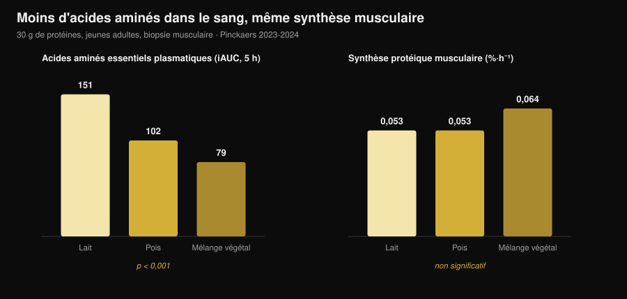
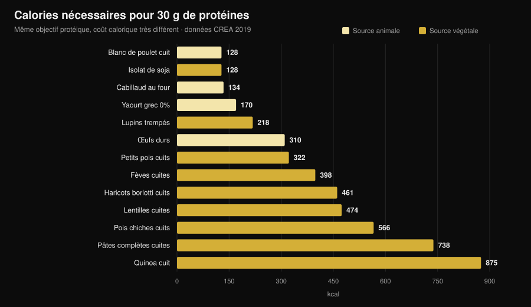

# Protéines végétales ou animales pour les muscles ?

Par [Giammaria Loi](/autore/giammaria-loi) · mis à jour le 31 octobre 2026

« Les protéines végétales sont incomplètes, elles ne construisent pas de muscle. » C'est l'une des phrases les plus répétées en salle, et le mécanisme derrière paraît solide : moins de leucine, moins de synthèse protéique. Puis quelqu'un est allé le mesurer pour de bon, avec des biopsies musculaires, et le résultat n'est pas celui qu'on attend. Mais il y a un second chiffre que presque personne ne pose sur la table, et c'est là que le choix devient concret.

## L'essentiel

- **Cinq essais avec biopsie musculaire, cinq égalités.** Trente grammes de protéines de pois, blé, maïs, pomme de terre ou d'un mélange végétal produisent la même synthèse protéique musculaire que 30 g de protéines de lait (groupe de Maastricht, 2021-2024).
- **Le mécanisme « il faut plus de leucine » ne résiste pas à la mesure.** Avec le mélange végétal, les acides aminés essentiels dans le sang sont presque deux fois moindres (iAUC 79 contre 151) et la synthèse est identique.
- **Même chose sur la durée.** Quatre essais de 10 à 16 semaines chez des végans, des femmes végétariennes et avec des mélanges végétaux ne trouvent aucune différence de masse, d'épaisseur musculaire ou de force.
- **La plus grande méta-analyse voit un petit avantage animal** (DMS −0,20 sur la masse), mais il vient des sources végétales autres que le soja et des régimes entièrement végétaux, pas de la comparaison soja/lait.
- **Le vrai coût, ce sont les calories.** Pour 30 g de protéines il faut 99 g de blanc de poulet et 128 kcal, ou 435 g de lentilles cuites et 474 kcal (tables CREA). Près de quatre fois plus.

## D'où vient le doute

Une protéine n'est pas un bloc unique : c'est une chaîne d'acides aminés, dont neuf que le corps ne sait pas fabriquer (les essentiels). L'un d'eux, la **leucine**, fonctionne comme un interrupteur : au-dessus d'une certaine concentration sanguine, il allume la machinerie qui construit la protéine musculaire.

Les sources végétales contiennent en moyenne moins de leucine et moins d'acides aminés essentiels par gramme que la viande, les œufs, le poisson et les produits laitiers, et plusieurs sont un peu moins bien digérées. D'où la conclusion logique : moins de leucine → moins de synthèse → moins de muscle.

Le raisonnement est juste. Le problème, c'est qu'un raisonnement juste n'est pas un résultat : il faut le mesurer.

## L'expérience qui mesure vraiment

Entre 2021 et 2024, l'équipe de Luc van Loon à l'université de Maastricht a publié **cinq essais randomisés en double aveugle** au même protocole : jeunes adultes, perfusion de phénylalanine marquée, biopsies musculaires répétées pendant 5 heures, 30 g de protéine végétale contre 30 g de protéine de lait.

| Protéine végétale testée | Synthèse végétale | Lait | Résultat |
|---|---|---|---|
| Blé (Pinckaers 2021) | 0,056 %·h⁻¹ | 0,053 %·h⁻¹ | p = 0,56 |
| Pomme de terre (Pinckaers 2022) | 0,053 %·h⁻¹ | 0,050 %·h⁻¹ | p = 0,54 |
| Mélange blé+maïs+pois (Pinckaers 2023) | 0,064 %·h⁻¹ | 0,053 %·h⁻¹ | p = 0,08 |
| Pois (Pinckaers 2024) | 0,053 %·h⁻¹ | 0,053 %·h⁻¹ | p = 0,96 |
| Maïs (Pinckaers 2024) | 0,053 %·h⁻¹ | 0,053 %·h⁻¹ | p = 0,90 |

Cinq sources végétales différentes, cinq égalités. Et dans l'essai sur la pomme de terre la mesure a aussi été faite **après une séance de musculation** : 0,069 contre 0,064 %·h⁻¹ en faveur de la pomme de terre, p = 0,52. Même dans la condition qui intéresse ceux qui s'entraînent, aucune différence.

Le graphique montre ce qui démonte le mécanisme. Les acides aminés essentiels arrivant dans le sang sur les 5 heures après le repas (iAUC) sont de **151 mmol·300 min·L⁻¹** avec le lait, **102** avec le pois et **79** avec le mélange végétal : un écart énorme et très solide (p < 0,001 dans les deux comparaisons). La synthèse musculaire, elle, ne bouge pas.

Autrement dit : à 30 grammes de protéines, le seuil est déjà franchi partout. Le « pic de leucine » compte quand la dose est faible ; sur une vraie portion, il cesse de décider.

## Et sur plusieurs mois ?

La synthèse mesurée sur 5 heures est un indice, pas un résultat. Le muscle se juge sur des mois. Quatre essais existent, et il faut les lire ensemble.

**Végans contre omnivores, 12 semaines** (Hevia-Larraín 2021, *Sports Medicine*). Dix-neuf végans habituels et 19 omnivores, apport porté à 1,6 g par kg et par jour avec du soja d'un côté et de la whey de l'autre, deux séances supervisées par semaine. Masse maigre de la jambe +1,2 kg dans les deux groupes ; section du droit fémoral +1,0 contre +0,9 cm² ; 1RM à la presse +97 contre +117 kg. Aucune différence significative.

**Régime végan hyperprotéiné, 10 semaines** (Monteyne 2023, *Journal of Nutrition*). Programme à volume élevé, 5 séances par semaine, environ 2 g/kg. Masse maigre +2,6 kg chez les omnivores et +3,1 kg chez les végans ; volume de la cuisse +8,3 % dans les deux groupes ; section des fibres +33 % contre +32 %.

**Mélange végétal contre whey, 12 semaines** (Santini 2025, *JISSN*). Quarante-quatre jeunes hommes non entraînés, 45 g par jour de complément répartis sur trois repas. Masse maigre totale +2,4 contre +2,5 kg, section du vaste latéral +0,9 contre +1,3 cm², 1RM à la presse +64 contre +63 kg. Aucune différence significative entre groupes.

**Femmes strictement végétariennes, 16 semaines** (Martini 2026, *Scandinavian Journal of Medicine & Science in Sports*). Vingt-cinq végétariennes et 20 non végétariennes, deux séances par semaine, **sans complément**. Épaisseur de la cuisse de 81,2 à 85,6 mm contre 80,8 à 87,3 mm ; force maximale composite de 106,9 à 132,6 kg contre 107,9 à 133,1 kg. Aucune différence entre groupes, alors même que les végétariennes mangeaient **moins de protéines** : 1,0 contre 1,3 g/kg (p = 0,002).

Ce dernier résultat est à la fois le plus intéressant et le plus fragile : c'est une étude **non randomisée** (personne ne devient végétarien par tirage au sort) chez des femmes non entraînées, elle n'autorise donc pas à dire que 1 g/kg suffit à qui s'entraîne dur.

## Pourquoi les méta-analyses disent quelque chose d'un peu différent

La revue systématique la plus large (Reid-McCann 2025, *Nutrition Reviews*, 43 essais randomisés, 30 dans la méta-analyse) trouve que, face à la protéine animale, **la protéine végétale laisse moins de masse musculaire** : DMS −0,20 (IC 95 % −0,37 / −0,03 ; p = 0,02), effet concentré chez les moins de 60 ans et absent au-delà.

Mais la même analyse, décomposée, dit exactement où se loge cette différence :

- **soja contre protéines de lait : aucune différence** (DMS −0,02 ; IC −0,20 / 0,16 ; p = 0,80), sur 17 essais ;
- **animal contre végétaux autres que le soja** (riz, chia, avoine, pomme de terre) : −0,58 (IC −1,06 / −0,09), sur 5 essais ;
- **animal contre régimes entièrement végétaux** : −0,51 (IC −0,91 / −0,11), sur 7 essais ;
- **force musculaire : aucune différence** (14 essais). **Performance physique : aucune différence** (5 essais).

La méta-analyse précédente (Lim 2021, *Nutrients*, 16 essais) arrive au même point : aucun effet de la source sur la masse maigre absolue et la force, petit avantage animal sur le **pourcentage** de masse maigre et, chez les moins de 50 ans, +0,41 kg (IC 0,08-0,74).

La lecture honnête : la différence existe, elle est petite, elle porte sur la masse et non sur la force, et elle disparaît quand on compare deux protéines isolées de qualité. Elle réapparaît au niveau des **régimes** entièrement végétaux — c'est-à-dire quand le problème n'est plus la qualité mais la quantité qu'on arrive à manger.

## Le vrai problème : la facture calorique

J'ai repris les tables de composition des aliments du CREA et calculé combien d'aliment, et avec combien de calories, il faut pour atteindre 30 g de protéines — la portion utilisée dans tous les essais ci-dessus.

| Aliment (tel que consommé) | Grammes pour 30 g de protéines | kcal | Fibres |
|---|---|---|---|
| Blanc de poulet cuit | 99 g | 128 | 0 g |
| Isolat de protéine de soja | 35 g | 128 | 0 g |
| Cabillaud cuit au four | 171 g | 134 | 0 g |
| Yaourt grec 0% | 333 g | 170 | 0 g |
| Lupins trempés | 183 g | 218 | 5 g |
| Œufs durs (≈5) | 242 g | 310 | 0 g |
| Petits pois cuits | 309 g | 322 | 20 g |
| Fèves sèches décortiquées cuites | 273 g | 398 | 8 g |
| Haricots borlotti cuits | 435 g | 461 | 30 g |
| Lentilles cuites | 435 g | 474 | 36 g |
| Pois chiches cuits | 429 g | 566 | 25 g |
| Pâtes complètes cuites | 405 g | 738 | 14 g |
| Quinoa cuit | 625 g | 875 | 23 g |

Un repas à 30 g de protéines coûte **128 kcal** avec du poulet et **474 kcal** avec des lentilles. Trois fois par jour, l'écart dépasse **1 000 kcal** : en sèche c'est tout simplement impossible, et même à l'entretien cela remplit l'assiette de glucides que vous vouliez peut-être placer ailleurs.

Il y a aussi le volume : 435 g de lentilles cuites, ce sont deux assiettes pleines, et elles apportent **36 g de fibres**, plus du double de la recommandation quotidienne en une fois. Ce n'est pas un problème de santé, c'est un problème d'estomac et d'organisation.

Deux exceptions méritent l'attention, et ce sont justement celles qui bouclent la boucle avec les essais. L'**isolat de protéine de soja** coûte 128 kcal pour 30 g de protéines, exactement comme le blanc de poulet : c'est la protéine végétale qui ne perd jamais contre le lait dans les méta-analyses. Et les **lupins**, peu utilisés hors bassin méditerranéen, restent à 218 kcal : le meilleur aliment végétal entier du tableau.

Si vous réglez les protéines en déficit, le raisonnement est le même que pour [la quantité de protéines en sèche](/fr/blog/proteines-en-seche) : le gramme ne change pas, ce qui l'accompagne change.

## Ce que dit vraiment la recherche

**Démenti — « les protéines végétales n'activent pas la synthèse musculaire comme les animales ».** Cinq essais avec biopsie, cinq égalités : blé p = 0,56, pomme de terre p = 0,54, pois p = 0,96, maïs p = 0,90, mélange p = 0,08 (en faveur du végétal).

**Démenti — « sans assez de leucine on ne construit pas de muscle ».** Avec le mélange végétal, les acides aminés essentiels sanguins sont 48 % plus bas (79 contre 151 iAUC, p < 0,001) et la synthèse est identique.

**Démenti — « végétarien ou végan, on ne peut pas progresser ».** Quatre essais de 10 à 16 semaines sans différence de masse, d'épaisseur, de section ni de force.

**À préciser — « la source ne compte absolument pas ».** La plus grande méta-analyse trouve DMS −0,20 sur la masse en défaveur du végétal, chez les moins de 60 ans. Petit, mais pas nul.

**À préciser — « il suffit de manger plus de protéines végétales ».** Sur le papier oui ; dans l'assiette ces protéines arrivent avec 3 à 4 fois les calories et beaucoup plus de fibres.

**Confirmé — « le soja tient la comparaison avec le lait ».** Sur 17 essais randomisés, DMS −0,02 (IC −0,20 / 0,16) : indiscernable de zéro.

**Démenti — « le soja fait baisser la testostérone chez l'homme ».** Méta-analyse de 41 études cliniques, testostérone totale mesurée chez 1 753 hommes : aucun effet sur la testostérone totale et libre, l'œstradiol, l'œstrone ou la SHBG, quelles que soient la dose et la durée (Reed 2021).

**Non vérifiable — « il faut associer céréales et légumineuses à chaque repas ».** Dans les essais de Maastricht une seule source végétale égale le lait sans aucune association, mais aucun travail n'a comparé directement « associer à chaque repas » et « associer dans la journée » sur l'hypertrophie.

## Comment l'appliquer

1. **Regardez le total quotidien, pas la source.** Tous les essais qui aboutissent à une égalité le font à 1,6-2 g par kg de poids et par jour.
2. **Montez la dose par repas avec des sources végétales.** Les études utilisent 30 g de protéines réelles par portion, pas 15-20 g.
3. **Construisez autour du soja et des lupins.** Ce sont les deux sources végétales au coût calorique le plus bas par gramme de protéines.
4. **Comptez les calories qui viennent avec.** Si un repas protéique végétal coûte 400 kcal au lieu de 130, retirez-les ailleurs.
5. **Montez les fibres progressivement.** Passer de 15 à 35 g par jour en une semaine se paie : augmentez par paliers et répartissez les légumineuses.
6. **Si le total reste bas, complémentez.** Isolat de soja ou mélange soja-pois : dans les essais, 45 g par jour ont égalé la whey.
7. **Surveillez la B12 et le fer, pas les protéines.** Dans un régime sans aliments animaux, ce sont ces nutriments à suivre avec votre médecin.

### Essayez Nurvan — les protéines comptées sur la base CREA

Le point de cet article, c'est que le gramme de protéines ne suffit pas : ce qui compte, ce sont les calories et le volume qui l'accompagnent. Dans Nurvan, la section nutrition s'appuie sur les tables officielles CREA : quand vous enregistrez 200 g de lentilles cuites, vous voyez les protéines, les calories et les fibres réelles de cet aliment, pas une moyenne glanée en ligne. Vous fixez l'objectif protéique en g/kg et l'application vous dit où vous en êtes et ce que cela coûte ; à côté, vos charges, votre RIR et vos mesures, pour vérifier que ces protéines deviennent bien du muscle. [Essayez Nurvan](https://nurvan.app).

## Questions fréquentes

**Les protéines végétales font-elles autant de muscle que les animales ?**
Oui, à quantité égale. Cinq essais randomisés avec biopsie montrent la même synthèse avec 30 g de protéines de blé, pomme de terre, pois, maïs ou mélange végétal qu'avec 30 g de protéines de lait, et quatre essais de 10 à 16 semaines ne trouvent aucune différence de masse ni de force.

**Combien de protéines par jour avec un régime végétarien ou végan ?**
Les essais aux résultats identiques aux omnivores utilisaient 1,6-2 g par kg de poids et par jour. Un essai chez des femmes végétariennes peu entraînées n'a rien trouvé de différent même à 1,0 g/kg, mais avec seulement deux séances par semaine.

**Faut-il associer céréales et légumineuses dans le même repas ?**
Cela ne semble pas nécessaire pour la synthèse musculaire : dans les essais de Maastricht une seule source végétale à 30 g égale le lait. Varier les sources dans la journée reste une bonne idée.

**La protéine de soja fait-elle baisser la testostérone ?**
Non. La méta-analyse la plus récente a réuni 41 études cliniques, avec testostérone totale mesurée chez 1 753 hommes, et n'a trouvé aucun effet sur la testostérone, l'œstradiol, l'œstrone ou la SHBG.

## À lire aussi

- [Combien de protéines en sèche](/fr/blog/proteines-en-seche) — la part protéique quand les calories manquent.
- [Que manger quand on est blessé](/fr/blog/que-manger-quand-on-est-blesse) — protéines et calories pendant l'arrêt.
- [Recomposition corporelle : perdre du gras et gagner du muscle](/fr/blog/recomposition-corporelle-perdre-gras-gagner-muscle) — comment protéines et déficit s'articulent.

## Sources

1. Pinckaers PJM, Kouw IWK, Hendriks FK, et al., 2021. *No differences in muscle protein synthesis rates following ingestion of wheat protein, milk protein, and their protein blend in healthy, young males.* British Journal of Nutrition 126(12):1832-1842. PMID [33597056](https://pubmed.ncbi.nlm.nih.gov/33597056/) · DOI [10.1017/S0007114521000635](https://doi.org/10.1017/S0007114521000635)
2. Pinckaers PJM, Hendriks FK, Hermans WJH, et al., 2022. *Potato Protein Ingestion Increases Muscle Protein Synthesis Rates at Rest and during Recovery from Exercise in Humans.* Medicine & Science in Sports & Exercise 54(9):1572-1581. PMID [35438672](https://pubmed.ncbi.nlm.nih.gov/35438672/) · DOI [10.1249/MSS.0000000000002937](https://doi.org/10.1249/MSS.0000000000002937)
3. Pinckaers PJM, Kouw IWK, Gorissen SHM, et al., 2023. *The Muscle Protein Synthetic Response to the Ingestion of a Plant-Derived Protein Blend Does Not Differ from an Equivalent Amount of Milk Protein in Healthy Young Males.* The Journal of Nutrition 152(12):2734-2743. PMID [36170964](https://pubmed.ncbi.nlm.nih.gov/36170964/) · DOI [10.1093/jn/nxac222](https://doi.org/10.1093/jn/nxac222)
4. Pinckaers PJM, Smeets JSJ, Kouw IWK, et al., 2024. *Post-prandial muscle protein synthesis rates following the ingestion of pea-derived protein do not differ from ingesting an equivalent amount of milk-derived protein in healthy, young males.* European Journal of Nutrition 63(3):893-904. PMID [38228945](https://pubmed.ncbi.nlm.nih.gov/38228945/) · DOI [10.1007/s00394-023-03295-6](https://doi.org/10.1007/s00394-023-03295-6)
5. Pinckaers PJM, Weijzen MEG, Houben LHP, et al., 2024. *The muscle protein synthetic response following corn protein ingestion does not differ from milk protein in healthy, young adults.* Amino Acids 56(1):8. PMID [38315260](https://pubmed.ncbi.nlm.nih.gov/38315260/) · DOI [10.1007/s00726-023-03377-z](https://doi.org/10.1007/s00726-023-03377-z)
6. Hevia-Larraín V, Gualano B, Longobardi I, et al., 2021. *High-Protein Plant-Based Diet Versus a Protein-Matched Omnivorous Diet to Support Resistance Training Adaptations: A Comparison Between Habitual Vegans and Omnivores.* Sports Medicine 51(6):1317-1330. PMID [33599941](https://pubmed.ncbi.nlm.nih.gov/33599941/) · DOI [10.1007/s40279-021-01434-9](https://doi.org/10.1007/s40279-021-01434-9)
7. Monteyne AJ, Coelho MOC, Murton AJ, et al., 2023. *Vegan and Omnivorous High Protein Diets Support Comparable Daily Myofibrillar Protein Synthesis Rates and Skeletal Muscle Hypertrophy in Young Adults.* The Journal of Nutrition 153(6):1680-1695. PMID [36822394](https://pubmed.ncbi.nlm.nih.gov/36822394/) · DOI [10.1016/j.tjnut.2023.02.023](https://doi.org/10.1016/j.tjnut.2023.02.023)
8. Santini MH, Erwig Leitão A, Mazzolani BC, et al., 2025. *Similar effects between animal-based and plant-based protein blend as complementary dietary protein on muscle adaptations to resistance training: findings from a randomized clinical trial.* Journal of the International Society of Sports Nutrition 22(1):2568047. PMID [41059835](https://pubmed.ncbi.nlm.nih.gov/41059835/) · DOI [10.1080/15502783.2025.2568047](https://doi.org/10.1080/15502783.2025.2568047)
9. Martini GL, Schemes MB, Strey B, et al., 2026. *No Differences in Muscular Adaptations to Long-Term Resistance Training Between Young Strict Vegetarian and Non-Vegetarian Women.* Scandinavian Journal of Medicine & Science in Sports 36(2):e70224. PMID [41684167](https://pubmed.ncbi.nlm.nih.gov/41684167/) · DOI [10.1111/sms.70224](https://doi.org/10.1111/sms.70224)
10. Reid-McCann RJ, Brennan SF, Ward NA, et al., 2025. *Effect of Plant Versus Animal Protein on Muscle Mass, Strength, Physical Performance, and Sarcopenia: A Systematic Review and Meta-analysis of Randomized Controlled Trials.* Nutrition Reviews 83(7):e1581-e1603. PMID [39813010](https://pubmed.ncbi.nlm.nih.gov/39813010/) · DOI [10.1093/nutrit/nuae200](https://doi.org/10.1093/nutrit/nuae200)
11. Lim MT, Pan BJ, Toh DWK, et al., 2021. *Animal Protein versus Plant Protein in Supporting Lean Mass and Muscle Strength: A Systematic Review and Meta-Analysis of Randomized Controlled Trials.* Nutrients 13(2):661. PMID [33670701](https://pubmed.ncbi.nlm.nih.gov/33670701/) · DOI [10.3390/nu13020661](https://doi.org/10.3390/nu13020661)
12. Reed KE, Camargo J, Hamilton-Reeves J, et al., 2021. *Neither soy nor isoflavone intake affects male reproductive hormones: An expanded and updated meta-analysis of clinical studies.* Reproductive Toxicology 100:60-67. PMID [33383165](https://pubmed.ncbi.nlm.nih.gov/33383165/) · DOI [10.1016/j.reprotox.2020.12.019](https://doi.org/10.1016/j.reprotox.2020.12.019)

Données de composition des aliments : CREA — Conseil pour la recherche en agriculture et l'analyse de l'économie agricole (Italie), *Tables de composition des aliments*, mise à jour 2019 ([alimentinutrizione.it](https://www.alimentinutrizione.it/tabelle-nutrizionali/ricerca-per-ordine-alfabetico)). Les sources scientifiques ont été récupérées via PubMed.

Signal de tendance à l'origine de l'article : en octobre 2026, deux travaux très repris sur la comparaison végétal/animal paraissent à quelques jours d'écart (Martini 2026 et Santini 2025) et la demande de recherche sur la recomposition corporelle et les protéines végétales continue de croître (Exploding Topics, données au 17 octobre 2026).

---

**Giammaria Loi** est le fondateur de Nurvan. Il s'entraîne avec des poids depuis 2012, travaille comme coach et préparateur certifié FIPE depuis 2013 et dispute des compétitions de force athlétique au niveau national depuis 2018. Chaque article qu'il signe part des études scientifiques et arrive à ce qui marche vraiment en salle.

> Note : contenu informatif, ne remplace pas l'avis d'un médecin ou d'un professionnel. Si vous suivez un régime sans aliments d'origine animale, parlez à votre médecin du suivi de la vitamine B12, du fer et de la vitamine D.
