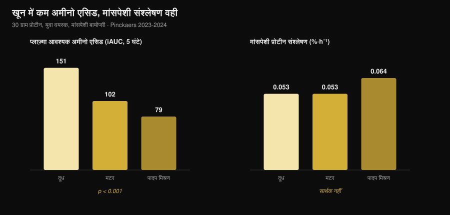
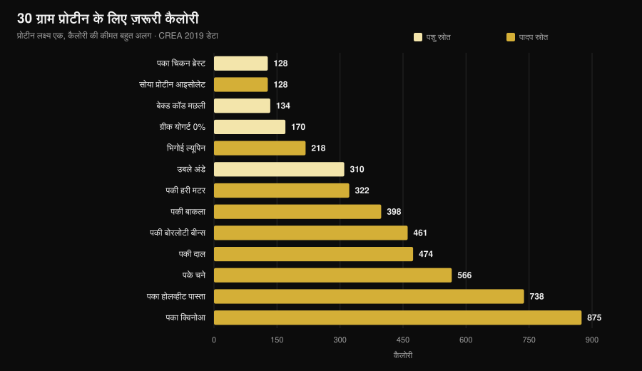

# मसल्स के लिए पादप प्रोटीन या पशु प्रोटीन?

लेखक: [Giammaria Loi](/autore/giammaria-loi) · अपडेट 31 अक्टूबर 2026

"प्लांट प्रोटीन अधूरा होता है, उससे मसल नहीं बनती।" जिम में सबसे ज़्यादा दोहराई जाने वाली लाइनों में से एक, और इसके पीछे का तर्क सुनने में ठोस लगता है: कम ल्यूसीन, कम मसल प्रोटीन सिंथेसिस। फिर किसी ने इसे सच में मापा — मसल बायोप्सी के साथ — और नतीजा वह नहीं निकला जिसकी उम्मीद थी। लेकिन एक दूसरा आँकड़ा है जिसका ज़िक्र लगभग कोई नहीं करता, और असली फैसला वहीं होता है।

## संक्षेप में

- **मसल बायोप्सी वाले पाँच अध्ययन, पाँचों बराबरी पर।** मटर, गेहूँ, मक्का, आलू या प्लांट ब्लेंड से मिले 30 ग्राम प्रोटीन उतनी ही मसल प्रोटीन सिंथेसिस पैदा करते हैं जितनी 30 ग्राम दूध प्रोटीन (मास्ट्रिख्ट समूह, 2021-2024)।
- **"ज़्यादा ल्यूसीन चाहिए" वाला तर्क जाँच में टिकता नहीं।** प्लांट ब्लेंड के साथ खून में आवश्यक अमीनो एसिड लगभग आधे रह जाते हैं (iAUC 79 बनाम 151), फिर भी सिंथेसिस एक जैसी है।
- **लंबी अवधि में भी यही।** वीगन, शाकाहारी महिलाओं और प्लांट ब्लेंड पर 10 से 16 हफ़्तों के चार अध्ययनों में मास, मसल मोटाई या ताकत में कोई अंतर नहीं मिला।
- **सबसे बड़ा मेटा-विश्लेषण पशु प्रोटीन को हल्की बढ़त देता है** (मास में SMD −0.20), लेकिन वह सोया के अलावा वाले पादप स्रोतों और पूर्ण पादप आहार से आती है, सोया बनाम दूध की तुलना से नहीं।
- **असली कीमत कैलोरी है।** 30 ग्राम प्रोटीन के लिए 99 ग्राम पका चिकन ब्रेस्ट और 128 कैलोरी चाहिए, या 435 ग्राम पकी दाल और 474 कैलोरी (CREA टेबल)। करीब चार गुना।

## शक कहाँ से आता है

प्रोटीन कोई एक ठोस ब्लॉक नहीं, अमीनो एसिड की शृंखला है, जिनमें से नौ शरीर खुद नहीं बना सकता (आवश्यक अमीनो एसिड)। इनमें से एक, **ल्यूसीन**, स्विच की तरह काम करता है: खून में एक सीमा से ऊपर पहुँचते ही वह मसल प्रोटीन बनाने वाली मशीनरी चालू कर देता है।

पादप स्रोतों में औसतन प्रति ग्राम ल्यूसीन और आवश्यक अमीनो एसिड मांस, अंडे, मछली और डेयरी से कम होते हैं, और कई थोड़े कम पचते भी हैं। इससे तार्किक निष्कर्ष निकलता है: कम ल्यूसीन → कम सिंथेसिस → कम मसल।

तर्क सही है। दिक्कत यह है कि सही तर्क नतीजा नहीं होता — उसे मापना पड़ता है।

## वह प्रयोग जो सचमुच मापता है

2021 से 2024 के बीच मास्ट्रिख्ट यूनिवर्सिटी में Luc van Loon के समूह ने एक ही डिज़ाइन पर **पाँच रैंडमाइज़्ड डबल-ब्लाइंड अध्ययन** प्रकाशित किए: युवा वयस्क, लेबल किए फेनिलएलनिन का इन्फ्यूज़न, 5 घंटे तक बार-बार मसल बायोप्सी, 30 ग्राम पादप प्रोटीन बनाम 30 ग्राम दूध प्रोटीन।

| परखा गया पादप प्रोटीन | पादप सिंथेसिस | दूध | नतीजा |
|---|---|---|---|
| गेहूँ (Pinckaers 2021) | 0.056 %·h⁻¹ | 0.053 %·h⁻¹ | p = 0.56 |
| आलू (Pinckaers 2022) | 0.053 %·h⁻¹ | 0.050 %·h⁻¹ | p = 0.54 |
| गेहूँ+मक्का+मटर ब्लेंड (Pinckaers 2023) | 0.064 %·h⁻¹ | 0.053 %·h⁻¹ | p = 0.08 |
| मटर (Pinckaers 2024) | 0.053 %·h⁻¹ | 0.053 %·h⁻¹ | p = 0.96 |
| मक्का (Pinckaers 2024) | 0.053 %·h⁻¹ | 0.053 %·h⁻¹ | p = 0.90 |

पाँच अलग-अलग पादप स्रोत, पाँच बार बराबरी। और आलू वाले अध्ययन में माप **वेट ट्रेनिंग सेशन के बाद** भी लिया गया: 0.069 बनाम 0.064 %·h⁻¹, आलू के पक्ष में, p = 0.52। यानी जिस स्थिति की ट्रेनिंग करने वालों को सबसे ज़्यादा परवाह है, वहाँ भी कोई फर्क नहीं।

ग्राफ वही आँकड़ा दिखाता है जो इस तर्क को तोड़ देता है। भोजन के बाद 5 घंटे में खून तक पहुँचे आवश्यक अमीनो एसिड (iAUC): दूध के साथ **151 mmol·300 min·L⁻¹**, मटर के साथ **102**, प्लांट ब्लेंड के साथ **79** — बहुत बड़ा और सांख्यिकीय रूप से मज़बूत अंतर (दोनों तुलनाओं में p < 0.001)। फिर भी मसल सिंथेसिस हिलती तक नहीं।

सीधे शब्दों में: 30 ग्राम प्रोटीन पर सीमा सभी मामलों में पहले ही पार हो चुकी होती है। "ल्यूसीन स्पाइक" तब मायने रखता है जब खुराक छोटी हो; असली सर्विंग पर वह फैसला करना बंद कर देता है।

## और महीनों में क्या होता है?

5 घंटे में मापी गई सिंथेसिस एक संकेत है, नतीजा नहीं। मसल महीनों में दिखती है। यहाँ चार अध्ययन उपलब्ध हैं, और उन्हें साथ पढ़ना चाहिए।

**वीगन बनाम मांसाहारी, 12 हफ़्ते** (Hevia-Larraín 2021, *Sports Medicine*)। उन्नीस नियमित वीगन और 19 मांसाहारी, प्रोटीन 1.6 ग्राम प्रति किलो प्रतिदिन तक लाया गया — एक तरफ सोया, दूसरी तरफ व्हे —, हफ़्ते में दो निगरानी वाले सेशन। टाँग का लीन मास दोनों समूहों में +1.2 किलो; रेक्टस फेमोरिस का क्रॉस-सेक्शन +1.0 बनाम +0.9 cm²; लेग प्रेस 1RM +97 बनाम +117 किलो। किसी भी वेरिएबल पर सार्थक अंतर नहीं।

**हाई-प्रोटीन वीगन डाइट, 10 हफ़्ते** (Monteyne 2023, *Journal of Nutrition*)। हाई वॉल्यूम प्रोग्राम, हफ़्ते में 5 सेशन, लगभग 2 ग्राम/किलो। लीन मास मांसाहारियों में +2.6 किलो और वीगन समूह में +3.1 किलो; जाँघ का मसल वॉल्यूम दोनों में +8.3%; फाइबर क्रॉस-सेक्शन +33% बनाम +32%।

**प्लांट ब्लेंड बनाम व्हे, 12 हफ़्ते** (Santini 2025, *JISSN*)। चौवालीस अप्रशिक्षित युवा पुरुष, रोज़ 45 ग्राम सप्लीमेंट तीन भोजनों में बँटा। कुल लीन मास +2.4 बनाम +2.5 किलो, वेस्टस लेटरलिस क्रॉस-सेक्शन +0.9 बनाम +1.3 cm², लेग प्रेस 1RM +64 बनाम +63 किलो। समूहों के बीच कोई सार्थक अंतर नहीं।

**कड़ी शाकाहारी महिलाएँ, 16 हफ़्ते** (Martini 2026, *Scandinavian Journal of Medicine & Science in Sports*)। पच्चीस शाकाहारी और 20 गैर-शाकाहारी, हफ़्ते में दो सेशन, **कोई सप्लीमेंट नहीं**। जाँघ की मोटाई 81.2 से 85.6 मिमी बनाम 80.8 से 87.3 मिमी; संयुक्त अधिकतम ताकत 106.9 से 132.6 किलो बनाम 107.9 से 133.1 किलो। समूहों में कोई अंतर नहीं — और वह भी तब जब शाकाहारी महिलाएँ **कम प्रोटीन** ले रही थीं: 1.0 बनाम 1.3 ग्राम/किलो (p = 0.002)।

यह आखिरी नतीजा सबसे दिलचस्प भी है और सबसे कमज़ोर भी: यह **रैंडमाइज़्ड नहीं** है (कोई लॉटरी से शाकाहारी नहीं बनता) और अप्रशिक्षित महिलाओं पर है, इसलिए इससे यह नहीं कहा जा सकता कि कड़ी ट्रेनिंग करने वालों के लिए भी 1 ग्राम/किलो काफी है।

## मेटा-विश्लेषण थोड़ी अलग बात क्यों कहते हैं

सबसे व्यापक सिस्टेमैटिक रिव्यू (Reid-McCann 2025, *Nutrition Reviews*, 43 रैंडमाइज़्ड ट्रायल, 30 मेटा-विश्लेषण में) पाता है कि पशु प्रोटीन की तुलना में **पादप प्रोटीन कम मसल मास छोड़ता है**: SMD −0.20 (95% CI −0.37 / −0.03; p = 0.02), असर 60 से कम उम्र वालों में केंद्रित और 60 से ऊपर गायब।

लेकिन वही विश्लेषण टुकड़ों में बताता है कि अंतर कहाँ बैठा है:

- **सोया बनाम दूध प्रोटीन: कोई अंतर नहीं** (SMD −0.02; CI −0.20 / 0.16; p = 0.80), 17 ट्रायल में;
- **पशु बनाम सोया के अलावा पादप स्रोत** (चावल, चिया, ओट, आलू): −0.58 (CI −1.06 / −0.09), 5 ट्रायल में;
- **पशु बनाम पूर्ण पादप आहार**: −0.51 (CI −0.91 / −0.11), 7 ट्रायल में;
- **मसल ताकत: कोई अंतर नहीं** (14 ट्रायल)। **शारीरिक प्रदर्शन: कोई अंतर नहीं** (5 ट्रायल)।

पहले का मेटा-विश्लेषण (Lim 2021, *Nutrients*, 16 ट्रायल) भी वहीं पहुँचता है: स्रोत का निरपेक्ष लीन मास और ताकत पर कोई असर नहीं, लीन मास के **प्रतिशत** पर पशु प्रोटीन की हल्की बढ़त, और 50 से कम उम्र वालों में +0.41 किलो (CI 0.08-0.74)।

ईमानदार पाठ यह है: अंतर मौजूद है, छोटा है, मास से जुड़ा है ताकत से नहीं, और दो अच्छी आइसोलेटेड प्रोटीनों की तुलना में गायब हो जाता है। वह दोबारा दिखता है पूर्ण पादप **आहार** के स्तर पर — यानी तब, जब सवाल गुणवत्ता का नहीं बल्कि इस बात का है कि असल में कितना खाया जा सकता है।

## असली समस्या: कैलोरी का हिसाब

मैंने CREA की खाद्य संघटन तालिकाएँ लीं और हिसाब लगाया कि 30 ग्राम प्रोटीन तक पहुँचने के लिए — ऊपर के सभी अध्ययनों में इस्तेमाल हुई सर्विंग — कितना भोजन और कितनी कैलोरी चाहिए।

| भोजन (जैसा खाया जाता है) | 30 ग्राम प्रोटीन के लिए मात्रा | कैलोरी | फाइबर |
|---|---|---|---|
| पका चिकन ब्रेस्ट | 99 ग्राम | 128 | 0 ग्राम |
| सोया प्रोटीन आइसोलेट | 35 ग्राम | 128 | 0 ग्राम |
| बेक्ड कॉड मछली | 171 ग्राम | 134 | 0 ग्राम |
| ग्रीक योगर्ट 0% | 333 ग्राम | 170 | 0 ग्राम |
| भिगोई ल्यूपिन | 183 ग्राम | 218 | 5 ग्राम |
| उबले अंडे (लगभग 5) | 242 ग्राम | 310 | 0 ग्राम |
| पकी हरी मटर | 309 ग्राम | 322 | 20 ग्राम |
| छिली पकी बाकला | 273 ग्राम | 398 | 8 ग्राम |
| पकी बोरलोटी बीन्स | 435 ग्राम | 461 | 30 ग्राम |
| पकी दाल | 435 ग्राम | 474 | 36 ग्राम |
| पके चने | 429 ग्राम | 566 | 25 ग्राम |
| पका होलव्हीट पास्ता | 405 ग्राम | 738 | 14 ग्राम |
| पका क्विनोआ | 625 ग्राम | 875 | 23 ग्राम |

30 ग्राम प्रोटीन वाला एक भोजन चिकन के साथ **128 कैलोरी** और दाल के साथ **474 कैलोरी** का पड़ता है। दिन में तीन बार करें तो फर्क **1,000 कैलोरी** से ऊपर चला जाता है: कटिंग में यह बस संभव नहीं, और मेंटेनेंस में भी प्लेट उन कार्ब्स से भर जाती है जो शायद आप कहीं और खर्च करना चाहते थे।

फिर वॉल्यूम की बात है: 435 ग्राम पकी दाल यानी दो भरी प्लेटें, और उसके साथ **36 ग्राम फाइबर**, एक ही बार में दैनिक सिफारिश से दोगुने से ज़्यादा। यह सेहत की नहीं, पेट और योजना की समस्या है।

दो अपवाद ध्यान देने लायक हैं, और वही अध्ययनों से तालमेल बिठाते हैं। **सोया प्रोटीन आइसोलेट** 30 ग्राम प्रोटीन के लिए 128 कैलोरी लेता है, ठीक चिकन ब्रेस्ट जितना: यही वह पादप प्रोटीन है जो मेटा-विश्लेषणों में दूध से कभी नहीं हारता। और **ल्यूपिन** 218 कैलोरी पर है — तालिका का सबसे अच्छा साबुत पादप भोजन।

अगर आप कैलोरी डेफिसिट में प्रोटीन सेट कर रहे हैं, तो तर्क वही है जो [कटिंग में कितना प्रोटीन चाहिए](/hi/blog/protein-for-fat-loss-phase) में था: ग्राम नहीं बदलता, उसके साथ आने वाली चीज़ें बदलती हैं।

## शोध असल में क्या कहता है

**ग़लत साबित — "पादप प्रोटीन पशु प्रोटीन जैसी मसल सिंथेसिस चालू नहीं करता"।** पाँच बायोप्सी अध्ययन, पाँच बराबरी: गेहूँ p = 0.56, आलू p = 0.54, मटर p = 0.96, मक्का p = 0.90, ब्लेंड p = 0.08 (पादप के पक्ष में)।

**ग़लत साबित — "पर्याप्त ल्यूसीन के बिना मसल नहीं बनती"।** प्लांट ब्लेंड के साथ खून में आवश्यक अमीनो एसिड 48% कम (79 बनाम 151 iAUC, p < 0.001) और सिंथेसिस एक जैसी।

**ग़लत साबित — "शाकाहारी या वीगन होकर ग्रोथ नहीं हो सकती"।** 10 से 16 हफ़्तों के चार अध्ययन, मास, मोटाई, क्रॉस-सेक्शन या ताकत में कोई अंतर नहीं।

**स्पष्टीकरण ज़रूरी — "स्रोत का कोई मतलब ही नहीं"।** सबसे बड़ा मेटा-विश्लेषण मास पर SMD −0.20 पाता है, पादप के विरुद्ध, 60 से कम उम्र वालों में। छोटा, पर शून्य नहीं।

**स्पष्टीकरण ज़रूरी — "बस ज़्यादा पादप प्रोटीन खा लो"।** कागज़ पर हाँ; प्लेट पर वह प्रोटीन 3 से 4 गुना कैलोरी और कहीं ज़्यादा फाइबर के साथ आता है।

**पुष्ट — "सोया दूध प्रोटीन के सामने टिकता है"।** 17 रैंडमाइज़्ड ट्रायल में SMD −0.02 (CI −0.20 / 0.16): शून्य से अलग पहचाना ही नहीं जा सकता।

**ग़लत साबित — "सोया पुरुषों में टेस्टोस्टेरोन घटाता है"।** 41 क्लिनिकल अध्ययनों का मेटा-विश्लेषण, 1,753 पुरुषों में कुल टेस्टोस्टेरोन मापा गया: किसी भी खुराक और अवधि पर कुल व मुक्त टेस्टोस्टेरोन, एस्ट्राडायोल, एस्ट्रोन या SHBG पर कोई असर नहीं (Reed 2021)।

**असत्यापित — "हर भोजन में अनाज और दाल मिलाना ज़रूरी है"।** मास्ट्रिख्ट के अध्ययनों में बिना किसी मिश्रण के एक अकेला पादप स्रोत दूध की बराबरी कर गया, लेकिन "हर भोजन में मिलाना" बनाम "दिन भर में मिलाना" की सीधी तुलना हाइपरट्रॉफी पर किसी ने नहीं की।

## इसे कैसे लागू करें

1. **दैनिक कुल देखें, स्रोत नहीं।** जिन सभी अध्ययनों में बराबरी हुई, वे 1.6-2 ग्राम प्रति किलो शरीर भार प्रतिदिन पर थे।
2. **पादप स्रोतों के साथ प्रति भोजन खुराक बढ़ाएँ।** अध्ययन प्रति सर्विंग 30 ग्राम असली प्रोटीन इस्तेमाल करते हैं, 15-20 ग्राम नहीं।
3. **सोया और ल्यूपिन को आधार बनाएँ।** प्रति ग्राम प्रोटीन सबसे कम कैलोरी लागत वाले यही दो पादप स्रोत हैं।
4. **साथ आने वाली कैलोरी गिनें।** अगर एक पादप प्रोटीन भोजन 130 की जगह 400 कैलोरी लेता है, तो वे कहीं और से घटाएँ।
5. **फाइबर धीरे-धीरे बढ़ाएँ।** एक हफ़्ते में 15 से 35 ग्राम पर जाना भारी पड़ता है: क्रम से बढ़ाएँ और दालें कई भोजनों में बाँटें।
6. **कुल कम रह जाए तो सप्लीमेंट लें।** सोया आइसोलेट या सोया-मटर ब्लेंड: अध्ययनों में रोज़ 45 ग्राम ने व्हे की बराबरी की।
7. **B12 और आयरन पर नज़र रखें, प्रोटीन पर नहीं।** पशु खाद्य रहित आहार में डॉक्टर के साथ यही मापदंड देखने चाहिए।

### Nurvan आज़माएँ — CREA डेटाबेस पर गिना गया प्रोटीन

इस लेख का सार यह है कि सिर्फ़ प्रोटीन के ग्राम काफी नहीं: साथ आने वाली कैलोरी और वॉल्यूम मायने रखते हैं। Nurvan का न्यूट्रिशन सेक्शन आधिकारिक CREA तालिकाओं पर चलता है, इसलिए जब आप 200 ग्राम पकी दाल दर्ज करते हैं तो उसी भोजन का असली प्रोटीन, कैलोरी और फाइबर दिखता है, इंटरनेट का औसत नहीं। आप प्रोटीन लक्ष्य g/kg में तय करते हैं और ऐप बताता है कि आप कितनी दूर हैं और वहाँ पहुँचने की कीमत क्या है; बगल में वज़न, RIR और माप रहते हैं, ताकि आप देख सकें कि वह प्रोटीन सच में मसल बन रहा है या नहीं। [Nurvan आज़माएँ](https://nurvan.app)।

## अक्सर पूछे जाने वाले सवाल

**क्या पादप प्रोटीन पशु प्रोटीन जितनी मसल बनाता है?**
हाँ, समान मात्रा पर। मसल बायोप्सी वाले पाँच रैंडमाइज़्ड अध्ययन दिखाते हैं कि गेहूँ, आलू, मटर, मक्का या प्लांट ब्लेंड से 30 ग्राम प्रोटीन वही सिंथेसिस देता है जो 30 ग्राम दूध प्रोटीन देता है, और 10 से 16 हफ़्तों के चार अध्ययनों में मास या ताकत में कोई अंतर नहीं मिला।

**शाकाहारी या वीगन आहार पर रोज़ कितना प्रोटीन?**
जिन अध्ययनों में नतीजे मांसाहारियों जैसे रहे, उनमें 1.6-2 ग्राम प्रति किलो शरीर भार प्रतिदिन था। कम ट्रेनिंग वाली शाकाहारी महिलाओं पर एक अध्ययन में 1.0 ग्राम/किलो पर भी अंतर नहीं मिला, पर वहाँ हफ़्ते में सिर्फ़ दो सेशन थे।

**क्या एक ही भोजन में अनाज और दाल मिलाना ज़रूरी है?**
मसल सिंथेसिस के लिए ज़रूरी नहीं लगता: मास्ट्रिख्ट के अध्ययनों में 30 ग्राम पर एक अकेला पादप स्रोत दूध की बराबरी कर गया। दिन भर स्रोत बदलते रहना फिर भी अच्छा है।

**क्या सोया प्रोटीन टेस्टोस्टेरोन घटाता है?**
नहीं। सबसे नया मेटा-विश्लेषण 41 क्लिनिकल अध्ययनों को जोड़ता है, 1,753 पुरुषों में कुल टेस्टोस्टेरोन मापा गया, और टेस्टोस्टेरोन, एस्ट्राडायोल, एस्ट्रोन या SHBG पर कोई असर नहीं मिला।

## यह भी पढ़ें

- [कटिंग में कितना प्रोटीन चाहिए](/hi/blog/protein-for-fat-loss-phase) — जब कैलोरी कम हों तो प्रोटीन का हिस्सा।
- [चोट लगने पर क्या खाएँ](/hi/blog/chot-lagne-par-kya-khayein) — ब्रेक के हफ़्तों में प्रोटीन और कैलोरी।
- [बॉडी रिकम्पोज़िशन: चर्बी घटाएँ, मसल बढ़ाएँ](/hi/blog/body-recomposition-charbi-ghataye-muscle-badhaye) — प्रोटीन और डेफिसिट का तालमेल।

## स्रोत

1. Pinckaers PJM, Kouw IWK, Hendriks FK, et al., 2021. *No differences in muscle protein synthesis rates following ingestion of wheat protein, milk protein, and their protein blend in healthy, young males.* British Journal of Nutrition 126(12):1832-1842. PMID [33597056](https://pubmed.ncbi.nlm.nih.gov/33597056/) · DOI [10.1017/S0007114521000635](https://doi.org/10.1017/S0007114521000635)
2. Pinckaers PJM, Hendriks FK, Hermans WJH, et al., 2022. *Potato Protein Ingestion Increases Muscle Protein Synthesis Rates at Rest and during Recovery from Exercise in Humans.* Medicine & Science in Sports & Exercise 54(9):1572-1581. PMID [35438672](https://pubmed.ncbi.nlm.nih.gov/35438672/) · DOI [10.1249/MSS.0000000000002937](https://doi.org/10.1249/MSS.0000000000002937)
3. Pinckaers PJM, Kouw IWK, Gorissen SHM, et al., 2023. *The Muscle Protein Synthetic Response to the Ingestion of a Plant-Derived Protein Blend Does Not Differ from an Equivalent Amount of Milk Protein in Healthy Young Males.* The Journal of Nutrition 152(12):2734-2743. PMID [36170964](https://pubmed.ncbi.nlm.nih.gov/36170964/) · DOI [10.1093/jn/nxac222](https://doi.org/10.1093/jn/nxac222)
4. Pinckaers PJM, Smeets JSJ, Kouw IWK, et al., 2024. *Post-prandial muscle protein synthesis rates following the ingestion of pea-derived protein do not differ from ingesting an equivalent amount of milk-derived protein in healthy, young males.* European Journal of Nutrition 63(3):893-904. PMID [38228945](https://pubmed.ncbi.nlm.nih.gov/38228945/) · DOI [10.1007/s00394-023-03295-6](https://doi.org/10.1007/s00394-023-03295-6)
5. Pinckaers PJM, Weijzen MEG, Houben LHP, et al., 2024. *The muscle protein synthetic response following corn protein ingestion does not differ from milk protein in healthy, young adults.* Amino Acids 56(1):8. PMID [38315260](https://pubmed.ncbi.nlm.nih.gov/38315260/) · DOI [10.1007/s00726-023-03377-z](https://doi.org/10.1007/s00726-023-03377-z)
6. Hevia-Larraín V, Gualano B, Longobardi I, et al., 2021. *High-Protein Plant-Based Diet Versus a Protein-Matched Omnivorous Diet to Support Resistance Training Adaptations: A Comparison Between Habitual Vegans and Omnivores.* Sports Medicine 51(6):1317-1330. PMID [33599941](https://pubmed.ncbi.nlm.nih.gov/33599941/) · DOI [10.1007/s40279-021-01434-9](https://doi.org/10.1007/s40279-021-01434-9)
7. Monteyne AJ, Coelho MOC, Murton AJ, et al., 2023. *Vegan and Omnivorous High Protein Diets Support Comparable Daily Myofibrillar Protein Synthesis Rates and Skeletal Muscle Hypertrophy in Young Adults.* The Journal of Nutrition 153(6):1680-1695. PMID [36822394](https://pubmed.ncbi.nlm.nih.gov/36822394/) · DOI [10.1016/j.tjnut.2023.02.023](https://doi.org/10.1016/j.tjnut.2023.02.023)
8. Santini MH, Erwig Leitão A, Mazzolani BC, et al., 2025. *Similar effects between animal-based and plant-based protein blend as complementary dietary protein on muscle adaptations to resistance training: findings from a randomized clinical trial.* Journal of the International Society of Sports Nutrition 22(1):2568047. PMID [41059835](https://pubmed.ncbi.nlm.nih.gov/41059835/) · DOI [10.1080/15502783.2025.2568047](https://doi.org/10.1080/15502783.2025.2568047)
9. Martini GL, Schemes MB, Strey B, et al., 2026. *No Differences in Muscular Adaptations to Long-Term Resistance Training Between Young Strict Vegetarian and Non-Vegetarian Women.* Scandinavian Journal of Medicine & Science in Sports 36(2):e70224. PMID [41684167](https://pubmed.ncbi.nlm.nih.gov/41684167/) · DOI [10.1111/sms.70224](https://doi.org/10.1111/sms.70224)
10. Reid-McCann RJ, Brennan SF, Ward NA, et al., 2025. *Effect of Plant Versus Animal Protein on Muscle Mass, Strength, Physical Performance, and Sarcopenia: A Systematic Review and Meta-analysis of Randomized Controlled Trials.* Nutrition Reviews 83(7):e1581-e1603. PMID [39813010](https://pubmed.ncbi.nlm.nih.gov/39813010/) · DOI [10.1093/nutrit/nuae200](https://doi.org/10.1093/nutrit/nuae200)
11. Lim MT, Pan BJ, Toh DWK, et al., 2021. *Animal Protein versus Plant Protein in Supporting Lean Mass and Muscle Strength: A Systematic Review and Meta-Analysis of Randomized Controlled Trials.* Nutrients 13(2):661. PMID [33670701](https://pubmed.ncbi.nlm.nih.gov/33670701/) · DOI [10.3390/nu13020661](https://doi.org/10.3390/nu13020661)
12. Reed KE, Camargo J, Hamilton-Reeves J, et al., 2021. *Neither soy nor isoflavone intake affects male reproductive hormones: An expanded and updated meta-analysis of clinical studies.* Reproductive Toxicology 100:60-67. PMID [33383165](https://pubmed.ncbi.nlm.nih.gov/33383165/) · DOI [10.1016/j.reprotox.2020.12.019](https://doi.org/10.1016/j.reprotox.2020.12.019)

खाद्य संघटन डेटा: CREA — इटली का खाद्य एवं पोषण अनुसंधान केंद्र, *खाद्य संघटन तालिकाएँ*, 2019 अद्यतन ([alimentinutrizione.it](https://www.alimentinutrizione.it/tabelle-nutrizionali/ricerca-per-ordine-alfabetico))। वैज्ञानिक स्रोत PubMed के माध्यम से लिए गए हैं।

लेख के पीछे का ट्रेंड संकेत: अक्टूबर 2026 में कुछ ही दिनों के अंतर पर पादप बनाम पशु प्रोटीन की तुलना पर दो बहुचर्चित अध्ययन आए (Martini 2026 और Santini 2025), जबकि बॉडी रिकम्पोज़िशन और प्लांट प्रोटीन की सर्च डिमांड लगातार बढ़ रही है (Exploding Topics, 17 अक्टूबर 2026 तक का डेटा)।

---

**Giammaria Loi** Nurvan के संस्थापक हैं। वे 2012 से वेट ट्रेनिंग करते हैं, 2013 से FIPE प्रमाणित पर्सनल ट्रेनर और कोच के रूप में काम करते हैं और 2018 से राष्ट्रीय स्तर पर पावरलिफ्टिंग में भाग लेते हैं। उनके हर लेख की शुरुआत वैज्ञानिक अध्ययनों से होती है और अंत इस पर कि जिम में असल में क्या काम करता है।

> नोट: यह जानकारीपरक सामग्री है, डॉक्टर या विशेषज्ञ की राय का विकल्प नहीं। अगर आप पशु खाद्य रहित आहार लेते हैं, तो विटामिन B12, आयरन और विटामिन D की निगरानी के बारे में अपने डॉक्टर से बात करें।
