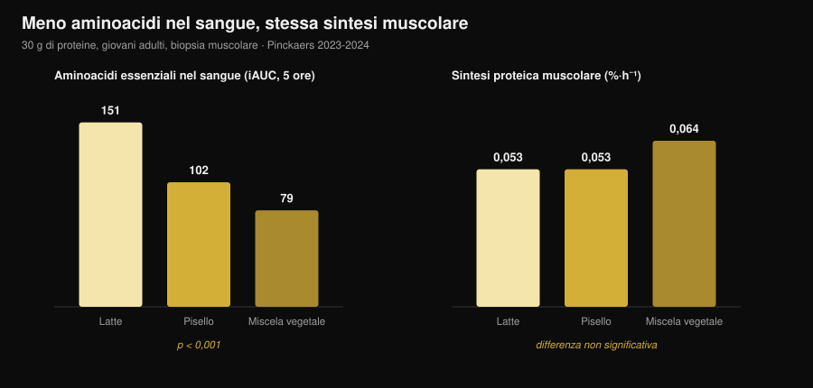
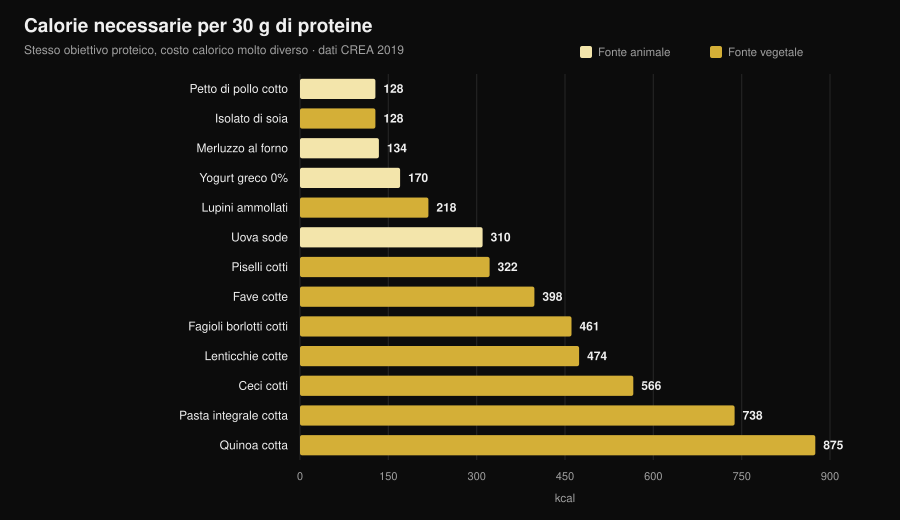

# Proteine vegetali o animali per i muscoli?

Di [Giammaria Loi](/autore/giammaria-loi) · aggiornato il 31 ottobre 2026

"Le proteine vegetali sono incomplete, non costruiscono muscolo." È una delle frasi più ripetute in palestra, e nasce da un meccanismo che sulla carta regge: meno leucina, meno sintesi proteica. Poi qualcuno è andato a misurarlo davvero, con biopsie muscolari, e il risultato non è quello che ti aspetti. Ma c'è un secondo numero, quello che nessuno ti dice, ed è lì che la scelta diventa concreta.

## In breve

- **Su cinque studi con biopsia muscolare, nessuna differenza.** Trenta grammi di proteine da pisello, grano, mais, patata o da una miscela vegetale producono la stessa sintesi proteica muscolare di 30 g di proteine del latte (gruppo di Maastricht, 2021-2024).
- **Il meccanismo "serve più leucina" non regge alla prova.** Con la miscela vegetale gli aminoacidi essenziali nel sangue sono quasi la metà (iAUC 79 contro 151), eppure la sintesi muscolare è identica.
- **A lungo termine lo stesso.** Quattro studi di 12-16 settimane su vegani, vegetariane e miscele vegetali non trovano differenze su massa, spessore muscolare o forza.
- **La meta-analisi più grande vede una piccola differenza a favore dell'animale** (SMD −0,20 sulla massa), ma si concentra sulle fonti vegetali diverse dalla soia e sui regimi interamente vegetali, non sul confronto soia/latte.
- **Il costo vero è calorico.** Per 30 g di proteine servono 99 g di petto di pollo e 128 kcal, oppure 435 g di lenticchie cotte e 474 kcal (tabelle CREA). Quasi quattro volte le calorie.

## Da dove nasce il dubbio

La proteina non è un blocco unico: è una sequenza di aminoacidi, e nove di questi il corpo non li sa fabbricare (si chiamano essenziali). Uno in particolare, la **leucina**, funziona da interruttore: oltre una certa soglia nel sangue, accende la macchina che costruisce proteina muscolare.

Le fonti vegetali, in media, hanno meno leucina e meno aminoacidi essenziali per grammo rispetto a carne, uova, pesce e latticini, e in molti casi vengono digerite un po' peggio. Da qui la conclusione logica: meno leucina → meno sintesi → meno muscolo.

Il ragionamento è corretto. Il punto è che un ragionamento corretto non è un risultato: va misurato.

## L'esperimento che misura davvero

Tra il 2021 e il 2024 il gruppo di Luc van Loon all'Università di Maastricht ha pubblicato **cinque studi randomizzati in doppio cieco** con lo stesso disegno: giovani adulti, infusione di fenilalanina marcata, biopsie muscolari ripetute per 5 ore, 30 g di proteina vegetale contro 30 g di proteina del latte.

| Proteina vegetale testata | Sintesi muscolare vegetale | Latte | Esito |
|---|---|---|---|
| Grano (Pinckaers 2021) | 0,056 %·h⁻¹ | 0,053 %·h⁻¹ | p = 0,56 |
| Patata (Pinckaers 2022) | 0,053 %·h⁻¹ | 0,050 %·h⁻¹ | p = 0,54 |
| Miscela grano+mais+pisello (Pinckaers 2023) | 0,064 %·h⁻¹ | 0,053 %·h⁻¹ | p = 0,08 |
| Pisello (Pinckaers 2024) | 0,053 %·h⁻¹ | 0,053 %·h⁻¹ | p = 0,96 |
| Mais (Pinckaers 2024) | 0,053 %·h⁻¹ | 0,053 %·h⁻¹ | p = 0,90 |

Cinque fonti vegetali diverse, cinque pareggi. E nello studio sulla patata la misura è stata fatta anche **dopo una seduta di pesi**: 0,069 contro 0,064 %·h⁻¹ a favore della patata, p = 0,52. Anche nella condizione che interessa a chi si allena, nessuna differenza.

Il grafico mostra il punto che smonta il meccanismo. Gli aminoacidi essenziali che arrivano nel sangue nelle 5 ore dopo il pasto (iAUC) sono **151 mmol·300 min·L⁻¹** con il latte, **102** con il pisello, **79** con la miscela vegetale: una differenza enorme, statisticamente solidissima (p < 0,001 in entrambi i confronti). La sintesi muscolare, però, non si muove.

Tradotto: a 30 grammi di proteina, la soglia è già superata da tutti. Il "picco di leucina" conta quando la dose è piccola; su una porzione vera smette di decidere.

## E a lungo termine, su persone che si allenano?

La sintesi proteica misurata in 5 ore è un indizio, non un risultato. Il muscolo si vede a mesi. Qui gli studi disponibili sono quattro, e vanno letti insieme.

**Vegani contro onnivori, 12 settimane** (Hevia-Larraín 2021, *Sports Medicine*). Diciannove vegani abituali e 19 onnivori, proteine portate a 1,6 g per kg al giorno con soia da una parte e whey dall'altra, due sedute a settimana supervisionate. Massa magra della gamba +1,2 kg in entrambi i gruppi; sezione del retto femorale +1,0 contro +0,9 cm²; 1RM alla leg press +97 contro +117 kg. Nessuna differenza significativa su nessuna variabile.

**Dieta vegana ad alte proteine, 10 settimane** (Monteyne 2023, *Journal of Nutrition*). Programma a volume alto, 5 sedute a settimana, circa 2 g/kg. Massa magra +2,6 kg negli onnivori e +3,1 kg nel gruppo vegano; volume della coscia +8,3% in entrambi; sezione delle fibre +33% contro +32%. Lo stesso studio aveva già verificato, con acqua deuterata, che la sintesi proteica giornaliera non differiva.

**Miscela vegetale contro whey, 12 settimane** (Santini 2025, *JISSN*). Quarantaquattro ragazzi non allenati, 45 g al giorno di integrazione divisi su tre pasti, soia e pisello da una parte, whey dall'altra. Massa magra totale +2,4 contro +2,5 kg, sezione del vasto laterale +0,9 contro +1,3 cm², 1RM alla leg press +64 contro +63 kg. Tutte le differenze fra gruppi non significative.

**Donne vegetariane strette, 16 settimane** (Martini 2026, *Scandinavian Journal of Medicine & Science in Sports*). Venticinque vegetariane e 20 non vegetariane, due sedute a settimana, **nessuna integrazione**, dieta abituale. Spessore della coscia da 81,2 a 85,6 mm nelle vegetariane e da 80,8 a 87,3 mm nelle altre; forza massimale composita da 106,9 a 132,6 kg contro 107,9 a 133,1 kg. Nessuna differenza fra gruppi — e questo nonostante le vegetariane mangiassero **meno proteine**: 1,0 contro 1,3 g/kg (p = 0,002).

Quest'ultimo dato è il più interessante e il più fragile insieme: suggerisce che in soggetti poco allenati, con uno stimolo di due sedute a settimana, anche 1,0 g/kg basta a non perdere nulla. Ma è uno studio **non randomizzato** (nessuno sceglie a caso di essere vegetariano) e su donne non allenate: non autorizza a dire che 1 g/kg sia abbastanza per chi si allena duro.

## Perché le meta-analisi dicono una cosa leggermente diversa

Qui il quadro si complica, ed è giusto dirlo.

La revisione sistematica più ampia sul tema (Reid-McCann 2025, *Nutrition Reviews*, 43 studi randomizzati, 30 in meta-analisi) trova che rispetto alla proteina animale **la proteina vegetale lascia meno massa muscolare**: SMD −0,20 (IC 95% −0,37 / −0,03; p = 0,02), con effetto concentrato negli under 60 e assente sopra i 60 anni.

Ma la stessa analisi, scomposta, dice esattamente dove sta la differenza:

- **soia contro proteine del latte: nessuna differenza** (SMD −0,02; IC −0,20 / 0,16; p = 0,80), su 17 studi;
- **animale contro vegetali diversi dalla soia** (riso, chia, avena, patata): −0,58 (IC −1,06 / −0,09), su 5 studi;
- **animale contro regimi interamente vegetali**: −0,51 (IC −0,91 / −0,11), su 7 studi;
- **forza muscolare: nessuna differenza** (14 studi). **Prestazione fisica: nessuna differenza** (5 studi).

La meta-analisi precedente (Lim 2021, *Nutrients*, 16 studi) arriva allo stesso posto: nessun effetto della fonte su massa magra assoluta e forza, piccolo vantaggio animale sulla **percentuale** di massa magra e, negli under 50, +0,41 kg di massa magra (IC 0,08-0,74).

La lettura onesta è questa. La differenza esiste, è piccola, riguarda la massa e non la forza, e scompare quando il confronto è fra due proteine isolate di buona qualità. Dove ricompare è nei **regimi alimentari** interamente vegetali — cioè quando il problema non è più la qualità della proteina, ma la quantità che si riesce a mangiare.

## Il problema vero: il conto calorico

Ed eccolo, il numero che quasi nessuno mette nel confronto. Ho preso le tabelle di composizione degli alimenti del CREA e calcolato quanto cibo serve, e con quante calorie, per arrivare a 30 g di proteine — la porzione usata in tutti gli studi sopra.

| Alimento (come si mangia) | Grammi per 30 g di proteine | kcal | Fibra |
|---|---|---|---|
| Petto di pollo, cotto in padella | 99 g | 128 | 0 g |
| Isolato proteico di soia | 35 g | 128 | 0 g |
| Merluzzo surgelato, cotto al forno | 171 g | 134 | 0 g |
| Yogurt greco 0% | 333 g | 170 | 0 g |
| Lupini ammollati | 183 g | 218 | 5 g |
| Uova sode | 242 g (≈5 uova) | 310 | 0 g |
| Piselli freschi cotti | 309 g | 322 | 20 g |
| Fave secche sgusciate, cotte | 273 g | 398 | 8 g |
| Fagioli borlotti, cotti | 435 g | 461 | 30 g |
| Lenticchie, cotte | 435 g | 474 | 36 g |
| Ceci, cotti | 429 g | 566 | 25 g |
| Pasta integrale, cotta | 405 g | 738 | 14 g |
| Quinoa, cotta | 625 g | 875 | 23 g |

Un pasto da 30 g di proteine costa **128 kcal** con il pollo e **474 kcal** con le lenticchie. Se ne fai tre al giorno, la differenza è di oltre **1.000 kcal**: in definizione è semplicemente impossibile, e anche in mantenimento riempie il piatto di carboidrati che magari volevi mettere altrove.

C'è poi il volume. Quattrocentotrentacinque grammi di lenticchie cotte sono due piatti pieni, e portano con sé **36 g di fibra**: più del doppio della quota giornaliera raccomandata in una sola seduta. Non è un problema di salute, è un problema di stomaco e di gestione.

Due eccezioni meritano attenzione, e sono proprio quelle che chiudono il cerchio con gli studi. L'**isolato proteico di soia** costa 128 kcal per 30 g di proteine, esattamente come il petto di pollo: è la proteina vegetale che nelle meta-analisi non perde mai contro il latte, ed è anche quella che non costa calorie. E i **lupini**, poco usati in Italia fuori dallo street food, stanno a 218 kcal: il miglior alimento vegetale intero della tabella.

Se stai impostando le proteine in una fase di taglio calorico, il ragionamento è lo stesso che facevamo parlando di [quante proteine servono in definizione](/blog/proteine-in-definizione): non cambia il grammo, cambia quello che ci viene insieme.

## Cosa dice davvero la ricerca

**Smentito — "le proteine vegetali non attivano la sintesi muscolare come quelle animali".** Cinque studi con biopsia, cinque pareggi: grano p = 0,56, patata p = 0,54, pisello p = 0,96, mais p = 0,90, miscela p = 0,08 (a favore del vegetale).

**Smentito — "senza abbastanza leucina non si costruisce muscolo".** Con la miscela vegetale gli aminoacidi essenziali nel sangue sono il 48% in meno rispetto al latte (79 contro 151 iAUC, p < 0,001) e la sintesi è identica. A 30 g la soglia è già passata.

**Smentito — "da vegetariano o vegano non puoi crescere".** Quattro studi di 10-16 settimane, su vegani, vegetariane e miscele vegetali, non trovano differenze su massa, spessore, sezione o forza.

**Da precisare — "la fonte non conta proprio niente".** La meta-analisi più grande trova −0,20 di SMD sulla massa a sfavore del vegetale, concentrato negli under 60. Piccolo, ma non zero.

**Da precisare — "basta mangiare più proteine vegetali".** Sulla carta sì; nel piatto quelle proteine arrivano con 3-4 volte le calorie e molta più fibra.

**Confermato — "la soia regge il confronto con il latte".** Su 17 studi randomizzati, SMD −0,02 (IC −0,20 / 0,16): la differenza è indistinguibile da zero.

**Smentito — "la soia abbassa il testosterone negli uomini".** Meta-analisi su 41 studi clinici, testosterone totale misurato in 1.753 uomini: nessun effetto su testosterone totale e libero, estradiolo, estrone e SHBG, a qualunque dose e durata (Reed 2021).

**Non verificabile — "serve combinare cereali e legumi a ogni pasto".** Negli studi di Maastricht una singola fonte vegetale pareggia con il latte senza alcuna combinazione, ma nessun lavoro ha confrontato direttamente "combinare a ogni pasto" contro "combinare nella giornata" su esiti di ipertrofia.

## Come applicarlo

1. **Guarda il totale giornaliero, non la fonte.** Tutti gli studi che pareggiano lo fanno a 1,6-2 g per kg di peso al giorno. È quello il numero che decide.
2. **Alza la dose per pasto se la fonte è vegetale.** Gli studi usano 30 g di proteina vera per porzione. Con fonti vegetali punta lì, non a 15-20 g.
3. **Usa soia e lupini come base.** Sono le due fonti vegetali che costano meno calorie per grammo di proteina, e la soia è l'unica con un confronto diretto e neutro contro il latte.
4. **Conta le calorie che arrivano insieme.** Se un pasto proteico vegetale ti costa 400 kcal invece di 130, togli quelle calorie da qualche altra parte o il bilancio salta.
5. **Vai a scalare sulla fibra.** Passare da 15 a 35 g di fibra al giorno in una settimana si paga. Aumenta gradualmente e distribuisci i legumi su più pasti.
6. **Se la quota resta bassa, integra.** Isolato di soia o miscela soia-pisello: negli studi a 45 g al giorno hanno dato gli stessi risultati delle whey.
7. **Fai attenzione alla B12 e al ferro, non alle proteine.** In una dieta senza alimenti animali i nutrienti da monitorare con il medico sono quelli, non la quantità di muscolo.

### Prova Nurvan — le proteine contate sul database CREA

Il punto di questo articolo è che il grammo di proteina non basta: contano le calorie e il volume che ci arrivano insieme. Su Nurvan la sezione nutrizione lavora sulle tabelle ufficiali CREA, quindi quando registri 200 g di lenticchie cotte vedi subito proteine, calorie e fibra reali di quell'alimento, non una media di internet. Imposti il target proteico in g/kg, e l'app ti dice a che punto sei e quanto ti costa arrivarci; accanto trovi carichi, RIR e misure, così vedi se quelle proteine stanno davvero diventando muscolo. [Prova Nurvan](https://nurvan.app).

## Domande frequenti

**Le proteine vegetali fanno crescere il muscolo come quelle animali?**
Sì, a parità di quantità. Cinque studi randomizzati con biopsia muscolare mostrano la stessa sintesi proteica con 30 g di proteina da grano, patata, pisello, mais o miscela vegetale rispetto a 30 g di proteina del latte, e quattro studi di 10-16 settimane non trovano differenze su massa e forza. La meta-analisi più ampia vede una differenza piccola (SMD −0,20) a favore dell'animale sulla massa, ma non sulla forza, e nessuna differenza fra soia e latte.

**Quante proteine al giorno servono con una dieta vegetariana o vegana?**
Gli studi che mostrano risultati identici agli onnivori usavano 1,6-2 g per kg di peso corporeo al giorno. Un trial su donne vegetariane poco allenate non ha trovato differenze nemmeno a 1,0 g/kg, ma con solo due sedute a settimana e un livello di partenza basso: non è un dato da trasferire a chi si allena intensamente.

**Serve combinare cereali e legumi nello stesso pasto?**
Non risulta necessario per la sintesi muscolare: negli studi di Maastricht una singola fonte vegetale (pisello, grano, mais o patata) a 30 g pareggia con il latte senza alcuna combinazione. Variare le fonti nell'arco della giornata resta una buona idea per il profilo aminoacidico complessivo.

**La proteina della soia abbassa il testosterone?**
No. La meta-analisi più aggiornata ha raccolto 41 studi clinici, con testosterone totale misurato in 1.753 uomini e testosterone libero in 752, e non ha trovato alcun effetto di proteine di soia o isoflavoni su testosterone, estradiolo, estrone o SHBG, indipendentemente da dose e durata.

## Leggi anche

- [Quante proteine servono davvero in definizione](/blog/proteine-in-definizione) — la quota proteica quando le calorie sono poche.
- [Cosa mangiare quando sei infortunato](/blog/cosa-mangiare-quando-sei-infortunato) — proteine e calorie nelle settimane di stop.
- [Ricomposizione corporea: perdere grasso e guadagnare muscolo](/blog/ricomposizione-corporea-perdere-grasso-guadagnare-muscolo) — come si incastrano proteine e deficit.

## Fonti

1. Pinckaers PJM, Kouw IWK, Hendriks FK, et al., 2021. *No differences in muscle protein synthesis rates following ingestion of wheat protein, milk protein, and their protein blend in healthy, young males.* British Journal of Nutrition 126(12):1832-1842. PMID [33597056](https://pubmed.ncbi.nlm.nih.gov/33597056/) · DOI [10.1017/S0007114521000635](https://doi.org/10.1017/S0007114521000635)
2. Pinckaers PJM, Hendriks FK, Hermans WJH, et al., 2022. *Potato Protein Ingestion Increases Muscle Protein Synthesis Rates at Rest and during Recovery from Exercise in Humans.* Medicine & Science in Sports & Exercise 54(9):1572-1581. PMID [35438672](https://pubmed.ncbi.nlm.nih.gov/35438672/) · DOI [10.1249/MSS.0000000000002937](https://doi.org/10.1249/MSS.0000000000002937)
3. Pinckaers PJM, Kouw IWK, Gorissen SHM, et al., 2023. *The Muscle Protein Synthetic Response to the Ingestion of a Plant-Derived Protein Blend Does Not Differ from an Equivalent Amount of Milk Protein in Healthy Young Males.* The Journal of Nutrition 152(12):2734-2743. PMID [36170964](https://pubmed.ncbi.nlm.nih.gov/36170964/) · DOI [10.1093/jn/nxac222](https://doi.org/10.1093/jn/nxac222)
4. Pinckaers PJM, Smeets JSJ, Kouw IWK, et al., 2024. *Post-prandial muscle protein synthesis rates following the ingestion of pea-derived protein do not differ from ingesting an equivalent amount of milk-derived protein in healthy, young males.* European Journal of Nutrition 63(3):893-904. PMID [38228945](https://pubmed.ncbi.nlm.nih.gov/38228945/) · DOI [10.1007/s00394-023-03295-6](https://doi.org/10.1007/s00394-023-03295-6)
5. Pinckaers PJM, Weijzen MEG, Houben LHP, et al., 2024. *The muscle protein synthetic response following corn protein ingestion does not differ from milk protein in healthy, young adults.* Amino Acids 56(1):8. PMID [38315260](https://pubmed.ncbi.nlm.nih.gov/38315260/) · DOI [10.1007/s00726-023-03377-z](https://doi.org/10.1007/s00726-023-03377-z)
6. Hevia-Larraín V, Gualano B, Longobardi I, et al., 2021. *High-Protein Plant-Based Diet Versus a Protein-Matched Omnivorous Diet to Support Resistance Training Adaptations: A Comparison Between Habitual Vegans and Omnivores.* Sports Medicine 51(6):1317-1330. PMID [33599941](https://pubmed.ncbi.nlm.nih.gov/33599941/) · DOI [10.1007/s40279-021-01434-9](https://doi.org/10.1007/s40279-021-01434-9)
7. Monteyne AJ, Coelho MOC, Murton AJ, et al., 2023. *Vegan and Omnivorous High Protein Diets Support Comparable Daily Myofibrillar Protein Synthesis Rates and Skeletal Muscle Hypertrophy in Young Adults.* The Journal of Nutrition 153(6):1680-1695. PMID [36822394](https://pubmed.ncbi.nlm.nih.gov/36822394/) · DOI [10.1016/j.tjnut.2023.02.023](https://doi.org/10.1016/j.tjnut.2023.02.023)
8. Santini MH, Erwig Leitão A, Mazzolani BC, et al., 2025. *Similar effects between animal-based and plant-based protein blend as complementary dietary protein on muscle adaptations to resistance training: findings from a randomized clinical trial.* Journal of the International Society of Sports Nutrition 22(1):2568047. PMID [41059835](https://pubmed.ncbi.nlm.nih.gov/41059835/) · DOI [10.1080/15502783.2025.2568047](https://doi.org/10.1080/15502783.2025.2568047)
9. Martini GL, Schemes MB, Strey B, et al., 2026. *No Differences in Muscular Adaptations to Long-Term Resistance Training Between Young Strict Vegetarian and Non-Vegetarian Women.* Scandinavian Journal of Medicine & Science in Sports 36(2):e70224. PMID [41684167](https://pubmed.ncbi.nlm.nih.gov/41684167/) · DOI [10.1111/sms.70224](https://doi.org/10.1111/sms.70224)
10. Reid-McCann RJ, Brennan SF, Ward NA, et al., 2025. *Effect of Plant Versus Animal Protein on Muscle Mass, Strength, Physical Performance, and Sarcopenia: A Systematic Review and Meta-analysis of Randomized Controlled Trials.* Nutrition Reviews 83(7):e1581-e1603. PMID [39813010](https://pubmed.ncbi.nlm.nih.gov/39813010/) · DOI [10.1093/nutrit/nuae200](https://doi.org/10.1093/nutrit/nuae200)
11. Lim MT, Pan BJ, Toh DWK, et al., 2021. *Animal Protein versus Plant Protein in Supporting Lean Mass and Muscle Strength: A Systematic Review and Meta-Analysis of Randomized Controlled Trials.* Nutrients 13(2):661. PMID [33670701](https://pubmed.ncbi.nlm.nih.gov/33670701/) · DOI [10.3390/nu13020661](https://doi.org/10.3390/nu13020661)
12. Reed KE, Camargo J, Hamilton-Reeves J, et al., 2021. *Neither soy nor isoflavone intake affects male reproductive hormones: An expanded and updated meta-analysis of clinical studies.* Reproductive Toxicology 100:60-67. PMID [33383165](https://pubmed.ncbi.nlm.nih.gov/33383165/) · DOI [10.1016/j.reprotox.2020.12.019](https://doi.org/10.1016/j.reprotox.2020.12.019)

Dati di composizione degli alimenti: CREA — Centro di ricerca Alimenti e Nutrizione, *Tabelle di composizione degli alimenti*, aggiornamento 2019 ([alimentinutrizione.it](https://www.alimentinutrizione.it/tabelle-nutrizionali/ricerca-per-ordine-alfabetico)). Le fonti scientifiche sono state recuperate tramite PubMed.

Segnale di tendenza all'origine dell'articolo: a ottobre 2026 escono a pochi giorni di distanza due lavori molto ripresi sul confronto vegetale/animale (Martini 2026 e Santini 2025) e la domanda di ricerca su ricomposizione corporea e proteine vegetali resta in crescita (Exploding Topics, dati al 17 ottobre 2026).

---

**Giammaria Loi** è il fondatore di Nurvan. Si allena con i pesi dal 2012, lavora come personal trainer e coach certificato FIPE dal 2013 e gareggia nel powerlifting a livello nazionale dal 2018. Ogni articolo che firma parte dagli studi scientifici e arriva a ciò che funziona davvero in palestra.

> Nota: contenuto informativo, non sostituisce il parere di un medico o professionista. Se segui una dieta senza alimenti di origine animale, parla con il medico del monitoraggio di vitamina B12, ferro e vitamina D.
