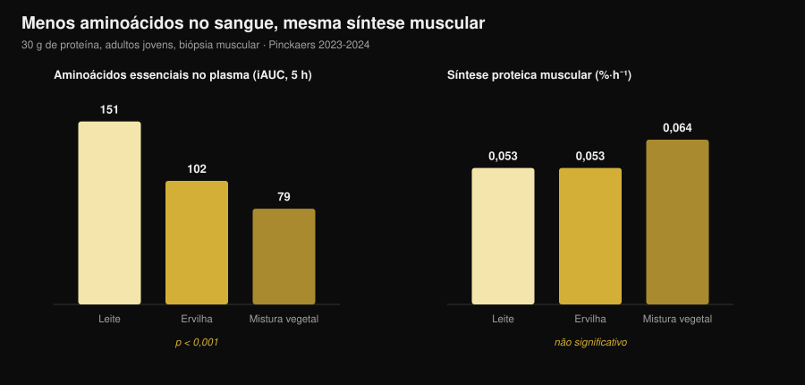
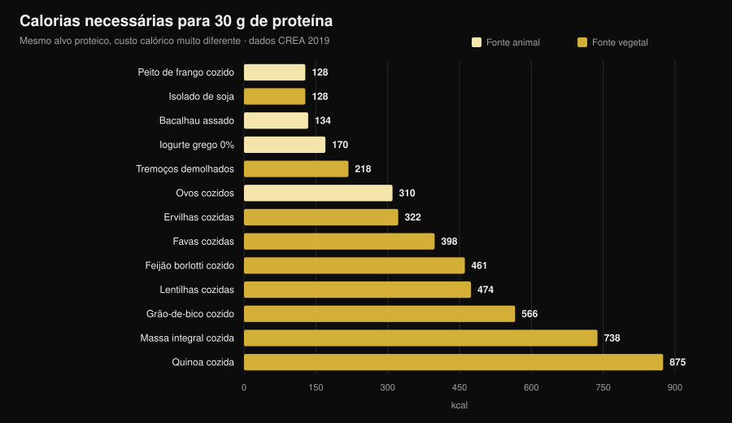

# Proteína vegetal ou animal para os músculos?

Por [Giammaria Loi](/autore/giammaria-loi) · atualizado a 31 de outubro de 2026

"A proteína vegetal é incompleta, não constrói músculo." É uma das frases mais repetidas em qualquer ginásio, e o mecanismo por trás parece sólido: menos leucina, menos síntese proteica. Depois alguém foi medir a sério, com biópsias musculares, e o resultado não é o que esperas. Mas há um segundo número que quase ninguém põe na mesa, e é aí que a escolha se torna concreta.

## Em resumo

- **Cinco ensaios com biópsia muscular, cinco empates.** Trinta gramas de proteína de ervilha, trigo, milho, batata ou de uma mistura vegetal produzem a mesma síntese proteica muscular que 30 g de proteína do leite (grupo de Maastricht, 2021-2024).
- **O mecanismo "é preciso mais leucina" não resiste à medição.** Com a mistura vegetal os aminoácidos essenciais no sangue são quase metade (iAUC 79 contra 151) e a síntese é idêntica.
- **A longo prazo, o mesmo.** Quatro ensaios de 10 a 16 semanas em veganos, mulheres vegetarianas e com misturas vegetais não encontram diferenças em massa, espessura muscular ou força.
- **A maior meta-análise vê uma pequena vantagem animal** (DMP −0,20 na massa), mas vinda de fontes vegetais que não a soja e de dietas inteiramente vegetais, não da comparação soja/leite.
- **O custo real são as calorias.** Para 30 g de proteína são precisos 99 g de peito de frango e 128 kcal, ou 435 g de lentilhas cozidas e 474 kcal (tabelas CREA). Quase quatro vezes mais.

## De onde vem a dúvida

A proteína não é um bloco único: é uma cadeia de aminoácidos, nove dos quais o corpo não sabe fabricar (os essenciais). Um deles, a **leucina**, funciona como interruptor: acima de certa concentração no sangue liga a maquinaria que constrói proteína muscular.

As fontes vegetais têm, em média, menos leucina e menos aminoácidos essenciais por grama do que carne, ovos, peixe e laticínios, e várias são digeridas um pouco pior. Daí a conclusão lógica: menos leucina → menos síntese → menos músculo.

O raciocínio está certo. O problema é que um raciocínio certo não é um resultado: tem de ser medido.

## A experiência que mede mesmo

Entre 2021 e 2024 o grupo de Luc van Loon, na Universidade de Maastricht, publicou **cinco ensaios aleatorizados em dupla ocultação** com o mesmo desenho: adultos jovens, infusão de fenilalanina marcada, biópsias musculares repetidas durante 5 horas, 30 g de proteína vegetal contra 30 g de proteína do leite.

| Proteína vegetal testada | Síntese vegetal | Leite | Resultado |
|---|---|---|---|
| Trigo (Pinckaers 2021) | 0,056 %·h⁻¹ | 0,053 %·h⁻¹ | p = 0,56 |
| Batata (Pinckaers 2022) | 0,053 %·h⁻¹ | 0,050 %·h⁻¹ | p = 0,54 |
| Mistura trigo+milho+ervilha (Pinckaers 2023) | 0,064 %·h⁻¹ | 0,053 %·h⁻¹ | p = 0,08 |
| Ervilha (Pinckaers 2024) | 0,053 %·h⁻¹ | 0,053 %·h⁻¹ | p = 0,96 |
| Milho (Pinckaers 2024) | 0,053 %·h⁻¹ | 0,053 %·h⁻¹ | p = 0,90 |

Cinco fontes vegetais diferentes, cinco empates. E no estudo da batata a medição foi feita também **depois de um treino de pesos**: 0,069 contra 0,064 %·h⁻¹ a favor da batata, p = 0,52. Mesmo na condição que interessa a quem treina, nenhuma diferença.

O gráfico mostra o dado que desmonta o mecanismo. Os aminoácidos essenciais que chegam ao sangue nas 5 horas seguintes (iAUC) são **151 mmol·300 min·L⁻¹** com leite, **102** com ervilha e **79** com a mistura vegetal: uma diferença enorme e muito sólida (p < 0,001 em ambas as comparações). A síntese muscular, essa, não se mexe.

Traduzindo: com 30 gramas de proteína, o limiar já está ultrapassado em todos os casos. O "pico de leucina" conta quando a dose é pequena; numa porção real deixa de decidir.

## E ao longo dos meses?

A síntese medida em 5 horas é um indício, não um resultado. O músculo vê-se em meses. Aqui há quatro ensaios, e convém lê-los em conjunto.

**Veganos contra omnívoros, 12 semanas** (Hevia-Larraín 2021, *Sports Medicine*). Dezanove veganos habituais e 19 omnívoros, proteína levada a 1,6 g por kg por dia com soja de um lado e whey do outro, dois treinos supervisionados por semana. Massa magra da perna +1,2 kg nos dois grupos; secção do reto femoral +1,0 contra +0,9 cm²; 1RM na prensa +97 contra +117 kg. Nenhuma diferença significativa.

**Dieta vegana rica em proteína, 10 semanas** (Monteyne 2023, *Journal of Nutrition*). Programa de volume alto, 5 treinos por semana, cerca de 2 g/kg. Massa magra +2,6 kg nos omnívoros e +3,1 kg no grupo vegano; volume da coxa +8,3% nos dois; secção das fibras +33% contra +32%.

**Mistura vegetal contra whey, 12 semanas** (Santini 2025, *JISSN*). Quarenta e quatro jovens não treinados, 45 g diários de suplemento divididos por três refeições. Massa magra total +2,4 contra +2,5 kg, secção do vasto lateral +0,9 contra +1,3 cm², 1RM na prensa +64 contra +63 kg. Nenhuma diferença significativa entre grupos.

**Mulheres estritamente vegetarianas, 16 semanas** (Martini 2026, *Scandinavian Journal of Medicine & Science in Sports*). Vinte e cinco vegetarianas e 20 não vegetarianas, dois treinos por semana, **sem suplementação**. Espessura da coxa de 81,2 para 85,6 mm contra 80,8 para 87,3 mm; força máxima composta de 106,9 para 132,6 kg contra 107,9 para 133,1 kg. Sem diferenças entre grupos, e isto apesar de as vegetarianas comerem **menos proteína**: 1,0 contra 1,3 g/kg (p = 0,002).

Este último dado é ao mesmo tempo o mais interessante e o mais frágil: é um estudo **não aleatorizado** (ninguém é sorteado para ser vegetariano) em mulheres não treinadas, portanto não autoriza dizer que 1 g/kg chega para quem treina a sério.

## Porque as meta-análises dizem algo um pouco diferente

A revisão sistemática mais ampla (Reid-McCann 2025, *Nutrition Reviews*, 43 ensaios aleatorizados, 30 na meta-análise) conclui que, face à proteína animal, **a vegetal deixa menos massa muscular**: DMP −0,20 (IC 95% −0,37 / −0,03; p = 0,02), com efeito concentrado nos menores de 60 anos e ausente acima disso.

Mas a mesma análise, desdobrada, diz exatamente onde está a diferença:

- **soja contra proteína do leite: nenhuma diferença** (DMP −0,02; IC −0,20 / 0,16; p = 0,80), em 17 ensaios;
- **animal contra vegetais que não a soja** (arroz, chia, aveia, batata): −0,58 (IC −1,06 / −0,09), em 5 ensaios;
- **animal contra dietas inteiramente vegetais**: −0,51 (IC −0,91 / −0,11), em 7 ensaios;
- **força muscular: nenhuma diferença** (14 ensaios). **Desempenho físico: nenhuma diferença** (5 ensaios).

A meta-análise anterior (Lim 2021, *Nutrients*, 16 ensaios) chega ao mesmo sítio: nenhum efeito da fonte sobre massa magra absoluta e força, pequena vantagem animal na **percentagem** de massa magra e, nos menores de 50 anos, +0,41 kg (IC 0,08-0,74).

A leitura honesta: a diferença existe, é pequena, diz respeito à massa e não à força, e desaparece quando se comparam duas proteínas isoladas de qualidade. Onde reaparece é nas **dietas** inteiramente vegetais — ou seja, quando o problema já não é a qualidade mas a quantidade que se consegue comer.

## O problema real: a conta das calorias

Peguei nas tabelas de composição dos alimentos do CREA e calculei quanto alimento, e com quantas calorias, é preciso para chegar a 30 g de proteína — a porção usada em todos os estudos acima.

| Alimento (como se come) | Gramas para 30 g de proteína | kcal | Fibra |
|---|---|---|---|
| Peito de frango cozinhado | 99 g | 128 | 0 g |
| Isolado de proteína de soja | 35 g | 128 | 0 g |
| Bacalhau assado | 171 g | 134 | 0 g |
| Iogurte grego 0% | 333 g | 170 | 0 g |
| Tremoços demolhados | 183 g | 218 | 5 g |
| Ovos cozidos (≈5) | 242 g | 310 | 0 g |
| Ervilhas cozidas | 309 g | 322 | 20 g |
| Favas secas descascadas cozidas | 273 g | 398 | 8 g |
| Feijão borlotti cozido | 435 g | 461 | 30 g |
| Lentilhas cozidas | 435 g | 474 | 36 g |
| Grão-de-bico cozido | 429 g | 566 | 25 g |
| Massa integral cozida | 405 g | 738 | 14 g |
| Quinoa cozida | 625 g | 875 | 23 g |

Uma refeição com 30 g de proteína custa **128 kcal** com frango e **474 kcal** com lentilhas. Se fizeres três por dia, a diferença passa das **1.000 kcal**: em definição é simplesmente impossível, e mesmo em manutenção enche o prato de hidratos que talvez quisesses gastar noutro sítio.

Depois há o volume: 435 g de lentilhas cozidas são dois pratos cheios e trazem **36 g de fibra**, mais do dobro da recomendação diária de uma só vez. Não é um problema de saúde, é um problema de estômago e de logística.

Duas exceções merecem atenção, e são precisamente as que fecham o círculo com os ensaios. O **isolado de proteína de soja** custa 128 kcal por 30 g de proteína, exatamente como o peito de frango: é a proteína vegetal que nunca perde contra o leite nas meta-análises. E os **tremoços**, pouco usados fora do aperitivo mediterrânico, ficam em 218 kcal: o melhor alimento vegetal inteiro da tabela.

Se estás a ajustar a proteína em défice, o raciocínio é o mesmo de quando falámos de [quanta proteína é precisa na definição](/pt/blog/proteina-na-definicao): não muda a grama, muda o que vem com ela.

## O que a investigação diz mesmo

**Desmentido — "a proteína vegetal não ativa a síntese muscular como a animal".** Cinco ensaios com biópsia, cinco empates: trigo p = 0,56, batata p = 0,54, ervilha p = 0,96, milho p = 0,90, mistura p = 0,08 (a favor do vegetal).

**Desmentido — "sem leucina suficiente não se constrói músculo".** Com a mistura vegetal os aminoácidos essenciais no sangue são 48% mais baixos (79 contra 151 iAUC, p < 0,001) e a síntese é idêntica.

**Desmentido — "sendo vegetariano ou vegano não se cresce".** Quatro ensaios de 10 a 16 semanas sem diferenças em massa, espessura, secção ou força.

**A precisar — "a fonte não conta nada".** A maior meta-análise encontra DMP −0,20 na massa contra o vegetal, nos menores de 60 anos. Pequeno, mas não zero.

**A precisar — "basta comer mais proteína vegetal".** No papel sim; no prato essa proteína chega com 3 a 4 vezes as calorias e muito mais fibra.

**Confirmado — "a soja aguenta a comparação com o leite".** Em 17 ensaios aleatorizados, DMP −0,02 (IC −0,20 / 0,16): indistinguível de zero.

**Desmentido — "a soja baixa a testosterona nos homens".** Meta-análise de 41 estudos clínicos, testosterona total medida em 1.753 homens: nenhum efeito sobre testosterona total e livre, estradiol, estrona ou SHBG, em qualquer dose e duração (Reed 2021).

**Não verificável — "é preciso combinar cereais e leguminosas em cada refeição".** Nos ensaios de Maastricht uma única fonte vegetal empata com o leite sem qualquer combinação, mas nenhum trabalho comparou diretamente "combinar em cada refeição" com "combinar ao longo do dia" em hipertrofia.

## Como aplicar

1. **Olha para o total diário, não para a fonte.** Todos os ensaios que empatam fazem-no com 1,6-2 g por kg de peso por dia.
2. **Sobe a dose por refeição com fontes vegetais.** Os estudos usam 30 g de proteína real por porção, não 15-20 g.
3. **Constrói à volta da soja e dos tremoços.** São as duas fontes vegetais com menor custo calórico por grama de proteína.
4. **Conta as calorias que vêm atrás.** Se uma refeição proteica vegetal custa 400 kcal em vez de 130, tira-as de outro lado.
5. **Sobe a fibra devagar.** Passar de 15 para 35 g por dia numa semana paga-se: aumenta gradualmente e distribui as leguminosas.
6. **Se o total ficar curto, suplementa.** Isolado de soja ou mistura soja-ervilha: nos ensaios, 45 g por dia igualaram a whey.
7. **Vigia a B12 e o ferro, não a proteína.** Numa dieta sem alimentos animais, são esses os nutrientes a acompanhar com o médico.

### Experimenta a Nurvan — proteína contada na base de dados CREA

O ponto deste artigo é que a grama de proteína não chega: contam as calorias e o volume que vêm com ela. Na Nurvan a secção de nutrição trabalha sobre as tabelas oficiais CREA, por isso quando registas 200 g de lentilhas cozidas vês a proteína, as calorias e a fibra reais daquele alimento, não uma média da internet. Defines o alvo proteico em g/kg e a app diz-te a que distância estás e quanto custa lá chegar; ao lado tens cargas, RIR e medidas, para ver se essa proteína se está a transformar em músculo. [Experimenta a Nurvan](https://nurvan.app).

## Perguntas frequentes

**A proteína vegetal constrói músculo como a animal?**
Sim, em igualdade de quantidade. Cinco ensaios aleatorizados com biópsia mostram a mesma síntese com 30 g de proteína de trigo, batata, ervilha, milho ou mistura vegetal e com 30 g de proteína do leite, e quatro ensaios de 10 a 16 semanas não encontram diferenças em massa nem força.

**Quanta proteína por dia numa dieta vegetariana ou vegana?**
Os ensaios com resultados iguais aos dos omnívoros usavam 1,6-2 g por kg de peso por dia. Um ensaio em mulheres vegetarianas pouco treinadas não encontrou diferenças nem com 1,0 g/kg, mas com apenas dois treinos por semana.

**É preciso combinar cereais e leguminosas na mesma refeição?**
Não parece necessário para a síntese muscular: nos ensaios de Maastricht uma única fonte vegetal a 30 g empata com o leite. Variar as fontes ao longo do dia continua a ser boa ideia.

**A proteína de soja baixa a testosterona?**
Não. A meta-análise mais atualizada reuniu 41 estudos clínicos, com testosterona total medida em 1.753 homens, e não encontrou efeito sobre testosterona, estradiol, estrona ou SHBG.

## Lê também

- [Quanta proteína é precisa na definição](/pt/blog/proteina-na-definicao) — a quota proteica quando as calorias são poucas.
- [O que comer quando estás lesionado](/pt/blog/o-que-comer-quando-esta-lesionado) — proteína e calorias nas semanas de paragem.
- [Recomposição corporal: perder gordura e ganhar músculo](/pt/blog/recomposicao-corporal-perder-gordura-ganhar-musculo) — como encaixam proteína e défice.

## Fontes

1. Pinckaers PJM, Kouw IWK, Hendriks FK, et al., 2021. *No differences in muscle protein synthesis rates following ingestion of wheat protein, milk protein, and their protein blend in healthy, young males.* British Journal of Nutrition 126(12):1832-1842. PMID [33597056](https://pubmed.ncbi.nlm.nih.gov/33597056/) · DOI [10.1017/S0007114521000635](https://doi.org/10.1017/S0007114521000635)
2. Pinckaers PJM, Hendriks FK, Hermans WJH, et al., 2022. *Potato Protein Ingestion Increases Muscle Protein Synthesis Rates at Rest and during Recovery from Exercise in Humans.* Medicine & Science in Sports & Exercise 54(9):1572-1581. PMID [35438672](https://pubmed.ncbi.nlm.nih.gov/35438672/) · DOI [10.1249/MSS.0000000000002937](https://doi.org/10.1249/MSS.0000000000002937)
3. Pinckaers PJM, Kouw IWK, Gorissen SHM, et al., 2023. *The Muscle Protein Synthetic Response to the Ingestion of a Plant-Derived Protein Blend Does Not Differ from an Equivalent Amount of Milk Protein in Healthy Young Males.* The Journal of Nutrition 152(12):2734-2743. PMID [36170964](https://pubmed.ncbi.nlm.nih.gov/36170964/) · DOI [10.1093/jn/nxac222](https://doi.org/10.1093/jn/nxac222)
4. Pinckaers PJM, Smeets JSJ, Kouw IWK, et al., 2024. *Post-prandial muscle protein synthesis rates following the ingestion of pea-derived protein do not differ from ingesting an equivalent amount of milk-derived protein in healthy, young males.* European Journal of Nutrition 63(3):893-904. PMID [38228945](https://pubmed.ncbi.nlm.nih.gov/38228945/) · DOI [10.1007/s00394-023-03295-6](https://doi.org/10.1007/s00394-023-03295-6)
5. Pinckaers PJM, Weijzen MEG, Houben LHP, et al., 2024. *The muscle protein synthetic response following corn protein ingestion does not differ from milk protein in healthy, young adults.* Amino Acids 56(1):8. PMID [38315260](https://pubmed.ncbi.nlm.nih.gov/38315260/) · DOI [10.1007/s00726-023-03377-z](https://doi.org/10.1007/s00726-023-03377-z)
6. Hevia-Larraín V, Gualano B, Longobardi I, et al., 2021. *High-Protein Plant-Based Diet Versus a Protein-Matched Omnivorous Diet to Support Resistance Training Adaptations: A Comparison Between Habitual Vegans and Omnivores.* Sports Medicine 51(6):1317-1330. PMID [33599941](https://pubmed.ncbi.nlm.nih.gov/33599941/) · DOI [10.1007/s40279-021-01434-9](https://doi.org/10.1007/s40279-021-01434-9)
7. Monteyne AJ, Coelho MOC, Murton AJ, et al., 2023. *Vegan and Omnivorous High Protein Diets Support Comparable Daily Myofibrillar Protein Synthesis Rates and Skeletal Muscle Hypertrophy in Young Adults.* The Journal of Nutrition 153(6):1680-1695. PMID [36822394](https://pubmed.ncbi.nlm.nih.gov/36822394/) · DOI [10.1016/j.tjnut.2023.02.023](https://doi.org/10.1016/j.tjnut.2023.02.023)
8. Santini MH, Erwig Leitão A, Mazzolani BC, et al., 2025. *Similar effects between animal-based and plant-based protein blend as complementary dietary protein on muscle adaptations to resistance training: findings from a randomized clinical trial.* Journal of the International Society of Sports Nutrition 22(1):2568047. PMID [41059835](https://pubmed.ncbi.nlm.nih.gov/41059835/) · DOI [10.1080/15502783.2025.2568047](https://doi.org/10.1080/15502783.2025.2568047)
9. Martini GL, Schemes MB, Strey B, et al., 2026. *No Differences in Muscular Adaptations to Long-Term Resistance Training Between Young Strict Vegetarian and Non-Vegetarian Women.* Scandinavian Journal of Medicine & Science in Sports 36(2):e70224. PMID [41684167](https://pubmed.ncbi.nlm.nih.gov/41684167/) · DOI [10.1111/sms.70224](https://doi.org/10.1111/sms.70224)
10. Reid-McCann RJ, Brennan SF, Ward NA, et al., 2025. *Effect of Plant Versus Animal Protein on Muscle Mass, Strength, Physical Performance, and Sarcopenia: A Systematic Review and Meta-analysis of Randomized Controlled Trials.* Nutrition Reviews 83(7):e1581-e1603. PMID [39813010](https://pubmed.ncbi.nlm.nih.gov/39813010/) · DOI [10.1093/nutrit/nuae200](https://doi.org/10.1093/nutrit/nuae200)
11. Lim MT, Pan BJ, Toh DWK, et al., 2021. *Animal Protein versus Plant Protein in Supporting Lean Mass and Muscle Strength: A Systematic Review and Meta-Analysis of Randomized Controlled Trials.* Nutrients 13(2):661. PMID [33670701](https://pubmed.ncbi.nlm.nih.gov/33670701/) · DOI [10.3390/nu13020661](https://doi.org/10.3390/nu13020661)
12. Reed KE, Camargo J, Hamilton-Reeves J, et al., 2021. *Neither soy nor isoflavone intake affects male reproductive hormones: An expanded and updated meta-analysis of clinical studies.* Reproductive Toxicology 100:60-67. PMID [33383165](https://pubmed.ncbi.nlm.nih.gov/33383165/) · DOI [10.1016/j.reprotox.2020.12.019](https://doi.org/10.1016/j.reprotox.2020.12.019)

Dados de composição dos alimentos: CREA — Conselho para a Investigação em Agricultura e Análise da Economia Agrária (Itália), *Tabelas de composição dos alimentos*, atualização de 2019 ([alimentinutrizione.it](https://www.alimentinutrizione.it/tabelle-nutrizionali/ricerca-per-ordine-alfabetico)). As fontes científicas foram recuperadas através do PubMed.

Sinal de tendência na origem do artigo: em outubro de 2026 saem com poucos dias de diferença dois trabalhos muito divulgados sobre a comparação vegetal/animal (Martini 2026 e Santini 2025) e a procura por recomposição corporal e proteína vegetal continua a crescer (Exploding Topics, dados até 17 de outubro de 2026).

---

**Giammaria Loi** é o fundador da Nurvan. Treina com pesos desde 2012, trabalha como personal trainer e coach certificado FIPE desde 2013 e compete em powerlifting a nível nacional desde 2018. Cada artigo que assina parte dos estudos científicos e chega ao que funciona mesmo no ginásio.

> Nota: conteúdo informativo, não substitui a opinião de um médico ou profissional. Se segues uma dieta sem alimentos de origem animal, fala com o teu médico sobre o controlo da vitamina B12, do ferro e da vitamina D.
