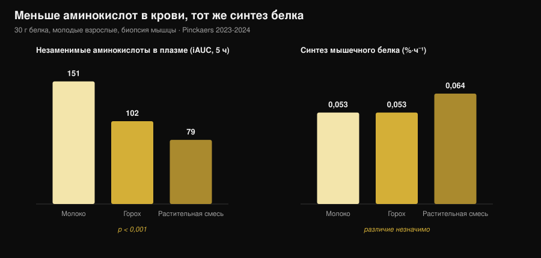
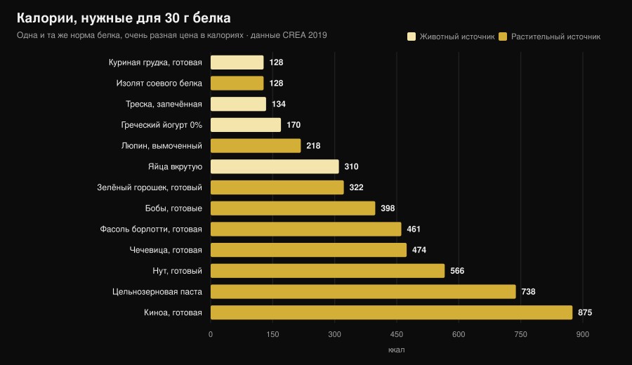

# Растительный или животный белок для мышц?

Автор: [Giammaria Loi](/autore/giammaria-loi) · обновлено 31 октября 2026

«Растительный белок неполноценный, мышцы от него не растут». Одна из самых частых фраз в зале, и механизм за ней выглядит убедительно: меньше лейцина — меньше синтеза белка. Потом это взяли и измерили, с биопсией мышцы, и результат оказался не тем, которого ждёшь. Но есть вторая цифра, которую почти никто не называет, и именно она делает выбор практическим.

## Коротко

- **Пять исследований с биопсией мышцы — пять ничьих.** Тридцать граммов белка из гороха, пшеницы, кукурузы, картофеля или растительной смеси дают такой же синтез мышечного белка, как 30 г молочного белка (группа Маастрихта, 2021-2024).
- **Механизм «нужно больше лейцина» не выдерживает проверки.** С растительной смесью незаменимых аминокислот в крови почти вдвое меньше (iAUC 79 против 151), а синтез одинаковый.
- **В долгую — то же самое.** Четыре исследования длительностью 10-16 недель на веганах, вегетарианках и растительных смесях не находят различий ни в массе, ни в толщине мышцы, ни в силе.
- **Крупнейший метаанализ всё же видит небольшое преимущество животного белка** (SMD −0,20 по мышечной массе), но оно исходит из несоевых растительных источников и полностью растительных рационов, а не из сравнения «соя против молока».
- **Настоящая цена — калории.** На 30 г белка нужно 99 г готовой куриной грудки и 128 ккал либо 435 г варёной чечевицы и 474 ккал (таблицы CREA). Почти в четыре раза больше.

## Откуда берётся сомнение

Белок — не однородный блок, а цепочка аминокислот, девять из которых организм не умеет делать сам (незаменимые). Одна из них, **лейцин**, работает как выключатель: выше определённой концентрации в крови она запускает механизм синтеза мышечного белка.

В растительных источниках в среднем меньше лейцина и меньше незаменимых аминокислот на грамм, чем в мясе, яйцах, рыбе и молочных продуктах, и часть из них переваривается чуть хуже. Отсюда логичный вывод: меньше лейцина → меньше синтеза → меньше мышц.

Рассуждение верное. Беда в том, что верное рассуждение — это ещё не результат: его нужно измерить.

## Эксперимент, который действительно измеряет

С 2021 по 2024 год группа Люка ван Луна в Маастрихтском университете опубликовала **пять рандомизированных двойных слепых исследований** с одинаковым дизайном: молодые взрослые, инфузия меченого фенилаланина, повторные биопсии мышцы в течение 5 часов, 30 г растительного белка против 30 г молочного.

| Растительный белок | Синтез, растительный | Молоко | Итог |
|---|---|---|---|
| Пшеница (Pinckaers 2021) | 0,056 %·ч⁻¹ | 0,053 %·ч⁻¹ | p = 0,56 |
| Картофель (Pinckaers 2022) | 0,053 %·ч⁻¹ | 0,050 %·ч⁻¹ | p = 0,54 |
| Смесь пшеница+кукуруза+горох (Pinckaers 2023) | 0,064 %·ч⁻¹ | 0,053 %·ч⁻¹ | p = 0,08 |
| Горох (Pinckaers 2024) | 0,053 %·ч⁻¹ | 0,053 %·ч⁻¹ | p = 0,96 |
| Кукуруза (Pinckaers 2024) | 0,053 %·ч⁻¹ | 0,053 %·ч⁻¹ | p = 0,90 |

Пять разных растительных источников — пять ничьих. А в исследовании с картофелем измерение провели ещё и **после силовой тренировки**: 0,069 против 0,064 %·ч⁻¹ в пользу картофеля, p = 0,52. Даже в том состоянии, которое интересует тренирующихся, разницы нет.

График показывает то, что разрушает механизм. Незаменимых аминокислот, поступающих в кровь за 5 часов после приёма (iAUC), **151 ммоль·300 мин·л⁻¹** с молоком, **102** с горохом и **79** с растительной смесью: разрыв огромный и статистически очень надёжный (p < 0,001 в обоих сравнениях). Синтез при этом не меняется.

Проще говоря: при 30 граммах белка порог уже пройден во всех вариантах. «Пик лейцина» важен при малой дозе; на реальной порции он перестаёт решать.

## А что за месяцы?

Синтез, измеренный за 5 часов, — это подсказка, а не результат. Мышца видна за месяцы. Здесь есть четыре исследования, и читать их надо вместе.

**Веганы против всеядных, 12 недель** (Hevia-Larraín 2021, *Sports Medicine*). Девятнадцать постоянных веганов и 19 всеядных, белок доведён до 1,6 г на кг в сутки соей с одной стороны и сывороткой с другой, две тренировки в неделю под присмотром. Сухая масса ноги +1,2 кг в обеих группах; площадь сечения прямой мышцы бедра +1,0 против +0,9 см²; 1ПМ в жиме ногами +97 против +117 кг. Значимых различий нет.

**Веганский рацион с высоким белком, 10 недель** (Monteyne 2023, *Journal of Nutrition*). Высокий объём, 5 тренировок в неделю, около 2 г/кг. Сухая масса +2,6 кг у всеядных и +3,1 кг у веганов; объём бедра +8,3% в обеих группах; площадь сечения волокон +33% против +32%.

**Растительная смесь против сыворотки, 12 недель** (Santini 2025, *JISSN*). Сорок четыре нетренированных молодых мужчины, 45 г добавки в сутки на три приёма пищи. Общая сухая масса +2,4 против +2,5 кг, сечение латеральной широкой мышцы +0,9 против +1,3 см², 1ПМ в жиме ногами +64 против +63 кг. Межгрупповых различий нет.

**Строгие вегетарианки, 16 недель** (Martini 2026, *Scandinavian Journal of Medicine & Science in Sports*). Двадцать пять вегетарианок и 20 невегетарианок, две тренировки в неделю, **без добавок**. Толщина бедра с 81,2 до 85,6 мм против 80,8 до 87,3 мм; составная максимальная сила со 106,9 до 132,6 кг против 107,9 до 133,1 кг. Различий между группами нет — и это при том, что вегетарианки ели **меньше белка**: 1,0 против 1,3 г/кг (p = 0,002).

Этот результат одновременно самый интересный и самый хрупкий: исследование **не рандомизированное** (вегетарианцем не становятся по жребию) и на нетренированных женщинах, поэтому переносить «1 г/кг достаточно» на тех, кто тренируется тяжело, нельзя.

## Почему метаанализы говорят немного иное

Самый обширный систематический обзор (Reid-McCann 2025, *Nutrition Reviews*, 43 рандомизированных исследования, 30 в метаанализе) находит, что по сравнению с животным белком **растительный оставляет меньше мышечной массы**: SMD −0,20 (95% ДИ −0,37 / −0,03; p = 0,02), причём эффект сосредоточен у людей моложе 60 лет и отсутствует старше.

Но тот же анализ в разбивке показывает, где именно живёт эта разница:

- **соя против молочного белка: различий нет** (SMD −0,02; ДИ −0,20 / 0,16; p = 0,80), 17 исследований;
- **животный против несоевых растительных** (рис, чиа, овёс, картофель): −0,58 (ДИ −1,06 / −0,09), 5 исследований;
- **животный против полностью растительных рационов**: −0,51 (ДИ −0,91 / −0,11), 7 исследований;
- **мышечная сила: различий нет** (14 исследований). **Физическая работоспособность: различий нет** (5 исследований).

Предыдущий метаанализ (Lim 2021, *Nutrients*, 16 исследований) приходит туда же: источник не влияет на абсолютную сухую массу и силу, есть небольшое преимущество животного белка по **доле** сухой массы и у людей моложе 50 лет +0,41 кг (ДИ 0,08-0,74).

Честное прочтение: разница существует, она мала, касается массы, а не силы, и исчезает при сравнении двух качественных изолированных белков. Возвращается она на уровне полностью растительных **рационов** — то есть там, где вопрос уже не в качестве, а в количестве, которое реально удаётся съесть.

## Настоящая проблема: калорийный счёт

Я взял таблицы состава продуктов CREA и посчитал, сколько еды и сколько калорий нужно, чтобы набрать 30 г белка — порцию, использованную во всех исследованиях выше.

| Продукт (в готовом виде) | Граммов на 30 г белка | ккал | Клетчатка |
|---|---|---|---|
| Куриная грудка, готовая | 99 г | 128 | 0 г |
| Изолят соевого белка | 35 г | 128 | 0 г |
| Треска, запечённая | 171 г | 134 | 0 г |
| Греческий йогурт 0% | 333 г | 170 | 0 г |
| Люпин, вымоченный | 183 г | 218 | 5 г |
| Яйца вкрутую (≈5 шт.) | 242 г | 310 | 0 г |
| Зелёный горошек, готовый | 309 г | 322 | 20 г |
| Бобы сушёные, очищенные, варёные | 273 г | 398 | 8 г |
| Фасоль борлотти, варёная | 435 г | 461 | 30 г |
| Чечевица, варёная | 435 г | 474 | 36 г |
| Нут, варёный | 429 г | 566 | 25 г |
| Цельнозерновая паста, варёная | 405 г | 738 | 14 г |
| Киноа, варёная | 625 г | 875 | 23 г |

Приём пищи на 30 г белка стоит **128 ккал** с курицей и **474 ккал** с чечевицей. Три раза в день — разрыв более **1 000 ккал**: на сушке это просто невозможно, да и на поддержании забивает тарелку углеводами, которые вы, может быть, хотели потратить иначе.

Есть ещё объём: 435 г варёной чечевицы — это две полные тарелки и **36 г клетчатки**, больше двух дневных норм за один присест. Это не проблема здоровья, это проблема желудка и организации.

Два исключения заслуживают внимания, и именно они смыкаются с исследованиями. **Изолят соевого белка** стоит 128 ккал на 30 г белка — ровно столько же, сколько куриная грудка: это тот растительный белок, который в метаанализах никогда не проигрывает молоку. А **люпин** — 218 ккал: лучший цельный растительный продукт в таблице.

Если вы настраиваете белок на дефиците, логика та же, что и в разговоре о [норме белка на сушке](/ru/blog/belok-na-sushke): грамм не меняется, меняется то, что приходит вместе с ним.

## Что на самом деле говорит наука

**Опровергнуто — «растительный белок не запускает синтез так, как животный».** Пять исследований с биопсией, пять ничьих: пшеница p = 0,56, картофель p = 0,54, горох p = 0,96, кукуруза p = 0,90, смесь p = 0,08 (в пользу растительного).

**Опровергнуто — «без достаточного лейцина мышцы не строятся».** С растительной смесью незаменимых аминокислот в крови на 48% меньше (79 против 151 iAUC, p < 0,001), синтез одинаковый.

**Опровергнуто — «вегетарианцу или вегану не вырасти».** Четыре исследования длительностью 10-16 недель без различий в массе, толщине, сечении и силе.

**Требует уточнения — «источник вообще не имеет значения».** Крупнейший метаанализ находит SMD −0,20 по массе не в пользу растительного, у людей моложе 60. Мало, но не ноль.

**Требует уточнения — «достаточно есть больше растительного белка».** На бумаге да; на тарелке этот белок приходит с 3-4-кратными калориями и намного большей клетчаткой.

**Подтверждено — «соя выдерживает сравнение с молоком».** В 17 рандомизированных исследованиях SMD −0,02 (ДИ −0,20 / 0,16): неотличимо от нуля.

**Опровергнуто — «соя снижает тестостерон у мужчин».** Метаанализ 41 клинического исследования, общий тестостерон измерен у 1 753 мужчин: никакого влияния на общий и свободный тестостерон, эстрадиол, эстрон и ГСПГ при любой дозе и длительности (Reed 2021).

**Непроверяемо — «нужно сочетать злаки и бобовые в каждом приёме пищи».** В маастрихтских работах один растительный источник без всякого сочетания сравнялся с молоком, но прямого сравнения «сочетать в каждом приёме» против «сочетать в течение дня» по гипертрофии никто не делал.

## Как это применить

1. **Смотрите на суточную сумму, а не на источник.** Все исследования с ничьей работают на 1,6-2 г на кг массы тела в сутки.
2. **Поднимите дозу на приём при растительных источниках.** В исследованиях — 30 г реального белка на порцию, а не 15-20 г.
3. **Стройте рацион вокруг сои и люпина.** Это два растительных источника с наименьшей калорийной ценой за грамм белка.
4. **Считайте калории, идущие следом.** Если растительный белковый приём стоит 400 ккал вместо 130, снимите их в другом месте.
5. **Поднимайте клетчатку постепенно.** Переход с 15 до 35 г в сутки за неделю даётся тяжело: увеличивайте по шагам и распределяйте бобовые.
6. **Если сумма не добирается, добавьте добавку.** Изолят сои или смесь «соя-горох»: в исследованиях 45 г в сутки сравнялись с сывороткой.
7. **Следите за B12 и железом, а не за белком.** В рационе без животных продуктов именно эти показатели стоит контролировать с врачом.

### Попробуйте Nurvan — белок, посчитанный по базе CREA

Смысл этой статьи в том, что граммов белка мало: значение имеют калории и объём, которые приходят вместе с ним. В Nurvan раздел питания работает на официальных таблицах CREA, поэтому, записывая 200 г варёной чечевицы, вы видите реальные белки, калории и клетчатку именно этого продукта, а не среднее по интернету. Вы задаёте цель по белку в г/кг, приложение показывает, насколько вы близки и во что это обходится; рядом — рабочие веса, RIR и замеры, чтобы видеть, превращается ли этот белок в мышцы. [Попробуйте Nurvan](https://nurvan.app).

## Частые вопросы

**Растут ли мышцы от растительного белка так же, как от животного?**
Да, при равном количестве. Пять рандомизированных исследований с биопсией показывают одинаковый синтез с 30 г белка пшеницы, картофеля, гороха, кукурузы или растительной смеси и с 30 г молочного белка, а четыре исследования длительностью 10-16 недель не находят различий в массе и силе.

**Сколько белка в сутки на вегетарианском или веганском рационе?**
В исследованиях с результатами как у всеядных использовали 1,6-2 г на кг массы тела в сутки. Одно исследование на малотренированных вегетарианках не нашло различий даже при 1,0 г/кг, но там было всего две тренировки в неделю.

**Нужно ли сочетать злаки и бобовые в одном приёме пищи?**
Для синтеза мышечного белка это, судя по данным, не обязательно: в маастрихтских работах один растительный источник в 30 г сравнялся с молоком. Разнообразить источники в течение дня всё равно полезно.

**Снижает ли соевый белок тестостерон?**
Нет. Самый свежий метаанализ собрал 41 клиническое исследование, общий тестостерон измерен у 1 753 мужчин, и не нашёл влияния на тестостерон, эстрадиол, эстрон или ГСПГ.

## Читайте также

- [Сколько белка нужно на сушке](/ru/blog/belok-na-sushke) — норма белка, когда калорий мало.
- [Что есть при травме](/ru/blog/chto-est-pri-travme) — белок и калории в недели простоя.
- [Рекомпозиция тела: сжечь жир и набрать мышцы](/ru/blog/rekompozitsiya-tela-szhech-zhir-nabrat-myshtsy) — как сочетаются белок и дефицит.

## Источники

1. Pinckaers PJM, Kouw IWK, Hendriks FK, et al., 2021. *No differences in muscle protein synthesis rates following ingestion of wheat protein, milk protein, and their protein blend in healthy, young males.* British Journal of Nutrition 126(12):1832-1842. PMID [33597056](https://pubmed.ncbi.nlm.nih.gov/33597056/) · DOI [10.1017/S0007114521000635](https://doi.org/10.1017/S0007114521000635)
2. Pinckaers PJM, Hendriks FK, Hermans WJH, et al., 2022. *Potato Protein Ingestion Increases Muscle Protein Synthesis Rates at Rest and during Recovery from Exercise in Humans.* Medicine & Science in Sports & Exercise 54(9):1572-1581. PMID [35438672](https://pubmed.ncbi.nlm.nih.gov/35438672/) · DOI [10.1249/MSS.0000000000002937](https://doi.org/10.1249/MSS.0000000000002937)
3. Pinckaers PJM, Kouw IWK, Gorissen SHM, et al., 2023. *The Muscle Protein Synthetic Response to the Ingestion of a Plant-Derived Protein Blend Does Not Differ from an Equivalent Amount of Milk Protein in Healthy Young Males.* The Journal of Nutrition 152(12):2734-2743. PMID [36170964](https://pubmed.ncbi.nlm.nih.gov/36170964/) · DOI [10.1093/jn/nxac222](https://doi.org/10.1093/jn/nxac222)
4. Pinckaers PJM, Smeets JSJ, Kouw IWK, et al., 2024. *Post-prandial muscle protein synthesis rates following the ingestion of pea-derived protein do not differ from ingesting an equivalent amount of milk-derived protein in healthy, young males.* European Journal of Nutrition 63(3):893-904. PMID [38228945](https://pubmed.ncbi.nlm.nih.gov/38228945/) · DOI [10.1007/s00394-023-03295-6](https://doi.org/10.1007/s00394-023-03295-6)
5. Pinckaers PJM, Weijzen MEG, Houben LHP, et al., 2024. *The muscle protein synthetic response following corn protein ingestion does not differ from milk protein in healthy, young adults.* Amino Acids 56(1):8. PMID [38315260](https://pubmed.ncbi.nlm.nih.gov/38315260/) · DOI [10.1007/s00726-023-03377-z](https://doi.org/10.1007/s00726-023-03377-z)
6. Hevia-Larraín V, Gualano B, Longobardi I, et al., 2021. *High-Protein Plant-Based Diet Versus a Protein-Matched Omnivorous Diet to Support Resistance Training Adaptations: A Comparison Between Habitual Vegans and Omnivores.* Sports Medicine 51(6):1317-1330. PMID [33599941](https://pubmed.ncbi.nlm.nih.gov/33599941/) · DOI [10.1007/s40279-021-01434-9](https://doi.org/10.1007/s40279-021-01434-9)
7. Monteyne AJ, Coelho MOC, Murton AJ, et al., 2023. *Vegan and Omnivorous High Protein Diets Support Comparable Daily Myofibrillar Protein Synthesis Rates and Skeletal Muscle Hypertrophy in Young Adults.* The Journal of Nutrition 153(6):1680-1695. PMID [36822394](https://pubmed.ncbi.nlm.nih.gov/36822394/) · DOI [10.1016/j.tjnut.2023.02.023](https://doi.org/10.1016/j.tjnut.2023.02.023)
8. Santini MH, Erwig Leitão A, Mazzolani BC, et al., 2025. *Similar effects between animal-based and plant-based protein blend as complementary dietary protein on muscle adaptations to resistance training: findings from a randomized clinical trial.* Journal of the International Society of Sports Nutrition 22(1):2568047. PMID [41059835](https://pubmed.ncbi.nlm.nih.gov/41059835/) · DOI [10.1080/15502783.2025.2568047](https://doi.org/10.1080/15502783.2025.2568047)
9. Martini GL, Schemes MB, Strey B, et al., 2026. *No Differences in Muscular Adaptations to Long-Term Resistance Training Between Young Strict Vegetarian and Non-Vegetarian Women.* Scandinavian Journal of Medicine & Science in Sports 36(2):e70224. PMID [41684167](https://pubmed.ncbi.nlm.nih.gov/41684167/) · DOI [10.1111/sms.70224](https://doi.org/10.1111/sms.70224)
10. Reid-McCann RJ, Brennan SF, Ward NA, et al., 2025. *Effect of Plant Versus Animal Protein on Muscle Mass, Strength, Physical Performance, and Sarcopenia: A Systematic Review and Meta-analysis of Randomized Controlled Trials.* Nutrition Reviews 83(7):e1581-e1603. PMID [39813010](https://pubmed.ncbi.nlm.nih.gov/39813010/) · DOI [10.1093/nutrit/nuae200](https://doi.org/10.1093/nutrit/nuae200)
11. Lim MT, Pan BJ, Toh DWK, et al., 2021. *Animal Protein versus Plant Protein in Supporting Lean Mass and Muscle Strength: A Systematic Review and Meta-Analysis of Randomized Controlled Trials.* Nutrients 13(2):661. PMID [33670701](https://pubmed.ncbi.nlm.nih.gov/33670701/) · DOI [10.3390/nu13020661](https://doi.org/10.3390/nu13020661)
12. Reed KE, Camargo J, Hamilton-Reeves J, et al., 2021. *Neither soy nor isoflavone intake affects male reproductive hormones: An expanded and updated meta-analysis of clinical studies.* Reproductive Toxicology 100:60-67. PMID [33383165](https://pubmed.ncbi.nlm.nih.gov/33383165/) · DOI [10.1016/j.reprotox.2020.12.019](https://doi.org/10.1016/j.reprotox.2020.12.019)

Данные о составе продуктов: CREA — Центр исследований пищевых продуктов и питания (Италия), *Таблицы состава пищевых продуктов*, обновление 2019 ([alimentinutrizione.it](https://www.alimentinutrizione.it/tabelle-nutrizionali/ricerca-per-ordine-alfabetico)). Научные источники найдены через PubMed.

Трендовый сигнал в основе статьи: в октябре 2026 года с разницей в несколько дней выходят две широко освещённые работы о сравнении растительного и животного белка (Martini 2026 и Santini 2025), а поисковый спрос на рекомпозицию тела и растительный белок продолжает расти (Exploding Topics, данные на 17 октября 2026).

---

**Giammaria Loi** — основатель Nurvan. Тренируется с отягощениями с 2012 года, работает персональным тренером и коучем с сертификацией FIPE с 2013-го и выступает в пауэрлифтинге на национальном уровне с 2018-го. Каждая его статья начинается с научных работ и заканчивается тем, что действительно работает в зале.

> Примечание: информационный материал, не заменяет консультацию врача или профильного специалиста. Если вы придерживаетесь рациона без продуктов животного происхождения, обсудите с врачом контроль витамина B12, железа и витамина D.
