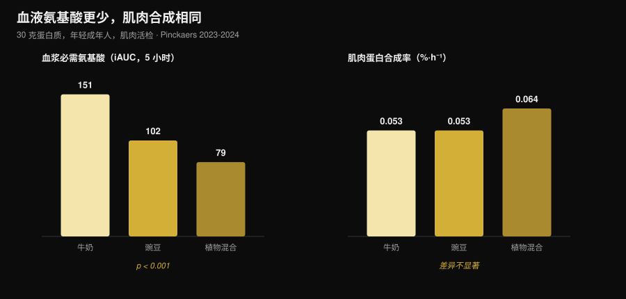
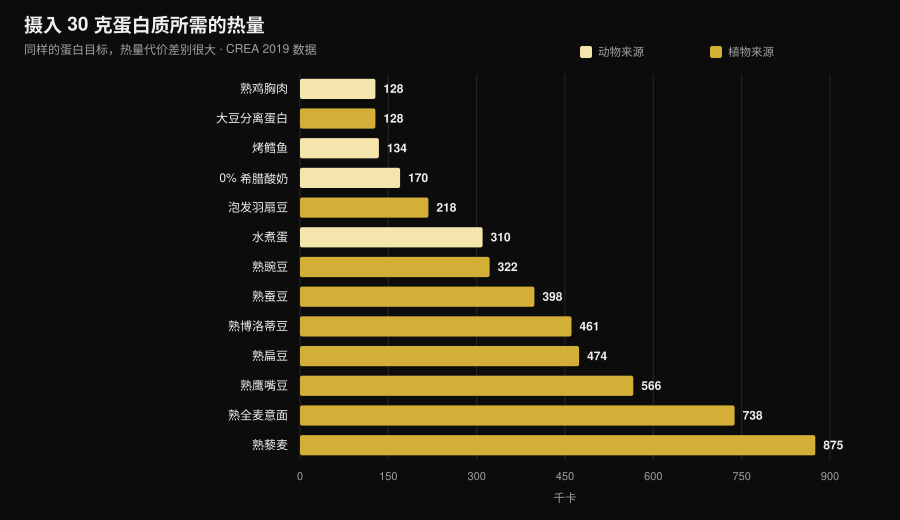

# 植物蛋白还是动物蛋白更适合增肌？

作者：[Giammaria Loi](/autore/giammaria-loi) · 更新于 2026 年 10 月 31 日

"植物蛋白不完全，长不了肌肉。"这是健身房里最常听到的一句话，背后的机制听上去也站得住脚：亮氨酸少，肌肉蛋白合成就少。后来真的有人去测了，用肌肉活检，结果和你想的不一样。但还有第二个数字几乎没人提，而选择恰恰在那里才变得具体。

## 要点速览

- **五项肌肉活检研究，五次打平。** 30 克来自豌豆、小麦、玉米、马铃薯或植物混合蛋白的蛋白质，产生的肌肉蛋白合成率与 30 克牛奶蛋白相同（马斯特里赫特团队，2021-2024）。
- **"需要更多亮氨酸"的机制经不起检验。** 使用植物混合蛋白时，血液中的必需氨基酸几乎只有一半（iAUC 79 对 151），而合成率完全相同。
- **长期同样如此。** 四项为期 10 至 16 周、针对纯素者、素食女性和植物混合蛋白的研究，在肌肉量、肌肉厚度和力量上均未发现差异。
- **最大的荟萃分析确实看到动物蛋白的小幅优势**（肌肉量 SMD −0.20），但它来自非大豆类植物来源和全植物饮食，而不是"大豆对牛奶"的比较。
- **真正的代价是热量。** 要摄入 30 克蛋白质，需要 99 克熟鸡胸肉、128 千卡，或者 435 克熟扁豆、474 千卡（CREA 食物成分表）。接近四倍。

## 疑问从哪里来

蛋白质不是一整块，而是一条氨基酸链，其中九种人体无法自行合成（必需氨基酸）。其中的**亮氨酸**像一个开关：血中浓度超过某个水平，就会启动合成肌肉蛋白的机制。

植物来源平均每克含有的亮氨酸和必需氨基酸都少于肉、蛋、鱼和乳制品，而且有些消化率略低。于是得出一个看似合理的结论：亮氨酸少 → 合成少 → 肌肉少。

推理本身没错。问题是，正确的推理不等于结果，必须拿去测量。

## 真正做了测量的实验

2021 到 2024 年间，马斯特里赫特大学 Luc van Loon 团队发表了**五项随机双盲研究**，设计一致：年轻成年人，输注标记苯丙氨酸，5 小时内多次肌肉活检，30 克植物蛋白对 30 克牛奶蛋白。

| 受试植物蛋白 | 植物组合成率 | 牛奶 | 结果 |
|---|---|---|---|
| 小麦（Pinckaers 2021） | 0.056 %·h⁻¹ | 0.053 %·h⁻¹ | p = 0.56 |
| 马铃薯（Pinckaers 2022） | 0.053 %·h⁻¹ | 0.050 %·h⁻¹ | p = 0.54 |
| 小麦+玉米+豌豆混合（Pinckaers 2023） | 0.064 %·h⁻¹ | 0.053 %·h⁻¹ | p = 0.08 |
| 豌豆（Pinckaers 2024） | 0.053 %·h⁻¹ | 0.053 %·h⁻¹ | p = 0.96 |
| 玉米（Pinckaers 2024） | 0.053 %·h⁻¹ | 0.053 %·h⁻¹ | p = 0.90 |

五种不同的植物来源，五次打平。而在马铃薯那项研究里，还测了**一次力量训练之后**的情况：0.069 对 0.064 %·h⁻¹，马铃薯略高，p = 0.52。即使在训练者最关心的条件下，也没有差别。

这张图展示了瓦解该机制的数据。餐后 5 小时进入血液的必需氨基酸（iAUC）：牛奶 **151 mmol·300 min·L⁻¹**，豌豆 **102**，植物混合蛋白 **79**——差距巨大且非常稳健（两项比较均 p < 0.001）。但肌肉合成率纹丝不动。

换句话说：在 30 克蛋白质这个量上，阈值已经全部跨过。"亮氨酸峰值"在剂量小的时候才重要；到了真实的一餐分量，它不再决定结果。

## 那几个月下来呢？

5 小时内测到的合成率是线索，不是结果。肌肉要用几个月来看。这方面有四项研究，应该放在一起读。

**纯素者对杂食者，12 周**（Hevia-Larraín 2021，*Sports Medicine*）。19 名长期纯素者与 19 名杂食者，蛋白摄入统一提到每公斤 1.6 克／天，一组用大豆、一组用乳清，每周两次有人监督的训练。腿部瘦体重两组都 +1.2 公斤；股直肌横截面积 +1.0 对 +0.9 cm²；腿举 1RM +97 对 +117 公斤。所有指标均无显著差异。

**高蛋白纯素饮食，10 周**（Monteyne 2023，*Journal of Nutrition*）。大容量方案，每周 5 练，约 2 克/公斤。瘦体重杂食组 +2.6 公斤、纯素组 +3.1 公斤；大腿肌肉体积两组均 +8.3%；肌纤维横截面积 +33% 对 +32%。

**植物混合蛋白对乳清，12 周**（Santini 2025，*JISSN*）。44 名未训练的年轻男性，每天 45 克补充蛋白分三餐摄入。全身瘦体重 +2.4 对 +2.5 公斤，股外侧肌横截面积 +0.9 对 +1.3 cm²，腿举 1RM +64 对 +63 公斤。组间差异均不显著。

**严格素食女性，16 周**（Martini 2026，*Scandinavian Journal of Medicine & Science in Sports*）。25 名素食者与 20 名非素食者，每周两练，**不使用补剂**。大腿肌肉厚度由 81.2 增至 85.6 毫米，对照由 80.8 增至 87.3 毫米；综合最大力量由 106.9 增至 132.6 公斤，对照由 107.9 增至 133.1 公斤。组间无差异——而素食组吃的蛋白质其实**更少**：1.0 对 1.3 克/公斤（p = 0.002）。

最后这个结果既最有意思，也最脆弱：这是一项**非随机**研究（没人靠抽签成为素食者），对象是未训练女性，因此不能据此断言 1 克/公斤对刻苦训练的人也够用。

## 为什么荟萃分析说法略有不同

规模最大的系统综述（Reid-McCann 2025，*Nutrition Reviews*，43 项随机试验，30 项纳入合并）发现，与动物蛋白相比，**植物蛋白留下的肌肉量更少**：SMD −0.20（95% CI −0.37 / −0.03；p = 0.02），效应集中在 60 岁以下，60 岁以上不存在。

但同一分析拆开来看，差异的位置其实很明确：

- **大豆对牛奶蛋白：无差异**（SMD −0.02；CI −0.20 / 0.16；p = 0.80），17 项试验；
- **动物蛋白对非大豆类植物蛋白**（大米、奇亚、燕麦、马铃薯）：−0.58（CI −1.06 / −0.09），5 项试验；
- **动物蛋白对全植物饮食**：−0.51（CI −0.91 / −0.11），7 项试验；
- **肌肉力量：无差异**（14 项试验）。**体能表现：无差异**（5 项试验）。

更早的荟萃分析（Lim 2021，*Nutrients*，16 项试验）落点一致：来源对绝对瘦体重和力量没有影响，动物蛋白在瘦体重**百分比**上有小幅优势，50 岁以下人群 +0.41 公斤（CI 0.08-0.74）。

诚实的解读是：差异存在，但很小，只涉及肌肉量而非力量，并且在两种优质分离蛋白之间的比较中消失。它重新出现的地方是全植物**饮食模式**——也就是说，问题不再是蛋白质质量，而是实际能吃进去多少。

## 真正的问题：热量账

我取用 CREA 食物成分表，算了一下要达到 30 克蛋白质——上述所有研究使用的分量——需要吃多少食物、附带多少热量。

| 食物（食用状态） | 达到 30 克蛋白所需重量 | 千卡 | 膳食纤维 |
|---|---|---|---|
| 熟鸡胸肉 | 99 克 | 128 | 0 克 |
| 大豆分离蛋白 | 35 克 | 128 | 0 克 |
| 烤鳕鱼 | 171 克 | 134 | 0 克 |
| 0% 希腊酸奶 | 333 克 | 170 | 0 克 |
| 泡发羽扇豆 | 183 克 | 218 | 5 克 |
| 水煮蛋（约 5 个） | 242 克 | 310 | 0 克 |
| 熟豌豆 | 309 克 | 322 | 20 克 |
| 去皮熟蚕豆 | 273 克 | 398 | 8 克 |
| 熟博洛蒂豆 | 435 克 | 461 | 30 克 |
| 熟扁豆 | 435 克 | 474 | 36 克 |
| 熟鹰嘴豆 | 429 克 | 566 | 25 克 |
| 熟全麦意面 | 405 克 | 738 | 14 克 |
| 熟藜麦 | 625 克 | 875 | 23 克 |

一顿 30 克蛋白质的饭，用鸡肉花 **128 千卡**，用扁豆花 **474 千卡**。一天三顿，差距超过 **1,000 千卡**：减脂期根本做不到，即便维持期也会把碳水额度占满。

还有体积问题：435 克熟扁豆是满满两盘，同时带来 **36 克膳食纤维**，一顿就超过日常推荐量的两倍。这不是健康问题，是胃容量和安排的问题。

有两个例外值得注意，而且正好和研究结果呼应。**大豆分离蛋白**每 30 克蛋白只要 128 千卡，和熟鸡胸肉完全一样：它恰恰是荟萃分析中从未输给牛奶蛋白的那种植物蛋白。而**羽扇豆**为 218 千卡，是表中最好的天然植物食物。

如果你是在热量缺口下安排蛋白质，道理和我们讲[减脂期需要多少蛋白质](/zh/blog/protein-intake-cutting-zh)时一样：克数不变，变的是随之而来的东西。

## 研究到底怎么说

**已驳斥——"植物蛋白不像动物蛋白那样启动肌肉合成"。** 五项活检研究、五次打平：小麦 p = 0.56，马铃薯 p = 0.54，豌豆 p = 0.96，玉米 p = 0.90，混合蛋白 p = 0.08（植物组更高）。

**已驳斥——"亮氨酸不够就长不了肌肉"。** 植物混合蛋白组血液必需氨基酸低 48%（79 对 151 iAUC，p < 0.001），合成率却相同。

**已驳斥——"素食或纯素就练不出来"。** 四项 10 至 16 周的研究，在肌肉量、厚度、横截面积和力量上都没有差异。

**需要补充——"来源完全不重要"。** 最大的荟萃分析在肌肉量上给出 SMD −0.20，不利于植物蛋白，集中于 60 岁以下。很小，但不是零。

**需要补充——"多吃点植物蛋白就行"。** 纸面上成立；到了餐盘上，这些蛋白质要带来 3 至 4 倍的热量和多得多的纤维。

**已证实——"大豆蛋白扛得住与牛奶的比较"。** 17 项随机试验，SMD −0.02（CI −0.20 / 0.16），与零无法区分。

**已驳斥——"大豆会降低男性睾酮"。** 41 项临床研究的荟萃分析，在 1,753 名男性中测量总睾酮：无论剂量和时长，对总睾酮、游离睾酮、雌二醇、雌酮和 SHBG 均无影响（Reed 2021）。

**无法证实——"每餐都要谷物和豆类搭配"。** 在马斯特里赫特的研究中，单一植物来源不作任何搭配就与牛奶打平；但没有研究直接比较过"每餐搭配"与"全天搭配"对肌肉增长的影响。

## 怎么落地

1. **看每天的总量，不看来源。** 所有打平的研究都是在每公斤体重 1.6-2 克／天的水平上。
2. **植物来源要提高单餐剂量。** 研究用的是每份 30 克真实蛋白，不是 15-20 克。
3. **以大豆和羽扇豆为主。** 它们是每克蛋白热量代价最低的两种植物来源。
4. **把附带的热量算进去。** 如果一餐植物蛋白要 400 千卡而不是 130，就得从别处扣回来。
5. **纤维要慢慢加。** 一周内从 15 克加到 35 克是有代价的：逐步增加，把豆类分散到多餐。
6. **总量仍然不够就用补剂。** 大豆分离蛋白或大豆-豌豆混合：研究中每天 45 克与乳清效果相当。
7. **要盯的是 B12 和铁，不是蛋白质。** 在没有动物性食物的饮食里，这才是需要和医生一起监测的指标。

### 试试 Nurvan —— 基于 CREA 数据库计算蛋白质

这篇文章的核心是：只看蛋白克数不够，关键是随之而来的热量和体积。Nurvan 的营养模块建立在官方 CREA 食物成分表上，所以当你记录 200 克熟扁豆时，看到的是这种食物真实的蛋白质、热量和纤维，而不是网络平均值。你以 g/kg 设定蛋白目标，应用会显示你离目标还有多远、达到它要付出多少热量；旁边是训练重量、RIR 和围度数据，让你看出这些蛋白质有没有真的变成肌肉。[试试 Nurvan](https://nurvan.app)。

## 常见问题

**植物蛋白增肌效果和动物蛋白一样吗？**
在摄入量相同的前提下，是的。五项随机肌肉活检研究显示，30 克小麦、马铃薯、豌豆、玉米或植物混合蛋白与 30 克牛奶蛋白产生相同的合成率；四项 10 至 16 周的研究在肌肉量和力量上也没有差异。

**素食或纯素饮食每天需要多少蛋白质？**
那些结果与杂食者相同的研究使用的是每公斤体重 1.6-2 克／天。一项针对训练水平较低的素食女性的研究，即便在 1.0 克/公斤下也没发现差异，但那只是每周两练的情况。

**必须在同一餐里搭配谷物和豆类吗？**
就肌肉合成而言似乎不必：在马斯特里赫特的研究中，单一植物来源达到 30 克即可与牛奶打平。全天变换来源仍然是好习惯。

**大豆蛋白会降低睾酮吗？**
不会。最新的荟萃分析汇总了 41 项临床研究，在 1,753 名男性中测量总睾酮，未发现对睾酮、雌二醇、雌酮或 SHBG 的影响。

## 延伸阅读

- [减脂期到底需要多少蛋白质](/zh/blog/protein-intake-cutting-zh)——热量有限时的蛋白配额。
- [受伤时该怎么吃](/zh/blog/shoushang-shi-chi-shenme)——停训几周里的蛋白质与热量。
- [身体重组：减脂同时增肌](/zh/blog/shenti-chengfen-chongzu-jianzhi-zengji)——蛋白质与热量缺口如何配合。

## 参考文献

1. Pinckaers PJM, Kouw IWK, Hendriks FK, et al., 2021. *No differences in muscle protein synthesis rates following ingestion of wheat protein, milk protein, and their protein blend in healthy, young males.* British Journal of Nutrition 126(12):1832-1842. PMID [33597056](https://pubmed.ncbi.nlm.nih.gov/33597056/) · DOI [10.1017/S0007114521000635](https://doi.org/10.1017/S0007114521000635)
2. Pinckaers PJM, Hendriks FK, Hermans WJH, et al., 2022. *Potato Protein Ingestion Increases Muscle Protein Synthesis Rates at Rest and during Recovery from Exercise in Humans.* Medicine & Science in Sports & Exercise 54(9):1572-1581. PMID [35438672](https://pubmed.ncbi.nlm.nih.gov/35438672/) · DOI [10.1249/MSS.0000000000002937](https://doi.org/10.1249/MSS.0000000000002937)
3. Pinckaers PJM, Kouw IWK, Gorissen SHM, et al., 2023. *The Muscle Protein Synthetic Response to the Ingestion of a Plant-Derived Protein Blend Does Not Differ from an Equivalent Amount of Milk Protein in Healthy Young Males.* The Journal of Nutrition 152(12):2734-2743. PMID [36170964](https://pubmed.ncbi.nlm.nih.gov/36170964/) · DOI [10.1093/jn/nxac222](https://doi.org/10.1093/jn/nxac222)
4. Pinckaers PJM, Smeets JSJ, Kouw IWK, et al., 2024. *Post-prandial muscle protein synthesis rates following the ingestion of pea-derived protein do not differ from ingesting an equivalent amount of milk-derived protein in healthy, young males.* European Journal of Nutrition 63(3):893-904. PMID [38228945](https://pubmed.ncbi.nlm.nih.gov/38228945/) · DOI [10.1007/s00394-023-03295-6](https://doi.org/10.1007/s00394-023-03295-6)
5. Pinckaers PJM, Weijzen MEG, Houben LHP, et al., 2024. *The muscle protein synthetic response following corn protein ingestion does not differ from milk protein in healthy, young adults.* Amino Acids 56(1):8. PMID [38315260](https://pubmed.ncbi.nlm.nih.gov/38315260/) · DOI [10.1007/s00726-023-03377-z](https://doi.org/10.1007/s00726-023-03377-z)
6. Hevia-Larraín V, Gualano B, Longobardi I, et al., 2021. *High-Protein Plant-Based Diet Versus a Protein-Matched Omnivorous Diet to Support Resistance Training Adaptations: A Comparison Between Habitual Vegans and Omnivores.* Sports Medicine 51(6):1317-1330. PMID [33599941](https://pubmed.ncbi.nlm.nih.gov/33599941/) · DOI [10.1007/s40279-021-01434-9](https://doi.org/10.1007/s40279-021-01434-9)
7. Monteyne AJ, Coelho MOC, Murton AJ, et al., 2023. *Vegan and Omnivorous High Protein Diets Support Comparable Daily Myofibrillar Protein Synthesis Rates and Skeletal Muscle Hypertrophy in Young Adults.* The Journal of Nutrition 153(6):1680-1695. PMID [36822394](https://pubmed.ncbi.nlm.nih.gov/36822394/) · DOI [10.1016/j.tjnut.2023.02.023](https://doi.org/10.1016/j.tjnut.2023.02.023)
8. Santini MH, Erwig Leitão A, Mazzolani BC, et al., 2025. *Similar effects between animal-based and plant-based protein blend as complementary dietary protein on muscle adaptations to resistance training: findings from a randomized clinical trial.* Journal of the International Society of Sports Nutrition 22(1):2568047. PMID [41059835](https://pubmed.ncbi.nlm.nih.gov/41059835/) · DOI [10.1080/15502783.2025.2568047](https://doi.org/10.1080/15502783.2025.2568047)
9. Martini GL, Schemes MB, Strey B, et al., 2026. *No Differences in Muscular Adaptations to Long-Term Resistance Training Between Young Strict Vegetarian and Non-Vegetarian Women.* Scandinavian Journal of Medicine & Science in Sports 36(2):e70224. PMID [41684167](https://pubmed.ncbi.nlm.nih.gov/41684167/) · DOI [10.1111/sms.70224](https://doi.org/10.1111/sms.70224)
10. Reid-McCann RJ, Brennan SF, Ward NA, et al., 2025. *Effect of Plant Versus Animal Protein on Muscle Mass, Strength, Physical Performance, and Sarcopenia: A Systematic Review and Meta-analysis of Randomized Controlled Trials.* Nutrition Reviews 83(7):e1581-e1603. PMID [39813010](https://pubmed.ncbi.nlm.nih.gov/39813010/) · DOI [10.1093/nutrit/nuae200](https://doi.org/10.1093/nutrit/nuae200)
11. Lim MT, Pan BJ, Toh DWK, et al., 2021. *Animal Protein versus Plant Protein in Supporting Lean Mass and Muscle Strength: A Systematic Review and Meta-Analysis of Randomized Controlled Trials.* Nutrients 13(2):661. PMID [33670701](https://pubmed.ncbi.nlm.nih.gov/33670701/) · DOI [10.3390/nu13020661](https://doi.org/10.3390/nu13020661)
12. Reed KE, Camargo J, Hamilton-Reeves J, et al., 2021. *Neither soy nor isoflavone intake affects male reproductive hormones: An expanded and updated meta-analysis of clinical studies.* Reproductive Toxicology 100:60-67. PMID [33383165](https://pubmed.ncbi.nlm.nih.gov/33383165/) · DOI [10.1016/j.reprotox.2020.12.019](https://doi.org/10.1016/j.reprotox.2020.12.019)

食物成分数据：CREA——意大利食品与营养研究中心，*食物成分表*，2019 年更新版（[alimentinutrizione.it](https://www.alimentinutrizione.it/tabelle-nutrizionali/ricerca-per-ordine-alfabetico)）。科学文献通过 PubMed 检索获得。

本文的趋势来源：2026 年 10 月，两项被广泛报道的植物／动物蛋白对比研究相隔数日发表（Martini 2026 与 Santini 2025），同时围绕身体重组与植物蛋白的搜索需求持续上升（Exploding Topics，数据截至 2026 年 10 月 17 日）。

---

**Giammaria Loi** 是 Nurvan 的创始人。他自 2012 年开始进行力量训练，2013 年起担任 FIPE 认证私人教练，2018 年起参加全国级力量举比赛。他署名的每篇文章都从科学研究出发，落到健身房里真正管用的做法。

> 注：本文为科普内容，不能替代医生或专业人士的意见。如果你采用不含动物性食物的饮食，请与医生讨论维生素 B12、铁和维生素 D 的监测。
