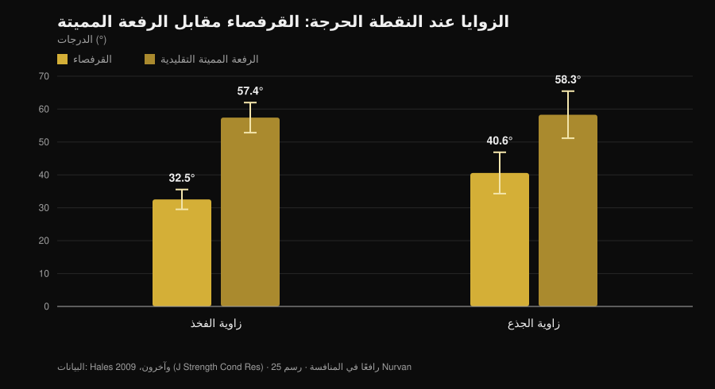
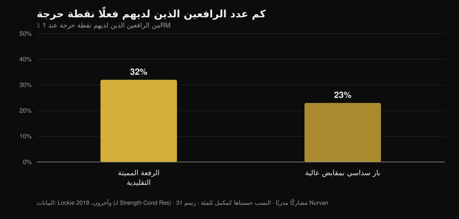

# الرفعة المميتة بإيقاع بطيء حتى الركبة: هل تنفع؟

بقلم [Giammaria Loi](/autore/giammaria-loi) · تحديث 1 نوفمبر 2026

هناك تنويعة للرفعة المميتة تنتشر كثيرًا بين لاعبي رفع الأثقال القوة: تبدأ ببطء، تتحكم في البار حتى الركبة، ثم تتسارع. تُسمّى *tempo to knee*، ومن يبرمجها يقول إنها تساعد على «الإحساس» بوضعية البداية وتصحيح الورك الذي يرتفع دفعة واحدة. الفكرة جيدة. المشكلة أن معظم ما يُنسب إليها — قوة أكبر، عضلات أكثر، تقنية أفضل — يأتي من ثلاث ادعاءات مختلفة تتعامل معها الأبحاث بطرق متباينة جدًا. يستحق الأمر فصلها، لأن اثنتين تصمدان وواحدة لا.

## باختصار

- **التنويعة نفسها لم تُدرَس قط.** لا توجد أي تجربة تدخّلية مفهرسة في PubMed اختبرت الرفعة المميتة بإيقاع حتى الركبة (تم التحقق في 1 نوفمبر 2026). من يقول غير ذلك فهو يستنتج بالقياس.
- **الرفعة المميتة بطيئة أصلًا حيث يهم الأمر.** عند النقطة الحرجة تبلغ السرعة الرأسية للبار **0.20 م/ث** في الرفعة المميتة مقابل **0.09 م/ث** في القرفصاء، مع زوايا فخذ وجذع أكثر انفتاحًا بكثير (Hales وآخرون، 2009).
- **ارتفاع الورك أولًا ليس خطأ: إنه الحركة نفسها.** العمل ذاته يصنّف الرفعة المميتة حركةً **تتابعية** والقرفصاء حركةً **متزامنة**. الدرجة قابلة للنقاش، أما الظاهرة فلا.
- **الإبطاء لا يبني عضلات أكثر.** من 0.5 إلى 8 ثوانٍ لكل تكرار يكون التضخم متكافئًا؛ وفوق 10 ثوانٍ يسوء (Schoenfeld وآخرون، 2015).
- **ولا يعطي قوة أكبر كذلك.** السريع والمعتدل-البطيء ينتجان مكاسب متشابهة، مع أفضلية — إن وُجدت — تميل إلى السريع في نطاق 60-79٪ من 1RM (Davies وآخرون، 2017).
- **ليس لدى الجميع نقطة حرجة.** في الرفعة المميتة التقليدية **68٪ من المشاركين لا تظهر لديهم أي منطقة التصاق قابلة للقياس** (Lockie وآخرون، 2018).

## ما هي عمليًا

في *tempo to knee* تفرض مدة ثابتة — عادةً من 3 إلى 5 ثوانٍ — على المسافة من الأرض حتى ارتفاع الركبة، ثم تُكمل الرفعة بالسرعة الاعتيادية. ليست رفعة من عجز ولا توقفًا ساكنًا: إنها إبطاء متحكَّم فيه للجزء الأول من الصعود.

الهدف المعلن مزدوج: إجبارك على البقاء في وضعية البداية مدة كافية لتدرك أين يقع الثقل فعلًا، ومنع الوركين من الارتفاع قبل الكتفين. هذه أهداف تحكّم حركي لا أهداف قوة. تذكُّر هذا الفارق هو نصف العمل، لأنه بالضبط الموضع الذي ينزلق عنده النقاش عادةً.

## ماذا تقول الأبحاث فعلًا

### الادعاء 1 — «الرفعة المميتة تُفقد في السنتيمترات الأولى»
**مؤكَّد، مع تحفظ.**

حلّل بحث ثلاثي الأبعاد 25 لاعبًا خلال بطولة إقليمية، وقاس ما يحدث عند النقطة الحرجة في الحركتين. النتيجة واضحة.

*رسم Nurvan استنادًا إلى بيانات Hales وآخرين، 2009 (J Strength Cond Res). المتوسطات والانحرافات المعيارية كما وردت في المقال؛ 25 لاعبًا في منافسة، أربع كاميرات متزامنة على 60 هرتز.*

في الرفعة المميتة يميل الجذع إلى الأمام بما يقارب 60 درجة في أصعب لحظة من الحركة، مقابل 40 في القرفصاء. ذراع العزم على العمود الفقري أطول ببساطة. وهي في أقصاها في المسافة الأولى: ليست رأيًا في النادي، بل هندسة مقيسة في المنافسة.

إذن نعم، الجزء الأول من الرفعة المميتة هو المسافة الهشّة. لكن انتبه إلى الاستنتاج: «هشّة» لا تعني «يجب تنفيذها ببطء عن قصد». الرفعة المميتة بطيئة جدًا هناك أصلًا — 0.20 م/ث عند النقطة الحرجة — ومع الأحمال الثقيلة تتباطأ أكثر من تلقاء نفسها. مراجعة منهجية من 2025 شملت 22 دراسة و293 رياضيًا متمرسًا تؤكد أنه مع ارتفاع الشدة تنخفض السرعة المتوسطة والقصوى، وتطول المدد المركزية، وتزداد التغيّرية المفصلية تحديدًا في مرحلتي التسارع والالتصاق (Bakhshinejad وآخرون، 2025).

### الادعاء 2 — «ارتفاع الورك المبكر خطأ يجب تصحيحه»
**يحتاج إلى تدقيق.**

هذا هو السبب الأكثر استشهادًا لبرمجة التنويعة، وهو الذي يستحق أكبر قدر من الحذر. تخلص دراسة Hales إلى أن القرفصاء حركة **تآزرية متزامنة**، بينما الرفعة المميتة **تتابعية ومجزّأة**: المفاصل لا تمتد معًا بل تمرر العمل فيما بينها. ارتفاع الورك قبل الكتفين، ضمن حدود معينة، *هو* الرفعة المميتة.

المقارنة بين التنويعات تعزّز الصورة. لدى إحدى عشرة امرأة مدرّبة في اختبار 3RM، تنتج التقليدية والسومو عزومًا مفصلية أكبر عند الورك قرب الإقفال مقارنةً بالبار السداسي، الذي يحمّل الركبة أكثر ويسمح بسرعات بار أعلى (Gundersen وآخرون، 2025). كلما كانت الرفعة أكثر هيمنةً للورك، كان تتابع «الورك أولًا» متوقعًا أكثر.

المشكلة الحقيقية ليست ارتفاع الوركين، بل ارتفاعهما **إلى حدّ** يحوّل الرفعة إلى رفعة بساقين ممدودتين والبار بعيد عن الجسم أصلًا. هذا فرق في الدرجة، وتمرين تحكّم قد يساعد على الإحساس به. أما تسمية الظاهرة نفسها «خطأ» فتعني التدريب ضد ميكانيكا التمرين.

### الادعاء 3 — «تساعد على تجاوز النقطة الحرجة»
**يحتاج إلى تدقيق.**

النقطة الحرجة في الرفعة المميتة ليست أمرًا عامًا. من بين 31 مشاركًا مدرّبًا قيست رفعاتهم القصوى بمحوّل إزاحة خطي، لم تظهر لدى الأغلبية أي نقطة حرجة.

*رسم Nurvan استنادًا إلى بيانات Lockie وآخرين، 2018 (J Strength Cond Res). النسب حسبناها كمكمّل لنسب المشاركين بلا منطقة التصاق الواردة في الملخص (68٪ و77٪)؛ 31 مشاركًا مدرّبًا، 21 رجلًا و10 نساء.*

اثنان من كل ثلاثة رياضيين ليس لديهم نقطة حرجة يهاجمونها في الرفعة المميتة التقليدية. قبل بناء كتلة تدريبية حولها، يجدر التأكد من وجودها لديك: صوّر تكرارًا مفردًا ثقيلًا من الجانب وانظر هل يتوقف البار فعلًا عند ارتفاع محدد أم يتباطأ بانتظام.

### الادعاء 4 — «زمن شدّ أطول، عضلات أكثر»
**مُفنَّد.**

هذا هو التبرير المعتاد لكل تنويعة بطيئة، والتحليل البعدي يغلق الملف. ثماني دراسات تقارن مباشرةً بين مدد التكرار: التضخم **متكافئ على كامل المدى من 0.5 إلى 8 ثوانٍ**، ولا يسوء إلا فوق 10 ثوانٍ لكل تكرار (Schoenfeld وآخرون، 2015).

عمل لاحق يوضّح لماذا تُضلّل حسابات «زمن الشد»: عند معادلة زمن الشد عند 60 ثانية، يسمح الإيقاع البطيء بحمل خارجي أكبر، بينما ينتج الإيقاع التقليدي حجمًا إجماليًا أكبر ولاكتاتًا أعلى ونبضًا أسرع وRPE أعلى (Mang وآخرون، 2022). البروتوكولان ليسا الحصة نفسها بساعة إيقاف مختلفة: إنهما محفّزان مختلفان.

### الادعاء 5 — «التدريب البطيء يبني قوة أكبر»
**مُفنَّد.**

خمس عشرة دراسة تقارن التنفيذ السريع بالمعتدل-البطيء مع معادلة الحجم والشدة: مكاسب القوة الديناميكية متشابهة، بغضّ النظر عن العمر والخبرة. وحيث يظهر فرق، فهو ميل لصالح **السريع** في نطاق 60-79٪ من 1RM (ES 0.31؛ p = 0.06) (Davies وآخرون، 2017).

وهناك ما هو أبعد، ويتعلق بالنية أكثر من الساعة. ستة وعشرون مشاركًا تلقّوا تعليمات بتركيز انتباه خارجي أنتجوا سرعات بار أعلى بدلالة إحصائية ممن تلقّوا تعليمات بتركيز داخلي، عند الحمل نفسه (Finlay وآخرون، 2025). الطريقة التي تخاطب بها نفسك للدفع تغيّر مقدار ما تدفعه. لذلك ينبغي استخدام تمرين يعوّدك على عدم الدفع بقوة في المسافة الأولى مع إدراك ما يدرّبه: التحكّم، لا نية التسارع.

### الادعاء 6 — «مناسبة للأحمال الثقيلة»
**يحتاج إلى تدقيق.**

قرب الأحمال القصوى يأتي التباطؤ من تلقاء نفسه وترتفع التغيّرية التقنية (Bakhshinejad وآخرون، 2025): فرض إيقاع فوق ذلك يعني ببساطة رفع وزن أقل. وهناك نقطة نادرًا ما تُذكر: في القرفصاء عند 60٪ من 1RM كان ذروة الانفعال في وتر الرضفة **أعلى** في التنفيذ السريع منه في إيقاع بطيء 2-1-2 (Earp وآخرون، 2016). الإيقاع البطيء إذن ألطف على الأوتار، ما يجعله أداة مفيدة في مراحل الأحمال العالية — ولهذا بالذات ليس المكان الذي تبحث فيه عن رقمك الأقصى.

## كيف تطبّقها

إن قررت استخدامها، تعامل معها كما هي: تمرين مساعد للتحكم.

1. **تحقّق من حاجتك إليها.** صوّر تكرارين مفردين ثقيلين من الجانب. إن ارتفع الورك قليلًا وبقي البار قريبًا من الساق، فمشكلتك مختلفة.
2. **أبقِ الحمل دون الأقصى.** النطاق الذي يبقى فيه الإيقاع المفروض قابلًا للتنفيذ دون تشويه التقنية هو تقريبًا 60-75٪ من 1RM، بـ 3 إلى 5 تكرارات. فوق ذلك يفرض البار الإيقاع.
3. **اضبط الإيقاع على المسافة المعنية فقط.** من الأرض إلى الركبة في 3-5 ثوانٍ، ثم أكمل بالسرعة الاعتيادية. إبطاء الإقفال أيضًا يغيّر التمرين دون إضافة معلومة.
4. **لا تستبدل بها رفعة المنافسة.** ضعها بعد الحركة الأساسية، 2 إلى 4 مجموعات، ضمن كتلة من 4 إلى 6 أسابيع.
5. **قِس ما إذا كانت تعمل.** المعيار ليس حمل التنويعة، بل ارتفاع الورك في رفعتك الاعتيادية وسرعة المسافة الأولى عند الوزن نفسه.
6. **افصل التمرينين في السجل.** أفضل أداء في التنويعة ليس رقمك الأقصى: وضعهما في السطر نفسه أسرع طريقة للخلط بين تقدّم تقني وتقدّم في القوة.

ينطبق المبدأ نفسه الذي عرضناه في مقال [المجموعات والتكرارات والراحة للتضخم](/ar/blog/kam-takrar-lilkutla-aladalia): متغيّر واحد معزول يزن قليلًا إن لم يدعمه بقية البرنامج.

> **جرّب Nurvan — لكل تنويعة سجل أحمالها**
>
> في Nurvan تكون الرفعة المميتة بإيقاع تمرينًا مستقلًا: الأحمال والتكرارات وRIR تبقى منفصلة عن رفعة المنافسة، فترى إن كانت التنويعة تتقدّم دون أن تختلط الأرقام. مجموعات الإحماء تُقترح تلقائيًا انطلاقًا من حمل العمل اليومي، والسجل يخبرك إن كانت المسافة الأولى تتحسن أم أنك تراكم المجموعات فقط. [جرّب Nurvan](https://nurvan.app)

## أسئلة شائعة

**كم ثانية يجب أن يستغرق tempo to knee؟**
من يبرمجها يستخدم عادةً 3 إلى 5 ثوانٍ من الأرض إلى الركبة. لا توجد دراسة على التنويعة تشير إلى مدة مثلى؛ ما نعرفه أن تجاوز 10 ثوانٍ لكل تكرار يُسيء إلى تكيّفات التضخم (Schoenfeld وآخرون، 2015)، فلا معنى للإطالة أكثر.

**هل تنفع للرفعة التقليدية أيضًا؟**
المنشور الأصلي يقدّمها كتنويعة سومو، لكن المنطق — البقاء أطول في وضعية البداية — لا يتعلق باتساع الوقفة. بل إن التقليدية لديها جذع أكثر ميلًا عند النقطة الحرجة (Hales وآخرون، 2009)، أي مسافة أولى أكثر انكشافًا. لا توجد بيانات تقارن الاستخدامين.

**أشعر بألم في الظهر أثناء الرفعة المميتة: هل تساعدني هذه التنويعة؟**
الألم المستمر أو المتفاقم يجب أن يقيّمه طبيب أو أخصائي علاج طبيعي قبل تغيير التمرين. لا تنويعة تقنية هي علاج، وتمرين يخفّض الحمل قد يحجب المشكلة بدل حلّها.

**الأفضل: رفعة بإيقاع أم رفعة بتوقف؟**
لا توجد مقارنة مباشرة في الأدبيات. إنهما تمرينان بمنطقين مختلفين: التوقف يعزل وضعية واحدة، والإيقاع يوزّع التحكّم على المسافة كلها. اختر بحسب ما تفقده — وضعية محددة أم التتابع ككل.

## اقرأ أيضًا

- [المجموعات والتكرارات والراحة للتضخم](/ar/blog/kam-takrar-lilkutla-aladalia) — كم تزن متغيرات البرمجة فعلًا، بالأرقام.
- [الركبتان إلى الخارج في القرفصاء: قاعدة أم إشارة؟](/ar/blog/alrukbatan-ila-alkharij-fi-alqurfusa) — إشارة تقنية أخرى تتكرر كثيرًا، مرّرناها على الأبحاث.
- [قبضة البولدوغ في دفع الصدر: ماذا تقول الدراسات](/ar/blog/qabdat-albulldog-dafe-alsadr) — ماذا تفعل حين لا تكون تقنية شائعة قد قيست قط.

## المصادر

- Hales ME, Johnson BF, Johnson JT, 2009. Kinematic analysis of the powerlifting style squat and the conventional deadlift during competition: is there a cross-over effect between lifts? *Journal of Strength and Conditioning Research* 23(9):2574-80. PMID 19910816. [DOI](https://doi.org/10.1519/JSC.0b013e3181bc1d2a)
- Lockie RG, Moreno MR, Lazar A, et al., 2018. The 1 Repetition Maximum Mechanics of a High-Handle Hexagonal Bar Deadlift Compared With a Conventional Deadlift as Measured by a Linear Position Transducer. *Journal of Strength and Conditioning Research* 32(1):150-161. PMID 28394830. [DOI](https://doi.org/10.1519/JSC.0000000000001781)
- Schoenfeld BJ, Ogborn DI, Krieger JW, 2015. Effect of repetition duration during resistance training on muscle hypertrophy: a systematic review and meta-analysis. *Sports Medicine* 45(4):577-85. PMID 25601394. [DOI](https://doi.org/10.1007/s40279-015-0304-0)
- Davies TB, Kuang K, Orr R, Halaki M, Hackett D, 2017. Effect of Movement Velocity During Resistance Training on Dynamic Muscular Strength: A Systematic Review and Meta-Analysis. *Sports Medicine* 47(8):1603-1617. PMID 28105573. [DOI](https://doi.org/10.1007/s40279-017-0676-4)
- Bakhshinejad JA, Ramer JD, Dunsmore KA, Pelton LM, Berglund L, 2025. Effects of Intensity and Fatigue on the Kinetics and Kinematics of the Barbell Squat, Bench Press, and Deadlift in Experienced Lifters: A Systematic Review. *Sports Medicine - Open* 11(1):115. PMID 41085612. [DOI](https://doi.org/10.1186/s40798-025-00921-x)
- Mang ZA, Realzola RA, Ducharme J, et al., 2022. The effect of repetition tempo on cardiovascular and metabolic stress when time under tension is matched during lower body exercise. *European Journal of Applied Physiology* 122(6):1485-1495. PMID 35394146. [DOI](https://doi.org/10.1007/s00421-022-04941-3)
- Earp JE, Newton RU, Cormie P, Blazevich AJ, 2016. Faster Movement Speed Results in Greater Tendon Strain during the Loaded Squat Exercise. *Frontiers in Physiology* 7:366. PMID 27630574. [DOI](https://doi.org/10.3389/fphys.2016.00366)
- Gundersen AH, van den Tillaar R, Falch HN, Fredriksen AB, Larsen S, 2025. A Biomechanical Comparison Between Conventional, Sumo, and Hex-Bar Deadlifts Among Resistance Trained Women. *Journal of Strength and Conditioning Research* 39(3):281-288. PMID 39705135. [DOI](https://doi.org/10.1519/JSC.0000000000005011)
- Finlay M, Marchant D, Langley C, Simpson T, 2025. Impact of attentional focus and action verbs on bench press performance. *Human Movement Science* 102:103385. PMID 40602018. [DOI](https://doi.org/10.1016/j.humov.2025.103385)

المراجع مستخرجة عبر PubMed. نقطة الانطلاق: منشور [Reactive Training Systems مع Adam Jones](https://www.instagram.com/p/DduBVWWiQOw/) بتاريخ 25 سبتمبر 2026. استُخدم محتوى المنشور فقط لتحديد الموضوع والادعاءات الواجب التحقق منها: لم يُعَد استخدام أي نص أو صورة أو بنية.

---

Giammaria Loi هو مؤسس Nurvan. يتدرب بالأثقال منذ 2012، ويعمل مدربًا شخصيًا ومدرّبًا معتمدًا من FIPE منذ 2013، ويشارك في منافسات رفع القوة على المستوى الوطني منذ 2018. كل مقال يوقّعه ينطلق من الدراسات العلمية وينتهي إلى ما ينفع فعلًا في النادي.

> ملاحظة: محتوى إعلامي، لا يُغني عن رأي الطبيب أو المختص.
