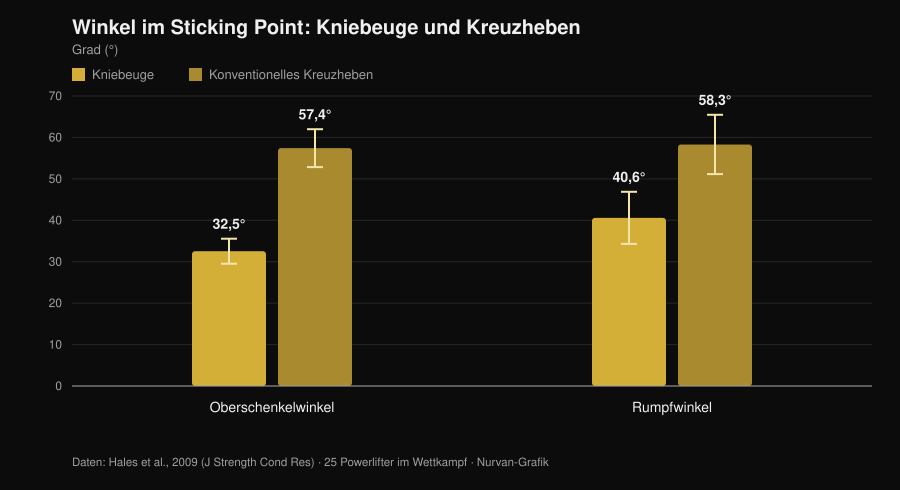
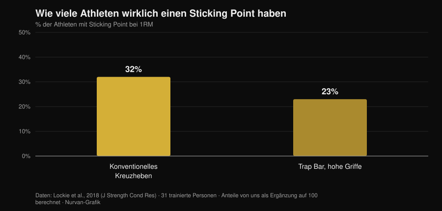

# Tempo-Kreuzheben bis zum Knie: bringt das was?

Von [Giammaria Loi](/autore/giammaria-loi) · aktualisiert am 1. November 2026

Unter Powerliftern kursiert eine Kreuzheben-Variante: langsam starten, die Hantel bis zum Knie kontrollieren, danach beschleunigen. Sie heißt *Tempo to Knee*, und wer sie programmiert, sagt, sie helfe dabei, die Startposition zu spüren und die hochschießende Hüfte zu korrigieren. Die Idee ist gut. Das Problem: Fast alles, was ihr zugeschrieben wird — mehr Kraft, mehr Muskeln, bessere Technik — stammt aus drei verschiedenen Behauptungen, die die Forschung sehr unterschiedlich behandelt. Es lohnt sich, sie zu trennen, denn zwei halten stand und eine nicht.

## Kurz gefasst

- **Die Variante selbst wurde nie untersucht.** Keine in PubMed indexierte Interventionsstudie hat das Tempo-Kreuzheben bis zum Knie getestet (geprüft am 1. November 2026). Wer etwas anderes behauptet, extrapoliert.
- **Kreuzheben ist dort, wo es zählt, ohnehin langsam.** Am Sticking Point beträgt die vertikale Hantelgeschwindigkeit **0,20 m/s** beim Kreuzheben gegenüber **0,09 m/s** bei der Kniebeuge, bei deutlich offeneren Oberschenkel- und Rumpfwinkeln (Hales et al., 2009).
- **Eine zuerst steigende Hüfte ist kein Fehler, sondern die Bewegung.** Dieselbe Arbeit stuft das Kreuzheben als **sequenzielle**, die Kniebeuge als **simultane** Bewegung ein. Das Ausmaß ist diskutabel, das Phänomen nicht.
- **Langsamer macht nicht mehr Muskeln.** Von 0,5 bis 8 Sekunden pro Wiederholung ist die Hypertrophie gleichwertig; über 10 Sekunden wird sie schlechter (Schoenfeld et al., 2015).
- **Und auch nicht mehr Kraft.** Schnell und moderat-langsam liefern ähnliche Zuwächse, wobei ein möglicher Vorteil eher beim Schnellen im Bereich 60-79 % des 1RM liegt (Davies et al., 2017).
- **Nicht jeder hat einen Sticking Point.** Beim konventionellen Kreuzheben zeigen **68 % der Probanden gar keine messbare Sticking Region** (Lockie et al., 2018).

## Was es praktisch ist

Beim *Tempo to Knee* gibst du dem Abschnitt vom Boden bis Kniehöhe eine feste Dauer vor — typischerweise 3 bis 5 Sekunden — und beendest die Wiederholung dann in normalem Tempo. Es ist weder Deficit-Kreuzheben noch eine statische Pause: Es ist ein kontrolliertes Abbremsen des ersten Teils des Zugs.

Das erklärte Ziel ist doppelt: lange genug in der Startposition bleiben, um zu merken, wo das Gewicht tatsächlich liegt, und verhindern, dass die Hüfte vor den Schultern hochkommt. Das sind Ziele der Bewegungskontrolle, nicht der Kraft. Diese Unterscheidung im Kopf zu behalten, ist die halbe Arbeit — denn genau hier rutscht die Argumentation sonst ab.

## Was die Forschung wirklich sagt

### Behauptung 1 — „Kreuzheben verliert man im ersten Abschnitt"
**Bestätigt, mit Einschränkung.**

Eine dreidimensionale Analyse von 25 Powerliftern während eines Regionalwettkampfs hat gemessen, was am Sticking Point beider Übungen passiert. Das Ergebnis ist eindeutig.

*Nurvan-Grafik auf Basis der Daten von Hales et al., 2009 (J Strength Cond Res). Mittelwerte und Standardabweichungen wie im Artikel berichtet; 25 Powerlifter im Wettkampf, vier mit 60 Hz synchronisierte Kameras.*

Beim Kreuzheben ist der Rumpf im schwersten Moment der Bewegung fast 60 Grad nach vorn geneigt, gegenüber 40 Grad bei der Kniebeuge. Der Hebel auf die Wirbelsäule ist schlicht länger. Und im ersten Abschnitt ist dieser Hebel am größten: keine Studiomeinung, sondern im Wettkampf gemessene Geometrie.

Also ja, der frühe Teil des Kreuzhebens ist der verletzliche Abschnitt. Aber Vorsicht bei der Schlussfolgerung: „verletzlich" heißt nicht „absichtlich langsam auszuführen". Das Kreuzheben kriecht dort ohnehin — 0,20 m/s am Sticking Point — und bei schweren Lasten bremst es von allein weiter ab. Eine systematische Übersichtsarbeit von 2025 über 22 Studien und 293 erfahrene Athleten bestätigt: Mit steigender Intensität sinken mittlere und Spitzengeschwindigkeit, die konzentrischen Dauern verlängern sich und die Gelenkvariabilität nimmt genau in der Beschleunigungs- und Sticking-Phase zu (Bakhshinejad et al., 2025).

### Behauptung 2 — „Die hochschießende Hüfte ist ein zu korrigierender Fehler"
**Zu präzisieren.**

Das ist die meistgenannte Begründung für diese Variante — und die, die am meisten Vorsicht verdient. Die Hales-Studie kommt zu dem Schluss, dass die Kniebeuge eine **synergistische, simultane** Bewegung ist, das Kreuzheben dagegen **sequenziell und segmentiert**: Die Gelenke strecken sich nicht gemeinsam, sie reichen die Arbeit weiter. Dass die Hüfte vor den Schultern hochkommt, ist innerhalb gewisser Grenzen *das* Kreuzheben.

Der Variantenvergleich stützt das Bild. Bei elf trainierten Frauen im 3RM erzeugen konventionell und Sumo nahe dem Lockout größere Hüftgelenkmomente als die Trap Bar, die dafür das Knie stärker belastet und höhere Hantelgeschwindigkeiten erlaubt (Gundersen et al., 2025). Je hüftdominanter der Zug, desto erwartbarer die Hüfte-zuerst-Sequenz.

Das eigentliche Problem ist nicht, dass die Hüfte steigt, sondern dass sie **so stark** steigt, dass aus dem Kreuzheben ein gestrecktes Kreuzheben mit bereits körperfern geführter Hantel wird. Das ist ein Gradunterschied, und eine Kontrollübung kann helfen, ihn zu spüren. Das Phänomen selbst „Fehler" zu nennen, heißt dagegen, gegen die Mechanik der Übung zu trainieren.

### Behauptung 3 — „Sie hilft über den Sticking Point"
**Zu präzisieren.**

Der Sticking Point beim Kreuzheben ist nichts Universelles. Von 31 trainierten Personen, die im Maximalversuch mit linearem Wegaufnehmer gemessen wurden, zeigte die Mehrheit gar keinen.

*Nurvan-Grafik auf Basis der Daten von Lockie et al., 2018 (J Strength Cond Res). Die Anteile haben wir als Ergänzung zu den im Abstract berichteten Quoten ohne Sticking Region (68 % und 77 %) berechnet; 31 trainierte Personen, 21 Männer und 10 Frauen.*

Zwei von drei Athleten haben beim konventionellen Kreuzheben keinen Sticking Point zum Angreifen. Bevor man darauf einen Trainingsblock aufbaut, lohnt sich die Prüfung: einen schweren Einzelversuch von der Seite filmen und schauen, ob die Hantel tatsächlich an einer bestimmten Stelle stockt oder gleichmäßig abbremst.

### Behauptung 4 — „Mehr Time under Tension, mehr Muskeln"
**Widerlegt.**

Das ist die Standardbegründung für jede langsame Variante, und die Metaanalyse schließt den Fall. Acht Studien im direkten Vergleich verschiedener Wiederholungsdauern: Die Hypertrophie ist **über den gesamten Bereich von 0,5 bis 8 Sekunden gleichwertig** und wird erst jenseits von 10 Sekunden pro Wiederholung schlechter (Schoenfeld et al., 2015).

Eine spätere Arbeit zeigt, warum die Time-under-Tension-Rechnung täuscht: Bei auf 60 Sekunden angeglichener Time under Tension erlaubt das langsame Tempo eine höhere externe Last, das traditionelle Tempo erzeugt dagegen mehr Gesamtvolumen, mehr Laktat, eine höhere Herzfrequenz und ein höheres RPE (Mang et al., 2022). Die beiden Protokolle sind nicht dieselbe Einheit mit anderer Stoppuhr, sondern unterschiedliche Reize.

### Behauptung 5 — „Langsam trainieren macht mehr Kraft"
**Widerlegt.**

Fünfzehn Studien, Vergleich schneller und moderat-langsamer Ausführung bei angeglichenem Volumen und Intensität: Die Zuwächse an dynamischer Kraft sind ähnlich, unabhängig von Alter und Trainingsstand. Wo ein Unterschied auftaucht, ist es ein Trend zugunsten des **Schnellen** im Bereich 60-79 % des 1RM (ES 0,31; p = 0,06) (Davies et al., 2017).

Und es gibt mehr, und es betrifft die Absicht mehr als die Stoppuhr. Sechsundzwanzig Probanden mit extern fokussierten Anweisungen erzeugten bei gleicher Last signifikant höhere Hantelgeschwindigkeiten als jene mit intern fokussierten Anweisungen (Finlay et al., 2025). Wie du dir sagst zu drücken, verändert, wie stark du drückst. Eine Übung, die dich daran gewöhnt, im ersten Abschnitt nicht kräftig zu ziehen, sollte man deshalb im Bewusstsein einsetzen, was sie trainiert: Kontrolle, nicht die Absicht zu beschleunigen.

### Behauptung 6 — „Funktioniert auch mit schweren Lasten"
**Zu präzisieren.**

Nahe am Maximum kommt die Verlangsamung von selbst und die technische Variabilität steigt (Bakhshinejad et al., 2025): ein Tempo obendrauf vorzuschreiben bedeutet schlicht, weniger zu heben. Hinzu kommt ein selten erwähnter Punkt: Bei der Kniebeuge mit 60 % des 1RM war die Spitzendehnung der Patellasehne in schnellen Ausführungen **größer** als bei einem langsamen 2-1-2-Tempo (Earp et al., 2016). Langsames Tempo ist also sehnenschonender, was es in Phasen hoher Last nützlich macht — und genau deshalb nicht der Ort ist, an dem man sein Maximum sucht.

## Wie man es einsetzt

Wenn du es nutzt, behandle es als das, was es ist: eine Zusatzübung zur Kontrolle.

1. **Prüfe, ob du es brauchst.** Filme zwei schwere Einzelwiederholungen von der Seite. Steigt die Hüfte kaum und bleibt die Hantel nah am Schienbein, hast du ein anderes Problem.
2. **Halte die Last submaximal.** Der Bereich, in dem ein vorgegebenes Tempo ohne Technikverlust machbar bleibt, liegt grob bei 60-75 % des 1RM, mit 3 bis 5 Wiederholungen. Darüber diktiert die Hantel das Tempo.
3. **Gib das Tempo nur für den gewünschten Abschnitt vor.** Vom Boden bis zum Knie in 3 bis 5 Sekunden, dann in normalem Tempo beenden. Auch den Lockout zu bremsen verändert die Übung, ohne Information zu liefern.
4. **Ersetze damit nicht das Wettkampf-Kreuzheben.** Setze es nach der Hauptübung an, 2 bis 4 Sätze, in einem Block von 4 bis 6 Wochen.
5. **Miss, ob es wirkt.** Der Maßstab ist nicht die Last in der Variante, sondern wie hoch deine Hüfte im normalen Kreuzheben steigt und wie schnell der erste Abschnitt bei gleichem Gewicht läuft.
6. **Trenne beide Übungen im Logbuch.** Das Maximum der Variante ist nicht dein Maximum: Beide in derselben Zeile zu führen, ist der schnellste Weg, technischen Fortschritt mit Kraftfortschritt zu verwechseln.

Es gilt dasselbe Prinzip wie in unserem Beitrag zu [Sätzen, Wiederholungen und Pausen für die Hypertrophie](/de/blog/wie-viele-wiederholungen-muskelaufbau): Eine isolierte Variable zählt wenig, wenn der Rest des Programms sie nicht trägt.

> **Teste Nurvan — jede Variante mit eigener Lasthistorie**
>
> In Nurvan ist das Tempo-Kreuzheben eine eigene Übung: Lasten, Wiederholungen und RIR bleiben vom Wettkampf-Kreuzheben getrennt, so siehst du, ob die Variante Fortschritte macht, ohne dass sich die Zahlen vermischen. Die Aufwärmsätze werden automatisch aus der Arbeitslast des Tages vorgeschlagen, und die Historie zeigt dir, ob der erste Abschnitt besser wird oder du nur Sätze sammelst. [Teste Nurvan](https://nurvan.app)

## Häufige Fragen

**Wie viele Sekunden sollte ein Tempo to Knee dauern?**
Wer es programmiert, nutzt in der Regel 3 bis 5 Sekunden vom Boden bis zum Knie. Es gibt keine Studie zur Variante, die eine optimale Dauer nennt; bekannt ist nur, dass jenseits von 10 Sekunden pro Wiederholung die Hypertrophieanpassungen schlechter werden (Schoenfeld et al., 2015) — länger zu dehnen ergibt also keinen Sinn.

**Funktioniert das auch beim konventionellen Kreuzheben?**
Der Ausgangspost präsentiert es als Sumo-Variante, doch die Logik — länger in der Startposition bleiben — hängt nicht von der Standbreite ab. Konventionell ist der Rumpf am Sticking Point sogar stärker geneigt (Hales et al., 2009), der erste Abschnitt also noch exponierter. Daten, die beide Anwendungen vergleichen, gibt es nicht.

**Mir tut beim Kreuzheben der Rücken weh — hilft diese Variante?**
Anhaltende oder zunehmende Schmerzen gehören vor jedem Übungswechsel ärztlich oder physiotherapeutisch abgeklärt. Keine Technikvariante ist eine Behandlung, und eine Übung, die die Last senkt, kann ein Problem eher verdecken als lösen.

**Tempo-Kreuzheben oder Kreuzheben mit Pause?**
Ein direkter Vergleich fehlt in der Literatur. Es sind zwei Übungen mit unterschiedlicher Logik: Die Pause isoliert eine Position, das Tempo verteilt die Kontrolle über den gesamten Abschnitt. Wähle danach, was du verlierst — eine bestimmte Position oder die Sequenz als Ganzes.

## Weiterlesen

- [Sätze, Wiederholungen und Pausen für die Hypertrophie](/de/blog/wie-viele-wiederholungen-muskelaufbau) — was die Programmvariablen wirklich wiegen, mit Zahlen.
- [Knie nach außen in der Kniebeuge: Regel oder Cue?](/de/blog/knie-nach-aussen-kniebeuge) — ein weiterer vielzitierter Technik-Cue, an der Forschung geprüft.
- [Bulldog-Griff beim Bankdrücken: was die Studien sagen](/de/blog/bulldog-griff-bankdruecken) — was tun, wenn eine verbreitete Technik nie gemessen wurde.

## Quellen

- Hales ME, Johnson BF, Johnson JT, 2009. Kinematic analysis of the powerlifting style squat and the conventional deadlift during competition: is there a cross-over effect between lifts? *Journal of Strength and Conditioning Research* 23(9):2574-80. PMID 19910816. [DOI](https://doi.org/10.1519/JSC.0b013e3181bc1d2a)
- Lockie RG, Moreno MR, Lazar A, et al., 2018. The 1 Repetition Maximum Mechanics of a High-Handle Hexagonal Bar Deadlift Compared With a Conventional Deadlift as Measured by a Linear Position Transducer. *Journal of Strength and Conditioning Research* 32(1):150-161. PMID 28394830. [DOI](https://doi.org/10.1519/JSC.0000000000001781)
- Schoenfeld BJ, Ogborn DI, Krieger JW, 2015. Effect of repetition duration during resistance training on muscle hypertrophy: a systematic review and meta-analysis. *Sports Medicine* 45(4):577-85. PMID 25601394. [DOI](https://doi.org/10.1007/s40279-015-0304-0)
- Davies TB, Kuang K, Orr R, Halaki M, Hackett D, 2017. Effect of Movement Velocity During Resistance Training on Dynamic Muscular Strength: A Systematic Review and Meta-Analysis. *Sports Medicine* 47(8):1603-1617. PMID 28105573. [DOI](https://doi.org/10.1007/s40279-017-0676-4)
- Bakhshinejad JA, Ramer JD, Dunsmore KA, Pelton LM, Berglund L, 2025. Effects of Intensity and Fatigue on the Kinetics and Kinematics of the Barbell Squat, Bench Press, and Deadlift in Experienced Lifters: A Systematic Review. *Sports Medicine - Open* 11(1):115. PMID 41085612. [DOI](https://doi.org/10.1186/s40798-025-00921-x)
- Mang ZA, Realzola RA, Ducharme J, et al., 2022. The effect of repetition tempo on cardiovascular and metabolic stress when time under tension is matched during lower body exercise. *European Journal of Applied Physiology* 122(6):1485-1495. PMID 35394146. [DOI](https://doi.org/10.1007/s00421-022-04941-3)
- Earp JE, Newton RU, Cormie P, Blazevich AJ, 2016. Faster Movement Speed Results in Greater Tendon Strain during the Loaded Squat Exercise. *Frontiers in Physiology* 7:366. PMID 27630574. [DOI](https://doi.org/10.3389/fphys.2016.00366)
- Gundersen AH, van den Tillaar R, Falch HN, Fredriksen AB, Larsen S, 2025. A Biomechanical Comparison Between Conventional, Sumo, and Hex-Bar Deadlifts Among Resistance Trained Women. *Journal of Strength and Conditioning Research* 39(3):281-288. PMID 39705135. [DOI](https://doi.org/10.1519/JSC.0000000000005011)
- Finlay M, Marchant D, Langley C, Simpson T, 2025. Impact of attentional focus and action verbs on bench press performance. *Human Movement Science* 102:103385. PMID 40602018. [DOI](https://doi.org/10.1016/j.humov.2025.103385)

Literatur über PubMed recherchiert. Ausgangspunkt: Beitrag von [Reactive Training Systems mit Adam Jones](https://www.instagram.com/p/DduBVWWiQOw/) vom 25. September 2026. Der Inhalt des Posts diente nur dazu, Thema und zu prüfende Behauptungen zu identifizieren: Es wurden weder Text noch Bild noch Struktur übernommen.

---

Giammaria Loi ist der Gründer von Nurvan. Er trainiert seit 2012 mit Gewichten, arbeitet seit 2013 als FIPE-zertifizierter Personal Trainer und Coach und startet seit 2018 auf nationalem Niveau im Powerlifting. Jeder Artikel, den er zeichnet, beginnt bei den Studien und endet bei dem, was im Studio wirklich funktioniert.

> Hinweis: informativer Inhalt, ersetzt nicht die Beratung durch Arzt oder Fachperson.
