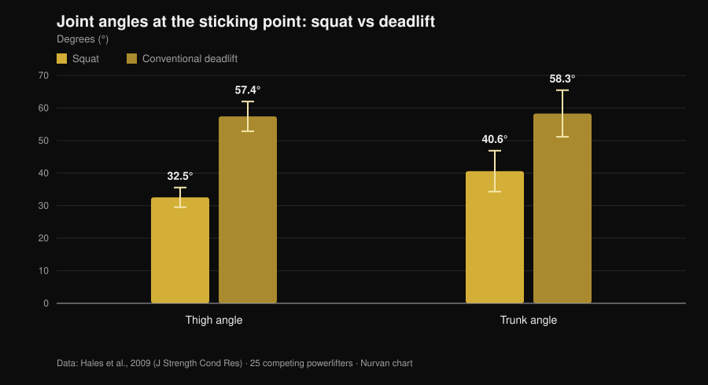
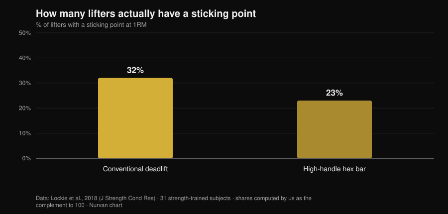

# Tempo to Knee Deadlift: Does It Actually Work?

By [Giammaria Loi](/autore/giammaria-loi) · updated 1 November 2026

There's a deadlift variation doing the rounds among powerlifters: start slow, control the bar to knee height, then accelerate. It's called *tempo to knee*, and the coaches who program it say it teaches you to feel the start position and stops your hips from shooting up. The idea is sound. The trouble is that almost everything credited to it — more strength, more muscle, better technique — comes from three separate claims that the research treats very differently. Worth pulling them apart, because two hold up and one doesn't.

## The short version

- **The variation itself has never been studied.** No indexed intervention trial on PubMed has tested the tempo-to-knee deadlift (checked 1 November 2026). Anyone claiming otherwise is extrapolating.
- **The deadlift is already slow where it matters.** At the sticking point, vertical bar velocity is **0.20 m/s** in the deadlift versus **0.09 m/s** in the squat, with far more open thigh and trunk angles (Hales et al., 2009).
- **Hips rising first isn't a fault — it's the lift.** The same study classifies the deadlift as a **sequential** movement and the squat as a **simultaneous** one. The degree is debatable, the phenomenon isn't.
- **Slowing down doesn't build more muscle.** From 0.5 to 8 seconds per rep, hypertrophy is equivalent; past 10 seconds it gets worse (Schoenfeld et al., 2015).
- **And it doesn't build more strength either.** Fast and moderate-slow produce similar gains, with any edge leaning towards fast in the 60–79% 1RM range (Davies et al., 2017).
- **Not everyone has a sticking point.** In the conventional deadlift, **68% of subjects show no measurable sticking region at all** (Lockie et al., 2018).

## What it is, in practice

In the *tempo to knee* you impose a fixed duration — typically 3 to 5 seconds — on the stretch from the floor to knee height, then finish the lift at normal speed. It isn't a deficit deadlift and it isn't a dead-stop pause: it's a controlled slowing of the first portion of the pull.

The stated aim is twofold: force you to stay in the start position long enough to notice where the weight actually is, and stop the hips from rising ahead of the shoulders. Those are motor-control goals, not strength goals. Keeping that distinction in mind is half the job, because it's exactly where the argument usually slips.

## What the research actually says

### Claim 1 — "The deadlift is lost in the first few inches"
**Confirmed, with a caveat.**

A three-dimensional analysis of 25 powerlifters during a regional meet measured what happens at the sticking point of both lifts. The result is unambiguous.

*Nurvan chart on data from Hales et al., 2009 (J Strength Cond Res). Means and standard deviations as reported in the paper; 25 competing powerlifters, four cameras synchronised at 60 Hz.*

In the deadlift the trunk is pitched forward by almost 60 degrees at the hardest moment of the lift, against 40 in the squat. The lever on the spine is simply longer. And that lever is at its longest in the first portion: that isn't a gym opinion, it's geometry measured in competition.

So yes, the early part of the deadlift is the fragile stretch. But watch the conclusion people draw from it: "it's fragile" doesn't imply "it should be performed slowly on purpose". The deadlift is already crawling there — 0.20 m/s at the sticking point — and at heavy loads it slows down further on its own. A 2025 systematic review of 22 studies and 293 experienced lifters confirms that as intensity rises, mean and peak velocity fall, concentric durations lengthen and joint variability increases precisely in the acceleration and sticking phases (Bakhshinejad et al., 2025).

### Claim 2 — "Hips shooting up is a fault to fix"
**Needs qualifying.**

This is the most quoted reason for programming the variation, and the one that deserves the most caution. The Hales study concludes that the squat is a **synergistic, simultaneous** movement while the deadlift is **sequential and segmented**: the joints don't extend together, they hand the work along. Hips rising ahead of the shoulders, within limits, *is* the deadlift.

Comparing variations reinforces the picture. In eleven trained women tested on a 3RM, conventional and sumo produce larger hip joint moments near lockout than the hex bar, which instead loads the knee more and allows higher bar velocities (Gundersen et al., 2025). The more hip-dominant the pull, the more a hips-first sequence is expected.

The real problem isn't that the hips rise: it's that they rise **so much** that the deadlift turns into a stiff-leg pull with the bar already drifting away from the body. That's a difference of degree, and a control drill can help you feel it. But calling the phenomenon itself a "fault" means training against the mechanics of the exercise.

### Claim 3 — "It helps you get through the sticking point"
**Needs qualifying.**

The deadlift sticking point isn't universal. Across 31 trained subjects measured with a linear position transducer during a one-rep max, most showed none at all.

*Nurvan chart on data from Lockie et al., 2018 (J Strength Cond Res). Percentages computed by us as the complement of the shares of subjects without a sticking region reported in the abstract (68% and 77%); 31 trained subjects, 21 men and 10 women.*

Two lifters out of three have no sticking point to attack in the conventional deadlift. Before building a training block around one, it's worth checking that you have one: film a heavy single from the side and look at whether the bar genuinely stalls at a specific height, or decelerates smoothly.

### Claim 4 — "More time under tension, more muscle"
**Busted.**

This is the standard justification for every slow variation, and the meta-analysis closes it. Eight studies directly comparing repetition durations: hypertrophy is **equivalent across the whole 0.5 to 8 second range**, and only gets worse past 10 seconds per rep (Schoenfeld et al., 2015).

A later study shows why time-under-tension accounting misleads. With time under tension matched at 60 seconds, the slow tempo allows a heavier external load, but the traditional tempo produces more total volume, more lactate, higher heart rate and a higher RPE (Mang et al., 2022). The two protocols aren't the same session with a different stopwatch: they're different stimuli.

### Claim 5 — "Training slow builds more strength"
**Busted.**

Fifteen studies comparing fast versus moderate-slow execution at matched volume and intensity: dynamic strength gains are similar, regardless of age and training status. Where a difference shows up, it's a trend favouring **fast** in the 60–79% 1RM range (ES 0.31; p = 0.06) (Davies et al., 2017).

There's more, and it's about intent rather than the clock. Twenty-six subjects given externally focused instructions produced significantly higher bar velocities than those given internally focused ones, at the same load (Finlay et al., 2025). How you tell yourself to push changes how hard you push. A drill that trains you not to push hard in the first portion should therefore be used with a clear sense of what it's training: control, not the intent to accelerate.

### Claim 6 — "It's fine at heavy loads"
**Needs qualifying.**

Near maximal loads the slowdown arrives by itself and technical variability rises (Bakhshinejad et al., 2025): imposing a tempo on top of that simply means lifting less. There's also a point that rarely comes up: in the squat at 60% 1RM, peak patellar tendon strain was **greater** in fast executions than in a slow 2-1-2 tempo (Earp et al., 2016). Slow tempo is therefore gentler on tendons, which makes it a useful tool in high-load phases — and precisely for that reason, not the place to chase a max.

## How to use it

If you decide to run it, treat it as what it is: an accessory control drill.

1. **Check you need it.** Film two heavy singles from the side. If the hips rise only slightly and the bar stays close to the shin, you have a different problem to solve.
2. **Keep the load submaximal.** The range where an imposed tempo stays executable without wrecking technique is roughly 60–75% of 1RM, for 3 to 5 reps. Above that, the bar sets the tempo.
3. **Apply the tempo only to the stretch you care about.** Floor to knee in 3 to 5 seconds, then finish at normal speed. Slowing the lockout too changes the exercise without adding information.
4. **Don't replace the competition deadlift with it.** Put it after your main pull, 2 to 4 sets, in a 4 to 6 week block.
5. **Measure whether it's working.** The metric isn't the load on the variation: it's how high your hips rise in your normal deadlift, and the speed of the first portion at the same weight.
6. **Keep the two lifts separate in your log.** The variation's best set isn't your max; keeping them on the same line is the fastest way to confuse a technical gain with a strength gain.

The same principle applies as in our piece on [sets, reps and rest for hypertrophy](/en/blog/how-many-reps-build-muscle): one isolated variable counts for little if the rest of the programme doesn't support it.

> **Try Nurvan — every variation gets its own load history**
>
> In Nurvan the tempo deadlift is its own exercise: load, reps and RIR stay separate from your competition deadlift, so you can see whether the variation is progressing without the numbers blending together. Warm-up sets are proposed automatically from the day's working load, and the history tells you whether the first portion is improving or whether you're just adding sets. [Try Nurvan](https://nurvan.app)

## Frequently asked questions

**How many seconds should a tempo to knee last?**
Coaches who program it generally use 3 to 5 seconds from floor to knee. No study on the variation points to an optimal duration; what we do know is that past 10 seconds per rep hypertrophic adaptations get worse (Schoenfeld et al., 2015), so there's no case for stretching it further.

**Does it work for the conventional deadlift too?**
The original post frames it as a sumo variation, but the rationale — spending longer in the start position — doesn't depend on stance width. If anything the conventional pull has a more pitched trunk at the sticking point (Hales et al., 2009), so an even more exposed first portion. There's no data comparing the two applications.

**My back hurts when I deadlift — will this variation help?**
Pain that persists or worsens should be assessed by a doctor or physiotherapist before you change exercises. No technical variation is a treatment, and a drill that reduces the load can mask a problem rather than solve it.

**Tempo deadlift or paused deadlift?**
There's no head-to-head comparison in the literature. They're two drills with different logics: the pause isolates one position, the tempo spreads control across the whole stretch. Choose based on what you lose — a specific position, or the sequence as a whole.

## Read next

- [Sets, reps and rest for hypertrophy](/en/blog/how-many-reps-build-muscle) — what the programming variables are really worth, with the numbers.
- [Knees out in the squat: rule or cue?](/en/blog/knees-out-squat-cue-or-rule) — another heavily repeated technical cue, put through the research.
- [Bulldog grip in the bench press: what the studies say](/en/blog/bulldog-grip-bench-press) — what to do when a popular technique has never been measured.

## Sources

- Hales ME, Johnson BF, Johnson JT, 2009. Kinematic analysis of the powerlifting style squat and the conventional deadlift during competition: is there a cross-over effect between lifts? *Journal of Strength and Conditioning Research* 23(9):2574-80. PMID 19910816. [DOI](https://doi.org/10.1519/JSC.0b013e3181bc1d2a)
- Lockie RG, Moreno MR, Lazar A, et al., 2018. The 1 Repetition Maximum Mechanics of a High-Handle Hexagonal Bar Deadlift Compared With a Conventional Deadlift as Measured by a Linear Position Transducer. *Journal of Strength and Conditioning Research* 32(1):150-161. PMID 28394830. [DOI](https://doi.org/10.1519/JSC.0000000000001781)
- Schoenfeld BJ, Ogborn DI, Krieger JW, 2015. Effect of repetition duration during resistance training on muscle hypertrophy: a systematic review and meta-analysis. *Sports Medicine* 45(4):577-85. PMID 25601394. [DOI](https://doi.org/10.1007/s40279-015-0304-0)
- Davies TB, Kuang K, Orr R, Halaki M, Hackett D, 2017. Effect of Movement Velocity During Resistance Training on Dynamic Muscular Strength: A Systematic Review and Meta-Analysis. *Sports Medicine* 47(8):1603-1617. PMID 28105573. [DOI](https://doi.org/10.1007/s40279-017-0676-4)
- Bakhshinejad JA, Ramer JD, Dunsmore KA, Pelton LM, Berglund L, 2025. Effects of Intensity and Fatigue on the Kinetics and Kinematics of the Barbell Squat, Bench Press, and Deadlift in Experienced Lifters: A Systematic Review. *Sports Medicine - Open* 11(1):115. PMID 41085612. [DOI](https://doi.org/10.1186/s40798-025-00921-x)
- Mang ZA, Realzola RA, Ducharme J, et al., 2022. The effect of repetition tempo on cardiovascular and metabolic stress when time under tension is matched during lower body exercise. *European Journal of Applied Physiology* 122(6):1485-1495. PMID 35394146. [DOI](https://doi.org/10.1007/s00421-022-04941-3)
- Earp JE, Newton RU, Cormie P, Blazevich AJ, 2016. Faster Movement Speed Results in Greater Tendon Strain during the Loaded Squat Exercise. *Frontiers in Physiology* 7:366. PMID 27630574. [DOI](https://doi.org/10.3389/fphys.2016.00366)
- Gundersen AH, van den Tillaar R, Falch HN, Fredriksen AB, Larsen S, 2025. A Biomechanical Comparison Between Conventional, Sumo, and Hex-Bar Deadlifts Among Resistance Trained Women. *Journal of Strength and Conditioning Research* 39(3):281-288. PMID 39705135. [DOI](https://doi.org/10.1519/JSC.0000000000005011)
- Finlay M, Marchant D, Langley C, Simpson T, 2025. Impact of attentional focus and action verbs on bench press performance. *Human Movement Science* 102:103385. PMID 40602018. [DOI](https://doi.org/10.1016/j.humov.2025.103385)

References retrieved via PubMed. Starting point: a post by [Reactive Training Systems with Adam Jones](https://www.instagram.com/p/DduBVWWiQOw/) dated 25 September 2026. The post was used only to identify the topic and the claims to check: no text, image or structure was reused.

---

Giammaria Loi is the founder of Nurvan. He has been lifting since 2012, has worked as a FIPE-certified personal trainer and coach since 2013, and has competed in powerlifting at national level since 2018. Every article he writes starts from the research and ends with what actually works in the gym.

> Note: informational content; it does not replace the advice of a doctor or qualified professional.
