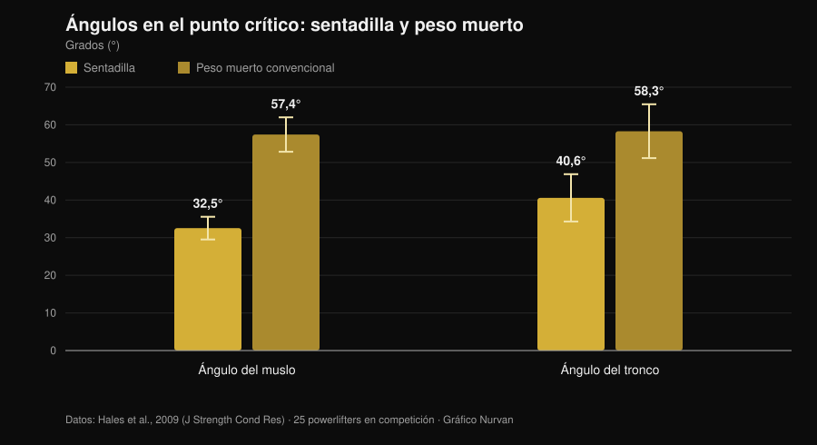
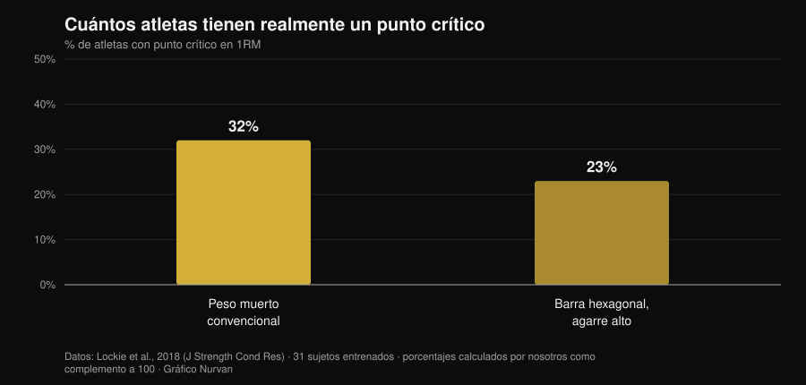

# Peso muerto a tempo hasta la rodilla: ¿sirve?

Por [Giammaria Loi](/autore/giammaria-loi) · actualizado el 1 de noviembre de 2026

Hay una variante de peso muerto que circula mucho entre powerlifters: sales lento, controlas la barra hasta la rodilla y después aceleras. Se llama *tempo to knee*, y quien la programa dice que sirve para "sentir" la posición de salida y corregir la cadera que sube de golpe. La idea es buena. El problema es que casi todo lo que se le atribuye — más fuerza, más músculo, mejor técnica — viene de tres afirmaciones distintas que la investigación trata de forma muy diferente. Conviene separarlas, porque dos se sostienen y una no.

## En resumen

- **La variante concreta nunca se ha estudiado.** Ningún ensayo de intervención indexado en PubMed ha probado el peso muerto a tempo hasta la rodilla (comprobado el 1 de noviembre de 2026). Quien diga lo contrario está extrapolando.
- **El peso muerto ya es lento donde importa.** En el punto crítico la velocidad vertical de la barra es de **0,20 m/s** en el peso muerto frente a **0,09 m/s** en la sentadilla, con ángulos de muslo y tronco mucho más abiertos (Hales et al., 2009).
- **Que la cadera suba antes no es un error: es el movimiento.** El mismo trabajo clasifica el peso muerto como movimiento **secuencial** y la sentadilla como **simultáneo**. El grado es discutible, el fenómeno no.
- **Ir lento no hace crecer más.** De 0,5 a 8 segundos por repetición la hipertrofia es equivalente; por encima de 10 segundos empeora (Schoenfeld et al., 2015).
- **Y tampoco da más fuerza.** Rápido y moderado-lento producen ganancias similares, con una ventaja que, si acaso, se inclina hacia lo rápido en la franja del 60-79% del 1RM (Davies et al., 2017).
- **No todo el mundo tiene punto crítico.** En el peso muerto convencional el **68% de los sujetos no muestra ningún sticking point medible** (Lockie et al., 2018).

## Qué es, en la práctica

En el *tempo to knee* impones una duración fija — normalmente de 3 a 5 segundos — al tramo que va del suelo a la altura de la rodilla, y luego completas el levantamiento a velocidad normal. No es un peso muerto déficit ni una pausa estática: es una ralentización controlada de la primera parte de la subida.

El objetivo declarado es doble: obligarte a permanecer en la posición inicial el tiempo suficiente para notar dónde está el peso, e impedir que las caderas se eleven antes que los hombros. Son objetivos de control motor, no de fuerza. Tener presente esa distinción es media tarea, porque es justo ahí donde el argumento suele resbalar.

## Qué dice realmente la investigación

### Afirmación 1 — "El peso muerto se pierde en el primer tramo"
**Confirmado, con matices.**

Un análisis tridimensional de 25 powerlifters durante una competición regional midió qué ocurre en el punto crítico de ambos levantamientos. El resultado es claro.

*Gráfico Nurvan sobre datos de Hales et al., 2009 (J Strength Cond Res). Medias y desviaciones estándar publicadas en el artículo; 25 powerlifters en competición, cuatro cámaras sincronizadas a 60 Hz.*

En el peso muerto el tronco está inclinado hacia delante casi 60 grados en el momento más duro del levantamiento, frente a los 40 de la sentadilla. La palanca sobre la columna es sencillamente más larga. Y es en el primer tramo donde esa palanca es máxima: no es una opinión de gimnasio, es geometría medida en competición.

Así que sí, la primera parte del peso muerto es el tramo frágil. Pero cuidado con la conclusión: "es frágil" no implica "hay que ejecutarla lenta a propósito". El peso muerto ya va lentísimo ahí — 0,20 m/s en el punto crítico — y con cargas altas se frena todavía más solo. Una revisión sistemática de 2025 sobre 22 estudios y 293 atletas experimentados confirma que, al subir la intensidad, caen la velocidad media y la de pico, se alargan las duraciones concéntricas y aumenta la variabilidad articular justo en las fases de aceleración y sticking (Bakhshinejad et al., 2025).

### Afirmación 2 — "La cadera que sube antes es un error a corregir"
**Matizable.**

Es la razón más citada para programar la variante y la que más cautela merece. El estudio de Hales concluye que la sentadilla es un movimiento **sinérgico y simultáneo**, mientras que el peso muerto es **secuencial y segmentado**: las articulaciones no se extienden a la vez, se van pasando el trabajo. Que la cadera se eleve antes que los hombros, dentro de ciertos límites, *es* el peso muerto.

La comparación entre variantes refuerza el cuadro. En once mujeres entrenadas evaluadas en un 3RM, convencional y sumo producen momentos articulares de cadera mayores cerca del bloqueo que la barra hexagonal, que en cambio carga más la rodilla y permite velocidades de barra superiores (Gundersen et al., 2025). Cuanto más dominante de cadera es el levantamiento, más esperable es la secuencia cadera-primero.

El problema real no es que las caderas suban: es que suban **tanto** que el peso muerto se convierta en un peso muerto rumano con la barra ya lejos del cuerpo. Eso es una diferencia de grado, y un ejercicio de control puede ayudar a notarla. Pero llamar "error" al fenómeno en sí lleva a entrenar contra la mecánica del ejercicio.

### Afirmación 3 — "Sirve para superar el punto crítico"
**Matizable.**

El punto crítico del peso muerto no es universal. En 31 sujetos entrenados medidos con transductor lineal durante un máximo, la mayoría no mostraba ninguno.

*Gráfico Nurvan sobre datos de Lockie et al., 2018 (J Strength Cond Res). Porcentajes calculados por nosotros como complemento de las proporciones de sujetos sin sticking region publicadas en el resumen (68% y 77%); 31 sujetos entrenados, 21 hombres y 10 mujeres.*

Dos atletas de cada tres no tienen un punto crítico que atacar en el peso muerto convencional. Antes de montar un bloque de entrenamiento encima, conviene comprobar que lo tienes: graba una serie pesada de un solo levantamiento desde el lateral y mira si la barra se frena de verdad en un punto concreto o si decelera de forma uniforme.

### Afirmación 4 — "Más tiempo bajo tensión, más músculo"
**Desmentido.**

Es la justificación habitual de toda variante lenta, y el metanálisis la cierra. Ocho estudios de comparación directa entre duraciones de repetición: la hipertrofia es **equivalente en todo el intervalo de 0,5 a 8 segundos**, y solo empeora al superar los 10 segundos por repetición (Schoenfeld et al., 2015).

Un trabajo posterior muestra por qué la contabilidad del "tiempo bajo tensión" engaña: con el tiempo bajo tensión igualado a 60 segundos, el tempo lento permite usar una carga externa mayor, pero el tempo tradicional produce más volumen total, más lactato, más frecuencia cardíaca y un RPE más alto (Mang et al., 2022). Los dos protocolos no son la misma sesión con otro cronómetro: son estímulos distintos.

### Afirmación 5 — "Entrenar lento construye más fuerza"
**Desmentido.**

Quince estudios comparando ejecuciones rápidas y moderado-lentas con volumen e intensidad igualados: las ganancias de fuerza dinámica son similares, independientemente de la edad y la experiencia. Donde aparece una diferencia, es una tendencia a favor de lo **rápido** en la franja del 60-79% del 1RM (TE 0,31; p = 0,06) (Davies et al., 2017).

Hay más, y tiene que ver con la intención más que con el cronómetro. Veintiséis sujetos instruidos con indicaciones de foco externo produjeron velocidades de barra significativamente mayores que quienes recibían indicaciones de foco interno, con la misma carga (Finlay et al., 2025). Cómo te dices que tienes que empujar cambia cuánto empujas. Un ejercicio que te acostumbra a no empujar fuerte en el primer tramo debe usarse sabiendo qué entrena: el control, no la intención de acelerar.

### Afirmación 6 — "Va bien con cargas altas"
**Matizable.**

Con cargas cercanas al máximo la ralentización llega sola y la variabilidad técnica aumenta (Bakhshinejad et al., 2025): imponer un tempo por encima significa sencillamente levantar menos. Hay además un detalle del que se habla poco: en la sentadilla al 60% del 1RM, el pico de estiramiento del tendón rotuliano fue **mayor** en las ejecuciones rápidas que con un tempo lento 2-1-2 (Earp et al., 2016). El tempo lento es por tanto más amable con los tendones, lo que lo hace útil en fases de carga alta — y justo por eso no es el sitio donde buscar tu máximo.

## Cómo aplicarlo

Si decides usarlo, trátalo como lo que es: un accesorio de control.

1. **Comprueba que lo necesitas.** Graba dos levantamientos pesados desde el lateral. Si la cadera sube poco y la barra se mantiene cerca de la tibia, tienes otro problema que resolver.
2. **Mantén la carga submáxima.** La franja donde el tempo impuesto sigue siendo ejecutable sin destrozar la técnica es orientativamente el 60-75% del 1RM, con 3 a 5 repeticiones. Por encima, el tempo lo marca la barra.
3. **Aplica el tempo solo al tramo que te interesa.** Del suelo a la rodilla en 3-5 segundos y después completa a velocidad normal. Frenar también el bloqueo cambia el ejercicio sin añadir información.
4. **No sustituyas con él el peso muerto de competición.** Colócalo después del levantamiento principal, 2-4 series, en un bloque de 4 a 6 semanas.
5. **Mide si está funcionando.** El parámetro no es la carga de la variante: es la altura a la que sube tu cadera en el peso muerto normal y la velocidad del primer tramo con los mismos kilos.
6. **Separa los dos ejercicios en el registro.** El máximo de la variante no es tu máximo: tenerlos en la misma línea es la forma más rápida de confundir un progreso técnico con uno de fuerza.

Vale el mismo principio que vimos al hablar de [series, repeticiones y descanso para la hipertrofia](/es/blog/cuantas-repeticiones-masa-muscular): una variable aislada cuenta poco si el resto del programa no la acompaña.

> **Prueba Nurvan — cada variante con su historial de cargas**
>
> En Nurvan el peso muerto a tempo es un ejercicio aparte: cargas, repeticiones y RIR quedan separados de los del peso muerto de competición, así ves si la variante progresa sin que los números se mezclen. Las series de calentamiento se proponen automáticamente sobre la carga de trabajo del día, y el historial te dice si el primer tramo está mejorando o si solo estás acumulando series. [Prueba Nurvan](https://nurvan.app)

## Preguntas frecuentes

**¿Cuántos segundos debe durar un tempo to knee?**
Quien los programa suele usar 3-5 segundos del suelo a la rodilla. No existe ningún estudio sobre la variante que indique una duración óptima; lo que sí sabemos es que por encima de 10 segundos por repetición los efectos hipertróficos empeoran (Schoenfeld et al., 2015), así que no tiene sentido alargar más.

**¿Funciona también para el peso muerto convencional?**
El post de partida lo presenta como variante de sumo, pero el razonamiento — permanecer más tiempo en la posición inicial — no depende de la amplitud del stance. El convencional tiene incluso el tronco más inclinado en el punto crítico (Hales et al., 2009), es decir, un tramo inicial aún más expuesto. No hay datos que comparen ambas aplicaciones.

**Me duele la espalda en el peso muerto, ¿me ayuda esta variante?**
Un dolor persistente o que empeora debe valorarlo un médico o un fisioterapeuta antes de cambiar de ejercicio. Ninguna variante técnica es un tratamiento, y un ejercicio que reduce la carga puede enmascarar un problema en lugar de resolverlo.

**¿Mejor peso muerto a tempo o con pausa?**
No hay comparación directa en la literatura. Son dos ejercicios con lógicas distintas: la pausa aísla una posición, el tempo reparte el control por todo el tramo. Elige según lo que pierdas: una posición concreta o la secuencia en su conjunto.

## Lee también

- [Series, repeticiones y descanso para la hipertrofia](/es/blog/cuantas-repeticiones-masa-muscular) — cuánto pesan de verdad las variables de programación, con números.
- [Rodillas hacia fuera en la sentadilla: ¿regla o cue?](/es/blog/rodillas-hacia-fuera-sentadilla) — otro cue técnico muy repetido, pasado por el filtro de los estudios.
- [Agarre bulldog en press de banca: qué dicen los estudios](/es/blog/agarre-bulldog-press-banca) — qué hacer cuando una técnica extendida nunca se ha medido.

## Fuentes

- Hales ME, Johnson BF, Johnson JT, 2009. Kinematic analysis of the powerlifting style squat and the conventional deadlift during competition: is there a cross-over effect between lifts? *Journal of Strength and Conditioning Research* 23(9):2574-80. PMID 19910816. [DOI](https://doi.org/10.1519/JSC.0b013e3181bc1d2a)
- Lockie RG, Moreno MR, Lazar A, et al., 2018. The 1 Repetition Maximum Mechanics of a High-Handle Hexagonal Bar Deadlift Compared With a Conventional Deadlift as Measured by a Linear Position Transducer. *Journal of Strength and Conditioning Research* 32(1):150-161. PMID 28394830. [DOI](https://doi.org/10.1519/JSC.0000000000001781)
- Schoenfeld BJ, Ogborn DI, Krieger JW, 2015. Effect of repetition duration during resistance training on muscle hypertrophy: a systematic review and meta-analysis. *Sports Medicine* 45(4):577-85. PMID 25601394. [DOI](https://doi.org/10.1007/s40279-015-0304-0)
- Davies TB, Kuang K, Orr R, Halaki M, Hackett D, 2017. Effect of Movement Velocity During Resistance Training on Dynamic Muscular Strength: A Systematic Review and Meta-Analysis. *Sports Medicine* 47(8):1603-1617. PMID 28105573. [DOI](https://doi.org/10.1007/s40279-017-0676-4)
- Bakhshinejad JA, Ramer JD, Dunsmore KA, Pelton LM, Berglund L, 2025. Effects of Intensity and Fatigue on the Kinetics and Kinematics of the Barbell Squat, Bench Press, and Deadlift in Experienced Lifters: A Systematic Review. *Sports Medicine - Open* 11(1):115. PMID 41085612. [DOI](https://doi.org/10.1186/s40798-025-00921-x)
- Mang ZA, Realzola RA, Ducharme J, et al., 2022. The effect of repetition tempo on cardiovascular and metabolic stress when time under tension is matched during lower body exercise. *European Journal of Applied Physiology* 122(6):1485-1495. PMID 35394146. [DOI](https://doi.org/10.1007/s00421-022-04941-3)
- Earp JE, Newton RU, Cormie P, Blazevich AJ, 2016. Faster Movement Speed Results in Greater Tendon Strain during the Loaded Squat Exercise. *Frontiers in Physiology* 7:366. PMID 27630574. [DOI](https://doi.org/10.3389/fphys.2016.00366)
- Gundersen AH, van den Tillaar R, Falch HN, Fredriksen AB, Larsen S, 2025. A Biomechanical Comparison Between Conventional, Sumo, and Hex-Bar Deadlifts Among Resistance Trained Women. *Journal of Strength and Conditioning Research* 39(3):281-288. PMID 39705135. [DOI](https://doi.org/10.1519/JSC.0000000000005011)
- Finlay M, Marchant D, Langley C, Simpson T, 2025. Impact of attentional focus and action verbs on bench press performance. *Human Movement Science* 102:103385. PMID 40602018. [DOI](https://doi.org/10.1016/j.humov.2025.103385)

Referencias recuperadas a través de PubMed. Punto de partida: publicación de [Reactive Training Systems con Adam Jones](https://www.instagram.com/p/DduBVWWiQOw/) del 25 de septiembre de 2026. El contenido del post se usó solo para identificar el tema y las afirmaciones a verificar: no se ha reutilizado ningún texto, imagen ni estructura.

---

Giammaria Loi es el fundador de Nurvan. Entrena con pesas desde 2012, trabaja como entrenador personal y coach certificado FIPE desde 2013 y compite en powerlifting a nivel nacional desde 2018. Cada artículo que firma parte de los estudios científicos y llega a lo que funciona de verdad en el gimnasio.

> Nota: contenido informativo, no sustituye la opinión de un médico o profesional.
