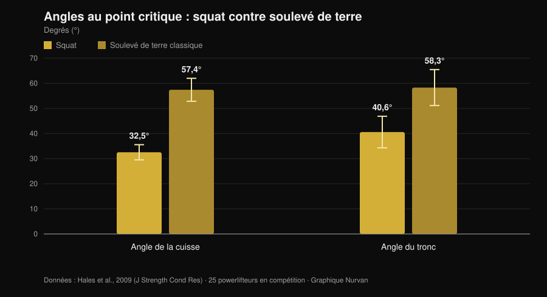
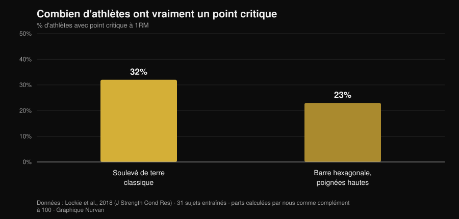

# Soulevé de terre tempo jusqu'au genou : utile ?

Par [Giammaria Loi](/autore/giammaria-loi) · mis à jour le 1er novembre 2026

Une variante de soulevé de terre circule beaucoup chez les powerlifteurs : tu démarres lentement, tu contrôles la barre jusqu'au genou, puis tu accélères. On l'appelle *tempo to knee*, et ceux qui la programment disent qu'elle sert à « sentir » la position de départ et à corriger les hanches qui montent trop vite. L'idée est bonne. Le problème, c'est que presque tout ce qu'on lui attribue — plus de force, plus de muscle, une meilleure technique — découle de trois affirmations distinctes que la recherche traite très différemment. Il vaut la peine de les séparer, parce que deux tiennent et une non.

## En bref

- **Cette variante précise n'a jamais été étudiée.** Aucun essai d'intervention indexé sur PubMed n'a testé le soulevé de terre tempo jusqu'au genou (vérifié le 1er novembre 2026). Dire le contraire, c'est extrapoler.
- **Le soulevé de terre est déjà lent là où ça compte.** Au point critique, la vitesse verticale de la barre est de **0,20 m/s** au soulevé de terre contre **0,09 m/s** au squat, avec des angles de cuisse et de tronc bien plus ouverts (Hales et al., 2009).
- **Les hanches qui montent en premier ne sont pas une faute : c'est le mouvement.** La même étude classe le soulevé de terre comme mouvement **séquentiel** et le squat comme **simultané**. Le degré se discute, le phénomène non.
- **Ralentir ne fait pas grossir davantage.** De 0,5 à 8 secondes par répétition, l'hypertrophie est équivalente ; au-delà de 10 secondes, elle se dégrade (Schoenfeld et al., 2015).
- **Et ça ne donne pas plus de force non plus.** Rapide et modéré-lent produisent des gains comparables, avec un avantage qui penche plutôt vers le rapide dans la plage 60-79 % du 1RM (Davies et al., 2017).
- **Tout le monde n'a pas de point critique.** Au soulevé de terre classique, **68 % des sujets ne montrent aucun sticking point mesurable** (Lockie et al., 2018).

## Ce que c'est, concrètement

Dans le *tempo to knee*, tu imposes une durée fixe — généralement 3 à 5 secondes — à la portion qui va du sol à la hauteur du genou, puis tu termines à vitesse normale. Ce n'est pas un soulevé en déficit ni une pause statique : c'est un ralentissement contrôlé de la première partie de la montée.

L'objectif affiché est double : t'obliger à rester assez longtemps dans la position de départ pour percevoir où se trouve la charge, et empêcher les hanches de monter avant les épaules. Ce sont des objectifs de contrôle moteur, pas de force. Garder cette distinction en tête, c'est la moitié du travail, car c'est exactement là que le raisonnement dérape d'habitude.

## Ce que dit vraiment la recherche

### Affirmation 1 — « Le soulevé de terre se perd dans les premiers centimètres »
**Confirmé, avec une nuance.**

Une analyse tridimensionnelle menée sur 25 powerlifteurs pendant une compétition régionale a mesuré ce qui se passe au point critique des deux mouvements. Le résultat est net.

*Graphique Nurvan d'après les données de Hales et al., 2009 (J Strength Cond Res). Moyennes et écarts-types publiés dans l'article ; 25 powerlifteurs en compétition, quatre caméras synchronisées à 60 Hz.*

Au soulevé de terre, le tronc est penché vers l'avant de près de 60 degrés au moment le plus dur du mouvement, contre 40 au squat. Le bras de levier sur la colonne est tout simplement plus long. Et c'est dans la première portion qu'il est maximal : ce n'est pas une opinion de salle, c'est de la géométrie mesurée en compétition.

Donc oui, la première partie du soulevé de terre est la portion fragile. Mais attention à la conclusion qu'on en tire : « c'est fragile » n'implique pas « il faut l'exécuter lentement exprès ». Le soulevé de terre y est déjà très lent — 0,20 m/s au point critique — et avec des charges lourdes il ralentit encore tout seul. Une revue systématique de 2025 portant sur 22 études et 293 athlètes expérimentés confirme qu'avec l'augmentation de l'intensité, la vitesse moyenne et la vitesse de pointe chutent, les durées concentriques s'allongent et la variabilité articulaire augmente précisément dans les phases d'accélération et de sticking (Bakhshinejad et al., 2025).

### Affirmation 2 — « Les hanches qui montent trop vite sont une faute à corriger »
**À nuancer.**

C'est la raison la plus citée pour programmer cette variante, et celle qui mérite le plus de prudence. L'étude de Hales conclut que le squat est un mouvement **synergique et simultané**, tandis que le soulevé de terre est **séquentiel et segmenté** : les articulations ne s'étendent pas ensemble, elles se passent le travail. Que le bassin monte avant les épaules, dans certaines limites, *c'est* le soulevé de terre.

La comparaison entre variantes renforce le tableau. Chez onze femmes entraînées testées sur un 3RM, le classique et le sumo produisent des moments articulaires de hanche plus élevés près du verrouillage que la barre hexagonale, qui charge davantage le genou et permet des vitesses de barre supérieures (Gundersen et al., 2025). Plus le mouvement est dominant de hanche, plus la séquence hanches-d'abord est attendue.

Le vrai problème n'est pas que les hanches montent : c'est qu'elles montent **à ce point** que le soulevé devient un soulevé jambes tendues avec la barre déjà éloignée du corps. C'est une différence de degré, et un exercice de contrôle peut aider à la sentir. Mais appeler « faute » le phénomène lui-même revient à s'entraîner contre la mécanique de l'exercice.

### Affirmation 3 — « Ça sert à passer le point critique »
**À nuancer.**

Le point critique du soulevé de terre n'est pas universel. Sur 31 sujets entraînés mesurés au transducteur linéaire pendant un maximal, la majorité n'en présentait aucun.

*Graphique Nurvan d'après les données de Lockie et al., 2018 (J Strength Cond Res). Pourcentages calculés par nos soins comme complément des parts de sujets sans sticking region indiquées dans le résumé (68 % et 77 %) ; 31 sujets entraînés, 21 hommes et 10 femmes.*

Deux athlètes sur trois n'ont pas de point critique à attaquer au soulevé de terre classique. Avant de construire un bloc d'entraînement dessus, mieux vaut vérifier que tu en as un : filme une série d'un seul répétition lourde de profil et regarde si la barre ralentit vraiment à un endroit précis, ou si elle décélère de façon régulière.

### Affirmation 4 — « Plus de temps sous tension, plus de muscle »
**Démenti.**

C'est la justification récurrente de toute variante lente, et la méta-analyse la referme. Huit études comparant directement différentes durées de répétition : l'hypertrophie est **équivalente sur tout l'intervalle de 0,5 à 8 secondes**, et ne se dégrade qu'au-delà de 10 secondes par répétition (Schoenfeld et al., 2015).

Un travail ultérieur montre pourquoi la comptabilité du « temps sous tension » induit en erreur : à temps sous tension égalisé à 60 secondes, le tempo lent permet une charge externe plus élevée, mais le tempo traditionnel produit plus de volume total, plus de lactate, une fréquence cardiaque plus haute et un RPE supérieur (Mang et al., 2022). Les deux protocoles ne sont pas la même séance avec un autre chronomètre : ce sont des stimuli différents.

### Affirmation 5 — « S'entraîner lentement construit plus de force »
**Démenti.**

Quinze études comparant exécutions rapides et modéré-lentes à volume et intensité égalisés : les gains de force dynamique sont similaires, quels que soient l'âge et l'expérience. Là où une différence apparaît, c'est une tendance en faveur du **rapide** dans la plage 60-79 % du 1RM (TE 0,31 ; p = 0,06) (Davies et al., 2017).

Il y a plus, et cela concerne l'intention plus que le chronomètre. Vingt-six sujets recevant des consignes à focus externe ont produit des vitesses de barre significativement supérieures à ceux recevant des consignes à focus interne, à charge égale (Finlay et al., 2025). La façon dont tu te dis de pousser change la force que tu produis. Un exercice qui t'habitue à ne pas pousser fort dans la première portion doit donc être utilisé en sachant ce qu'il entraîne : le contrôle, pas l'intention d'accélérer.

### Affirmation 6 — « Ça marche avec des charges lourdes »
**À nuancer.**

Près du maximal, le ralentissement arrive tout seul et la variabilité technique augmente (Bakhshinejad et al., 2025) : imposer un tempo par-dessus revient simplement à soulever moins. Il y a aussi un point dont on parle peu : au squat à 60 % du 1RM, le pic de déformation du tendon rotulien s'est révélé **plus élevé** lors des exécutions rapides que sur un tempo lent 2-1-2 (Earp et al., 2016). Le tempo lent est donc plus doux pour les tendons, ce qui en fait un bon outil dans les phases de charge élevée — et précisément pour cette raison, ce n'est pas là qu'on cherche son maximal.

## Comment l'appliquer

Si tu décides de l'utiliser, traite-le pour ce qu'il est : un accessoire de contrôle.

1. **Vérifie que tu en as besoin.** Filme deux séries lourdes d'une répétition de profil. Si le bassin monte peu et que la barre reste près du tibia, tu as un autre problème à résoudre.
2. **Garde la charge sous-maximale.** La plage où le tempo imposé reste exécutable sans déformer la technique se situe autour de 60-75 % du 1RM, sur 3 à 5 répétitions. Au-dessus, c'est la barre qui dicte le tempo.
3. **N'applique le tempo qu'à la portion visée.** Du sol au genou en 3 à 5 secondes, puis termine à vitesse normale. Ralentir aussi le verrouillage change l'exercice sans ajouter d'information.
4. **Ne remplace pas le soulevé de compétition par lui.** Place-le après le mouvement principal, 2 à 4 séries, sur un bloc de 4 à 6 semaines.
5. **Mesure si ça fonctionne.** Le critère n'est pas la charge de la variante : c'est la hauteur à laquelle montent tes hanches sur ton soulevé normal, et la vitesse de la première portion à charge égale.
6. **Sépare les deux exercices dans ton carnet.** Le maximal de la variante n'est pas ton maximal : les garder sur la même ligne, c'est le moyen le plus rapide de confondre un progrès technique et un progrès de force.

Le même principe s'applique que dans notre article sur [séries, répétitions et récupération pour l'hypertrophie](/fr/blog/combien-de-repetitions-masse-musculaire) : une variable isolée pèse peu si le reste du programme ne la soutient pas.

> **Essaie Nurvan — chaque variante a son propre historique de charges**
>
> Dans Nurvan, le soulevé de terre tempo est un exercice à part entière : charges, répétitions et RIR restent séparés de ceux du soulevé de compétition, pour voir si la variante progresse sans que les chiffres se mélangent. Les séries d'échauffement sont proposées automatiquement à partir de la charge de travail du jour, et l'historique te dit si la première portion s'améliore ou si tu empiles seulement des séries. [Essaie Nurvan](https://nurvan.app)

## Questions fréquentes

**Combien de secondes doit durer un tempo to knee ?**
Ceux qui les programment utilisent généralement 3 à 5 secondes du sol au genou. Aucune étude sur la variante n'indique de durée optimale ; ce que l'on sait, c'est qu'au-delà de 10 secondes par répétition les adaptations hypertrophiques se dégradent (Schoenfeld et al., 2015), donc rien ne justifie d'allonger davantage.

**Est-ce que ça marche aussi pour le soulevé classique ?**
Le post d'origine la présente comme une variante de sumo, mais le raisonnement — rester plus longtemps dans la position initiale — ne dépend pas de l'écartement des pieds. Le classique a même un tronc plus penché au point critique (Hales et al., 2009), donc une première portion encore plus exposée. Aucune donnée ne compare les deux applications.

**J'ai mal au dos au soulevé de terre : cette variante peut-elle m'aider ?**
Une douleur persistante ou qui s'aggrave doit être évaluée par un médecin ou un kinésithérapeute avant tout changement d'exercice. Aucune variante technique n'est un traitement, et un exercice qui réduit la charge peut masquer un problème au lieu de le résoudre.

**Tempo ou pause au soulevé de terre ?**
Il n'existe pas de comparaison directe dans la littérature. Ce sont deux exercices de logiques différentes : la pause isole une position, le tempo répartit le contrôle sur toute la portion. Choisis selon ce que tu perds — une position précise ou la séquence dans son ensemble.

## À lire aussi

- [Séries, répétitions et récupération pour l'hypertrophie](/fr/blog/combien-de-repetitions-masse-musculaire) — ce que pèsent vraiment les variables de programmation, chiffres à l'appui.
- [Genoux vers l'extérieur au squat : règle ou cue ?](/fr/blog/genoux-vers-exterieur-squat) — un autre repère technique très répété, passé au crible des études.
- [Prise bulldog au développé couché : ce que disent les études](/fr/blog/prise-bulldog-developpe-couche) — que faire quand une technique répandue n'a jamais été mesurée.

## Sources

- Hales ME, Johnson BF, Johnson JT, 2009. Kinematic analysis of the powerlifting style squat and the conventional deadlift during competition: is there a cross-over effect between lifts? *Journal of Strength and Conditioning Research* 23(9):2574-80. PMID 19910816. [DOI](https://doi.org/10.1519/JSC.0b013e3181bc1d2a)
- Lockie RG, Moreno MR, Lazar A, et al., 2018. The 1 Repetition Maximum Mechanics of a High-Handle Hexagonal Bar Deadlift Compared With a Conventional Deadlift as Measured by a Linear Position Transducer. *Journal of Strength and Conditioning Research* 32(1):150-161. PMID 28394830. [DOI](https://doi.org/10.1519/JSC.0000000000001781)
- Schoenfeld BJ, Ogborn DI, Krieger JW, 2015. Effect of repetition duration during resistance training on muscle hypertrophy: a systematic review and meta-analysis. *Sports Medicine* 45(4):577-85. PMID 25601394. [DOI](https://doi.org/10.1007/s40279-015-0304-0)
- Davies TB, Kuang K, Orr R, Halaki M, Hackett D, 2017. Effect of Movement Velocity During Resistance Training on Dynamic Muscular Strength: A Systematic Review and Meta-Analysis. *Sports Medicine* 47(8):1603-1617. PMID 28105573. [DOI](https://doi.org/10.1007/s40279-017-0676-4)
- Bakhshinejad JA, Ramer JD, Dunsmore KA, Pelton LM, Berglund L, 2025. Effects of Intensity and Fatigue on the Kinetics and Kinematics of the Barbell Squat, Bench Press, and Deadlift in Experienced Lifters: A Systematic Review. *Sports Medicine - Open* 11(1):115. PMID 41085612. [DOI](https://doi.org/10.1186/s40798-025-00921-x)
- Mang ZA, Realzola RA, Ducharme J, et al., 2022. The effect of repetition tempo on cardiovascular and metabolic stress when time under tension is matched during lower body exercise. *European Journal of Applied Physiology* 122(6):1485-1495. PMID 35394146. [DOI](https://doi.org/10.1007/s00421-022-04941-3)
- Earp JE, Newton RU, Cormie P, Blazevich AJ, 2016. Faster Movement Speed Results in Greater Tendon Strain during the Loaded Squat Exercise. *Frontiers in Physiology* 7:366. PMID 27630574. [DOI](https://doi.org/10.3389/fphys.2016.00366)
- Gundersen AH, van den Tillaar R, Falch HN, Fredriksen AB, Larsen S, 2025. A Biomechanical Comparison Between Conventional, Sumo, and Hex-Bar Deadlifts Among Resistance Trained Women. *Journal of Strength and Conditioning Research* 39(3):281-288. PMID 39705135. [DOI](https://doi.org/10.1519/JSC.0000000000005011)
- Finlay M, Marchant D, Langley C, Simpson T, 2025. Impact of attentional focus and action verbs on bench press performance. *Human Movement Science* 102:103385. PMID 40602018. [DOI](https://doi.org/10.1016/j.humov.2025.103385)

Références récupérées via PubMed. Point de départ : publication de [Reactive Training Systems avec Adam Jones](https://www.instagram.com/p/DduBVWWiQOw/) du 25 septembre 2026. Le contenu du post a servi uniquement à identifier le sujet et les affirmations à vérifier : aucun texte, image ou structure n'a été repris.

---

Giammaria Loi est le fondateur de Nurvan. Il s'entraîne avec les poids depuis 2012, travaille comme entraîneur personnel et coach certifié FIPE depuis 2013 et participe à des compétitions de powerlifting au niveau national depuis 2018. Chaque article qu'il signe part des études scientifiques et aboutit à ce qui fonctionne vraiment en salle.

> Note : contenu informatif, ne remplace pas l'avis d'un médecin ou d'un professionnel.
