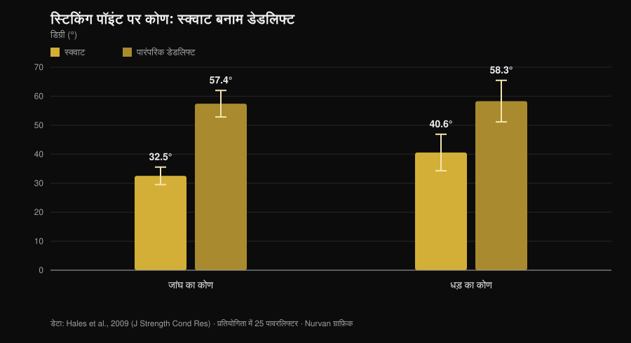
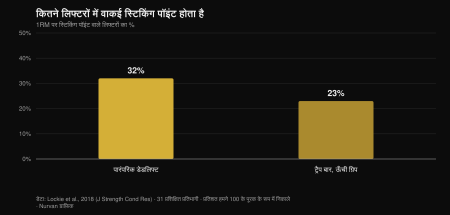

# घुटने तक टेम्पो डेडलिफ्ट: क्या यह सच में काम करती है?

लेखक: [Giammaria Loi](/autore/giammaria-loi) · अपडेट 1 नवंबर 2026

पावरलिफ्टरों के बीच डेडलिफ्ट का एक वैरिएशन खूब चल रहा है: धीरे शुरू करो, बार को घुटने तक कंट्रोल करो, फिर तेज करो। इसे *tempo to knee* कहते हैं, और जो कोच इसे प्रोग्राम करते हैं वे कहते हैं कि यह शुरुआती पोज़िशन को "महसूस" कराती है और एकदम से उठ जाने वाले हिप को ठीक करती है। आइडिया अच्छा है। दिक्कत यह है कि इसे जो भी श्रेय दिया जाता है — ज़्यादा ताकत, ज़्यादा मसल, बेहतर तकनीक — वह तीन अलग-अलग दावों से आता है, और रिसर्च इन तीनों के साथ बहुत अलग बर्ताव करती है। इन्हें अलग करना ज़रूरी है, क्योंकि दो टिकते हैं और एक नहीं।

## संक्षेप में

- **इस वैरिएशन पर कभी अध्ययन हुआ ही नहीं।** PubMed पर कोई भी इंडेक्स्ड इंटरवेंशन ट्रायल घुटने तक टेम्पो डेडलिफ्ट की जाँच नहीं करता (1 नवंबर 2026 को जाँचा गया)। इसके उलट कहने वाले अनुमान लगा रहे हैं।
- **डेडलिफ्ट वहाँ पहले से ही धीमी है जहाँ मायने रखता है।** स्टिकिंग पॉइंट पर बार की ऊर्ध्वाधर गति डेडलिफ्ट में **0.20 m/s** है और स्क्वाट में **0.09 m/s**, और जांघ तथा धड़ के कोण कहीं ज़्यादा खुले होते हैं (Hales et al., 2009)।
- **हिप का पहले उठना गलती नहीं, वही हरकत है।** वही अध्ययन डेडलिफ्ट को **क्रमिक** और स्क्वाट को **एक साथ होने वाली** हरकत बताता है। मात्रा पर बहस हो सकती है, परिघटना पर नहीं।
- **धीमा करने से ज़्यादा मसल नहीं बनती।** प्रति रेप 0.5 से 8 सेकंड तक हाइपरट्रॉफी बराबर रहती है; 10 सेकंड से ऊपर खराब हो जाती है (Schoenfeld et al., 2015)।
- **और ज़्यादा ताकत भी नहीं।** तेज़ और मध्यम-धीमा लगभग बराबर नतीजे देते हैं, और जो हल्की बढ़त दिखती है वह 1RM के 60-79% दायरे में तेज़ की तरफ झुकती है (Davies et al., 2017)।
- **हर किसी का स्टिकिंग पॉइंट नहीं होता।** पारंपरिक डेडलिफ्ट में **68% प्रतिभागियों में कोई मापने लायक स्टिकिंग रीजन मिलता ही नहीं** (Lockie et al., 2018)।

## यह व्यवहार में क्या है

*tempo to knee* में आप ज़मीन से घुटने की ऊँचाई तक के हिस्से पर एक तय अवधि लगाते हैं — आमतौर पर 3 से 5 सेकंड — और फिर सामान्य गति से लिफ्ट पूरी करते हैं। यह डेफिसिट डेडलिफ्ट नहीं है और न ही स्थिर पॉज़: यह उठान के पहले हिस्से की नियंत्रित धीमी गति है।

घोषित मकसद दोहरा है: आपको शुरुआती पोज़िशन में इतनी देर रोकना कि आपको पता चले वज़न असल में कहाँ है, और हिप को कंधों से पहले उठने से रोकना। ये मोटर कंट्रोल के लक्ष्य हैं, ताकत के नहीं। यह फर्क याद रखना आधा काम है, क्योंकि तर्क आमतौर पर ठीक यहीं फिसलता है।

## रिसर्च असल में क्या कहती है

### दावा 1 — "डेडलिफ्ट पहले कुछ सेंटीमीटर में ही खो जाती है"
**पुष्ट, एक शर्त के साथ।**

एक क्षेत्रीय प्रतियोगिता में 25 पावरलिफ्टरों के त्रिआयामी विश्लेषण ने मापा कि दोनों लिफ्टों के स्टिकिंग पॉइंट पर क्या होता है। नतीजा साफ है।

*Nurvan ग्राफ़िक, डेटा Hales et al., 2009 (J Strength Cond Res) से। माध्य और मानक विचलन लेख में दिए अनुसार; प्रतियोगिता में 25 पावरलिफ्टर, 60 Hz पर सिंक्रनाइज़ चार कैमरे।*

डेडलिफ्ट में लिफ्ट के सबसे कठिन क्षण पर धड़ लगभग 60 डिग्री आगे झुका होता है, जबकि स्क्वाट में 40। रीढ़ पर लीवर बस लंबा होता है। और पहले हिस्से में यही लीवर सबसे बड़ा होता है: यह जिम की राय नहीं, प्रतियोगिता में मापी गई ज्यामिति है।

तो हाँ, डेडलिफ्ट का शुरुआती हिस्सा नाज़ुक हिस्सा है। लेकिन निष्कर्ष पर ध्यान दीजिए: "नाज़ुक है" का मतलब "जानबूझकर धीरे करना चाहिए" नहीं होता। डेडलिफ्ट वहाँ पहले से ही रेंगती है — स्टिकिंग पॉइंट पर 0.20 m/s — और भारी वज़न पर खुद और धीमी हो जाती है। 22 अध्ययनों और 293 अनुभवी एथलीटों पर 2025 की एक सिस्टेमैटिक रिव्यू पुष्टि करती है कि तीव्रता बढ़ने पर औसत और शिखर गति गिरती है, कॉन्सेन्ट्रिक अवधि लंबी होती है और जोड़ों की परिवर्तनशीलता ठीक एक्सेलेरेशन तथा स्टिकिंग चरणों में बढ़ती है (Bakhshinejad et al., 2025)।

### दावा 2 — "हिप का जल्दी उठना सुधारने लायक गलती है"
**स्पष्टीकरण चाहिए।**

यह वैरिएशन प्रोग्राम करने की सबसे ज़्यादा उद्धृत वजह है और सबसे ज़्यादा सावधानी माँगने वाली भी। Hales का अध्ययन निष्कर्ष देता है कि स्क्वाट एक **सहक्रियात्मक, एक साथ होने वाली** हरकत है जबकि डेडलिफ्ट **क्रमिक और खंडित**: जोड़ एक साथ नहीं खुलते, वे काम आगे सौंपते हैं। कंधों से पहले हिप का उठना, एक हद तक, *ही* डेडलिफ्ट है।

वैरिएशनों की तुलना इस तस्वीर को और पुख्ता करती है। ग्यारह प्रशिक्षित महिलाओं के 3RM में पारंपरिक और सूमो लॉकआउट के पास हेक्स बार की तुलना में अधिक हिप जॉइंट मोमेंट पैदा करते हैं, जबकि हेक्स बार घुटने पर ज़्यादा भार डालता है और अधिक बार स्पीड देता है (Gundersen et al., 2025)। लिफ्ट जितनी हिप-प्रधान होगी, "पहले हिप" वाला क्रम उतना ही अपेक्षित है।

असली समस्या हिप का उठना नहीं, बल्कि **इतना** उठना है कि डेडलिफ्ट सीधी टाँगों वाली लिफ्ट बन जाए और बार शरीर से दूर चला जाए। यह मात्रा का अंतर है, और एक कंट्रोल ड्रिल इसे महसूस करने में मदद कर सकती है। लेकिन परिघटना को ही "गलती" कहना मतलब व्यायाम की यांत्रिकी के खिलाफ ट्रेन करना।

### दावा 3 — "यह स्टिकिंग पॉइंट पार करने में मदद करती है"
**स्पष्टीकरण चाहिए।**

डेडलिफ्ट का स्टिकिंग पॉइंट सार्वभौमिक नहीं है। अधिकतम प्रयास के दौरान लीनियर पोज़िशन ट्रांसड्यूसर से मापे गए 31 प्रशिक्षित प्रतिभागियों में से अधिकांश में यह था ही नहीं।

*Nurvan ग्राफ़िक, डेटा Lockie et al., 2018 (J Strength Cond Res) से। प्रतिशत हमने सार में दिए गए बिना स्टिकिंग रीजन वाले प्रतिभागियों के अनुपात (68% और 77%) के पूरक के रूप में निकाले; 31 प्रशिक्षित प्रतिभागी, 21 पुरुष और 10 महिलाएँ।*

तीन में से दो एथलीटों के पास पारंपरिक डेडलिफ्ट में हमला करने लायक कोई स्टिकिंग पॉइंट है ही नहीं। उसके इर्द-गिर्द ट्रेनिंग ब्लॉक बनाने से पहले यह पक्का कर लेना ठीक रहेगा कि आपके पास एक है: एक भारी सिंगल को साइड से फिल्म करें और देखें कि बार वाकई किसी खास ऊँचाई पर अटकता है या समान रूप से धीमा होता है।

### दावा 4 — "जितना ज़्यादा टाइम अंडर टेंशन, उतनी ज़्यादा मसल"
**गलत।**

यह हर धीमे वैरिएशन का मानक तर्क है, और मेटा-एनालिसिस इसे बंद कर देती है। रेप अवधि की सीधी तुलना करने वाले आठ अध्ययन: हाइपरट्रॉफी **0.5 से 8 सेकंड के पूरे दायरे में बराबर** है, और सिर्फ़ प्रति रेप 10 सेकंड से ऊपर खराब होती है (Schoenfeld et al., 2015)।

बाद का एक काम दिखाता है कि "टाइम अंडर टेंशन" का हिसाब क्यों भ्रमित करता है: टाइम अंडर टेंशन को 60 सेकंड पर बराबर करने पर धीमा टेम्पो ज़्यादा बाहरी भार की इजाज़त देता है, लेकिन पारंपरिक टेम्पो ज़्यादा कुल वॉल्यूम, ज़्यादा लैक्टेट, ज़्यादा हृदय गति और ऊँचा RPE पैदा करता है (Mang et al., 2022)। दोनों प्रोटोकॉल अलग स्टॉपवॉच वाला एक ही सेशन नहीं हैं: ये अलग उद्दीपन हैं।

### दावा 5 — "धीरे ट्रेन करने से ज़्यादा ताकत बनती है"
**गलत।**

पंद्रह अध्ययन, वॉल्यूम और तीव्रता बराबर रखते हुए तेज़ बनाम मध्यम-धीमे निष्पादन की तुलना: डायनेमिक स्ट्रेंथ में बढ़त समान है, उम्र और अनुभव से स्वतंत्र। जहाँ अंतर दिखता है, वह 1RM के 60-79% दायरे में **तेज़** के पक्ष में रुझान है (ES 0.31; p = 0.06) (Davies et al., 2017)।

एक बात और, और वह स्टॉपवॉच से ज़्यादा इरादे की है। छब्बीस प्रतिभागियों में, बाहरी फोकस वाले निर्देश पाने वालों ने समान भार पर आंतरिक फोकस वाले निर्देश पाने वालों से काफ़ी अधिक बार स्पीड पैदा की (Finlay et al., 2025)। आप खुद से "धक्का दो" कैसे कहते हैं, यह बदल देता है कि आप कितना ज़ोर लगाते हैं। इसलिए जो ड्रिल आपको पहले हिस्से में ज़ोर न लगाने की आदत डालती है, उसे यह समझकर इस्तेमाल करना चाहिए कि वह क्या ट्रेन कर रही है: नियंत्रण, तेज़ होने का इरादा नहीं।

### दावा 6 — "भारी वज़न पर भी ठीक है"
**स्पष्टीकरण चाहिए।**

अधिकतम के पास धीमापन खुद आ जाता है और तकनीकी परिवर्तनशीलता बढ़ती है (Bakhshinejad et al., 2025): उसके ऊपर टेम्पो थोपने का मतलब बस कम उठाना है। एक और बात जिस पर कम चर्चा होती है: 1RM के 60% पर स्क्वाट में पटेलर टेंडन का शिखर स्ट्रेन धीमे 2-1-2 टेम्पो की तुलना में तेज़ निष्पादन में **अधिक** पाया गया (Earp et al., 2016)। यानी धीमा टेम्पो टेंडन के लिए नरम है, जो इसे ऊँचे भार वाले चरणों में उपयोगी बनाता है — और ठीक इसी वजह से यह अपना मैक्स खोजने की जगह नहीं है।

## इसे कैसे लागू करें

अगर इस्तेमाल करने का तय करें, तो इसे वही समझें जो यह है: नियंत्रण का एक सहायक व्यायाम।

1. **जाँचें कि आपको इसकी ज़रूरत है।** दो भारी सिंगल साइड से फिल्म करें। अगर हिप थोड़ा ही उठता है और बार पिंडली के पास रहता है, तो आपकी समस्या कुछ और है।
2. **भार सब-मैक्सिमल रखें।** जिस दायरे में थोपा गया टेम्पो तकनीक बिगाड़े बिना निभ पाता है, वह मोटे तौर पर 1RM का 60-75% है, 3 से 5 रेप के साथ। उससे ऊपर टेम्पो बार तय करता है।
3. **टेम्पो सिर्फ़ उसी हिस्से पर लगाएँ जो मायने रखता है।** ज़मीन से घुटने तक 3-5 सेकंड, फिर सामान्य गति से पूरा करें। लॉकआउट भी धीमा करना व्यायाम बदल देता है पर कोई जानकारी नहीं जोड़ता।
4. **इससे प्रतियोगिता वाली डेडलिफ्ट को न बदलें।** इसे मुख्य लिफ्ट के बाद रखें, 2 से 4 सेट, 4 से 6 हफ़्तों के ब्लॉक में।
5. **नापें कि काम कर रहा है या नहीं।** पैमाना वैरिएशन का वज़न नहीं है: पैमाना यह है कि आपकी सामान्य डेडलिफ्ट में हिप कितना ऊपर उठता है, और उतने ही किलो पर पहले हिस्से की गति कैसी है।
6. **डायरी में दोनों व्यायाम अलग रखें।** वैरिएशन का बेस्ट आपका मैक्स नहीं है: दोनों को एक ही लाइन में रखना तकनीकी प्रगति को ताकत की प्रगति समझ बैठने का सबसे तेज़ तरीका है।

वही सिद्धांत लागू होता है जो हमने [हाइपरट्रॉफी के लिए सेट, रेप और आराम](/hi/blog/kitne-reps-muscle-ke-liye) में देखा था: अकेला एक वेरिएबल तब तक कम मायने रखता है जब तक बाकी प्रोग्राम उसका साथ न दे।

> **Nurvan आज़माएँ — हर वैरिएशन का अपना लोड इतिहास**
>
> Nurvan में टेम्पो डेडलिफ्ट एक अलग व्यायाम है: वज़न, रेप और RIR प्रतियोगिता वाली डेडलिफ्ट से अलग रहते हैं, इसलिए आप देख सकते हैं कि वैरिएशन आगे बढ़ रहा है या नहीं, और आँकड़े आपस में नहीं मिलते। वार्म-अप सेट उस दिन के वर्किंग लोड से अपने आप सुझाए जाते हैं, और इतिहास बताता है कि पहला हिस्सा सुधर रहा है या आप सिर्फ़ सेट जोड़ रहे हैं। [Nurvan आज़माएँ](https://nurvan.app)

## अक्सर पूछे जाने वाले सवाल

**tempo to knee कितने सेकंड का होना चाहिए?**
जो कोच इसे प्रोग्राम करते हैं वे आमतौर पर ज़मीन से घुटने तक 3 से 5 सेकंड लेते हैं। इस वैरिएशन पर कोई अध्ययन नहीं है जो इष्टतम अवधि बताए; हम इतना जानते हैं कि प्रति रेप 10 सेकंड से ऊपर हाइपरट्रॉफिक अनुकूलन खराब होते हैं (Schoenfeld et al., 2015), इसलिए और खींचने का कोई तर्क नहीं।

**क्या यह पारंपरिक डेडलिफ्ट के लिए भी काम करती है?**
मूल पोस्ट इसे सूमो वैरिएशन बताती है, पर तर्क — शुरुआती पोज़िशन में ज़्यादा देर रहना — स्टांस की चौड़ाई पर निर्भर नहीं करता। पारंपरिक में तो स्टिकिंग पॉइंट पर धड़ और ज़्यादा झुका होता है (Hales et al., 2009), यानी पहला हिस्सा और भी खुला हुआ। दोनों उपयोगों की तुलना करने वाला कोई डेटा नहीं है।

**डेडलिफ्ट में मेरी पीठ दुखती है: क्या यह वैरिएशन मदद करेगी?**
लगातार रहने वाला या बढ़ता दर्द व्यायाम बदलने से पहले डॉक्टर या फिजियोथेरेपिस्ट से जँचवाना चाहिए। कोई भी तकनीकी वैरिएशन इलाज नहीं है, और भार घटाने वाली ड्रिल समस्या को हल करने के बजाय ढक सकती है।

**टेम्पो डेडलिफ्ट बेहतर या पॉज़ डेडलिफ्ट?**
साहित्य में सीधी तुलना नहीं है। ये दो अलग तर्क वाली ड्रिल हैं: पॉज़ एक पोज़िशन को अलग करता है, टेम्पो पूरे हिस्से पर नियंत्रण फैलाता है। चुनाव इस आधार पर करें कि आप क्या खोते हैं — कोई खास पोज़िशन या पूरा क्रम।

## यह भी पढ़ें

- [हाइपरट्रॉफी के लिए सेट, रेप और आराम](/hi/blog/kitne-reps-muscle-ke-liye) — प्रोग्रामिंग वेरिएबल असल में कितने मायने रखते हैं, आँकड़ों के साथ।
- [स्क्वाट में घुटने बाहर: नियम या क्यू?](/hi/blog/squat-mein-knees-out-cue) — एक और बार-बार दोहराया जाने वाला तकनीकी क्यू, रिसर्च की कसौटी पर।
- [बेंच प्रेस में बुलडॉग ग्रिप: अध्ययन क्या कहते हैं](/hi/blog/bulldog-grip-bench-press-hindi) — जब कोई लोकप्रिय तकनीक कभी मापी ही न गई हो तो क्या करें।

## स्रोत

- Hales ME, Johnson BF, Johnson JT, 2009. Kinematic analysis of the powerlifting style squat and the conventional deadlift during competition: is there a cross-over effect between lifts? *Journal of Strength and Conditioning Research* 23(9):2574-80. PMID 19910816. [DOI](https://doi.org/10.1519/JSC.0b013e3181bc1d2a)
- Lockie RG, Moreno MR, Lazar A, et al., 2018. The 1 Repetition Maximum Mechanics of a High-Handle Hexagonal Bar Deadlift Compared With a Conventional Deadlift as Measured by a Linear Position Transducer. *Journal of Strength and Conditioning Research* 32(1):150-161. PMID 28394830. [DOI](https://doi.org/10.1519/JSC.0000000000001781)
- Schoenfeld BJ, Ogborn DI, Krieger JW, 2015. Effect of repetition duration during resistance training on muscle hypertrophy: a systematic review and meta-analysis. *Sports Medicine* 45(4):577-85. PMID 25601394. [DOI](https://doi.org/10.1007/s40279-015-0304-0)
- Davies TB, Kuang K, Orr R, Halaki M, Hackett D, 2017. Effect of Movement Velocity During Resistance Training on Dynamic Muscular Strength: A Systematic Review and Meta-Analysis. *Sports Medicine* 47(8):1603-1617. PMID 28105573. [DOI](https://doi.org/10.1007/s40279-017-0676-4)
- Bakhshinejad JA, Ramer JD, Dunsmore KA, Pelton LM, Berglund L, 2025. Effects of Intensity and Fatigue on the Kinetics and Kinematics of the Barbell Squat, Bench Press, and Deadlift in Experienced Lifters: A Systematic Review. *Sports Medicine - Open* 11(1):115. PMID 41085612. [DOI](https://doi.org/10.1186/s40798-025-00921-x)
- Mang ZA, Realzola RA, Ducharme J, et al., 2022. The effect of repetition tempo on cardiovascular and metabolic stress when time under tension is matched during lower body exercise. *European Journal of Applied Physiology* 122(6):1485-1495. PMID 35394146. [DOI](https://doi.org/10.1007/s00421-022-04941-3)
- Earp JE, Newton RU, Cormie P, Blazevich AJ, 2016. Faster Movement Speed Results in Greater Tendon Strain during the Loaded Squat Exercise. *Frontiers in Physiology* 7:366. PMID 27630574. [DOI](https://doi.org/10.3389/fphys.2016.00366)
- Gundersen AH, van den Tillaar R, Falch HN, Fredriksen AB, Larsen S, 2025. A Biomechanical Comparison Between Conventional, Sumo, and Hex-Bar Deadlifts Among Resistance Trained Women. *Journal of Strength and Conditioning Research* 39(3):281-288. PMID 39705135. [DOI](https://doi.org/10.1519/JSC.0000000000005011)
- Finlay M, Marchant D, Langley C, Simpson T, 2025. Impact of attentional focus and action verbs on bench press performance. *Human Movement Science* 102:103385. PMID 40602018. [DOI](https://doi.org/10.1016/j.humov.2025.103385)

संदर्भ PubMed के माध्यम से लिए गए। प्रेरणा: [Reactive Training Systems और Adam Jones](https://www.instagram.com/p/DduBVWWiQOw/) की 25 सितंबर 2026 की पोस्ट। पोस्ट की सामग्री का उपयोग केवल विषय और जाँचने लायक दावों की पहचान के लिए हुआ: कोई टेक्स्ट, छवि या संरचना दोबारा इस्तेमाल नहीं की गई।

---

Giammaria Loi, Nurvan के संस्थापक हैं। वे 2012 से वेट ट्रेनिंग करते हैं, 2013 से FIPE प्रमाणित पर्सनल ट्रेनर और कोच के रूप में काम करते हैं, और 2018 से राष्ट्रीय स्तर पर पावरलिफ्टिंग में प्रतिस्पर्धा करते हैं। उनके हर लेख की शुरुआत वैज्ञानिक अध्ययनों से होती है और अंत इस पर कि जिम में असल में क्या काम करता है।

> नोट: यह जानकारीपरक सामग्री है, यह डॉक्टर या विशेषज्ञ की राय का विकल्प नहीं है।
