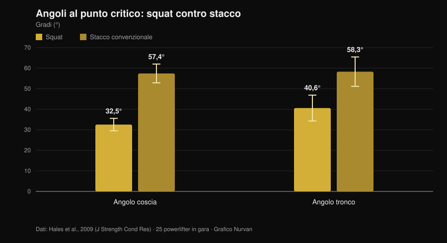
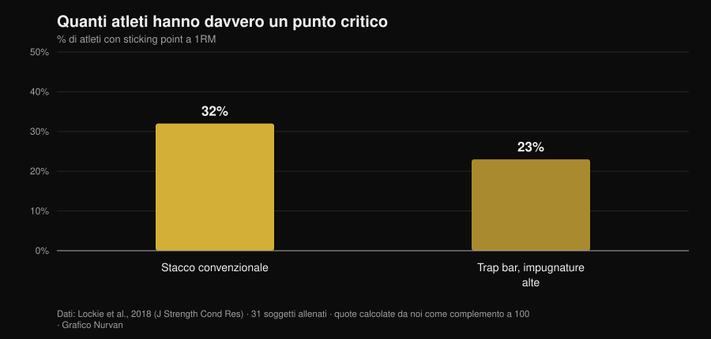

# Stacco a tempo fino al ginocchio: serve davvero?

Di [Giammaria Loi](/autore/giammaria-loi) · aggiornato il 1 novembre 2026

C'è una variante di stacco che gira parecchio fra i powerlifter: parti lento, controlli il bilanciere fino al ginocchio, poi acceleri. Si chiama *tempo to knee*, e chi la programma dice che serve a "sentire" la posizione di partenza e a correggere il bacino che schizza su. L'idea è buona. Il problema è che quasi tutto quello che le si attribuisce — più forza, più muscolo, tecnica corretta — viene da tre affermazioni diverse che la ricerca tratta in modo molto diverso. Vale la pena separarle, perché due reggono e una no.

## In breve

- **La variante specifica non è mai stata studiata.** Nessuno studio di intervento indicizzato su PubMed ha testato lo stacco a tempo fino al ginocchio (verificato il 1 novembre 2026). Chi dice il contrario sta estrapolando.
- **Lo stacco è già lento dove conta.** Al punto critico la velocità verticale del bilanciere è di **0,20 m/s** nello stacco contro **0,09 m/s** nello squat, con angoli di coscia e tronco molto più aperti (Hales et al., 2009).
- **Il bacino che sale prima non è un errore: è il movimento.** Lo stesso lavoro classifica lo stacco come movimento **sequenziale**, lo squat come **simultaneo**. Il grado è discutibile, il fenomeno no.
- **Rallentare non fa crescere di più.** Da 0,5 a 8 secondi per ripetizione l'ipertrofia è equivalente; sopra i 10 secondi peggiora (Schoenfeld et al., 2015).
- **E non fa nemmeno più forza.** Veloce e moderato-lento producono guadagni simili, con un vantaggio che semmai tende al veloce nella fascia 60-79% di 1RM (Davies et al., 2017).
- **Il punto critico non ce l'hanno tutti.** Nello stacco convenzionale il **68% dei soggetti non mostra alcuno sticking point** misurabile (Lockie et al., 2018).

## Cos'è, in pratica

Nel *tempo to knee* imponi una durata fissa — tipicamente 3-5 secondi — al tratto che va da terra all'altezza del ginocchio, poi completi l'alzata alla velocità normale. Non è uno stacco deficit, non è una pausa statica: è un rallentamento controllato della prima parte della salita.

L'intento dichiarato da chi la usa è duplice: costringere a stare nella posizione iniziale abbastanza a lungo da accorgersi di dov'è il peso, e impedire che le anche si alzino prima delle spalle. Sono obiettivi di controllo motorio, non di forza. Tenere a mente questa distinzione è metà del lavoro, perché è esattamente il punto in cui il discorso di solito scivola.

## Cosa dice davvero la ricerca

### Affermazione 1 — "Lo stacco si perde nel primo tratto"
**Confermato, con una precisazione.**

Un'analisi tridimensionale condotta su 25 powerlifter durante una gara regionale ha misurato cosa succede al punto critico delle due alzate. Il risultato è netto.

*Grafico Nurvan sui dati di Hales et al., 2009 (J Strength Cond Res). Medie e deviazioni standard riportate nell'articolo; 25 powerlifter in gara, quattro telecamere sincronizzate a 60 Hz.*

Nello stacco il tronco è inclinato in avanti di quasi 60 gradi nel momento più duro dell'alzata, contro i 40 dello squat. La leva sulla colonna è semplicemente più lunga. Ed è lì, nel primo tratto, che quella leva è massima: non è un'opinione di palestra, è geometria misurata in gara.

Quindi sì, la prima parte dello stacco è il tratto fragile. Ma attenzione alla conseguenza che se ne trae: "è fragile" non implica "va eseguita lentamente di proposito". Lo stacco è già lentissimo lì — 0,20 m/s al punto critico — e a carichi alti rallenta ancora da solo. Una revisione sistematica del 2025 su 22 studi e 293 atleti esperti conferma che, salendo di intensità, velocità media e di picco calano, le durate concentriche si allungano e la variabilità articolare aumenta proprio nelle fasi di accelerazione e di sticking (Bakhshinejad et al., 2025).

### Affermazione 2 — "Il bacino che sale subito è un errore da correggere"
**Da precisare.**

Questa è la motivazione più citata per programmare la variante, ed è quella che merita più cautela. Lo studio di Hales conclude che lo squat è un movimento **sinergico e simultaneo**, mentre lo stacco è **sequenziale e segmentato**: le articolazioni non si estendono insieme, si passano il lavoro. Il bacino che si alza prima delle spalle, entro certi limiti, *è* lo stacco.

Il confronto fra varianti rafforza il quadro. In undici donne allenate testate su un 3RM, convenzionale e sumo producono momenti articolari d'anca maggiori vicino al lockout rispetto alla trap bar, che invece carica di più il ginocchio e consente velocità del bilanciere superiori (Gundersen et al., 2025). Più l'alzata è dominante d'anca, più la sequenza anca-prima è attesa.

Il problema vero non è che le anche salgano: è che salgano **così tanto** da trasformare lo stacco in uno stacco a gambe tese con il bilanciere già lontano dal corpo. Quella è una differenza di grado, e un drill di controllo può aiutare a sentirla. Ma chiamare "errore" il fenomeno in sé porta ad allenare contro la meccanica dell'esercizio.

### Affermazione 3 — "Serve a superare il punto critico"
**Da precisare.**

Il punto critico dello stacco non è un'entità universale. Su 31 soggetti allenati misurati con trasduttore lineare durante un massimale, la maggioranza non ne mostrava affatto uno.

*Grafico Nurvan sui dati di Lockie et al., 2018 (J Strength Cond Res). Percentuali calcolate da noi come complemento alle quote di soggetti senza sticking region riportate nell'abstract (68% e 77%); 31 soggetti allenati, 21 uomini e 10 donne.*

Due atleti su tre non hanno un punto critico da aggredire nello stacco convenzionale. Prima di costruirci sopra un blocco di allenamento, conviene verificare di averne uno: basta filmare un singolo pesante di lato e guardare se il bilanciere rallenta davvero in un punto preciso, o se decelera in modo uniforme.

### Affermazione 4 — "Più tempo sotto tensione, più muscolo"
**Smentito.**

È la giustificazione più ricorrente per ogni variante lenta, e la meta-analisi la chiude. Otto studi a confronto diretto fra diverse durate della ripetizione: l'ipertrofia è **equivalente in tutto l'intervallo da 0,5 a 8 secondi**, e peggiora solo quando si superano i 10 secondi per ripetizione (Schoenfeld et al., 2015).

Un lavoro successivo mostra perché la contabilità del "tempo sotto tensione" inganna: a tempo sotto tensione pareggiato a 60 secondi, il tempo lento permette di usare un carico esterno maggiore, ma il tempo tradizionale produce più volume totale, più lattato, più frequenza cardiaca e un RPE più alto (Mang et al., 2022). I due protocolli non sono la stessa seduta con il cronometro diverso: sono stimoli differenti.

### Affermazione 5 — "Allenare lento costruisce più forza"
**Smentito.**

Quindici studi, confronto fra velocità veloci ed esecuzioni moderato-lente a volume e intensità pareggiati: i guadagni di forza dinamica sono simili, indipendentemente da età ed esperienza. Dove emerge una differenza, è un trend a favore del **veloce** nella fascia 60-79% di 1RM (ES 0,31; p = 0,06) (Davies et al., 2017).

C'è di più, e riguarda l'intenzione più che il cronometro. Ventisei soggetti istruiti con indicazioni a focus esterno hanno prodotto velocità del bilanciere significativamente maggiori rispetto a chi riceveva indicazioni a focus interno, a parità di carico (Finlay et al., 2025). Il modo in cui ti dici di spingere cambia quanto spingi. Un drill che ti abitua a non spingere forte nel primo tratto va quindi usato con la consapevolezza di cosa sta allenando: il controllo, non l'intenzione di accelerare.

### Affermazione 6 — "Va bene a carichi alti"
**Da precisare.**

A carichi vicini al massimale il rallentamento arriva da solo e la variabilità tecnica aumenta (Bakhshinejad et al., 2025): imporre un tempo sopra a quello significa semplicemente ridurre il carico sollevabile. C'è anche un elemento di cui si parla poco: nello squat al 60% di 1RM il picco di strain del tendine rotuleo è risultato **maggiore** nelle esecuzioni veloci rispetto al tempo lento 2-1-2 (Earp et al., 2016). Il tempo lento è quindi più tenero con i tendini, il che lo rende un buon strumento in fasi di carico alto — ma proprio per questo non è il posto dove cercare il tuo massimale.

## Come applicarlo

Se decidi di usarlo, trattalo per quello che è: un esercizio accessorio di controllo.

1. **Verifica di averne bisogno.** Filma due singoli pesanti di lato. Se il bacino si alza di poco e il bilanciere resta vicino alla tibia, hai un problema diverso da risolvere.
2. **Tieni il carico sottomassimale.** La fascia dove il tempo imposto resta eseguibile senza stravolgere la tecnica è indicativamente 60-75% di 1RM, con 3-5 ripetizioni. Sopra, il tempo lo detta il bilanciere.
3. **Imposta il tempo solo sul tratto che ti interessa.** Da terra al ginocchio in 3-5 secondi, poi completa alla velocità normale. Rallentare anche il lockout cambia l'esercizio senza aggiungere informazione.
4. **Non sostituirlo allo stacco di gara.** Mettilo dopo l'alzata principale, 2-4 serie, in un blocco di 4-6 settimane.
5. **Misura se sta funzionando.** Il parametro non è il carico della variante: è l'altezza a cui si alza il bacino nel tuo stacco normale, e la velocità del primo tratto a parità di chili.
6. **Separa i due esercizi nel diario.** Il massimale della variante non è il tuo massimale: tenerli nella stessa riga è il modo più rapido per confondere un progresso tecnico con un progresso di forza.

Vale lo stesso principio che abbiamo visto parlando di [serie, ripetizioni e recupero per l'ipertrofia](/blog/ripetizioni-serie-recupero-ipertrofia): una variabile isolata conta poco se il resto del programma non la supporta.

> **Prova Nurvan — ogni variante ha la sua storia di carichi**
>
> In Nurvan lo stacco a tempo è un esercizio a sé: carichi, ripetizioni e RIR restano separati da quelli dello stacco di gara, così vedi se la variante progredisce senza che i numeri si mescolino. Le serie di riscaldamento vengono proposte in automatico sul carico di lavoro del giorno, e lo storico ti dice se il primo tratto sta migliorando o se stai solo accumulando serie. [Prova Nurvan](https://nurvan.app)

## Domande frequenti

**Quanti secondi devono durare i tempo to knee?**
Chi li programma usa in genere 3-5 secondi da terra al ginocchio. Non esiste uno studio sulla variante che indichi una durata ottimale; quello che sappiamo è che oltre i 10 secondi per ripetizione gli adattamenti ipertrofici peggiorano (Schoenfeld et al., 2015), quindi non ha senso allungare oltre.

**Funziona anche per lo stacco convenzionale?**
Il post di partenza la presenta come variante di sumo, ma il razionale — stare più a lungo nella posizione iniziale — non dipende dalla larghezza dello stance. Il convenzionale ha anzi un tronco più inclinato al punto critico (Hales et al., 2009), quindi un tratto iniziale ancora più esposto. Non esistono dati che confrontino le due applicazioni.

**Mi fa male la schiena nello stacco: questa variante mi aiuta?**
Un dolore persistente o che peggiora va valutato da un medico o da un fisioterapista prima di cambiare esercizio. Nessuna variante tecnica è una terapia, e un drill che riduce il carico può mascherare un problema invece di risolverlo.

**Meglio stacco a tempo o stacco con pausa?**
Non c'è un confronto diretto in letteratura. Sono due drill con logiche diverse: la pausa isola una posizione, il tempo distribuisce il controllo su tutto il tratto. Scegli in base a cosa perdi — una posizione precisa o la sequenza nel suo insieme.

## Leggi anche

- [Serie, ripetizioni e recupero per l'ipertrofia](/blog/ripetizioni-serie-recupero-ipertrofia) — come le variabili di programmazione pesano davvero, numeri alla mano.
- [Ginocchia in fuori nello squat: regola o cue?](/blog/ginocchia-in-fuori-squat) — un altro cue tecnico molto ripetuto, passato al setaccio degli studi.
- [Bulldog grip in panca: cosa dicono gli studi](/blog/bulldog-grip-panca-piana) — cosa fare quando una tecnica diffusa non è mai stata misurata.

## Fonti

- Hales ME, Johnson BF, Johnson JT, 2009. Kinematic analysis of the powerlifting style squat and the conventional deadlift during competition: is there a cross-over effect between lifts? *Journal of Strength and Conditioning Research* 23(9):2574-80. PMID 19910816. [DOI](https://doi.org/10.1519/JSC.0b013e3181bc1d2a)
- Lockie RG, Moreno MR, Lazar A, et al., 2018. The 1 Repetition Maximum Mechanics of a High-Handle Hexagonal Bar Deadlift Compared With a Conventional Deadlift as Measured by a Linear Position Transducer. *Journal of Strength and Conditioning Research* 32(1):150-161. PMID 28394830. [DOI](https://doi.org/10.1519/JSC.0000000000001781)
- Schoenfeld BJ, Ogborn DI, Krieger JW, 2015. Effect of repetition duration during resistance training on muscle hypertrophy: a systematic review and meta-analysis. *Sports Medicine* 45(4):577-85. PMID 25601394. [DOI](https://doi.org/10.1007/s40279-015-0304-0)
- Davies TB, Kuang K, Orr R, Halaki M, Hackett D, 2017. Effect of Movement Velocity During Resistance Training on Dynamic Muscular Strength: A Systematic Review and Meta-Analysis. *Sports Medicine* 47(8):1603-1617. PMID 28105573. [DOI](https://doi.org/10.1007/s40279-017-0676-4)
- Bakhshinejad JA, Ramer JD, Dunsmore KA, Pelton LM, Berglund L, 2025. Effects of Intensity and Fatigue on the Kinetics and Kinematics of the Barbell Squat, Bench Press, and Deadlift in Experienced Lifters: A Systematic Review. *Sports Medicine - Open* 11(1):115. PMID 41085612. [DOI](https://doi.org/10.1186/s40798-025-00921-x)
- Mang ZA, Realzola RA, Ducharme J, et al., 2022. The effect of repetition tempo on cardiovascular and metabolic stress when time under tension is matched during lower body exercise. *European Journal of Applied Physiology* 122(6):1485-1495. PMID 35394146. [DOI](https://doi.org/10.1007/s00421-022-04941-3)
- Earp JE, Newton RU, Cormie P, Blazevich AJ, 2016. Faster Movement Speed Results in Greater Tendon Strain during the Loaded Squat Exercise. *Frontiers in Physiology* 7:366. PMID 27630574. [DOI](https://doi.org/10.3389/fphys.2016.00366)
- Gundersen AH, van den Tillaar R, Falch HN, Fredriksen AB, Larsen S, 2025. A Biomechanical Comparison Between Conventional, Sumo, and Hex-Bar Deadlifts Among Resistance Trained Women. *Journal of Strength and Conditioning Research* 39(3):281-288. PMID 39705135. [DOI](https://doi.org/10.1519/JSC.0000000000005011)
- Finlay M, Marchant D, Langley C, Simpson T, 2025. Impact of attentional focus and action verbs on bench press performance. *Human Movement Science* 102:103385. PMID 40602018. [DOI](https://doi.org/10.1016/j.humov.2025.103385)

Riferimenti bibliografici recuperati tramite PubMed. Spunto: post di [Reactive Training Systems con Adam Jones](https://www.instagram.com/p/DduBVWWiQOw/) del 25 settembre 2026. Il contenuto del post è stato usato solo per individuare il tema e le affermazioni da verificare: nessun testo, immagine o struttura è stato ripreso.

---

Giammaria Loi è il fondatore di Nurvan. Si allena con i pesi dal 2012, lavora come personal trainer e coach certificato FIPE dal 2013 e gareggia nel powerlifting a livello nazionale dal 2018. Ogni articolo che firma parte dagli studi scientifici e arriva a ciò che funziona davvero in palestra.

> Nota: contenuto informativo, non sostituisce il parere di un medico o professionista.
