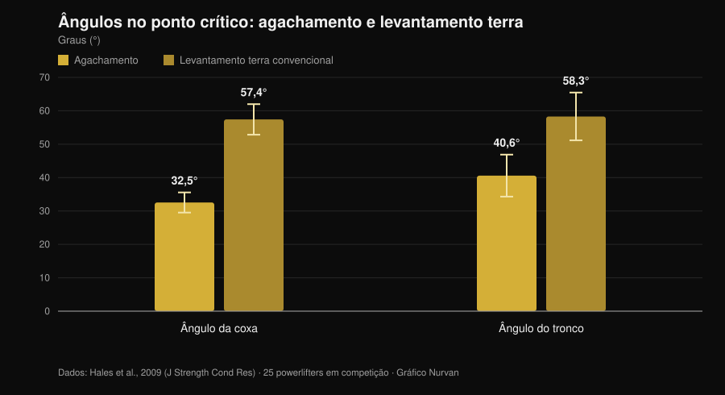
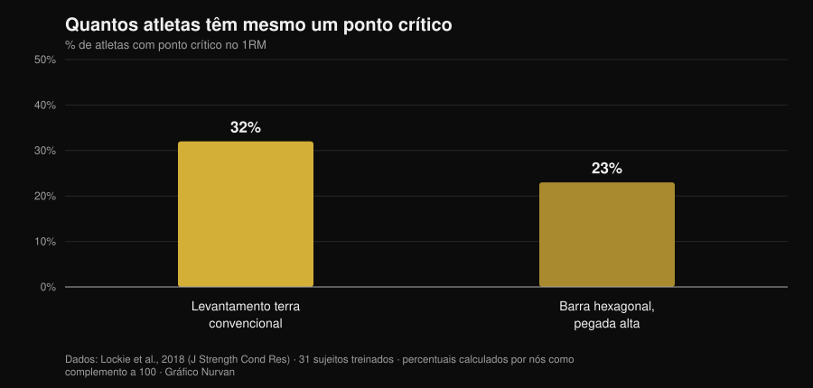

# Levantamento terra com tempo até o joelho: funciona?

Por [Giammaria Loi](/autore/giammaria-loi) · atualizado em 1 de novembro de 2026

Existe uma variação de levantamento terra que circula bastante entre powerlifters: você sai devagar, controla a barra até o joelho e depois acelera. Chama-se *tempo to knee*, e quem a programa diz que serve para "sentir" a posição inicial e corrigir o quadril que sobe de uma vez. A ideia é boa. O problema é que quase tudo o que lhe atribuem — mais força, mais músculo, técnica melhor — vem de três afirmações distintas que a pesquisa trata de maneiras muito diferentes. Vale separar, porque duas se sustentam e uma não.

## Em resumo

- **A variação específica nunca foi estudada.** Nenhum ensaio de intervenção indexado no PubMed testou o levantamento terra com tempo até o joelho (verificado em 1 de novembro de 2026). Quem diz o contrário está extrapolando.
- **O levantamento terra já é lento onde importa.** No ponto crítico, a velocidade vertical da barra é de **0,20 m/s** no levantamento terra contra **0,09 m/s** no agachamento, com ângulos de coxa e tronco muito mais abertos (Hales et al., 2009).
- **O quadril subir antes não é erro: é o movimento.** O mesmo trabalho classifica o levantamento terra como movimento **sequencial** e o agachamento como **simultâneo**. O grau é discutível, o fenômeno não.
- **Ir devagar não faz crescer mais.** De 0,5 a 8 segundos por repetição a hipertrofia é equivalente; acima de 10 segundos piora (Schoenfeld et al., 2015).
- **E também não dá mais força.** Rápido e moderado-lento produzem ganhos semelhantes, com vantagem que, se houver, pende para o rápido na faixa de 60-79% de 1RM (Davies et al., 2017).
- **Nem todo mundo tem ponto crítico.** No levantamento terra convencional, **68% dos participantes não apresentam nenhum sticking point mensurável** (Lockie et al., 2018).

## O que é, na prática

No *tempo to knee* você impõe uma duração fixa — normalmente de 3 a 5 segundos — ao trecho que vai do chão até a altura do joelho e depois completa o movimento em velocidade normal. Não é terra no déficit nem pausa estática: é uma desaceleração controlada da primeira parte da subida.

O objetivo declarado é duplo: obrigar você a ficar na posição inicial tempo suficiente para perceber onde o peso está, e impedir que o quadril suba antes dos ombros. São objetivos de controle motor, não de força. Manter essa distinção em mente é metade do trabalho, porque é exatamente aí que o raciocínio costuma escorregar.

## O que a pesquisa realmente diz

### Afirmação 1 — "O levantamento terra se perde no primeiro trecho"
**Confirmado, com ressalva.**

Uma análise tridimensional de 25 powerlifters durante uma competição regional mediu o que acontece no ponto crítico dos dois movimentos. O resultado é claro.

*Gráfico Nurvan sobre dados de Hales et al., 2009 (J Strength Cond Res). Médias e desvios-padrão publicados no artigo; 25 powerlifters em competição, quatro câmeras sincronizadas a 60 Hz.*

No levantamento terra o tronco está inclinado para a frente quase 60 graus no momento mais duro do movimento, contra 40 no agachamento. A alavanca sobre a coluna é simplesmente mais longa. E é no primeiro trecho que essa alavanca é máxima: não é opinião de academia, é geometria medida em competição.

Então sim, a primeira parte do levantamento terra é o trecho frágil. Mas cuidado com a conclusão: "é frágil" não implica "deve ser executada devagar de propósito". O levantamento terra já rasteja ali — 0,20 m/s no ponto crítico — e com cargas altas desacelera ainda mais sozinho. Uma revisão sistemática de 2025 com 22 estudos e 293 atletas experientes confirma que, ao subir a intensidade, a velocidade média e a de pico caem, as durações concêntricas se alongam e a variabilidade articular aumenta justamente nas fases de aceleração e de sticking (Bakhshinejad et al., 2025).

### Afirmação 2 — "O quadril que sobe antes é um erro a corrigir"
**A precisar.**

Essa é a justificativa mais citada para programar a variação e a que merece mais cautela. O estudo de Hales conclui que o agachamento é um movimento **sinérgico e simultâneo**, enquanto o levantamento terra é **sequencial e segmentado**: as articulações não se estendem juntas, passam o trabalho adiante. O quadril subir antes dos ombros, dentro de certos limites, *é* o levantamento terra.

A comparação entre variações reforça o quadro. Em onze mulheres treinadas avaliadas num 3RM, convencional e sumô produzem momentos articulares de quadril maiores perto do lockout do que a barra hexagonal, que carrega mais o joelho e permite velocidades de barra superiores (Gundersen et al., 2025). Quanto mais dominante de quadril é o movimento, mais esperada é a sequência quadril-primeiro.

O problema real não é o quadril subir: é subir **tanto** que o levantamento vira um terra de pernas estendidas com a barra já longe do corpo. Isso é diferença de grau, e um exercício de controle pode ajudar a senti-la. Mas chamar o fenômeno em si de "erro" leva a treinar contra a mecânica do exercício.

### Afirmação 3 — "Serve para passar o ponto crítico"
**A precisar.**

O ponto crítico do levantamento terra não é universal. Em 31 participantes treinados medidos com transdutor linear durante um máximo, a maioria não apresentava nenhum.

*Gráfico Nurvan sobre dados de Lockie et al., 2018 (J Strength Cond Res). Percentuais calculados por nós como complemento das proporções de participantes sem sticking region publicadas no resumo (68% e 77%); 31 participantes treinados, 21 homens e 10 mulheres.*

Dois atletas em cada três não têm ponto crítico a atacar no levantamento terra convencional. Antes de montar um bloco de treino em cima disso, vale confirmar que você tem um: filme uma repetição única pesada de lado e veja se a barra realmente trava num ponto específico ou se desacelera de forma uniforme.

### Afirmação 4 — "Mais tempo sob tensão, mais músculo"
**Desmentido.**

É a justificativa padrão de toda variação lenta, e a metanálise encerra o assunto. Oito estudos comparando diretamente durações de repetição: a hipertrofia é **equivalente em todo o intervalo de 0,5 a 8 segundos** e só piora acima de 10 segundos por repetição (Schoenfeld et al., 2015).

Um trabalho posterior mostra por que a contabilidade do "tempo sob tensão" engana: com o tempo sob tensão igualado em 60 segundos, o tempo lento permite usar carga externa maior, mas o tempo tradicional produz mais volume total, mais lactato, mais frequência cardíaca e RPE mais alto (Mang et al., 2022). Os dois protocolos não são a mesma sessão com outro cronômetro: são estímulos diferentes.

### Afirmação 5 — "Treinar devagar constrói mais força"
**Desmentido.**

Quinze estudos comparando execuções rápidas e moderado-lentas com volume e intensidade igualados: os ganhos de força dinâmica são semelhantes, independentemente de idade e experiência. Onde aparece diferença, é uma tendência a favor do **rápido** na faixa de 60-79% de 1RM (TE 0,31; p = 0,06) (Davies et al., 2017).

Há mais, e tem a ver com a intenção mais do que com o cronômetro. Vinte e seis participantes instruídos com comandos de foco externo produziram velocidades de barra significativamente maiores do que os que receberam comandos de foco interno, com a mesma carga (Finlay et al., 2025). O modo como você diz a si mesmo para empurrar muda o quanto empurra. Um exercício que te acostuma a não puxar forte no primeiro trecho deve ser usado sabendo o que treina: o controle, não a intenção de acelerar.

### Afirmação 6 — "Funciona com cargas altas"
**A precisar.**

Perto do máximo, a desaceleração vem sozinha e a variabilidade técnica aumenta (Bakhshinejad et al., 2025): impor um tempo por cima disso significa simplesmente levantar menos. Há ainda um ponto pouco comentado: no agachamento a 60% de 1RM, o pico de deformação do tendão patelar foi **maior** nas execuções rápidas do que num tempo lento 2-1-2 (Earp et al., 2016). O tempo lento é, portanto, mais gentil com os tendões, o que o torna uma boa ferramenta em fases de carga alta — e exatamente por isso não é onde se busca o máximo.

## Como aplicar

Se decidir usar, trate como o que é: um acessório de controle.

1. **Confirme que precisa.** Filme duas repetições únicas pesadas de lado. Se o quadril sobe pouco e a barra fica perto da canela, você tem outro problema a resolver.
2. **Mantenha a carga submáxima.** A faixa em que o tempo imposto continua executável sem destruir a técnica fica em torno de 60-75% de 1RM, com 3 a 5 repetições. Acima disso, quem dita o tempo é a barra.
3. **Aplique o tempo só ao trecho que interessa.** Do chão ao joelho em 3 a 5 segundos e depois conclua em velocidade normal. Frear também o lockout muda o exercício sem acrescentar informação.
4. **Não substitua o levantamento de competição por ele.** Coloque depois do movimento principal, 2 a 4 séries, num bloco de 4 a 6 semanas.
5. **Meça se está funcionando.** O parâmetro não é a carga da variação: é a altura a que o quadril sobe no seu levantamento normal e a velocidade do primeiro trecho com os mesmos quilos.
6. **Separe os dois exercícios no diário.** O máximo da variação não é o seu máximo: mantê-los na mesma linha é o jeito mais rápido de confundir progresso técnico com progresso de força.

Vale o mesmo princípio que vimos ao falar de [séries, repetições e descanso para a hipertrofia](/pt/blog/quantas-repeticoes-massa-muscular): uma variável isolada pesa pouco se o resto do programa não a sustenta.

> **Experimente o Nurvan — cada variação com o seu histórico de cargas**
>
> No Nurvan o levantamento terra com tempo é um exercício à parte: cargas, repetições e RIR ficam separados dos do levantamento de competição, então você vê se a variação progride sem os números se misturarem. As séries de aquecimento são propostas automaticamente sobre a carga de trabalho do dia, e o histórico diz se o primeiro trecho está melhorando ou se você só está acumulando séries. [Experimente o Nurvan](https://nurvan.app)

## Perguntas frequentes

**Quantos segundos deve durar um tempo to knee?**
Quem programa costuma usar 3 a 5 segundos do chão ao joelho. Não existe estudo sobre a variação indicando duração ótima; o que sabemos é que acima de 10 segundos por repetição as adaptações de hipertrofia pioram (Schoenfeld et al., 2015), então não faz sentido alongar mais.

**Funciona também para o levantamento convencional?**
O post de origem apresenta como variação de sumô, mas o raciocínio — ficar mais tempo na posição inicial — não depende da abertura dos pés. O convencional tem até o tronco mais inclinado no ponto crítico (Hales et al., 2009), ou seja, um primeiro trecho ainda mais exposto. Não há dados comparando as duas aplicações.

**Minhas costas doem no levantamento terra: essa variação ajuda?**
Dor persistente ou que piora deve ser avaliada por um médico ou fisioterapeuta antes de trocar de exercício. Nenhuma variação técnica é tratamento, e um exercício que reduz a carga pode mascarar um problema em vez de resolvê-lo.

**Melhor levantamento terra com tempo ou com pausa?**
Não há comparação direta na literatura. São dois exercícios com lógicas diferentes: a pausa isola uma posição, o tempo distribui o controle por todo o trecho. Escolha conforme o que você perde — uma posição específica ou a sequência como um todo.

## Leia também

- [Séries, repetições e descanso para a hipertrofia](/pt/blog/quantas-repeticoes-massa-muscular) — quanto pesam de fato as variáveis de programação, com números.
- [Joelhos para fora no agachamento: regra ou cue?](/pt/blog/joelhos-para-fora-agachamento) — outro cue técnico muito repetido, passado pelo crivo dos estudos.
- [Pegada bulldog no supino: o que dizem os estudos](/pt/blog/pegada-bulldog-supino) — o que fazer quando uma técnica difundida nunca foi medida.

## Fontes

- Hales ME, Johnson BF, Johnson JT, 2009. Kinematic analysis of the powerlifting style squat and the conventional deadlift during competition: is there a cross-over effect between lifts? *Journal of Strength and Conditioning Research* 23(9):2574-80. PMID 19910816. [DOI](https://doi.org/10.1519/JSC.0b013e3181bc1d2a)
- Lockie RG, Moreno MR, Lazar A, et al., 2018. The 1 Repetition Maximum Mechanics of a High-Handle Hexagonal Bar Deadlift Compared With a Conventional Deadlift as Measured by a Linear Position Transducer. *Journal of Strength and Conditioning Research* 32(1):150-161. PMID 28394830. [DOI](https://doi.org/10.1519/JSC.0000000000001781)
- Schoenfeld BJ, Ogborn DI, Krieger JW, 2015. Effect of repetition duration during resistance training on muscle hypertrophy: a systematic review and meta-analysis. *Sports Medicine* 45(4):577-85. PMID 25601394. [DOI](https://doi.org/10.1007/s40279-015-0304-0)
- Davies TB, Kuang K, Orr R, Halaki M, Hackett D, 2017. Effect of Movement Velocity During Resistance Training on Dynamic Muscular Strength: A Systematic Review and Meta-Analysis. *Sports Medicine* 47(8):1603-1617. PMID 28105573. [DOI](https://doi.org/10.1007/s40279-017-0676-4)
- Bakhshinejad JA, Ramer JD, Dunsmore KA, Pelton LM, Berglund L, 2025. Effects of Intensity and Fatigue on the Kinetics and Kinematics of the Barbell Squat, Bench Press, and Deadlift in Experienced Lifters: A Systematic Review. *Sports Medicine - Open* 11(1):115. PMID 41085612. [DOI](https://doi.org/10.1186/s40798-025-00921-x)
- Mang ZA, Realzola RA, Ducharme J, et al., 2022. The effect of repetition tempo on cardiovascular and metabolic stress when time under tension is matched during lower body exercise. *European Journal of Applied Physiology* 122(6):1485-1495. PMID 35394146. [DOI](https://doi.org/10.1007/s00421-022-04941-3)
- Earp JE, Newton RU, Cormie P, Blazevich AJ, 2016. Faster Movement Speed Results in Greater Tendon Strain during the Loaded Squat Exercise. *Frontiers in Physiology* 7:366. PMID 27630574. [DOI](https://doi.org/10.3389/fphys.2016.00366)
- Gundersen AH, van den Tillaar R, Falch HN, Fredriksen AB, Larsen S, 2025. A Biomechanical Comparison Between Conventional, Sumo, and Hex-Bar Deadlifts Among Resistance Trained Women. *Journal of Strength and Conditioning Research* 39(3):281-288. PMID 39705135. [DOI](https://doi.org/10.1519/JSC.0000000000005011)
- Finlay M, Marchant D, Langley C, Simpson T, 2025. Impact of attentional focus and action verbs on bench press performance. *Human Movement Science* 102:103385. PMID 40602018. [DOI](https://doi.org/10.1016/j.humov.2025.103385)

Referências recuperadas via PubMed. Ponto de partida: publicação de [Reactive Training Systems com Adam Jones](https://www.instagram.com/p/DduBVWWiQOw/) de 25 de setembro de 2026. O conteúdo do post foi usado apenas para identificar o tema e as afirmações a verificar: nenhum texto, imagem ou estrutura foi reaproveitado.

---

Giammaria Loi é o fundador do Nurvan. Treina com pesos desde 2012, trabalha como personal trainer e coach certificado FIPE desde 2013 e compete no powerlifting em nível nacional desde 2018. Cada artigo que assina parte dos estudos científicos e chega ao que funciona de verdade na academia.

> Nota: conteúdo informativo, não substitui a opinião de um médico ou profissional.
