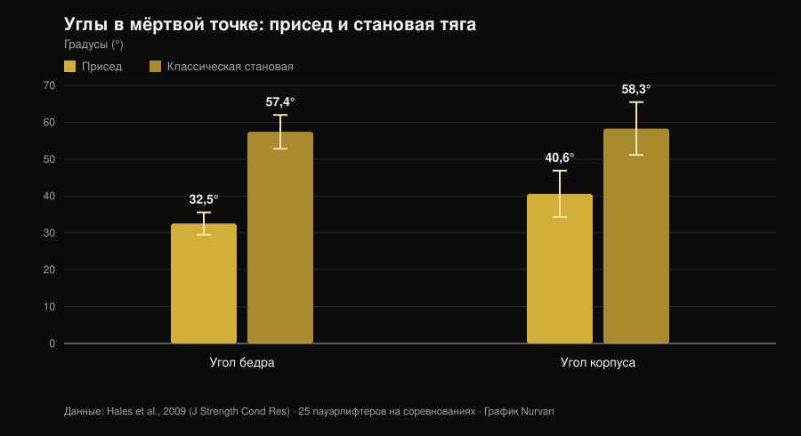
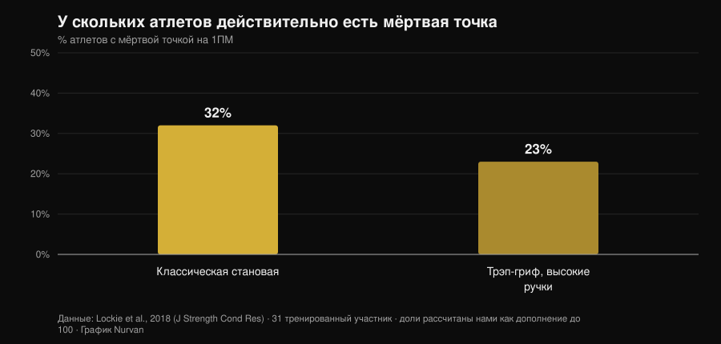

# Становая тяга в темпе до колена: работает ли?

Автор: [Giammaria Loi](/autore/giammaria-loi) · обновлено 1 ноября 2026

Среди пауэрлифтеров ходит один вариант становой тяги: стартуешь медленно, контролируешь штангу до колена, затем ускоряешься. Его называют *tempo to knee*, и те, кто его программирует, говорят, что он помогает «почувствовать» стартовое положение и убрать таз, который взлетает вверх. Идея хорошая. Проблема в том, что почти всё, что ему приписывают — больше силы, больше мышц, лучше техника — складывается из трёх разных утверждений, с которыми наука обходится совершенно по-разному. Их стоит разделить: два выдерживают проверку, одно нет.

## Коротко

- **Сам вариант никто не изучал.** В PubMed нет ни одного индексированного интервенционного исследования темповой становой до колена (проверено 1 ноября 2026). Кто утверждает обратное, экстраполирует.
- **Становая и так медленная там, где это важно.** В мёртвой точке вертикальная скорость штанги составляет **0,20 м/с** в становой против **0,09 м/с** в приседе, при куда более открытых углах бедра и корпуса (Hales et al., 2009).
- **Таз, который поднимается первым, — не ошибка, а само движение.** Та же работа классифицирует становую как **последовательное** движение, а присед как **одновременное**. Степень обсуждаема, само явление — нет.
- **Замедление не даёт больше мышц.** От 0,5 до 8 секунд на повторение гипертрофия одинакова; свыше 10 секунд — хуже (Schoenfeld et al., 2015).
- **И силы тоже не даёт.** Быстрый и умеренно-медленный режимы дают схожий прирост, а преимущество, если и есть, склоняется к быстрому в диапазоне 60-79 % от 1ПМ (Davies et al., 2017).
- **Мёртвая точка есть не у всех.** В классической становой **у 68 % участников нет никакой измеримой мёртвой точки** (Lockie et al., 2018).

## Что это такое на практике

В *tempo to knee* ты задаёшь фиксированную длительность — обычно 3-5 секунд — отрезку от пола до уровня колена, а затем завершаешь подъём в обычном темпе. Это не тяга с плинтов и не статическая пауза: это контролируемое замедление первой части подъёма.

Заявленная цель двойная: заставить тебя задержаться в стартовом положении достаточно долго, чтобы заметить, где на самом деле находится вес, и не дать тазу подняться раньше плеч. Это задачи двигательного контроля, а не силы. Держать это различие в голове — половина дела, потому что именно здесь рассуждение обычно и соскальзывает.

## Что на самом деле говорят исследования

### Утверждение 1 — «Становую теряют на первых сантиметрах»
**Подтверждено, с оговоркой.**

Трёхмерный анализ 25 пауэрлифтеров на региональных соревнованиях измерил, что происходит в мёртвой точке обоих движений. Результат однозначен.

*График Nurvan по данным Hales et al., 2009 (J Strength Cond Res). Средние значения и стандартные отклонения приведены в статье; 25 пауэрлифтеров на соревнованиях, четыре камеры, синхронизированные на 60 Гц.*

В становой корпус наклонён вперёд почти на 60 градусов в самый тяжёлый момент подъёма против 40 в приседе. Рычаг на позвоночник просто длиннее. И максимален он именно в первом отрезке: это не мнение из зала, а геометрия, измеренная на соревнованиях.

Так что да, первая часть становой — уязвимый отрезок. Но осторожнее с выводом: «уязвимый» не значит «выполнять нарочно медленно». Становая там и так ползёт — 0,20 м/с в мёртвой точке — а на больших весах замедляется ещё сильнее сама по себе. Систематический обзор 2025 года по 22 исследованиям и 293 опытным атлетам подтверждает: с ростом интенсивности средняя и пиковая скорость падают, концентрическая фаза удлиняется, а вариативность в суставах растёт именно в фазах ускорения и мёртвой точки (Bakhshinejad et al., 2025).

### Утверждение 2 — «Таз, который взлетает, — ошибка, её надо исправлять»
**Требует уточнения.**

Это самый частый аргумент в пользу варианта и тот, что требует наибольшей осторожности. Работа Hales заключает, что присед — движение **синергичное и одновременное**, а становая — **последовательная и сегментированная**: суставы не разгибаются вместе, они передают работу друг другу. То, что таз поднимается раньше плеч, в определённых пределах *и есть* становая.

Сравнение вариантов усиливает картину. У одиннадцати тренированных женщин в 3ПМ классика и сумо дают большие моменты в тазобедренном суставе ближе к локауту, чем трэп-гриф, который сильнее нагружает колено и позволяет более высокую скорость штанги (Gundersen et al., 2025). Чем более тазодоминантна тяга, тем ожидаемее последовательность «сначала таз».

Настоящая проблема не в том, что таз поднимается, а в том, что он поднимается **настолько**, что становая превращается в тягу на прямых ногах со штангой, уже ушедшей от тела. Это разница в степени, и упражнение на контроль может помочь её почувствовать. Но называть «ошибкой» само явление — значит тренироваться против механики упражнения.

### Утверждение 3 — «Помогает пройти мёртвую точку»
**Требует уточнения.**

Мёртвая точка в становой не универсальна. Из 31 тренированного участника, измеренного линейным датчиком на максимальном подъёме, у большинства её не было вовсе.

*График Nurvan по данным Lockie et al., 2018 (J Strength Cond Res). Доли рассчитаны нами как дополнение к приведённым в аннотации долям участников без мёртвой точки (68 % и 77 %); 31 тренированный участник, 21 мужчина и 10 женщин.*

У двух атлетов из трёх в классической становой нет мёртвой точки, которую можно атаковать. Прежде чем строить вокруг неё тренировочный блок, стоит убедиться, что она у тебя есть: сними тяжёлый одиночный подход сбоку и посмотри, действительно ли штанга тормозит в конкретной точке или замедляется равномерно.

### Утверждение 4 — «Больше времени под нагрузкой — больше мышц»
**Опровергнуто.**

Это стандартное обоснование любого медленного варианта, и метаанализ закрывает вопрос. Восемь исследований с прямым сравнением длительности повторения: гипертрофия **одинакова во всём диапазоне от 0,5 до 8 секунд** и ухудшается только свыше 10 секунд на повторение (Schoenfeld et al., 2015).

Более поздняя работа показывает, почему бухгалтерия «времени под нагрузкой» вводит в заблуждение: при уравненном до 60 секунд времени под нагрузкой медленный темп позволяет взять больший внешний вес, но традиционный даёт больше суммарного объёма, больше лактата, выше ЧСС и выше RPE (Mang et al., 2022). Два протокола — не одна и та же тренировка с другим секундомером, а разные стимулы.

### Утверждение 5 — «Медленная работа строит больше силы»
**Опровергнуто.**

Пятнадцать исследований, сравнение быстрого и умеренно-медленного выполнения при уравненных объёме и интенсивности: прирост динамической силы схож независимо от возраста и стажа. Там, где различие появляется, это тренд в пользу **быстрого** в диапазоне 60-79 % от 1ПМ (ES 0,31; p = 0,06) (Davies et al., 2017).

И ещё: дело скорее в намерении, чем в секундомере. Двадцать шесть участников, получивших инструкции с внешним фокусом внимания, показали достоверно большую скорость штанги, чем те, кому давали инструкции с внутренним фокусом, при одинаковом весе (Finlay et al., 2025). То, как ты говоришь себе толкать, меняет силу, которую ты прикладываешь. Поэтому упражнение, приучающее не тянуть мощно на первом отрезке, надо применять, понимая, что именно оно тренирует: контроль, а не намерение ускоряться.

### Утверждение 6 — «Подходит для больших весов»
**Требует уточнения.**

Вблизи максимума замедление приходит само, а техническая вариативность растёт (Bakhshinejad et al., 2025): задавать темп поверх этого означает просто поднимать меньше. Есть и момент, о котором говорят редко: в приседе на 60 % от 1ПМ пиковая деформация надколенникового сухожилия оказалась **выше** в быстрых повторениях, чем при медленном темпе 2-1-2 (Earp et al., 2016). Медленный темп, таким образом, бережнее к сухожилиям, что делает его полезным в фазах высокой нагрузки — и именно поэтому это не место для поиска максимума.

## Как применять

Если решишь использовать, относись к нему как к тому, чем он является: вспомогательному упражнению на контроль.

1. **Проверь, нужно ли оно тебе.** Сними два тяжёлых одиночных подъёма сбоку. Если таз поднимается немного, а штанга идёт близко к голени, у тебя другая задача.
2. **Держи вес субмаксимальным.** Диапазон, где заданный темп остаётся выполнимым без слома техники, ориентировочно 60-75 % от 1ПМ, по 3-5 повторений. Выше темп диктует штанга.
3. **Задавай темп только нужному отрезку.** От пола до колена за 3-5 секунд, дальше заверши в обычном темпе. Замедлять ещё и локаут — значит менять упражнение, не получая новой информации.
4. **Не заменяй им соревновательную тягу.** Ставь после основного движения, 2-4 подхода, блоком на 4-6 недель.
5. **Измеряй, работает ли это.** Показатель — не вес в варианте, а высота, на которую поднимается таз в обычной становой, и скорость первого отрезка при тех же килограммах.
6. **Разделяй эти два упражнения в дневнике.** Максимум варианта — не твой максимум: держать их в одной строке проще всего, чтобы спутать технический прогресс с силовым.

Действует тот же принцип, что и в нашем разборе [подходов, повторений и отдыха для гипертрофии](/ru/blog/skolko-povtoreniy-dlya-massy): отдельная переменная значит мало, если остальная программа её не поддерживает.

> **Попробуй Nurvan — у каждого варианта своя история весов**
>
> В Nurvan темповая становая — отдельное упражнение: веса, повторения и RIR хранятся отдельно от соревновательной тяги, так что видно, прогрессирует ли вариант, и цифры не смешиваются. Разминочные подходы предлагаются автоматически от рабочего веса дня, а история показывает, улучшается ли первый отрезок или ты просто набираешь подходы. [Попробуй Nurvan](https://nurvan.app)

## Частые вопросы

**Сколько секунд должен длиться tempo to knee?**
Те, кто его программирует, обычно берут 3-5 секунд от пола до колена. Исследований по этому варианту с оптимальной длительностью нет; известно лишь, что свыше 10 секунд на повторение гипертрофические адаптации ухудшаются (Schoenfeld et al., 2015), так что растягивать дольше смысла нет.

**Работает ли это и для классической тяги?**
Исходный пост подаёт это как вариант для сумо, но логика — дольше оставаться в стартовом положении — не зависит от ширины стойки. У классики корпус в мёртвой точке наклонён даже сильнее (Hales et al., 2009), то есть первый отрезок ещё уязвимее. Данных, сравнивающих оба применения, нет.

**У меня болит спина в становой: поможет этот вариант?**
Стойкую или усиливающуюся боль должен оценить врач или физиотерапевт, прежде чем менять упражнение. Ни один технический вариант не является лечением, а упражнение, снижающее нагрузку, может скрыть проблему вместо того, чтобы её решить.

**Что лучше: темповая тяга или тяга с паузой?**
Прямого сравнения в литературе нет. Это два упражнения с разной логикой: пауза изолирует одно положение, темп распределяет контроль по всему отрезку. Выбирай по тому, что ты теряешь: конкретное положение или последовательность целиком.

## Читайте также

- [Подходы, повторения и отдых для гипертрофии](/ru/blog/skolko-povtoreniy-dlya-massy) — сколько на самом деле весят переменные программы, с цифрами.
- [Колени наружу в приседе: правило или подсказка?](/ru/blog/koleni-naruzhu-prised) — ещё одна часто повторяемая техническая подсказка, проверенная по исследованиям.
- [Хват «бульдог» в жиме лёжа: что говорят исследования](/ru/blog/khvat-bulldog-zhim-lezha) — что делать, когда распространённую технику никто не измерял.

## Источники

- Hales ME, Johnson BF, Johnson JT, 2009. Kinematic analysis of the powerlifting style squat and the conventional deadlift during competition: is there a cross-over effect between lifts? *Journal of Strength and Conditioning Research* 23(9):2574-80. PMID 19910816. [DOI](https://doi.org/10.1519/JSC.0b013e3181bc1d2a)
- Lockie RG, Moreno MR, Lazar A, et al., 2018. The 1 Repetition Maximum Mechanics of a High-Handle Hexagonal Bar Deadlift Compared With a Conventional Deadlift as Measured by a Linear Position Transducer. *Journal of Strength and Conditioning Research* 32(1):150-161. PMID 28394830. [DOI](https://doi.org/10.1519/JSC.0000000000001781)
- Schoenfeld BJ, Ogborn DI, Krieger JW, 2015. Effect of repetition duration during resistance training on muscle hypertrophy: a systematic review and meta-analysis. *Sports Medicine* 45(4):577-85. PMID 25601394. [DOI](https://doi.org/10.1007/s40279-015-0304-0)
- Davies TB, Kuang K, Orr R, Halaki M, Hackett D, 2017. Effect of Movement Velocity During Resistance Training on Dynamic Muscular Strength: A Systematic Review and Meta-Analysis. *Sports Medicine* 47(8):1603-1617. PMID 28105573. [DOI](https://doi.org/10.1007/s40279-017-0676-4)
- Bakhshinejad JA, Ramer JD, Dunsmore KA, Pelton LM, Berglund L, 2025. Effects of Intensity and Fatigue on the Kinetics and Kinematics of the Barbell Squat, Bench Press, and Deadlift in Experienced Lifters: A Systematic Review. *Sports Medicine - Open* 11(1):115. PMID 41085612. [DOI](https://doi.org/10.1186/s40798-025-00921-x)
- Mang ZA, Realzola RA, Ducharme J, et al., 2022. The effect of repetition tempo on cardiovascular and metabolic stress when time under tension is matched during lower body exercise. *European Journal of Applied Physiology* 122(6):1485-1495. PMID 35394146. [DOI](https://doi.org/10.1007/s00421-022-04941-3)
- Earp JE, Newton RU, Cormie P, Blazevich AJ, 2016. Faster Movement Speed Results in Greater Tendon Strain during the Loaded Squat Exercise. *Frontiers in Physiology* 7:366. PMID 27630574. [DOI](https://doi.org/10.3389/fphys.2016.00366)
- Gundersen AH, van den Tillaar R, Falch HN, Fredriksen AB, Larsen S, 2025. A Biomechanical Comparison Between Conventional, Sumo, and Hex-Bar Deadlifts Among Resistance Trained Women. *Journal of Strength and Conditioning Research* 39(3):281-288. PMID 39705135. [DOI](https://doi.org/10.1519/JSC.0000000000005011)
- Finlay M, Marchant D, Langley C, Simpson T, 2025. Impact of attentional focus and action verbs on bench press performance. *Human Movement Science* 102:103385. PMID 40602018. [DOI](https://doi.org/10.1016/j.humov.2025.103385)

Литература найдена через PubMed. Отправная точка: публикация [Reactive Training Systems с Adam Jones](https://www.instagram.com/p/DduBVWWiQOw/) от 25 сентября 2026. Содержание поста использовано только для выбора темы и утверждений для проверки: ни текст, ни изображения, ни структура не заимствованы.

---

Giammaria Loi — основатель Nurvan. Тренируется с отягощениями с 2012 года, работает персональным тренером и коучем с сертификацией FIPE с 2013 года и выступает в пауэрлифтинге на национальном уровне с 2018 года. Каждая его статья начинается с научных исследований и заканчивается тем, что действительно работает в зале.

> Примечание: информационный материал, не заменяет консультацию врача или специалиста.
