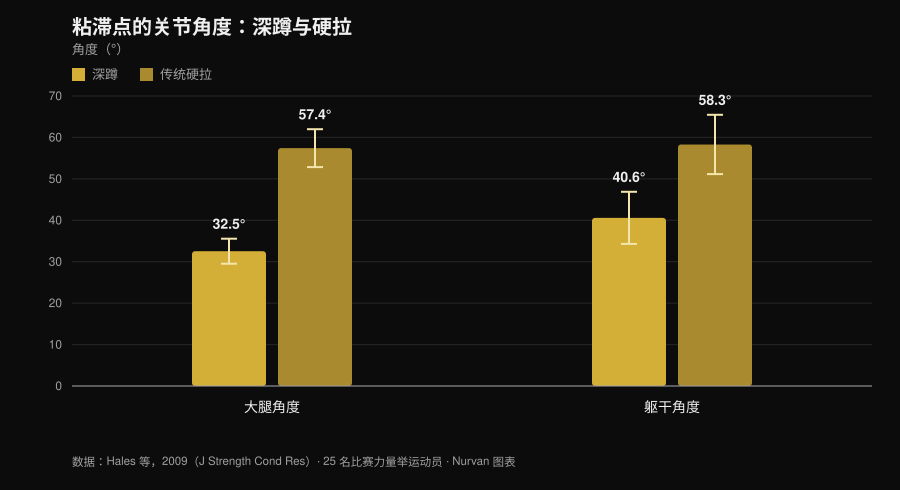
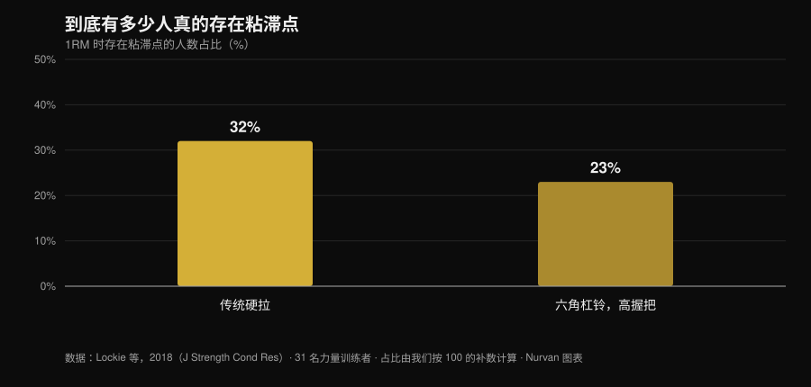

# 硬拉慢速至膝盖：这个动作真的有用吗？

作者：[Giammaria Loi](/autore/giammaria-loi) · 更新于 2026 年 11 月 1 日

力量举圈子里流行一个硬拉变式：起始放慢，控制杠铃到膝盖高度，然后加速。它叫 *tempo to knee*，安排这个动作的教练说，它能让你"感受"起始位置，并纠正臀部一下子窜起来的问题。想法是好的。问题在于，人们归功于它的几乎所有好处——更大的力量、更多的肌肉、更好的技术——其实来自三个不同的说法，而研究对这三个说法的态度完全不同。值得把它们分开看，因为两个站得住脚，一个站不住。

## 要点速览

- **这个变式本身从未被研究过。** PubMed 上没有任何已收录的干预试验测试过慢速至膝盖的硬拉（2026 年 11 月 1 日核查）。说有的人，是在外推。
- **硬拉在关键处本来就慢。** 在粘滞点，杠铃垂直速度硬拉为 **0.20 m/s**，深蹲为 **0.09 m/s**，而且大腿和躯干角度要开得多（Hales 等，2009）。
- **臀部先起不是错误，那就是这个动作本身。** 同一项研究把硬拉归类为**顺序性**动作，深蹲为**同时性**动作。程度可以讨论，现象本身不可以。
- **放慢并不会长更多肌肉。** 每次 0.5 到 8 秒之间，肥大效果相当；超过 10 秒反而变差（Schoenfeld 等，2015）。
- **也不会长更多力量。** 快速与中慢速的增益相近，若说有优势，反而偏向快速，出现在 1RM 的 60-79% 区间（Davies 等，2017）。
- **不是每个人都有粘滞点。** 在传统硬拉中，**68% 的受试者根本没有可测量的粘滞区**（Lockie 等，2018）。

## 实际操作是什么

在 *tempo to knee* 中，你给从地面到膝盖高度这一段设定一个固定时长——通常是 3 到 5 秒——然后以正常速度完成剩下的部分。它不是赤字硬拉，也不是静止暂停：它是对上拉第一段的受控减速。

它宣称的目标有两个：让你在起始位置停留足够久，意识到重量到底在哪里；以及防止髋部早于肩部抬起。这些是运动控制目标，不是力量目标。记住这个区分，任务就完成了一半，因为推理通常正是在这里滑掉的。

## 研究到底怎么说

### 说法 1 ——"硬拉是在最初那几厘米丢掉的"
**成立，但要补充。**

一项针对区域比赛中 25 名力量举运动员的三维分析，测量了两个动作在粘滞点发生了什么。结果很明确。

*Nurvan 图表，数据来自 Hales 等，2009（J Strength Cond Res）。均值和标准差见原文；25 名参赛力量举运动员，四台以 60 Hz 同步的摄像机。*

硬拉在最吃力的时刻，躯干前倾接近 60 度，而深蹲是 40 度。对脊柱的力臂就是更长。而且正是在第一段，这个力臂最大：这不是健身房里的说法，而是在比赛中测出的几何关系。

所以没错，硬拉的前段是脆弱的那一段。但要小心由此得出的结论："脆弱"并不意味着"应该故意慢慢做"。硬拉在那里本来就慢得像爬——粘滞点 0.20 m/s——大重量下还会自己更慢。2025 年一项涵盖 22 项研究、293 名有经验运动员的系统综述证实：强度上升时，平均速度和峰值速度下降，向心阶段时长拉长，关节变异性增加，而且恰恰出现在加速阶段和粘滞阶段（Bakhshinejad 等，2025）。

### 说法 2 ——"臀部窜起来是要纠正的错误"
**需要限定。**

这是安排这个变式时最常被引用的理由，也是最需要谨慎的一个。Hales 的研究结论是：深蹲是**协同、同时**的动作，而硬拉是**顺序、分段**的动作——关节不是一起伸展，而是把工作往下传递。髋部早于肩部抬起，在一定范围内，*就是*硬拉。

变式之间的对比强化了这个图景。在 11 名受过训练的女性的 3RM 测试中，传统与相扑硬拉在接近锁定时产生的髋关节力矩大于六角杠铃，而六角杠铃更多负荷膝关节并允许更高的杠铃速度（Gundersen 等，2025）。动作越以髋为主导，"髋先起"的顺序就越是预期之内。

真正的问题不是髋部抬起，而是抬得**太多**，以至于硬拉变成了杠铃已经远离身体的直腿硬拉。这是程度上的差别，一个控制类训练确实能帮你察觉它。但把现象本身称为"错误"，等于在和动作的力学对着干。

### 说法 3 ——"它能帮你突破粘滞点"
**需要限定。**

硬拉的粘滞点并不普遍存在。在 31 名受训者的极限试举中用线性位移传感器测量，大多数人根本没有粘滞点。

*Nurvan 图表，数据来自 Lockie 等，2018（J Strength Cond Res）。占比由我们按摘要中报告的无粘滞区受试者比例（68% 和 77%）的补数计算；31 名受训者，21 男 10 女。*

三个人里有两个在传统硬拉中根本没有可以攻克的粘滞点。在围绕它安排一个训练周期之前，值得先确认你确实有：从侧面拍一组大重量单次，看看杠铃是真的在某个特定高度卡住，还是均匀减速。

### 说法 4 ——"张力下时间越长，肌肉越多"
**不成立。**

这是所有慢速变式的标准理由，而荟萃分析把它关上了。八项直接比较不同每次时长的研究：在 **0.5 到 8 秒的整个区间内肥大效果相当**，只有超过每次 10 秒才变差（Schoenfeld 等，2015）。

后来的一项研究说明了"张力下时间"这笔账为何具有误导性：把张力下时间统一为 60 秒后，慢速节奏允许使用更大的外部负荷，而传统节奏产生更多总容量、更多乳酸、更高心率和更高的 RPE（Mang 等，2022）。两套方案不是同一次训练换了个秒表：它们是不同的刺激。

### 说法 5 ——"慢练能长更多力量"
**不成立。**

十五项研究，在容量与强度匹配的条件下比较快速与中慢速执行：动态力量增益相似，与年龄和训练水平无关。出现差异的地方，是在 1RM 的 60-79% 区间内偏向**快速**的趋势（ES 0.31；p = 0.06）（Davies 等，2017）。

还有一点，关乎意图而非秒表。26 名受试者在相同负荷下，接受外部注意焦点指令者的杠铃速度显著高于接受内部注意焦点指令者（Finlay 等，2025）。你怎么对自己说"用力"，会改变你实际用出多大力。因此，一个让你习惯在第一段不发力的训练，使用时要清楚它在练什么：控制，而不是加速的意图。

### 说法 6 ——"大重量下也适用"
**需要限定。**

接近极限时减速会自己到来，技术变异性上升（Bakhshinejad 等，2025）：在此之上再规定节奏，只不过意味着举得更轻。还有一个很少被提到的点：在 1RM 60% 的深蹲中，髌腱峰值应变在快速执行时**高于**慢速 2-1-2 节奏（Earp 等，2016）。因此慢节奏对肌腱更友好，这让它在高负荷阶段成为有用的工具——也正因如此，它不是用来冲极限的地方。

## 怎么用

如果决定采用，就把它当作它本来的样子：一个控制类辅助动作。

1. **确认你需要它。** 从侧面拍两组大重量单次。如果髋部只是略微抬起、杠铃贴着小腿走，那你要解决的是另一个问题。
2. **负荷保持次极限。** 规定节奏仍可执行而不破坏技术的区间，大致是 1RM 的 60-75%，每组 3 到 5 次。再往上，节奏由杠铃说了算。
3. **只对你关心的那一段设定节奏。** 地面到膝盖 3 到 5 秒，之后以正常速度完成。连锁定也放慢，只会改变动作而不增加信息。
4. **不要用它取代比赛硬拉。** 放在主项之后，2 到 4 组，安排在 4 到 6 周的周期里。
5. **衡量它是否有效。** 指标不是这个变式的重量，而是你正常硬拉中髋部抬起的高度，以及同样重量下第一段的速度。
6. **在训练日志里把两个动作分开。** 变式的最好成绩不是你的极限：放在同一行，是把技术进步误当成力量进步最快的方式。

这和我们在[增肌的组数、次数与休息](/zh/blog/duoshao-cishu-zengji)一文中谈到的原则一样：如果计划的其余部分不支持，单独一个变量的分量很有限。

> **试试 Nurvan —— 每个变式都有自己的负荷记录**
>
> 在 Nurvan 中，慢速硬拉是一个独立动作：重量、次数和 RIR 与比赛硬拉分开保存，这样你能看出变式是否在进步，而数字不会混在一起。热身组会根据当天的工作重量自动给出，历史记录会告诉你第一段是在改善，还是你只是在累积组数。[试试 Nurvan](https://nurvan.app)

## 常见问题

**tempo to knee 应该持续几秒？**
安排这个动作的教练一般用 3 到 5 秒从地面到膝盖。没有任何关于该变式的研究给出最优时长；我们知道的是，超过每次 10 秒，肥大适应会变差（Schoenfeld 等，2015），所以没有理由再拉长。

**传统硬拉也适用吗？**
原帖把它当作相扑硬拉的变式，但其逻辑——在起始位置停留更久——与站距宽窄无关。传统硬拉在粘滞点的躯干前倾甚至更大（Hales 等，2009），也就是说第一段更暴露。目前没有比较两种用法的数据。

**我硬拉时腰疼，这个变式有帮助吗？**
持续或加重的疼痛应先由医生或物理治疗师评估，再考虑换动作。任何技术变式都不是治疗，而一个降低负荷的动作可能掩盖问题而不是解决它。

**慢速硬拉和暂停硬拉选哪个？**
文献中没有直接比较。这是两个逻辑不同的训练：暂停隔离某一个位置，节奏把控制分散到整段行程。根据你丢失的是什么来选——是某个具体位置，还是整个动作顺序。

## 延伸阅读

- [增肌的组数、次数与休息](/zh/blog/duoshao-cishu-zengji) —— 计划变量到底有多重要，用数据说话。
- [深蹲膝盖外展：规则还是口令？](/zh/blog/shenzun-xigai-waizhan) —— 另一个被反复重复的技术口令，拿研究来检验。
- [卧推 bulldog 握法：研究怎么说](/zh/blog/bulldog-woju-wotui) —— 当一种流行技术从未被测量过时该怎么办。

## 参考文献

- Hales ME, Johnson BF, Johnson JT, 2009. Kinematic analysis of the powerlifting style squat and the conventional deadlift during competition: is there a cross-over effect between lifts? *Journal of Strength and Conditioning Research* 23(9):2574-80. PMID 19910816. [DOI](https://doi.org/10.1519/JSC.0b013e3181bc1d2a)
- Lockie RG, Moreno MR, Lazar A, et al., 2018. The 1 Repetition Maximum Mechanics of a High-Handle Hexagonal Bar Deadlift Compared With a Conventional Deadlift as Measured by a Linear Position Transducer. *Journal of Strength and Conditioning Research* 32(1):150-161. PMID 28394830. [DOI](https://doi.org/10.1519/JSC.0000000000001781)
- Schoenfeld BJ, Ogborn DI, Krieger JW, 2015. Effect of repetition duration during resistance training on muscle hypertrophy: a systematic review and meta-analysis. *Sports Medicine* 45(4):577-85. PMID 25601394. [DOI](https://doi.org/10.1007/s40279-015-0304-0)
- Davies TB, Kuang K, Orr R, Halaki M, Hackett D, 2017. Effect of Movement Velocity During Resistance Training on Dynamic Muscular Strength: A Systematic Review and Meta-Analysis. *Sports Medicine* 47(8):1603-1617. PMID 28105573. [DOI](https://doi.org/10.1007/s40279-017-0676-4)
- Bakhshinejad JA, Ramer JD, Dunsmore KA, Pelton LM, Berglund L, 2025. Effects of Intensity and Fatigue on the Kinetics and Kinematics of the Barbell Squat, Bench Press, and Deadlift in Experienced Lifters: A Systematic Review. *Sports Medicine - Open* 11(1):115. PMID 41085612. [DOI](https://doi.org/10.1186/s40798-025-00921-x)
- Mang ZA, Realzola RA, Ducharme J, et al., 2022. The effect of repetition tempo on cardiovascular and metabolic stress when time under tension is matched during lower body exercise. *European Journal of Applied Physiology* 122(6):1485-1495. PMID 35394146. [DOI](https://doi.org/10.1007/s00421-022-04941-3)
- Earp JE, Newton RU, Cormie P, Blazevich AJ, 2016. Faster Movement Speed Results in Greater Tendon Strain during the Loaded Squat Exercise. *Frontiers in Physiology* 7:366. PMID 27630574. [DOI](https://doi.org/10.3389/fphys.2016.00366)
- Gundersen AH, van den Tillaar R, Falch HN, Fredriksen AB, Larsen S, 2025. A Biomechanical Comparison Between Conventional, Sumo, and Hex-Bar Deadlifts Among Resistance Trained Women. *Journal of Strength and Conditioning Research* 39(3):281-288. PMID 39705135. [DOI](https://doi.org/10.1519/JSC.0000000000005011)
- Finlay M, Marchant D, Langley C, Simpson T, 2025. Impact of attentional focus and action verbs on bench press performance. *Human Movement Science* 102:103385. PMID 40602018. [DOI](https://doi.org/10.1016/j.humov.2025.103385)

文献通过 PubMed 检索。灵感来源：[Reactive Training Systems 与 Adam Jones](https://www.instagram.com/p/DduBVWWiQOw/) 2026 年 9 月 25 日的帖子。该帖子仅用于确定主题和需要核查的说法：未沿用任何文字、图片或结构。

---

Giammaria Loi 是 Nurvan 的创始人。他自 2012 年开始力量训练，自 2013 年起担任 FIPE 认证私人教练，自 2018 年起在国家级力量举比赛中参赛。他署名的每篇文章都从科学研究出发，落到健身房里真正有效的做法。

> 注：本文为信息性内容，不能替代医生或专业人士的意见。
