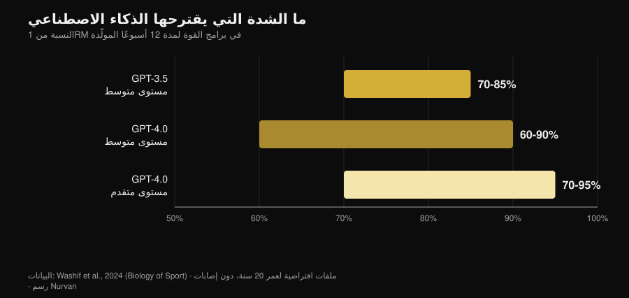
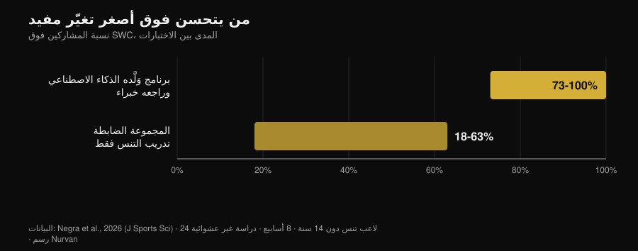

# برنامج تدريب بالذكاء الاصطناعي: ماذا تقول الدراسات

بقلم [Giammaria Loi](/autore/giammaria-loi) · تحديث 2 نوفمبر 2026

اطلب برنامج تمارين من روبوت محادثة، وبعد عشر ثوانٍ يصل إليك برنامج من اثني عشر أسبوعاً، بمراحل ونسب مئوية وأزمنة راحة. يبدو متماسكاً ومكتوباً بخبرة. السؤال الحقيقي ليس ما إذا كان الذكاء الاصطناعي قادراً على كتابة برنامج — فهو قادر — بل ما إذا كان ذلك البرنامج *برنامجك أنت* فعلاً، وكم من العناصر التي تجعل أي برنامج ينجح تبقى خارج الملف. منذ 2024 توقّفت بعض فرق البحث عن الجدل وبدأت تقيس: جعلت النماذج تولّد برامج، ثم سلّمتها إلى خبراء يملكون معايير تقييم مكتوبة، وفي حالة واحدة جعلت رياضيين ينفّذون البرنامج فعلياً لثمانية أسابيع. النتائج أكثر إثارة للاهتمام من الرواية التي يبيعها تسويق التطبيقات.

## باختصار

- **البرنامج يخرج منطقياً، لكنه مسودة.** برامج من 12 أسبوعاً في ثلاث مراحل، وشدّة بين 60% و95% من 1RM حسب المستوى: بنية متوافقة مع المراجع، لكنها "تتطلب على الأرجح ضبطاً إضافياً قبل التطبيق" (Washif et al., 2024).
- **ليس مخصّصاً لك: إنه برنامج عام في ثوب شخصي.** في الدراسة نفسها خرجت البرامج المولّدة لملف رجل وملف امرأة **متشابهة موضوعياً**. غيّر النموذج الاسم، لا المحتوى.
- **يمكن أن ينجح، إذا مرّ على يد إنسان.** ثمانية أسابيع من برنامج تدريب لا مركزي (eccentric) ولّده ChatGPT *وأقرّه خبراء قبل الاستخدام*: تحسّن في العدو على 5 أمتار وفي تغيير الاتجاه وفي الرشاقة، ولا تحسّن في الوثب (Negra et al., 2026).
- **فكرة أن الروبوت يجعلك منتظماً لا دليل عليها.** مراجعة منهجية لسبع تجارب معشّاة: آثار **غير متسقة** على النشاط البدني والتغذية عند البالغين، ولا دليل على أي أثر عند الأطفال. ينجح مع الإقلاع عن التدخين، لا مع النادي (Chen et al., 2025).
- **في السعرات هو أدقّ في الوصفة الواحدة من الخطة اليومية.** خطط غذائية ووصفات مولّدة ثم أُعيد حسابها على قواعد بيانات غذائية: الوصفات صمدت أفضل من قوائم اليوم الكامل (Aslan و Sozlu, 2025).
- **ليس خطيراً بقدر ما هو ناقص.** قيّم اثنا عشر أخصائي علاج طبيعي أجوبة ChatGPT بأنها آمنة ودقيقة في معظمها في **خمسة مجالات من ستة**، لكنها تنقصها الشمولية (Schütze et al., 2026).

## ما يحدث فعلاً عندما تطلب "اكتب لي برنامجاً"

النموذج اللغوي لا يحسب برنامجك: يتوقّع النص الأكثر ترجيحاً بناءً على ما كتبته له. الناتج معدّل مدروس لكل ما قرأه، ولأنه قرأ كثيراً من المراجع الجدّية فهذا المعدّل معقول في الغالب. لهذا تبدو البرامج المولّدة جيدة من النظرة الأولى: المراحل موجودة، ونطاقات التكرارات سليمة، والتسخين في موضعه الصحيح.

المشكلة تبدأ بعد ذلك. البرنامج موجود لينتج تكيّفاً في شخص *واحد*، بتاريخ أحماله وجدوله اليومي ومتاعبه القديمة واستجابته الخاصة للتعب. هذا الجزء ليس موجوداً في ما كتبته للنموذج، ولا في النص الذي يعيده: يأتي لاحقاً، أسبوعاً بعد أسبوع. الدراسات التالية تقيس هذه المسافة بالضبط.

## ما تقوله الأبحاث فعلاً

| الادعاء الشائع | الحكم | المصدر |
|---|---|---|
| "الذكاء الاصطناعي يكتب برنامجاً منطقياً" | مؤكّد، لكنه مسودة | Washif et al., 2024 |
| "البرنامج مخصّص لك" | مُدحَض | Washif et al., 2024 |
| "برنامج يكتبه الذكاء الاصطناعي لا ينجح" | مُدحَض، بشرط واحد | Negra et al., 2026 |
| "الإصدارات الجديدة حلّت كل هذا" | يحتاج تفصيلاً | Genç et al., 2025 |
| "روبوت المحادثة يجعلك منتظماً" | غير مدعوم | Chen et al., 2025 |
| "يمكنك أن تطلب منه نظامك الغذائي أيضاً" | يحتاج تفصيلاً | Aslan و Sozlu, 2025 |
| "إنه خطير" | يحتاج تفصيلاً: ناقص أكثر من كونه غير آمن | Schütze et al., 2026 |

### الادعاء 1 — "الذكاء الاصطناعي يكتب برنامجاً منطقياً"
**مؤكّد، لكنه مسودة.**

أول دراسة مفهرسة دخلت في التفاصيل طلبت من GPT-3.5 وGPT-4.0 تصميم برامج قوة من اثني عشر أسبوعاً لملفات افتراضية لأشخاص في العشرين من العمر، بخبرة متوسطة أولاً ثم متقدّمة. أنتج الإصداران برامج في ثلاث مراحل من أربعة أسابيع لكل منها أهداف مختلفة (تضخيم، قوة)، مع متغيّرات داخل نطاقات المراجع وأزمنة راحة متماسكة.

*مخطط Nurvan على بيانات Washif et al., 2024 (Biology of Sport). نطاقات الشدة التي اقترحتها النماذج لبرامج من 12 أسبوعاً؛ ملفات افتراضية لعمر 20 سنة، بدون إصابات.*

الفروق بين الإصدارين حقيقية وتسير في الاتجاه المتوقّع: GPT-4.0 يميّز المستوى المتوسط عن المتقدّم، ويوسّع نافذة الراحة (من 60-180 إلى 60-300 ثانية)، ويتعامل مع معلومات أكثر في وقت واحد. مع ذلك فإن خلاصة الباحثين حاسمة: البرامج "تتطلب على الأرجح ضبطاً إضافياً قبل التطبيق"، والنموذج "قد يصلح كأداة مكمّلة لكتابة مسودة".

كلمة "مسودة" هي الكلمة الصحيحة هنا. البرنامج المعقول ليس بالضرورة البرنامج المناسب.

### الادعاء 2 — "البرنامج مخصّص لك"
**مُدحَض.**

هذه أكثر نتيجة محرجة في الدراسة نفسها، ولا يكاد أحد يذكرها. كفى الباحثين أن يغيّروا جنس الملف في الطلب ليروا ما يحدث: كل البرامج المولّدة خرجت **متشابهة موضوعياً بغضّ النظر عن الجنس**. ليست هذه ملاحظة على الفيزيولوجيا — فتوصيات التدريب للرجال والنساء متقاربة فعلاً إلى حد كبير — بل ملاحظة على الآلية: النموذج لم يستخدم المعلومة الفردية الوحيدة التي أُعطيت له.

وإذا كانت معلومة صريحة في الطلب لا تحرّك الناتج، فكل ما لم تكتبه وزنه صفر. وما لا تكتبه هو كل شيء تقريباً: كم نمت، وكم أنهكتك حصة الأمس، ولماذا يشدّ كتفك الأيمن في ضغط البار بقبضة واسعة فقط.

### الادعاء 3 — "برنامج يكتبه الذكاء الاصطناعي لا ينجح"
**مُدحَض، بشرط واحد يغيّر الصورة كلها.**

في 2026 وصلت أول دراسة تدخّل. أربعة وعشرون لاعب تنس تحت 14 سنة قُسّموا إلى مجموعتين: الأولى اتبعت ثمانية أسابيع من برنامج عمل لا مركزي ولّده ChatGPT، والثانية واصلت تدريب التنس وحده. حقّقت مجموعة الذكاء الاصطناعي تحسناً دالاً في العدو على 5 أمتار، وفي تغيير الاتجاه (اختبار 505)، وفي الرشاقة، بأحجام أثر بين 0.6 و2.15 مقابل 0.15-0.6 في مجموعة الضبط. أما العدو على 10 أمتار واختبارات الوثب فلم يظهر فيهما فرق بين المجموعتين.

*مخطط Nurvan على بيانات Negra et al., 2026 (Journal of Sports Sciences). نسبة المشاركين الذين تجاوزوا أصغر تغيّر ذي قيمة في الاختبارات المختلفة؛ دراسة مضبوطة غير معشّاة، 24 رياضياً تحت 14 سنة.*

الشرط مكتوب في سطر واحد من فصل المنهجية: البرنامج المولّد بالذكاء الاصطناعي **أقرّه خبراء بشريون قبل أن يُطبّق على أي أحد**. هذه ليست قصة "الذكاء الاصطناعي درّب مجموعة من الناشئين"، بل "خبراء استخدموا الذكاء الاصطناعي لكتابة النسخة الأولى، ثم راجعوها، ثم طبّقوها". وهذا بالضبط سير العمل الذي ينجح، وهو نفسه السبب في أن الدراسة لا تسمح لك بتخطّي المراجعة.

### الادعاء 4 — "الإصدارات الجديدة حلّت كل هذا"
**يحتاج تفصيلاً.**

أخذ فريق بحثي ثلاثة إصدارات من ChatGPT وكلّفها بتوليد برامج قوة من اثني عشر أسبوعاً انطلاقاً من سبع مجموعات مختلفة من التعليمات، ثم عرضها على سبعة خبراء — مدرّبين معتمدين CSCS وحاملي دكتوراه في علوم الرياضة بخبرة عشر سنوات على الأقل — ليقيّموها على معيار يشمل، بين أمور أخرى، تفريد التدرّج، وتعديل البرنامج، وخطر الإصابة، ووجود توصيات خاطئة.

كانت الفروق بين الإصدارات دالة إحصائياً في كل المقارنات الثنائية (p = 0.018)، وحُكم على الإصدار الأحدث بأنه أكثر تفصيلاً وأكثر تماسكاً داخلياً وأفضل استناداً إلى الأدبيات. التحسّن حقيقي. لكن خلاصة الباحثين مطابقة لخلاصة 2024: لكي تكون الخطة المدعومة بالذكاء الاصطناعي آمنة ومبنية على الأدلة ومفرّدة، "يبقى إشراك خبرة بشرية مؤهّلة أمراً جوهرياً". الإصدارات الجديدة تحسّن المسودة، ولا تلغي المراجعة.

### الادعاء 5 — "روبوت المحادثة يجعلك منتظماً أكثر من مدرب"
**غير مدعوم.**

هنا يسبق الوعد التجاري البيانات بمسافة كبيرة. مسحت مراجعة منهجية اثنتي عشرة قاعدة بيانات و6301 سجل لعزل التجارب المعشّاة على روبوتات محادثة قادرة على حوار طبيعي مفتوح: بقي منها سبع. في الإقلاع عن التدخين كانت الآثار متسقة. أما في التغذية والنشاط البدني عند البالغين فكانت **غير متسقة**، وعند الأطفال لم يظهر أي دليل على أثر، واثنتان من أربع دراسات النشاط البدني حملتا خطر تحيّز مرتفعاً.

وهناك تفصيل يفسّر الكثير: كان المستخدمون يتفاعلون كثيراً مع الروبوتات بشكل عام، لكن أقل بكثير حين يتعلق الأمر بسلوكيات الصحة المحدّدة. الرضا مرتفع، والتغيير لا. هذا هو الفرق بين تطبيق يعجبك وتطبيق يجعلك تتدرّب، وهو نفس الفرق بين مدرب لطيف ومدرب يحقّق نتائج: جمعت أرقام الإشراف البشري في مقال [هل ينجح التدريب عن بُعد فعلاً](/ar/blog/hal-yanjah-altadrib-an-bud).

### الادعاء 6 — "يمكنك أن تطلب منه نظامك الغذائي أيضاً"
**يحتاج تفصيلاً.**

طلبت دراسة استكشافية من ChatGPT خطط طعام يومية بـ1500 و2000 و2500 سعرة، ووصفات بـ300 و500 و700 سعرة، ثم أعادت حساب كل شيء على قواعد بيانات غذائية. تبيّن أن النموذج **أدقّ في بناء وصفة تصيب السعرات المطلوبة من تركيب خطة يوم كامل**: كلما كان الهدف أصغر وأكثر تحديداً، تراكم الخطأ أقل.

هي دراسة استكشافية على إصدار أصبح قديماً، فتصلح كمؤشّر منهجي لا كحكم نهائي. والمؤشّر مفيد على أي حال: استخدم الذكاء الاصطناعي للأجزاء، لا للهيكل. وحين تحتاج غرامات حقيقية، فأنت تحتاج غرامات حقيقية من قاعدة بيانات غذائية، لا تقديراً معقول الشكل.

### الادعاء 7 — "إنه خطير"
**يحتاج تفصيلاً: ناقص أكثر من كونه غير آمن.**

أقسى اختبار يأتي من خارج النادي. قيّم اثنا عشر أخصائي علاج طبيعي ذوي خبرة أجوبة ChatGPT على ست أسئلة حول التمرين في مرض عضلي نادر، على مقياس يمتد من "شامل ودقيق" إلى "خاطئ وغير آمن". الحكم: أجوبة آمنة ودقيقة في معظمها في خمسة مجالات من ستة، لكنها في الغالب غير شاملة.

هذا هو ملمح الخطر المميّز: لا يقول لك أن تفعل شيئاً سخيفاً، بل يقول لك شيئاً معقولاً ويترك خارجه الجزء الذي كان مهماً. وفي طب الرياضة تتكرر الخلاصة نفسها: أداء النموذج على اختباراته لا يترجم تلقائياً إلى نتائج أفضل، ويبقى المهني داخل الحلقة بصفته من يدمج المعلومات (Palermi et al., 2026). عَرَض لا يزول، وألم يزداد سوءاً، وتحليل يحتاج تفسيراً: هذه مهمة الطبيب، لا مهمة روبوت المحادثة.

## كيف تستخدمه جيداً

1. **استخدمه للمسودة، لا للقرار.** برنامج انطلاق، أفكار لبدائل التمارين، إعادة تنظيم برنامج تملكه أصلاً: نعم. اختيار حمل الغد: لا.
2. **أعطه السياق الذي تملكه فعلاً.** تاريخ الأحمال، وRIR الحصص الأخيرة، والأيام المتاحة، والإصابات. بدون هذه، كما أظهر Washif، لا يتحرك الناتج تقريباً حتى لو تغيّر الملف.
3. **راجع الأرقام.** إذا ذكر دراسة فتحقّق منها: المراجع المُختلقة هي أسرع طريق لحمل اعتقاد خاطئ إلى النادي.
4. **اعرضه على من يعرف قراءته.** في دراسة التدخّل الإيجابية الوحيدة كان البرنامج مُقرّاً من خبراء بشريين قبل الاستخدام. هذا هو الخط الفاصل بين أداة وبديل.
5. **قِس بدلاً من أن تثق.** بعد أربعة أسابيع انظر إلى الأحمال، لا إلى الإحساس: إذا لم تنتج المسودة تدرّجاً، فهي مسودة خاطئة.
6. **أبعده عن الطب.** الأمراض والأدوية ونتائج التحاليل: لا روبوت محادثة ولا تطبيق. اذهب إلى الطبيب.

> **جرّب Nurvan — الذكاء الاصطناعي يكتب المسودة، وبياناتك تصحّحها**
>
> في Nurvan لا يبقى البرنامج نصاً: الحمل والتكرارات وRIR لكل مجموعة تدخل في سجلك، ومجموعات التسخين تُقترح انطلاقاً من حمل العمل في ذلك اليوم، ويُبنى التدرّج على ما رفعته فعلاً. وإذا كنت تعمل مع مدرب فهو يرى الأرقام نفسها ويصحّح حيث يلزم — وهذا بالضبط الجزء الذي يغيب عن أي برنامج مولّد. [جرّب Nurvan](https://nurvan.app)

## أسئلة شائعة

**هل يمكنني استخدام ChatGPT لكتابة برنامج تمارين النادي؟**
كمسودة نعم، كبرنامج نهائي لا. الدراسات التي قيّمت البرامج المولّدة تصفها بأنها متماسكة بنيوياً لكنها تحتاج ضبطاً، وتتفق على نقطة واحدة: تلزم خبرة بشرية مؤهّلة لجعلها آمنة ومفرّدة (Washif et al., 2024; Genç et al., 2025).

**هل تختلف برامج الذكاء الاصطناعي بين الرجال والنساء؟**
في الدراسة التي تحقّقت من ذلك، لا: البرامج التي أُنتجت لملفات رجال وملفات نساء كانت متشابهة موضوعياً (Washif et al., 2024). إذا كنت تتوقع تخصيصاً لمجرّد أنك ذكرت من أنت، فأنت على الأرجح لا تحصل عليه.

**هل يساعدني تطبيق بالذكاء الاصطناعي على الالتزام؟**
لا يوجد دليل قوي حتى الآن. في التجارب المعشّاة السبع المتاحة، آثار روبوتات المحادثة على النشاط البدني والتغذية عند البالغين غير متسقة، والنتيجة المتسقة الوحيدة تتعلق بالتدخين (Chen et al., 2025).

**الذكاء الاصطناعي أم مدرب بشري؟**
ليسا بديلين على المستوى نفسه: أحدهما يكتب نصاً، والآخر يراقبك أنت. بيانات الإشراف تشير إلى أن الجزء الحاسم في العمل البشري هو جعل البرنامج يُنفّذ جيداً لا كتابته — فمع مشرف واحد لكل خمسة متدرّبين ارتفع ضغط البار الأقصى بنسبة 15.9% مقابل 10.2% مع مشرف واحد لكل خمسة وعشرين (Gentil و Bottaro, 2010).

## اقرأ أيضاً

- [هل ينجح التدريب عن بُعد؟ ما تقوله الدراسات](/ar/blog/hal-yanjah-altadrib-an-bud) — كم يهمّ فعلاً أن يتابعك أحد، بالأرقام.
- [كم تكراراً لبناء الكتلة العضلية؟ أسطورة 8-12](/ar/blog/kam-takrar-lilkutla-aladalia) — متغيّرات البرمجة التي تُسلّم لمسودة الذكاء الاصطناعي، وما تقوله الأدلة عنها.
- [اتجاهات اللياقة 2027: ما ينجح فعلاً](/ar/blog/itijahat-allyaqa-2027-ma-yanjah) — موقع التقنية بين الموضات والأشياء التي تصمد.

## المصادر

- Washif JA, Pagaduan J, James C, Dergaa I, Beaven CM, 2024. Artificial intelligence in sport: Exploring the potential of using ChatGPT in resistance training prescription. *Biology of Sport* 41(2):209-220. PMID 38524820. [DOI](https://doi.org/10.5114/biolsport.2024.132987)
- Genç A, Aydın GR, Kasap M, Özkan A, Rakhymzhanov A, Gürcan HH, Güllü S, Demirhan B, 2025. Comparative evaluation of ChatGPT versions in training program design: scientific approach, accuracy, and practical applicability. *BMC Sports Science, Medicine and Rehabilitation* 18(1):19. PMID 41345701. [DOI](https://doi.org/10.1186/s13102-025-01409-7)
- Negra Y, Sammoud S, Bouguezzi R, Markov A, Capranica L, Müller P, Chaabene H, 2026. Effects of a ChatGPT-generated eccentric training programme on speed, change of direction, agility, and jumping performance in U14 tennis players: A non-randomised controlled study. *Journal of Sports Sciences*. PMID 41944488. [DOI](https://doi.org/10.1080/02640414.2026.2653295)
- Chen J, Hu RZ, Zhuang YX, Zhang JQ, Shan R, Yang Y, Liu Z, 2025. Natural Language Processing Chatbot-Based Interventions for Improvement of Diet, Physical Activity, and Tobacco Smoking Behaviors: Systematic Review. *JMIR mHealth and uHealth* 13:e66403. PMID 40503914. [DOI](https://doi.org/10.2196/66403)
- Aslan S, Sozlu S, 2025. A pilot study of the potential role of ChatGPT in stated-calorie diet planning. *International Journal of Obesity* 49(9):1891-1896. PMID 40628963. [DOI](https://doi.org/10.1038/s41366-025-01839-w)
- Schütze K, Shehatha R, Beer K, Needham M, Smith T, Bagg M, Doverty A, Cooper I, 2026. Evaluating ChatGPT's advice and recommendations regarding exercise for people with inclusion body myositis. *Neuromuscular Disorders* 62:106418. PMID 41950577. [DOI](https://doi.org/10.1016/j.nmd.2026.106418)
- Palermi S, Pucciatti R, Regnard NE, et al., 2026. Artificial Intelligence in Sports Medicine: A Decision-Centered Framework for the Future Sports Physician. *Diagnostics* 16(10):1448. PMID 42196815. [DOI](https://doi.org/10.3390/diagnostics16101448)
- Gentil P, Bottaro M, 2010. Influence of supervision ratio on muscle adaptations to resistance training in nontrained subjects. *Journal of Strength and Conditioning Research* 24(3):639-43. PMID 19661830. [DOI](https://doi.org/10.1519/JSC.0b013e3181ad3373)

المراجع البِبليوغرافية مستخرجة عبر PubMed. الموضوع اختير ببحث الاتجاهات في 2 نوفمبر 2026: سؤال "الذكاء الاصطناعي أم مدرب" من أكثر ما يُبحث عنه حالياً في اللياقة، لكن الصفحات التي تحتل تلك النتائج مدونات لشركات برمجيات بلا مصدر واحد.

---

Giammaria Loi هو مؤسّس Nurvan. يتدرّب بالأثقال منذ 2012، ويعمل مدرّباً شخصياً وكوتشاً معتمداً من FIPE منذ 2013، وينافس في رفع الأثقال القوة (powerlifting) على المستوى الوطني منذ 2018. كل مقال يحمل اسمه يبدأ من الدراسات العلمية ويصل إلى ما ينجح فعلاً في النادي.

> ملاحظة: محتوى تعليمي، لا يحلّ محلّ رأي طبيب أو مهني مؤهّل.
