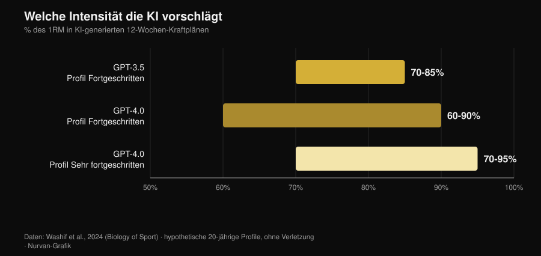

# Trainingsplan mit KI: was die Studien zeigen

Von [Giammaria Loi](/autore/giammaria-loi) · aktualisiert am 2. November 2026

Du fragst einen Chatbot nach einem Trainingsplan und hast zehn Sekunden später zwölf Wochen Programm vor dir, mit Phasen, Prozentangaben und Pausenzeiten. Es sieht kompetent aus. Die eigentliche Frage ist nicht, ob eine KI einen Plan schreiben kann — sie kann es —, sondern ob dieser Plan wirklich *deiner* ist und wie viel von dem, was einen Plan wirken lässt, nie in der Datei landet. Seit 2024 haben einige Forschungsgruppen aufgehört zu diskutieren und angefangen zu messen: Sie ließen Modelle Programme generieren, gaben sie Fachleuten mit Bewertungsrastern und ließen eines davon in einem Fall acht Wochen lang tatsächlich durchführen. Die Ergebnisse sind interessanter als die Version, die App-Marketing erzählt.

## Kurz gefasst

- **Der Plan ist sinnvoll — aber nur ein Entwurf.** Zwölf-Wochen-Programme in drei Phasen, Intensitäten zwischen 60 % und 95 % des 1RM je nach Niveau: Strukturen, die zu den Lehrbüchern passen, die aber „vor der Anwendung wahrscheinlich eine zusätzliche Feinabstimmung brauchen" (Washif et al., 2024).
- **Er ist nicht individualisiert, sondern generisch im Kostüm.** In derselben Arbeit fielen die Programme für ein männliches und ein weibliches Profil **objektiv ähnlich** aus. Das Modell hat das Etikett geändert, nicht den Inhalt.
- **Er kann funktionieren, wenn ein Mensch ihn prüft.** Acht Wochen exzentrisches Programm von ChatGPT, *vor dem Einsatz von Fachleuten validiert*: 5-m-Sprint, Richtungswechsel und Agilität verbesserten sich, Sprünge nicht (Negra et al., 2026).
- **Dass ein Chatbot dich dranbleiben lässt, ist nicht belegt.** Systematische Übersicht über 7 RCTs: **inkonsistente** Effekte auf körperliche Aktivität und Ernährung bei Erwachsenen, keine Evidenz bei Kindern. Es wirkt beim Rauchen, nicht im Gym (Chen et al., 2025).
- **Bei Kalorien ist sie im Rezept genauer als im Tagesplan.** Generierte Tagespläne und Rezepte, anschließend gegen Nährwertdatenbanken nachgerechnet: Einzelrezepte hielten besser als ganze Tagesmenüs (Aslan und Sozlu, 2025).
- **Sie ist nicht gefährlich, sondern unvollständig.** Zwölf Physiotherapeutinnen und Physiotherapeuten bewerteten die Antworten von ChatGPT in **fünf von sechs Bereichen** als sicher und überwiegend korrekt, aber zu wenig vollständig (Schütze et al., 2026).

## Was wirklich passiert, wenn du „schreib mir einen Plan" eingibst

Ein Sprachmodell berechnet dein Programm nicht: Es sagt den plausibelsten Text zu dem voraus, was du geschrieben hast. Das Ergebnis ist ein begründeter Mittelwert aus allem, was es gelesen hat, und weil es viele seriöse Lehrbücher gelesen hat, ist dieser Mittelwert meist vernünftig. Genau darum sehen generierte Pläne auf den ersten Blick gut aus: Die Phasen sind da, die Wiederholungsbereiche stimmen, das Aufwärmen steht an der richtigen Stelle.

Das Problem beginnt danach. Ein Programm existiert, um bei *einer* Person eine Anpassung auszulösen — mit ihrer Belastungshistorie, ihren Zeiten, ihrer zickigen Schulter und ihrer eigenen Reaktion auf Ermüdung. Dieser Teil steht nicht im Prompt, und er steht auch nicht im Text, den das Modell zurückgibt: Er kommt erst danach, Woche für Woche. Die folgenden Studien messen genau diesen Abstand.

## Was die Forschung wirklich sagt

| Verbreitete Behauptung | Urteil | Quelle |
|---|---|---|
| „Die KI schreibt einen sinnvollen Plan" | Bestätigt, aber als Entwurf | Washif et al., 2024 |
| „Der Plan ist auf dich zugeschnitten" | Widerlegt | Washif et al., 2024 |
| „Ein KI-Plan funktioniert nicht" | Widerlegt, mit einer Bedingung | Negra et al., 2026 |
| „Die neuen Versionen haben das gelöst" | Zu präzisieren | Genç et al., 2025 |
| „Ein Chatbot hält dich dran" | Nicht belegt | Chen et al., 2025 |
| „Die Ernährung kannst du auch fragen" | Zu präzisieren | Aslan und Sozlu, 2025 |
| „Sie ist gefährlich" | Zu präzisieren: eher unvollständig als unsicher | Schütze et al., 2026 |

### Behauptung 1 — „Die KI schreibt einen sinnvollen Plan"
**Bestätigt, aber es ist ein Entwurf.**

Die erste indexierte Arbeit, die wirklich hineingeschaut hat, ließ GPT-3.5 und GPT-4.0 zwölfwöchige Kraftprogramme für hypothetische Zwanzigjährige entwerfen, zuerst mit fortgeschrittener, dann mit sehr fortgeschrittener Erfahrung. Beide Versionen lieferten drei Phasen von je vier Wochen mit unterschiedlichen Zielen (Hypertrophie, Kraft), Parameter innerhalb der Lehrbuchbereiche und schlüssige Pausen.

*Nurvan-Grafik auf Daten von Washif et al., 2024 (Biology of Sport). Von den Modellen vorgeschlagene Intensitätsbereiche für Zwölf-Wochen-Programme; hypothetische 20-jährige Profile, ohne Verletzung.*

Die Unterschiede zwischen den Versionen sind vorhanden und gehen in die erwartete Richtung: GPT-4.0 trennt das fortgeschrittene vom sehr fortgeschrittenen Niveau, weitet das Pausenfenster (von 60-180 auf 60-300 Sekunden) und verarbeitet mehr Informationen gleichzeitig. Das Fazit der Autoren bleibt dennoch deutlich: Die Programme „brauchen vor der Anwendung wahrscheinlich eine zusätzliche Feinabstimmung", und das Modell „kann als ergänzendes Werkzeug zum Schreiben eines Entwurfs dienen".

Entwurf ist das entscheidende Wort. Ein plausibler Plan ist kein passender Plan.

### Behauptung 2 — „Der Plan ist auf dich zugeschnitten"
**Widerlegt.**

Das ist das unbequemste Ergebnis derselben Studie, und fast niemand zitiert es. Den Autoren genügte es, im Prompt das Geschlecht des Profils zu ändern, um zu sehen, was passiert: Alle generierten Programme fielen **unabhängig vom Geschlecht objektiv ähnlich** aus. Das ist kein Einwand gegen die Physiologie — die Trainingsempfehlungen für Männer und Frauen überschneiden sich tatsächlich stark —, sondern einer gegen den Mechanismus: Das Modell hat die einzige individuelle Information, die es bekommen hatte, nicht genutzt.

Wenn eine ausdrückliche Angabe im Prompt das Ergebnis nicht verändert, dann wiegt alles, was du *nicht* geschrieben hast, null. Und was du nicht schreibst, ist fast alles: wie du geschlafen hast, was dich die Einheit von gestern gekostet hat, warum die rechte Schulter nur beim Bankdrücken mit weitem Griff zieht.

### Behauptung 3 — „Ein KI-Plan funktioniert nicht"
**Widerlegt, mit einer Bedingung, die alles verändert.**

2026 kam die erste Interventionsstudie. Vierundzwanzig Tennisspieler unter 14 Jahren in zwei Gruppen: Eine absolvierte acht Wochen ein von ChatGPT generiertes exzentrisches Trainingsprogramm, die andere trainierte weiter nur Tennis. Die KI-Gruppe verbesserte sich signifikant im 5-m-Sprint, im Richtungswechsel (505) und in der Agilität, mit Effektstärken zwischen 0,6 und 2,15 gegenüber 0,15-0,6 in der Kontrollgruppe. Beim 10-m-Sprint und bei den Sprungtests gab es keinen Unterschied zwischen den Gruppen.

*Nurvan-Grafik auf Daten von Negra et al., 2026 (Journal of Sports Sciences). Anteil der Teilnehmenden, die den Smallest Worthwhile Change in den einzelnen Tests überschreiten; nicht randomisierte kontrollierte Studie, 24 U14-Athleten.*

Die Bedingung steckt in einer Zeile der Methodik: Das KI-generierte Programm wurde **vor der Anwendung von menschlichen Fachleuten validiert**. Das ist nicht „die KI hat Jugendliche trainiert", sondern „Fachleute haben mit der KI die erste Fassung geschrieben, sie kontrolliert und dann umsetzen lassen". Genau dieser Arbeitsablauf funktioniert — und genau deshalb erlaubt die Studie nicht, die Kontrolle zu überspringen.

### Behauptung 4 — „Die neuen Versionen haben das alles gelöst"
**Zu präzisieren.**

Eine Forschungsgruppe ließ drei ChatGPT-Versionen aus sieben verschiedenen Anweisungssätzen zwölfwöchige Kraftprogramme generieren und anschließend von sieben Fachleuten bewerten — CSCS-zertifizierte Trainer und promovierte Sportwissenschaftler mit mindestens zehn Jahren Erfahrung — anhand eines Rasters, das unter anderem Individualisierung der Progression, Programmanpassung, Verletzungsrisiko und das Vorkommen falscher Empfehlungen gewichtete.

Die Unterschiede zwischen den Versionen waren in allen Paarvergleichen statistisch signifikant (p = 0,018), und die neueste Version wurde als detaillierter, in sich konsistenter und besser in der Literatur verankert beurteilt. Die Verbesserung ist echt. Das Fazit der Autoren ist allerdings identisch mit dem von 2024: Damit ein KI-gestützter Plan sicher, evidenzbasiert und individualisiert ist, „bleibt die Beteiligung qualifizierter menschlicher Expertise unverzichtbar". Neue Versionen verbessern den Entwurf, sie ersetzen die Überprüfung nicht.

### Behauptung 5 — „Ein Chatbot hält dich besser dran als ein Coach"
**Nicht belegt.**

Hier läuft das Marketingversprechen den Daten deutlich voraus. Eine systematische Übersicht durchsuchte zwölf Datenbanken und 6.301 Datensätze, um randomisierte Studien zu Chatbots zu isolieren, die ein offenes Gespräch in natürlicher Sprache führen können: sieben blieben übrig. Beim Rauchen sind die Effekte konsistent. Bei Ernährung und körperlicher Aktivität von Erwachsenen sind sie **inkonsistent**, bei Kindern gibt es keine Evidenz für einen Effekt, und zwei der vier Studien zur körperlichen Aktivität haben ein hohes Verzerrungsrisiko.

Ein Detail erklärt viel: Die Nutzenden interagierten insgesamt viel mit den Chatbots, aber deutlich weniger zu den konkreten Gesundheitsverhalten. Die Zufriedenheit war hoch, die Verhaltensänderung nicht. Das ist der Unterschied zwischen einer App, die dir gefällt, und einer App, die dich trainieren lässt — derselbe Unterschied, der einen sympathischen Coach von einem wirksamen trennt. Die Zahlen zur menschlichen Betreuung habe ich im Artikel dazu gesammelt, [ob Online-Coaching wirklich funktioniert](/de/blog/funktioniert-online-coaching).

### Behauptung 6 — „Die Ernährung kannst du sie doch auch fragen"
**Zu präzisieren.**

Eine Pilotstudie verlangte von ChatGPT Tagespläne mit 1500, 2000 und 2500 kcal sowie Rezepte mit 300, 500 und 700 kcal und rechnete anschließend alles gegen Nährwertdatenbanken nach. Das Modell war **genauer darin, ein einzelnes Rezept auf die geforderten Kalorien zu bringen, als einen ganzen Tagesplan zusammenzustellen**: Je kleiner und klarer umgrenzt das Objekt, desto weniger summiert sich der Fehler.

Es ist ein Pilotprojekt mit einer inzwischen alten Version, taugt also als methodischer Hinweis, nicht als Urteil. Der Hinweis bleibt nützlich: Nutze die KI für die Teile, nicht für die Konstruktion. Und wenn es um echte Gramm geht, brauchst du echte Gramm aus einer Lebensmitteldatenbank, keine plausible Schätzung.

### Behauptung 7 — „Sie ist gefährlich"
**Zu präzisieren: eher unvollständig als unsicher.**

Der härteste Test kommt von außerhalb des Gyms. Zwölf erfahrene Physiotherapeutinnen und Physiotherapeuten bewerteten die Antworten von ChatGPT auf sechs Fragen zum Training bei einer seltenen Muskelerkrankung, auf einer Skala von „vollständig und korrekt" bis „falsch und unsicher". Urteil: sichere und überwiegend korrekte Antworten in fünf von sechs Bereichen, aber häufig nicht vollständig.

Das ist das typische Risikoprofil: Sie sagt dir nichts Absurdes, sie sagt dir etwas Vernünftiges und lässt den Teil weg, auf den es ankam. In der Sportmedizin lautet das Fazit genauso: Die Leistung eines Modells in seinen eigenen Tests übersetzt sich nicht automatisch in bessere Ergebnisse, und die Fachperson bleibt als diejenige im Kreis, die die Informationen zusammenführt (Palermi et al., 2026). Ein Symptom, das nicht verschwindet, ein Schmerz, der schlimmer wird, ein Befund, der gedeutet werden muss: Das gehört zur Ärztin oder zum Arzt, nicht zum Chatbot.

## So nutzt du sie richtig

1. **Nutze sie für den Entwurf, nicht für die Entscheidung.** Ein Startplan, Übungsvarianten, das Umsortieren eines Programms, das du schon hast: ja. Die Wahl des Gewichts für morgen: nein.
2. **Gib ihr den Kontext, den du tatsächlich hast.** Belastungshistorie, RIR der letzten Einheiten, verfügbare Tage, Verletzungen. Ohne die bewegt sich das Ergebnis, wie Washif gezeigt hat, nicht einmal dann, wenn sich das Profil ändert.
3. **Prüfe die Zahlen nach.** Wenn sie eine Studie zitiert, kontrolliere sie: Erfundene Quellen sind der schnellste Weg, eine falsche Überzeugung ins Gym zu tragen.
4. **Lass sie von jemandem lesen, der das kann.** In der einzigen positiven Interventionsstudie war das Programm vor dem Einsatz von menschlichen Fachleuten validiert. Das ist die Grenze zwischen Werkzeug und Ersatz.
5. **Messen statt vertrauen.** Schau nach vier Wochen auf die Gewichte, nicht auf das Gefühl: Wenn der Entwurf keine Progression erzeugt, ist es der falsche Entwurf.
6. **Halte sie aus der Medizin heraus.** Erkrankungen, Medikamente, Befunde: kein Chatbot, keine App. Zur Ärztin oder zum Arzt.

> **Nurvan testen — die KI schreibt den Entwurf, deine Daten korrigieren ihn**
>
> In Nurvan bleibt der Plan kein Textblock: Gewicht, Wiederholungen und RIR jeder Serie landen in deiner Historie, die Aufwärmsätze werden aus dem Arbeitsgewicht des Tages vorgeschlagen, und die Progression baut auf dem auf, was du wirklich gehoben hast. Wenn du mit einem Coach arbeitest, sieht er dieselben Zahlen und korrigiert dort, wo es nötig ist — genau der Teil, der einem generierten Plan fehlt. [Nurvan testen](https://nurvan.app)

## Häufige Fragen

**Kann ich mir mit ChatGPT meinen Trainingsplan schreiben lassen?**
Als Entwurf ja, als endgültiges Programm nein. Die Studien, die generierte Pläne bewertet haben, beschreiben sie als strukturell schlüssig, aber feinabstimmungsbedürftig, und sie sind sich in einem Punkt einig: Es braucht qualifizierte menschliche Expertise, damit sie sicher und individualisiert sind (Washif et al., 2024; Genç et al., 2025).

**Sind KI-Trainingspläne für Männer und Frauen unterschiedlich?**
In der Studie, die das überprüft hat, nein: Die Programme für männliche und weibliche Profile waren objektiv ähnlich (Washif et al., 2024). Wenn du eine Individualisierung allein dadurch erwartest, dass du geschrieben hast, wer du bist, bekommst du sie wahrscheinlich nicht.

**Hilft mir eine KI-App dabei, dranzubleiben?**
Dafür gibt es noch keine belastbare Evidenz. Über die sieben vorliegenden randomisierten Studien hinweg sind die Chatbot-Effekte auf körperliche Aktivität und Ernährung bei Erwachsenen inkonsistent; konsistent ist das Ergebnis nur beim Rauchen (Chen et al., 2025).

**KI oder Coach: was ist besser?**
Sie konkurrieren nicht um dieselbe Aufgabe: Die eine schreibt Text, der andere schaut dir zu. Die Daten zur Betreuung zeigen, dass der entscheidende menschliche Beitrag darin liegt, einen Plan gut ausführen zu lassen, nicht ihn zu schreiben — mit einer Betreuungsperson pro fünf Trainierenden stieg das Maximum im Bankdrücken um 15,9 % gegenüber 10,2 % bei einer pro fünfundzwanzig (Gentil und Bottaro, 2010).

## Weiterlesen

- [Funktioniert Online-Coaching? Was die Studien sagen](/de/blog/funktioniert-online-coaching) — wie viel Betreuung wirklich ausmacht, mit Zahlen.
- [Wie viele Wiederholungen für Muskelaufbau? Der 8-12-Mythos](/de/blog/wie-viele-wiederholungen-muskelaufbau) — die Programmvariablen, die ein KI-Entwurf zugeteilt bekommt, und was die Evidenz dazu sagt.
- [Fitness-Trends 2027: was wirklich funktioniert](/de/blog/fitness-trends-2027-was-wirklich-funktioniert) — wo die Technologie zwischen Moden und haltbaren Dingen steht.

## Quellen

- Washif JA, Pagaduan J, James C, Dergaa I, Beaven CM, 2024. Artificial intelligence in sport: Exploring the potential of using ChatGPT in resistance training prescription. *Biology of Sport* 41(2):209-220. PMID 38524820. [DOI](https://doi.org/10.5114/biolsport.2024.132987)
- Genç A, Aydın GR, Kasap M, Özkan A, Rakhymzhanov A, Gürcan HH, Güllü S, Demirhan B, 2025. Comparative evaluation of ChatGPT versions in training program design: scientific approach, accuracy, and practical applicability. *BMC Sports Science, Medicine and Rehabilitation* 18(1):19. PMID 41345701. [DOI](https://doi.org/10.1186/s13102-025-01409-7)
- Negra Y, Sammoud S, Bouguezzi R, Markov A, Capranica L, Müller P, Chaabene H, 2026. Effects of a ChatGPT-generated eccentric training programme on speed, change of direction, agility, and jumping performance in U14 tennis players: A non-randomised controlled study. *Journal of Sports Sciences*. PMID 41944488. [DOI](https://doi.org/10.1080/02640414.2026.2653295)
- Chen J, Hu RZ, Zhuang YX, Zhang JQ, Shan R, Yang Y, Liu Z, 2025. Natural Language Processing Chatbot-Based Interventions for Improvement of Diet, Physical Activity, and Tobacco Smoking Behaviors: Systematic Review. *JMIR mHealth and uHealth* 13:e66403. PMID 40503914. [DOI](https://doi.org/10.2196/66403)
- Aslan S, Sozlu S, 2025. A pilot study of the potential role of ChatGPT in stated-calorie diet planning. *International Journal of Obesity* 49(9):1891-1896. PMID 40628963. [DOI](https://doi.org/10.1038/s41366-025-01839-w)
- Schütze K, Shehatha R, Beer K, Needham M, Smith T, Bagg M, Doverty A, Cooper I, 2026. Evaluating ChatGPT's advice and recommendations regarding exercise for people with inclusion body myositis. *Neuromuscular Disorders* 62:106418. PMID 41950577. [DOI](https://doi.org/10.1016/j.nmd.2026.106418)
- Palermi S, Pucciatti R, Regnard NE, et al., 2026. Artificial Intelligence in Sports Medicine: A Decision-Centered Framework for the Future Sports Physician. *Diagnostics* 16(10):1448. PMID 42196815. [DOI](https://doi.org/10.3390/diagnostics16101448)
- Gentil P, Bottaro M, 2010. Influence of supervision ratio on muscle adaptations to resistance training in nontrained subjects. *Journal of Strength and Conditioning Research* 24(3):639-43. PMID 19661830. [DOI](https://doi.org/10.1519/JSC.0b013e3181ad3373)

Literaturangaben über PubMed recherchiert. Thema über die Trendrecherche vom 2. November 2026 gewählt: Die Frage „KI oder Coach" gehört derzeit zu den meistgesuchten im Fitnessbereich, doch die Seiten, die diese Ergebnisse besetzen, sind Software-Blogs ohne eine einzige Quelle.

---

**Giammaria Loi** ist der Gründer von Nurvan. Er trainiert seit 2012 mit Gewichten, arbeitet seit 2013 als FIPE-zertifizierter Personal Trainer und Coach und tritt seit 2018 im Powerlifting auf nationaler Ebene an. Jeder Artikel, den er zeichnet, beginnt bei den Studien und endet bei dem, was im Gym wirklich funktioniert.

> Hinweis: informativer Inhalt, der ärztlichen oder fachlichen Rat nicht ersetzt.
