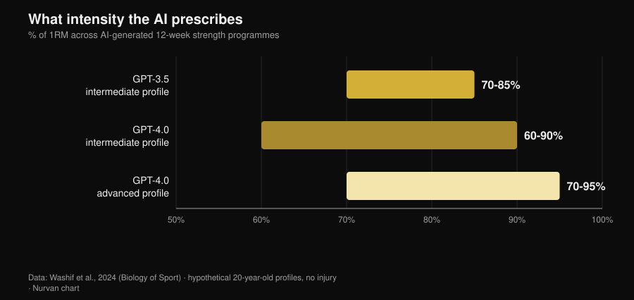
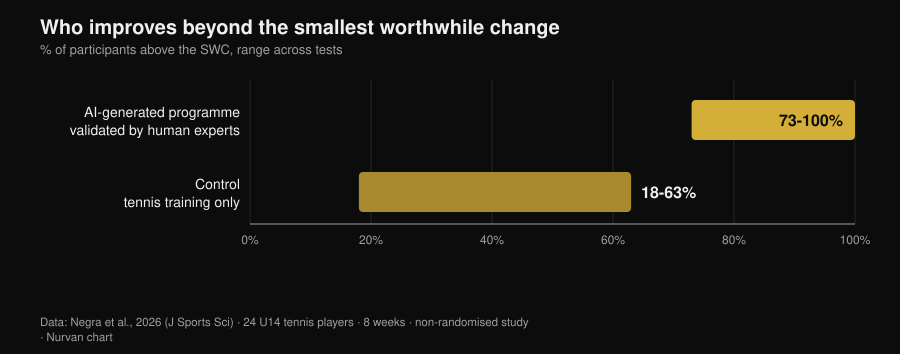

# AI workout plans: what the research actually shows

By [Giammaria Loi](/autore/giammaria-loi) · updated 2 November 2026

Ask a chatbot for a training plan and ten seconds later you have twelve weeks of programming, complete with phases, percentages and rest intervals. It looks competent. The real question is not whether AI can write a plan — it can — but whether that plan is actually *yours*, and how much of what makes a plan work never ends up in the file. Since 2024 a few research groups stopped arguing about it and started measuring: they had models generate programmes, handed them to experts with scoring rubrics and, in one case, had athletes run one for eight weeks. The findings are more interesting than the version app marketing tells you.

## The short version

- **The plan looks sensible — as a draft.** Twelve-week programmes in three phases, intensities between 60% and 95% of 1RM depending on level: structures consistent with the textbooks, but ones that "likely require additional fine-tuning before application" (Washif et al., 2024).
- **It is not personalised. It is generic in a costume.** In the same study, the programmes generated for a male and a female profile were **objectively similar**. The model changed the label, not the content.
- **It can work — if a human checks it first.** Eight weeks of a ChatGPT-generated eccentric programme *validated by experts before use*: 5 m sprint, change of direction and agility improved; jumps did not (Negra et al., 2026).
- **The "chatbot keeps you consistent" claim has no evidence.** A systematic review of 7 RCTs: **inconsistent** effects on physical activity and diet in adults, no evidence in children. It works for smoking, not for the gym (Chen et al., 2025).
- **On calories it is better at a recipe than at a day.** Generated meal plans and recipes recalculated against nutrition databases: single recipes held up better than whole daily plans (Aslan and Sozlu, 2025).
- **It is not dangerous so much as incomplete.** Twelve physiotherapists rated ChatGPT's answers safe and mostly accurate in **five domains out of six**, but short on comprehensiveness (Schütze et al., 2026).

## What is really happening when you ask for a plan

A language model does not compute your programme: it predicts the most plausible text given what you typed. The output is a reasoned average of everything it has read, and because it has read a lot of serious textbooks, that average is usually reasonable. That is why generated plans look good at a glance: the phases are there, the rep ranges are sane, the warm-up is in the right place.

The problem starts afterwards. A programme exists to produce an adaptation in *one* person, with their loading history, their schedule, their cranky shoulder and their own response to fatigue. None of that is in the prompt, and none of it is in the text the model returns: it arrives week by week. The studies below measure exactly that gap.

## What the research actually says

| Common claim | Verdict | Source |
|---|---|---|
| "AI writes a sensible plan" | Confirmed, but it is a draft | Washif et al., 2024 |
| "The plan is personalised to you" | Busted | Washif et al., 2024 |
| "An AI-written plan does not work" | Busted, with one condition | Negra et al., 2026 |
| "Newer versions fixed all of this" | Needs nuance | Genç et al., 2025 |
| "A chatbot keeps you consistent" | Not supported | Chen et al., 2025 |
| "You can ask it for your diet too" | Needs nuance | Aslan and Sozlu, 2025 |
| "It is dangerous" | Needs nuance: incomplete rather than unsafe | Schütze et al., 2026 |

### Claim 1 — "AI writes a sensible plan"
**Confirmed, but it is a draft.**

The first indexed study to look under the hood asked GPT-3.5 and GPT-4.0 to design twelve-week strength programmes for hypothetical 20-year-olds, first intermediate and then advanced. Both versions produced three four-week phases with distinct goals (hypertrophy, strength), parameters inside textbook ranges and coherent rest periods.

*Nurvan chart built on data from Washif et al., 2024 (Biology of Sport). Intensity ranges prescribed for 12-week programmes; hypothetical 20-year-old profiles, no injuries.*

The differences between versions are real and point the expected way: GPT-4.0 distinguishes intermediate from advanced, widens the rest window (from 60-180 to 60-300 seconds) and handles more information at once. The authors' conclusion is blunt all the same: the programmes "likely require additional fine-tuning before application", and the model "may serve as a complementary tool for writing a draft".

Draft is the operative word. A plausible plan is not a suitable plan.

### Claim 2 — "The plan is personalised to you"
**Busted.**

This is the most awkward result in that study and almost nobody quotes it. The authors only had to change the sex in the prompt to see what happened: every generated programme came out **objectively similar regardless of sex**. That is not a point about physiology — training recommendations for men and women really do overlap heavily — it is a point about mechanism: the model ignored the one individual detail it had been given.

If an explicit input does not move the output, everything you did *not* type counts for nothing. And what you do not type is almost everything: how you slept, what yesterday's session cost you, why the right shoulder only complains on a wide-grip bench.

### Claim 3 — "An AI-written plan does not work"
**Busted, with one condition that changes the picture.**

The first intervention study landed in 2026. Twenty-four under-14 tennis players in two groups: one followed an eight-week eccentric training programme generated by ChatGPT, the other carried on with tennis alone. The AI group improved significantly in the 5 m sprint, change of direction (505) and agility, with effect sizes between 0.6 and 2.15 against 0.15-0.6 in controls. On the 10 m sprint and the jump tests, no difference between groups.

*Nurvan chart built on data from Negra et al., 2026 (Journal of Sports Sciences). Share of participants exceeding the smallest worthwhile change across tests; non-randomised controlled study, 24 U14 athletes.*

The condition sits in one line of the methods: the AI-generated programme was **validated by human experts before it was given to anyone**. This is not "AI coached a group of kids". It is "experts used AI to write the first draft, checked it, then ran it". That is exactly the workflow that works, and exactly why the study does not license skipping the check.

### Claim 4 — "Newer versions fixed all of this"
**Needs nuance.**

One group put three ChatGPT versions to work generating twelve-week strength programmes from seven different instruction sets, then had seven experts score them — CSCS-certified coaches and sports science PhDs with at least ten years in the field — on a rubric covering, among other things, individualisation of progression, programme modification, injury risk and the presence of incorrect recommendations.

Differences between versions were statistically significant in every pairwise comparison (p = 0.018), with the newest version judged more detailed, more internally consistent and better anchored in the literature. The improvement is genuine. The authors' conclusion, however, is identical to 2024's: for an AI-assisted plan to be safe, evidence-based and individualised, "the involvement of qualified human expertise remains essential". Newer versions improve the draft; they do not replace the review.

### Claim 5 — "A chatbot keeps you more consistent than a coach"
**Not supported.**

Here the marketing promise runs well ahead of the data. A systematic review searched twelve databases and 6,301 records to isolate randomised trials of chatbots able to hold an open natural-language conversation: seven survived. For smoking, effects were consistent. For diet and physical activity in adults they were **inconsistent**, in children there was no evidence of effect, and two of the four physical-activity studies carried a high risk of bias.

One detail explains a lot: users interacted plenty with the chatbots in general, but far less on the specific health behaviours. Satisfaction was high; behaviour change was not. That is the difference between an app you enjoy and an app that gets you training — the same difference that separates a likeable coach from an effective one. I pulled the numbers on human supervision together in the piece on [whether online coaching actually works](/en/blog/does-online-coaching-work).

### Claim 6 — "You can ask it for your diet too"
**Needs nuance.**

A pilot study asked ChatGPT for daily meal plans at 1500, 2000 and 2500 kcal and for recipes at 300, 500 and 700 kcal, then recalculated everything against nutrition databases. The model turned out to be **more accurate at hitting a target in a single recipe than across a whole day's plan**: the smaller and more contained the object, the less error accumulates.

It is a pilot on a now-old version, so treat it as a methodological hint rather than a verdict. The hint is still useful: use AI for the parts, not for the architecture. And when you need real grams, you need real grams from a food database, not a plausible estimate.

### Claim 7 — "It is dangerous"
**Needs nuance: incomplete rather than unsafe.**

The toughest test comes from outside the gym. Twelve experienced physiotherapists rated ChatGPT's answers to six questions about exercise in a rare muscle disease, on a scale running from "comprehensive and accurate" to "wrong and unsafe". Verdict: safe and mostly accurate in five domains out of six, but frequently not comprehensive.

That is the characteristic risk profile. It does not tell you to do something absurd; it tells you something reasonable while leaving out the part that mattered. Sports medicine reaches the same conclusion: a model's performance on its own benchmarks does not automatically translate into better outcomes, and the clinician stays in the loop as the person who integrates the information (Palermi et al., 2026). A symptom that will not settle, a pain that is getting worse, a test result to interpret: that is a doctor's job, not a chatbot's.

## How to use it well

1. **Use it for the draft, not the decision.** A starting plan, exercise variations, reorganising a programme you already have: yes. Choosing tomorrow's load: no.
2. **Give it the context you actually have.** Loading history, RIR from recent sessions, available days, injuries. Without those, as Washif showed, the output barely moves even when the profile does.
3. **Audit the numbers.** If it cites a study, check it: invented references are the fastest way to carry a false belief into the gym.
4. **Run it past someone who can read it.** In the one positive intervention study, the programme was validated by human experts before use. That is the line between a tool and a substitute.
5. **Measure instead of trusting.** After four weeks look at the loads, not at how it felt: if the draft is not producing progression, it is the wrong draft.
6. **Keep it out of medicine.** Conditions, medication, test results: no chatbot, no app. See a doctor.

> **Try Nurvan — AI writes the draft, your data corrects it**
>
> In Nurvan a plan does not stay a block of text: load, reps and RIR for every set go into your history, warm-up sets are proposed from the day's working load, and progression is built on what you actually lifted. If you work with a coach, they see the same numbers and adjust where it matters — which is precisely the part a generated plan is missing. [Try Nurvan](https://nurvan.app)

## FAQ

**Can I use ChatGPT to write my gym plan?**
As a draft, yes. As your final programme, no. The studies that have assessed generated plans describe them as structurally coherent but in need of fine-tuning, and agree on one point: qualified human expertise is required to make them safe and individualised (Washif et al., 2024; Genç et al., 2025).

**Are AI-generated plans different for men and women?**
In the study that checked, no: the programmes produced for male and female profiles were objectively similar (Washif et al., 2024). If you expect personalisation simply because you stated who you are, you are probably not getting it.

**Will an AI app help me stay consistent?**
There is no solid evidence yet. Across the seven available randomised trials, chatbot effects on physical activity and diet in adults are inconsistent; the only consistent result is for smoking (Chen et al., 2025).

**AI or a coach?**
They are not competing for the same job: one writes text, the other watches you. The supervision data suggest the decisive human contribution is getting a plan executed properly rather than writing it — with one supervisor per five trainees, maximal bench press rose 15.9% against 10.2% at one per twenty-five (Gentil and Bottaro, 2010).

## Read next

- [Does online coaching work? What the studies say](/en/blog/does-online-coaching-work) — how much being supervised really matters, with the numbers.
- [How many reps build muscle? The 8-12 myth](/en/blog/how-many-reps-build-muscle) — the programming variables an AI draft gets handed, and what the evidence says about them.
- [Fitness trends 2027: what actually works](/en/blog/fitness-trends-2027-what-works) — where technology sits between the fads and the things that hold up.

## Sources

- Washif JA, Pagaduan J, James C, Dergaa I, Beaven CM, 2024. Artificial intelligence in sport: Exploring the potential of using ChatGPT in resistance training prescription. *Biology of Sport* 41(2):209-220. PMID 38524820. [DOI](https://doi.org/10.5114/biolsport.2024.132987)
- Genç A, Aydın GR, Kasap M, Özkan A, Rakhymzhanov A, Gürcan HH, Güllü S, Demirhan B, 2025. Comparative evaluation of ChatGPT versions in training program design: scientific approach, accuracy, and practical applicability. *BMC Sports Science, Medicine and Rehabilitation* 18(1):19. PMID 41345701. [DOI](https://doi.org/10.1186/s13102-025-01409-7)
- Negra Y, Sammoud S, Bouguezzi R, Markov A, Capranica L, Müller P, Chaabene H, 2026. Effects of a ChatGPT-generated eccentric training programme on speed, change of direction, agility, and jumping performance in U14 tennis players: A non-randomised controlled study. *Journal of Sports Sciences*. PMID 41944488. [DOI](https://doi.org/10.1080/02640414.2026.2653295)
- Chen J, Hu RZ, Zhuang YX, Zhang JQ, Shan R, Yang Y, Liu Z, 2025. Natural Language Processing Chatbot-Based Interventions for Improvement of Diet, Physical Activity, and Tobacco Smoking Behaviors: Systematic Review. *JMIR mHealth and uHealth* 13:e66403. PMID 40503914. [DOI](https://doi.org/10.2196/66403)
- Aslan S, Sozlu S, 2025. A pilot study of the potential role of ChatGPT in stated-calorie diet planning. *International Journal of Obesity* 49(9):1891-1896. PMID 40628963. [DOI](https://doi.org/10.1038/s41366-025-01839-w)
- Schütze K, Shehatha R, Beer K, Needham M, Smith T, Bagg M, Doverty A, Cooper I, 2026. Evaluating ChatGPT's advice and recommendations regarding exercise for people with inclusion body myositis. *Neuromuscular Disorders* 62:106418. PMID 41950577. [DOI](https://doi.org/10.1016/j.nmd.2026.106418)
- Palermi S, Pucciatti R, Regnard NE, et al., 2026. Artificial Intelligence in Sports Medicine: A Decision-Centered Framework for the Future Sports Physician. *Diagnostics* 16(10):1448. PMID 42196815. [DOI](https://doi.org/10.3390/diagnostics16101448)
- Gentil P, Bottaro M, 2010. Influence of supervision ratio on muscle adaptations to resistance training in nontrained subjects. *Journal of Strength and Conditioning Research* 24(3):639-43. PMID 19661830. [DOI](https://doi.org/10.1519/JSC.0b013e3181ad3373)

References retrieved through PubMed. Topic selected by trend research on 2 November 2026: "AI or a coach" is one of the most searched questions in fitness right now, yet the pages occupying those results are software blogs without a single source.

---

Giammaria Loi is the founder of Nurvan. He has been lifting since 2012, has worked as a FIPE-certified personal trainer and coach since 2013, and has competed in powerlifting at national level since 2018. Every article he writes starts from the research and ends with what actually works in the gym.

> Note: educational content. It does not replace advice from a doctor or qualified professional.
