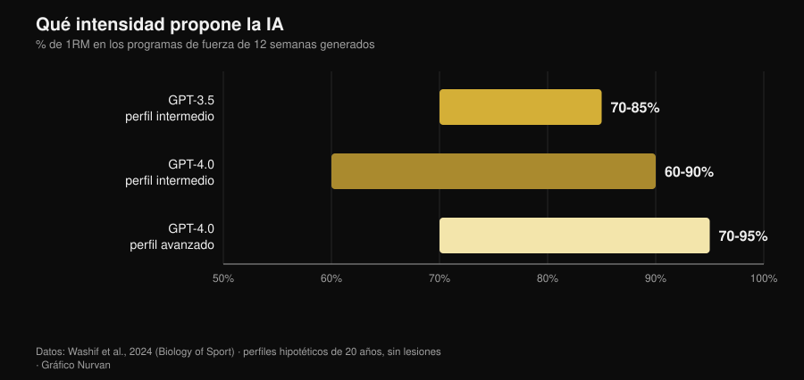
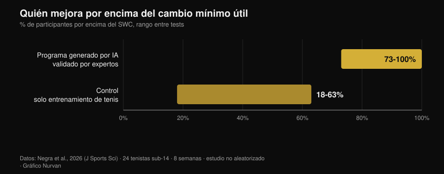

# Rutina de entrenamiento con IA: qué dicen los estudios

Por [Giammaria Loi](/autore/giammaria-loi) · actualizado el 2 de noviembre de 2026

Le pides una rutina a un chatbot y en diez segundos tienes doce semanas de programa, con fases, porcentajes y tiempos de descanso. Parece bien hecha. La pregunta de verdad no es si la IA sabe escribir una rutina —sabe hacerlo— sino si esa rutina es realmente *tuya*, y cuánto de lo que la hace funcionar se queda fuera del archivo. Desde 2024 algunos grupos de investigación han dejado de discutirlo y han empezado a medirlo: hicieron que los modelos generaran programas, se los pasaron a expertos con rúbricas de evaluación y, en un caso, los hicieron ejecutar durante ocho semanas. Los resultados son más interesantes de como los cuenta quien vende apps.

## En resumen

- **La rutina sale sensata, pero en borrador.** Programas de 12 semanas en tres fases, intensidades entre el 60% y el 95% de 1RM según el nivel: estructuras coherentes con los manuales que, sin embargo, "probablemente requieren un ajuste adicional antes de su aplicación" (Washif et al., 2024).
- **No está personalizada: es genérica disfrazada.** En el mismo trabajo, los programas generados para un perfil masculino y para uno femenino resultaron **objetivamente similares**. La IA cambió la etiqueta, no el contenido.
- **Puede funcionar, si pasa por manos humanas.** Ocho semanas de programa excéntrico generado por ChatGPT *y validado por expertos antes de usarlo*: sprint de 5 m, cambio de dirección y agilidad mejoraron; los saltos no (Negra et al., 2026).
- **El chatbot que te mantiene constante no tiene pruebas.** Revisión sistemática de 7 ensayos aleatorizados: efectos **incoherentes** sobre actividad física y dieta en adultos, ninguna evidencia en niños. Funciona con el tabaco, no con el gimnasio (Chen et al., 2025).
- **Con las calorías acierta más en una receta que en un plan.** Planes diarios y recetas generados y después recalculados con bases de datos nutricionales: las recetas aguantan mejor que los menús enteros (Aslan y Sozlu, 2025).
- **No es peligrosa, es incompleta.** Doce fisioterapeutas juzgaron las respuestas de ChatGPT seguras y en su mayoría precisas en **5 de 6 dominios**, pero faltas de exhaustividad (Schütze et al., 2026).

## Qué pasa de verdad cuando pides "hazme una rutina"

Un modelo de lenguaje no calcula tu programa: predice el texto más plausible a partir de lo que le has escrito. El resultado es una media razonada de todo lo que ha leído y, como ha leído muchos manuales serios, esa media suele ser razonable. Es el motivo por el que las rutinas generadas parecen buenas a primera vista: tienen las fases, los rangos de repeticiones correctos, el calentamiento en su sitio.

El problema llega después. Un programa sirve para producir una adaptación en *una* persona, con su historial de cargas, sus horarios, sus achaques y su respuesta a la fatiga. Esa parte no está en el prompt, y tampoco en el texto que devuelve el modelo: llega después, semana a semana. Los estudios que siguen miden exactamente esa distancia.

## Qué dice de verdad la investigación

| Afirmación habitual | Veredicto | Fuente |
|---|---|---|
| "La IA escribe una rutina sensata" | Confirmado, pero es un borrador | Washif et al., 2024 |
| "La rutina está personalizada para ti" | Desmentido | Washif et al., 2024 |
| "Una rutina hecha por la IA no funciona" | Desmentido, con una condición | Negra et al., 2026 |
| "Las versiones nuevas ya lo han resuelto" | Hay que matizar | Genç et al., 2025 |
| "Un chatbot te mantiene constante" | Sin respaldo | Chen et al., 2025 |
| "También le puedes pedir la dieta" | Hay que matizar | Aslan y Sozlu, 2025 |
| "Es peligrosa" | Hay que matizar: más incompleta que insegura | Schütze et al., 2026 |

### Afirmación 1 — "La IA escribe una rutina sensata"
**Confirmado, pero es un borrador.**

El primer trabajo indexado que entró en el fondo del asunto pidió a GPT-3.5 y GPT-4.0 que diseñaran programas de fuerza de doce semanas para perfiles hipotéticos de veinte años, primero con experiencia intermedia y después avanzada. Ambas versiones produjeron programas en tres fases de cuatro semanas con objetivos distintos (hipertrofia, fuerza), parámetros dentro de los rangos de los manuales y descansos coherentes.

*Gráfico de Nurvan sobre los datos de Washif et al., 2024 (Biology of Sport). Intervalos de intensidad propuestos por los modelos para programas de 12 semanas; perfiles hipotéticos de 20 años, sin lesiones.*

Las diferencias entre versiones existen y van en la dirección esperada: GPT-4.0 distingue el nivel intermedio del avanzado, amplía la horquilla de los descansos (de 60-180 a 60-300 segundos) y maneja más información a la vez. La conclusión de los autores, en cambio, es tajante: los programas "probablemente requieren un ajuste adicional antes de su aplicación" y el modelo "puede servir como herramienta complementaria para escribir un borrador".

Borrador es la palabra correcta. Una rutina plausible no es una rutina adecuada.

### Afirmación 2 — "La rutina está personalizada para ti"
**Desmentido.**

Es el resultado más incómodo de ese mismo estudio, y casi nadie lo cita. A los autores les bastó cambiar el sexo del perfil en el prompt para ver qué pasaba: todos los programas generados resultaron **objetivamente similares independientemente del sexo**. No es una crítica sobre la fisiología —las recomendaciones de entrenamiento para hombres y mujeres se parecen bastante— sino sobre el mecanismo: el modelo no usó el único dato individual que se le había dado.

Si un dato explícito del prompt no cambia el resultado, lo que no has escrito en el prompt pesa cero. Y lo que no escribes es casi todo: cuánto has dormido, cuánto te costó la sesión de ayer, por qué el hombro derecho tira solo en press de banca con agarre ancho.

### Afirmación 3 — "Una rutina hecha por la IA no funciona"
**Desmentido, con una condición que lo cambia todo.**

En 2026 llegó el primer estudio de intervención. Veinticuatro tenistas sub-14 divididos en dos grupos: uno siguió durante ocho semanas un programa de trabajo excéntrico generado por ChatGPT, el otro continuó solo con el entrenamiento de tenis. El grupo IA mejoró de forma significativa el sprint de 5 metros, el cambio de dirección (505) y la agilidad, con tamaños del efecto entre 0,6 y 2,15 frente a 0,15-0,6 del control. En el sprint de 10 metros y en los saltos, ninguna diferencia entre grupos.

*Gráfico de Nurvan sobre los datos de Negra et al., 2026 (Journal of Sports Sciences). Proporción de participantes que supera el smallest worthwhile change en las distintas pruebas; estudio controlado no aleatorizado, 24 atletas sub-14.*

La condición está en una línea del método: el programa generado por la IA fue **validado por expertos humanos antes de administrarlo**. No es "la IA entrenó a unos chicos": es "unos expertos usaron la IA para escribir la primera versión, la revisaron y después la hicieron ejecutar". Es exactamente el flujo de trabajo que funciona, y también el motivo por el que el estudio no demuestra que puedas saltarte la revisión.

### Afirmación 4 — "Las versiones nuevas ya lo han resuelto"
**Hay que matizar.**

Un grupo de investigación puso a tres versiones de ChatGPT a generar programas de fuerza de doce semanas con siete conjuntos de instrucciones distintos, y los hizo evaluar por siete expertos (preparadores certificados CSCS y doctores en ciencias del deporte con al menos diez años de experiencia) con una rúbrica que pesaba, entre otras cosas, la individualización de la progresión, las modificaciones del programa, el riesgo de lesión y la presencia de recomendaciones erróneas.

Las diferencias entre versiones resultaron estadísticamente significativas en todas las comparaciones por pares (p = 0,018), y la versión más reciente fue juzgada más detallada, más coherente y mejor anclada en la literatura. La mejora es real. La conclusión de los autores, sin embargo, es idéntica a la de 2024: para que un plan asistido por IA sea seguro, basado en la evidencia e individualizado, "la participación de competencia humana cualificada sigue siendo esencial". Las versiones mejoran el borrador, no sustituyen la revisión.

### Afirmación 5 — "Un chatbot te mantiene más constante que un coach"
**Sin respaldo.**

Aquí la promesa comercial va muy por delante de los datos. Una revisión sistemática rastreó doce bases de datos y 6.301 registros para aislar los estudios aleatorizados sobre chatbots capaces de mantener una conversación en lenguaje natural: quedaron siete. Con el tabaco los efectos son coherentes. Con la dieta y la actividad física en adultos son **incoherentes**, en niños no hay evidencia de efecto, y dos de los cuatro estudios sobre actividad física tienen un riesgo alto de sesgo.

Hay un detalle que explica mucho: los usuarios interactuaban bastante con los chatbots en general, pero no igual sobre los comportamientos de salud concretos. La satisfacción es alta, el cambio no. Es la diferencia entre una app que te gusta y una app que te hace entrenar, y es la misma diferencia que separa a un coach simpático de un coach que consigue resultados: sobre esto he reunido los números de la supervisión humana en el artículo sobre [si el coaching online funciona de verdad](/es/blog/funciona-el-coaching-online).

### Afirmación 6 — "Total, también le puedes pedir la dieta"
**Hay que matizar.**

Un estudio piloto pidió a ChatGPT planes de alimentación de 1500, 2000 y 2500 kcal y recetas de 300, 500 y 700 kcal, y después recalculó todo con bases de datos nutricionales. El modelo resultó **más preciso al construir una receta con las calorías pedidas que al componer un plan diario completo**: cuanto más pequeño y delimitado es el objeto, menos error se acumula.

Es un piloto sobre una versión ya vieja, así que vale como indicación de método, no como veredicto. La indicación es útil igualmente: usa la IA para las piezas, no para la estructura. Y cuando hacen falta los gramos de verdad, hacen falta los gramos de verdad de una base de datos de alimentos, no una estimación plausible.

### Afirmación 7 — "Es peligrosa"
**Hay que matizar: más incompleta que insegura.**

La prueba más severa llega de fuera del gimnasio. Doce fisioterapeutas con experiencia evaluaron las respuestas de ChatGPT a seis preguntas sobre el ejercicio en una enfermedad muscular rara, en una escala que iba de "completa y precisa" a "errónea e insegura". Veredicto: respuestas seguras y en su mayoría precisas en cinco de seis dominios, pero a menudo no completas.

Es el perfil de riesgo típico: no te dice que hagas algo absurdo, te dice algo razonable dejando fuera la pieza que importa. En la medicina deportiva la conclusión es la misma: lo bueno que sea un modelo en sus propias pruebas no se traduce automáticamente en mejores resultados, y el profesional sigue en el circuito como quien integra la información (Palermi et al., 2026). Un síntoma que no se va, un dolor que empeora, una prueba que interpretar: ahí se va al médico, no al chatbot.

## Cómo usarla bien

1. **Úsala para el borrador, no para la decisión.** Rutina de partida, ideas de variantes, reordenar un programa que ya tienes: sí. Elegir la carga de mañana: no.
2. **Dale el contexto que tienes de verdad.** Historial de cargas, RIR de las últimas sesiones, días disponibles, lesiones. Sin eso, como mostró Washif, el resultado no cambia ni aunque cambies el perfil.
3. **Pídele cuentas de los números.** Si cita un estudio, compruébalo: las referencias inventadas son la vía más rápida para llevarse al gimnasio una creencia falsa.
4. **Que la revise quien sepa leerla.** En el único estudio de intervención positivo, el programa había sido validado por expertos humanos antes de usarlo. Es la diferencia entre una herramienta y un sustituto.
5. **Mide, no te fíes.** Después de cuatro semanas mira las cargas, no las sensaciones: si el borrador no está produciendo progresión, es un borrador equivocado.
6. **Mantenla fuera de la medicina.** Patologías, fármacos, pruebas: ningún chatbot, ninguna app. Médico.

> **Prueba Nurvan — la IA escribe el borrador, tus datos lo corrigen**
>
> En Nurvan la rutina no se queda en un texto: cargas, repeticiones y RIR de cada serie entran en el historial, las series de calentamiento se proponen sobre la carga de trabajo del día y la progresión se construye sobre lo que has levantado de verdad. Si trabajas con un coach, él ve los mismos números y corrige donde hace falta —que es exactamente la pieza que le falta a una rutina generada. [Prueba Nurvan](https://nurvan.app)

## Preguntas frecuentes

**¿Puedo usar ChatGPT para hacerme la rutina del gimnasio?**
Como borrador sí, como programa definitivo no. Los estudios que han evaluado los programas generados los describen como estructuralmente coherentes pero pendientes de ajuste, y coinciden en un punto: hace falta competencia humana cualificada para volverlos seguros e individualizados (Washif et al., 2024; Genç et al., 2025).

**¿Las rutinas generadas por IA son distintas para hombres y mujeres?**
En el estudio que lo comprobó, no: los programas producidos para perfiles masculinos y femeninos eran objetivamente similares (Washif et al., 2024). Si esperas personalización por el simple hecho de haber escrito quién eres, probablemente no la estás consiguiendo.

**¿Una app con IA me ayuda a ser constante?**
Todavía no hay evidencia sólida. En los siete estudios aleatorizados disponibles, los efectos de los chatbots sobre actividad física y dieta en adultos son incoherentes, y el resultado solo es coherente para el tabaco (Chen et al., 2025).

**¿Qué es mejor, la IA o un entrenador?**
No son alternativas al mismo nivel: una escribe texto, el otro te observa. Los datos sobre supervisión e intensidad muestran que la parte decisiva del trabajo humano es hacer ejecutar bien una rutina, no escribirla: por ejemplo, con un técnico cada cinco personas el press de banca máximo subió un 15,9% frente al 10,2% de un técnico cada veinticinco (Gentil y Bottaro, 2010).

## Lee también

- [¿Funciona el coaching online? Qué dicen los estudios](/es/blog/funciona-el-coaching-online) — cuánto cuenta de verdad estar supervisado, con los números delante.
- [Cuántas repeticiones para masa muscular: el mito del 8-12](/es/blog/cuantas-repeticiones-masa-muscular) — las variables de programación que recibe un borrador de IA, y qué dice la evidencia sobre ellas.
- [Tendencias fitness 2027: qué funciona de verdad](/es/blog/tendencias-fitness-2027-que-funciona) — dónde se sitúa la tecnología entre las modas y las cosas que aguantan.

## Fuentes

- Washif JA, Pagaduan J, James C, Dergaa I, Beaven CM, 2024. Artificial intelligence in sport: Exploring the potential of using ChatGPT in resistance training prescription. *Biology of Sport* 41(2):209-220. PMID 38524820. [DOI](https://doi.org/10.5114/biolsport.2024.132987)
- Genç A, Aydın GR, Kasap M, Özkan A, Rakhymzhanov A, Gürcan HH, Güllü S, Demirhan B, 2025. Comparative evaluation of ChatGPT versions in training program design: scientific approach, accuracy, and practical applicability. *BMC Sports Science, Medicine and Rehabilitation* 18(1):19. PMID 41345701. [DOI](https://doi.org/10.1186/s13102-025-01409-7)
- Negra Y, Sammoud S, Bouguezzi R, Markov A, Capranica L, Müller P, Chaabene H, 2026. Effects of a ChatGPT-generated eccentric training programme on speed, change of direction, agility, and jumping performance in U14 tennis players: A non-randomised controlled study. *Journal of Sports Sciences*. PMID 41944488. [DOI](https://doi.org/10.1080/02640414.2026.2653295)
- Chen J, Hu RZ, Zhuang YX, Zhang JQ, Shan R, Yang Y, Liu Z, 2025. Natural Language Processing Chatbot-Based Interventions for Improvement of Diet, Physical Activity, and Tobacco Smoking Behaviors: Systematic Review. *JMIR mHealth and uHealth* 13:e66403. PMID 40503914. [DOI](https://doi.org/10.2196/66403)
- Aslan S, Sozlu S, 2025. A pilot study of the potential role of ChatGPT in stated-calorie diet planning. *International Journal of Obesity* 49(9):1891-1896. PMID 40628963. [DOI](https://doi.org/10.1038/s41366-025-01839-w)
- Schütze K, Shehatha R, Beer K, Needham M, Smith T, Bagg M, Doverty A, Cooper I, 2026. Evaluating ChatGPT's advice and recommendations regarding exercise for people with inclusion body myositis. *Neuromuscular Disorders* 62:106418. PMID 41950577. [DOI](https://doi.org/10.1016/j.nmd.2026.106418)
- Palermi S, Pucciatti R, Regnard NE, et al., 2026. Artificial Intelligence in Sports Medicine: A Decision-Centered Framework for the Future Sports Physician. *Diagnostics* 16(10):1448. PMID 42196815. [DOI](https://doi.org/10.3390/diagnostics16101448)
- Gentil P, Bottaro M, 2010. Influence of supervision ratio on muscle adaptations to resistance training in nontrained subjects. *Journal of Strength and Conditioning Research* 24(3):639-43. PMID 19661830. [DOI](https://doi.org/10.1519/JSC.0b013e3181ad3373)

Referencias bibliográficas recuperadas a través de PubMed. Tema elegido con la investigación de tendencias del 2 de noviembre de 2026: la pregunta "¿IA o coach?" está entre las más buscadas del momento en fitness, pero las páginas que ocupan esos resultados son blogs de software sin una sola fuente.

---

Giammaria Loi es el fundador de Nurvan. Entrena con pesas desde 2012, trabaja como entrenador personal y coach certificado por la FIPE desde 2013 y compite en powerlifting a nivel nacional desde 2018. Cada artículo que firma parte de los estudios científicos y llega a lo que funciona de verdad en el gimnasio.

> Nota: contenido informativo, no sustituye la opinión de un médico o profesional cualificado.
