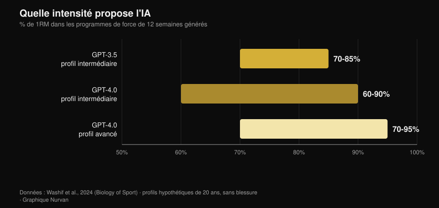
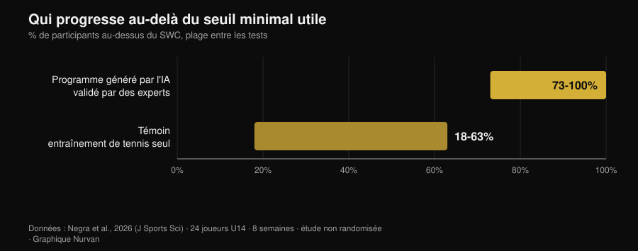

# Programme d'entraînement IA : ce que disent les études

Par [Giammaria Loi](/autore/giammaria-loi) · mis à jour le 2 novembre 2026

Tu demandes un programme à un chatbot et dix secondes plus tard tu as douze semaines de planification, avec les phases, les pourcentages et les temps de récupération. Ça a l'air bien fait. La vraie question n'est pas de savoir si l'IA sait écrire un programme — elle sait le faire — mais si ce programme est vraiment *le tien*, et quelle part de ce qui le fait fonctionner reste en dehors du fichier. Depuis 2024, quelques équipes de recherche ont cessé d'en débattre et ont commencé à mesurer : elles ont fait générer des programmes aux modèles, les ont soumis à des experts avec des grilles d'évaluation et, dans un cas, les ont fait exécuter pendant huit semaines. Les résultats sont plus intéressants que la version racontée par ceux qui vendent des applis.

## En bref

- **Le programme sort cohérent, mais à l'état de brouillon.** Programmes de 12 semaines en trois phases, intensités entre 60 % et 95 % du 1RM selon le niveau : des structures conformes aux manuels, qui pourtant « nécessitent probablement un ajustement supplémentaire avant application » (Washif et al., 2024).
- **Il n'est pas personnalisé : c'est du générique déguisé.** Dans le même travail, les programmes générés pour un profil masculin et pour un profil féminin se sont révélés **objectivement similaires**. L'IA a changé l'étiquette, pas le contenu.
- **Il peut marcher, s'il passe par des mains humaines.** Huit semaines de programme excentrique généré par ChatGPT *et validé par des experts avant utilisation* : sprint sur 5 m, changement de direction et agilité améliorés ; les sauts non (Negra et al., 2026).
- **Le chatbot qui te rend régulier n'a aucune preuve.** Revue systématique de 7 essais randomisés : effets **incohérents** sur l'activité physique et l'alimentation chez l'adulte, aucune preuve chez l'enfant. Ça marche sur le tabac, pas sur la salle (Chen et al., 2025).
- **Sur les calories, elle est plus juste sur une recette que sur un plan.** Plans journaliers et recettes générés puis recalculés sur des bases de données nutritionnelles : les recettes tiennent mieux que les menus entiers (Aslan et Sozlu, 2025).
- **Elle n'est pas dangereuse, elle est incomplète.** Douze kinésithérapeutes ont jugé les réponses de ChatGPT sûres et globalement exactes dans **5 domaines sur 6**, mais insuffisamment complètes (Schütze et al., 2026).

## Ce qui se passe vraiment quand tu demandes « fais-moi un programme »

Un modèle de langage ne calcule pas ton programme : il prédit le texte le plus plausible à partir de ce que tu as écrit. Le résultat est une moyenne raisonnée de tout ce qu'il a lu et, comme il a lu beaucoup de manuels sérieux, cette moyenne est souvent raisonnable. C'est la raison pour laquelle les programmes générés paraissent bons au premier coup d'œil : les phases sont là, les fourchettes de répétitions sont justes, l'échauffement est au bon endroit.

Le problème commence après. Un programme sert à produire une adaptation chez *une* personne, avec son historique de charges, ses horaires, ses petits bobos et sa réponse à la fatigue. Cette partie n'est pas dans le prompt, et pas davantage dans le texte que le modèle renvoie : elle arrive ensuite, semaine après semaine. Les études qui suivent mesurent exactement cet écart.

## Ce que dit vraiment la recherche

| Affirmation courante | Verdict | Source |
|---|---|---|
| « L'IA écrit un programme cohérent » | Confirmé, mais c'est un brouillon | Washif et al., 2024 |
| « Le programme est personnalisé pour toi » | Démenti | Washif et al., 2024 |
| « Un programme fait par l'IA ne marche pas » | Démenti, à une condition | Negra et al., 2026 |
| « Les nouvelles versions ont tout réglé » | À nuancer | Genç et al., 2025 |
| « Un chatbot te rend régulier » | Non étayé | Chen et al., 2025 |
| « Tu peux aussi lui demander le régime » | À nuancer | Aslan et Sozlu, 2025 |
| « C'est dangereux » | À nuancer : plus incomplet que risqué | Schütze et al., 2026 |

### Affirmation 1 — « L'IA écrit un programme cohérent »
**Confirmé, mais c'est un brouillon.**

Le premier travail indexé à entrer dans le détail a demandé à GPT-3.5 et GPT-4.0 de concevoir des programmes de force de douze semaines pour des profils hypothétiques de vingt ans, d'abord de niveau intermédiaire puis avancé. Les deux versions ont produit des programmes en trois phases de quatre semaines avec des objectifs distincts (hypertrophie, force), des paramètres dans les fourchettes des manuels et des récupérations cohérentes.

*Graphique Nurvan d'après les données de Washif et al., 2024 (Biology of Sport). Intervalles d'intensité proposés par les modèles pour des programmes de 12 semaines ; profils hypothétiques de 20 ans, aucune blessure.*

Les différences entre versions existent et vont dans le sens attendu : GPT-4.0 distingue le niveau intermédiaire de l'avancé, élargit la fourchette des récupérations (de 60-180 à 60-300 secondes) et gère plus d'informations à la fois. La conclusion des auteurs est pourtant nette : les programmes « nécessitent probablement un ajustement supplémentaire avant application » et le modèle « peut servir d'outil complémentaire pour écrire un brouillon ».

Brouillon est le mot juste. Un programme plausible n'est pas un programme adapté.

### Affirmation 2 — « Le programme est personnalisé pour toi »
**Démenti.**

C'est le résultat le plus gênant de cette même étude, et presque personne ne le cite. Il a suffi aux auteurs de changer le sexe du profil dans le prompt pour voir ce qui se passait : tous les programmes générés se sont révélés **objectivement similaires indépendamment du sexe**. Ce n'est pas une critique sur la physiologie — les recommandations d'entraînement pour les hommes et pour les femmes se ressemblent beaucoup — mais sur le mécanisme : le modèle n'a pas utilisé la seule information individuelle qu'on lui avait donnée.

Si une donnée explicite du prompt ne change pas la sortie, ce que tu n'as pas écrit dans le prompt pèse zéro. Et ce que tu n'écris pas, c'est presque tout : combien tu as dormi, ce que la séance d'hier t'a coûté, pourquoi l'épaule droite tire seulement au développé couché en prise large.

### Affirmation 3 — « Un programme fait par l'IA ne marche pas »
**Démenti, à une condition qui change tout.**

En 2026 est arrivée la première étude d'intervention. Vingt-quatre joueurs de tennis de moins de 14 ans répartis en deux groupes : l'un a suivi pendant huit semaines un programme de travail excentrique généré par ChatGPT, l'autre a poursuivi le seul entraînement de tennis. Le groupe IA a amélioré de façon significative le sprint sur 5 mètres, le changement de direction (505) et l'agilité, avec des tailles d'effet entre 0,6 et 2,15 contre 0,15-0,6 dans le groupe témoin. Sur le sprint de 10 mètres et sur les sauts, aucune différence entre les groupes.

*Graphique Nurvan d'après les données de Negra et al., 2026 (Journal of Sports Sciences). Part des participants dépassant le smallest worthwhile change sur les différents tests ; étude contrôlée non randomisée, 24 athlètes de moins de 14 ans.*

La condition tient en une ligne de la méthode : le programme généré par l'IA a été **validé par des experts humains avant d'être administré**. Ce n'est pas « l'IA a entraîné des jeunes » : c'est « des experts ont utilisé l'IA pour écrire la première version, l'ont vérifiée, puis l'ont fait exécuter ». C'est exactement le flux de travail qui fonctionne, et c'est aussi pourquoi l'étude ne démontre pas qu'on peut sauter la vérification.

### Affirmation 4 — « Les nouvelles versions ont tout réglé »
**À nuancer.**

Une équipe de recherche a mis trois versions de ChatGPT à générer des programmes de force de douze semaines avec sept jeux d'instructions différents, et les a fait évaluer par sept experts (préparateurs certifiés CSCS et docteurs en sciences du sport avec au moins dix ans d'expérience) sur une grille qui pondérait, entre autres, l'individualisation de la progression, les modifications du programme, le risque de blessure et la présence de recommandations erronées.

Les différences entre versions se sont révélées statistiquement significatives dans toutes les comparaisons par paires (p = 0,018), la version la plus récente étant jugée plus détaillée, plus cohérente et mieux ancrée dans la littérature. L'amélioration est réelle. La conclusion des auteurs est pourtant identique à celle de 2024 : pour qu'un plan assisté par IA soit sûr, fondé sur les preuves et individualisé, « l'implication d'une expertise humaine qualifiée reste essentielle ». Les versions améliorent le brouillon, elles ne remplacent pas la relecture.

### Affirmation 5 — « Un chatbot te rend plus régulier qu'un coach »
**Non étayé.**

Ici, la promesse commerciale va bien plus loin que les données. Une revue systématique a passé au crible douze bases de données et 6 301 références pour isoler les essais randomisés portant sur des chatbots capables de dialoguer en langage naturel : il en est resté sept. Sur le tabac, les effets sont cohérents. Sur l'alimentation et l'activité physique chez l'adulte, ils sont **incohérents**, chez l'enfant il n'y a aucune preuve d'effet, et deux des quatre études sur l'activité physique présentent un risque élevé de biais.

Un détail explique beaucoup : les utilisateurs interagissaient pas mal avec les chatbots en général, mais beaucoup moins sur les comportements de santé précis. La satisfaction est élevée, le changement non. C'est la différence entre une appli que tu aimes bien et une appli qui te fait t'entraîner, et c'est la même différence qui sépare un coach sympathique d'un coach qui obtient des résultats : j'ai rassemblé les chiffres de la supervision humaine dans l'article sur [le fait de savoir si le coaching en ligne fonctionne vraiment](/fr/blog/le-coaching-en-ligne-fonctionne).

### Affirmation 6 — « De toute façon, tu peux aussi lui demander le régime »
**À nuancer.**

Une étude pilote a demandé à ChatGPT des plans alimentaires à 1500, 2000 et 2500 kcal et des recettes à 300, 500 et 700 kcal, puis a tout recalculé sur des bases de données nutritionnelles. Le modèle s'est révélé **plus précis pour construire une recette aux calories demandées que pour composer un plan journalier entier** : plus l'objet est petit et circonscrit, moins l'erreur s'accumule.

C'est un pilote sur une version désormais ancienne, donc à prendre comme une indication de méthode, pas comme un verdict. L'indication reste utile : utilise l'IA pour les pièces, pas pour la charpente. Et quand il faut de vrais grammes, il faut de vrais grammes issus d'une base de données alimentaire, pas une estimation plausible.

### Affirmation 7 — « C'est dangereux »
**À nuancer : plus incomplet que risqué.**

Le test le plus sévère vient de l'extérieur de la salle. Douze kinésithérapeutes expérimentés ont évalué les réponses de ChatGPT à six questions sur l'exercice dans une maladie musculaire rare, sur une échelle allant de « complète et exacte » à « fausse et dangereuse ». Verdict : des réponses sûres et globalement exactes dans cinq domaines sur six, mais souvent incomplètes.

C'est le profil de risque typique : elle ne te dit pas de faire quelque chose d'absurde, elle te dit quelque chose de raisonnable en laissant de côté la pièce qui compte. En médecine du sport, la conclusion est la même : la performance d'un modèle sur ses propres tests ne se traduit pas automatiquement par de meilleurs résultats, et le professionnel reste dans la boucle comme celui qui intègre l'information (Palermi et al., 2026). Un symptôme qui ne passe pas, une douleur qui empire, un examen à interpréter : là, on va chez le médecin, pas chez le chatbot.

## Comment bien l'utiliser

1. **Utilise-la pour le brouillon, pas pour la décision.** Programme de départ, idées de variantes, réorganisation d'un programme que tu as déjà : oui. Choix de la charge de demain : non.
2. **Donne-lui le contexte que tu as vraiment.** Historique des charges, RIR des dernières séances, jours disponibles, blessures. Sans ça, comme l'a montré Washif, la sortie ne change même pas quand tu changes le profil.
3. **Demande-lui des comptes sur les chiffres.** Si elle cite une étude, vérifie-la : les références inventées sont le moyen le plus rapide d'emporter une fausse conviction à la salle.
4. **Fais-la relire par quelqu'un qui sait la lire.** Dans la seule étude d'intervention positive, le programme avait été validé par des experts humains avant utilisation. C'est la différence entre un outil et un substitut.
5. **Mesure, ne te fie pas.** Après quatre semaines, regarde les charges, pas les sensations : si le brouillon ne produit pas de progression, c'est un mauvais brouillon.
6. **Garde-la hors de la médecine.** Pathologies, médicaments, examens : aucun chatbot, aucune appli. Un médecin.

> **Essaie Nurvan — l'IA écrit le brouillon, tes données le corrigent**
>
> Dans Nurvan, le programme ne reste pas un texte : charges, répétitions et RIR de chaque série entrent dans l'historique, les séries d'échauffement sont proposées à partir de la charge de travail du jour et la progression se construit sur ce que tu as vraiment soulevé. Si tu travailles avec un coach, il voit les mêmes chiffres et corrige là où il faut — et c'est exactement la pièce qui manque à un programme généré. [Essaie Nurvan](https://nurvan.app)

## Questions fréquentes

**Est-ce que je peux utiliser ChatGPT pour me faire un programme de musculation ?**
Comme brouillon oui, comme programme définitif non. Les études qui ont évalué les programmes générés les décrivent comme structurellement cohérents mais à ajuster, et s'accordent sur un point : il faut une expertise humaine qualifiée pour les rendre sûrs et individualisés (Washif et al., 2024 ; Genç et al., 2025).

**Les programmes générés par IA sont-ils différents pour les hommes et pour les femmes ?**
Dans l'étude qui l'a vérifié, non : les programmes produits pour des profils masculins et féminins étaient objectivement similaires (Washif et al., 2024). Si tu attends une personnalisation du simple fait d'avoir écrit qui tu es, tu ne l'obtiens probablement pas.

**Est-ce qu'une appli avec IA m'aide à être régulier ?**
Il n'y a pas encore de preuve solide. Sur les sept essais randomisés disponibles, les effets des chatbots sur l'activité physique et l'alimentation chez l'adulte sont incohérents, et le résultat n'est cohérent que pour le tabac (Chen et al., 2025).

**Coach IA ou coach humain : lequel choisir ?**
Ce ne sont pas deux options sur le même plan : l'une écrit du texte, l'autre t'observe. Les données sur la supervision et l'intensité montrent que la part décisive du travail humain est de faire bien exécuter un programme, pas de l'écrire — par exemple, avec un encadrant pour cinq personnes, le développé couché maximal a progressé de 15,9 % contre 10,2 % avec un encadrant pour vingt-cinq (Gentil et Bottaro, 2010).

## À lire aussi

- [Le coaching en ligne fonctionne-t-il ? Ce que disent les études](/fr/blog/le-coaching-en-ligne-fonctionne) — à quel point être suivi compte vraiment, chiffres en main.
- [Combien de répétitions pour la masse musculaire : le mythe du 8-12](/fr/blog/combien-de-repetitions-masse-musculaire) — les variables de planification qu'un brouillon d'IA reçoit, et ce que dit la preuve à leur sujet.
- [Tendances fitness 2027 : ce qui marche vraiment](/fr/blog/tendances-fitness-2027-ce-qui-marche) — où se situe la technologie entre les modes et les choses qui tiennent.

## Sources

- Washif JA, Pagaduan J, James C, Dergaa I, Beaven CM, 2024. Artificial intelligence in sport: Exploring the potential of using ChatGPT in resistance training prescription. *Biology of Sport* 41(2):209-220. PMID 38524820. [DOI](https://doi.org/10.5114/biolsport.2024.132987)
- Genç A, Aydın GR, Kasap M, Özkan A, Rakhymzhanov A, Gürcan HH, Güllü S, Demirhan B, 2025. Comparative evaluation of ChatGPT versions in training program design: scientific approach, accuracy, and practical applicability. *BMC Sports Science, Medicine and Rehabilitation* 18(1):19. PMID 41345701. [DOI](https://doi.org/10.1186/s13102-025-01409-7)
- Negra Y, Sammoud S, Bouguezzi R, Markov A, Capranica L, Müller P, Chaabene H, 2026. Effects of a ChatGPT-generated eccentric training programme on speed, change of direction, agility, and jumping performance in U14 tennis players: A non-randomised controlled study. *Journal of Sports Sciences*. PMID 41944488. [DOI](https://doi.org/10.1080/02640414.2026.2653295)
- Chen J, Hu RZ, Zhuang YX, Zhang JQ, Shan R, Yang Y, Liu Z, 2025. Natural Language Processing Chatbot-Based Interventions for Improvement of Diet, Physical Activity, and Tobacco Smoking Behaviors: Systematic Review. *JMIR mHealth and uHealth* 13:e66403. PMID 40503914. [DOI](https://doi.org/10.2196/66403)
- Aslan S, Sozlu S, 2025. A pilot study of the potential role of ChatGPT in stated-calorie diet planning. *International Journal of Obesity* 49(9):1891-1896. PMID 40628963. [DOI](https://doi.org/10.1038/s41366-025-01839-w)
- Schütze K, Shehatha R, Beer K, Needham M, Smith T, Bagg M, Doverty A, Cooper I, 2026. Evaluating ChatGPT's advice and recommendations regarding exercise for people with inclusion body myositis. *Neuromuscular Disorders* 62:106418. PMID 41950577. [DOI](https://doi.org/10.1016/j.nmd.2026.106418)
- Palermi S, Pucciatti R, Regnard NE, et al., 2026. Artificial Intelligence in Sports Medicine: A Decision-Centered Framework for the Future Sports Physician. *Diagnostics* 16(10):1448. PMID 42196815. [DOI](https://doi.org/10.3390/diagnostics16101448)
- Gentil P, Bottaro M, 2010. Influence of supervision ratio on muscle adaptations to resistance training in nontrained subjects. *Journal of Strength and Conditioning Research* 24(3):639-43. PMID 19661830. [DOI](https://doi.org/10.1519/JSC.0b013e3181ad3373)

Références bibliographiques récupérées via PubMed. Sujet choisi grâce à la recherche de tendances du 2 novembre 2026 : la question « IA ou coach » est parmi les plus recherchées du moment dans le fitness, mais les pages qui occupent ces résultats sont des blogs de logiciels sans une seule source.

---

Giammaria Loi est le fondateur de Nurvan. Il s'entraîne avec les poids depuis 2012, travaille comme coach sportif et préparateur certifié FIPE depuis 2013 et participe à des compétitions de powerlifting au niveau national depuis 2018. Chaque article qu'il signe part des études scientifiques et arrive à ce qui fonctionne vraiment à la salle.

> Note : contenu informatif, ne remplace pas l'avis d'un médecin ou d'un professionnel.
