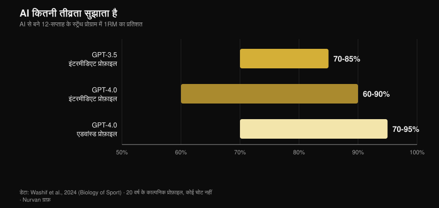
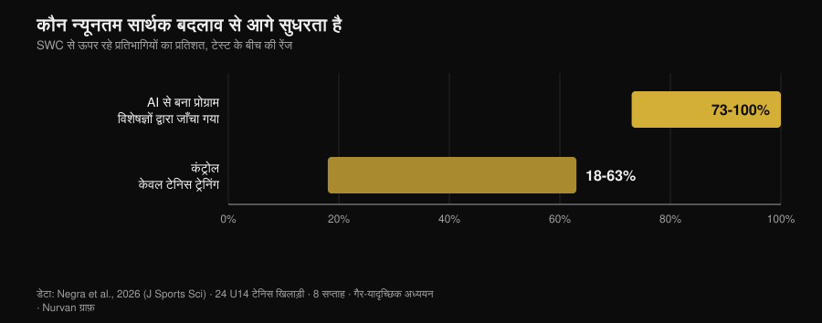

# AI workout plan: रिसर्च असल में क्या कहती है

लेखक: [Giammaria Loi](/autore/giammaria-loi) · अपडेट 2 नवंबर 2026

चैटबॉट से workout plan मांगिए और दस सेकंड में बारह हफ्ते का पूरा प्रोग्राम हाजिर — phases, परसेंटेज और rest intervals के साथ। देखने में एकदम प्रोफेशनल लगता है। असली सवाल यह नहीं है कि AI plan लिख सकता है या नहीं — लिख सकता है — बल्कि यह है कि वह plan सच में *आपका* है या नहीं, और जो चीजें किसी plan को काम करने लायक बनाती हैं उनमें से कितनी उस फाइल में कभी पहुँचती ही नहीं। 2024 से कुछ रिसर्च ग्रुप्स ने बहस छोड़कर नापना शुरू किया: मॉडल से प्रोग्राम बनवाए, उन्हें स्कोरिंग rubric के साथ एक्सपर्ट्स को दिया, और एक मामले में एथलीट्स से आठ हफ्ते तक वह प्रोग्राम करवाया भी। नतीजे ऐप मार्केटिंग की कहानी से ज्यादा दिलचस्प हैं।

## छोटे में

- **Plan ठीक-ठाक निकलता है — पर draft के तौर पर।** तीन phases में बारह हफ्ते का प्रोग्राम, level के हिसाब से 60% से 95% 1RM तक की intensity: structure किताबों से मेल खाता है, लेकिन ऐसा जो "लागू करने से पहले अतिरिक्त fine-tuning मांगता है" (Washif et al., 2024).
- **यह personalised नहीं है — यह generic है, नाम बदलकर।** उसी स्टडी में मर्द profile और औरत profile के लिए बने प्रोग्राम **objectively एक जैसे** निकले। मॉडल ने लेबल बदला, कंटेंट नहीं।
- **काम कर सकता है — अगर पहले कोई इंसान चेक करे।** ChatGPT से बने eccentric प्रोग्राम के आठ हफ्ते, *इस्तेमाल से पहले एक्सपर्ट्स से validate कराए गए*: 5 m sprint, change of direction और agility में सुधार; jumps में नहीं (Negra et al., 2026).
- **"चैटबॉट आपको consistent रखेगा" — इसका कोई सबूत नहीं।** 7 RCT की systematic review: बड़ों में physical activity और diet पर असर **असंगत**, बच्चों में कोई सबूत नहीं। स्मोकिंग पर काम करता है, जिम पर नहीं (Chen et al., 2025).
- **Calories में यह पूरे दिन के plan से एक recipe में ज्यादा सटीक है।** बनाए गए meal plans और recipes को nutrition databases पर दोबारा गिना गया: अकेली recipes पूरे दिन के मेन्यू से बेहतर टिकीं (Aslan और Sozlu, 2025).
- **खतरनाक नहीं, अधूरा है।** बारह फिजियोथेरेपिस्ट्स ने ChatGPT के जवाबों को **छह में से पाँच domains** में सुरक्षित और ज्यादातर सही माना, लेकिन comprehensiveness में कमजोर (Schütze et al., 2026).

## "मेरा plan बना दो" कहने पर असल में होता क्या है

लैंग्वेज मॉडल आपका प्रोग्राम calculate नहीं करता: आपने जो लिखा उसके आधार पर सबसे संभावित टेक्स्ट predict करता है। नतीजा उस सब का एक सधा हुआ औसत है जो उसने पढ़ा है, और चूंकि उसने बहुत सी गंभीर किताबें पढ़ी हैं, वह औसत आम तौर पर समझदार होता है। इसी वजह से बने हुए plans पहली नजर में अच्छे लगते हैं: phases मौजूद हैं, rep ranges सही हैं, warm-up अपनी जगह पर है।

दिक्कत इसके बाद शुरू होती है। प्रोग्राम का काम *एक* आदमी में adaptation पैदा करना है — उसकी loading history, उसकी टाइमिंग, उसका पुराना दर्द और थकान पर उसकी अपनी प्रतिक्रिया के साथ। यह हिस्सा न prompt में होता है और न उस टेक्स्ट में जो मॉडल लौटाता है: यह बाद में आता है, हफ्ते दर हफ्ते। नीचे की स्टडीज़ ठीक इसी दूरी को नापती हैं।

## रिसर्च असल में क्या कहती है

| आम दावा | फैसला | स्रोत |
|---|---|---|
| "AI समझदार plan लिखता है" | सही, पर वह एक draft है | Washif et al., 2024 |
| "Plan आपके हिसाब से personalised है" | गलत | Washif et al., 2024 |
| "AI का लिखा plan काम नहीं करता" | गलत, एक शर्त के साथ | Negra et al., 2026 |
| "नए वर्जन ने सब ठीक कर दिया" | बारीकी चाहिए | Genç et al., 2025 |
| "चैटबॉट आपको consistent रखता है" | सबूत नहीं | Chen et al., 2025 |
| "डाइट भी इससे पूछ सकते हैं" | बारीकी चाहिए | Aslan और Sozlu, 2025 |
| "यह खतरनाक है" | बारीकी चाहिए: unsafe से ज्यादा अधूरा | Schütze et al., 2026 |

### दावा 1 — "AI समझदार plan लिखता है"
**सही, पर वह एक draft है।**

भीतर झाँकने वाली पहली indexed स्टडी ने GPT-3.5 और GPT-4.0 से बीस साल के काल्पनिक profiles के लिए बारह हफ्ते के strength प्रोग्राम डिजाइन करवाए — पहले intermediate, फिर advanced। दोनों वर्जन ने चार-चार हफ्ते की तीन phases बनाईं, हर phase का अलग मकसद (hypertrophy, strength), parameters किताबी ranges के भीतर और rest periods आपस में मेल खाते हुए।

*Washif et al., 2024 (Biology of Sport) के डेटा पर बना Nurvan चार्ट। 12 हफ्ते के प्रोग्राम के लिए मॉडलों ने जो intensity ranges बताईं; 20 साल के काल्पनिक profiles, कोई चोट नहीं।*

वर्जन के बीच फर्क असली है और उम्मीद की दिशा में ही है: GPT-4.0 intermediate और advanced में अंतर करता है, rest की window चौड़ी करता है (60-180 से 60-300 सेकंड), और एक बार में ज्यादा जानकारी संभालता है। फिर भी लेखकों का निष्कर्ष सीधा है: ये प्रोग्राम "लागू करने से पहले संभवतः अतिरिक्त fine-tuning मांगते हैं", और मॉडल "draft लिखने के लिए एक पूरक टूल का काम कर सकता है"।

Draft ही सही शब्द है। संभव लगने वाला plan उपयुक्त plan नहीं होता।

### दावा 2 — "Plan आपके हिसाब से personalised है"
**गलत।**

उसी स्टडी का यह सबसे असहज नतीजा है और इसे कोई उद्धृत नहीं करता। लेखकों को सिर्फ prompt में profile का sex बदलना था यह देखने के लिए कि क्या होता है: हर generated प्रोग्राम **sex से बेपरवाह objectively एक जैसा** निकला। यह physiology पर टिप्पणी नहीं है — मर्दों और औरतों के training recommendations वाकई काफी मिलते-जुलते हैं — यह mechanism पर टिप्पणी है: मॉडल ने उस एक individual जानकारी का इस्तेमाल ही नहीं किया जो उसे दी गई थी।

अगर prompt में साफ-साफ लिखी बात output नहीं हिलाती, तो जो आपने लिखा ही नहीं उसका वजन शून्य है। और जो आप नहीं लिखते वह लगभग सब कुछ है: आप कितना सोए, कल की session ने आपसे क्या वसूला, और दायाँ कंधा सिर्फ wide-grip bench में क्यों खिंचता है।

### दावा 3 — "AI का लिखा plan काम नहीं करता"
**गलत, और शर्त ऐसी है जो पूरी तस्वीर बदल देती है।**

पहली intervention स्टडी 2026 में आई। चौबीस under-14 टेनिस खिलाड़ी दो ग्रुप्स में: एक ने आठ हफ्ते ChatGPT से बना eccentric training प्रोग्राम किया, दूसरे ने सिर्फ टेनिस ट्रेनिंग जारी रखी। AI ग्रुप ने 5 m sprint, change of direction (505) और agility में significant सुधार किया, effect sizes 0.6 से 2.15 के बीच, जबकि control में 0.15-0.6। 10 m sprint और jump tests में दोनों ग्रुप्स के बीच कोई फर्क नहीं।

*Negra et al., 2026 (Journal of Sports Sciences) के डेटा पर बना Nurvan चार्ट। विभिन्न टेस्ट में smallest worthwhile change पार करने वाले प्रतिभागियों का हिस्सा; non-randomised controlled स्टडी, 24 U14 एथलीट।*

शर्त methods की एक लाइन में छिपी है: AI से बना प्रोग्राम किसी को देने से पहले **इंसानी एक्सपर्ट्स से validate कराया गया था**। यह "AI ने बच्चों को ट्रेन किया" नहीं है। यह "एक्सपर्ट्स ने पहला draft लिखने के लिए AI इस्तेमाल किया, उसे चेक किया, फिर करवाया" है। यही वह workflow है जो काम करता है, और यही वजह है कि यह स्टडी चेकिंग छोड़ने की इजाजत नहीं देती।

### दावा 4 — "नए वर्जन ने सब ठीक कर दिया"
**बारीकी चाहिए।**

एक ग्रुप ने ChatGPT के तीन वर्जन से सात अलग-अलग instruction sets पर बारह हफ्ते के strength प्रोग्राम बनवाए, फिर सात एक्सपर्ट्स से उन्हें स्कोर कराया — CSCS-certified कोच और स्पोर्ट्स साइंस के PhD, कम से कम दस साल के अनुभव वाले — एक ऐसी rubric पर जिसमें progression का individualisation, प्रोग्राम में बदलाव, चोट का जोखिम और गलत सिफारिशों की मौजूदगी शामिल थे।

वर्जन के बीच फर्क हर pairwise तुलना में statistically significant रहे (p = 0.018), और सबसे नए वर्जन को ज्यादा विस्तृत, ज्यादा अंदरूनी रूप से संगत और literature पर बेहतर टिका हुआ माना गया। सुधार असली है। लेकिन लेखकों का निष्कर्ष 2024 वाले जैसा ही है: AI-असिस्टेड plan को सुरक्षित, evidence-based और individualised बनाने के लिए "qualified इंसानी विशेषज्ञता की भागीदारी जरूरी बनी रहती है"। नए वर्जन draft सुधारते हैं; review की जगह नहीं लेते।

### दावा 5 — "चैटबॉट कोच से ज्यादा consistent रखता है"
**सबूत नहीं।**

यहाँ मार्केटिंग का वादा डेटा से बहुत आगे दौड़ता है। एक systematic review ने बारह databases और 6,301 records छाने ताकि उन randomised trials को अलग किया जाए जिनमें चैटबॉट खुली natural-language बातचीत कर सकते थे: सात बचे। स्मोकिंग में असर संगत थे। बड़ों में diet और physical activity पर **असंगत**, बच्चों में असर का कोई सबूत नहीं, और physical activity की चार स्टडीज़ में से दो में bias का जोखिम ऊँचा था।

एक बारीकी बहुत कुछ समझा देती है: यूजर्स चैटबॉट से आम बातचीत में तो खूब जुड़े, पर उन खास health behaviours पर बहुत कम। संतुष्टि ऊँची थी, व्यवहार में बदलाव नहीं। यह उस ऐप और इस ऐप का फर्क है जो आपको पसंद आती है बनाम जो आपको ट्रेनिंग करवाती है — वही फर्क जो एक अच्छे लगने वाले कोच और असर करने वाले कोच के बीच है। इंसानी supervision के आंकड़े मैंने [ऑनलाइन कोचिंग सच में काम करती है या नहीं](/hi/blog/online-coaching-kaam-karta-hai) वाले लेख में एक जगह रखे हैं।

### दावा 6 — "डाइट भी इससे पूछ सकते हैं"
**बारीकी चाहिए।**

एक pilot स्टडी ने ChatGPT से 1500, 2000 और 2500 kcal के दिन भर के meal plans और 300, 500 और 700 kcal की recipes मांगीं, फिर सब कुछ nutrition databases पर दोबारा गिना। पता चला कि मॉडल **पूरे दिन के plan की तुलना में एक अकेली recipe में target छूने में ज्यादा सटीक है**: चीज जितनी छोटी और सीमित हो, गलती उतनी कम जमा होती है।

यह एक अब पुराने पड़ चुके वर्जन पर pilot है, इसलिए इसे तरीके का इशारा मानिए, फैसला नहीं। इशारा फिर भी काम का है: AI को हिस्सों के लिए इस्तेमाल करें, ढाँचे के लिए नहीं। और जब असली ग्राम चाहिए, तो वे किसी food database से चाहिए, संभव लगने वाले अनुमान से नहीं।

### दावा 7 — "यह खतरनाक है"
**बारीकी चाहिए: unsafe से ज्यादा अधूरा।**

सबसे सख्त टेस्ट जिम के बाहर से आता है। बारह अनुभवी फिजियोथेरेपिस्ट्स ने एक दुर्लभ muscle disease में exercise से जुड़े छह सवालों पर ChatGPT के जवाब "comprehensive और accurate" से "गलत और unsafe" तक की स्केल पर आँके। फैसला: छह में से पाँच domains में सुरक्षित और ज्यादातर सही, लेकिन अक्सर पूरे नहीं।

यही इसका खास risk profile है। यह आपसे कोई बेतुकी बात करने को नहीं कहता; यह आपको समझदार बात बताता है और वही हिस्सा छोड़ देता है जो मायने रखता था। स्पोर्ट्स मेडिसिन भी यही नतीजा निकालती है: अपने benchmarks पर मॉडल का प्रदर्शन अपने आप बेहतर नतीजों में नहीं बदलता, और प्रोफेशनल जानकारी जोड़ने वाले की भूमिका में loop में बना रहता है (Palermi et al., 2026). जो लक्षण न जाए, जो दर्द बढ़ता जाए, जो रिपोर्ट पढ़नी हो: वह डॉक्टर का काम है, चैटबॉट का नहीं।

## इसे ठीक से कैसे इस्तेमाल करें

1. **Draft के लिए इस्तेमाल करें, फैसले के लिए नहीं।** शुरुआती plan, exercise के variations, पहले से मौजूद प्रोग्राम को दोबारा जमाना: हाँ। कल का load चुनना: नहीं।
2. **जो context आपके पास सच में है, वह दें।** Loading history, पिछली sessions का RIR, उपलब्ध दिन, चोटें। इनके बिना, जैसा Washif ने दिखाया, profile बदलने पर भी output लगभग नहीं हिलता।
3. **नंबरों की जाँच करें।** अगर वह कोई स्टडी गिनाए तो उसे चेक करें: गढ़े हुए references जिम में झूठा यकीन ले जाने का सबसे तेज रास्ता हैं।
4. **इसे किसी ऐसे को दिखाएँ जो पढ़ना जानता हो।** एकमात्र positive intervention स्टडी में प्रोग्राम इस्तेमाल से पहले इंसानी एक्सपर्ट्स से validate कराया गया था। टूल और replacement के बीच की लाइन यही है।
5. **भरोसे की जगह नापें।** चार हफ्ते बाद loads देखें, feeling नहीं: अगर draft progression नहीं दे रहा, तो वह गलत draft है।
6. **इसे मेडिसिन से दूर रखें।** बीमारी, दवा, रिपोर्ट: कोई चैटबॉट नहीं, कोई ऐप नहीं। डॉक्टर के पास जाएँ।

> **Nurvan आज़माएँ — AI draft लिखता है, आपका डेटा उसे सुधारता है**
>
> Nurvan में plan टेक्स्ट का टुकड़ा बनकर नहीं रह जाता: हर set का load, reps और RIR आपकी history में जाता है, warm-up sets उस दिन के working load से प्रस्तावित होते हैं, और progression उस पर बनती है जो आपने सच में उठाया। अगर आप किसी कोच के साथ काम करते हैं, वह वही नंबर देखता है और जहाँ जरूरी हो वहाँ सुधार करता है — ठीक वही हिस्सा जो किसी generated plan में नहीं होता। [Nurvan आज़माएँ](https://nurvan.app)

## अक्सर पूछे जाने वाले सवाल

**क्या मैं ChatGPT से अपना जिम प्लान बनवा सकता हूँ?**
Draft के तौर पर हाँ, फाइनल प्रोग्राम के तौर पर नहीं। जिन स्टडीज़ ने generated plans को आँका है वे उन्हें structurally ठीक पर fine-tuning की जरूरत वाला बताती हैं, और एक बात पर सहमत हैं: उन्हें सुरक्षित और individualised बनाने के लिए qualified इंसानी विशेषज्ञता चाहिए (Washif et al., 2024; Genç et al., 2025).

**AI से बने workout plan मर्दों और औरतों के लिए अलग होते हैं?**
जिस स्टडी ने यह जाँचा, उसमें नहीं: मर्द और औरत profiles के लिए बने प्रोग्राम objectively एक जैसे थे (Washif et al., 2024). अगर आप सिर्फ अपनी जानकारी लिख देने से personalisation की उम्मीद रखते हैं, तो वह आपको मिल नहीं रही।

**क्या AI ऐप मुझे consistent रखने में मदद करेगी?**
अभी तक ठोस सबूत नहीं है। उपलब्ध सात randomised trials में बड़ों की physical activity और diet पर चैटबॉट का असर असंगत है; एकमात्र संगत नतीजा स्मोकिंग के लिए है (Chen et al., 2025).

**AI या पर्सनल ट्रेनर — किसे चुनें?**
ये एक ही काम के लिए मुकाबले में नहीं हैं: एक टेक्स्ट लिखता है, दूसरा आपको देखता है। Supervision के आंकड़े बताते हैं कि इंसानी योगदान का फैसलाकुन हिस्सा plan लिखना नहीं, उसे ठीक से करवाना है — पाँच ट्रेनीज़ पर एक supervisor के साथ maximal bench press 15.9% बढ़ा, जबकि पच्चीस पर एक के साथ 10.2% (Gentil और Bottaro, 2010).

## यह भी पढ़ें

- [ऑनलाइन कोचिंग काम करती है? स्टडीज़ क्या कहती हैं](/hi/blog/online-coaching-kaam-karta-hai) — किसी की निगरानी में होना सच में कितना मायने रखता है, आंकड़ों के साथ।
- [मसल के लिए कितने reps? 8-12 का मिथक](/hi/blog/kitne-reps-muscle-ke-liye) — AI के draft को जो programming variables थमाए जाते हैं, उनके बारे में सबूत क्या कहते हैं।
- [फिटनेस ट्रेंड्स 2027: सच में क्या काम करता है](/hi/blog/fitness-trends-2027-kya-kaam-karta-hai) — फैशन और टिकने वाली चीजों के बीच टेक्नोलॉजी कहाँ खड़ी है।

## स्रोत

- Washif JA, Pagaduan J, James C, Dergaa I, Beaven CM, 2024. Artificial intelligence in sport: Exploring the potential of using ChatGPT in resistance training prescription. *Biology of Sport* 41(2):209-220. PMID 38524820. [DOI](https://doi.org/10.5114/biolsport.2024.132987)
- Genç A, Aydın GR, Kasap M, Özkan A, Rakhymzhanov A, Gürcan HH, Güllü S, Demirhan B, 2025. Comparative evaluation of ChatGPT versions in training program design: scientific approach, accuracy, and practical applicability. *BMC Sports Science, Medicine and Rehabilitation* 18(1):19. PMID 41345701. [DOI](https://doi.org/10.1186/s13102-025-01409-7)
- Negra Y, Sammoud S, Bouguezzi R, Markov A, Capranica L, Müller P, Chaabene H, 2026. Effects of a ChatGPT-generated eccentric training programme on speed, change of direction, agility, and jumping performance in U14 tennis players: A non-randomised controlled study. *Journal of Sports Sciences*. PMID 41944488. [DOI](https://doi.org/10.1080/02640414.2026.2653295)
- Chen J, Hu RZ, Zhuang YX, Zhang JQ, Shan R, Yang Y, Liu Z, 2025. Natural Language Processing Chatbot-Based Interventions for Improvement of Diet, Physical Activity, and Tobacco Smoking Behaviors: Systematic Review. *JMIR mHealth and uHealth* 13:e66403. PMID 40503914. [DOI](https://doi.org/10.2196/66403)
- Aslan S, Sozlu S, 2025. A pilot study of the potential role of ChatGPT in stated-calorie diet planning. *International Journal of Obesity* 49(9):1891-1896. PMID 40628963. [DOI](https://doi.org/10.1038/s41366-025-01839-w)
- Schütze K, Shehatha R, Beer K, Needham M, Smith T, Bagg M, Doverty A, Cooper I, 2026. Evaluating ChatGPT's advice and recommendations regarding exercise for people with inclusion body myositis. *Neuromuscular Disorders* 62:106418. PMID 41950577. [DOI](https://doi.org/10.1016/j.nmd.2026.106418)
- Palermi S, Pucciatti R, Regnard NE, et al., 2026. Artificial Intelligence in Sports Medicine: A Decision-Centered Framework for the Future Sports Physician. *Diagnostics* 16(10):1448. PMID 42196815. [DOI](https://doi.org/10.3390/diagnostics16101448)
- Gentil P, Bottaro M, 2010. Influence of supervision ratio on muscle adaptations to resistance training in nontrained subjects. *Journal of Strength and Conditioning Research* 24(3):639-43. PMID 19661830. [DOI](https://doi.org/10.1519/JSC.0b013e3181ad3373)

संदर्भ PubMed के जरिए निकाले गए। विषय 2 नवंबर 2026 की ट्रेंड रिसर्च से चुना गया: "AI या कोच" फिटनेस में अभी सबसे ज्यादा खोजे जाने वाले सवालों में है, पर उन नतीजों पर कब्जा जमाए पेज सॉफ्टवेयर कंपनियों के ब्लॉग हैं, एक भी स्रोत के बिना।

---

Giammaria Loi, Nurvan के फाउंडर हैं। वे 2012 से वेट ट्रेनिंग करते हैं, 2013 से FIPE-सर्टिफाइड पर्सनल ट्रेनर और कोच के तौर पर काम करते हैं, और 2018 से राष्ट्रीय स्तर पर पावरलिफ्टिंग में प्रतिस्पर्धा करते हैं। उनके नाम से छपा हर लेख रिसर्च से शुरू होता है और वहाँ पहुँचता है जो जिम में सच में काम करता है।

> नोट: जानकारी देने वाली सामग्री, यह डॉक्टर या योग्य प्रोफेशनल की सलाह का विकल्प नहीं है।
