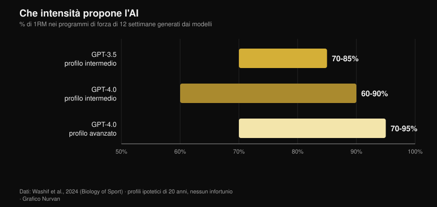
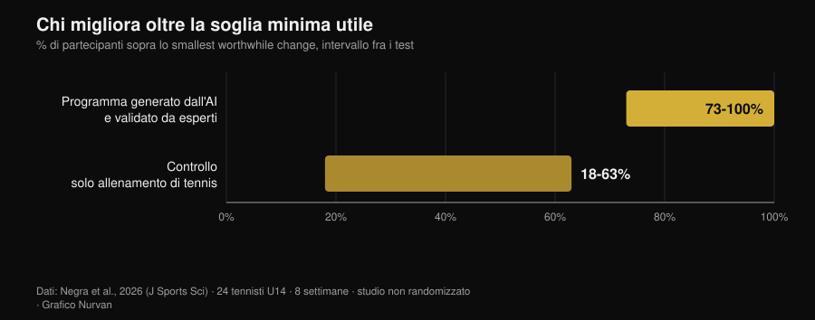

# Scheda di allenamento con l'AI: cosa dicono gli studi

Di [Giammaria Loi](/autore/giammaria-loi) · aggiornato il 2 novembre 2026

Chiedi una scheda a un chatbot e in dieci secondi hai dodici settimane di programma, con fasi, percentuali e tempi di recupero. Sembra fatta bene. La domanda vera non è se l'AI sappia scrivere una scheda — lo sa fare — ma se quella scheda sia davvero *tua*, e quanto di ciò che la fa funzionare resti fuori dal file. Dal 2024 alcuni gruppi di ricerca hanno smesso di discuterne e hanno iniziato a misurare: hanno fatto generare programmi ai modelli, li hanno dati in pasto a esperti con rubriche di valutazione e, in un caso, li hanno fatti eseguire per otto settimane. I risultati sono più interessanti di come li racconta chi vende app.

## In breve

- **La scheda esce sensata, ma in bozza.** Programmi di 12 settimane in tre fasi, intensità fra il 60% e il 95% di 1RM a seconda del livello: strutture coerenti con i manuali, che però "richiedono messa a punto prima dell'applicazione" (Washif et al., 2024).
- **Non è personalizzata: è generica travestita.** Nello stesso lavoro i programmi generati per un profilo maschile e per uno femminile sono risultati **oggettivamente simili**. L'AI ha cambiato il nome, non il contenuto.
- **Può funzionare, se passa da mani umane.** Otto settimane di programma eccentrico generato da ChatGPT *e validato da esperti prima dell'uso*: sprint sui 5 m, cambio di direzione e agilità migliorati, salti no (Negra et al., 2026).
- **Il chatbot che ti tiene costante non ha prove.** Revisione sistematica su 7 RCT: effetti **incoerenti** su attività fisica e dieta negli adulti, nessuna evidenza nei bambini. Funziona sul fumo, non sulla palestra (Chen et al., 2025).
- **Sulle calorie è più precisa sulla singola ricetta che sul piano.** Piani giornalieri e ricette generati e poi ricalcolati su database nutrizionali: le ricette reggono meglio dei menù interi (Aslan e Sozlu, 2025).
- **Non è pericolosa, è incompleta.** Dodici fisioterapisti hanno giudicato le risposte di ChatGPT sicure e per lo più accurate in **5 domini su 6**, ma carenti di completezza (Schütze et al., 2026).

## Cosa succede davvero quando chiedi "fammi una scheda"

Un modello linguistico non calcola il tuo programma: predice il testo più plausibile dato ciò che gli hai scritto. Il risultato è una media ragionata di tutto quello che ha letto, e siccome ha letto molti manuali seri, la media è spesso ragionevole. È il motivo per cui le schede generate sembrano buone a colpo d'occhio: hanno le fasi, i range di ripetizioni giusti, il riscaldamento al posto giusto.

Il problema nasce dopo. Un programma serve a produrre un adattamento in *una* persona, con la sua storia di carichi, i suoi orari, i suoi acciacchi e la sua risposta alla fatica. Quella parte non sta nel prompt, e nemmeno nel testo che il modello restituisce: arriva dopo, settimana per settimana. Gli studi che seguono misurano esattamente questa distanza.

## Cosa dice davvero la ricerca

| Affermazione diffusa | Verdetto | Fonte |
|---|---|---|
| "L'AI scrive una scheda sensata" | Confermato, ma è una bozza | Washif et al., 2024 |
| "La scheda è personalizzata su di te" | Smentito | Washif et al., 2024 |
| "Una scheda fatta dall'AI non funziona" | Smentito, con una condizione | Negra et al., 2026 |
| "Le versioni nuove hanno risolto tutto" | Da precisare | Genç et al., 2025 |
| "Un chatbot ti tiene costante" | Non supportato | Chen et al., 2025 |
| "Puoi chiederle anche la dieta" | Da precisare | Aslan e Sozlu, 2025 |
| "È pericolosa" | Da precisare: più incompleta che insicura | Schütze et al., 2026 |

### Affermazione 1 — "L'AI scrive una scheda sensata"
**Confermato, ma è una bozza.**

Il primo lavoro indicizzato a entrare nel merito ha chiesto a GPT-3.5 e GPT-4.0 di progettare programmi di forza di dodici settimane per profili ipotetici di vent'anni, con esperienza intermedia e poi avanzata. Entrambe le versioni hanno prodotto programmi in tre fasi da quattro settimane con obiettivi diversi (ipertrofia, forza), parametri dentro i range dei manuali e recuperi coerenti.

*Grafico Nurvan sui dati di Washif et al., 2024 (Biology of Sport). Intervalli di intensità proposti dai modelli per programmi di 12 settimane; profili ipotetici di 20 anni, nessun infortunio.*

Le differenze fra versioni ci sono e vanno nella direzione attesa: GPT-4.0 distingue il livello intermedio dall'avanzato, allarga la forbice dei recuperi (da 60-180 a 60-300 secondi) e gestisce più informazioni. La conclusione degli autori però è netta: i programmi "probabilmente richiedono una messa a punto aggiuntiva prima dell'applicazione" e il modello "può servire come strumento complementare per scrivere una bozza".

Bozza è la parola giusta. Una scheda plausibile non è una scheda adatta.

### Affermazione 2 — "La scheda è personalizzata su di te"
**Smentito.**

È il risultato più scomodo dello stesso studio, e quasi nessuno lo cita. Agli autori bastava cambiare il sesso del profilo nel prompt per vedere cosa succedeva: tutti i programmi generati sono risultati **oggettivamente simili indipendentemente dal sesso**. Non è una critica sulla fisiologia — le raccomandazioni di allenamento per uomini e donne si somigliano parecchio — ma sul meccanismo: il modello non ha usato l'unica informazione individuale che gli era stata data.

Se un dato esplicito nel prompt non cambia l'output, ciò che non hai scritto nel prompt pesa zero. E ciò che non scrivi è quasi tutto: quanto hai dormito, quanto ti è costata la seduta di ieri, perché la spalla destra tira solo in panca presa larga.

### Affermazione 3 — "Una scheda fatta dall'AI non funziona"
**Smentito, con una condizione che cambia tutto.**

Nel 2026 è arrivato il primo studio di intervento. Ventiquattro tennisti under 14 divisi in due gruppi: uno ha seguito per otto settimane un programma di lavoro eccentrico generato da ChatGPT, l'altro ha continuato il solo allenamento di tennis. Il gruppo AI ha migliorato in modo significativo sprint sui 5 metri, cambio di direzione (505) e agilità, con ampiezze dell'effetto fra 0,6 e 2,15 contro 0,15-0,6 del controllo. Su sprint sui 10 metri e salti, nessuna differenza fra i gruppi.

*Grafico Nurvan sui dati di Negra et al., 2026 (Journal of Sports Sciences). Quota di partecipanti che supera lo smallest worthwhile change nei vari test; studio controllato non randomizzato, 24 atleti U14.*

La condizione sta in una riga del metodo: il programma generato dall'AI è stato **validato da esperti umani prima di essere somministrato**. Non è "l'AI ha allenato dei ragazzi": è "degli esperti hanno usato l'AI per scrivere la prima versione, l'hanno controllata e poi l'hanno fatta eseguire". È esattamente il flusso di lavoro che funziona, ed è anche il motivo per cui lo studio non dimostra che puoi saltare il controllo.

### Affermazione 4 — "Le versioni nuove hanno risolto tutto"
**Da precisare.**

Un gruppo di ricerca ha messo tre versioni di ChatGPT a generare programmi di forza di dodici settimane con sette set di istruzioni diversi, e li ha fatti valutare da sette esperti (preparatori certificati CSCS e dottori di ricerca in scienze motorie con almeno dieci anni di esperienza) su una rubrica che pesava, fra le altre cose, individualizzazione della progressione, modifiche del programma, rischio di infortunio e presenza di raccomandazioni sbagliate.

Le differenze fra versioni sono risultate statisticamente significative in tutti i confronti a coppie (p = 0,018), con la versione più recente giudicata più dettagliata, più coerente e meglio ancorata alla letteratura. Il miglioramento è reale. La conclusione degli autori, però, è identica a quella del 2024: perché un piano assistito dall'AI sia sicuro, basato sulle evidenze e individualizzato, "il coinvolgimento di competenza umana qualificata resta essenziale". Le versioni migliorano la bozza, non sostituiscono la revisione.

### Affermazione 5 — "Un chatbot ti tiene costante meglio di un coach"
**Non supportato.**

Qui la promessa commerciale è più forte dei dati. Una revisione sistematica ha setacciato dodici database, 6.301 record, per isolare gli studi randomizzati su chatbot capaci di dialogare in linguaggio naturale: ne sono rimasti sette. Sul fumo gli effetti sono coerenti. Su dieta e attività fisica negli adulti sono **incoerenti**, nei bambini non c'è evidenza di effetto, e due dei quattro studi sull'attività fisica hanno un alto rischio di bias.

C'è un dettaglio che spiega molto: gli utenti interagivano parecchio con i chatbot in generale, ma non altrettanto sui comportamenti di salute specifici. Il gradimento è alto, il cambiamento no. È la differenza fra un'app che ti piace e un'app che ti fa allenare, ed è la stessa differenza che separa un coach simpatico da un coach che ottiene risultati: su questo ho raccolto i numeri della supervisione umana nell'articolo su [se il coaching online funziona davvero](/blog/coaching-online-funziona-studi).

### Affermazione 6 — "Tanto puoi chiederle anche la dieta"
**Da precisare.**

Uno studio pilota ha chiesto a ChatGPT piani alimentari da 1500, 2000 e 2500 kcal e ricette da 300, 500 e 700 kcal, poi ha ricalcolato tutto su database nutrizionali. Il modello è risultato **più accurato nel costruire una ricetta con le calorie richieste che nel comporre un piano giornaliero intero**: più l'oggetto è piccolo e circoscritto, meno l'errore si accumula.

È un pilota su una versione ormai vecchia, quindi vale come indicazione di metodo, non come verdetto. L'indicazione è comunque utile: usa l'AI per i pezzi, non per l'impianto. E quando servono i grammi veri, servono i grammi veri di un database alimentare, non una stima plausibile.

### Affermazione 7 — "È pericolosa"
**Da precisare: più incompleta che insicura.**

Il test più severo arriva da fuori palestra. Dodici fisioterapisti esperti hanno valutato le risposte di ChatGPT a sei domande sull'esercizio in una malattia muscolare rara, su una scala che andava da "completa e accurata" a "sbagliata e non sicura". Verdetto: risposte sicure e per lo più accurate in cinque domini su sei, ma spesso non complete.

È il profilo di rischio tipico: non ti dice di fare qualcosa di assurdo, ti dice qualcosa di ragionevole lasciando fuori il pezzo che conta. Nella medicina dello sport la conclusione è la stessa: la bravura di un modello sui suoi test non si traduce automaticamente in esiti migliori, e il professionista resta nel circuito come integratore delle informazioni (Palermi et al., 2026). Un sintomo che non passa, un dolore che peggiora, un esame da interpretare: lì si va dal medico, non dal chatbot.

## Come usarla bene

1. **Usala per la bozza, non per la decisione.** Scheda di partenza, idee di varianti, riordino di un programma che hai già: sì. Scelta del carico di domani: no.
2. **Dalle il contesto che hai davvero.** Storico dei carichi, RIR delle ultime sedute, giorni disponibili, infortuni. Senza questi, come ha mostrato Washif, l'output non cambia nemmeno se cambi il profilo.
3. **Chiedi conto dei numeri.** Se cita uno studio, controllalo: i riferimenti inventati sono il modo più rapido per portarsi in palestra una convinzione falsa.
4. **Falla passare da chi sa leggerla.** Nell'unico studio di intervento positivo il programma era stato validato da esperti umani prima dell'uso. È la differenza fra uno strumento e un sostituto.
5. **Misura, non fidarti.** Dopo quattro settimane guarda i carichi, non le sensazioni: se la bozza non sta producendo progressione, è una bozza sbagliata.
6. **Tienila fuori dalla medicina.** Patologie, farmaci, esami: nessun chatbot, nessuna app. Medico.

> **Prova Nurvan — l'AI scrive la bozza, i tuoi dati la correggono**
>
> In Nurvan la scheda non resta un testo: carichi, ripetizioni e RIR di ogni serie finiscono nello storico, le serie di riscaldamento vengono proposte sul carico di lavoro del giorno e la progressione si costruisce su quello che hai davvero sollevato. Se lavori con un coach, lui vede gli stessi numeri e corregge dove serve — che è esattamente il pezzo che a una scheda generata manca. [Prova Nurvan](https://nurvan.app)

## Domande frequenti

**Posso usare ChatGPT per farmi la scheda di palestra?**
Come bozza sì, come programma definitivo no. Gli studi che hanno valutato i programmi generati li descrivono come strutturalmente coerenti ma da mettere a punto, e concordi su un punto: serve una competenza umana qualificata per renderli sicuri e individualizzati (Washif et al., 2024; Genç et al., 2025).

**Le schede generate dall'AI sono diverse per uomini e donne?**
Nello studio che lo ha verificato, no: i programmi prodotti per profili maschili e femminili erano oggettivamente simili (Washif et al., 2024). Se ti aspetti una personalizzazione dal semplice fatto di aver scritto chi sei, probabilmente non la stai ottenendo.

**Un'app con AI mi aiuta a essere costante?**
Non c'è ancora evidenza solida. Sui sette studi randomizzati disponibili, gli effetti dei chatbot su attività fisica e dieta negli adulti sono incoerenti, mentre il risultato è coerente solo per il fumo (Chen et al., 2025).

**Meglio l'AI o un coach?**
Non sono alternative sullo stesso piano: una scrive testo, l'altro osserva te. I dati su supervisione e intensità mostrano che la parte decisiva del lavoro umano è far eseguire bene una scheda, non scriverla — per esempio, con un tecnico ogni cinque persone la panca massimale è salita del 15,9% contro il 10,2% di un tecnico ogni venticinque (Gentil e Bottaro, 2010).

## Leggi anche

- [Coaching online funziona? Cosa dicono gli studi](/blog/coaching-online-funziona-studi) — quanto conta davvero essere seguiti, numeri alla mano.
- [I migliori software e app per personal trainer in Italia](/blog/migliori-software-app-personal-trainer-italia) — cosa deve fare uno strumento di coaching, al di là dell'etichetta "AI".
- [Tendenze fitness 2027: cosa funziona davvero](/blog/tendenze-fitness-2027-cosa-funziona) — dove si colloca la tecnologia fra le mode e le cose che reggono.

## Fonti

- Washif JA, Pagaduan J, James C, Dergaa I, Beaven CM, 2024. Artificial intelligence in sport: Exploring the potential of using ChatGPT in resistance training prescription. *Biology of Sport* 41(2):209-220. PMID 38524820. [DOI](https://doi.org/10.5114/biolsport.2024.132987)
- Genç A, Aydın GR, Kasap M, Özkan A, Rakhymzhanov A, Gürcan HH, Güllü S, Demirhan B, 2025. Comparative evaluation of ChatGPT versions in training program design: scientific approach, accuracy, and practical applicability. *BMC Sports Science, Medicine and Rehabilitation* 18(1):19. PMID 41345701. [DOI](https://doi.org/10.1186/s13102-025-01409-7)
- Negra Y, Sammoud S, Bouguezzi R, Markov A, Capranica L, Müller P, Chaabene H, 2026. Effects of a ChatGPT-generated eccentric training programme on speed, change of direction, agility, and jumping performance in U14 tennis players: A non-randomised controlled study. *Journal of Sports Sciences*. PMID 41944488. [DOI](https://doi.org/10.1080/02640414.2026.2653295)
- Chen J, Hu RZ, Zhuang YX, Zhang JQ, Shan R, Yang Y, Liu Z, 2025. Natural Language Processing Chatbot-Based Interventions for Improvement of Diet, Physical Activity, and Tobacco Smoking Behaviors: Systematic Review. *JMIR mHealth and uHealth* 13:e66403. PMID 40503914. [DOI](https://doi.org/10.2196/66403)
- Aslan S, Sozlu S, 2025. A pilot study of the potential role of ChatGPT in stated-calorie diet planning. *International Journal of Obesity* 49(9):1891-1896. PMID 40628963. [DOI](https://doi.org/10.1038/s41366-025-01839-w)
- Schütze K, Shehatha R, Beer K, Needham M, Smith T, Bagg M, Doverty A, Cooper I, 2026. Evaluating ChatGPT's advice and recommendations regarding exercise for people with inclusion body myositis. *Neuromuscular Disorders* 62:106418. PMID 41950577. [DOI](https://doi.org/10.1016/j.nmd.2026.106418)
- Palermi S, Pucciatti R, Regnard NE, et al., 2026. Artificial Intelligence in Sports Medicine: A Decision-Centered Framework for the Future Sports Physician. *Diagnostics* 16(10):1448. PMID 42196815. [DOI](https://doi.org/10.3390/diagnostics16101448)
- Gentil P, Bottaro M, 2010. Influence of supervision ratio on muscle adaptations to resistance training in nontrained subjects. *Journal of Strength and Conditioning Research* 24(3):639-43. PMID 19661830. [DOI](https://doi.org/10.1519/JSC.0b013e3181ad3373)

Riferimenti bibliografici recuperati tramite PubMed. Tema scelto con la ricerca di tendenza del 2 novembre 2026: la domanda "AI o coach" è fra le più cercate del momento nel fitness, ma le pagine che la occupano sono blog di software senza una sola fonte.

---

Giammaria Loi è il fondatore di Nurvan. Si allena con i pesi dal 2012, lavora come personal trainer e coach certificato FIPE dal 2013 e gareggia nel powerlifting a livello nazionale dal 2018. Ogni articolo che firma parte dagli studi scientifici e arriva a ciò che funziona davvero in palestra.

> Nota: contenuto informativo, non sostituisce il parere di un medico o professionista.
