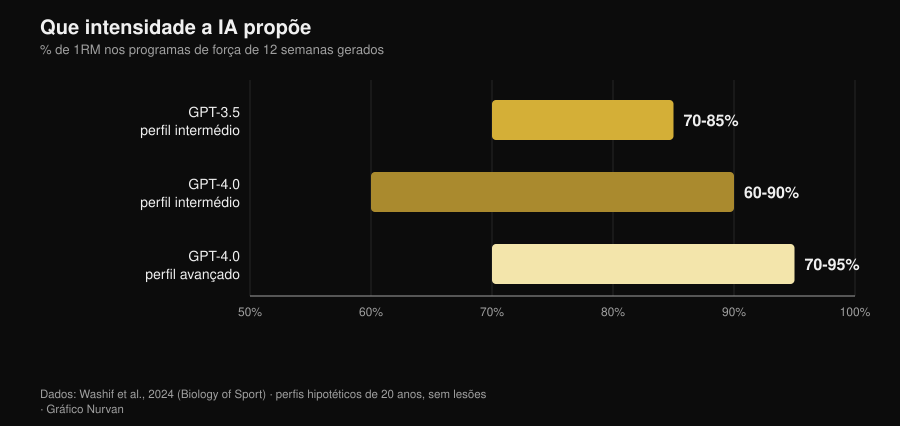
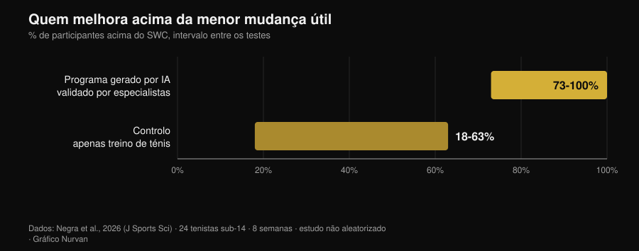

# Treino gerado por IA: o que dizem os estudos

Por [Giammaria Loi](/autore/giammaria-loi) · atualizado a 2 de novembro de 2026

Pedes um plano a um chatbot e dez segundos depois tens doze semanas de programa, com fases, percentagens e tempos de pausa. Parece bem feito. A pergunta verdadeira não é se a IA sabe escrever um treino — sabe — mas se esse treino é de facto *teu*, e quanto daquilo que o faz funcionar fica fora do ficheiro. Desde 2024 alguns grupos de investigação deixaram de discutir e começaram a medir: fizeram os modelos gerar programas, entregaram-nos a especialistas com grelhas de avaliação e, num dos casos, puseram atletas a cumprir um deles durante oito semanas. Os resultados são mais interessantes do que a versão contada por quem vende apps.

## Em resumo

- **O plano sai sensato, mas em rascunho.** Programas de 12 semanas em três fases, intensidades entre 60% e 95% de 1RM conforme o nível: estruturas coerentes com os manuais, que no entanto "provavelmente exigem um ajuste adicional antes da aplicação" (Washif et al., 2024).
- **Não é personalizado: é genérico disfarçado.** No mesmo trabalho, os programas gerados para um perfil masculino e para um feminino saíram **objetivamente semelhantes**. A IA mudou o rótulo, não o conteúdo.
- **Pode funcionar, se passar por mãos humanas.** Oito semanas de programa excêntrico gerado pelo ChatGPT *e validado por especialistas antes do uso*: sprint aos 5 m, mudança de direção e agilidade melhoraram; os saltos não (Negra et al., 2026).
- **O chatbot que te mantém constante não tem provas.** Revisão sistemática de 7 ensaios aleatorizados: efeitos **inconsistentes** na atividade física e na alimentação em adultos, nenhuma evidência em crianças. Funciona no tabaco, não no ginásio (Chen et al., 2025).
- **Nas calorias é mais precisa na receita do que no plano.** Planos diários e receitas gerados e depois recalculados em bases de dados nutricionais: as receitas aguentam melhor do que as ementas inteiras (Aslan e Sozlu, 2025).
- **Não é perigosa, é incompleta.** Doze fisioterapeutas julgaram as respostas do ChatGPT seguras e na maioria corretas em **5 domínios de 6**, mas carentes de completude (Schütze et al., 2026).

## O que acontece mesmo quando pedes "faz-me um treino"

Um modelo de linguagem não calcula o teu programa: prevê o texto mais plausível a partir daquilo que lhe escreveste. O resultado é uma média ponderada de tudo o que leu e, como leu muitos manuais sérios, essa média é quase sempre razoável. É por isso que os planos gerados parecem bons à primeira vista: têm as fases, os intervalos de repetições certos, o aquecimento no lugar certo.

O problema começa depois. Um programa serve para produzir uma adaptação em *uma* pessoa, com o seu histórico de cargas, os seus horários, as suas mazelas e a sua resposta à fadiga. Essa parte não está no prompt, nem está no texto que o modelo devolve: chega depois, semana a semana. Os estudos que seguem medem exatamente essa distância.

## O que a investigação diz mesmo

| Afirmação comum | Veredicto | Fonte |
|---|---|---|
| "A IA escreve um treino sensato" | Confirmado, mas é um rascunho | Washif et al., 2024 |
| "O plano é personalizado para ti" | Desmentido | Washif et al., 2024 |
| "Um treino feito pela IA não funciona" | Desmentido, com uma condição | Negra et al., 2026 |
| "As versões novas resolveram tudo" | A precisar | Genç et al., 2025 |
| "Um chatbot mantém-te constante" | Sem suporte | Chen et al., 2025 |
| "Também lhe podes pedir a dieta" | A precisar | Aslan e Sozlu, 2025 |
| "É perigosa" | A precisar: mais incompleta do que insegura | Schütze et al., 2026 |

### Afirmação 1 — "A IA escreve um treino sensato"
**Confirmado, mas é um rascunho.**

O primeiro trabalho indexado a entrar na matéria pediu ao GPT-3.5 e ao GPT-4.0 que desenhassem programas de força de doze semanas para perfis hipotéticos de vinte anos, primeiro com experiência intermédia e depois avançada. As duas versões produziram programas em três fases de quatro semanas com objetivos distintos (hipertrofia, força), parâmetros dentro dos intervalos dos manuais e pausas coerentes.

*Gráfico Nurvan com dados de Washif et al., 2024 (Biology of Sport). Intervalos de intensidade propostos pelos modelos para programas de 12 semanas; perfis hipotéticos de 20 anos, sem lesões.*

As diferenças entre versões existem e vão na direção esperada: o GPT-4.0 distingue o nível intermédio do avançado, alarga a janela das pausas (de 60-180 para 60-300 segundos) e gere mais informação ao mesmo tempo. A conclusão dos autores é, ainda assim, categórica: os programas "provavelmente exigem um ajuste adicional antes da aplicação" e o modelo "pode servir como ferramenta complementar para escrever um rascunho".

Rascunho é a palavra certa. Um plano plausível não é um plano adequado.

### Afirmação 2 — "O plano é personalizado para ti"
**Desmentido.**

É o resultado mais incómodo do mesmo estudo e quase ninguém o cita. Aos autores bastou mudar o sexo do perfil no prompt para ver o que acontecia: todos os programas gerados saíram **objetivamente semelhantes independentemente do sexo**. Não é uma crítica à fisiologia — as recomendações de treino para homens e mulheres sobrepõem-se bastante —, é uma crítica ao mecanismo: o modelo não usou a única informação individual que lhe foi dada.

Se um dado explícito no prompt não muda o resultado, aquilo que *não* escreveste no prompt pesa zero. E aquilo que não escreves é quase tudo: quanto dormiste, quanto te custou o treino de ontem, porque é que o ombro direito só puxa no supino com pega larga.

### Afirmação 3 — "Um treino feito pela IA não funciona"
**Desmentido, com uma condição que muda tudo.**

Em 2026 chegou o primeiro estudo de intervenção. Vinte e quatro tenistas sub-14 divididos em dois grupos: um seguiu durante oito semanas um programa de trabalho excêntrico gerado pelo ChatGPT, o outro continuou apenas com o treino de ténis. O grupo IA melhorou de forma significativa no sprint de 5 metros, na mudança de direção (505) e na agilidade, com magnitudes de efeito entre 0,6 e 2,15 contra 0,15-0,6 do controlo. No sprint de 10 metros e nos saltos, nenhuma diferença entre grupos.

*Gráfico Nurvan com dados de Negra et al., 2026 (Journal of Sports Sciences). Proporção de participantes que supera a menor mudança útil nos vários testes; estudo controlado não aleatorizado, 24 atletas sub-14.*

A condição está numa linha dos métodos: o programa gerado pela IA foi **validado por especialistas humanos antes de ser aplicado**. Não é "a IA treinou um grupo de jovens": é "especialistas usaram a IA para escrever a primeira versão, controlaram-na e só depois a puseram em prática". É exatamente este o fluxo de trabalho que funciona, e é também a razão pela qual o estudo não demonstra que podes saltar o controlo.

### Afirmação 4 — "As versões novas resolveram tudo"
**A precisar.**

Um grupo de investigação colocou três versões do ChatGPT a gerar programas de força de doze semanas a partir de sete conjuntos de instruções diferentes e mandou avaliá-los por sete especialistas — treinadores certificados CSCS e doutorados em ciências do desporto com pelo menos dez anos de experiência — segundo uma grelha que pesava, entre outras coisas, a individualização da progressão, as modificações do programa, o risco de lesão e a presença de recomendações erradas.

As diferenças entre versões foram estatisticamente significativas em todas as comparações aos pares (p = 0,018), com a versão mais recente julgada mais detalhada, mais coerente e melhor ancorada na literatura. A melhoria é real. A conclusão dos autores, no entanto, é idêntica à de 2024: para que um plano assistido por IA seja seguro, baseado na evidência e individualizado, "o envolvimento de competência humana qualificada continua a ser essencial". As versões melhoram o rascunho, não substituem a revisão.

### Afirmação 5 — "Um chatbot mantém-te mais constante do que um treinador"
**Sem suporte.**

Aqui a promessa comercial está bem à frente dos dados. Uma revisão sistemática percorreu doze bases de dados e 6.301 registos para isolar os estudos aleatorizados sobre chatbots capazes de manter uma conversa aberta em linguagem natural: sobraram sete. No tabaco os efeitos são consistentes. Na alimentação e na atividade física em adultos são **inconsistentes**, nas crianças não há evidência de efeito, e dois dos quatro estudos sobre atividade física têm risco elevado de viés.

Há um detalhe que explica muito: os utilizadores interagiam bastante com os chatbots em geral, mas muito menos nos comportamentos de saúde específicos. A satisfação é alta, a mudança não. É a diferença entre uma app de que gostas e uma app que te faz treinar, e é a mesma diferença que separa um treinador simpático de um treinador que consegue resultados: sobre isso reuni os números da supervisão humana no artigo sobre [se o coaching online funciona mesmo](/pt/blog/o-coaching-online-funciona).

### Afirmação 6 — "Afinal também lhe podes pedir a dieta"
**A precisar.**

Um estudo piloto pediu ao ChatGPT planos alimentares de 1500, 2000 e 2500 kcal e receitas de 300, 500 e 700 kcal, e depois recalculou tudo em bases de dados nutricionais. O modelo mostrou-se **mais preciso a construir uma receita com as calorias pedidas do que a compor um plano diário inteiro**: quanto mais pequeno e circunscrito é o objeto, menos o erro se acumula.

É um piloto sobre uma versão já antiga, pelo que vale como indicação de método e não como veredicto. A indicação é, de qualquer forma, útil: usa a IA para as peças, não para a estrutura. E quando são precisos os gramas verdadeiros, são precisos os gramas verdadeiros de uma base de dados alimentar, não uma estimativa plausível.

### Afirmação 7 — "É perigosa"
**A precisar: mais incompleta do que insegura.**

O teste mais severo vem de fora do ginásio. Doze fisioterapeutas experientes avaliaram as respostas do ChatGPT a seis perguntas sobre exercício numa doença muscular rara, numa escala que ia de "completa e correta" a "errada e insegura". Veredicto: respostas seguras e na maioria corretas em cinco domínios de seis, mas muitas vezes não completas.

É o perfil de risco típico: não te diz para fazer algo absurdo, diz-te algo razoável deixando de fora a parte que importava. Na medicina do desporto a conclusão é a mesma: o desempenho de um modelo nos seus próprios testes não se traduz automaticamente em melhores resultados, e o profissional permanece no circuito como quem integra a informação (Palermi et al., 2026). Um sintoma que não passa, uma dor que piora, um exame para interpretar: isso é para o médico, não para o chatbot.

## Como usá-la bem

1. **Usa-a para o rascunho, não para a decisão.** Plano de partida, ideias de variantes, reorganizar um programa que já tens: sim. Escolher a carga de amanhã: não.
2. **Dá-lhe o contexto que tens de facto.** Histórico de cargas, RIR dos últimos treinos, dias disponíveis, lesões. Sem isso, como mostrou Washif, o resultado não muda nem quando muda o perfil.
3. **Exige contas dos números.** Se cita um estudo, verifica-o: as referências inventadas são a forma mais rápida de levares uma convicção falsa para o ginásio.
4. **Fá-la passar por quem a sabe ler.** No único estudo de intervenção positivo, o programa tinha sido validado por especialistas humanos antes do uso. É a diferença entre uma ferramenta e um substituto.
5. **Mede, não confies.** Ao fim de quatro semanas olha para as cargas, não para as sensações: se o rascunho não está a produzir progressão, é um rascunho errado.
6. **Mantém-na fora da medicina.** Patologias, medicamentos, exames: nenhum chatbot, nenhuma app. Médico.

> **Experimenta a Nurvan — a IA escreve o rascunho, os teus dados corrigem-no**
>
> Na Nurvan o plano não fica um bloco de texto: cargas, repetições e RIR de cada série entram no histórico, as séries de aquecimento são propostas a partir da carga de trabalho do dia e a progressão constrói-se sobre aquilo que levantaste de facto. Se trabalhas com um treinador, ele vê os mesmos números e corrige onde é preciso — que é exatamente a parte que falta a um plano gerado. [Experimenta a Nurvan](https://nurvan.app)

## Perguntas frequentes

**Posso usar o ChatGPT para fazer o meu plano de ginásio?**
Como rascunho sim, como programa definitivo não. Os estudos que avaliaram os programas gerados descrevem-nos como estruturalmente coerentes mas a necessitar de ajuste, e concordam num ponto: é precisa competência humana qualificada para os tornar seguros e individualizados (Washif et al., 2024; Genç et al., 2025).

**Os treinos gerados por IA são diferentes para homens e mulheres?**
No estudo que o verificou, não: os programas produzidos para perfis masculinos e femininos eram objetivamente semelhantes (Washif et al., 2024). Se esperas personalização só porque escreveste quem és, provavelmente não a estás a obter.

**Uma app com IA ajuda-me a ser constante?**
Ainda não há evidência sólida. Nos sete estudos aleatorizados disponíveis, os efeitos dos chatbots na atividade física e na alimentação em adultos são inconsistentes, e o resultado só é consistente no tabaco (Chen et al., 2025).

**IA ou treinador?**
Não são alternativas no mesmo plano: uma escreve texto, o outro observa-te. Os dados sobre supervisão e intensidade mostram que a parte decisiva do trabalho humano é fazer executar bem um plano, não escrevê-lo — por exemplo, com um técnico por cada cinco pessoas o supino máximo subiu 15,9% contra 10,2% com um técnico por cada vinte e cinco (Gentil e Bottaro, 2010).

## Lê também

- [O coaching online funciona? O que dizem os estudos](/pt/blog/o-coaching-online-funciona) — quanto conta mesmo ser acompanhado, com números.
- [Quantas repetições para massa muscular? O mito das 8-12](/pt/blog/quantas-repeticoes-massa-muscular) — as variáveis de programação que um rascunho de IA recebe, e o que a evidência diz sobre elas.
- [Tendências fitness 2027: o que funciona mesmo](/pt/blog/tendencias-fitness-2027-o-que-funciona) — onde se coloca a tecnologia entre as modas e as coisas que aguentam.

## Fontes

- Washif JA, Pagaduan J, James C, Dergaa I, Beaven CM, 2024. Artificial intelligence in sport: Exploring the potential of using ChatGPT in resistance training prescription. *Biology of Sport* 41(2):209-220. PMID 38524820. [DOI](https://doi.org/10.5114/biolsport.2024.132987)
- Genç A, Aydın GR, Kasap M, Özkan A, Rakhymzhanov A, Gürcan HH, Güllü S, Demirhan B, 2025. Comparative evaluation of ChatGPT versions in training program design: scientific approach, accuracy, and practical applicability. *BMC Sports Science, Medicine and Rehabilitation* 18(1):19. PMID 41345701. [DOI](https://doi.org/10.1186/s13102-025-01409-7)
- Negra Y, Sammoud S, Bouguezzi R, Markov A, Capranica L, Müller P, Chaabene H, 2026. Effects of a ChatGPT-generated eccentric training programme on speed, change of direction, agility, and jumping performance in U14 tennis players: A non-randomised controlled study. *Journal of Sports Sciences*. PMID 41944488. [DOI](https://doi.org/10.1080/02640414.2026.2653295)
- Chen J, Hu RZ, Zhuang YX, Zhang JQ, Shan R, Yang Y, Liu Z, 2025. Natural Language Processing Chatbot-Based Interventions for Improvement of Diet, Physical Activity, and Tobacco Smoking Behaviors: Systematic Review. *JMIR mHealth and uHealth* 13:e66403. PMID 40503914. [DOI](https://doi.org/10.2196/66403)
- Aslan S, Sozlu S, 2025. A pilot study of the potential role of ChatGPT in stated-calorie diet planning. *International Journal of Obesity* 49(9):1891-1896. PMID 40628963. [DOI](https://doi.org/10.1038/s41366-025-01839-w)
- Schütze K, Shehatha R, Beer K, Needham M, Smith T, Bagg M, Doverty A, Cooper I, 2026. Evaluating ChatGPT's advice and recommendations regarding exercise for people with inclusion body myositis. *Neuromuscular Disorders* 62:106418. PMID 41950577. [DOI](https://doi.org/10.1016/j.nmd.2026.106418)
- Palermi S, Pucciatti R, Regnard NE, et al., 2026. Artificial Intelligence in Sports Medicine: A Decision-Centered Framework for the Future Sports Physician. *Diagnostics* 16(10):1448. PMID 42196815. [DOI](https://doi.org/10.3390/diagnostics16101448)
- Gentil P, Bottaro M, 2010. Influence of supervision ratio on muscle adaptations to resistance training in nontrained subjects. *Journal of Strength and Conditioning Research* 24(3):639-43. PMID 19661830. [DOI](https://doi.org/10.1519/JSC.0b013e3181ad3373)

Referências bibliográficas obtidas através da PubMed. Tema escolhido com a pesquisa de tendência de 2 de novembro de 2026: a pergunta "IA ou treinador" é das mais procuradas do momento no fitness, mas as páginas que ocupam esses resultados são blogues de software sem uma única fonte.

---

**Giammaria Loi** é o fundador da Nurvan. Treina com pesos desde 2012, trabalha como personal trainer e coach certificado FIPE desde 2013 e compete em powerlifting a nível nacional desde 2018. Cada artigo que assina parte dos estudos científicos e chega ao que funciona mesmo no ginásio.

> Nota: conteúdo informativo, não substitui a opinião de um médico ou de um profissional.
