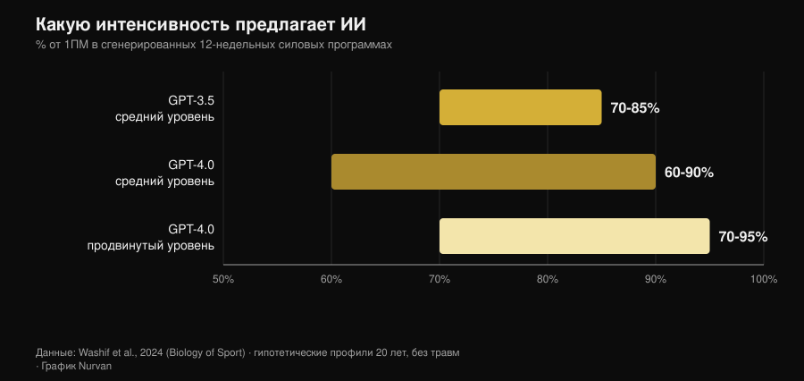
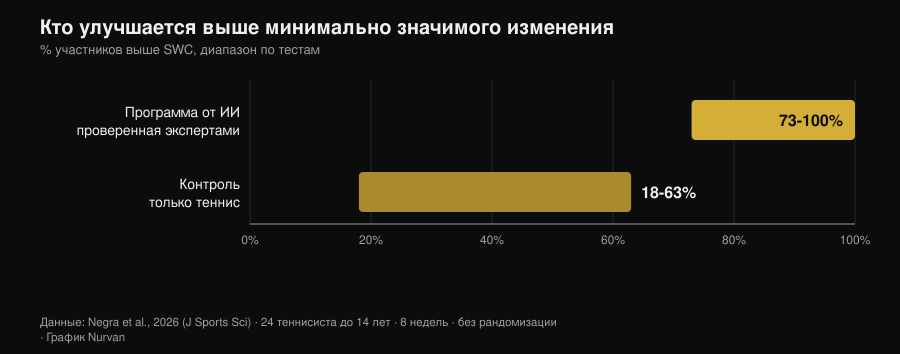

# План тренировок от ИИ: что говорят исследования

Автор: [Giammaria Loi](/autore/giammaria-loi) · обновлено 2 ноября 2026

Просишь у чат-бота программу — и через десять секунд получаешь двенадцать недель тренировок: с фазами, процентами от разового максимума и временем отдыха между подходами. Выглядит грамотно. Но настоящий вопрос не в том, умеет ли ИИ написать план — умеет, — а в том, твой ли это план и какая часть того, что заставляет программу работать, вообще не попадает в этот файл. С 2024 года несколько исследовательских групп перестали спорить и начали измерять: они заставляли модели генерировать программы, отдавали их экспертам с оценочными шкалами, а в одном случае дали спортсменам отработать такую программу восемь недель. Результаты оказались интереснее той версии, которую рассказывает реклама приложений.

## Коротко о главном

- **План выходит разумным, но это черновик.** Двенадцатинедельные программы из трёх фаз, интенсивность от 60% до 95% от 1ПМ в зависимости от уровня: структура согласуется с учебниками, но сами программы «скорее всего требуют дополнительной доработки перед применением» (Washif et al., 2024).
- **Это не персонализация, а универсальный шаблон в костюме.** В той же работе программы, сгенерированные для мужского и для женского профиля, оказались **объективно похожими**. Модель поменяла подпись, а не содержание.
- **Он может работать — если проходит через руки человека.** Восемь недель эксцентрической программы от ChatGPT, *проверенной экспертами до начала работы*: спринт на 5 м, смена направления и ловкость выросли, прыжки — нет (Negra et al., 2026).
- **У обещания «чат-бот не даст тебе бросить» нет доказательств.** Систематический обзор семи рандомизированных испытаний: **непоследовательные** эффекты на физическую активность и питание у взрослых, у детей эффекта не обнаружено. Работает с курением, но не с залом (Chen et al., 2025).
- **С калориями он точнее в отдельном рецепте, чем в целом рационе.** Сгенерированные дневные планы и рецепты пересчитали по базам данных о составе продуктов: рецепты держались лучше, чем меню на день (Aslan и Sozlu, 2025).
- **Он не опасен, он неполон.** Двенадцать физиотерапевтов признали ответы ChatGPT безопасными и в основном точными в **пяти доменах из шести**, но недостаточно полными (Schütze et al., 2026).

## Что на самом деле происходит, когда ты просишь «составь мне программу»

Языковая модель не рассчитывает твою программу: она предсказывает самый вероятный текст, исходя из того, что ты написал. На выходе получается осмысленное среднее по всему, что модель прочитала, а поскольку прочитала она много серьёзных учебников, это среднее обычно выглядит здраво. Именно поэтому сгенерированные планы хороши на первый взгляд: фазы на месте, диапазоны повторений адекватные, разминка стоит там, где и должна.

Проблема начинается потом. Программа существует, чтобы вызвать адаптацию у *одного* человека — с его историей рабочих весов, его графиком, его ноющим плечом и его собственной реакцией на усталость. Ничего из этого нет в запросе, и ничего из этого нет в тексте, который возвращает модель: это приходит неделя за неделей. Исследования ниже измеряют ровно эту дистанцию.

## Что на самом деле говорят исследования

| Распространённое утверждение | Вердикт | Источник |
|---|---|---|
| «ИИ пишет разумную программу» | Подтверждено, но это черновик | Washif et al., 2024 |
| «Программа составлена именно под тебя» | Опровергнуто | Washif et al., 2024 |
| «Программа от ИИ не работает» | Опровергнуто, с одним условием | Negra et al., 2026 |
| «Новые версии всё это исправили» | Нужны уточнения | Genç et al., 2025 |
| «Чат-бот не даст тебе бросить» | Не подтверждено | Chen et al., 2025 |
| «У него можно спросить и про питание» | Нужны уточнения | Aslan и Sozlu, 2025 |
| «Это опасно» | Нужны уточнения: скорее неполно, чем небезопасно | Schütze et al., 2026 |

### Утверждение 1 — «ИИ пишет разумную программу»
**Подтверждено, но это черновик.**

Первая проиндексированная работа, которая разобрала вопрос по существу, попросила GPT-3.5 и GPT-4.0 составить двенадцатинедельные силовые программы для гипотетических двадцатилетних — сначала со средним опытом, затем с продвинутым. Обе версии выдали по три четырёхнедельные фазы с разными задачами (гипертрофия, сила), с параметрами внутри учебниковых диапазонов и согласованными интервалами отдыха.

*График Nurvan по данным Washif et al., 2024 (Biology of Sport). Диапазоны интенсивности, предложенные моделями для 12-недельных программ; гипотетические профили 20 лет, без травм.*

Различия между версиями есть, и они идут в ожидаемую сторону: GPT-4.0 отличает средний уровень от продвинутого, расширяет окно отдыха (с 60–180 до 60–300 секунд) и удерживает больше информации одновременно. Вывод авторов при этом звучит жёстко: программы «скорее всего требуют дополнительной доработки перед применением», а модель «может служить вспомогательным инструментом для написания черновика».

Черновик — здесь ключевое слово. Правдоподобный план и подходящий план — разные вещи.

### Утверждение 2 — «Программа составлена именно под тебя»
**Опровергнуто.**

Это самый неудобный результат той же работы, и его почти никто не цитирует. Авторам достаточно было поменять в запросе пол профиля, чтобы увидеть, что произойдёт: все сгенерированные программы вышли **объективно похожими независимо от пола**. Это замечание не про физиологию — рекомендации по тренировкам для мужчин и женщин действительно сильно перекрываются, — а про механизм: модель не использовала единственную индивидуальную деталь, которую ей дали.

Если явно указанный в запросе параметр не меняет результат, то всё, что ты *не* написал, весит ноль. А не написал ты почти всё: сколько ты спал, чего тебе стоила вчерашняя тренировка, почему правое плечо тянет только в жиме широким хватом.

### Утверждение 3 — «Программа от ИИ не работает»
**Опровергнуто, с одним условием, которое меняет всю картину.**

Первое интервенционное исследование появилось в 2026 году. Двадцать четыре теннисиста до 14 лет разделили на две группы: одна восемь недель выполняла эксцентрическую программу, сгенерированную ChatGPT, вторая просто продолжала заниматься теннисом. Группа ИИ значимо улучшила спринт на 5 метров, смену направления (тест 505) и ловкость, с размерами эффекта от 0,6 до 2,15 против 0,15–0,6 в контроле. В спринте на 10 метров и в прыжковых тестах разницы между группами не было.

*График Nurvan по данным Negra et al., 2026 (Journal of Sports Sciences). Доля участников, превысивших smallest worthwhile change в разных тестах; контролируемое нерандомизированное исследование, 24 спортсмена до 14 лет.*

Условие спрятано в одной строке раздела «Методы»: сгенерированная ИИ программа была **проверена живыми экспертами, прежде чем её кому-то дали**. Это не «ИИ тренировал группу подростков». Это «эксперты использовали ИИ, чтобы написать первую версию, проверили её и только потом запустили в работу». Это ровно тот порядок действий, который работает, и ровно та причина, по которой исследование не разрешает пропускать проверку.

### Утверждение 4 — «Новые версии всё это исправили»
**Нужны уточнения.**

Одна исследовательская группа заставила три версии ChatGPT генерировать двенадцатинедельные силовые программы по семи разным наборам инструкций, а затем отдала результаты на оценку семи экспертам — тренерам с сертификацией CSCS и кандидатам наук в области спортивной науки со стажем не менее десяти лет — по шкале, которая учитывала, помимо прочего, индивидуализацию прогрессии, возможность модификации программы, риск травмы и наличие некорректных рекомендаций.

Различия между версиями оказались статистически значимыми во всех парных сравнениях (p = 0,018), а самую свежую версию признали более детальной, более внутренне непротиворечивой и лучше опирающейся на литературу. Улучшение настоящее. Но вывод авторов совпадает с выводом 2024 года: чтобы план, составленный с помощью ИИ, был безопасным, основанным на доказательствах и индивидуальным, «участие квалифицированной человеческой экспертизы остаётся необходимым». Новые версии улучшают черновик, но не отменяют проверку.

### Утверждение 5 — «Чат-бот держит тебя в режиме лучше, чем тренер»
**Не подтверждено.**

Здесь маркетинговое обещание сильно опережает данные. Систематический обзор просеял двенадцать баз данных и 6301 запись, чтобы выделить рандомизированные испытания чат-ботов, способных поддерживать свободный диалог на естественном языке: осталось семь. По курению эффекты согласованные. По питанию и физической активности у взрослых они **непоследовательные**, у детей доказательств эффекта нет, а два из четырёх исследований по физической активности имеют высокий риск систематической ошибки.

Одна деталь объясняет многое: пользователи охотно общались с чат-ботами в целом, но заметно меньше — именно по конкретному поведению, связанному со здоровьем. Удовлетворённость высокая, изменение поведения — нет. Это разница между приложением, которое тебе нравится, и приложением, которое заставляет тебя тренироваться, — и та же самая разница отделяет приятного тренера от тренера, который даёт результат. Цифры по человеческому контролю я собрал в материале о том, [работает ли онлайн-коучинг на самом деле](/ru/blog/rabotaet-li-onlayn-kouching).

### Утверждение 6 — «У него всё равно можно спросить и про питание»
**Нужны уточнения.**

Пилотное исследование попросило ChatGPT составить дневные рационы на 1500, 2000 и 2500 ккал и рецепты на 300, 500 и 700 ккал, а затем пересчитало всё по базам данных о составе продуктов. Модель оказалась **точнее в построении одного рецепта с заданной калорийностью, чем в составлении рациона на целый день**: чем меньше и чем более ограничен объект, тем меньше накапливается ошибка.

Это пилот на уже устаревшей версии, поэтому он годится как методическая подсказка, а не как вердикт. Подсказка всё равно полезная: используй ИИ для деталей, а не для каркаса. А когда нужны настоящие граммы, нужны настоящие граммы из базы данных продуктов, а не правдоподобная оценка.

### Утверждение 7 — «Это опасно»
**Нужны уточнения: скорее неполно, чем небезопасно.**

Самая суровая проверка пришла из-за пределов зала. Двенадцать опытных физиотерапевтов оценили ответы ChatGPT на шесть вопросов о физических упражнениях при редком мышечном заболевании по шкале от «полно и точно» до «неверно и небезопасно». Вердикт: ответы безопасные и в основном точные в пяти доменах из шести, но часто недостаточно полные.

Это типичный профиль риска: модель не советует тебе сделать что-то абсурдное — она говорит нечто разумное, оставляя за кадром ту часть, которая имела значение. В спортивной медицине вывод тот же: хорошие показатели модели на собственных тестах не превращаются автоматически в лучшие исходы, и специалист остаётся в контуре как тот, кто сводит информацию воедино (Palermi et al., 2026). Симптом, который не проходит, боль, которая усиливается, анализ, который нужно истолковать, — это работа врача, а не чат-бота.

## Как пользоваться этим правильно

1. **Используй его для черновика, а не для решения.** Стартовый план, идеи вариаций упражнений, перекомпоновка программы, которая у тебя уже есть, — да. Выбор рабочего веса на завтра — нет.
2. **Дай ему тот контекст, который у тебя действительно есть.** История рабочих весов, RIR последних тренировок, доступные дни, травмы. Без этого, как показал Washif, результат почти не меняется, даже если менять профиль.
3. **Проверяй цифры.** Если модель ссылается на исследование — найди его: выдуманные ссылки — самый быстрый способ принести в зал ложное убеждение.
4. **Покажи план тому, кто умеет его читать.** В единственном положительном интервенционном исследовании программа была проверена живыми экспертами до начала работы. Это и есть граница между инструментом и заменой.
5. **Измеряй, а не доверяй.** Через четыре недели смотри на веса, а не на ощущения: если черновик не даёт прогрессии, значит, это неправильный черновик.
6. **Держи его подальше от медицины.** Заболевания, лекарства, результаты анализов: никакого чат-бота, никакого приложения. К врачу.

> **Попробуйте Nurvan — ИИ пишет черновик, ваши данные его исправляют**
>
> В Nurvan программа не остаётся текстом: вес, повторения и RIR каждого подхода попадают в историю, разминочные подходы предлагаются исходя из рабочего веса на сегодня, а прогрессия строится на том, что вы действительно подняли. Если вы работаете с тренером, он видит те же цифры и правит там, где нужно, — а это ровно та часть, которой сгенерированному плану не хватает. [Попробуйте Nurvan](https://nurvan.app)

## Частые вопросы

**Можно ли составить программу тренировок через ChatGPT?**
Как черновик — да, как окончательную программу — нет. Исследования, которые оценивали сгенерированные планы, описывают их как структурно связные, но требующие доработки, и сходятся в одном: чтобы сделать их безопасными и индивидуальными, нужна квалифицированная человеческая экспертиза (Washif et al., 2024; Genç et al., 2025).

**Отличается ли план от ИИ для мужчин и для женщин?**
В исследовании, которое это проверяло, — нет: программы для мужского и женского профилей оказались объективно похожими (Washif et al., 2024). Если ты ждёшь персонализации просто потому, что указал, кто ты, скорее всего, ты её не получаешь.

**Поможет ли приложение с ИИ не бросить тренировки?**
Надёжных доказательств пока нет. По семи доступным рандомизированным испытаниям эффекты чат-ботов на физическую активность и питание у взрослых непоследовательны; единственный согласованный результат — по курению (Chen et al., 2025).

**Что выбрать: ИИ или живого тренера?**
Они не конкурируют за одну и ту же работу: один пишет текст, второй смотрит на тебя. Данные по контролю показывают, что решающий вклад человека — заставить выполнить программу правильно, а не написать её: при одном инструкторе на пять занимающихся максимум в жиме лёжа вырос на 15,9% против 10,2% при одном инструкторе на двадцать пять (Gentil и Bottaro, 2010).

## Читайте также

- [Работает ли онлайн-коучинг? Что говорят исследования](/ru/blog/rabotaet-li-onlayn-kouching) — насколько на самом деле важно, чтобы за тобой следили, с цифрами на руках.
- [Сколько повторений нужно для роста мышц? Миф о 8–12](/ru/blog/skolko-povtoreniy-dlya-massy) — те самые переменные программирования, которые достаются черновику от ИИ, и что о них говорят данные.
- [Фитнес-тренды 2027: что действительно работает](/ru/blog/fitnes-trendy-2027-chto-rabotaet) — где технологии находятся между модой и тем, что выдерживает проверку.

## Источники

- Washif JA, Pagaduan J, James C, Dergaa I, Beaven CM, 2024. Artificial intelligence in sport: Exploring the potential of using ChatGPT in resistance training prescription. *Biology of Sport* 41(2):209-220. PMID 38524820. [DOI](https://doi.org/10.5114/biolsport.2024.132987)
- Genç A, Aydın GR, Kasap M, Özkan A, Rakhymzhanov A, Gürcan HH, Güllü S, Demirhan B, 2025. Comparative evaluation of ChatGPT versions in training program design: scientific approach, accuracy, and practical applicability. *BMC Sports Science, Medicine and Rehabilitation* 18(1):19. PMID 41345701. [DOI](https://doi.org/10.1186/s13102-025-01409-7)
- Negra Y, Sammoud S, Bouguezzi R, Markov A, Capranica L, Müller P, Chaabene H, 2026. Effects of a ChatGPT-generated eccentric training programme on speed, change of direction, agility, and jumping performance in U14 tennis players: A non-randomised controlled study. *Journal of Sports Sciences*. PMID 41944488. [DOI](https://doi.org/10.1080/02640414.2026.2653295)
- Chen J, Hu RZ, Zhuang YX, Zhang JQ, Shan R, Yang Y, Liu Z, 2025. Natural Language Processing Chatbot-Based Interventions for Improvement of Diet, Physical Activity, and Tobacco Smoking Behaviors: Systematic Review. *JMIR mHealth and uHealth* 13:e66403. PMID 40503914. [DOI](https://doi.org/10.2196/66403)
- Aslan S, Sozlu S, 2025. A pilot study of the potential role of ChatGPT in stated-calorie diet planning. *International Journal of Obesity* 49(9):1891-1896. PMID 40628963. [DOI](https://doi.org/10.1038/s41366-025-01839-w)
- Schütze K, Shehatha R, Beer K, Needham M, Smith T, Bagg M, Doverty A, Cooper I, 2026. Evaluating ChatGPT's advice and recommendations regarding exercise for people with inclusion body myositis. *Neuromuscular Disorders* 62:106418. PMID 41950577. [DOI](https://doi.org/10.1016/j.nmd.2026.106418)
- Palermi S, Pucciatti R, Regnard NE, et al., 2026. Artificial Intelligence in Sports Medicine: A Decision-Centered Framework for the Future Sports Physician. *Diagnostics* 16(10):1448. PMID 42196815. [DOI](https://doi.org/10.3390/diagnostics16101448)
- Gentil P, Bottaro M, 2010. Influence of supervision ratio on muscle adaptations to resistance training in nontrained subjects. *Journal of Strength and Conditioning Research* 24(3):639-43. PMID 19661830. [DOI](https://doi.org/10.1519/JSC.0b013e3181ad3373)

Библиографические ссылки получены через PubMed. Тема выбрана по анализу трендов 2 ноября 2026 года: вопрос «ИИ или тренер» — один из самых частых запросов в фитнесе прямо сейчас, но страницы, которые занимают выдачу, — это блоги разработчиков софта без единого источника.

---

Giammaria Loi — основатель Nurvan. Занимается с отягощениями с 2012 года, работает персональным тренером и сертифицированным коучем FIPE с 2013 года и с 2018 года выступает в пауэрлифтинге на национальном уровне. Каждая статья, которую он подписывает, начинается с научных исследований и заканчивается тем, что действительно работает в зале.

> Примечание: информационный материал, не заменяет консультацию врача или квалифицированного специалиста.
