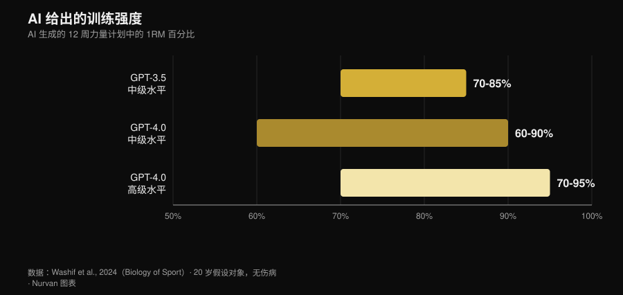
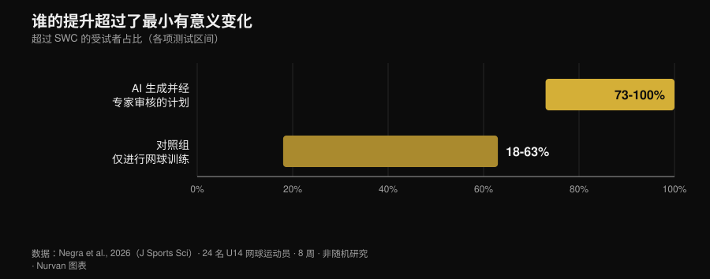

# AI 健身计划：研究到底怎么说

作者：[Giammaria Loi](/autore/giammaria-loi) · 更新于 2026 年 11 月 2 日

你向聊天机器人要一份训练计划，十秒钟后就拿到了十二周的方案：分期、1RM 百分比、组间休息时间，一样不少。看上去很专业。但真正的问题不是 AI 会不会写计划——它当然会——而是这份计划到底是不是*你的*，以及真正让一份计划起作用的那部分内容，有多少从来没有进入这个文件。从 2024 年开始，有几个研究团队不再争论，而是动手测量：他们让模型生成方案，交给专家按评分量表打分，其中一项研究还让运动员实打实地执行了八周。结果比 App 广告讲的那个版本有意思得多。

## 快速结论

- **计划看起来是合理的，但它只是草稿。** 十二周、三个阶段的方案，强度按水平在 1RM 的 60% 到 95% 之间：结构和教科书对得上，但这些方案「在应用之前很可能需要进一步调整」（Washif et al., 2024）。
- **这不是个性化，而是换了件外套的通用模板。** 在同一项研究里，为男性档案和女性档案生成的方案**客观上高度相似**。模型改掉的是标签，不是内容。
- **它可以有效，前提是先经过人手。** 一份由 ChatGPT 生成、*在使用前经专家审核*的离心训练方案执行八周：5 米冲刺、变向和敏捷性都有提升，弹跳没有（Negra et al., 2026）。
- **「聊天机器人能让你坚持」这句话没有证据。** 一项纳入 7 项随机对照试验的系统综述：对成年人身体活动和饮食的效果**并不一致**，在儿童身上没有发现效果。它对戒烟有用，对健身房没用（Chen et al., 2025）。
- **在热量上，它算单道菜比算一整天更准。** 把生成的每日食谱和单道菜谱放回营养成分数据库重新核算：单道菜谱比整天的菜单更站得住（Aslan 和 Sozlu, 2025）。
- **它不是危险，而是不完整。** 十二位物理治疗师认为 ChatGPT 的回答是安全的，在**六个维度中的五个**基本准确，但完整性不足（Schütze et al., 2026）。

## 当你说「给我一份训练计划」时，实际发生了什么

语言模型并不会计算你的训练方案：它只是根据你输入的内容，预测最可能出现的文本。输出结果是它读过的所有内容的一个「有道理的平均值」，而因为它读过大量严肃的教科书，这个平均值通常看起来挺靠谱。这就是为什么生成的计划第一眼看上去不错：分期在那里，次数区间也合理，热身放在了该放的位置。

问题是从之后开始的。一份训练方案存在的意义，是在*某一个*具体的人身上产生适应——这个人有自己的负荷史、自己的作息、自己那个会闹脾气的肩膀，以及自己对疲劳的反应方式。这些东西都不在提示词里，也不在模型返回的文本里：它们是一周一周才显现出来的。下面这些研究，量的正是这段距离。

## 研究到底说了什么

| 常见说法 | 结论 | 来源 |
|---|---|---|
| 「AI 能写出合理的训练计划」 | 成立，但只是草稿 | Washif et al., 2024 |
| 「这份计划是为你量身定制的」 | 不成立 | Washif et al., 2024 |
| 「AI 写的计划没用」 | 不成立，但有一个条件 | Negra et al., 2026 |
| 「新版本已经把问题都解决了」 | 需要补充说明 | Genç et al., 2025 |
| 「聊天机器人能让你坚持」 | 证据不足 | Chen et al., 2025 |
| 「顺便还能让它安排饮食」 | 需要补充说明 | Aslan 和 Sozlu, 2025 |
| 「它很危险」 | 需要补充说明：是不完整，而不是不安全 | Schütze et al., 2026 |

### 说法 1 ——「AI 能写出合理的训练计划」
**成立，但只是草稿。**

第一篇真正深入这个问题的被收录研究，让 GPT-3.5 和 GPT-4.0 为假设的 20 岁训练者设计十二周力量方案，先是中级水平，然后是高级水平。两个版本都给出了三个为期四周、目标各不相同的阶段（增肌、力量），参数落在教科书区间之内，组间休息也彼此自洽。

*Nurvan 图表，数据来自 Washif et al., 2024（Biology of Sport）。模型为 12 周计划给出的强度区间；假设对象为 20 岁，无伤病。*

版本之间的差异确实存在，而且方向符合预期：GPT-4.0 会区分中级和高级，把休息时间的窗口放宽（从 60–180 秒扩到 60–300 秒），一次能处理更多信息。但作者的结论依然很直接：这些方案「在应用之前很可能需要进一步调整」，模型「可以作为写草稿的辅助工具」。

草稿这个词是关键。一份看起来说得过去的计划，不等于一份适合你的计划。

### 说法 2 ——「这份计划是为你量身定制的」
**不成立。**

这是同一项研究里最尴尬的结果，而几乎没人引用它。作者只需要把提示词里的性别改掉，就能看出会发生什么：所有生成的方案都**不分性别地客观相似**。这不是在说生理学——男性和女性的训练建议本来就有大量重叠——而是在说机制：模型没有用上它唯一拿到的那条个体信息。

如果提示词里明确写出来的信息都没能改变输出，那么你*没有*写出来的东西，权重就是零。而你没写出来的几乎是全部：你睡了多久，昨天那堂训练让你付出了多少代价，为什么右肩只在宽握卧推时才难受。

### 说法 3 ——「AI 写的计划没用」
**不成立，但那个条件改变了整幅图景。**

第一项干预研究在 2026 年落地。24 名 14 岁以下网球运动员分成两组：一组执行由 ChatGPT 生成的离心训练方案八周，另一组照常只练网球。AI 组在 5 米冲刺、变向（505 测试）和敏捷性上有显著提升，效应量在 0.6 到 2.15 之间，对照组为 0.15–0.6。在 10 米冲刺和弹跳测试上，两组没有差异。

*Nurvan 图表，数据来自 Negra et al., 2026（Journal of Sports Sciences）。各项测试中超过 smallest worthwhile change 的参与者比例；非随机对照研究，24 名 U14 运动员。*

那个条件藏在方法部分的一行字里：AI 生成的方案**在交给任何人之前，先经过了真人专家的审核**。这不是「AI 带了一群孩子训练」，而是「专家用 AI 写出第一版，检查过，然后才拿去执行」。这正是真正有效的工作流程，也正是这项研究并不允许你跳过审核的原因。

### 说法 4 ——「新版本已经把问题都解决了」
**需要补充说明。**

一个研究团队让三个版本的 ChatGPT 按七套不同的指令生成十二周力量方案，然后请七位专家评分——持有 CSCS 认证的教练和运动科学博士，从业至少十年——评分量表涵盖了进阶的个体化程度、方案可修改性、受伤风险，以及是否出现错误建议等内容。

版本之间的差异在所有两两比较中都达到统计学显著（p = 0.018），最新版本被认为更详细、内部更一致，也更有文献依据。进步是真实的。但作者的结论和 2024 年那篇一模一样：要让一份 AI 辅助的方案做到安全、有证据支持且个体化，「合格的人类专业参与仍然是必要的」。新版本改善的是草稿，而不是取代审核。

### 说法 5 ——「聊天机器人比教练更能让你坚持」
**证据不足。**

在这一点上，营销话术跑得远远快过数据。一项系统综述检索了十二个数据库、6301 条记录，筛出能进行自然语言自由对话的聊天机器人随机对照试验：最后只剩七项。在戒烟方面，效果是一致的。在成年人的饮食和身体活动方面则**并不一致**，在儿童身上没有发现效果，而四项身体活动研究里有两项存在高偏倚风险。

有一个细节解释了很多事：用户整体上跟聊天机器人互动得很积极，但在具体的健康行为上互动少得多。满意度很高，行为改变却没有。这就是「一个你喜欢的 App」和「一个让你真去训练的 App」之间的区别，也正是一个讨人喜欢的教练和一个能出结果的教练之间的区别。关于人工监督的那些数字，我整理在[线上教练到底有没有效](/zh/blog/xianshang-jiaolian-youxiao-ma)那篇文章里。

### 说法 6 ——「顺便还能让它安排饮食」
**需要补充说明。**

一项先导研究让 ChatGPT 分别给出 1500、2000、2500 千卡的每日食谱，以及 300、500、700 千卡的单道菜谱，然后把所有内容放回营养成分数据库重新核算。结果是：模型**在做一道达到指定热量的菜谱时，比安排一整天的食谱更准确**——对象越小、边界越清楚，误差累积得越少。

这是一项基于现已过时版本的先导研究，所以它的价值在于方法上的提示，而不是定论。但这个提示依然有用：用 AI 处理局部，不要用它搭架构。而当你需要真实的克数时，你需要的是食物数据库里的真实克数，不是一个听起来合理的估计。

### 说法 7 ——「它很危险」
**需要补充说明：是不完整，而不是不安全。**

最严格的那场测试来自健身房之外。十二位资深物理治疗师对 ChatGPT 回答的六个关于某种罕见肌肉疾病运动问题的答案进行了评分，量表从「完整且准确」一直到「错误且不安全」。结论是：在六个维度中的五个里，回答是安全且基本准确的，但经常不够完整。

这是一种很典型的风险画像：它不会让你去做什么荒唐的事，它会告诉你一些合理的东西，然后把真正要紧的那部分漏在外面。运动医学给出的结论是一样的：模型在自家基准测试上的表现，不会自动转化成更好的临床结果，专业人员仍然留在流程之中，负责把信息整合起来（Palermi et al., 2026）。一个迟迟不好的症状、一处越来越疼的地方、一份需要解读的检查报告：那是医生的工作，不是聊天机器人的。

## 怎么用才算用对

1. **用它写草稿，不要用它做决定。** 一份起步计划、动作替换的思路、把你已有的方案重新排一遍：可以。决定明天上多少重量：不行。
2. **把你真正掌握的信息给它。** 负荷史、最近几次训练的 RIR、每周能训练的天数、伤病情况。没有这些，正如 Washif 的研究所显示的，就算你换掉档案，输出也几乎不动。
3. **逐个核对数字。** 如果它引用了某项研究，就去查一下：凭空编造的参考文献，是把一个错误观念带进健身房最快的路径。
4. **让看得懂的人过一遍。** 在唯一那项结果为正的干预研究里，方案在使用前经过了真人专家审核。这就是工具和替代品之间的那条界线。
5. **用测量代替信任。** 四周之后看重量，而不是看感觉：如果草稿没能带来进步，那它就是份错的草稿。
6. **别让它碰医疗。** 疾病、用药、检查结果：没有任何聊天机器人、任何 App 能替代。去看医生。

> **试用 Nurvan —— AI 写草稿，你的数据来修正**
>
> 在 Nurvan 里，一份计划不会停留在一段文字：每一组的重量、次数和 RIR 都会进入你的训练历史，热身组按当天的工作重量自动给出，进阶则建立在你真正举起来的数字之上。如果你跟教练合作，他看到的是同一批数字，并在关键的地方做出调整——而这恰恰是生成式计划缺掉的那一块。[试用 Nurvan](https://nurvan.app)

## 常见问题

**可以用 ChatGPT 给自己写健身计划吗？**
当草稿可以，当最终方案不行。评估过生成式计划的研究都把它们描述为结构上说得通、但需要调整，并且在一点上意见一致：要让这些计划变得安全且个体化，需要合格的人类专业判断（Washif et al., 2024；Genç et al., 2025）。

**AI 生成的训练计划，男性和女性会不一样吗？**
在验证过这一点的研究里，不会：为男性和女性档案生成的方案客观上高度相似（Washif et al., 2024）。如果你只因为写明了自己是谁就期待个性化，那你大概并没有得到它。

**AI 健身 App 能帮我坚持下来吗？**
目前还没有可靠证据。在已有的七项随机对照试验中，聊天机器人对成年人身体活动和饮食的效果并不一致；唯一一致的结果出现在戒烟上（Chen et al., 2025）。

**AI 私教和真人教练，该选哪个？**
它们并不是在抢同一份工作：一个写文字，另一个看着你。监督方面的数据说明，人的决定性贡献是让一份计划被正确执行，而不是把它写出来——每五名训练者配一位指导者时，卧推最大重量提升了 15.9%，而每二十五人配一位时只有 10.2%（Gentil 和 Bottaro, 2010）。

## 延伸阅读

- [线上教练有效吗？研究怎么说](/zh/blog/xianshang-jiaolian-youxiao-ma) —— 被人盯着练到底有多重要，用数字说话。
- [增肌该做多少次？8–12 次的迷思](/zh/blog/duoshao-cishu-zengji) —— AI 草稿接手的那些训练变量，以及证据对它们的说法。
- [2027 健身趋势：什么才真正有效](/zh/blog/2027-jianshen-qushi-shime-youxiao) —— 在潮流和真正扛得住的东西之间，技术究竟站在哪里。

## 参考文献

- Washif JA, Pagaduan J, James C, Dergaa I, Beaven CM, 2024. Artificial intelligence in sport: Exploring the potential of using ChatGPT in resistance training prescription. *Biology of Sport* 41(2):209-220. PMID 38524820. [DOI](https://doi.org/10.5114/biolsport.2024.132987)
- Genç A, Aydın GR, Kasap M, Özkan A, Rakhymzhanov A, Gürcan HH, Güllü S, Demirhan B, 2025. Comparative evaluation of ChatGPT versions in training program design: scientific approach, accuracy, and practical applicability. *BMC Sports Science, Medicine and Rehabilitation* 18(1):19. PMID 41345701. [DOI](https://doi.org/10.1186/s13102-025-01409-7)
- Negra Y, Sammoud S, Bouguezzi R, Markov A, Capranica L, Müller P, Chaabene H, 2026. Effects of a ChatGPT-generated eccentric training programme on speed, change of direction, agility, and jumping performance in U14 tennis players: A non-randomised controlled study. *Journal of Sports Sciences*. PMID 41944488. [DOI](https://doi.org/10.1080/02640414.2026.2653295)
- Chen J, Hu RZ, Zhuang YX, Zhang JQ, Shan R, Yang Y, Liu Z, 2025. Natural Language Processing Chatbot-Based Interventions for Improvement of Diet, Physical Activity, and Tobacco Smoking Behaviors: Systematic Review. *JMIR mHealth and uHealth* 13:e66403. PMID 40503914. [DOI](https://doi.org/10.2196/66403)
- Aslan S, Sozlu S, 2025. A pilot study of the potential role of ChatGPT in stated-calorie diet planning. *International Journal of Obesity* 49(9):1891-1896. PMID 40628963. [DOI](https://doi.org/10.1038/s41366-025-01839-w)
- Schütze K, Shehatha R, Beer K, Needham M, Smith T, Bagg M, Doverty A, Cooper I, 2026. Evaluating ChatGPT's advice and recommendations regarding exercise for people with inclusion body myositis. *Neuromuscular Disorders* 62:106418. PMID 41950577. [DOI](https://doi.org/10.1016/j.nmd.2026.106418)
- Palermi S, Pucciatti R, Regnard NE, et al., 2026. Artificial Intelligence in Sports Medicine: A Decision-Centered Framework for the Future Sports Physician. *Diagnostics* 16(10):1448. PMID 42196815. [DOI](https://doi.org/10.3390/diagnostics16101448)
- Gentil P, Bottaro M, 2010. Influence of supervision ratio on muscle adaptations to resistance training in nontrained subjects. *Journal of Strength and Conditioning Research* 24(3):639-43. PMID 19661830. [DOI](https://doi.org/10.1519/JSC.0b013e3181ad3373)

参考文献通过 PubMed 检索获得。选题来自 2026 年 11 月 2 日的趋势调研：「AI 还是教练」是当下健身领域搜索量最高的问题之一，但占据这些搜索结果的页面全是健身软件公司的博客，没有引用过任何一篇研究。

---

Giammaria Loi 是 Nurvan 的创始人。他从 2012 年开始进行负重训练，2013 年起担任私人教练并持有 FIPE 认证教练资格，2018 年起在全国级别的力量举比赛中参赛。他署名的每一篇文章，都从科研文献出发，落到健身房里真正有效的做法上。

> 注意：本文为科普内容，不能替代医生或专业人士的诊断与建议。
