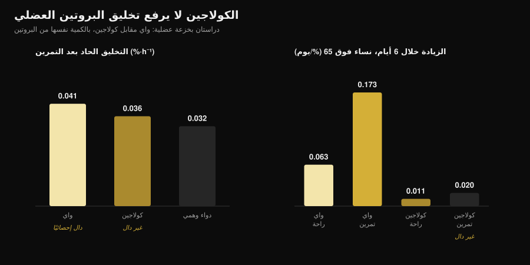
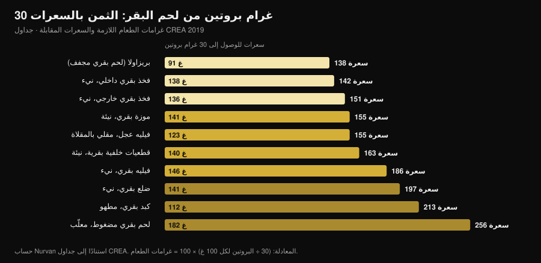

# بروتين اللحم البقري: هل يضاهي بروتين الواي؟

بقلم [Giammaria Loi](/autore/giammaria-loi) · حُدّث في 3 نوفمبر 2026

ارتفعت عمليات البحث عن «beef protein powder» بنسبة 467%، والعلبة تَعِد بأبسط فكرة ممكنة: العضلة لحم، إذن كُل اللحم. على الورق المنطق سليم، وأكبر تحليل بعدي ينصف اللحم البقري — فهو يتعادل مع الواي. المشكلة أن عبارة «بروتين بقري» على الملصق تخبرك من أي حيوان جاء المسحوق، لا من أي جزء منه. وهذا الفارق بالذات يفصل بين مكمّل يعمل وآخر لا يفعل شيئًا.

## باختصار

- **أمام الواي النتيجة تعادل.** تحليل بعدي لسبع تجارب و270 شخصًا: لا فرق بين البروتين البقري وبروتين مصل اللبن في الكتلة الخالية من الدهون (فرق معياري −0.01) أو كتلة الدهون (0.07) أو إجمالي البروتين المتناول (0.04).
- **أمام عدم التناول، يفوز اللحم البقري.** مقارنةً بمن لا يتناول شيئًا، ترتفع الكتلة الخالية من الدهون (0.34) وقوة الطرفين السفليين (0.40). لكن هذا أثر «بروتين أكثر في اليوم»، لا أثر «لحم بقري أكثر».
- **الكلمة المهمة على الملصق هي الكولاجين.** في المساحيق المستخلصة من الكولاجين لا يتحرك تخليق البروتين العضلي: لدى نساء فوق 65 عامًا وعلى مدى ستة أيام، رفعه الواي بمقدار 0.173 %/يوم في الساق المتدرّبة، والكولاجين بمقدار 0.020 فقط، وهو رقم لا يُميَّز عن نقطة البداية.
- **والملصق ليس دائمًا صحيحًا.** حلّلت دراسة إيطالية خمسة مكمّلات رياضية من السوق ووجدت حالات لا تطابق فيها الأحماض الأمينية الموجودة فعليًا ما أعلنته الشركة المصنّعة.
- **الميزة الحقيقية للحم البقري هي الحديد.** لدى لاعبي ترايثلون من فئة الكبار، رفعت عشرة أسابيع من البروتين البقري الفيريتين من 117 إلى 150 نانوغرام/مل؛ ولم يفعل الواي ولا الكربوهيدرات ذلك.

## لماذا يتحدث الجميع عن بروتين اللحم البقري

منطق البيع بسيط ومقنع: العضلة مبنية من بروتين حيواني، واللحم الأحمر هو البروتين الحيواني بامتياز، إذن يُفترض أن يكون مسحوق اللحم البقري أقصر طريق إلى العضلة. ثم تُضاف ثلاث حجج عملية: لا لاكتوز، ولا منتجات ألبان لمن يتبع حمية لحمية أو حمية الإنسان البدائي، وحديد هيمي لا يوجد في الواي أصلًا.

لا شيء من هذا سخيف. المشكلة أن «بروتين بقري» اسم تجاري وليس مواصفة تقنية. يحدّد النوع الحيواني لا النسيج. ومن البقرة الواحدة تُستخرج مادتان خامتان مختلفتان تمامًا، وكلتاهما تتحول إلى مسحوق.

## ما الذي يوجد فعلًا داخل العلبة

المادة الخام الأولى هي **العضل**: لحم خالٍ من الدهون، مُحلّل مائيًا أو معزول، بملف أحماض أمينية أساسية قريب من شريحة اللحم التي كنت ستأكلها. هذه هي المادة التي استُخدمت في الدراسات الجادة عن بروتين اللحم البقري، وهي تعمل.

والثانية هي **الكولاجين**: قصاصات وجلد وأوتار ونسيج ضام. إنه بروتين بكل المعايير، ويُحسب بروتينًا في جدول القيم الغذائية، ويكلّف أقل بكثير، ويتحول إلى مسحوق بسهولة. لكن ملفه من الأحماض الأمينية مختل — كميات هائلة من الغلايسين والبرولين، وقليل جدًا من الليوسين — والليوسين هو الحمض الأميني الذي يشغّل بناء البروتين العضلي. يمكن لمسحوق كولاجين أن يعلن 25 غرامًا من البروتين لكل حصة دون أن يحرّك تخليق البروتين العضلي قيد أنملة.

هذا ليس ظنًا، بل قيس ثلاث مرات بطرق مختلفة. لدى بالغين شباب، لم ترفع 30 غرامًا من الكولاجين بعد التمرين تخليق البروتينات الانقباضية بدلالة إحصائية مقارنةً بالدواء الوهمي، بينما فعلت 30 غرامًا من الواي ذلك (Aussieker et al., 2023). ولدى نساء فوق 65 عامًا تناولن المكمّل ستة أيام: رفع الواي التخليق في الراحة وفي الساق المتدرّبة معًا، ولم يرفعه الكولاجين في أي منهما (Oikawa et al., 2020). ولدى رجال مسنّين، رفعت 50 غرامًا يوميًا فوق الكمية الموصى بها التخليق مع الواي ومع بروتين البازلاء، لا مع الكولاجين (McKendry et al., 2024).

*رسم Nurvan على بيانات Aussieker et al., 2023 (Med Sci Sports Exerc) وOikawa et al., 2020 (Am J Clin Nutr). الكمية نفسها من البروتين، 30 غرامًا. القيم مأخوذة من الملخصات الأصلية لا من الأشكال.*

وحتى حين تكون المادة الخام صحيحة، فالملصق ليس ضمانة تلقائية: وصف فريق من جامعة ميلانو الجزء البروتيني في خمسة مكمّلات رياضية من السوق فوجد بروتينات شديدة الغلْيَكَزَة، وفي بعض الحالات أحماضًا أمينية مضافة لا تطابق المعلن، وخلص إلى ضرورة فحص الدفعات إلزاميًا (Pellegrino et al., 2022).

## ماذا تقول الأبحاث فعلًا

| ادعاء شائع | الحكم | المصدر |
|---|---|---|
| «اللحم البقري يبني عضلًا أكثر من الواي» | مفنَّد: تعادل | Valenzuela et al., 2019 |
| «بروتين اللحم البقري بلا فائدة» | مفنَّد، مع تحفظ | Valenzuela et al., 2019 |
| «إنه لحم، إذن بروتين كامل» | يحتاج تدقيقًا: يتوقف على المادة الخام | Oikawa 2020؛ Aussieker 2023؛ McKendry 2024 |
| «المسحوق أفضل من اللحم الحقيقي» | مفنَّد | Negro et al., 2014 |
| «بلا لاكتوز، اللحم البقري الخيار الوحيد» | مفنَّد | Sharp et al., 2018 |
| «كلما زدت الكمية زاد النمو» | مفنَّد | McKenna et al., 2021 |
| «يساعد في الحديد» | مؤكَّد، في سياق محدد | Naclerio et al., 2017 |

### الادعاء 1 — «اللحم البقري يبني عضلًا أكثر من الواي»

هذه هي المقارنة المباشرة، والجواب تعادل واضح. جمعت مراجعة منهجية مع تحليل بعدي سبع تجارب عشوائية شملت 270 ممارسًا لتمارين المقاومة، وقارنت البروتين البقري والواي وعدم التناول. لم يفصل بين البقري والواي شيء: إجمالي البروتين المتناول 0.04، الكتلة الخالية من الدهون −0.01، كتلة الدهون 0.07 — فروق معيارية كلها قرب الصفر ولا واحد منها دال إحصائيًا.

والدراسات المفردة تقول الشيء نفسه. ثمانية أسابيع بـ46 غرامًا من البروتين بعد التمرين: رفع معزول اللحم البقري ومُحلّل الدجاج ومركّز الواي الكتلةَ الخالية من الدهون مقارنةً بنقطة البداية، ولم يرفعها المالتوديكسترين في المجموعة الضابطة، ولم تظهر فروق في القوة بين البروتينات الثلاثة (Sharp et al., 2018).

### الادعاء 2 — «بروتين اللحم البقري بلا فائدة»

هذا أيضًا لا يصمد. في التحليل البعدي نفسه، ومقارنةً بعدم التناول، رفع اللحم البقري البروتين اليومي المتناول (0.68) والكتلة الخالية من الدهون (0.34) وقوة الطرفين السفليين (0.40). آثار صغيرة لكنها حقيقية.

والتحفظ مهم: هذا على الأرجح ليس أثر اللحم البقري، بل أثر الوصول إلى حصة بروتين كافية. يقول المؤلفون ذلك بوضوح، وتجعله دراسة أخرى أشد وضوحًا: لدى رجال يتدربون بالمقاومة، أنتج 20 غرامًا يوميًا من اللحم البقري المُحلّل أو الواي أو **الكربوهيدرات وحدها** مكاسب قوة متقاربة إلى حد بعيد، بفروق ضئيلة في تركيب الجسم (Naclerio et al., 2017). إذا كان نظامك الغذائي يحمل بروتينًا كافيًا أصلًا، فالعلبة تضيف القليل.

### الادعاء 3 — «كلما زدت الكمية زاد النمو»

عشرة أسابيع من تمارين المقاومة لدى بالغين في منتصف العمر، مع إرشاد غذائي وبروتين من لحم بقري خالٍ من الدهون: مجموعة عند نحو 1.0 غرام لكل كيلوغرام من وزن الجسم يوميًا، وأخرى عند نحو 1.6. ارتفعت القوة القصوى في كل التمارين، **دون أي أثر لكمية البروتين** (McKenna et al., 2021). بعد عتبة معينة، إضافة المسحوق لا تضيف نتيجة — وهو المبدأ نفسه الذي يسري على توقيت التناول، كما تناولته في مقال [متى تتناول المكمّلات](/ar/blog/mata-tatanawal-almukammilat-alghidhaiya).

### الادعاء 4 — «المسحوق أفضل من اللحم الحقيقي»

أجرت دراسة إيطالية أكثر اختبار مباشر ممكن: 135 غرامًا من اللحم المعلّب الخالي من الدهون بعد التمرين، أي 20 غرام بروتين و1.7 غرام دهون، لمدة ثمانية أسابيع. فقدت المجموعة التي تناولته 1.9 كيلوغرام من كتلة الدهون واكتسبت 2.3 كيلوغرام من الكتلة الخالية من الدهون؛ ولم تفعل المجموعة الضابطة بلا مكمّل ذلك (Negro et al., 2014). لحم حقيقي، بلا مسحوق، والنتيجة نفسها. يصفه المؤلفون بأنه «استراتيجية غذائية تُضاف إلى بروتينات أخرى أو مكمّلات أحماض أمينية»: خيار، لا تفوّق.

### الادعاء 5 — «يساعد في الحديد»

هنا للحم البقري ميزة خاصة به، وتظهر عند من يحتاجها. لدى لاعبي ترايثلون من فئة الكبار بين 35 و60 عامًا، رفعت عشرة أسابيع من 20 غرامًا يوميًا من البروتين البقري الفيريتين من 117 إلى 150 نانوغرام/مل، بينما لم يُحدث الواي ولا الكربوهيدرات أي تغيير؛ وفي المجموعة نفسها حُوفظ على سماكة العضلة المتّسعة الإنسية، وهو ما لم يحدث في الذراعين الأخريين من الدراسة (Naclerio et al., 2017).

اقرأه كما هو: نتيجة لدى رياضيي التحمّل، وهي فئة كثيرًا ما تكون مخازن الحديد لديها تحت ضغط. وفي التحليل البعدي أعلاه، لم يرفع اللحم البقري الحديد المتناول بدلالة إحصائية مقارنةً بعدم التناول. وإذا شككت في نقص، فالطريق المعقول تحليل دم وطبيب، لا مكمّل تختاره بنفسك.

## حساب السعرات: اللحم الحقيقي مقابل المسحوق

إذا كان المقصود من بروتين اللحم البقري أخذ البروتين من البقر، فمن المفيد معرفة كلفة طريق اللحم. باستخدام جداول الأغذية الإيطالية CREA حسبت كم غرامًا يلزم من كل قطعية للوصول إلى 30 غرامًا من البروتين — وهي الجرعة المستخدمة في معظم دراسات التخليق العضلي — وكم سعرة ترافقها.

*حساب Nurvan على جداول تركيب الأغذية CREA — مركز البحوث الإيطالي للأغذية والتغذية، تحديث 2019 (alimentinutrizione.it). المعادلة: (30 ÷ البروتين لكل 100 غ) × 100 = غرامات الطعام؛ والسعرات هي سعرات الكمية الناتجة.*

النتيجة أن اللحم الخالي من الدهون ليس مكلفًا بالسعرات إطلاقًا: 138 غرامًا من الفخذ الداخلي النيء تعطي 30 غرامًا من البروتين بـ142 سعرة، أي أكثر بقليل من حصة صدر دجاج. وواحد وتسعون غرامًا من البريزاولا تفعل الشيء نفسه بـ138 سعرة. وفي الطرف الآخر، يحتاج اللحم المضغوط المعلّب إلى 182 غرامًا و256 سعرة للحصة نفسها، والضلع البقري إلى 197.

حصة المسحوق تقع عادةً بين 100 و130 سعرة مقابل 25-30 غرامًا من البروتين: عمليًا الشيء نفسه مثل الفخذ الداخلي، مع فارقين عمليين. المسحوق يُحمل ويُشرب في ثلاثين ثانية ويُوزن بالغرام؛ واللحم يُشبع ويكلّف أقل لكل غرام بروتين ولا يحتاج إلى تحقيق في الملصق. الاختيار لوجستي لا فسيولوجي.

## كيف تطبّق هذا

1. **احسب أولًا البروتين الذي تتناوله فعلًا.** إذا كنت حول 1.6 غرام لكل كيلوغرام يوميًا موزعة على الوجبات، فهامش الاستفادة من أي مسحوق صغير: دراسة 1.0 مقابل 1.6 غ/كغ لم تجد ميزة في الزيادة أكثر.
2. **اقرأ قائمة المكوّنات لا واجهة العلبة.** ابحث عن «كولاجين» أو «كولاجين مُحلّل مائيًا» أو «جيلاتين» أو «بروتين بقري مُحلّل» دون تحديد. إن ظهرت في المقدمة فهذا المسحوق ليس بديلًا للواي.
3. **ابحث عن ملف الأحماض الأمينية على الملصق.** من دون ليوسين معلن (نحو 2-3 غرام للحصة في المصادر عالية القيمة البيولوجية) لا سبيل لمعرفة ما اشتريته.
4. **لا تدفع فرق سعر مقابل «إنه لحم».** في نتائج الصالة يتعادل البقري مع الواي. وإذا كان البقري أغلى ولا سبب محدد لاختياره، فلا سبب لديك.
5. **السبب المحدد موجود في حالتين.** عدم تحمّل واضح للاكتوز أو استبعاد الألبان: هنا اللحم البقري اختيار معقول، لكنه ليس الوحيد — ففي المقارنة المباشرة نجح مُحلّل الدجاج أيضًا.
6. **للحديد، مرّ عبر التحاليل.** فيريتين منخفض، تعب، أحمال تحمّل عالية: هذه أمور تُقاس وتُناقش مع طبيب، لا تُدار بمكمّل يُشترى عبر الإنترنت.

**جرّب Nurvan — البروتين محسوب على بيانات أطعمة حقيقية**

يعمل جانب التغذية في Nurvan على قاعدة بيانات رسمية لتركيب الأغذية: تسجّل ما تأكله فترى كم بروتينًا تقدّمه وجباتك فعليًا، يومًا بيوم. ويحفظ قسم المكمّلات ما تتناوله ومتى، وفي الملف نفسه تجد أحمال تدريبك والتحاليل التي رفعتها. هكذا يتحول سؤال «هل أحتاج مسحوقًا؟» من انطباع إلى رقم. [جرّب Nurvan](https://nurvan.app)

## أسئلة شائعة

**هل بروتين اللحم البقري أفضل من الواي؟**
لا، النتيجة تعادل. التحليل البعدي لسبع تجارب عشوائية و270 شخصًا لا يجد فرقًا بين البروتين البقري والواي في الكتلة الخالية من الدهون أو كتلة الدهون أو إجمالي البروتين المتناول (Valenzuela et al., 2019). اختر بحسب التحمّل والسعر والتفضيل.

**كيف أعرف أن بروتين اللحم البقري مصنوع من الكولاجين؟**
من قائمة المكوّنات وملف الأحماض الأمينية. عبارات مثل كولاجين مُحلّل مائيًا أو جيلاتين أو «بروتين بقري مُحلّل» دون تفصيل هي الإشارة؛ وغياب الليوسين أو انخفاضه الشديد يؤكدها. في تجارب الخزعة العضلية لم يرفع الكولاجين تخليق البروتين، لا لدى الشباب ولا لدى المسنّين.

**هل يصلح بروتين اللحم البقري لمن لا يتحمّل اللاكتوز؟**
نعم، وهذا أحد الأسباب الوجيهة لاختياره، لكنه ليس الخيار الوحيد: في مقارنة مباشرة على ثمانية أسابيع رفع مُحلّل الدجاج الكتلةَ الخالية من الدهون بقدر اللحم البقري والواي (Sharp et al., 2018)، كما أن معزولات الواي تحتوي كميات ضئيلة جدًا من اللاكتوز.

**مسحوق لحم بقري أم أكل اللحم مباشرة؟**
من حيث النتائج، يصمد اللحم الحقيقي تمامًا: 135 غرامًا من اللحم المعلّب الخالي من الدهون بعد التمرين خفّضت كتلة الدهون ورفعت الكتلة الخالية منها خلال ثمانية أسابيع (Negro et al., 2014). المسحوق يتفوق فقط في الراحة ودقة الجرعة.

## اقرأ أيضًا

- [بروتين نباتي أم حيواني لبناء العضلات؟](/ar/blog/albrotin-alnabati-am-alhayawani-lilaadalat) — ماذا يحدث حين يتغير مصدر البروتين فعلًا، مقيسًا بالخزعة.
- [تصنيف مكمّلات القوة: ماذا تقول الأدلة](/ar/blog/tasnif-mukammilat-alquwa) — أين يقف مسحوق البروتين إلى جانب الكرياتين والكافيين.
- [متى تتناول المكمّلات: هل يهم التوقيت؟](/ar/blog/mata-tatanawal-almukammilat-alghidhaiya) — لماذا تزن الكمية الإجمالية أكثر من لحظة التناول.

## المصادر

- Valenzuela PL, Mata F, Morales JS, Castillo-García A, Lucia A, 2019. Does Beef Protein Supplementation Improve Body Composition and Exercise Performance? A Systematic Review and Meta-Analysis of Randomized Controlled Trials. *Nutrients* 11(6):1429. PMID 31242624. [DOI](https://doi.org/10.3390/nu11061429)
- Sharp MH, Lowery RP, Shields KA, Lane JR, Gray JL, Partl JM, Hayes DW, Wilson GJ, Hollmer CA, Minivich JR, Wilson JM, 2018. The Effects of Beef, Chicken, or Whey Protein After Workout on Body Composition and Muscle Performance. *Journal of Strength and Conditioning Research* 32(8):2233-2242. PMID 28399016. [DOI](https://doi.org/10.1519/JSC.0000000000001936)
- Naclerio F, Seijo M, Larumbe-Zabala E, Earnest CP, 2017. Carbohydrates Alone or Mixing With Beef or Whey Protein Promote Similar Training Outcomes in Resistance Training Males: A Double-Blind, Randomized Controlled Clinical Trial. *International Journal of Sport Nutrition and Exercise Metabolism* 27(5):408-420. PMID 28530448. [DOI](https://doi.org/10.1123/ijsnem.2017-0003)
- Naclerio F, Seijo M, Larumbe-Zabala E, Ashrafi N, Christides T, Karsten B, Nielsen BV, 2017. Effects of Supplementation with Beef or Whey Protein Versus Carbohydrate in Master Triathletes. *Journal of the American College of Nutrition* 36(8):593-601. PMID 28910233. [DOI](https://doi.org/10.1080/07315724.2017.1335248)
- Negro M, Vandoni M, Ottobrini S, Codrons E, Correale L, Buonocore D, Marzatico F, 2014. Protein supplementation with low fat meat after resistance training: effects on body composition and strength. *Nutrients* 6(8):3040-9. PMID 25093275. [DOI](https://doi.org/10.3390/nu6083040)
- Oikawa SY, Kamal MJ, Webb EK, McGlory C, Baker SK, Phillips SM, 2020. Whey protein but not collagen peptides stimulate acute and longer-term muscle protein synthesis with and without resistance exercise in healthy older women: a randomized controlled trial. *The American Journal of Clinical Nutrition* 111(3):708-718. PMID 31919527. [DOI](https://doi.org/10.1093/ajcn/nqz332)
- Aussieker T, Hilkens L, Holwerda AM, Fuchs CJ, Houben LHP, Senden JM, van Dijk JW, Snijders T, van Loon LJC, 2023. Collagen Protein Ingestion during Recovery from Exercise Does Not Increase Muscle Connective Protein Synthesis Rates. *Medicine and Science in Sports and Exercise* 55(10):1792-1802. PMID 37202878. [DOI](https://doi.org/10.1249/MSS.0000000000003214)
- McKendry J, Lowisz CV, Nanthakumar A, MacDonald M, Lim C, Currier BS, Phillips SM, 2024. The effects of whey, pea, and collagen protein supplementation beyond the recommended dietary allowance on integrated myofibrillar protein synthetic rates in older males: a randomized controlled trial. *The American Journal of Clinical Nutrition* 120(1):34-46. PMID 38762187. [DOI](https://doi.org/10.1016/j.ajcnut.2024.05.009)
- Pellegrino L, Hogenboom JA, Rosi V, Sindaco M, Gerna S, D'Incecco P, 2022. Focus on the Protein Fraction of Sports Nutrition Supplements. *Molecules* 27(11):3487. PMID 35684425. [DOI](https://doi.org/10.3390/molecules27113487)
- McKenna CF, Salvador AF, Hughes RL, Scaroni SE, Alamilla RA, Askow AT, Paluska SA, Dilger AC, Holscher HD, De Lisio M, Khan NA, Burd NA, 2021. Higher protein intake during resistance training does not potentiate strength, but modulates gut microbiota, in middle-aged adults: a randomized control trial. *American Journal of Physiology-Endocrinology and Metabolism* 320(5):E900-E913. PMID 33682457. [DOI](https://doi.org/10.1152/ajpendo.00574.2020)

المراجع مستخرجة عبر PubMed. اختير الموضوع ببحث الاتجاهات في 3 نوفمبر 2026: «beef protein powder» من أسرع استعلامات اللياقة نموًا، لكن الصفحات التي تتصدره تعود في معظمها لمن يبيع المسحوق.

---

جيامّاريا لوي مؤسس Nurvan. يتدرب بالأثقال منذ 2012، ويعمل مدربًا شخصيًا ومدربًا معتمدًا من FIPE منذ 2013، وينافس في رفع الأثقال القوي على المستوى الوطني منذ 2018. كل مقال يوقّعه يبدأ من الدراسات العلمية وينتهي عند ما ينفع فعلًا في الصالة.

> ملاحظة: محتوى تثقيفي، لا يغني عن رأي طبيب أو مختص.
