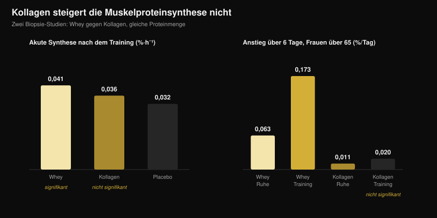
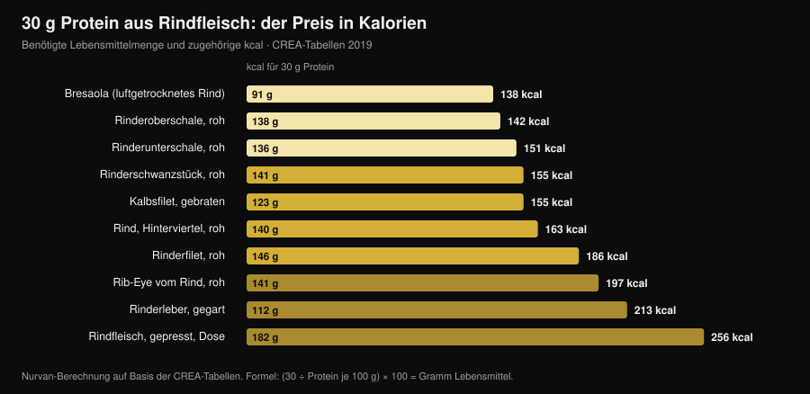

# Beef Protein: Ist Rinderprotein so gut wie Whey?

Von [Giammaria Loi](/autore/giammaria-loi) · aktualisiert am 3. November 2026

Die Suchanfragen nach „beef protein powder" sind um 467 % gestiegen, und die Dose verspricht das Naheliegendste überhaupt: Muskel ist Fleisch, also iss Fleisch. Auf dem Papier trägt das, und die größte Metaanalyse gibt dem Rind recht — es liegt gleichauf mit Whey. Das Problem: „Beef Protein" auf dem Etikett sagt, von welchem Tier das Pulver stammt, nicht von welchem Teil. Und genau dieser Unterschied trennt ein Supplement, das wirkt, von einem, das gar nichts tut.

## Kurz gefasst

- **Gegen Whey steht es unentschieden.** Metaanalyse aus 7 Studien mit 270 Personen: kein Unterschied zwischen Rinderprotein und Molkenprotein bei fettfreier Masse (standardisierte Differenz −0,01), Fettmasse (0,07) und Gesamtproteinzufuhr (0,04).
- **Gegen gar kein Supplement gewinnt das Rind.** Verglichen mit keiner Einnahme steigen fettfreie Masse (0,34) und Beinkraft (0,40). Das ist jedoch der Effekt „mehr Protein am Tag", nicht „mehr Rind".
- **Das entscheidende Wort auf dem Etikett heißt Kollagen.** Bei Pulvern aus Kollagen bewegt sich die Muskelproteinsynthese nicht: Bei Frauen über 65 stieg sie über sechs Tage im trainierten Bein mit Whey um 0,173 %/Tag, mit Kollagen um 0,020 — nicht vom Ausgangswert zu unterscheiden.
- **Und das Etikett stimmt nicht immer.** Eine italienische Analyse von fünf Sportsupplementen aus dem Handel fand Fälle, in denen die tatsächlich enthaltenen Aminosäuren nicht den deklarierten entsprachen.
- **Der echte Vorteil des Rinds ist Eisen.** Bei Masters-Triathleten hob Rinderprotein das Ferritin in zehn Wochen von 117 auf 150 ng/ml; Whey und Kohlenhydrate taten das nicht.

## Warum Beef Protein plötzlich überall ist

Die Verkaufslogik ist einfach und einleuchtend: Muskel besteht aus tierischem Eiweiß, rotes Fleisch ist das tierische Eiweiß schlechthin, also sollte ein Rinderpulver der direkteste Weg zum Muskel sein. Dazu kommen drei praktische Argumente: keine Laktose, keine Milchprodukte für alle, die sich carnivore oder paleo ernähren, und Hämeisen, das Whey schlicht nicht enthält.

Nichts davon ist abwegig. Das Problem ist, dass „Beef Protein" ein Handelsname ist und keine technische Spezifikation. Er nennt die Tierart, nicht das Gewebe. Und aus einem Rind lassen sich zwei sehr unterschiedliche Rohstoffe zu Pulver verarbeiten.

## Was wirklich in der Dose steckt

Der erste Rohstoff ist **Muskelfleisch**: mageres Fleisch, hydrolysiert oder isoliert, mit einem Profil essenzieller Aminosäuren nahe am Steak auf dem Teller. Genau das wurde in den seriösen Beef-Protein-Studien eingesetzt, und es funktioniert.

Der zweite ist **Kollagen**: Abschnitte, Haut, Sehnen, Bindegewebe. Das ist in jeder Hinsicht Eiweiß, es zählt in der Nährwerttabelle als Eiweiß, es kostet deutlich weniger und lässt sich hervorragend zu Pulver verarbeiten. Doch sein Aminosäureprofil ist schief — sehr viel Glycin und Prolin, sehr wenig Leucin — und Leucin ist die Aminosäure, die den Aufbau von Muskelprotein anschaltet. Ein Kollagenpulver kann 25 g Eiweiß pro Portion ausweisen und die Muskelproteinsynthese um nichts bewegen.

Das ist kein Verdacht, sondern dreimal mit unterschiedlichen Methoden gemessen. Bei jungen Erwachsenen erhöhten 30 g Kollagen nach dem Training die Synthese der kontraktilen Proteine nicht signifikant gegenüber Placebo, 30 g Whey dagegen schon (Aussieker et al., 2023). Bei Frauen über 65 und sechs Tagen Supplementierung steigerte Whey die Synthese sowohl in Ruhe als auch im trainierten Bein, Kollagen in keinem der beiden Fälle (Oikawa et al., 2020). Bei älteren Männern erhöhten 50 g pro Tag über der empfohlenen Zufuhr die Synthese mit Whey und mit Erbsenprotein, nicht aber mit Kollagen (McKendry et al., 2024).

*Nurvan-Grafik auf Daten von Aussieker et al., 2023 (Med Sci Sports Exerc) und Oikawa et al., 2020 (Am J Clin Nutr). Gleiche Proteinmenge, 30 g. Werte aus den Original-Abstracts, nicht aus Abbildungen abgelesen.*

Und selbst wenn der Rohstoff stimmt, ist das Etikett keine automatische Garantie: Eine Arbeitsgruppe der Universität Mailand charakterisierte die Proteinfraktion von fünf handelsüblichen Sportsupplementen und fand stark glykosylierte Proteine sowie teilweise zugesetzte Aminosäuren, die nicht den deklarierten entsprachen — mit dem Fazit, dass verpflichtende Chargentests nötig wären (Pellegrino et al., 2022).

## Was die Forschung wirklich sagt

| Verbreitete Behauptung | Urteil | Quelle |
|---|---|---|
| „Rind baut mehr Muskeln auf als Whey" | Widerlegt: unentschieden | Valenzuela et al., 2019 |
| „Beef Protein bringt gar nichts" | Widerlegt, mit Einschränkung | Valenzuela et al., 2019 |
| „Es ist Fleisch, also vollwertiges Protein" | Zu präzisieren: hängt vom Rohstoff ab | Oikawa 2020; Aussieker 2023; McKendry 2024 |
| „Pulver ist besser als echtes Fleisch" | Widerlegt | Negro et al., 2014 |
| „Ohne Laktose bleibt nur Rind" | Widerlegt | Sharp et al., 2018 |
| „Je mehr, desto mehr Muskeln" | Widerlegt | McKenna et al., 2021 |
| „Hilft beim Eisen" | Bestätigt, in einem klaren Kontext | Naclerio et al., 2017 |

### Behauptung 1 — „Rind baut mehr Muskeln auf als Whey"

Das ist der direkte Vergleich, und die Antwort ist ein klares Unentschieden. Eine systematische Übersicht mit Metaanalyse bündelte sieben randomisierte Studien mit insgesamt 270 krafttrainierenden Personen und verglich Rinderprotein, Whey und keine Supplementierung. Zwischen Rind und Whey trennte sie nichts: Gesamtproteinzufuhr 0,04, fettfreie Masse −0,01, Fettmasse 0,07 — standardisierte Differenzen alle nahe null, keine statistisch signifikant.

Die Einzelstudien sagen dasselbe. Acht Wochen mit 46 g Protein nach dem Training: Rinderisolat, hydrolysiertes Hühnerprotein und Whey-Konzentrat erhöhten alle die fettfreie Masse gegenüber dem Ausgangswert, die Maltodextrin-Kontrolle nicht, und zwischen den drei Proteinen zeigten sich keine Kraftunterschiede (Sharp et al., 2018).

### Behauptung 2 — „Beef Protein bringt gar nichts"

Auch das trägt nicht. In derselben Metaanalyse erhöhte Rind gegenüber keiner Supplementierung die tägliche Proteinzufuhr (0,68), die fettfreie Masse (0,34) und die Beinkraft (0,40). Kleine, aber reale Effekte.

Die Einschränkung ist wichtig: Das ist mit großer Wahrscheinlichkeit kein Rind-Effekt, sondern der Effekt, die Proteinzufuhr überhaupt zu erreichen. Die Autoren schreiben es deutlich, und eine weitere Studie macht es noch klarer: Bei krafttrainierenden Männern führten 20 g pro Tag aus hydrolysiertem Rind, aus Whey oder **aus reinen Kohlenhydraten** zu weitgehend vergleichbaren Kraftzuwächsen, mit minimalen Unterschieden in der Körperzusammensetzung (Naclerio et al., 2017). Wenn die Ernährung schon genug Protein liefert, fügt die Dose wenig hinzu.

### Behauptung 3 — „Je mehr, desto mehr Muskeln"

Zehn Wochen Krafttraining bei Erwachsenen mittleren Alters, mit Ernährungsberatung und Protein aus magerem Rindfleisch: eine Gruppe bei rund 1,0 g pro kg Körpergewicht und Tag, die andere bei rund 1,6. Die Maximalkraft stieg in allen Übungen, **ganz ohne Effekt der Proteinmenge** (McKenna et al., 2021). Jenseits einer Schwelle bringt mehr Pulver kein zusätzliches Ergebnis — dasselbe Prinzip wie beim Einnahmezeitpunkt, siehe den Beitrag dazu, [wann man Supplemente einnehmen sollte](/de/blog/wann-nahrungsergaenzungsmittel-einnehmen).

### Behauptung 4 — „Pulver ist besser als echtes Fleisch"

Eine italienische Studie führte den direktestmöglichen Test durch: 135 g mageres Dosenfleisch nach dem Training, also 20 g Protein und 1,7 g Fett, über acht Wochen. Die Gruppe, die es aß, verlor 1,9 kg Fettmasse und gewann 2,3 kg fettfreie Masse; die Kontrollgruppe ohne Supplementierung nicht (Negro et al., 2014). Echtes Fleisch, kein Pulver, gleiches Ergebnis. Die Autoren beschreiben es als „Ernährungsstrategie zusätzlich zu anderen Proteinen oder Aminosäurepräparaten": eine Option, keine Überlegenheit.

### Behauptung 5 — „Hilft beim Eisen"

Hier hat Rind einen eigenen Vorteil, und er zeigt sich bei denen, die ihn brauchen. Bei Masters-Triathleten zwischen 35 und 60 Jahren erhöhten zehn Wochen mit 20 g Rinderprotein täglich das Ferritin von 117 auf 150 ng/ml, während Whey und Kohlenhydrate keine Veränderung brachten; in derselben Gruppe blieb die Dicke des Vastus medialis erhalten, was in den beiden anderen Armen nicht der Fall war (Naclerio et al., 2017).

Das ist einzuordnen: ein Ergebnis bei Ausdauersportlern, deren Eisenspeicher häufig unter Druck stehen. In der oben genannten Metaanalyse erhöhte Rind die Eisenzufuhr gegenüber keiner Supplementierung nicht statistisch signifikant. Und wer einen Mangel vermutet, geht sinnvollerweise zum Blutbild und zur Ärztin, nicht zur selbst gewählten Dose.

## Die Kalorienrechnung: echtes Fleisch gegen Pulver

Wenn es bei Beef Protein darum geht, das Eiweiß aus Rind zu beziehen, lohnt der Blick darauf, was der Weg über das Fleisch kostet. Anhand der italienischen CREA-Lebensmitteltabellen habe ich berechnet, wie viel Gramm jedes Teilstücks nötig sind, um auf 30 g Protein zu kommen — die in den meisten Syntheseschulungen verwendete Menge — und wie viele Kalorien dabei anfallen.

*Nurvan-Berechnung auf den CREA-Nährwerttabellen — italienisches Forschungszentrum für Lebensmittel und Ernährung, Stand 2019 (alimentinutrizione.it). Formel: (30 ÷ Protein je 100 g) × 100 = Gramm Lebensmittel; die kcal gelten für die errechnete Menge.*

Das Ergebnis: Mageres Rindfleisch ist kalorisch überhaupt nicht teuer. 138 g rohe Oberschale liefern 30 g Protein für 142 kcal, kaum mehr als eine Portion Hähnchenbrust. Einundneunzig Gramm Bresaola schaffen dasselbe mit 138 kcal. Am anderen Ende verlangt gepresstes Dosenrindfleisch 182 g und 256 kcal für dieselbe Menge, ein Rib-Eye 197.

Eine Portion Pulver liegt meist zwischen 100 und 130 kcal für 25-30 g Protein — praktisch dasselbe wie die Oberschale, mit zwei praktischen Unterschieden. Pulver lässt sich transportieren, in dreißig Sekunden trinken und grammgenau dosieren; Fleisch sättigt, kostet pro Gramm Protein weniger und erfordert keine Etikettenforensik. Die Entscheidung ist logistisch, nicht physiologisch.

## So wendest du es an

1. **Zähle zuerst das Protein, das du ohnehin isst.** Wer bei rund 1,6 g pro kg Körpergewicht am Tag liegt, verteilt über die Mahlzeiten, hat mit jedem Pulver wenig Spielraum: Die Studie mit 1,0 gegen 1,6 g/kg fand keinen Vorteil darin, höher zu gehen.
2. **Lies die Zutatenliste, nicht die Dosenvorderseite.** Achte auf „Kollagen", „Kollagenhydrolysat", „Gelatine" oder nicht näher bezeichnetes „hydrolysiertes Rinderprotein". Stehen sie weit vorn, ersetzt dieses Pulver kein Whey.
3. **Suche das Aminosäureprofil auf dem Etikett.** Ohne deklariertes Leucin (orientierend 2-3 g pro Portion bei hochwertigen Quellen) weißt du nicht, was du kaufst.
4. **Zahle keinen Aufpreis für „es ist Fleisch".** Bei den Ergebnissen im Studio liegen Rind und Whey gleichauf. Wenn Rind mehr kostet und du keinen konkreten Grund dafür hast, hast du keinen.
5. **Den konkreten Grund gibt es in zwei Fällen.** Ausgeprägte Laktoseintoleranz oder Verzicht auf Milchprodukte: Dort ist Rind eine sinnvolle Wahl, aber nicht die einzige — im direkten Vergleich funktionierte auch hydrolysiertes Hühnerprotein.
6. **Beim Eisen führt der Weg über die Diagnostik.** Niedriges Ferritin, Müdigkeit, hohe Ausdauerbelastung: Das misst man und bespricht es ärztlich, statt es mit einem online gekauften Supplement zu regeln.

**Nurvan testen — Protein auf Basis echter Lebensmitteldaten**

Der Ernährungsteil von Nurvan arbeitet mit einer offiziellen Lebensmitteldatenbank: Du trägst ein, was du isst, und siehst Tag für Tag, wie viel Protein deine Mahlzeiten tatsächlich liefern. Im Supplement-Bereich hältst du fest, was du wann nimmst, und im selben Profil liegen deine Trainingslasten und die hochgeladenen Blutwerte. So wird aus der Frage „brauche ich ein Pulver?" statt eines Gefühls eine Zahl. [Nurvan testen](https://nurvan.app)

## Häufige Fragen

**Ist Beef Protein besser als Whey?**
Nein, es steht unentschieden. Die Metaanalyse aus sieben randomisierten Studien mit 270 Personen findet keinen Unterschied zwischen Rinderprotein und Whey bei fettfreier Masse, Fettmasse und Gesamtproteinzufuhr (Valenzuela et al., 2019). Entscheide nach Verträglichkeit, Preis und Vorliebe.

**Wie erkenne ich, ob ein Beef Protein aus Kollagen hergestellt ist?**
An der Zutatenliste und am Aminosäureprofil. Formulierungen wie Kollagenhydrolysat, Gelatine oder schlicht „hydrolysiertes Rinderprotein" sind das Signal; nicht deklariertes oder sehr niedriges Leucin bestätigt es. In Studien mit Muskelbiopsie erhöhte Kollagen die Proteinsynthese weder bei Jüngeren noch bei Älteren.

**Eignet sich Beef Protein bei Laktoseintoleranz?**
Ja, das ist einer der sinnvollen Gründe dafür, aber nicht die einzige Option: Im direkten Achtwochenvergleich steigerte hydrolysiertes Hühnerprotein die fettfreie Masse genauso wie Rind und Whey (Sharp et al., 2018), und Whey-Isolate enthalten nur Spuren von Laktose.

**Lieber Rinderpulver oder einfach Fleisch essen?**
Beim Ergebnis hält echtes Fleisch gut mit: 135 g mageres Dosenfleisch nach dem Training senkten in acht Wochen die Fettmasse und erhöhten die fettfreie Masse (Negro et al., 2014). Das Pulver gewinnt nur bei Bequemlichkeit und Dosiergenauigkeit.

## Auch lesenswert

- [Pflanzliches oder tierisches Protein für den Muskelaufbau?](/de/blog/pflanzliches-oder-tierisches-protein-muskelaufbau) — was passiert, wenn die Proteinquelle wirklich wechselt — per Biopsie gemessen.
- [Tier-List der Kraftsport-Supplemente: was die Evidenz sagt](/de/blog/kraftsport-supplemente-tier-list) — wo Proteinpulver neben Kreatin und Koffein steht.
- [Wann Nahrungsergänzungsmittel einnehmen: zählt die Uhrzeit?](/de/blog/wann-nahrungsergaenzungsmittel-einnehmen) — warum die Gesamtmenge mehr wiegt als der Zeitpunkt.

## Quellen

- Valenzuela PL, Mata F, Morales JS, Castillo-García A, Lucia A, 2019. Does Beef Protein Supplementation Improve Body Composition and Exercise Performance? A Systematic Review and Meta-Analysis of Randomized Controlled Trials. *Nutrients* 11(6):1429. PMID 31242624. [DOI](https://doi.org/10.3390/nu11061429)
- Sharp MH, Lowery RP, Shields KA, Lane JR, Gray JL, Partl JM, Hayes DW, Wilson GJ, Hollmer CA, Minivich JR, Wilson JM, 2018. The Effects of Beef, Chicken, or Whey Protein After Workout on Body Composition and Muscle Performance. *Journal of Strength and Conditioning Research* 32(8):2233-2242. PMID 28399016. [DOI](https://doi.org/10.1519/JSC.0000000000001936)
- Naclerio F, Seijo M, Larumbe-Zabala E, Earnest CP, 2017. Carbohydrates Alone or Mixing With Beef or Whey Protein Promote Similar Training Outcomes in Resistance Training Males: A Double-Blind, Randomized Controlled Clinical Trial. *International Journal of Sport Nutrition and Exercise Metabolism* 27(5):408-420. PMID 28530448. [DOI](https://doi.org/10.1123/ijsnem.2017-0003)
- Naclerio F, Seijo M, Larumbe-Zabala E, Ashrafi N, Christides T, Karsten B, Nielsen BV, 2017. Effects of Supplementation with Beef or Whey Protein Versus Carbohydrate in Master Triathletes. *Journal of the American College of Nutrition* 36(8):593-601. PMID 28910233. [DOI](https://doi.org/10.1080/07315724.2017.1335248)
- Negro M, Vandoni M, Ottobrini S, Codrons E, Correale L, Buonocore D, Marzatico F, 2014. Protein supplementation with low fat meat after resistance training: effects on body composition and strength. *Nutrients* 6(8):3040-9. PMID 25093275. [DOI](https://doi.org/10.3390/nu6083040)
- Oikawa SY, Kamal MJ, Webb EK, McGlory C, Baker SK, Phillips SM, 2020. Whey protein but not collagen peptides stimulate acute and longer-term muscle protein synthesis with and without resistance exercise in healthy older women: a randomized controlled trial. *The American Journal of Clinical Nutrition* 111(3):708-718. PMID 31919527. [DOI](https://doi.org/10.1093/ajcn/nqz332)
- Aussieker T, Hilkens L, Holwerda AM, Fuchs CJ, Houben LHP, Senden JM, van Dijk JW, Snijders T, van Loon LJC, 2023. Collagen Protein Ingestion during Recovery from Exercise Does Not Increase Muscle Connective Protein Synthesis Rates. *Medicine and Science in Sports and Exercise* 55(10):1792-1802. PMID 37202878. [DOI](https://doi.org/10.1249/MSS.0000000000003214)
- McKendry J, Lowisz CV, Nanthakumar A, MacDonald M, Lim C, Currier BS, Phillips SM, 2024. The effects of whey, pea, and collagen protein supplementation beyond the recommended dietary allowance on integrated myofibrillar protein synthetic rates in older males: a randomized controlled trial. *The American Journal of Clinical Nutrition* 120(1):34-46. PMID 38762187. [DOI](https://doi.org/10.1016/j.ajcnut.2024.05.009)
- Pellegrino L, Hogenboom JA, Rosi V, Sindaco M, Gerna S, D'Incecco P, 2022. Focus on the Protein Fraction of Sports Nutrition Supplements. *Molecules* 27(11):3487. PMID 35684425. [DOI](https://doi.org/10.3390/molecules27113487)
- McKenna CF, Salvador AF, Hughes RL, Scaroni SE, Alamilla RA, Askow AT, Paluska SA, Dilger AC, Holscher HD, De Lisio M, Khan NA, Burd NA, 2021. Higher protein intake during resistance training does not potentiate strength, but modulates gut microbiota, in middle-aged adults: a randomized control trial. *American Journal of Physiology-Endocrinology and Metabolism* 320(5):E900-E913. PMID 33682457. [DOI](https://doi.org/10.1152/ajpendo.00574.2020)

Literaturangaben über PubMed recherchiert. Thema über die Trendrecherche vom 3. November 2026 gewählt: „beef protein powder" gehört zu den am stärksten wachsenden Fitness-Suchanfragen, doch fast alle Seiten dazu stammen von Anbietern des Pulvers.

---

Giammaria Loi ist der Gründer von Nurvan. Er trainiert seit 2012 mit Gewichten, arbeitet seit 2013 als FIPE-zertifizierter Personal Trainer und Coach und startet seit 2018 im Powerlifting auf nationaler Ebene. Jeder Artikel, den er zeichnet, geht von der Studienlage aus und endet bei dem, was im Studio wirklich funktioniert.

> Hinweis: informativer Inhalt, ersetzt nicht die Beratung durch eine Ärztin, einen Arzt oder eine Fachperson.
