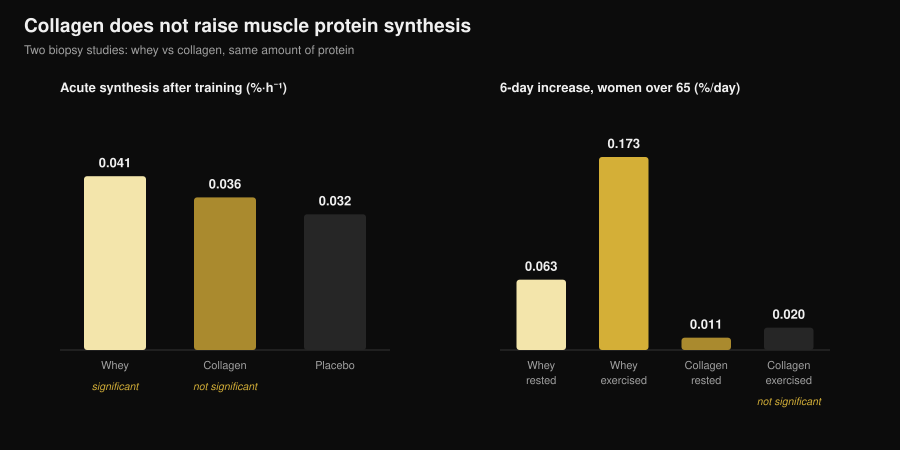
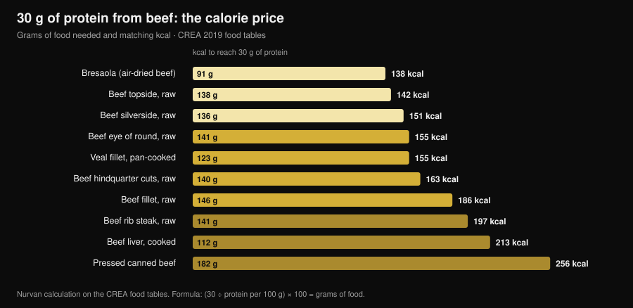

# Beef Protein Powder vs Whey: What the Research Says

By [Giammaria Loi](/autore/giammaria-loi) · updated 3 November 2026

Searches for "beef protein powder" have climbed 467%, and the tub promises the most intuitive thing in the world: muscle is meat, so eat meat. On paper it holds up, and the largest meta-analysis agrees — beef ties with whey. The catch is that "beef protein" on a label tells you which animal the powder came from, not which part of it. And that difference is the difference between a supplement that works and one that does nothing at all.

## In short

- **Against whey it is a tie.** A meta-analysis of 7 trials and 270 people found no difference between beef protein and whey for lean body mass (standardised difference −0.01), fat mass (0.07) or total protein intake (0.04).
- **Against taking nothing, beef wins.** Compared with no supplement it raised lean mass (0.34) and lower-limb strength (0.40). That is the effect of hitting your protein target, not of the beef itself.
- **The word that matters on the label is collagen.** In collagen-derived powders muscle protein synthesis does not move: over six days in women aged 65+, whey raised it by 0.173 %/day in the trained leg, collagen by 0.020 — indistinguishable from baseline.
- **And the label is not always right.** An Italian analysis of five commercial sports supplements found cases where the amino acids actually present did not match those declared by the manufacturer.
- **Beef's real edge is iron.** In masters triathletes, ten weeks of beef protein lifted ferritin from 117 to 150 ng/mL; whey and carbohydrate did not.

## Why beef protein is suddenly everywhere

The sales logic is simple and intuitive: muscle is built from animal protein, red meat is the animal protein, so a beef powder should be the most direct route to muscle. Three practical arguments get added on top: no lactose, no dairy for anyone eating carnivore or paleo, and heme iron that whey simply does not contain.

None of that is absurd. The problem is that "beef protein" is a marketing name, not a technical specification. It tells you the species, not the tissue. And a cow yields two very different raw materials that can both be turned into powder.

## What is actually inside the tub

The first raw material is **muscle**: lean meat, hydrolysed or isolated, with an essential amino acid profile close to the steak you would eat. That is what the serious beef protein trials used, and it works.

The second is **collagen**: trimmings, hide, tendon, connective tissue. It is protein in every legal sense, it counts as protein on the nutrition panel, it costs far less and it processes beautifully into powder. But its amino acid profile is lopsided — huge amounts of glycine and proline, very little leucine — and leucine is the amino acid that switches on muscle protein construction. A collagen powder can declare 25 g of protein per scoop and move muscle protein synthesis by nothing.

This is not a suspicion; it has been measured three times with different methods. In young adults, 30 g of collagen after training did not significantly raise myofibrillar protein synthesis above placebo, while 30 g of whey did (Aussieker et al., 2023). In women over 65 given six days of supplementation, whey raised synthesis both at rest and in the trained leg; collagen raised it in neither (Oikawa et al., 2020). In older men, 50 g a day above the recommended allowance raised synthesis with whey and with pea, but not with collagen (McKendry et al., 2024).

*Nurvan chart on data from Aussieker et al., 2023 (Med Sci Sports Exerc) and Oikawa et al., 2020 (Am J Clin Nutr). Same protein dose, 30 g. Values taken from the original abstracts, not read off figures.*

And even when the raw material is right, the label is not an automatic guarantee: a group at the University of Milan characterised the protein fraction of five commercial sports supplements and found heavily glycosylated protein and, in some cases, added amino acids that did not match the declared ones, concluding that mandatory batch testing would be warranted (Pellegrino et al., 2022).

## What the research actually says

| Common claim | Verdict | Source |
|---|---|---|
| "Beef builds more muscle than whey" | Busted: it's a tie | Valenzuela et al., 2019 |
| "Beef protein is useless" | Busted, with a caveat | Valenzuela et al., 2019 |
| "It's meat, so it's a complete protein" | Needs nuance: depends on the raw material | Oikawa 2020; Aussieker 2023; McKendry 2024 |
| "Powder beats real meat" | Busted | Negro et al., 2014 |
| "Dairy-free means beef is the only option" | Busted | Sharp et al., 2018 |
| "The more you take, the more you grow" | Busted | McKenna et al., 2021 |
| "It helps your iron" | Confirmed, in a specific context | Naclerio et al., 2017 |

### Claim 1 — "Beef builds more muscle than whey"

This is the head-to-head question, and the answer is a clean tie. A systematic review with meta-analysis pooled seven randomised trials covering 270 resistance-trained participants, comparing beef protein, whey and no supplement. Between beef and whey nothing separated them: total protein intake 0.04, lean body mass −0.01, fat mass 0.07 — standardised differences all hovering around zero, none statistically significant.

The individual trials say the same. Eight weeks of 46 g of post-workout protein: beef isolate, hydrolysed chicken and whey concentrate all increased lean body mass from baseline while the maltodextrin control did not, and no strength differences appeared between the three proteins (Sharp et al., 2018).

### Claim 2 — "Beef protein is useless"

That does not hold either. In the same meta-analysis, compared with no supplement, beef raised daily protein intake (0.68), lean body mass (0.34) and lower-limb strength (0.40). Small effects, but real ones.

The caveat matters: almost certainly this is not a beef effect, it is a reaching-your-protein-target effect. The authors say so plainly, and another trial makes it starker — in resistance-trained men, 20 g a day of hydrolysed beef, whey or **carbohydrate alone** produced broadly comparable strength gains, with only marginal differences in body composition (Naclerio et al., 2017). If your diet already carries enough protein, the tub adds little.

### Claim 3 — "The more you take, the more you grow"

Ten weeks of resistance training in middle-aged adults with dietary counselling and protein from lean beef: one group at roughly 1.0 g per kg of body weight per day, the other at roughly 1.6. Maximal strength rose in every upper- and lower-body lift, **with no effect of protein amount whatsoever** (McKenna et al., 2021). Past a threshold, adding powder does not add result — the same principle that applies to timing, which I covered in the piece on [when to take your supplements](/en/blog/when-to-take-supplements-timing).

### Claim 4 — "Powder beats real meat"

An Italian trial ran the most direct test possible: 135 g of lean canned beef after training — 20 g of protein and 1.7 g of fat — for eight weeks. The group eating it lost 1.9 kg of fat mass and gained 2.3 kg of fat-free mass; the unsupplemented control group did not (Negro et al., 2014). Real meat, no powder, same outcome. The authors frame it as "a nutrition strategy in addition to other proteins or amino acid supplements": an option, not a superiority.

### Claim 5 — "It helps your iron"

Here beef has an edge of its own, and it shows up in people who need it. In masters triathletes aged 35-60, ten weeks of 20 g a day of beef protein raised ferritin from 117 to 150 ng/mL while whey and carbohydrate produced no change; in that same group vastus medialis thickness was preserved, which did not happen in the other two arms (Naclerio et al., 2017).

Read it for what it is: a result in endurance athletes, a population whose iron stores are often under strain. In the meta-analysis above, beef did not significantly raise iron intake versus no supplement. And if you suspect a deficiency, the sensible route is a blood test and a doctor, not a tub you picked yourself.

## The calorie maths: real beef against powder

If the point of beef protein is getting your protein from beef, it is worth knowing what the meat route costs. Using the Italian CREA food tables I worked out how many grams of each cut you need to reach 30 g of protein — the dose used in most muscle protein synthesis studies — and how many calories come with it.

*Nurvan calculation on the CREA food composition tables — Italian Research Centre for Food and Nutrition, 2019 update (alimentinutrizione.it). Formula: (30 ÷ protein per 100 g) × 100 = grams of food; kcal are those of the resulting amount.*

The answer is that lean beef is not calorie-expensive at all: 138 g of raw topside delivers 30 g of protein for 142 kcal, barely more than a chicken breast portion. Ninety-one grams of bresaola does the same for 138 kcal. At the other end, pressed canned beef needs 182 g and 256 kcal for the same protein, and a rib steak needs 197.

A scoop of powder typically lands between 100 and 130 kcal for 25-30 g of protein — effectively the same as the topside, with two practical differences. Powder travels, goes down in thirty seconds and doses to the gram; meat fills you up, costs less per gram of protein and requires no label forensics. The choice is logistical, not physiological.

## How to use this

1. **Count the protein you already eat first.** If you are around 1.6 g per kg of body weight per day spread across meals, any powder has little room to help: the 1.0 versus 1.6 g/kg trial found no advantage in going higher.
2. **Read the ingredient list, not the front of the tub.** Look for "collagen", "hydrolysed collagen", "gelatin" or unspecified "hydrolysed bovine protein". If those appear near the top, that powder is not a whey substitute.
3. **Look for the amino acid breakdown.** Without declared leucine — roughly 2-3 g per serving in high-quality sources — you have no way of knowing what you bought.
4. **Do not pay a premium for "it's meat".** On gym outcomes beef and whey tie. If the beef costs more and you have no specific reason to choose it, you do not have one.
5. **Two specific reasons do exist.** Marked lactose intolerance or excluding dairy: beef is a sensible pick there, though not the only one — hydrolysed chicken performed just as well in the head-to-head trial.
6. **For iron, go through testing.** Low ferritin, fatigue, endurance load: things to measure and discuss with a doctor, not to manage with a supplement bought online.

**Try Nurvan — protein counted on real food data, not guessed**

Nurvan's nutrition side runs on a national food composition database: you log what you eat and see how much protein your meals actually deliver, day by day. The supplement section tracks what you take and when, and the same profile holds your training loads and the blood work you have uploaded. So "do I need a powder?" stops being a hunch and becomes a number. [Try Nurvan](https://nurvan.app)

## Frequently asked questions

**Is beef protein better than whey?**
No, it ties. The meta-analysis of seven randomised trials and 270 people found no difference between beef protein and whey for lean mass, fat mass or total protein intake (Valenzuela et al., 2019). Choose on tolerance, price and preference.

**How do I tell if a beef protein is made from collagen?**
From the ingredient list and the amino acid breakdown. Wording like hydrolysed collagen, gelatin or plain "hydrolysed bovine protein" is the tell; undeclared or very low leucine confirms it. In muscle biopsy trials collagen did not raise protein synthesis in young or older adults.

**Is beef protein good for lactose intolerance?**
Yes, that is one of the sound reasons to pick it, but it is not the only option: in an eight-week head-to-head, hydrolysed chicken raised lean mass as much as beef and whey (Sharp et al., 2018), and whey isolates contain only trace lactose.

**Beef protein powder or just eating beef?**
On results, real meat holds up fine: 135 g of lean canned beef after training reduced fat mass and increased fat-free mass over eight weeks (Negro et al., 2014). Powder only wins on convenience and dosing precision.

## Read next

- [Plant or animal protein for muscle?](/en/blog/plant-vs-animal-protein-for-muscle) — what happens when the protein source really changes, measured by biopsy.
- [Strength supplements tier list: what the evidence says](/en/blog/strength-supplements-tier-list-evidence) — where protein powder sits next to creatine and caffeine.
- [When to take supplements: does timing matter?](/en/blog/when-to-take-supplements-timing) — why total intake outweighs the hour you take it.

## Sources

- Valenzuela PL, Mata F, Morales JS, Castillo-García A, Lucia A, 2019. Does Beef Protein Supplementation Improve Body Composition and Exercise Performance? A Systematic Review and Meta-Analysis of Randomized Controlled Trials. *Nutrients* 11(6):1429. PMID 31242624. [DOI](https://doi.org/10.3390/nu11061429)
- Sharp MH, Lowery RP, Shields KA, Lane JR, Gray JL, Partl JM, Hayes DW, Wilson GJ, Hollmer CA, Minivich JR, Wilson JM, 2018. The Effects of Beef, Chicken, or Whey Protein After Workout on Body Composition and Muscle Performance. *Journal of Strength and Conditioning Research* 32(8):2233-2242. PMID 28399016. [DOI](https://doi.org/10.1519/JSC.0000000000001936)
- Naclerio F, Seijo M, Larumbe-Zabala E, Earnest CP, 2017. Carbohydrates Alone or Mixing With Beef or Whey Protein Promote Similar Training Outcomes in Resistance Training Males: A Double-Blind, Randomized Controlled Clinical Trial. *International Journal of Sport Nutrition and Exercise Metabolism* 27(5):408-420. PMID 28530448. [DOI](https://doi.org/10.1123/ijsnem.2017-0003)
- Naclerio F, Seijo M, Larumbe-Zabala E, Ashrafi N, Christides T, Karsten B, Nielsen BV, 2017. Effects of Supplementation with Beef or Whey Protein Versus Carbohydrate in Master Triathletes. *Journal of the American College of Nutrition* 36(8):593-601. PMID 28910233. [DOI](https://doi.org/10.1080/07315724.2017.1335248)
- Negro M, Vandoni M, Ottobrini S, Codrons E, Correale L, Buonocore D, Marzatico F, 2014. Protein supplementation with low fat meat after resistance training: effects on body composition and strength. *Nutrients* 6(8):3040-9. PMID 25093275. [DOI](https://doi.org/10.3390/nu6083040)
- Oikawa SY, Kamal MJ, Webb EK, McGlory C, Baker SK, Phillips SM, 2020. Whey protein but not collagen peptides stimulate acute and longer-term muscle protein synthesis with and without resistance exercise in healthy older women: a randomized controlled trial. *The American Journal of Clinical Nutrition* 111(3):708-718. PMID 31919527. [DOI](https://doi.org/10.1093/ajcn/nqz332)
- Aussieker T, Hilkens L, Holwerda AM, Fuchs CJ, Houben LHP, Senden JM, van Dijk JW, Snijders T, van Loon LJC, 2023. Collagen Protein Ingestion during Recovery from Exercise Does Not Increase Muscle Connective Protein Synthesis Rates. *Medicine and Science in Sports and Exercise* 55(10):1792-1802. PMID 37202878. [DOI](https://doi.org/10.1249/MSS.0000000000003214)
- McKendry J, Lowisz CV, Nanthakumar A, MacDonald M, Lim C, Currier BS, Phillips SM, 2024. The effects of whey, pea, and collagen protein supplementation beyond the recommended dietary allowance on integrated myofibrillar protein synthetic rates in older males: a randomized controlled trial. *The American Journal of Clinical Nutrition* 120(1):34-46. PMID 38762187. [DOI](https://doi.org/10.1016/j.ajcnut.2024.05.009)
- Pellegrino L, Hogenboom JA, Rosi V, Sindaco M, Gerna S, D'Incecco P, 2022. Focus on the Protein Fraction of Sports Nutrition Supplements. *Molecules* 27(11):3487. PMID 35684425. [DOI](https://doi.org/10.3390/molecules27113487)
- McKenna CF, Salvador AF, Hughes RL, Scaroni SE, Alamilla RA, Askow AT, Paluska SA, Dilger AC, Holscher HD, De Lisio M, Khan NA, Burd NA, 2021. Higher protein intake during resistance training does not potentiate strength, but modulates gut microbiota, in middle-aged adults: a randomized control trial. *American Journal of Physiology-Endocrinology and Metabolism* 320(5):E900-E913. PMID 33682457. [DOI](https://doi.org/10.1152/ajpendo.00574.2020)

References retrieved through PubMed. Topic selected by trend research on 3 November 2026: "beef protein powder" is one of the fastest-growing fitness queries, yet nearly every page ranking for it belongs to someone selling the powder.

---

Giammaria Loi is the founder of Nurvan. He has been lifting since 2012, has worked as a FIPE-certified personal trainer and coach since 2013, and has competed in powerlifting at national level since 2018. Every article he writes starts from the research and ends with what actually works in the gym.

> Note: this is educational content and does not replace advice from a doctor or qualified professional.
