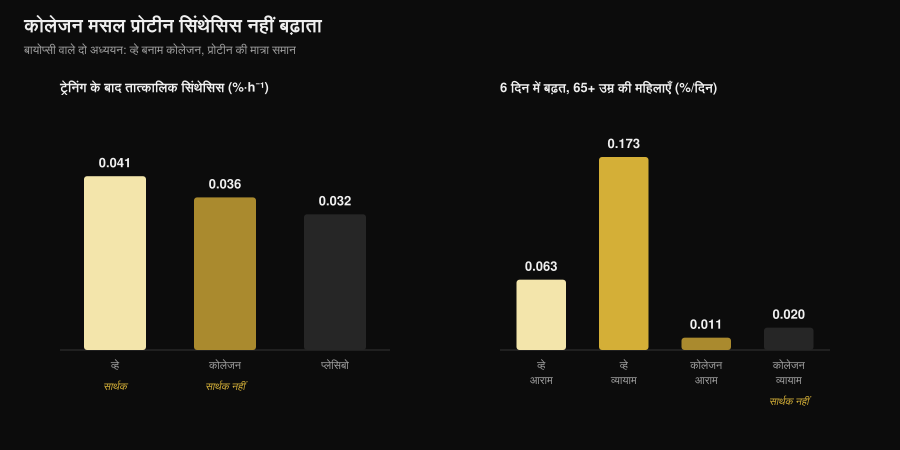
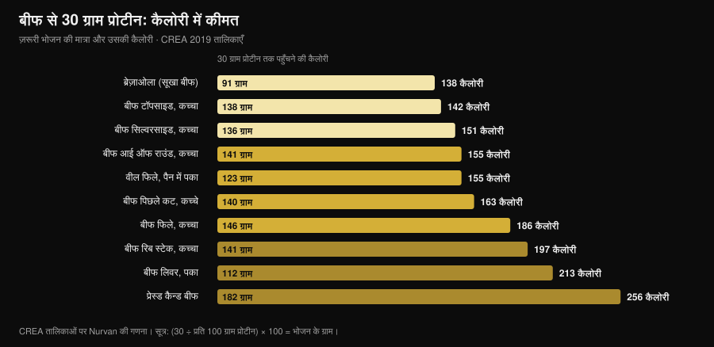

# बीफ प्रोटीन पाउडर: क्या यह व्हे जितना असरदार है?

लेखक: [Giammaria Loi](/autore/giammaria-loi) · 3 नवंबर 2026 को अपडेट

"beef protein powder" की खोज 467% बढ़ चुकी है, और डिब्बा दुनिया की सबसे सीधी बात का वादा करता है: मसल मांस है, तो मांस खाओ। कागज़ पर यह तर्क टिकता है, और सबसे बड़ा मेटा-विश्लेषण भी बीफ के पक्ष में है — यह व्हे के बराबर ठहरता है। दिक्कत यह है कि लेबल पर लिखा "बीफ प्रोटीन" बताता है कि पाउडर किस जानवर से आया, यह नहीं कि उसके किस हिस्से से। और यही फ़र्क काम करने वाले सप्लीमेंट और बेअसर सप्लीमेंट के बीच की रेखा है।

## संक्षेप में

- **व्हे के मुक़ाबले बराबरी है।** 7 ट्रायल और 270 लोगों के मेटा-विश्लेषण में बीफ प्रोटीन और व्हे के बीच लीन मास (मानकीकृत अंतर −0.01), फैट मास (0.07) और कुल प्रोटीन सेवन (0.04) में कोई फ़र्क नहीं मिला।
- **कुछ न लेने के मुक़ाबले बीफ जीतता है।** सप्लीमेंट न लेने वालों की तुलना में लीन मास (0.34) और निचले शरीर की ताक़त (0.40) बढ़ती है। पर यह "दिन भर में ज़्यादा प्रोटीन" का असर है, "ज़्यादा बीफ" का नहीं।
- **लेबल पर असली शब्द कोलेजन है।** कोलेजन से बने पाउडर में मसल प्रोटीन सिंथेसिस हिलता ही नहीं: 65 से ऊपर की महिलाओं में छह दिन में व्हे ने ट्रेन की गई टाँग में इसे 0.173 %/दिन बढ़ाया, कोलेजन ने सिर्फ़ 0.020 — जो शुरुआती स्तर से अलग नहीं पहचाना जा सकता।
- **और लेबल हमेशा सही नहीं होता।** बाज़ार के पाँच स्पोर्ट्स सप्लीमेंट पर हुए एक इतालवी विश्लेषण में ऐसे मामले मिले जहाँ मौजूद अमीनो एसिड निर्माता की घोषणा से मेल नहीं खाते थे।
- **बीफ की असली बढ़त आयरन है।** मास्टर्स ट्रायथलीटों में दस हफ़्ते बीफ प्रोटीन से फेरिटिन 117 से 150 ng/mL पहुँचा; व्हे और कार्बोहाइड्रेट से ऐसा नहीं हुआ।

## बीफ प्रोटीन अचानक चर्चा में क्यों है

बेचने वाला तर्क सरल और भरोसेमंद लगता है: मसल पशु प्रोटीन से बनती है, लाल मांस पशु प्रोटीन का सबसे शुद्ध रूप है, तो बीफ पाउडर मसल तक सबसे सीधा रास्ता होना चाहिए। ऊपर से तीन व्यावहारिक दलीलें जुड़ती हैं: लैक्टोज़ नहीं, कार्निवोर या पैलियो डाइट वालों के लिए डेयरी नहीं, और हीम आयरन जो व्हे में होता ही नहीं।

इनमें से कोई बात बेतुकी नहीं है। समस्या यह है कि "बीफ प्रोटीन" एक व्यापारिक नाम है, तकनीकी विवरण नहीं। यह जानवर बताता है, ऊतक नहीं। और एक गाय से दो बिल्कुल अलग कच्चे माल निकलते हैं, और दोनों पाउडर बन सकते हैं।

## डिब्बे के अंदर असल में क्या है

पहला कच्चा माल है **मांसपेशी**: लीन मीट, हाइड्रोलाइज़्ड या आइसोलेट, जिसका आवश्यक अमीनो एसिड प्रोफ़ाइल उसी स्टेक जैसा है जो आप खाते। बीफ प्रोटीन पर हुए गंभीर अध्ययनों ने यही इस्तेमाल किया, और यह काम करता है।

दूसरा है **कोलेजन**: कतरन, खाल, टेंडन, संयोजी ऊतक। यह हर कानूनी अर्थ में प्रोटीन है, पोषण तालिका में प्रोटीन के रूप में गिना जाता है, बहुत सस्ता पड़ता है और पाउडर में आसानी से ढल जाता है। पर इसका अमीनो एसिड प्रोफ़ाइल असंतुलित है — ग्लाइसिन और प्रोलिन बहुत ज़्यादा, ल्यूसिन बहुत कम — और ल्यूसिन ही वह अमीनो एसिड है जो मसल प्रोटीन का निर्माण चालू करता है। कोलेजन पाउडर प्रति सर्विंग 25 ग्राम प्रोटीन घोषित कर सकता है और मसल प्रोटीन सिंथेसिस को एक मिलीमीटर भी न हिलाए।

यह शक नहीं, तीन बार अलग-अलग तरीकों से नापा गया है। युवा वयस्कों में ट्रेनिंग के बाद 30 ग्राम कोलेजन ने प्लेसिबो के मुक़ाबले संकुचनशील प्रोटीन का सिंथेसिस सार्थक रूप से नहीं बढ़ाया, जबकि 30 ग्राम व्हे ने बढ़ाया (Aussieker et al., 2023)। 65 से ऊपर की महिलाओं में छह दिन के सप्लीमेंट पर: व्हे ने आराम वाली और ट्रेन की गई, दोनों टाँगों में सिंथेसिस बढ़ाया, कोलेजन ने किसी में नहीं (Oikawa et al., 2020)। बुज़ुर्ग पुरुषों में अनुशंसित मात्रा से ऊपर रोज़ 50 ग्राम देने पर व्हे और मटर प्रोटीन से सिंथेसिस बढ़ा, कोलेजन से नहीं (McKendry et al., 2024)।

*Aussieker et al., 2023 (Med Sci Sports Exerc) और Oikawa et al., 2020 (Am J Clin Nutr) के आँकड़ों पर Nurvan का ग्राफ़। प्रोटीन की मात्रा समान, 30 ग्राम। मान मूल सारांशों से लिए गए, आकृतियों से नहीं पढ़े गए।*

और कच्चा माल सही होने पर भी लेबल अपने-आप गारंटी नहीं है: मिलान विश्वविद्यालय के एक समूह ने बाज़ार के पाँच स्पोर्ट्स सप्लीमेंट के प्रोटीन अंश की जाँच की और भारी ग्लाइकोसिलेटेड प्रोटीन पाए, कुछ मामलों में जोड़े गए अमीनो एसिड घोषित वालों से मेल नहीं खाते थे, और निष्कर्ष निकला कि अनिवार्य बैच परीक्षण ज़रूरी है (Pellegrino et al., 2022)।

## शोध असल में क्या कहता है

| आम दावा | निष्कर्ष | स्रोत |
|---|---|---|
| "बीफ व्हे से ज़्यादा मसल बनाता है" | खारिज: बराबरी | Valenzuela et al., 2019 |
| "बीफ प्रोटीन बेकार है" | खारिज, एक शर्त के साथ | Valenzuela et al., 2019 |
| "मांस है, तो पूर्ण प्रोटीन है" | स्पष्टीकरण ज़रूरी: कच्चे माल पर निर्भर | Oikawa 2020; Aussieker 2023; McKendry 2024 |
| "पाउडर असली मांस से बेहतर है" | खारिज | Negro et al., 2014 |
| "लैक्टोज़ के बिना बीफ ही एकमात्र विकल्प है" | खारिज | Sharp et al., 2018 |
| "जितना ज़्यादा लो, उतना बढ़ोगे" | खारिज | McKenna et al., 2021 |
| "आयरन में मदद करता है" | पुष्ट, एक खास संदर्भ में | Naclerio et al., 2017 |

### दावा 1 — "बीफ व्हे से ज़्यादा मसल बनाता है"

यही सीधा मुक़ाबला है, और जवाब साफ़ बराबरी है। एक व्यवस्थित समीक्षा सहित मेटा-विश्लेषण ने सात यादृच्छिक ट्रायल जोड़े, कुल 270 वेट ट्रेनिंग करने वाले, और बीफ प्रोटीन, व्हे तथा बिना सप्लीमेंट की तुलना की। बीफ और व्हे के बीच कुछ भी अलग नहीं निकला: कुल प्रोटीन सेवन 0.04, लीन मास −0.01, फैट मास 0.07 — सभी मानकीकृत अंतर शून्य के आसपास, कोई भी सांख्यिकीय रूप से सार्थक नहीं।

अलग-अलग अध्ययन भी यही कहते हैं। ट्रेनिंग के बाद 46 ग्राम प्रोटीन, आठ हफ़्ते: बीफ आइसोलेट, हाइड्रोलाइज़्ड चिकन और व्हे कंसंट्रेट — तीनों ने शुरुआत की तुलना में लीन मास बढ़ाया, माल्टोडेक्सट्रिन कंट्रोल ने नहीं, और तीनों प्रोटीन के बीच ताक़त में कोई अंतर नहीं दिखा (Sharp et al., 2018)।

### दावा 2 — "बीफ प्रोटीन बेकार है"

यह भी नहीं टिकता। उसी मेटा-विश्लेषण में, सप्लीमेंट न लेने वालों की तुलना में बीफ ने दैनिक प्रोटीन सेवन (0.68), लीन मास (0.34) और निचले शरीर की ताक़त (0.40) बढ़ाई। असर छोटे हैं, पर असली हैं।

शर्त अहम है: यह लगभग निश्चित रूप से बीफ का असर नहीं, पर्याप्त प्रोटीन तक पहुँचने का असर है। लेखक यह साफ़ लिखते हैं, और एक और अध्ययन इसे और स्पष्ट कर देता है: वेट ट्रेनिंग करने वाले पुरुषों में रोज़ 20 ग्राम हाइड्रोलाइज़्ड बीफ, व्हे या **सिर्फ़ कार्बोहाइड्रेट** से ताक़त में लगभग एक जैसी बढ़त मिली, शरीर संरचना में अंतर नगण्य रहा (Naclerio et al., 2017)। अगर आपकी डाइट में प्रोटीन पहले से पर्याप्त है, तो डिब्बा बहुत कम जोड़ता है।

### दावा 3 — "जितना ज़्यादा लो, उतना बढ़ोगे"

मध्यम आयु के वयस्कों में दस हफ़्ते की वेट ट्रेनिंग, आहार परामर्श और लीन बीफ से प्रोटीन: एक समूह लगभग 1.0 ग्राम प्रति किलो वज़न रोज़, दूसरा लगभग 1.6। सभी ऊपरी और निचले शरीर के व्यायामों में अधिकतम ताक़त बढ़ी, **और प्रोटीन की मात्रा का कोई असर नहीं दिखा** (McKenna et al., 2021)। एक सीमा के बाद पाउडर जोड़ने से नतीजा नहीं जुड़ता — वही सिद्धांत जो लेने के समय पर लागू होता है, जिस पर मैंने [सप्लीमेंट कब लें](/hi/blog/supplements-kab-lein-samay) वाला लेख लिखा है।

### दावा 4 — "पाउडर असली मांस से बेहतर है"

एक इतालवी अध्ययन ने सबसे सीधी जाँच की: ट्रेनिंग के बाद 135 ग्राम लीन कैन्ड बीफ, यानी 20 ग्राम प्रोटीन और 1.7 ग्राम वसा, आठ हफ़्ते तक। इसे खाने वाले समूह ने 1.9 किलो फैट मास घटाया और 2.3 किलो फैट-फ्री मास बढ़ाया; बिना सप्लीमेंट वाले कंट्रोल समूह ने नहीं (Negro et al., 2014)। असली मांस, कोई पाउडर नहीं, वही नतीजा। लेखक इसे "अन्य प्रोटीन या अमीनो एसिड सप्लीमेंट के साथ जोड़ी जाने वाली पोषण रणनीति" कहते हैं: एक विकल्प, श्रेष्ठता नहीं।

### दावा 5 — "आयरन में मदद करता है"

यहाँ बीफ की अपनी बढ़त है, और यह उन्हीं में दिखती है जिन्हें ज़रूरत है। 35 से 60 साल के मास्टर्स ट्रायथलीटों में रोज़ 20 ग्राम बीफ प्रोटीन, दस हफ़्ते: फेरिटिन 117 से 150 ng/mL पहुँचा, जबकि व्हे और कार्बोहाइड्रेट से कोई बदलाव नहीं आया; उसी समूह में वेस्टस मीडियालिस की मोटाई बनी रही, जो बाक़ी दो समूहों में नहीं हुआ (Naclerio et al., 2017)।

इसे जैसा है वैसा पढ़िए: यह एंड्योरेंस एथलीटों का नतीजा है, जिनके आयरन भंडार अक्सर दबाव में रहते हैं। ऊपर वाले मेटा-विश्लेषण में बीफ ने सप्लीमेंट न लेने की तुलना में आयरन सेवन सांख्यिकीय रूप से सार्थक रूप से नहीं बढ़ाया। और अगर कमी का शक हो, तो समझदारी भरा रास्ता खून की जाँच और डॉक्टर है, खुद चुना हुआ सप्लीमेंट नहीं।

## कैलोरी का हिसाब: असली मांस बनाम पाउडर

अगर बीफ प्रोटीन का मक़सद प्रोटीन को बीफ से लेना है, तो यह जानना काम का है कि मांस वाला रास्ता कितना महँगा पड़ता है। इतालवी CREA खाद्य तालिकाओं से मैंने निकाला कि 30 ग्राम प्रोटीन तक पहुँचने के लिए हर कट के कितने ग्राम चाहिए — यही मात्रा ज़्यादातर मसल सिंथेसिस अध्ययनों में इस्तेमाल होती है — और उसके साथ कितनी कैलोरी आती है।

*CREA खाद्य संरचना तालिकाओं पर Nurvan की गणना — इटली का खाद्य एवं पोषण अनुसंधान केंद्र, 2019 अद्यतन (alimentinutrizione.it)। सूत्र: (30 ÷ प्रति 100 ग्राम प्रोटीन) × 100 = भोजन के ग्राम; कैलोरी उसी मात्रा की हैं।*

नतीजा यह कि लीन बीफ कैलोरी में बिल्कुल महँगा नहीं है: 138 ग्राम कच्चा टॉपसाइड 142 कैलोरी में 30 ग्राम प्रोटीन देता है, चिकन ब्रेस्ट की एक सर्विंग से बस थोड़ा ज़्यादा। 91 ग्राम ब्रेज़ाओला वही काम 138 कैलोरी में करता है। दूसरे छोर पर प्रेस्ड कैन्ड बीफ को उतने ही प्रोटीन के लिए 182 ग्राम और 256 कैलोरी चाहिए, और रिब स्टेक को 197।

पाउडर की एक सर्विंग आम तौर पर 25-30 ग्राम प्रोटीन पर 100 से 130 कैलोरी के बीच होती है: व्यवहार में टॉपसाइड जितना ही, पर दो व्यावहारिक फ़र्क के साथ। पाउडर साथ ले जाया जा सकता है, तीस सेकंड में पिया जाता है और ग्राम तक नापा जाता है; मांस पेट भरता है, प्रति ग्राम प्रोटीन सस्ता पड़ता है और लेबल की जाँच-पड़ताल नहीं माँगता। यह चुनाव लॉजिस्टिक है, शरीर-विज्ञान का नहीं।

## इसे कैसे लागू करें

1. **पहले वह प्रोटीन गिनिए जो आप पहले से खा रहे हैं।** अगर आप रोज़ लगभग 1.6 ग्राम प्रति किलो वज़न पर हैं और वह भोजन में बँटा है, तो किसी भी पाउडर की गुंजाइश कम है: 1.0 बनाम 1.6 ग्राम/किलो वाले अध्ययन में और बढ़ाने का कोई फ़ायदा नहीं मिला।
2. **डिब्बे का अगला हिस्सा नहीं, सामग्री सूची पढ़िए।** "कोलेजन", "हाइड्रोलाइज़्ड कोलेजन", "जिलेटिन" या बिना विवरण वाला "हाइड्रोलाइज़्ड बोवाइन प्रोटीन" खोजिए। अगर ये शुरुआत में हैं, तो वह पाउडर व्हे का विकल्प नहीं है।
3. **लेबल पर अमीनो एसिड प्रोफ़ाइल ढूँढिए।** ल्यूसिन घोषित न हो (उच्च जैविक मूल्य वाले स्रोतों में मोटे तौर पर 2-3 ग्राम प्रति सर्विंग) तो आपको पता ही नहीं चलेगा कि आपने क्या खरीदा।
4. **"यह मांस है" के नाम पर ज़्यादा मत चुकाइए।** जिम के नतीजों में बीफ और व्हे बराबर हैं। अगर बीफ महँगा है और उसे चुनने की कोई खास वजह नहीं, तो वजह है ही नहीं।
5. **खास वजह दो स्थितियों में बनती है।** स्पष्ट लैक्टोज़ असहिष्णुता या डेयरी से परहेज़: वहाँ बीफ समझदारी भरा विकल्प है, पर इकलौता नहीं — सीधी तुलना में हाइड्रोलाइज़्ड चिकन ने भी वही काम किया।
6. **आयरन के लिए जाँच से गुज़रिए।** कम फेरिटिन, थकान, ज़्यादा एंड्योरेंस भार: ये नापने और डॉक्टर से चर्चा करने की चीज़ें हैं, ऑनलाइन खरीदे सप्लीमेंट से सुलझाने की नहीं।

**Nurvan आज़माइए — प्रोटीन असली फूड डेटा पर गिना जाए, अंदाज़े से नहीं**

Nurvan का पोषण हिस्सा एक आधिकारिक खाद्य संरचना डेटाबेस पर चलता है: आप जो खाते हैं दर्ज करते हैं और रोज़ देखते हैं कि आपके भोजन वाकई कितना प्रोटीन दे रहे हैं। सप्लीमेंट सेक्शन में दर्ज रहता है कि आप क्या और कब लेते हैं, और उसी प्रोफ़ाइल में आपके ट्रेनिंग लोड और अपलोड की गई जाँच रिपोर्ट रहती है। इससे "मुझे पाउडर चाहिए या नहीं" सवाल अंदाज़ा नहीं, एक संख्या बन जाता है। [Nurvan आज़माएँ](https://nurvan.app)

## अक्सर पूछे जाने वाले सवाल

**क्या बीफ प्रोटीन व्हे से बेहतर है?**
नहीं, बराबरी है। सात यादृच्छिक ट्रायल और 270 लोगों के मेटा-विश्लेषण में लीन मास, फैट मास और कुल प्रोटीन सेवन पर बीफ प्रोटीन और व्हे में कोई अंतर नहीं मिला (Valenzuela et al., 2019)। सहनशीलता, क़ीमत और पसंद के आधार पर चुनिए।

**कैसे पहचानें कि बीफ प्रोटीन कोलेजन से बना है?**
सामग्री सूची और अमीनो एसिड प्रोफ़ाइल से। हाइड्रोलाइज़्ड कोलेजन, जिलेटिन या सिर्फ़ "हाइड्रोलाइज़्ड बोवाइन प्रोटीन" जैसे शब्द संकेत हैं; ल्यूसिन का घोषित न होना या बहुत कम होना इसकी पुष्टि करता है। मसल बायोप्सी वाले अध्ययनों में कोलेजन ने न युवाओं में, न बुज़ुर्गों में प्रोटीन सिंथेसिस बढ़ाया।

**लैक्टोज़ असहिष्णुता में बीफ प्रोटीन ठीक है?**
हाँ, यही इसे चुनने की एक ठोस वजह है, पर यह इकलौता विकल्प नहीं: आठ हफ़्ते की सीधी तुलना में हाइड्रोलाइज़्ड चिकन ने भी बीफ और व्हे जितना ही लीन मास बढ़ाया (Sharp et al., 2018), और व्हे आइसोलेट में लैक्टोज़ नाममात्र होता है।

**बीफ प्रोटीन पाउडर लें या सीधे मांस खाएँ?**
नतीजों के लिहाज़ से असली मांस पूरी तरह टिकता है: ट्रेनिंग के बाद 135 ग्राम लीन कैन्ड बीफ ने आठ हफ़्तों में फैट मास घटाया और फैट-फ्री मास बढ़ाया (Negro et al., 2014)। पाउडर सिर्फ़ सुविधा और सटीक मात्रा में आगे है।

## यह भी पढ़ें

- [मसल्स के लिए पौधों का प्रोटीन या पशु प्रोटीन?](/hi/blog/paudhon-ya-pashu-protein-muscle-ke-liye) — जब प्रोटीन का स्रोत सचमुच बदलता है तो क्या होता है — बायोप्सी से नापा गया।
- [स्ट्रेंथ सप्लीमेंट टियर लिस्ट: सबूत क्या कहते हैं](/hi/blog/strength-supplements-tier-list-hindi) — क्रिएटिन और कैफीन के बगल में प्रोटीन पाउडर कहाँ खड़ा है।
- [सप्लीमेंट कब लें: क्या समय मायने रखता है?](/hi/blog/supplements-kab-lein-samay) — कुल मात्रा लेने के समय से ज़्यादा भारी क्यों पड़ती है।

## स्रोत

- Valenzuela PL, Mata F, Morales JS, Castillo-García A, Lucia A, 2019. Does Beef Protein Supplementation Improve Body Composition and Exercise Performance? A Systematic Review and Meta-Analysis of Randomized Controlled Trials. *Nutrients* 11(6):1429. PMID 31242624. [DOI](https://doi.org/10.3390/nu11061429)
- Sharp MH, Lowery RP, Shields KA, Lane JR, Gray JL, Partl JM, Hayes DW, Wilson GJ, Hollmer CA, Minivich JR, Wilson JM, 2018. The Effects of Beef, Chicken, or Whey Protein After Workout on Body Composition and Muscle Performance. *Journal of Strength and Conditioning Research* 32(8):2233-2242. PMID 28399016. [DOI](https://doi.org/10.1519/JSC.0000000000001936)
- Naclerio F, Seijo M, Larumbe-Zabala E, Earnest CP, 2017. Carbohydrates Alone or Mixing With Beef or Whey Protein Promote Similar Training Outcomes in Resistance Training Males: A Double-Blind, Randomized Controlled Clinical Trial. *International Journal of Sport Nutrition and Exercise Metabolism* 27(5):408-420. PMID 28530448. [DOI](https://doi.org/10.1123/ijsnem.2017-0003)
- Naclerio F, Seijo M, Larumbe-Zabala E, Ashrafi N, Christides T, Karsten B, Nielsen BV, 2017. Effects of Supplementation with Beef or Whey Protein Versus Carbohydrate in Master Triathletes. *Journal of the American College of Nutrition* 36(8):593-601. PMID 28910233. [DOI](https://doi.org/10.1080/07315724.2017.1335248)
- Negro M, Vandoni M, Ottobrini S, Codrons E, Correale L, Buonocore D, Marzatico F, 2014. Protein supplementation with low fat meat after resistance training: effects on body composition and strength. *Nutrients* 6(8):3040-9. PMID 25093275. [DOI](https://doi.org/10.3390/nu6083040)
- Oikawa SY, Kamal MJ, Webb EK, McGlory C, Baker SK, Phillips SM, 2020. Whey protein but not collagen peptides stimulate acute and longer-term muscle protein synthesis with and without resistance exercise in healthy older women: a randomized controlled trial. *The American Journal of Clinical Nutrition* 111(3):708-718. PMID 31919527. [DOI](https://doi.org/10.1093/ajcn/nqz332)
- Aussieker T, Hilkens L, Holwerda AM, Fuchs CJ, Houben LHP, Senden JM, van Dijk JW, Snijders T, van Loon LJC, 2023. Collagen Protein Ingestion during Recovery from Exercise Does Not Increase Muscle Connective Protein Synthesis Rates. *Medicine and Science in Sports and Exercise* 55(10):1792-1802. PMID 37202878. [DOI](https://doi.org/10.1249/MSS.0000000000003214)
- McKendry J, Lowisz CV, Nanthakumar A, MacDonald M, Lim C, Currier BS, Phillips SM, 2024. The effects of whey, pea, and collagen protein supplementation beyond the recommended dietary allowance on integrated myofibrillar protein synthetic rates in older males: a randomized controlled trial. *The American Journal of Clinical Nutrition* 120(1):34-46. PMID 38762187. [DOI](https://doi.org/10.1016/j.ajcnut.2024.05.009)
- Pellegrino L, Hogenboom JA, Rosi V, Sindaco M, Gerna S, D'Incecco P, 2022. Focus on the Protein Fraction of Sports Nutrition Supplements. *Molecules* 27(11):3487. PMID 35684425. [DOI](https://doi.org/10.3390/molecules27113487)
- McKenna CF, Salvador AF, Hughes RL, Scaroni SE, Alamilla RA, Askow AT, Paluska SA, Dilger AC, Holscher HD, De Lisio M, Khan NA, Burd NA, 2021. Higher protein intake during resistance training does not potentiate strength, but modulates gut microbiota, in middle-aged adults: a randomized control trial. *American Journal of Physiology-Endocrinology and Metabolism* 320(5):E900-E913. PMID 33682457. [DOI](https://doi.org/10.1152/ajpendo.00574.2020)

संदर्भ PubMed के ज़रिए निकाले गए। विषय 3 नवंबर 2026 की ट्रेंड रिसर्च से चुना गया: "beef protein powder" सबसे तेज़ी से बढ़ती फिटनेस खोजों में है, पर इस पर रैंक करने वाले लगभग सभी पेज पाउडर बेचने वालों के हैं।

---

जियाम्मारिया लोई Nurvan के संस्थापक हैं। वे 2012 से वेट ट्रेनिंग करते हैं, 2013 से FIPE प्रमाणित पर्सनल ट्रेनर और कोच के रूप में काम करते हैं और 2018 से राष्ट्रीय स्तर पर पावरलिफ्टिंग में प्रतिस्पर्धा करते हैं। उनके हर लेख की शुरुआत वैज्ञानिक अध्ययनों से होती है और अंत उस पर जो जिम में सचमुच काम करता है।

> नोट: यह जानकारीपरक सामग्री है, डॉक्टर या विशेषज्ञ की सलाह का विकल्प नहीं।
