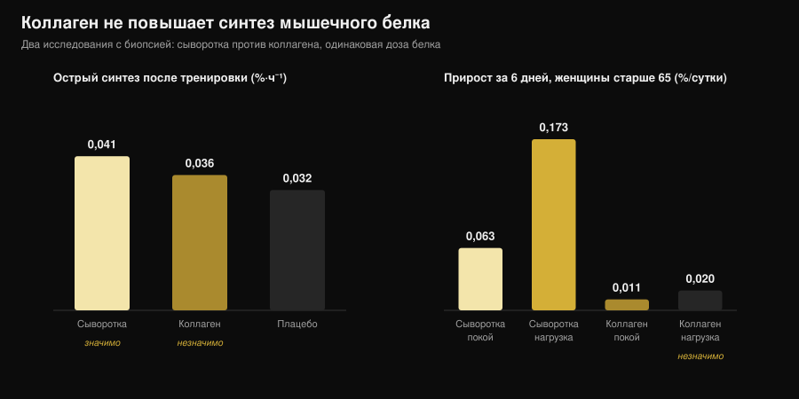

# Говяжий протеин: он не хуже сывороточного?

Автор: [Giammaria Loi](/autore/giammaria-loi) · обновлено 3 ноября 2026

Запросы «beef protein powder» выросли на 467%, и банка обещает самое логичное, что можно придумать: мышца — это мясо, значит ешь мясо. На бумаге это работает, и крупнейший метаанализ подтверждает: говядина идёт вровень с сывороткой. Проблема в том, что надпись «говяжий протеин» говорит, от какого животного получен порошок, но не от какой его части. А именно эта разница отделяет работающую добавку от бесполезной.

## Коротко

- **Против сыворотки — ничья.** Метаанализ 7 исследований и 270 человек: никакой разницы между говяжьим и сывороточным белком по сухой массе (стандартизованная разница −0,01), жировой массе (0,07) и общему потреблению белка (0,04).
- **Против «ничего не принимать» говядина выигрывает.** По сравнению с отсутствием добавки растут сухая масса (0,34) и сила ног (0,40). Но это эффект «больше белка за сутки», а не «больше говядины».
- **Ключевое слово на этикетке — коллаген.** У порошков из коллагена синтез мышечного белка не сдвигается: у женщин старше 65 за шесть дней сыворотка подняла его на 0,173 %/сутки в тренированной ноге, коллаген — на 0,020, что неотличимо от исходного уровня.
- **И этикетка не всегда права.** Итальянский анализ пяти спортивных добавок с рынка выявил случаи, когда реально присутствующие аминокислоты не совпадали с заявленными производителем.
- **Настоящее преимущество говядины — железо.** У триатлетов-мастеров десять недель говяжьего белка подняли ферритин со 117 до 150 нг/мл; сыворотка и углеводы этого не дали.

## Почему все вдруг заговорили о говяжьем протеине

Логика продаж простая и убедительная: мышца построена из животного белка, красное мясо — животный белок по определению, значит говяжий порошок должен быть самым коротким путём к мышцам. Сверху добавляются три практических довода: нет лактозы, нет молочного для тех, кто на карнивор- или палео-питании, и гемовое железо, которого в сыворотке попросту нет.

Ни один из этих пунктов не абсурден. Беда в том, что «говяжий протеин» — коммерческое название, а не техническая спецификация. Оно указывает вид животного, но не ткань. А из одной коровы получают два совершенно разных сырья, и оба превращаются в порошок.

## Что на самом деле в банке

Первое сырьё — **мышца**: постное мясо, гидролизованное или в виде изолята, с профилем незаменимых аминокислот, близким к тому самому стейку. Именно его использовали в серьёзных исследованиях говяжьего протеина, и оно работает.

Второе — **коллаген**: обрезь, шкура, сухожилия, соединительная ткань. Это белок во всех смыслах, он считается белком в таблице пищевой ценности, стоит заметно дешевле и прекрасно перерабатывается в порошок. Но профиль аминокислот у него перекошен — очень много глицина и пролина, очень мало лейцина, — а именно лейцин включает сборку мышечного белка. Коллагеновый порошок может заявлять 25 г белка на порцию и не сдвинуть синтез ни на миллиметр.

Это не подозрение, это измерено трижды разными методами. У молодых взрослых 30 г коллагена после тренировки не повысили синтез сократительных белков значимо по сравнению с плацебо, а 30 г сыворотки повысили (Aussieker et al., 2023). У женщин старше 65 за шесть дней приёма сыворотка подняла синтез и в покое, и в тренированной ноге, коллаген — ни в одном из состояний (Oikawa et al., 2020). У пожилых мужчин 50 г в сутки сверх рекомендованной нормы повысили синтез на сыворотке и на гороховом белке, но не на коллагене (McKendry et al., 2024).

*График Nurvan по данным Aussieker et al., 2023 (Med Sci Sports Exerc) и Oikawa et al., 2020 (Am J Clin Nutr). Одинаковая доза белка, 30 г. Значения взяты из оригинальных аннотаций, а не считаны с рисунков.*

И даже когда сырьё правильное, этикетка не даёт автоматической гарантии: группа Миланского университета изучила белковую фракцию пяти коммерческих спортивных добавок и обнаружила сильно гликозилированные белки, а в ряде случаев добавленные аминокислоты, не совпадающие с заявленными, заключив, что нужны обязательные проверки партий (Pellegrino et al., 2022).

## Что на самом деле говорят исследования

| Распространённое утверждение | Вердикт | Источник |
|---|---|---|
| «Говядина строит мышцы лучше сыворотки» | Опровергнуто: ничья | Valenzuela et al., 2019 |
| «Говяжий протеин бесполезен» | Опровергнуто, с оговоркой | Valenzuela et al., 2019 |
| «Это мясо, значит полноценный белок» | Требует уточнения: зависит от сырья | Oikawa 2020; Aussieker 2023; McKendry 2024 |
| «Порошок лучше настоящего мяса» | Опровергнуто | Negro et al., 2014 |
| «Без лактозы остаётся только говядина» | Опровергнуто | Sharp et al., 2018 |
| «Чем больше, тем больше мышц» | Опровергнуто | McKenna et al., 2021 |
| «Помогает с железом» | Подтверждено, в конкретном контексте | Naclerio et al., 2017 |

### Утверждение 1 — «Говядина строит мышцы лучше сыворотки»

Это прямое сравнение, и ответ — чистая ничья. Систематический обзор с метаанализом объединил семь рандомизированных исследований с 270 участниками силовых тренировок, сравнивая говяжий белок, сыворотку и отсутствие добавки. Между говядиной и сывороткой не нашлось ничего: общее потребление белка 0,04, сухая масса −0,01, жировая масса 0,07 — все стандартизованные разницы около нуля, ни одна статистически значимая.

Отдельные работы говорят то же самое. Восемь недель с 46 г белка после тренировки: говяжий изолят, гидролизат курицы и концентрат сыворотки — все три увеличили сухую массу относительно исходной, мальтодекстрин в контроле нет, а различий в силе между тремя белками не было (Sharp et al., 2018).

### Утверждение 2 — «Говяжий протеин бесполезен»

Это тоже не держится. В том же метаанализе по сравнению с отсутствием добавки говядина увеличила суточное потребление белка (0,68), сухую массу (0,34) и силу ног (0,40). Эффекты небольшие, но реальные.

Оговорка важна: почти наверняка это эффект не говядины, а выхода на достаточную норму белка. Авторы пишут об этом прямо, а другое исследование делает картину ещё яснее: у тренирующихся мужчин 20 г в сутки гидролизата говядины, сыворотки или **одних углеводов** дали практически сопоставимый прирост силы при минимальных различиях в составе тела (Naclerio et al., 2017). Если в рационе белка уже достаточно, банка добавляет мало.

### Утверждение 3 — «Чем больше, тем больше мышц»

Десять недель силовых тренировок у людей среднего возраста с нутрициологическим сопровождением и белком из постной говядины: одна группа около 1,0 г на кг массы тела в сутки, другая около 1,6. Максимальная сила выросла во всех упражнениях, **без какого-либо влияния количества белка** (McKenna et al., 2021). За определённым порогом добавка порошка не добавляет результата — тот же принцип, что и со временем приёма, разобранный в материале о том, [когда принимать добавки](/ru/blog/kogda-prinimat-dobavki-vremya).

### Утверждение 4 — «Порошок лучше настоящего мяса»

Итальянское исследование провело максимально прямую проверку: 135 г постной консервированной говядины после тренировки, то есть 20 г белка и 1,7 г жира, в течение восьми недель. Группа, которая её ела, потеряла 1,9 кг жировой массы и набрала 2,3 кг безжировой; контрольная группа без добавки — нет (Negro et al., 2014). Настоящее мясо, никакого порошка, тот же результат. Авторы называют это «нутритивной стратегией в дополнение к другим белкам или аминокислотным добавкам»: вариант, а не превосходство.

### Утверждение 5 — «Помогает с железом»

Здесь у говядины есть собственное преимущество, и оно видно у тех, кому это нужно. У триатлетов-мастеров 35-60 лет десять недель приёма 20 г говяжьего белка в сутки подняли ферритин со 117 до 150 нг/мл, тогда как сыворотка и углеводы изменений не дали; в той же группе сохранилась толщина медиальной широкой мышцы, чего не произошло в двух других (Naclerio et al., 2017).

Читать это нужно буквально: результат у спортсменов на выносливость, где запасы железа часто под нагрузкой. В упомянутом метаанализе говядина не увеличила потребление железа по сравнению с отсутствием добавки статистически значимо. А если вы подозреваете дефицит, разумный путь — анализ крови и врач, а не выбранная самостоятельно банка.

## Арифметика калорий: настоящее мясо против порошка

Если смысл говяжьего протеина в том, чтобы брать белок из говядины, полезно знать, во что обходится мясной путь. По итальянским таблицам состава продуктов CREA я посчитал, сколько граммов каждого отруба нужно, чтобы набрать 30 г белка — дозу, использованную в большинстве исследований синтеза, — и сколько калорий при этом приходит.

*Расчёт Nurvan по таблицам состава продуктов CREA — итальянский Центр исследований пищи и питания, обновление 2019 (alimentinutrizione.it). Формула: (30 ÷ белок на 100 г) × 100 = граммы продукта; ккал соответствуют полученному количеству.*

Оказывается, постное мясо совсем не дорогое по калориям: 138 г сырой внутренней части бедра дают 30 г белка за 142 ккал, едва больше порции куриной грудки. Девяносто один грамм брезаолы делает то же за 138 ккал. На другом конце прессованная консервированная говядина требует 182 г и 256 ккал за ту же норму, а стейк на кости — 197.

Порция порошка обычно укладывается в 100-130 ккал на 25-30 г белка: по сути то же самое, что мясо бедра, с двумя практическими отличиями. Порошок удобно возить, он выпивается за тридцать секунд и дозируется до грамма; мясо насыщает, стоит дешевле в пересчёте на грамм белка и не требует изучения состава. Выбор здесь логистический, а не физиологический.

## Как это применить

1. **Сначала посчитайте белок, который уже едите.** Если вы около 1,6 г на кг массы тела в сутки и он распределён по приёмам пищи, запас пользы от любого порошка невелик: исследование 1,0 против 1,6 г/кг не нашло выгоды в дальнейшем повышении.
2. **Читайте состав, а не лицевую сторону банки.** Ищите «коллаген», «гидролизат коллагена», «желатин» или неуточнённый «гидролизованный говяжий белок». Если они стоят в начале списка, этот порошок не замена сыворотке.
3. **Ищите аминокислотный профиль на этикетке.** Без заявленного лейцина (ориентировочно 2-3 г на порцию в источниках высокой биологической ценности) понять, что вы купили, невозможно.
4. **Не переплачивайте за «это же мясо».** По результатам в зале говядина и сыворотка равны. Если говяжий стоит дороже и конкретной причины выбрать его нет, значит её нет.
5. **Конкретная причина существует в двух случаях.** Выраженная непереносимость лактозы или отказ от молочного: там говяжий белок — разумный выбор, но не единственный: в прямом сравнении гидролизат курицы сработал так же.
6. **С железом — через анализы.** Низкий ферритин, усталость, большие объёмы выносливости: это измеряют и обсуждают с врачом, а не решают добавкой из интернета.

**Попробуйте Nurvan — белок считается по реальным данным о продуктах**

Раздел питания в Nurvan работает на официальной базе состава продуктов: вы записываете, что едите, и видите, сколько белка на самом деле дают приёмы пищи, день за днём. В разделе добавок фиксируется, что и когда вы принимаете, а в том же профиле лежат ваши тренировочные веса и загруженные анализы. Так вопрос «нужен ли мне порошок?» перестаёт быть ощущением и становится числом. [Попробовать Nurvan](https://nurvan.app)

## Частые вопросы

**Говяжий протеин лучше сывороточного?**
Нет, ничья. Метаанализ семи рандомизированных исследований и 270 человек не находит различий между говяжьим и сывороточным белком по сухой массе, жировой массе и общему потреблению белка (Valenzuela et al., 2019). Выбирайте по переносимости, цене и вкусу.

**Как понять, что говяжий протеин сделан из коллагена?**
По составу и аминокислотному профилю. Формулировки «гидролизат коллагена», «желатин» или просто «гидролизованный говяжий белок» — сигнал; незаявленный или очень низкий лейцин подтверждает. В исследованиях с биопсией коллаген не повышал синтез белка ни у молодых, ни у пожилых.

**Подходит ли говяжий протеин при непереносимости лактозы?**
Да, это одна из разумных причин его выбрать, но не единственный вариант: в прямом восьминедельном сравнении гидролизат курицы увеличил сухую массу так же, как говядина и сыворотка (Sharp et al., 2018), а в изолятах сыворотки лактозы следовые количества.

**Что лучше — говяжий порошок или просто мясо?**
По результату настоящее мясо держится отлично: 135 г постной консервированной говядины после тренировки снизили жировую массу и повысили безжировую за восемь недель (Negro et al., 2014). Порошок выигрывает только в удобстве и точности дозировки.

## Читайте также

- [Растительный или животный белок для мышц?](/ru/blog/rastitelnyy-ili-zhivotnyy-belok-dlya-myshts) — что происходит, когда источник белка действительно меняется — по данным биопсии.
- [Рейтинг спортивных добавок для силы: что говорит наука](/ru/blog/reyting-sportivnykh-dobavok-dlya-sily) — где протеин стоит рядом с креатином и кофеином.
- [Когда принимать добавки: важно ли время?](/ru/blog/kogda-prinimat-dobavki-vremya) — почему общее количество важнее момента приёма.

## Источники

- Valenzuela PL, Mata F, Morales JS, Castillo-García A, Lucia A, 2019. Does Beef Protein Supplementation Improve Body Composition and Exercise Performance? A Systematic Review and Meta-Analysis of Randomized Controlled Trials. *Nutrients* 11(6):1429. PMID 31242624. [DOI](https://doi.org/10.3390/nu11061429)
- Sharp MH, Lowery RP, Shields KA, Lane JR, Gray JL, Partl JM, Hayes DW, Wilson GJ, Hollmer CA, Minivich JR, Wilson JM, 2018. The Effects of Beef, Chicken, or Whey Protein After Workout on Body Composition and Muscle Performance. *Journal of Strength and Conditioning Research* 32(8):2233-2242. PMID 28399016. [DOI](https://doi.org/10.1519/JSC.0000000000001936)
- Naclerio F, Seijo M, Larumbe-Zabala E, Earnest CP, 2017. Carbohydrates Alone or Mixing With Beef or Whey Protein Promote Similar Training Outcomes in Resistance Training Males: A Double-Blind, Randomized Controlled Clinical Trial. *International Journal of Sport Nutrition and Exercise Metabolism* 27(5):408-420. PMID 28530448. [DOI](https://doi.org/10.1123/ijsnem.2017-0003)
- Naclerio F, Seijo M, Larumbe-Zabala E, Ashrafi N, Christides T, Karsten B, Nielsen BV, 2017. Effects of Supplementation with Beef or Whey Protein Versus Carbohydrate in Master Triathletes. *Journal of the American College of Nutrition* 36(8):593-601. PMID 28910233. [DOI](https://doi.org/10.1080/07315724.2017.1335248)
- Negro M, Vandoni M, Ottobrini S, Codrons E, Correale L, Buonocore D, Marzatico F, 2014. Protein supplementation with low fat meat after resistance training: effects on body composition and strength. *Nutrients* 6(8):3040-9. PMID 25093275. [DOI](https://doi.org/10.3390/nu6083040)
- Oikawa SY, Kamal MJ, Webb EK, McGlory C, Baker SK, Phillips SM, 2020. Whey protein but not collagen peptides stimulate acute and longer-term muscle protein synthesis with and without resistance exercise in healthy older women: a randomized controlled trial. *The American Journal of Clinical Nutrition* 111(3):708-718. PMID 31919527. [DOI](https://doi.org/10.1093/ajcn/nqz332)
- Aussieker T, Hilkens L, Holwerda AM, Fuchs CJ, Houben LHP, Senden JM, van Dijk JW, Snijders T, van Loon LJC, 2023. Collagen Protein Ingestion during Recovery from Exercise Does Not Increase Muscle Connective Protein Synthesis Rates. *Medicine and Science in Sports and Exercise* 55(10):1792-1802. PMID 37202878. [DOI](https://doi.org/10.1249/MSS.0000000000003214)
- McKendry J, Lowisz CV, Nanthakumar A, MacDonald M, Lim C, Currier BS, Phillips SM, 2024. The effects of whey, pea, and collagen protein supplementation beyond the recommended dietary allowance on integrated myofibrillar protein synthetic rates in older males: a randomized controlled trial. *The American Journal of Clinical Nutrition* 120(1):34-46. PMID 38762187. [DOI](https://doi.org/10.1016/j.ajcnut.2024.05.009)
- Pellegrino L, Hogenboom JA, Rosi V, Sindaco M, Gerna S, D'Incecco P, 2022. Focus on the Protein Fraction of Sports Nutrition Supplements. *Molecules* 27(11):3487. PMID 35684425. [DOI](https://doi.org/10.3390/molecules27113487)
- McKenna CF, Salvador AF, Hughes RL, Scaroni SE, Alamilla RA, Askow AT, Paluska SA, Dilger AC, Holscher HD, De Lisio M, Khan NA, Burd NA, 2021. Higher protein intake during resistance training does not potentiate strength, but modulates gut microbiota, in middle-aged adults: a randomized control trial. *American Journal of Physiology-Endocrinology and Metabolism* 320(5):E900-E913. PMID 33682457. [DOI](https://doi.org/10.1152/ajpendo.00574.2020)

Библиографические ссылки найдены через PubMed. Тема выбрана по анализу трендов 3 ноября 2026 года: «beef protein powder» — один из самых быстрорастущих фитнес-запросов, но почти все страницы в выдаче принадлежат продавцам порошка.

---

Джаммария Лои — основатель Nurvan. Занимается с отягощениями с 2012 года, работает персональным тренером и коучем с сертификатом FIPE с 2013 года и выступает в пауэрлифтинге на национальном уровне с 2018 года. Каждая его статья начинается с научных работ и заканчивается тем, что действительно работает в зале.

> Примечание: информационный материал, не заменяет консультацию врача или профильного специалиста.
