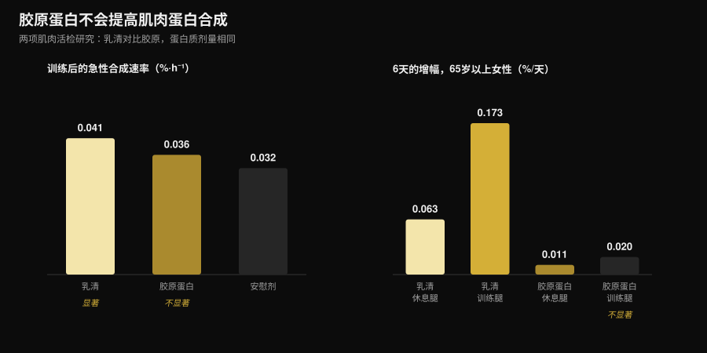
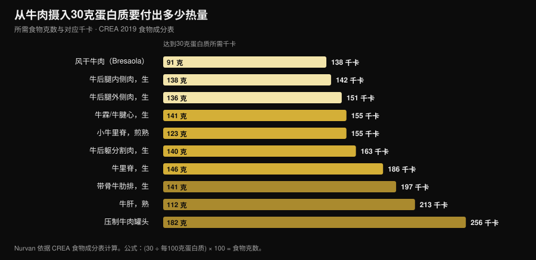

# 牛肉蛋白粉真的能替代乳清蛋白吗？

作者：[Giammaria Loi](/autore/giammaria-loi) · 更新于2026年11月3日

「beef protein powder」的搜索量上涨了467%，罐子上的承诺听起来再合理不过：肌肉是肉，那就吃肉。理论上说得通，最大的那篇荟萃分析也站在牛肉这边——它和乳清打成平手。问题在于，标签上的「牛肉蛋白」只告诉你粉来自哪种动物，没告诉你来自动物的哪个部位。而这个差别，正是一款有效补剂和一款毫无作用的补剂之间的差别。

## 要点速览

- **对比乳清是平局。** 涵盖7项试验、270人的荟萃分析显示：牛肉蛋白与乳清蛋白在瘦体重（标准化差值 −0.01）、脂肪量（0.07）和总蛋白摄入（0.04）上没有差别。
- **但对比「什么都不补」，牛肉赢了。** 相比不补充的人，瘦体重（0.34）和下肢力量（0.40）都有提升。不过这是「一天吃够蛋白质」的效果，而不是「牛肉」的效果。
- **标签上真正要看的词是胶原蛋白。** 以胶原为原料的粉完全推不动肌肉蛋白合成：65岁以上女性连续六天补充，训练腿的合成速率乳清提高了0.173 %/天，胶原只有0.020，与基线无法区分。
- **而且标签不一定可靠。** 一项意大利研究分析了市售的五款运动补剂，发现存在实际氨基酸与厂商标示不符的情况。
- **牛肉真正的优势是铁。** 在大师组铁人三项运动员中，十周牛肉蛋白让铁蛋白从117升至150 ng/mL；乳清和碳水没有这个效果。

## 牛肉蛋白粉为什么突然火了

推销逻辑简单又顺耳：肌肉由动物蛋白构成，红肉是最典型的动物蛋白，那么牛肉粉应该是增肌最直接的路径。再加上三个实用卖点：不含乳糖、肉食或原始人饮食者可以避开乳制品、还有乳清里根本没有的血红素铁。

这些说法都不离谱。问题在于「牛肉蛋白」是一个商品名，不是技术规格。它标明物种，却不标明组织。而一头牛能提供两种差异极大的原料，两种都能做成粉。

## 罐子里到底装了什么

第一种原料是**肌肉**：瘦肉水解物或分离物，必需氨基酸谱接近你会吃进嘴里的那块牛排。严肃的牛肉蛋白研究用的就是它，它确实有效。

第二种是**胶原蛋白**：边角料、皮、肌腱、结缔组织。它在法律意义上完全算蛋白质，在营养成分表里按蛋白质计，成本低得多，而且非常好加工成粉。但它的氨基酸谱严重失衡——甘氨酸和脯氨酸极多，亮氨酸极少——而亮氨酸正是启动肌肉蛋白合成的那把钥匙。一款胶原粉可以标注每份25克蛋白质，却一点也推不动肌肉蛋白合成。

这不是猜测，而是用三种不同方法测过三次。在年轻成人中，训练后摄入30克胶原并未显著提高收缩蛋白的合成速率，而30克乳清做到了（Aussieker et al., 2023）。在65岁以上女性中连续补充六天：乳清在休息腿和训练腿都提高了合成速率，胶原两者都没有（Oikawa et al., 2020）。在老年男性中，每天在推荐摄入量之上额外补50克，乳清和豌豆蛋白提高了合成速率，胶原没有（McKendry et al., 2024）。

*Nurvan 根据 Aussieker et al., 2023（Med Sci Sports Exerc）与 Oikawa et al., 2020（Am J Clin Nutr）数据制图。蛋白剂量相同，均为30克。数值取自原文摘要，非从图中读取。*

即便原料选对了，标签也不是自动的保证：米兰大学的一个团队分析了五款市售运动补剂的蛋白组分，发现蛋白质被大量糖基化，部分产品添加的氨基酸与标示不符，并据此提出应当强制进行批次检测（Pellegrino et al., 2022）。

## 研究到底怎么说

| 常见说法 | 结论 | 来源 |
|---|---|---|
| 「牛肉比乳清更能增肌」 | 被推翻：打平 | Valenzuela et al., 2019 |
| 「牛肉蛋白完全没用」 | 被推翻，但有前提 | Valenzuela et al., 2019 |
| 「是肉，所以是完全蛋白」 | 需要细分：取决于原料 | Oikawa 2020；Aussieker 2023；McKendry 2024 |
| 「粉比真肉好」 | 被推翻 | Negro et al., 2014 |
| 「不耐乳糖只能选牛肉」 | 被推翻 | Sharp et al., 2018 |
| 「吃得越多长得越多」 | 被推翻 | McKenna et al., 2021 |
| 「对补铁有帮助」 | 在特定情境下成立 | Naclerio et al., 2017 |

### 说法一 ——「牛肉比乳清更能增肌」

这是最直接的对比，答案是干净利落的平局。一项系统综述加荟萃分析汇总了七项随机对照试验、共270名抗阻训练者，比较牛肉蛋白、乳清和不补充三种情况。牛肉与乳清之间没有任何差别：总蛋白摄入0.04，瘦体重 −0.01，脂肪量0.07——标准化差值全部接近零，没有一项具有统计学意义。

单项研究也是一样。训练后补充46克蛋白质、持续八周：牛肉分离蛋白、水解鸡肉蛋白和乳清浓缩蛋白都使瘦体重较基线上升，麦芽糊精对照组没有，而三种蛋白之间的力量增长没有差异（Sharp et al., 2018）。

### 说法二 ——「牛肉蛋白完全没用」

这同样站不住。在同一篇荟萃分析中，相比不补充的人，牛肉提高了每日蛋白摄入（0.68）、瘦体重（0.34）和下肢力量（0.40）。效应不大，但是真实的。

前提很关键：这几乎可以肯定不是牛肉的功劳，而是「把蛋白质吃够」的功劳。作者写得很明白，另一项研究把这点说得更透：在抗阻训练男性中，每天20克水解牛肉蛋白、乳清或**单纯碳水**带来的力量提升大体相当，身体成分差异极小（Naclerio et al., 2017）。如果你的饮食蛋白质已经足够，那罐粉能加的不多。

### 说法三 ——「吃得越多长得越多」

中年成人进行十周抗阻训练，配合营养咨询并以瘦牛肉为蛋白来源：一组每天约每公斤体重1.0克，另一组约1.6克。所有上下肢动作的最大力量都提高了，**而蛋白质摄入量没有产生任何影响**（McKenna et al., 2021）。越过某个阈值之后，多加粉并不多出成绩——这和服用时间的道理一样，我在[补剂该什么时候吃](/zh/blog/buji-shenme-shijian-chi)那篇里写过。

### 说法四 ——「粉比真肉好」

一项意大利研究做了最直接的验证：训练后吃135克低脂罐头牛肉，也就是20克蛋白质和1.7克脂肪，持续八周。吃肉组减少了1.9公斤脂肪量，增加了2.3公斤去脂体重；不补充的对照组没有（Negro et al., 2014）。真肉，零粉末，结果相同。作者把它定义为「在其他蛋白质或氨基酸补剂之外的一种营养策略」：是一个选项，不是更优解。

### 说法五 ——「对补铁有帮助」

在这一点上牛肉确有自己的优势，而且在需要的人身上看得见。35至60岁的大师组铁人三项运动员每天补20克牛肉蛋白、持续十周，铁蛋白从117升到150 ng/mL，而乳清和碳水没有变化；同一组的股内侧肌厚度得以保持，另外两组则没有（Naclerio et al., 2017）。

要按原意理解：这是耐力运动员的结果，这类人群的铁储备常常处在紧张状态。在上面那篇荟萃分析里，牛肉相比不补充并未在统计上显著提高铁的摄入量。如果你怀疑自己缺铁，合理的做法是验血加看医生，而不是自己挑一罐粉。

## 热量这笔账：真肉对比蛋白粉

如果牛肉蛋白的意义在于「从牛身上拿蛋白质」，那就值得算一算走真肉这条路要付多少代价。我用意大利 CREA 食物成分表计算了每个部位需要多少克才能凑够30克蛋白质——多数肌肉蛋白合成研究使用的剂量——以及随之而来的热量。

*Nurvan 依据 CREA 食物成分表计算 —— 意大利食品与营养研究中心，2019年更新版（alimentinutrizione.it）。公式：(30 ÷ 每100克蛋白质) × 100 = 食物克数；千卡为对应该数量的热量。*

结果是瘦牛肉在热量上一点也不贵：138克生后腿内侧肉提供30克蛋白质，只需142千卡，比一份鸡胸肉高不了多少。91克风干牛肉同样做到，只要138千卡。另一端，压制牛肉罐头要182克、256千卡才能凑够同样的量，带骨牛肋排则要197千卡。

一份蛋白粉通常是25-30克蛋白质对应100到130千卡：实际上和后腿内侧肉差不多，但有两个现实差别。粉便于携带，三十秒喝完，能精确到克；肉有饱腹感，按每克蛋白质算更便宜，而且完全不需要研究配料表。这是后勤问题，不是生理问题。

## 怎么落到实处

1. **先把已经吃进去的蛋白质算清楚。** 如果你每天大约每公斤体重1.6克并分配到各餐，任何蛋白粉的提升空间都很小：1.0克对比1.6克那项研究没有发现继续加量的好处。
2. **读配料表，不要读罐子正面。** 留意「胶原蛋白」「水解胶原蛋白」「明胶」或者没有进一步说明的「水解牛蛋白」。如果它们排在前面，这款粉不能替代乳清。
3. **在标签上找氨基酸明细。** 没有标出亮氨酸（高生物价来源每份大致2-3克），你就无从判断自己买的是什么。
4. **不要为「这是肉」多付钱。** 在健身房的结果上，牛肉和乳清打平。如果牛肉更贵而你没有具体理由选它，那就是没有理由。
5. **具体理由在两种情况下成立。** 明显乳糖不耐或要避开乳制品：这时牛肉是合理选择，但不是唯一选择——在直接对比中水解鸡肉蛋白同样有效。
6. **补铁要走检查这条路。** 铁蛋白偏低、疲劳、大量耐力负荷：这些要测量并和医生讨论，而不是靠网上买来的补剂解决。

**试试 Nurvan —— 蛋白质用真实食物数据来算，不靠估**

Nurvan 的营养模块基于官方食物成分数据库：你记录吃了什么，就能逐日看到每餐真正提供了多少蛋白质。补剂模块记录你吃了什么、什么时候吃，同一份档案里还有你的训练负荷和上传的体检报告。这样「我到底需不需要一罐粉」就不再是感觉，而是一个数字。 [试用 Nurvan](https://nurvan.app)

## 常见问题

**牛肉蛋白粉比乳清好吗？**
不，是平局。涵盖七项随机对照试验、270人的荟萃分析在瘦体重、脂肪量和总蛋白摄入上都没有发现牛肉蛋白与乳清的差别（Valenzuela et al., 2019）。按耐受度、价格和个人偏好选就行。

**怎么判断一款牛肉蛋白是不是用胶原做的？**
看配料表和氨基酸明细。出现「水解胶原蛋白」「明胶」或笼统的「水解牛蛋白」就是信号；亮氨酸未标注或数值很低可以确认。在肌肉活检研究中，胶原在年轻人和老年人身上都没有提高蛋白合成。

**乳糖不耐受适合吃牛肉蛋白吗？**
适合，这是选择它的合理理由之一，但不是唯一选项：在八周的直接对比中，水解鸡肉蛋白提升瘦体重的幅度与牛肉和乳清相当（Sharp et al., 2018），而乳清分离蛋白中的乳糖只有微量。

**是买牛肉蛋白粉还是直接吃牛肉？**
从结果看，真肉表现很好：训练后吃135克低脂罐头牛肉，八周内减少了脂肪量并增加了去脂体重（Negro et al., 2014）。粉只在便利性和剂量精确度上占优。

## 延伸阅读

- [植物蛋白还是动物蛋白更能增肌？](/zh/blog/zhiwu-dongwu-danbai-zhi-zengji) — 当蛋白来源真的改变时会发生什么——用肌肉活检测出来的答案。
- [力量类补剂分级榜：证据怎么说](/zh/blog/liliang-buji-dengji-bang) — 蛋白粉在肌酸和咖啡因旁边处在什么位置。
- [补剂该什么时候吃：时间点重要吗？](/zh/blog/buji-shenme-shijian-chi) — 为什么总量比服用时刻更重要。

## 参考文献

- Valenzuela PL, Mata F, Morales JS, Castillo-García A, Lucia A, 2019. Does Beef Protein Supplementation Improve Body Composition and Exercise Performance? A Systematic Review and Meta-Analysis of Randomized Controlled Trials. *Nutrients* 11(6):1429. PMID 31242624. [DOI](https://doi.org/10.3390/nu11061429)
- Sharp MH, Lowery RP, Shields KA, Lane JR, Gray JL, Partl JM, Hayes DW, Wilson GJ, Hollmer CA, Minivich JR, Wilson JM, 2018. The Effects of Beef, Chicken, or Whey Protein After Workout on Body Composition and Muscle Performance. *Journal of Strength and Conditioning Research* 32(8):2233-2242. PMID 28399016. [DOI](https://doi.org/10.1519/JSC.0000000000001936)
- Naclerio F, Seijo M, Larumbe-Zabala E, Earnest CP, 2017. Carbohydrates Alone or Mixing With Beef or Whey Protein Promote Similar Training Outcomes in Resistance Training Males: A Double-Blind, Randomized Controlled Clinical Trial. *International Journal of Sport Nutrition and Exercise Metabolism* 27(5):408-420. PMID 28530448. [DOI](https://doi.org/10.1123/ijsnem.2017-0003)
- Naclerio F, Seijo M, Larumbe-Zabala E, Ashrafi N, Christides T, Karsten B, Nielsen BV, 2017. Effects of Supplementation with Beef or Whey Protein Versus Carbohydrate in Master Triathletes. *Journal of the American College of Nutrition* 36(8):593-601. PMID 28910233. [DOI](https://doi.org/10.1080/07315724.2017.1335248)
- Negro M, Vandoni M, Ottobrini S, Codrons E, Correale L, Buonocore D, Marzatico F, 2014. Protein supplementation with low fat meat after resistance training: effects on body composition and strength. *Nutrients* 6(8):3040-9. PMID 25093275. [DOI](https://doi.org/10.3390/nu6083040)
- Oikawa SY, Kamal MJ, Webb EK, McGlory C, Baker SK, Phillips SM, 2020. Whey protein but not collagen peptides stimulate acute and longer-term muscle protein synthesis with and without resistance exercise in healthy older women: a randomized controlled trial. *The American Journal of Clinical Nutrition* 111(3):708-718. PMID 31919527. [DOI](https://doi.org/10.1093/ajcn/nqz332)
- Aussieker T, Hilkens L, Holwerda AM, Fuchs CJ, Houben LHP, Senden JM, van Dijk JW, Snijders T, van Loon LJC, 2023. Collagen Protein Ingestion during Recovery from Exercise Does Not Increase Muscle Connective Protein Synthesis Rates. *Medicine and Science in Sports and Exercise* 55(10):1792-1802. PMID 37202878. [DOI](https://doi.org/10.1249/MSS.0000000000003214)
- McKendry J, Lowisz CV, Nanthakumar A, MacDonald M, Lim C, Currier BS, Phillips SM, 2024. The effects of whey, pea, and collagen protein supplementation beyond the recommended dietary allowance on integrated myofibrillar protein synthetic rates in older males: a randomized controlled trial. *The American Journal of Clinical Nutrition* 120(1):34-46. PMID 38762187. [DOI](https://doi.org/10.1016/j.ajcnut.2024.05.009)
- Pellegrino L, Hogenboom JA, Rosi V, Sindaco M, Gerna S, D'Incecco P, 2022. Focus on the Protein Fraction of Sports Nutrition Supplements. *Molecules* 27(11):3487. PMID 35684425. [DOI](https://doi.org/10.3390/molecules27113487)
- McKenna CF, Salvador AF, Hughes RL, Scaroni SE, Alamilla RA, Askow AT, Paluska SA, Dilger AC, Holscher HD, De Lisio M, Khan NA, Burd NA, 2021. Higher protein intake during resistance training does not potentiate strength, but modulates gut microbiota, in middle-aged adults: a randomized control trial. *American Journal of Physiology-Endocrinology and Metabolism* 320(5):E900-E913. PMID 33682457. [DOI](https://doi.org/10.1152/ajpendo.00574.2020)

文献通过 PubMed 检索获得。选题依据2026年11月3日的趋势调研：「beef protein powder」是增长最快的健身搜索词之一，但占据这个词的页面几乎都属于卖粉的商家。

---

Giammaria Loi 是 Nurvan 的创始人。他自2012年开始力量训练，自2013年起担任 FIPE 认证私人教练和教练，自2018年起在意大利全国级别参加力量举比赛。他署名的每篇文章都从科学研究出发，落到健身房里真正有效的做法。

> 提示：本文为科普内容，不能替代医生或专业人士的意见。
