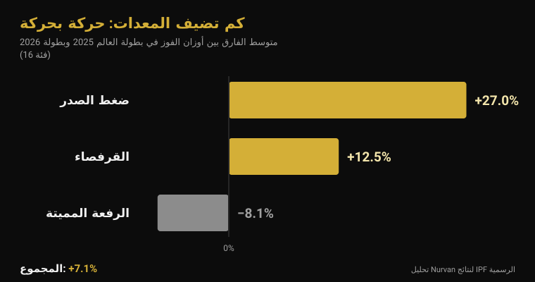
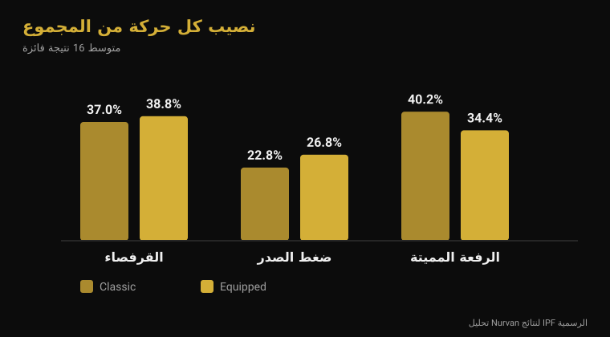

# بطولة العالم بالمعدات 2026: كم تضيف المعدات فعلاً

بقلم [Giammaria Loi](/autore/giammaria-loi) · حُدِّث في 4 نوفمبر 2026

من الاثنين 9 إلى الأحد 15 نوفمبر، تستضيف إسطنبول بطولة العالم للاتحاد الدولي IPF في فئة المعدات: المنافسة التي تُسمح فيها بدلة القرفصاء وقميص ضغط الصدر وأربطة الركبة. هي التخصص الذي يُنتج أكبر الأرقام في رفع الأثقال القوة، وأيضاً الذي تدور حوله أكثر العبارات غموضاً — «بالبدلة ترفع 100 كغ إضافية»، «في النهاية المعدات هي التي ترفع». أخذت النتائج الرسمية للاتحاد من آخر بطولة بالمعدات ومن بطولة العالم الكلاسيكية في يونيو، وقارنتها فئة بفئة. النتيجة لا تشبه أياً من العبارتين.

## باختصار

- **إسطنبول، من 9 إلى 15 نوفمبر 2026.** إنها بطولة العالم المفتوحة بالمعدات، اللقب العالمي المطلق الوحيد الذي يُسمح فيه بالمعدات الداعمة (الروزنامة الرسمية للاتحاد الدولي).
- **الأفضلية المتوسطة في المجموع هي 7% لا 20%.** بمقارنة أوزان الفوز في الفئات الست عشرة جميعها بين بطولة 2025 بالمعدات وبطولة 2026 الكلاسيكية، يبلغ الفارق المتوسط **+7.1%**. وفي فئتين من أصل ست عشرة رفع بطل الكلاسيكي وزناً أكبر.
- **المعدات لا تساعد الحركات الثلاث بالقدر نفسه.** ضغط الصدر **+27%**، القرفصاء **+12.5%**، الرفعة المميتة **−8.1%**: القماش المطاطي يعمل حيث توجد مرحلة نزول يمكن شحنها، والرفعة المميتة تبدأ من السكون.
- **الأربطة فعّالة، لكنها تنقل الجهد.** مع الأربطة ترتفع القدرة القصوى في القرفصاء بنسبة **10%**، ويصبح النزول **أسرع بـ45%**، وتنخفض فعالية العضلة المتسعة الوحشية عند 90% من الأقصى (Lake 2012؛ Gomes 2015).
- **واقيات الركبة ليست أربطة طرية.** لدى 15 رجلاً مدرَّباً، أضافت واقيات النيوبرين نحو **5 كغ** إلى الحد الأقصى في القرفصاء (166 مقابل 161 كغ) ولا شيء غير ذلك، بالتأثير نفسه في المقاس الموصى به وفي مقاس أصغر (Machek 2021).

## ماذا يحدث في إسطنبول من 9 إلى 15 نوفمبر

تُقام بطولة العالم المفتوحة بالمعدات 2026 في إسطنبول بتركيا من **9 إلى 15 نوفمبر**، بحسب الروزنامة الرسمية للاتحاد الدولي لرفع الأثقال القوة. هي المنافسة المطلقة، بلا فئات عمرية، وتمنح الألقاب في ثماني فئات وزن للرجال (59 و66 و74 و83 و93 و105 و120 وما فوق 120 كغ) وثماني فئات للنساء (47 و52 و57 و63 و69 و76 و84 وما فوق 84 كغ).

اختُتمت النسخة السابقة في 16 نوفمبر 2025 في **كلوج نابوكا برومانيا**. وتفيد الوثائق الرسمية بأمرين لقراءة بطولة إسطنبول: فازت **أوكرانيا** بتصنيفَي الفرق، للرجال والنساء؛ وأفضل نقاط IPF GL كانت لـ**فولوديمير ريسييف** (93 كغ، مجموع 1050 كغ) و**تايلور لاشابيل** (63 كغ، 645 كغ). وفي فئة 74 كغ للرجال فاز **ياروسواف أوليخ**، المولود عام 1974: مجموع 850 كغ في الحادية والخمسين، ضمن الفئة المفتوحة.

أعلنت الولايات المتحدة فريقاً من ستة عشر لاعباً، ثمانية رجال وثماني نساء، جميعهم في الفئة المفتوحة، بينهم **إيان بيل**، بطل فئة 105 كغ في كلوج نابوكا بمجموع 1067.5 كغ، و**كيلسي مكارثي**، بطلة فئة 69 كغ بمجموع 652.5 كغ.

## الكلاسيكي والمعدات: ما الذي يتغير فعلاً

اللائحة الفنية للاتحاد الدولي السارية منذ 1 مارس 2026 تفصل بين المنافستين بما يُسمح بارتدائه فقط.

في **الكلاسيكي** (raw) يُسمح بـ: بدلة منافسة غير داعمة، قميص تحتها، حزام من الجلد أو مادة غير مطاطية بعرض أقصاه 10 سم وسماكة 13 ملم، و**واقيات ركبة** من النيوبرين بسماكة لا تتجاوز 7 ملم وطول لا يتجاوز 30 سم، وأربطة معصم بطول متر واحد كحد أقصى.

وفي **المعدات** تُضاف ثلاث قطع يمنعها الكلاسيكي: **بدلة القرفصاء** (قماش بسماكة واحدة، الحمّالات على الكتفين دائماً، الساقان بين 3 و15 سم من أعلى المنشعب)، و**قميص ضغط الصدر** (قماش غير مطاطي أو مُمطَّط، أكمام تنتهي تحت العضلة الدالية ولا تصل إلى المرفق)، و**أربطة الركبة** (بطول أقصاه مترين وعرض أقصاه 8 سم، ولا تتجاوز 15 سم فوق مركز الركبة و15 سم تحته). وتمنع اللائحة صراحةً الجمع بين الأربطة والواقيات.

الفرق الفني كله هنا: البدلة والقميص والأربطة أقمشة مطاطية تقاوم النزول وتخزّن الطاقة وتعيدها عند الصعود. هي لا ترفع بدلاً عنك، لكنها تغيّر منحنى القوة في الحركة.

## كم تضيف المعدات: الأرقام الرسمية

للإجابة بالأرقام أخذت أكثر وثيقتي نتائج رسميتين قابلتين للمقارنة: أوزان الفائزين في **بطولة العالم المفتوحة بالمعدات 2025** (كلوج نابوكا) وأوزان الفائزين في **بطولة العالم المفتوحة الكلاسيكية 2026** (دروسكينينكاي، ليتوانيا، 13-21 يونيو). الاتحاد نفسه، الفئات الست عشرة نفسها، المستوى نفسه.

في **مجموع المنافسة**، يبلغ الفارق المتوسط عبر الفئات الست عشرة **+7.1%** لصالح المعدات (الوسيط +7.8%). وفي أربع عشرة فئة من ست عشرة رفع بطل المعدات وزناً أكبر. والاستثناءان مفيدان: في فئة 74 كغ للرجال سجّل أوستن بيركنز **891.5 كغ بلا أي معدات** مقابل 850 كغ لبطل المعدات، وفي فئة ما فوق 84 كغ للنساء أنهت بريتاني شلاتر عند **756.5 كغ** مقابل 700 كغ.

| الحركة | الفارق المتوسط: المعدات − الكلاسيكي |
|---|---|
| ضغط الصدر | +27.0% |
| القرفصاء | +12.5% |
| الرفعة المميتة | −8.1% |
| **المجموع** | **+7.1%** |

وحركةً بحركة تتبدّل الصورة تماماً. ضغط الصدر هو الاختبار الذي يزن فيه القميص أكثر شيء: أوزان الفوز أعلى بنحو **27%** في المتوسط. والقرفصاء يكسب **12.5%**. أما الرفعة المميتة، حيث لا تجد المعدات مرحلة نزول تستغلها لأن البار يبدأ ساكناً على الأرض، فتسير في الاتجاه المعاكس: أوزان الفوز بالمعدات أدنى بنحو **8%** من أوزان الكلاسيكي.

ويظهر ذلك في تركيب المجموع أيضاً. لدى أبطال الكلاسيكي تمثّل الرفعة المميتة **40.2%** من المجموع وضغط الصدر **22.8%**؛ ولدى أبطال المعدات تهبط الرفعة إلى **34.4%** ويصعد ضغط الصدر إلى **26.8%**. رياضتان بالاسم نفسه وتوازن داخلي مختلف.

توضيح أمين: هؤلاء رياضيون مختلفون في بطولتين مختلفتين، لذا تقيس هذه المقارنة **ما يُرفع في المنافستين**، لا أثر البدلة على الجسم نفسه. لكن الاتجاه يتوافق مع الآلية — كلما زاد القماش المطاطي الذي يُشحن أثناء النزول زاد المكسب — ومع البيانات السكانية المنشورة الوحيدة: بتحليل 26,472 لاعباً في الفئة المفتوحة، وجد فيرلاند وزملاؤه أن لاعبي المعدات يرفعون أوزاناً أعلى بدلالة إحصائية من لاعبي الكلاسيكي في فئة الوزن نفسها (Ferland et al., 2020).

## ماذا تقول الأبحاث فعلاً

| ادعاء شائع | الحكم | المصدر |
|---|---|---|
| «المعدات تضيف 20-30% إلى المجموع» | مُفنَّد: +7.1% في المتوسط | النتائج الرسمية للاتحاد |
| «البدلة تساعد الحركات الثلاث» | مُفنَّد: الرفعة المميتة تتراجع | النتائج الرسمية للاتحاد |
| «الأربطة تجعلك ترفع أكثر» | مؤكَّد، لكنها تغيّر التمرين | Lake et al., 2012؛ Gomes et al., 2015 |
| «الواقيات مثل الأربطة» | مُفنَّد | Machek et al., 2021 |
| «الحزام يحمي الظهر» | يحتاج تدقيقاً | Siewe et al., 2011؛ Lynch et al., 2025 |
| «رفع الأثقال يدمّر المفاصل» | يحتاج تدقيقاً: إصابة واحدة لكل 1000 ساعة | Siewe et al., 2011 |

### الأربطة تعمل، لكنها لا تدرّب ما تظنه

الأربطة هي القطعة الوحيدة من معدات فئة المعدات التي يستخدمها كثيرون في الصالة العادية، لذا تستحق نظرة قريبة. أدّى عشرة رجال مدرَّبين قرفصاءات مفردة عند 80% من الحد الأقصى، مرة بالأربطة ومرة بدونها. مع الأربطة انخفضت الإزاحة الأفقية للبار بنسبة **39%**، وصارت مرحلة النزول **أسرع بـ45%**، وارتفع الدفع العمودي عند الصعود بنسبة **10%**، والقدرة القصوى بنسبة **10%** (2121 مقابل 1841 واط). ويعزو الباحثون ذلك إلى الطاقة المرنة المخزَّنة في الرباط أثناء النزول، ويخلصون إلى أن الأربطة تغيّر تقنية القرفصاء بطريقة يُرجَّح أن تغيّر العضلات المستهدفة (Lake et al., 2012).

وتقيس الدراسة الثانية هذا بالضبط. أدّى أربعة عشر رجلاً مدرَّباً القرفصاء عند 60% و90% من الحد الأقصى، بالأربطة وبدونها: عند 90% كانت فعالية **العضلة المتسعة الوحشية** أقل مع الأربطة. وبدون الأربطة كان ثني الركبة أكبر عند الشدتين (Gomes et al., 2015).

بالترجمة: الأربطة تجعلك ترفع أكثر وتجعل العضلة رباعية الرؤوس تعمل أقل. في المنافسة هذا امتياز؛ أما في التدريب، إن كان الهدف بناء الساق، فهذا سبب ممتاز لتركها في الحقيبة. وينطبق المنطق نفسه على تفاصيل التقنية التي تغيّر العضلات العاملة — كتبت عن ذلك في [دفع الركبتين إلى الخارج في القرفصاء](/ar/blog/alrukbatan-ila-alkharij-fi-alqurfusa).

### الواقيات شيء آخر

خمسة عشر رجلاً مدرَّباً لم يسبق لهم استخدامها جرّبوا ثلاثة أوضاع: كُمّ ضابط ضعيف الدعم، وواقي نيوبرين بالمقاس الموصى به، وآخر أصغر بمقاس. ارتفع الحد الأقصى في القرفصاء مع الواقيين الحقيقيين (166 كغ مقابل 161 كغ للضابط)، **من دون أي فرق بين المقاس العادي والأضيق** ومن دون أي أثر على القفز أو القدرة أو السرعة أو التحمّل. ويشدّد الباحثون على التباين مع الأربطة التي يزداد أثرها فعلاً بزيادة الشدّ (Machek et al., 2021).

نحو 5 كغ من أصل 161، أي 3%: مفيد على المنصة، بلا قيمة كاختصار.

### الحزام: أعقد مما يُقال

معطيان، ولا أحد منهما مطمئن بالمعنى المتوقَّع. في استبيان شمل 245 لاعباً تنافسياً ونخبوياً، ارتبط استخدام الحزام **بمعدّل أعلى لإصابات الفقرات القطنية** (Siewe et al., 2011). هذه دراسة استعادية تعتمد على التصريح الذاتي، فهي لا تثبت أن الحزام يسبب المشكلة: فمن يرتديه يحرّك أوزاناً أثقل، وبعضهم يضعه تحديداً لأن ظهره يزعجه. لكنها ليست ما يوحي به التسويق.

والثاني: لدى 28 رجلاً يؤدّون القرفصاء عند 75% من الحد الأقصى المتوقَّع، **لم يغيّر الحزام وحده فعالية** عضلات الجذع والأطراف السفلية؛ ولم ترتفع فعالية عضلات البطن إلا مع *الشدّ البطني* الفاعل، بحزام أو بدونه (Lynch et al., 2025). الحزام سطح تدفع تجاهه، لا بديل عن الدفع.

وتحتوي دراسة Siewe نفسها على الرقم الغائب عادةً عن النقاشات: معدّل الإصابات **0.3 إصابة لكل لاعب سنوياً**، أي نحو واحدة لكل 1000 ساعة تدريب — منخفض مقارنةً برياضات كثيرة، وإن أفاد 43% بمضايقات في الحصص الاعتيادية.

## كيف تطبّق هذا

1. **إن كنت تنافس في الكلاسيكي فلا حاجة لك بالأربطة.** فائدتها على المنصة، وثمنها عمل أقل للعضلة رباعية الرؤوس عند الشدّات التي تريدها فيها أكثر.
2. **الواقيات: اختر المقاس الموصى به.** الأضيق لا يعطي أكثر، ويضايق. توقّع بضعة كيلوغرامات لا فئة وزن كاملة.
3. **الحزام يُتعلَّم ولا يُلبَس وحسب.** أولاً الشدّ البطني من دون حزام، ثم الحزام كسطح تدفع تجاهه. وإن كان الظهر يؤلم فالشدّ الأقوى ليس الحل.
4. **إن أردت تجربة المعدات فتوقّع إعادة تعلّم ضغط الصدر.** هي الحركة التي تغيّرها المعدات أكثر من غيرها، وبالتالي الأكثر طلباً لتقنية جديدة.
5. **الرفعة المميتة تبقى الرفعة المميتة.** ستؤكّد إسطنبول ذلك: الحركة التي تساعد فيها البدلة أقل ما يكون، وتظهر فيها القوة بلا مرشِّحات.
6. **سجّل دائماً بأي معدات رفعت.** 180 كغ بالأربطة و180 كغ بدونها معطيان مختلفان: إن وُضعا في السطر نفسه فقد سجلّك معناه.

**جرّب Nurvan — الأوزان مع سياقها، لا الرقم وحده**

في Nurvan تُسجَّل كل مجموعة بالوزن والتكرارات وقيمة RIR، وتتيح الملاحظات التمييز بين الحركة نفسها بمعدات وبدونها. وتُقترح مجموعات الإحماء تلقائياً انطلاقاً من أثقل مجموعة في اليوم، فتبقى قراءة التقدّم واضحة حتى عند تغيير تجهيزات المنافسة. وإن كان يتابعك مدرّب فهو يرى السجلّ نفسه من حسابه. [جرّب Nurvan](https://nurvan.app)

## أسئلة شائعة

**ما الفرق بين رفع الأثقال الكلاسيكي وفئة المعدات؟**
الكلاسيكي (raw) يسمح بالبدلة والحزام وواقيات النيوبرين وأربطة المعصم. وفئة المعدات تضيف بدلة القرفصاء وقميص ضغط الصدر وأربطة الركبة المطاطية، التي تخزّن الطاقة في النزول وتعيدها في الصعود. وفي الاتحاد الدولي هما منافستان منفصلتان بألقاب منفصلة.

**كم ترفع إضافياً بالمعدات؟**
بمقارنة أوزان الفوز في بطولة 2025 بالمعدات وبطولة 2026 الكلاسيكية في الفئات الست عشرة نفسها، يكون المجموع أعلى بنحو 7.1% في المتوسط. لكن المتوسط يخفي كل شيء: ضغط الصدر يرتفع 27%، والقرفصاء 12.5%، والرفعة المميتة تنخفض 8%.

**هل أربطة الركبة مضرّة بالركبتين؟**
الدراسات المتاحة تقيس الميكانيكا وفعالية العضلات لا خطر الإصابة على المدى الطويل، لذا الجواب الأمين أننا لا نعرف. المعروف أنها تقلّل الإزاحة الأفقية للبار، وتسرّع النزول، وتخفض فعالية العضلة رباعية الرؤوس عند الشدّات العالية.

**هل يمكن ارتداء الواقيات والأربطة معاً؟**
لا. تمنع اللائحة الفنية للاتحاد الدولي ذلك صراحةً في المنافسة. وفي الصالة لا توجد لائحة، لكن لا يوجد سبب أيضاً: كلاهما يؤدي الوظيفة نفسها، والأربطة تؤديها بشكل أعنف بكثير.

## اقرأ أيضاً

- [بطولة المخضرمين 2026: كم قوة تُفقد مع العمر](/ar/blog/butulat-almukhadramin-2026-alquwa-walumr) — التحليل نفسه للنتائج الرسمية للاتحاد، مطبّقاً على الفئات العمرية.
- [الركبتان إلى الخارج في القرفصاء: قاعدة أم إشارة؟](/ar/blog/alrukbatan-ila-alkharij-fi-alqurfusa) — كيف يغيّر تفصيل تقني واحد العضلات العاملة فعلاً.
- [قبضة ضغط الصدر: واسعة أم متوسطة أم ضيقة؟](/ar/blog/qabdat-dafe-alsadr-wasia-dayiqa) — ما الذي يغيّره عرض القبضة، بقميص أو بدونه.

## المصادر

- Lake JP, Carden PJC, Shorter KA, 2012. Wearing knee wraps affects mechanical output and performance characteristics of back squat exercise. *Journal of Strength and Conditioning Research* 26(10):2844-9. PMID 22995993. [DOI](https://doi.org/10.1519/JSC.0b013e3182429840)
- Gomes WA, Brown LE, Soares EG, da Silva JJ, de O Silva FHD, Serpa ÉP, Corrêa DA, Vilela Junior GdeB, Lopes CR, Marchetti PH, 2015. Kinematic and sEMG Analysis of the Back Squat at Different Intensities With and Without Knee Wraps. *Journal of Strength and Conditioning Research* 29(9):2482-7. PMID 25763519. [DOI](https://doi.org/10.1519/JSC.0000000000000922)
- Machek SB, Cardaci TD, Wilburn DT, Cholewinski MC, Latt SL, Harris DR, Willoughby DS, 2021. Neoprene Knee Sleeves of Varying Tightness Augment Barbell Squat One Repetition Maximum Performance Without Improving Other Indices of Muscular Strength, Power, or Endurance. *Journal of Strength and Conditioning Research* 35(Suppl 1):S6-S15. PMID 33201154. [DOI](https://doi.org/10.1519/JSC.0000000000003869)
- Siewe J, Rudat J, Röllinghoff M, Schlegel UJ, Eysel P, Michael JW-P, 2011. Injuries and overuse syndromes in powerlifting. *International Journal of Sports Medicine* 32(9):703-11. PMID 21590644. [DOI](https://doi.org/10.1055/s-0031-1277207)
- Lynch DJ, Drusch AS, Hooper TL, James CR, Brooks TJ, Wilford KF, Seeber GH, Sizer PS, 2025. Changes in muscle activation in response to abdominal bracing and stabilization belt use during a loaded squat. *Journal of Sports Sciences* 43(20):2434-2446. PMID 40698971. [DOI](https://doi.org/10.1080/02640414.2025.2535048)
- Ferland PM, Allard MO, Comtois AS, 2020. Efficiency of the Wilks and IPF Formulas at Comparing Maximal Strength Regardless of Bodyweight through Analysis of the Open Powerlifting Database. *International Journal of Exercise Science* 13(4):567-582. PMID 33042369. [DOI](https://doi.org/10.70252/XGHM8852)

المراجع مستخرجة عبر PubMed. بيانات المنافسة من النتائج الرسمية للاتحاد الدولي (بطولة العالم المفتوحة بالمعدات 2025، كلوج نابوكا؛ بطولة العالم المفتوحة الكلاسيكية 2026، دروسكينينكاي) ومن روزنامته الرسمية؛ واللائحة من IPF Technical Rules Book السارية منذ 1 مارس 2026. تشكيلة منتخب الولايات المتحدة بحسب Powerlifting America.

---

Giammaria Loi هو مؤسس Nurvan. يتدرّب بالأثقال منذ 2012، ويعمل مدرّباً شخصياً ومدرّباً معتمداً من FIPE منذ 2013، ويشارك في منافسات رفع الأثقال القوة على المستوى الوطني منذ 2018. كل مقال يوقّعه يبدأ من الدراسات العلمية وينتهي عند ما ينفع فعلاً في الصالة.

> ملاحظة: محتوى تثقيفي، لا يغني عن رأي الطبيب أو المختص.
