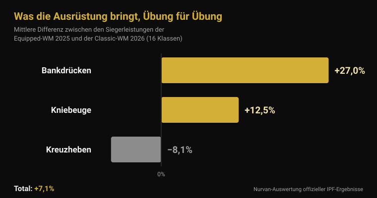
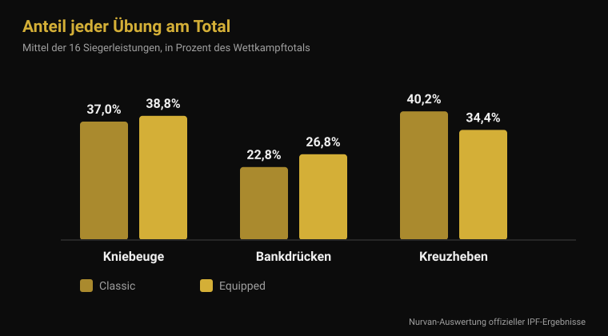

# Equipped-WM 2026: was die Ausrüstung wirklich bringt

Von [Giammaria Loi](/autore/giammaria-loi) · aktualisiert am 4. November 2026

Von Montag, dem 9., bis Sonntag, dem 15. November vergibt Istanbul die IPF-Weltmeistertitel in der Kategorie Equipped: dem Wettkampf, in dem Kniebeugeanzug, Bankdrückhemd und Kniebandagen erlaubt sind. Es ist die Disziplin mit den größten Zahlen im Kraftdreikampf — und mit den vagesten Sätzen: „mit dem Anzug hebst du 100 Kilo mehr", „das ist doch alles nur Ausrüstung". Ich habe die offiziellen IPF-Ergebnisse der letzten Equipped-WM und die der Classic-WM vom Juni genommen und Klasse für Klasse verglichen. Das Ergebnis passt zu keinem der beiden Sätze.

## Kurz gefasst

- **Istanbul, 9. bis 15. November 2026.** Es sind die IPF World Open Equipped Championships, der einzige offene WM-Titel, bei dem unterstützende Ausrüstung erlaubt ist (offizieller IPF-Kalender).
- **Der Vorsprung im Total liegt im Mittel bei 7 %, nicht bei 20 %.** Vergleicht man die Siegerleistungen aller 16 Klassen der Equipped-WM 2025 mit denen der Classic-WM 2026, beträgt die mittlere Differenz **+7,1 %**. In 2 von 16 Klassen hat der Classic-Sieger mehr gehoben.
- **Die Ausrüstung hilft den drei Übungen unterschiedlich.** Bankdrücken **+27 %**, Kniebeuge **+12,5 %**, Kreuzheben **−8,1 %**: elastischer Stoff wirkt dort, wo es eine exzentrische Phase zu laden gibt — und Kreuzheben startet aus dem Stand.
- **Bandagen wirken, verschieben aber die Arbeit.** Mit Bandagen steigt die Spitzenleistung in der Kniebeuge um **10 %**, die Abwärtsphase ist **45 % schneller**, und die Aktivierung des Vastus lateralis bei 90 % des Maximums **sinkt** (Lake 2012; Gomes 2015).
- **Sleeves sind keine weichen Bandagen.** Bei 15 trainierten Männern brachten Neopren-Sleeves rund **5 kg** mehr im Kniebeuge-Maximum (166 statt 161 kg) und sonst nichts — mit gleichem Effekt in empfohlener und in einer Nummer kleinerer Größe (Machek 2021).

## Was in Istanbul vom 9. bis 15. November passiert

Die World Open Equipped Championships 2026 finden vom **9. bis 15. November** in Istanbul, Türkei, statt — so der offizielle Kalender der International Powerlifting Federation. Es ist der offene Wettkampf, ohne Altersklassen, mit Titeln in acht Männer-Gewichtsklassen (59, 66, 74, 83, 93, 105, 120 und über 120 kg) und acht Frauenklassen (47, 52, 57, 63, 69, 76, 84 und über 84 kg).

Die vorige Ausgabe endete am 16. November 2025 in **Cluj-Napoca, Rumänien**. Aus den offiziellen IPF-Unterlagen sind zwei Dinge für Istanbul nützlich: Die **Ukraine** gewann beide Teamwertungen, bei Männern und Frauen; die besten IPF-GL-Punkte erzielten **Volodymyr Rysiyev** (93 kg, 1050 kg Total) und **Taylor LaChapelle** (63 kg, 645 kg). Die 74 kg der Männer gewann **Jarosław Olech**, Jahrgang 1974: 850 kg Total mit einundfünfzig, in der offenen Klasse.

Die USA haben ein Team aus sechzehn Athletinnen und Athleten gemeldet, acht Männer und acht Frauen, alle in der offenen Klasse — darunter **Ian Bell**, Sieger der 105 kg in Cluj-Napoca mit 1067,5 kg, und **Kelsey McCarthy**, Siegerin der 69 kg mit 652,5 kg.

## Classic und Equipped: was sich wirklich unterscheidet

Das seit dem 1. März 2026 gültige technische IPF-Regelwerk trennt die beiden Wettkämpfe allein über die erlaubte Kleidung.

Im **Classic** (raw) sind zugelassen: nicht unterstützender Wettkampfanzug, T-Shirt darunter, Gürtel aus Leder oder nicht dehnbarem Material mit maximal 10 cm Breite und 13 mm Dicke, **Knie-Sleeves** aus Neopren bis 7 mm Dicke und 30 cm Länge sowie Handgelenkbandagen bis 1 Meter Länge.

Im **Equipped** kommen drei im Classic verbotene Teile dazu: der **Kniebeugeanzug** (einlagiges Material, Träger stets über den Schultern, Beine 3 bis 15 cm ab Schritt), das **Bankdrückhemd** (kein gummiertes oder dehnbares Material, Ärmel enden unter dem Deltoideus und reichen nicht bis zum Ellbogen) und die **Kniebandagen** (höchstens 2 Meter lang und 8 cm breit, nicht mehr als 15 cm über und 15 cm unter der Kniemitte). Bandagen und Sleeves zu kombinieren, ist ausdrücklich verboten.

Der technische Unterschied liegt genau darin: Anzug, Hemd und Bandagen sind elastische Stoffe, die der Abwärtsbewegung entgegenwirken, Energie speichern und beim Hochkommen zurückgeben. Sie heben nicht für dich — sie verändern die Kraftkurve der Bewegung.

## Was die Ausrüstung bringt: die offiziellen Zahlen

Für eine Antwort mit Zahlen habe ich die beiden vergleichbarsten offiziellen Ergebnislisten genommen: die Siegerleistungen der **World Open Equipped Championships 2025** (Cluj-Napoca) und die der **World Open Classic Championships 2026** (Druskininkai, Litauen, 13.-21. Juni). Gleicher Verband, gleiche sechzehn Gewichtsklassen, gleiches Niveau.

Im **Wettkampftotal** beträgt die mittlere Differenz über die sechzehn Klassen **+7,1 %** zugunsten von Equipped (Median +7,8 %). In vierzehn von sechzehn Klassen hob der Equipped-Sieger mehr. Die beiden Ausnahmen sind lehrreich: In den 74 kg der Männer erzielte Austin Perkins **891,5 kg ganz ohne Ausrüstung** gegen 850 kg des Equipped-Siegers, und in den über 84 kg der Frauen schloss Brittany Schlater mit **756,5 kg** gegen 700 ab.

| Übung | Mittlere Differenz Equipped − Classic |
|---|---|
| Bankdrücken | +27,0 % |
| Kniebeuge | +12,5 % |
| Kreuzheben | −8,1 % |
| **Total** | **+7,1 %** |

Übung für Übung sieht es völlig anders aus. Beim Bankdrücken wiegt das Hemd am schwersten: Die Siegerleistungen liegen im Mittel **27 % höher**. Die Kniebeuge gewinnt **12,5 %**. Das Kreuzheben, wo die Ausrüstung keine exzentrische Phase ausnutzen kann, weil die Hantel still am Boden startet, geht in die Gegenrichtung: Die Equipped-Siegerleistungen sind im Mittel **8 % niedriger** als die Classic-Leistungen.

Auch die Zusammensetzung des Totals verschiebt sich. Bei den Classic-Siegern macht das Kreuzheben **40,2 %** des Totals aus und das Bankdrücken **22,8 %**; bei den Equipped-Siegern fällt das Kreuzheben auf **34,4 %** und das Bankdrücken steigt auf **26,8 %**. Zwei Sportarten mit demselben Namen und einem anderen inneren Gleichgewicht.

Eine ehrliche Einschränkung: Es sind verschiedene Athleten in verschiedenen Wettkämpfen. Der Vergleich misst also, **was in den beiden Wettkämpfen gehoben wird**, nicht die Wirkung eines Anzugs am selben Körper. Die Richtung passt aber zum Mechanismus — je mehr elastischer Stoff in der Abwärtsphase geladen wird, desto größer der Gewinn — und zu den einzigen publizierten Populationsdaten: In einer Auswertung von 26 472 Powerliftern der offenen Klasse fanden Ferland und Kollegen, dass Equipped-Athleten in derselben Gewichtsklasse statistisch signifikant mehr heben als Classic-Athleten (Ferland et al., 2020).

## Was die Forschung tatsächlich sagt

| Verbreitete Behauptung | Urteil | Quelle |
|---|---|---|
| „Mit Ausrüstung 20-30 % mehr im Total" | Widerlegt: im Mittel +7,1 % | Offizielle IPF-Ergebnisse |
| „Der Anzug hilft allen drei Übungen" | Widerlegt: Kreuzheben wird schlechter | Offizielle IPF-Ergebnisse |
| „Bandagen lassen dich mehr heben" | Bestätigt — sie verändern aber die Übung | Lake et al., 2012; Gomes et al., 2015 |
| „Sleeves sind wie Bandagen" | Widerlegt | Machek et al., 2021 |
| „Der Gürtel schützt den Rücken" | Zu präzisieren | Siewe et al., 2011; Lynch et al., 2025 |
| „Kraftdreikampf ruiniert die Gelenke" | Zu präzisieren: 1 Verletzung pro 1000 Stunden | Siewe et al., 2011 |

### Bandagen wirken, trainieren aber nicht, was man denkt

Bandagen sind das einzige Equipped-Teil, das viele auch im normalen Studio nutzen — also lohnt der genaue Blick. Zehn trainierte Männer führten Einzelwiederholungen in der Kniebeuge bei 80 % des Maximums mit und ohne Bandagen aus. Mit Bandagen sank die horizontale Hantelbewegung um **39 %**, die Abwärtsphase war **45 % schneller**, der vertikale Impuls beim Hochkommen stieg um **10 %** und die Spitzenleistung um **10 %** (2121 gegen 1841 W). Die Autoren führen das auf die während der Abwärtsphase in der Bandage gespeicherte elastische Energie zurück und schließen, dass Bandagen die Kniebeugetechnik so verändern, dass sich vermutlich die beanspruchte Muskulatur verschiebt (Lake et al., 2012).

Die zweite Studie misst genau das. Vierzehn trainierte Männer beugten bei 60 % und 90 % des Maximums mit und ohne Bandagen: Bei 90 % war die EMG-Aktivierung des **Vastus lateralis** mit Bandagen niedriger. Ohne Bandagen war die Kniebeugung bei beiden Intensitäten größer (Gomes et al., 2015).

Übersetzt: Bandagen lassen dich mehr heben und weniger mit dem Quadrizeps arbeiten. Im Wettkampf ist das ein Vorteil; im Training, wenn es um Beinaufbau geht, ein sehr guter Grund, sie in der Tasche zu lassen. Dasselbe gilt für Technikdetails, die verschieben, welche Muskeln arbeiten — darüber habe ich bei den [Knien nach außen in der Kniebeuge](/de/blog/knie-nach-aussen-kniebeuge) geschrieben.

### Sleeves sind etwas anderes

Fünfzehn trainierte Männer ohne Sleeve-Erfahrung testeten drei Bedingungen: eine kaum stützende Kontrollmanschette, ein Neopren-Sleeve in der empfohlenen Größe und eines eine Nummer kleiner. Das Kniebeuge-Maximum stieg mit beiden echten Sleeves (166 kg gegen 161 kg der Kontrolle), **ohne jeden Unterschied zwischen normaler und engerer Größe** und ohne Effekt auf Sprung, Leistung, Geschwindigkeit oder Ausdauer. Die Autoren betonen den Gegensatz zu Bandagen, deren Wirkung mit der Enge tatsächlich zunimmt (Machek et al., 2021).

Rund 5 kg auf 161, also 3 %: im Wettkampf nützlich, als Abkürzung bedeutungslos.

### Der Gürtel: komplizierter als der Werbespruch

Zwei Befunde, keiner davon beruhigend im erwarteten Sinn. In einer Fragebogenstudie mit 245 Wettkampf- und Elite-Powerliftern war der Gürtelgebrauch **mit einer höheren Rate an Verletzungen der Lendenwirbelsäule assoziiert** (Siewe et al., 2011). Das ist eine retrospektive Selbstauskunft und beweist keine Ursache: Wer einen Gürtel trägt, bewegt auch schwerere Lasten, und manche legen ihn gerade deshalb an, weil der Rücken zwickt. Es ist aber nicht das, was die Werbung nahelegt.

Der zweite: Bei 28 Männern, die bei 75 % des geschätzten Maximums beugten, veränderte der **Gürtel allein die Aktivierung nicht** — weder im Rumpf noch in den Beinen; die Bauchaktivität stieg nur mit *Bracing*, dem aktiven Druck der Bauchwand, mit oder ohne Gürtel (Lynch et al., 2025). Der Gürtel ist eine Fläche zum Dagegendrücken, kein Ersatz für das Drücken.

Dieselbe Arbeit von Siewe enthält die Zahl, die in Debatten über den Kraftdreikampf meist fehlt: Die Verletzungsrate liegt bei **0,3 Verletzungen pro Athlet und Jahr**, also etwa eine pro 1000 Trainingsstunden — niedrig im Vergleich zu vielen Sportarten, auch wenn 43 % von Beschwerden im normalen Training berichteten.

## So wendest du das an

1. **Wer Classic startet, braucht keine Bandagen.** Ihr Nutzen liegt auf der Plattform, der Preis ist weniger Quadrizepsarbeit genau bei den Intensitäten, wo du sie am meisten willst.
2. **Sleeves: nimm die empfohlene Größe.** Enger bringt nichts und tut weh. Erwarte ein paar Kilo, keine Gewichtsklasse.
3. **Den Gürtel lernt man, man zieht ihn nicht nur an.** Erst Bracing ohne Gürtel, dann der Gürtel als Fläche zum Dagegendrücken. Wenn der Rücken schmerzt, hilft enger schnallen nicht.
4. **Wer Equipped probieren will, lernt das Bankdrücken neu.** Es ist die Übung, die die Ausrüstung am stärksten verändert — und damit die mit dem größten Technikaufwand.
5. **Kreuzheben bleibt Kreuzheben.** Istanbul wird es bestätigen: die Übung, bei der der Anzug am wenigsten hilft und Kraft ungefiltert sichtbar wird.
6. **Notiere immer, mit welcher Ausrüstung du gehoben hast.** 180 kg mit Bandagen und 180 kg ohne sind zwei verschiedene Datenpunkte: in derselben Zeile sagt deine Historie nichts mehr aus.

**Nurvan ausprobieren — Lasten mit Kontext, nicht nur eine Zahl**

In Nurvan wird jeder Satz mit Last, Wiederholungen und RIR erfasst, und Notizen trennen dieselbe Übung mit und ohne Ausrüstung. Aufwärmsätze werden automatisch aus dem schwersten Satz des Tages vorgeschlagen, sodass die Progression lesbar bleibt, auch wenn du den Wettkampf-Aufbau wechselst. Wenn dich ein Coach betreut, sieht er dieselbe Historie in seinem Profil. [Nurvan ausprobieren](https://nurvan.app)

## Häufige Fragen

**Was ist der Unterschied zwischen Classic und Equipped im Powerlifting?**
Classic (raw) erlaubt Anzug, Gürtel, Neopren-Sleeves und Handgelenkbandagen. Equipped ergänzt Kniebeugeanzug, Bankdrückhemd und elastische Kniebandagen, die in der Abwärtsphase Energie speichern und beim Hochkommen zurückgeben. In der IPF sind es zwei getrennte Wettkämpfe mit getrennten Titeln.

**Wie viel mehr hebt man mit Ausrüstung?**
Im Vergleich der Siegerleistungen der Equipped-WM 2025 und der Classic-WM 2026 in denselben 16 Klassen liegt das Total im Mittel 7,1 % höher. Der Mittelwert verdeckt jedoch alles: Bankdrücken +27 %, Kniebeuge +12,5 %, Kreuzheben −8 %.

**Sind Kniebandagen schlecht für die Knie?**
Die vorliegenden Studien messen Mechanik und Muskelaktivierung, nicht das langfristige Verletzungsrisiko — die ehrliche Antwort lautet also: Wir wissen es nicht. Bekannt ist, dass Bandagen die horizontale Hantelbewegung verringern, die Abwärtsphase beschleunigen und die Quadrizepsaktivierung bei hohen Intensitäten senken.

**Darf ich Sleeves und Bandagen zusammen tragen?**
Nein. Das technische IPF-Regelwerk verbietet das im Wettkampf ausdrücklich. Im Studio gibt es kein Regelwerk, aber auch keinen Grund: Beide erfüllen dieselbe Aufgabe, und Bandagen tun es weit aggressiver.

## Auch lesenswert

- [Masters-WM 2026: wie viel Kraft man mit dem Alter verliert](/de/blog/masters-wm-2026-kraft-und-alter) — dieselbe Auswertung offizieller IPF-Ergebnisse, auf Altersklassen angewandt.
- [Knie nach außen in der Kniebeuge: Regel oder Cue?](/de/blog/knie-nach-aussen-kniebeuge) — wie ein Technikdetail verschiebt, welche Muskeln arbeiten.
- [Griffbreite beim Bankdrücken: weit, mittel oder eng?](/de/blog/bankdruecken-griffbreite-weit-eng) — was die Griffbreite verändert, mit oder ohne Hemd.

## Quellen

- Lake JP, Carden PJC, Shorter KA, 2012. Wearing knee wraps affects mechanical output and performance characteristics of back squat exercise. *Journal of Strength and Conditioning Research* 26(10):2844-9. PMID 22995993. [DOI](https://doi.org/10.1519/JSC.0b013e3182429840)
- Gomes WA, Brown LE, Soares EG, da Silva JJ, de O Silva FHD, Serpa ÉP, Corrêa DA, Vilela Junior GdeB, Lopes CR, Marchetti PH, 2015. Kinematic and sEMG Analysis of the Back Squat at Different Intensities With and Without Knee Wraps. *Journal of Strength and Conditioning Research* 29(9):2482-7. PMID 25763519. [DOI](https://doi.org/10.1519/JSC.0000000000000922)
- Machek SB, Cardaci TD, Wilburn DT, Cholewinski MC, Latt SL, Harris DR, Willoughby DS, 2021. Neoprene Knee Sleeves of Varying Tightness Augment Barbell Squat One Repetition Maximum Performance Without Improving Other Indices of Muscular Strength, Power, or Endurance. *Journal of Strength and Conditioning Research* 35(Suppl 1):S6-S15. PMID 33201154. [DOI](https://doi.org/10.1519/JSC.0000000000003869)
- Siewe J, Rudat J, Röllinghoff M, Schlegel UJ, Eysel P, Michael JW-P, 2011. Injuries and overuse syndromes in powerlifting. *International Journal of Sports Medicine* 32(9):703-11. PMID 21590644. [DOI](https://doi.org/10.1055/s-0031-1277207)
- Lynch DJ, Drusch AS, Hooper TL, James CR, Brooks TJ, Wilford KF, Seeber GH, Sizer PS, 2025. Changes in muscle activation in response to abdominal bracing and stabilization belt use during a loaded squat. *Journal of Sports Sciences* 43(20):2434-2446. PMID 40698971. [DOI](https://doi.org/10.1080/02640414.2025.2535048)
- Ferland PM, Allard MO, Comtois AS, 2020. Efficiency of the Wilks and IPF Formulas at Comparing Maximal Strength Regardless of Bodyweight through Analysis of the Open Powerlifting Database. *International Journal of Exercise Science* 13(4):567-582. PMID 33042369. [DOI](https://doi.org/10.70252/XGHM8852)

Literatur über PubMed recherchiert. Wettkampfdaten aus den offiziellen IPF-Ergebnissen (World Open Equipped 2025, Cluj-Napoca; World Open Classic 2026, Druskininkai) und dem offiziellen IPF-Kalender; Regeln aus dem IPF Technical Rules Book, gültig ab 1. März 2026. Zusammensetzung des US-Teams nach Powerlifting America.

---

Giammaria Loi ist der Gründer von Nurvan. Er trainiert seit 2012 mit Gewichten, arbeitet seit 2013 als FIPE-zertifizierter Personal Trainer und Coach und startet seit 2018 auf nationaler Ebene im Kraftdreikampf. Jeder Artikel, den er zeichnet, beginnt bei den Studien und endet bei dem, was im Studio wirklich funktioniert.

> Hinweis: informativer Inhalt, kein Ersatz für die Einschätzung einer Ärztin, eines Arztes oder einer Fachperson.
