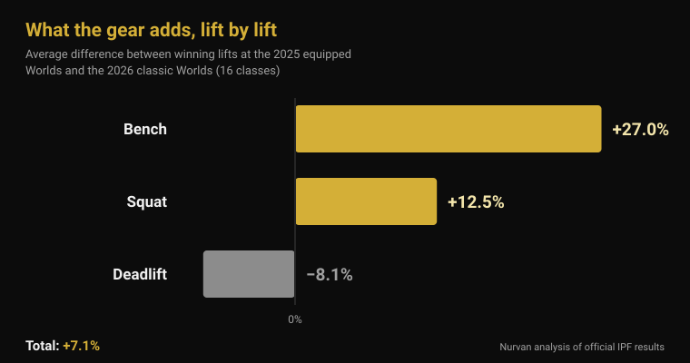
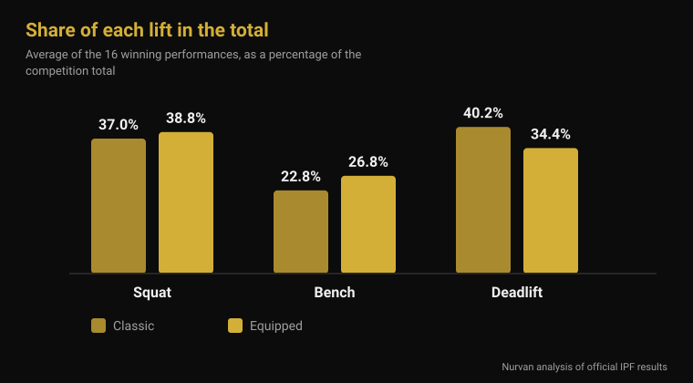

# Equipped Worlds 2026: how much the gear really adds

By [Giammaria Loi](/autore/giammaria-loi) · updated 4 November 2026

From Monday 9 to Sunday 15 November, Istanbul hosts the IPF World Open Equipped Championships: the meet where squat suits, bench shirts and knee wraps are legal. It produces the biggest numbers in powerlifting, and also the vaguest claims — "the suit is worth 100 kg", "it's all gear anyway". So I took the official IPF results from the last equipped Worlds and from June's classic Worlds and compared them class by class. The answer matches neither claim.

## The short version

- **Istanbul runs 9-15 November 2026.** It is the IPF World Open Equipped Championships, the only open world title where supportive gear is allowed (official IPF calendar).
- **The average edge on the total is 7%, not 20%.** Comparing the winning weights in all 16 classes at the 2025 equipped Worlds and the 2026 classic Worlds, the mean difference is **+7.1%**. In 2 classes out of 16 the classic winner lifted more.
- **The gear does not help the three lifts equally.** Bench **+27%**, squat **+12.5%**, deadlift **−8.1%**. Elastic fabric works where there is an eccentric phase to load — and the deadlift starts from a dead stop.
- **Knee wraps work, but they move the work elsewhere.** With wraps, peak squat power rises by **10%**, the descent is **45% faster**, and vastus lateralis activation at 90% of 1RM goes **down** (Lake 2012; Gomes 2015).
- **Knee sleeves are not soft wraps.** In 15 trained men, neoprene sleeves added about **5 kg** to the squat 1RM (166 vs 161 kg) and nothing else — and the effect was the same whether the sleeves were normal or a size tighter (Machek 2021).

## What happens in Istanbul, 9-15 November

The 2026 World Open Equipped Championships take place in Istanbul, Türkiye, from **9 to 15 November**, per the official International Powerlifting Federation calendar. It is the open meet — no age brackets — and it awards titles in eight men's bodyweight classes (59, 66, 74, 83, 93, 105, 120 and 120+ kg) and eight women's (47, 52, 57, 63, 69, 76, 84 and 84+ kg).

The previous edition closed on 16 November 2025 in **Cluj-Napoca, Romania**. Two things from the official IPF sheets are worth carrying into Istanbul: **Ukraine** won both team championships, men's and women's; and the best IPF GL scores belonged to **Volodymyr Rysiyev** (93 kg, 1,050 kg total) and **Taylor LaChapelle** (63 kg, 645 kg). The men's 74 kg went to **Jarosław Olech**, born in 1974 — an 850 kg total at fifty-one, in the open division.

The United States has announced a sixteen-lifter team, eight men and eight women, all in the open division, including **Ian Bell**, who won the 105 kg class in Cluj-Napoca with 1,067.5 kg, and **Kelsey McCarthy**, who won the 69 kg with 652.5 kg.

## Classic and equipped: what actually changes

The IPF technical rulebook in force since 1 March 2026 separates the two meets purely by what you may wear.

In **classic** (raw) you get: a non-supportive singlet, a t-shirt underneath, a leather or non-stretch belt up to 10 cm wide and 13 mm thick, neoprene **knee sleeves** up to 7 mm thick and 30 cm long, and wrist wraps up to 1 m long.

**Equipped** adds three garments classic forbids: the **squat suit** (single-thickness material, straps over the shoulders at all times, legs 3 to 15 cm from the top of the crotch), the **bench shirt** (no rubberised or stretch material, sleeves ending below the deltoid and not reaching the elbow) and **knee wraps** (no longer than 2 m, no wider than 8 cm, extending no more than 15 cm above and 15 cm below the centre of the knee). The rulebook explicitly forbids combining wraps and sleeves.

The technical difference is entirely that: suit, shirt and wraps are elastic fabric that resists the descent, stores energy and returns it on the way up. They do not lift for you — they change the force curve of the movement.

## How much the gear adds: the official numbers

To answer with numbers I used the two most comparable official results documents available: the winning lifts at the **2025 World Open Equipped Championships** (Cluj-Napoca) and at the **2026 World Open Classic Championships** (Druskininkai, Lithuania, 13-21 June). Same federation, same sixteen bodyweight classes, same level of competition.

On the **competition total**, the average difference across the sixteen classes is **+7.1%** in favour of equipped (median +7.8%). The equipped winner lifted more in fourteen classes out of sixteen. The two exceptions are instructive: in the men's 74 kg, Austin Perkins totalled **891.5 kg with no gear at all** against the equipped winner's 850, and in the women's 84+ kg Brittany Schlater finished on **756.5 kg** against 700.

| Lift | Average difference, equipped − classic |
|---|---|
| Bench press | +27.0% |
| Squat | +12.5% |
| Deadlift | −8.1% |
| **Total** | **+7.1%** |

Lift by lift the picture changes completely. The bench is where the shirt matters most: winning weights are on average **27% higher**. The squat gains **12.5%**. The deadlift, where the gear has no eccentric phase to exploit because the bar starts still on the floor, goes the other way: equipped winning deadlifts are on average **8% lighter** than classic ones.

You can see it in the shape of the total too. For classic winners the deadlift is **40.2%** of the total and the bench **22.8%**; for equipped winners the deadlift drops to **34.4%** and the bench rises to **26.8%**. Two sports with the same name and a different internal balance.

One honest caveat: these are different athletes at different meets, so the comparison measures **what gets lifted at the two competitions**, not the effect of a suit on the same body. But the direction matches the mechanism — the bigger the eccentric phase to load, the bigger the gain — and it matches the only published population data: analysing 26,472 open powerlifters, Ferland and colleagues found that equipped lifters lift significantly more than classic lifters in the same weight class (Ferland et al., 2020).

## What the research actually says

| Common claim | Verdict | Source |
|---|---|---|
| "Gear is worth 20-30% on the total" | Debunked: +7.1% on average | Official IPF results |
| "The suit helps all three lifts" | Debunked: the deadlift gets worse | Official IPF results |
| "Knee wraps let you lift more" | Confirmed — but they change the exercise | Lake et al., 2012; Gomes et al., 2015 |
| "Knee sleeves are just like wraps" | Debunked | Machek et al., 2021 |
| "A belt protects your back" | Needs qualifying | Siewe et al., 2011; Lynch et al., 2025 |
| "Powerlifting wrecks your joints" | Needs qualifying: 1 injury per 1,000 hours | Siewe et al., 2011 |

### Wraps work, but they don't train what you think

Wraps are the one piece of equipped kit plenty of people also use in a normal gym, so they deserve a close look. Ten trained men performed single squats at 80% of 1RM with and without wraps. With wraps, horizontal bar displacement fell by **39%**, the lowering phase was **45% faster**, the vertical impulse on the way up rose by **10%**, and peak power rose by **10%** (2,121 vs 1,841 W). The authors attribute this to elastic energy stored in the wrap during the descent, and conclude that wraps alter squat technique in a way that is likely to change which muscles the exercise targets (Lake et al., 2012).

The second study measures exactly that. Fourteen trained men squatted at 60% and 90% of 1RM with and without wraps: at 90%, **vastus lateralis** activation was lower with wraps. Without wraps, knee flexion was greater at both intensities (Gomes et al., 2015).

Translated: wraps let you lift more while your quads do less. In competition that is an advantage; in training, if the goal is building legs, it is an excellent reason to leave them in the bag. The same logic applies to technique details that shift which muscles work — I wrote about that in [knees out in the squat](/en/blog/knees-out-squat-cue-or-rule).

### Sleeves are a different animal

Fifteen trained men, none of whom had used sleeves before, tested three conditions: a minimally supportive control sleeve, a neoprene sleeve in the manufacturer's recommended size, and one size smaller. Squat 1RM rose with both real sleeves (166 kg vs 161 kg for the control), with **no difference between the normal and the tighter sleeve** and no effect at all on jump height, power, velocity or endurance. The authors underline the contrast with wraps, whose effect does grow with tightness (Machek et al., 2021).

Roughly 5 kg on 161, or 3%: useful on the platform, irrelevant as a shortcut.

### The belt is more complicated than the slogan

Two findings, neither of them reassuring in the expected way. In a questionnaire study of 245 competitive and elite powerlifters, belt use was **associated with a higher rate of lumbar spine injury** (Siewe et al., 2011). That is retrospective self-report, so it does not show the belt causes the problem: lifters who wear belts also handle heavier loads, and some put one on precisely because their back bothers them. But it is not what the marketing implies.

The second: in 28 men squatting at 75% of predicted 1RM, the **belt alone did not change activation** of trunk or lower-limb muscles; abdominal activity rose only with bracing — the active push of the abdominal wall — with or without a belt (Lynch et al., 2025). A belt is something to brace against, not a substitute for bracing.

That same Siewe paper carries the number usually missing from arguments about powerlifting: the injury rate is **0.3 injuries per lifter per year**, roughly one per 1,000 hours of training — low compared with many sports, even though 43% reported niggles during ordinary sessions.

## How to use this

1. **If you compete raw, you do not need wraps.** Their payoff is on the platform, and the price is less quadriceps work at exactly the intensities where you want it most.
2. **Sleeves: buy the recommended size.** Tighter does not give you more, and it hurts. Expect a few kilos, not a weight class.
3. **A belt is a skill, not a purchase.** Learn bracing without it first, then use the belt as a surface to push against. If your back hurts, cranking it tighter is not the fix.
4. **If you want to try equipped, expect to relearn the bench.** It is the lift the gear changes most, so it is the one that demands the most new technique.
5. **The deadlift stays the deadlift.** Istanbul will confirm it: it is the lift where the suit helps least, and where strength shows up unfiltered.
6. **Always log what you were wearing.** 180 kg in wraps and 180 kg without are two different data points. Put them in the same row and your training history stops meaning anything.

**Try Nurvan — loads with context, not just a number**

In Nurvan every set is logged with load, reps and RIR, and notes let you separate the same lift done with and without gear. Warm-up sets are proposed automatically from the day's top set, so progression stays readable even when you change your competition setup. If you work with a coach, they see the same history from their own profile. [Try Nurvan](https://nurvan.app)

## Frequently asked questions

**What is the difference between classic and equipped powerlifting?**
Classic (raw) allows a singlet, a belt, neoprene knee sleeves and wrist wraps. Equipped adds a squat suit, a bench shirt and elastic knee wraps, which store energy during the descent and return it on the ascent. In the IPF they are two separate competitions with separate titles.

**How much more can you lift with gear?**
Comparing the winning weights at the 2025 equipped Worlds and the 2026 classic Worlds in the same 16 classes, equipped totals are on average 7.1% higher. The average hides everything, though: the bench is up 27%, the squat 12.5%, and the deadlift is down 8%.

**Are knee wraps bad for your knees?**
The available studies measure mechanics and muscle activation, not long-term injury risk, so the honest answer is that we do not know. What we do know is that wraps cut horizontal bar displacement, speed up the descent and lower quadriceps activation at high intensities.

**Can I wear sleeves and wraps together?**
No. The IPF technical rulebook explicitly forbids it in competition. There is no rulebook in your gym, but there is no reason either: they do the same job, and wraps do it far more aggressively.

## Read next

- [Masters Worlds 2026: how much strength you really lose with age](/en/blog/world-masters-powerlifting-2026-strength-age) — the same analysis of official IPF results, applied to age brackets.
- [Knees out in the squat: rule or cue?](/en/blog/knees-out-squat-cue-or-rule) — how one technique detail changes which muscles actually work.
- [Bench press grip: wide, medium or close?](/en/blog/bench-press-grip-width-wide-close) — what grip width moves, with or without a shirt.

## Sources

- Lake JP, Carden PJC, Shorter KA, 2012. Wearing knee wraps affects mechanical output and performance characteristics of back squat exercise. *Journal of Strength and Conditioning Research* 26(10):2844-9. PMID 22995993. [DOI](https://doi.org/10.1519/JSC.0b013e3182429840)
- Gomes WA, Brown LE, Soares EG, da Silva JJ, de O Silva FHD, Serpa ÉP, Corrêa DA, Vilela Junior GdeB, Lopes CR, Marchetti PH, 2015. Kinematic and sEMG Analysis of the Back Squat at Different Intensities With and Without Knee Wraps. *Journal of Strength and Conditioning Research* 29(9):2482-7. PMID 25763519. [DOI](https://doi.org/10.1519/JSC.0000000000000922)
- Machek SB, Cardaci TD, Wilburn DT, Cholewinski MC, Latt SL, Harris DR, Willoughby DS, 2021. Neoprene Knee Sleeves of Varying Tightness Augment Barbell Squat One Repetition Maximum Performance Without Improving Other Indices of Muscular Strength, Power, or Endurance. *Journal of Strength and Conditioning Research* 35(Suppl 1):S6-S15. PMID 33201154. [DOI](https://doi.org/10.1519/JSC.0000000000003869)
- Siewe J, Rudat J, Röllinghoff M, Schlegel UJ, Eysel P, Michael JW-P, 2011. Injuries and overuse syndromes in powerlifting. *International Journal of Sports Medicine* 32(9):703-11. PMID 21590644. [DOI](https://doi.org/10.1055/s-0031-1277207)
- Lynch DJ, Drusch AS, Hooper TL, James CR, Brooks TJ, Wilford KF, Seeber GH, Sizer PS, 2025. Changes in muscle activation in response to abdominal bracing and stabilization belt use during a loaded squat. *Journal of Sports Sciences* 43(20):2434-2446. PMID 40698971. [DOI](https://doi.org/10.1080/02640414.2025.2535048)
- Ferland PM, Allard MO, Comtois AS, 2020. Efficiency of the Wilks and IPF Formulas at Comparing Maximal Strength Regardless of Bodyweight through Analysis of the Open Powerlifting Database. *International Journal of Exercise Science* 13(4):567-582. PMID 33042369. [DOI](https://doi.org/10.70252/XGHM8852)

References retrieved through PubMed. Competition data from official IPF results (2025 World Open Equipped, Cluj-Napoca; 2026 World Open Classic, Druskininkai) and the official IPF calendar; rules from the IPF Technical Rules Book in force from 1 March 2026. United States team composition from Powerlifting America.

---

Giammaria Loi is the founder of Nurvan. He has been lifting since 2012, has worked as a FIPE-certified personal trainer and coach since 2013, and has competed in powerlifting at national level since 2018. Every article he writes starts from the research and ends with what actually works in the gym.

> Note: educational content, not a substitute for medical or professional advice.
