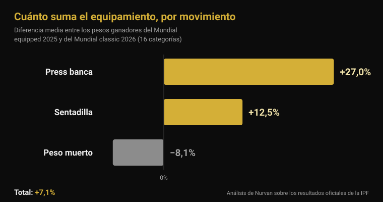
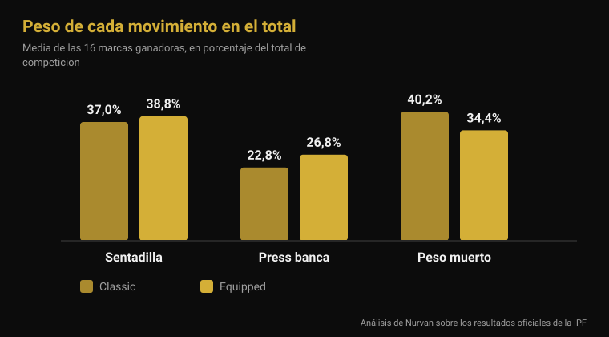

# Mundial equipped 2026: cuánto suma el equipamiento

Por [Giammaria Loi](/autore/giammaria-loi) · actualizado el 4 de noviembre de 2026

Del lunes 9 al domingo 15 de noviembre, Estambul reparte los títulos mundiales IPF de la categoría equipped: la competición en la que el mono de sentadilla, la camiseta de press banca y las vendas de rodilla están permitidos. Es la especialidad que produce los números más grandes del powerlifting y también sobre la que circulan las frases más vagas: "con el mono levantas 100 kg más", "total, es todo equipamiento". He cogido los resultados oficiales de la IPF de la última edición equipped y los del Mundial raw de junio y los he comparado categoría por categoría. El resultado no se parece a ninguna de las dos frases.

## En resumen

- **Estambul compite del 9 al 15 de noviembre de 2026.** Es el Mundial IPF Open Equipped, el único título mundial absoluto en el que se permite el equipamiento de apoyo (calendario oficial de la IPF).
- **La ventaja media en el total es del 7%, no del 20%.** Comparando los pesos ganadores de las 16 categorías del Mundial equipped 2025 con los del Mundial raw 2026, la diferencia media es del **+7,1%**. En 2 de 16 categorías ganó más peso el raw.
- **El equipamiento no ayuda igual a los tres movimientos.** Press banca **+27%**, sentadilla **+12,5%**, peso muerto **−8,1%**: el tejido elástico trabaja donde hay una fase excéntrica que cargar, y el peso muerto arranca desde parado.
- **Las vendas funcionan, pero desplazan el trabajo.** Con vendas la potencia máxima en sentadilla sube un **10%**, la bajada es un **45% más rápida** y la activación del vasto lateral al 90% del máximo **baja** (Lake 2012; Gomes 2015).
- **Las rodilleras no son vendas blandas.** En 15 hombres entrenados, las rodilleras de neopreno añadieron unos **5 kg** al máximo de sentadilla (166 frente a 161 kg) y nada más, con el mismo efecto con la talla recomendada y con una talla menos (Machek 2021).

## Qué pasa en Estambul del 9 al 15 de noviembre

El Mundial Open Equipped 2026 se celebra en Estambul, Turquía, del **9 al 15 de noviembre**, según el calendario oficial de la International Powerlifting Federation. Es la prueba absoluta —categoría Open, sin franjas de edad— y reparte títulos en las ocho categorías de peso masculinas (59, 66, 74, 83, 93, 105, 120 y más de 120 kg) y en las ocho femeninas (47, 52, 57, 63, 69, 76, 84 y más de 84 kg).

La edición anterior se cerró el 16 de noviembre de 2025 en **Cluj-Napoca, Rumanía**. Los documentos oficiales de la IPF dejan dos datos útiles para leer la de Estambul: **Ucrania** ganó las dos clasificaciones por equipos, masculina y femenina; las mejores puntuaciones IPF GL fueron de **Volodymyr Rysiyev** (93 kg, 1.050 kg de total) y de **Taylor LaChapelle** (63 kg, 645 kg). En la 74 kg masculina ganó **Jarosław Olech**, nacido en 1974: 850 kg de total a los cincuenta y uno, en categoría Open.

Estados Unidos ha anunciado un equipo de dieciséis atletas, ocho hombres y ocho mujeres, todos en Open, entre ellos **Ian Bell**, ganador de la 105 kg en Cluj-Napoca con 1.067,5 kg, y **Kelsey McCarthy**, ganadora de la 69 kg con 652,5 kg.

## Raw y equipped: qué cambia de verdad

El reglamento técnico de la IPF en vigor desde el 1 de marzo de 2026 separa las dos competiciones solo por lo que se puede vestir.

En **raw** (classic) se permiten: maillot de competición no elástico, camiseta debajo, cinturón de cuero o material no elástico de 10 cm de ancho y 13 mm de grosor como máximo, **rodilleras** de neopreno de hasta 7 mm de grosor y 30 cm de largo, y muñequeras de hasta 1 metro.

En **equipped** se añaden tres prendas que el raw prohíbe: el **mono de sentadilla** (tejido de un solo grosor, tirantes siempre sobre los hombros, perneras de 3 a 15 cm desde la entrepierna), la **camiseta de press banca** (tejido no engomado, mangas que acaban por debajo del deltoides sin llegar al codo) y las **vendas de rodilla** (máximo 2 metros de largo y 8 cm de ancho, sin pasar de 15 cm por encima ni 15 cm por debajo del centro de la rodilla). El reglamento prohíbe expresamente combinar vendas y rodilleras.

La diferencia técnica es exactamente esa: mono, camiseta y vendas son tejidos elásticos que se oponen a la bajada, acumulan energía y la devuelven en la subida. No levantan por ti: cambian la curva de fuerza del movimiento.

## Cuánto suma el equipamiento: los números oficiales

Para responder con números he usado los dos documentos de resultados más comparables que existen: los pesos de los ganadores del **Mundial Open Equipped 2025** (Cluj-Napoca) y los del **Mundial Open Classic 2026** (Druskininkai, Lituania, 13-21 de junio). Misma federación, mismas dieciséis categorías de peso, mismo nivel.

En el **total de competición**, la diferencia media entre las dieciséis categorías es del **+7,1%** a favor del equipped (mediana +7,8%). En catorce de dieciséis categorías el ganador equipped levantó más. Las otras dos son instructivas: en la 74 kg masculina Austin Perkins totalizó **891,5 kg sin equipamiento** frente a los 850 del ganador equipped, y en la femenina de más de 84 kg Brittany Schlater cerró en **756,5 kg** frente a 700.

| Movimiento | Diferencia media equipped − raw |
|---|---|
| Press banca | +27,0% |
| Sentadilla | +12,5% |
| Peso muerto | −8,1% |
| **Total** | **+7,1%** |

Movimiento a movimiento el cuadro cambia por completo. El press banca es donde la camiseta más pesa: los pesos ganadores son de media un **27% más altos**. La sentadilla gana un **12,5%**. El peso muerto, donde el equipamiento no tiene una fase excéntrica que aprovechar porque la barra arranca parada en el suelo, va en dirección contraria: los pesos ganadores equipped son de media un **8% más bajos** que los raw.

También se ve en la composición del total. En los ganadores raw el peso muerto vale el **40,2%** del total y el press banca el **22,8%**; en los equipped el peso muerto baja al **34,4%** y el press banca sube al **26,8%**. Dos deportes con el mismo nombre y un equilibrio interno distinto.

Una precisión honesta: son atletas distintos en competiciones distintas, así que esta comparación mide **cuánto se levanta en las dos pruebas**, no el efecto del mono sobre el mismo cuerpo. Pero la dirección encaja con el mecanismo —más ganancia cuanto más tejido elástico hay que cargar en la bajada— y con el único dato poblacional publicado: analizando 26.472 powerlifters de categoría Open, Ferland y sus colegas encontraron que los atletas equipped levantan de forma estadísticamente significativa más que los raw de la misma categoría de peso (Ferland et al., 2020).

## Qué dice realmente la investigación

| Afirmación habitual | Veredicto | Fuente |
|---|---|---|
| "Con equipamiento levantas un 20-30% más de total" | Desmentido: +7,1% de media | Resultados oficiales IPF |
| "El mono ayuda en los tres movimientos" | Desmentido: el peso muerto empeora | Resultados oficiales IPF |
| "Las vendas te hacen levantar más" | Confirmado, pero cambian el ejercicio | Lake et al., 2012; Gomes et al., 2015 |
| "Las rodilleras son como las vendas" | Desmentido | Machek et al., 2021 |
| "El cinturón protege la espalda" | Hay que matizar | Siewe et al., 2011; Lynch et al., 2025 |
| "El powerlifting destroza las articulaciones" | Hay que matizar: 1 lesión cada 1.000 horas | Siewe et al., 2011 |

### Las vendas funcionan, pero no entrenan lo que crees

Son la única pieza del equipamiento equipped que mucha gente usa también en el gimnasio, así que merecen una mirada de cerca. Diez hombres entrenados hicieron sentadillas simples al 80% del máximo con y sin vendas. Con vendas el desplazamiento horizontal de la barra bajó un **39%**, la fase de bajada fue un **45% más rápida**, el impulso vertical en la subida aumentó un **10%** y la potencia máxima un **10%** (2.121 frente a 1.841 W). Los autores lo atribuyen a la energía elástica acumulada en la venda durante la bajada y concluyen que las vendas cambian la técnica de la sentadilla de una forma que probablemente modifica los músculos implicados (Lake et al., 2012).

El segundo estudio mide justo eso. Catorce hombres entrenados hicieron sentadillas al 60% y al 90% del máximo con y sin vendas: al 90%, la activación electromiográfica del **vasto lateral** fue menor con vendas. Sin vendas la flexión de rodilla era mayor en las dos intensidades (Gomes et al., 2015).

Traducido: las vendas te hacen levantar más y trabajar menos con el cuádriceps. En competición es una ventaja; en entrenamiento, si el objetivo es construir pierna, es una excelente razón para dejarlas en la bolsa. Lo mismo vale para los detalles de técnica que cambian qué músculos trabajan: lo conté hablando de las [rodillas hacia fuera en la sentadilla](/es/blog/rodillas-hacia-fuera-sentadilla).

### Las rodilleras son otra cosa

Quince hombres entrenados que nunca las habían usado probaron tres condiciones: una manga de control poco sujetante, una rodillera de neopreno de la talla recomendada y otra una talla menos. El máximo de sentadilla subió con las dos rodilleras reales (166 kg frente a 161 del control), **sin ninguna diferencia entre la talla normal y la apretada** y sin efecto alguno sobre salto, potencia, velocidad o resistencia. Los autores subrayan el contraste con las vendas, cuyo efecto sí crece con la compresión (Machek et al., 2021).

Unos 5 kg sobre 161, es decir un 3%: útil en competición, irrelevante como atajo.

### El cinturón: más complicado de lo que lo cuentan

Dos datos, y ninguno tranquiliza en el sentido esperado. En un cuestionario a 245 powerlifters de competición y de élite, el uso del cinturón aparecía **asociado a una tasa más alta de lesiones lumbares** (Siewe et al., 2011). Es un estudio retrospectivo con datos declarados, así que no demuestra que el cinturón cause el problema: quien lo usa también mueve más peso, y hay quien se lo pone precisamente porque la espalda le molesta. Pero no es lo que sugiere el marketing.

El segundo: en 28 hombres que hacían sentadilla al 75% del máximo previsto, el **cinturón por sí solo no modificó la activación** de los músculos del tronco ni de las piernas; la activación abdominal solo aumentó con el *bracing*, el empuje activo de la pared abdominal, con o sin cinturón (Lynch et al., 2025). El cinturón es una superficie contra la que empujar, no un sustituto del empuje.

El mismo trabajo de Siewe contiene el dato que suele faltar en estas discusiones: la tasa de lesiones es de **0,3 lesiones por atleta y año**, aproximadamente una cada 1.000 horas de entrenamiento, baja comparada con muchos deportes, aunque el 43% refería molestias en los entrenamientos ordinarios.

## Cómo aplicarlo

1. **Si compites en raw, no necesitas vendas.** Su ventaja está en la plataforma, y el precio es menos trabajo de cuádriceps justo en las intensidades donde más lo quieres.
2. **Rodilleras: compra la talla recomendada.** Más apretadas no dan más y molestan. Espera unos kilos, no una categoría.
3. **El cinturón se aprende, no se pone y ya.** Primero el bracing sin cinturón, luego el cinturón como superficie contra la que empujar. Si la espalda duele, apretar más no lo arregla.
4. **Si quieres probar el equipped, cuenta con reaprender el press banca.** Es el movimiento que más cambia con el equipamiento y el que más técnica nueva exige.
5. **El peso muerto sigue siendo el peso muerto.** Estambul lo confirmará: es el movimiento en el que el mono menos ayuda y en el que la fuerza se ve sin filtros.
6. **Anota siempre con qué equipamiento levantaste.** 180 kg con vendas y 180 kg sin vendas son dos datos distintos: si acaban en la misma línea, tu histórico deja de significar nada.

**Prueba Nurvan — las cargas con contexto, no solo el número**

En Nurvan cada serie se registra con carga, repeticiones y RIR, y las notas te permiten distinguir el mismo movimiento hecho con o sin equipamiento. Las series de calentamiento se proponen automáticamente a partir de la serie más pesada del día, así la progresión sigue siendo legible aunque cambies de montaje de competición. Si te sigue un entrenador, ve el mismo histórico desde su perfil. [Prueba Nurvan](https://nurvan.app)

## Preguntas frecuentes

**¿Qué diferencia hay entre powerlifting raw y equipped?**
El raw (classic) permite maillot, cinturón, rodilleras de neopreno y muñequeras. El equipped añade mono de sentadilla, camiseta de press banca y vendas elásticas de rodilla, que acumulan energía en la bajada y la devuelven en la subida. En la IPF son dos competiciones separadas con títulos separados.

**¿Cuánto más se levanta con equipamiento?**
Comparando los pesos ganadores del Mundial equipped 2025 y del raw 2026 en las mismas 16 categorías, el total es de media un 7,1% más alto en equipped. Pero la media lo esconde todo: el press banca sube un 27%, la sentadilla un 12,5% y el peso muerto baja un 8%.

**¿Las vendas de rodilla son malas para las rodillas?**
Los estudios disponibles miden mecánica y activación muscular, no el riesgo de lesión a largo plazo, así que la respuesta honesta es que no lo sabemos. Lo que sí se sabe es que reducen el desplazamiento horizontal de la barra, aceleran la bajada y bajan la activación del cuádriceps a intensidades altas.

**¿Puedo usar rodilleras y vendas a la vez?**
No. El reglamento técnico de la IPF lo prohíbe expresamente en competición. En el gimnasio no hay reglamento, pero tampoco motivo: hacen el mismo trabajo y las vendas lo hacen de forma mucho más agresiva.

## Lee también

- [Mundial Master 2026: cuánta fuerza se pierde con la edad](/es/blog/mundial-master-powerlifting-2026-fuerza-edad) — el mismo análisis de resultados oficiales de la IPF, aplicado a las franjas de edad.
- [Rodillas hacia fuera en la sentadilla: ¿regla o cue?](/es/blog/rodillas-hacia-fuera-sentadilla) — cómo un detalle técnico cambia qué músculos trabajan.
- [Agarre en press banca: ¿ancho, medio o cerrado?](/es/blog/agarre-press-banca-ancho-cerrado) — qué mueve la amplitud del agarre, con camiseta o sin ella.

## Fuentes

- Lake JP, Carden PJC, Shorter KA, 2012. Wearing knee wraps affects mechanical output and performance characteristics of back squat exercise. *Journal of Strength and Conditioning Research* 26(10):2844-9. PMID 22995993. [DOI](https://doi.org/10.1519/JSC.0b013e3182429840)
- Gomes WA, Brown LE, Soares EG, da Silva JJ, de O Silva FHD, Serpa ÉP, Corrêa DA, Vilela Junior GdeB, Lopes CR, Marchetti PH, 2015. Kinematic and sEMG Analysis of the Back Squat at Different Intensities With and Without Knee Wraps. *Journal of Strength and Conditioning Research* 29(9):2482-7. PMID 25763519. [DOI](https://doi.org/10.1519/JSC.0000000000000922)
- Machek SB, Cardaci TD, Wilburn DT, Cholewinski MC, Latt SL, Harris DR, Willoughby DS, 2021. Neoprene Knee Sleeves of Varying Tightness Augment Barbell Squat One Repetition Maximum Performance Without Improving Other Indices of Muscular Strength, Power, or Endurance. *Journal of Strength and Conditioning Research* 35(Suppl 1):S6-S15. PMID 33201154. [DOI](https://doi.org/10.1519/JSC.0000000000003869)
- Siewe J, Rudat J, Röllinghoff M, Schlegel UJ, Eysel P, Michael JW-P, 2011. Injuries and overuse syndromes in powerlifting. *International Journal of Sports Medicine* 32(9):703-11. PMID 21590644. [DOI](https://doi.org/10.1055/s-0031-1277207)
- Lynch DJ, Drusch AS, Hooper TL, James CR, Brooks TJ, Wilford KF, Seeber GH, Sizer PS, 2025. Changes in muscle activation in response to abdominal bracing and stabilization belt use during a loaded squat. *Journal of Sports Sciences* 43(20):2434-2446. PMID 40698971. [DOI](https://doi.org/10.1080/02640414.2025.2535048)
- Ferland PM, Allard MO, Comtois AS, 2020. Efficiency of the Wilks and IPF Formulas at Comparing Maximal Strength Regardless of Bodyweight through Analysis of the Open Powerlifting Database. *International Journal of Exercise Science* 13(4):567-582. PMID 33042369. [DOI](https://doi.org/10.70252/XGHM8852)

Referencias bibliográficas recuperadas mediante PubMed. Datos de competición de los resultados oficiales de la IPF (Mundial Open Equipped 2025, Cluj-Napoca; Mundial Open Classic 2026, Druskininkai) y del calendario oficial de la IPF; reglamento del IPF Technical Rules Book en vigor desde el 1 de marzo de 2026. Composición del equipo estadounidense de Powerlifting America.

---

Giammaria Loi es el fundador de Nurvan. Entrena con pesas desde 2012, trabaja como entrenador personal y coach certificado FIPE desde 2013 y compite en powerlifting a nivel nacional desde 2018. Cada artículo que firma parte de los estudios científicos y llega a lo que funciona de verdad en el gimnasio.

> Nota: contenido informativo, no sustituye la opinión de un médico o profesional.
