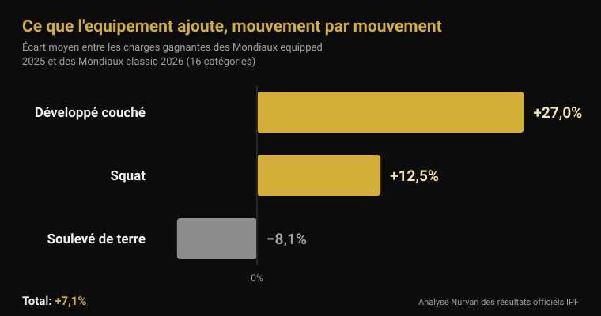
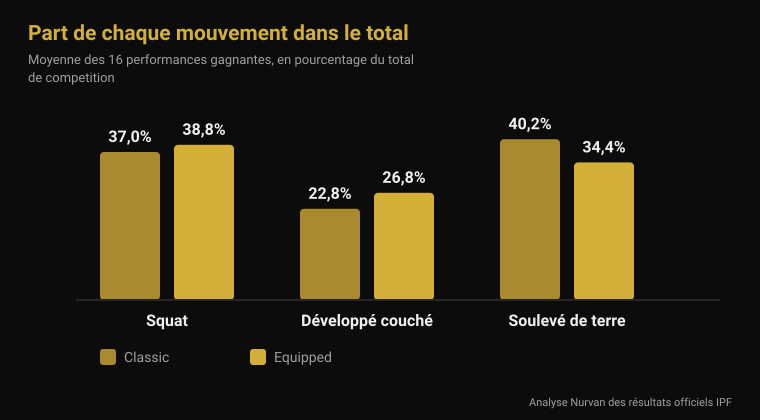

# Mondiaux equipped 2026 : ce qu'apporte l'équipement

Par [Giammaria Loi](/autore/giammaria-loi) · mis à jour le 4 novembre 2026

Du lundi 9 au dimanche 15 novembre, Istanbul décerne les titres mondiaux IPF de la catégorie equipped : la compétition où la combinaison de squat, la chemise de développé couché et les bandes de genoux sont autorisées. C'est la discipline qui produit les plus gros chiffres de la force athlétique, et aussi celle qui charrie les phrases les plus vagues — « avec la combinaison tu prends 100 kg », « de toute façon c'est l'équipement qui soulève ». J'ai pris les résultats officiels IPF de la dernière édition equipped et ceux des Mondiaux classic de juin, et je les ai comparés catégorie par catégorie. Le résultat ne ressemble à aucune des deux phrases.

## L'essentiel

- **Istanbul, du 9 au 15 novembre 2026.** Ce sont les Mondiaux IPF Open Equipped, le seul titre mondial absolu où l'équipement de soutien est autorisé (calendrier officiel IPF).
- **L'avantage moyen sur le total est de 7 %, pas de 20 %.** En comparant les charges gagnantes des 16 catégories des Mondiaux equipped 2025 et des Mondiaux classic 2026, l'écart moyen est de **+7,1 %**. Dans 2 catégories sur 16, c'est le vainqueur classic qui a soulevé le plus.
- **L'équipement n'aide pas les trois mouvements de la même façon.** Développé couché **+27 %**, squat **+12,5 %**, soulevé de terre **−8,1 %** : le tissu élastique travaille là où il y a une phase excentrique à charger, et le soulevé de terre part à l'arrêt.
- **Les bandes fonctionnent, mais elles déplacent le travail.** Avec les bandes, la puissance de pointe au squat augmente de **10 %**, la descente est **45 % plus rapide** et l'activation du vaste latéral à 90 % du maximum **diminue** (Lake 2012 ; Gomes 2015).
- **Les genouillères ne sont pas des bandes molles.** Chez 15 hommes entraînés, les genouillères en néoprène ont ajouté environ **5 kg** au maximum au squat (166 contre 161 kg) et rien d'autre, avec le même effet en taille recommandée et en taille en dessous (Machek 2021).

## Ce qui se passe à Istanbul du 9 au 15 novembre

Les Mondiaux Open Equipped 2026 se tiennent à Istanbul, en Turquie, du **9 au 15 novembre**, selon le calendrier officiel de l'International Powerlifting Federation. C'est l'épreuve absolue — catégorie Open, sans classes d'âge — et elle décerne les titres dans les huit catégories de poids masculines (59, 66, 74, 83, 93, 105, 120 et plus de 120 kg) et les huit féminines (47, 52, 57, 63, 69, 76, 84 et plus de 84 kg).

L'édition précédente s'est achevée le 16 novembre 2025 à **Cluj-Napoca, en Roumanie**. Les documents officiels IPF en retiennent deux choses utiles pour lire celle d'Istanbul : l'**Ukraine** a remporté les deux classements par équipes, masculin et féminin ; les meilleurs scores IPF GL sont allés à **Volodymyr Rysiyev** (93 kg, 1 050 kg de total) et à **Taylor LaChapelle** (63 kg, 645 kg). Chez les hommes, les 74 kg ont été remportés par **Jarosław Olech**, né en 1974 : 850 kg de total à cinquante et un ans, en catégorie Open.

Les États-Unis ont annoncé une équipe de seize athlètes, huit hommes et huit femmes, tous en Open, parmi lesquels **Ian Bell**, vainqueur des 105 kg à Cluj-Napoca avec 1 067,5 kg, et **Kelsey McCarthy**, victorieuse des 69 kg avec 652,5 kg.

## Classic et equipped : ce qui change vraiment

Le règlement technique IPF en vigueur depuis le 1er mars 2026 sépare les deux compétitions uniquement par ce qu'on a le droit de porter.

En **classic** (raw) sont autorisés : la combinaison de compétition non élastique, un t-shirt dessous, une ceinture en cuir ou en matériau non extensible de 10 cm de large et 13 mm d'épaisseur au maximum, des **genouillères** en néoprène de 7 mm d'épaisseur et 30 cm de long au maximum, et des bandes de poignets d'un mètre maximum.

En **equipped** s'ajoutent trois pièces interdites en classic : la **combinaison de squat** (tissu d'une seule épaisseur, bretelles toujours sur les épaules, jambes de 3 à 15 cm depuis l'entrejambe), la **chemise de développé couché** (tissu non caoutchouté, manches s'arrêtant sous le deltoïde sans atteindre le coude) et les **bandes de genoux** (2 mètres de long et 8 cm de large maximum, pas plus de 15 cm au-dessus ni 15 cm au-dessous du centre du genou). Le règlement interdit explicitement de combiner bandes et genouillères.

La différence technique tient entièrement là : combinaison, chemise et bandes sont des tissus élastiques qui s'opposent à la descente, stockent de l'énergie et la restituent à la remontée. Ils ne soulèvent pas à votre place : ils modifient la courbe de force du mouvement.

## Ce qu'apporte l'équipement : les chiffres officiels

Pour répondre avec des chiffres, j'ai pris les deux documents de résultats les plus comparables qui existent : les charges des vainqueurs des **Mondiaux Open Equipped 2025** (Cluj-Napoca) et celles des vainqueurs des **Mondiaux Open Classic 2026** (Druskininkai, Lituanie, 13-21 juin). Même fédération, mêmes seize catégories de poids, même niveau.

Sur le **total de compétition**, l'écart moyen entre les seize catégories est de **+7,1 %** en faveur de l'equipped (médiane +7,8 %). Dans quatorze catégories sur seize, le vainqueur equipped a soulevé davantage. Les deux exceptions sont parlantes : chez les hommes en 74 kg, Austin Perkins a totalisé **891,5 kg sans aucun équipement** contre 850 pour le vainqueur equipped, et chez les femmes en plus de 84 kg, Brittany Schlater a conclu à **756,5 kg** contre 700.

| Mouvement | Écart moyen equipped − classic |
|---|---|
| Développé couché | +27,0 % |
| Squat | +12,5 % |
| Soulevé de terre | −8,1 % |
| **Total** | **+7,1 %** |

Mouvement par mouvement, le tableau change du tout au tout. Le développé couché est l'épreuve où la chemise pèse le plus : les charges gagnantes y sont en moyenne **27 % plus lourdes**. Le squat gagne **12,5 %**. Le soulevé de terre, où l'équipement n'a pas de phase excentrique à exploiter puisque la barre part immobile au sol, part dans l'autre sens : les charges gagnantes equipped sont en moyenne **8 % plus légères** que les charges classic.

Cela se voit aussi dans la composition du total. Chez les vainqueurs classic, le soulevé de terre vaut **40,2 %** du total et le développé couché **22,8 %** ; chez les vainqueurs equipped, le soulevé tombe à **34,4 %** et le développé monte à **26,8 %**. Deux sports qui portent le même nom et n'ont pas le même équilibre interne.

Une précision honnête : ce sont des athlètes différents, dans des compétitions différentes. Cette comparaison mesure donc **ce qui se soulève dans les deux épreuves**, pas l'effet de la combinaison sur un même corps. Mais le sens va avec le mécanisme — d'autant plus de gain qu'il y a de tissu élastique à charger à la descente — et avec la seule donnée de population publiée : en analysant 26 472 powerlifters de catégorie Open, Ferland et ses collègues ont trouvé que les athlètes equipped soulèvent significativement plus que les classic de la même catégorie de poids (Ferland et al., 2020).

## Ce que dit vraiment la recherche

| Affirmation courante | Verdict | Source |
|---|---|---|
| « Avec l'équipement, +20-30 % sur le total » | Démenti : +7,1 % en moyenne | Résultats officiels IPF |
| « La combinaison aide les trois mouvements » | Démenti : le soulevé de terre baisse | Résultats officiels IPF |
| « Les bandes font soulever plus » | Confirmé, mais elles changent l'exercice | Lake et al., 2012 ; Gomes et al., 2015 |
| « Les genouillères, c'est comme des bandes » | Démenti | Machek et al., 2021 |
| « La ceinture protège le dos » | À nuancer | Siewe et al., 2011 ; Lynch et al., 2025 |
| « La force athlétique détruit les articulations » | À nuancer : 1 blessure pour 1 000 heures | Siewe et al., 2011 |

### Les bandes marchent, mais elles n'entraînent pas ce qu'on croit

C'est la seule pièce de l'équipement equipped que beaucoup utilisent aussi en salle, elle mérite donc un examen de près. Dix hommes entraînés ont réalisé des squats en série de une à 80 % du maximum, avec et sans bandes. Avec les bandes, le déplacement horizontal de la barre a chuté de **39 %**, la phase de descente a été **45 % plus rapide**, l'impulsion verticale à la remontée a augmenté de **10 %** et la puissance de pointe de **10 %** (2 121 contre 1 841 W). Les auteurs attribuent l'effet à l'énergie élastique stockée dans la bande pendant la descente et concluent que les bandes modifient la technique du squat d'une manière qui change probablement les muscles sollicités (Lake et al., 2012).

La deuxième étude mesure exactement cela. Quatorze hommes entraînés ont squatté à 60 % et 90 % du maximum, avec et sans bandes : à 90 %, l'activation électromyographique du **vaste latéral** était plus faible avec les bandes. Sans bandes, la flexion du genou était plus grande aux deux intensités (Gomes et al., 2015).

Traduction : les bandes font soulever plus et travailler moins les quadriceps. En compétition c'est un avantage ; à l'entraînement, si l'objectif est de construire les cuisses, c'est une excellente raison de les laisser dans le sac. Le même raisonnement vaut pour les détails techniques qui changent les muscles sollicités — j'en ai parlé à propos des [genoux vers l'extérieur au squat](/fr/blog/genoux-vers-exterieur-squat).

### Les genouillères, c'est autre chose

Quinze hommes entraînés n'en ayant jamais porté ont testé trois conditions : un manchon témoin peu soutenant, une genouillère en néoprène à la taille recommandée et une taille en dessous. Le maximum au squat a augmenté avec les deux vraies genouillères (166 kg contre 161 kg pour le témoin), **sans aucune différence entre la taille normale et la plus serrée** et sans aucun effet sur le saut, la puissance, la vitesse ou l'endurance. Les auteurs soulignent le contraste avec les bandes, dont l'effet augmente bel et bien avec la compression (Machek et al., 2021).

Environ 5 kg sur 161, soit 3 % : utile en compétition, négligeable comme raccourci.

### La ceinture : plus compliqué que le slogan

Deux données, et aucune n'est rassurante dans le sens attendu. Dans un questionnaire auprès de 245 powerlifters de compétition et d'élite, le port de la ceinture était **associé à un taux plus élevé de blessures lombaires** (Siewe et al., 2011). C'est une étude rétrospective sur déclarations : elle ne prouve pas que la ceinture cause le problème, car ceux qui la portent manipulent aussi des charges plus lourdes et certains la mettent justement parce que le dos les gêne. Mais ce n'est pas ce que suggère le marketing.

La seconde : chez 28 hommes squattant à 75 % du maximum prédit, la **ceinture seule n'a pas modifié l'activation** des muscles du tronc ni des membres inférieurs ; l'activité abdominale n'a augmenté qu'avec le *bracing*, la poussée active de la paroi abdominale, avec ou sans ceinture (Lynch et al., 2025). La ceinture est une surface contre laquelle pousser, pas un substitut à la poussée.

Le même travail de Siewe contient le chiffre qui manque d'ordinaire dans les discussions sur la force athlétique : le taux de blessures est de **0,3 blessure par athlète et par an**, soit environ une pour 1 000 heures d'entraînement — faible par rapport à beaucoup de sports, même si 43 % rapportaient des douleurs lors des séances ordinaires.

## Comment l'appliquer

1. **Si vous concourez en classic, les bandes ne vous servent pas.** Leur bénéfice est sur le plateau, et le prix est moins de travail du quadriceps précisément aux intensités où vous en voulez le plus.
2. **Genouillères : prenez la taille recommandée.** Plus serré n'apporte rien et fait mal. Attendez-vous à quelques kilos, pas à une catégorie.
3. **La ceinture s'apprend, elle ne se met pas simplement.** D'abord le bracing sans ceinture, puis la ceinture comme surface d'appui. Si le dos fait mal, serrer plus ne règle rien.
4. **Si vous voulez essayer l'equipped, prévoyez de réapprendre le développé couché.** C'est le mouvement que l'équipement transforme le plus, donc celui qui demande le plus de technique nouvelle.
5. **Le soulevé de terre reste le soulevé de terre.** Istanbul le confirmera : c'est le mouvement où la combinaison aide le moins et où la force se voit sans filtre.
6. **Notez toujours avec quel équipement vous avez soulevé.** 180 kg avec bandes et 180 kg sans sont deux données différentes : dans la même ligne, votre historique ne veut plus rien dire.

**Essayez Nurvan — les charges avec leur contexte, pas juste un chiffre**

Dans Nurvan, chaque série est enregistrée avec la charge, les répétitions et le RIR, et les notes permettent de distinguer le même mouvement réalisé avec ou sans équipement. Les séries d'échauffement sont proposées automatiquement à partir de la série la plus lourde du jour, ce qui garde la progression lisible même quand vous changez de configuration de compétition. Si un coach vous suit, il voit le même historique depuis son profil. [Essayez Nurvan](https://nurvan.app)

## Questions fréquentes

**Quelle est la différence entre force athlétique classic et equipped ?**
Le classic (raw) autorise la combinaison, la ceinture, les genouillères en néoprène et les bandes de poignets. L'equipped ajoute la combinaison de squat, la chemise de développé couché et les bandes de genoux élastiques, qui stockent de l'énergie à la descente et la restituent à la remontée. À l'IPF, ce sont deux compétitions distinctes avec des titres distincts.

**Combien soulève-t-on en plus avec l'équipement ?**
En comparant les charges gagnantes des Mondiaux equipped 2025 et classic 2026 dans les mêmes 16 catégories, le total est en moyenne 7,1 % plus élevé en equipped. Mais la moyenne cache tout : le développé couché monte de 27 %, le squat de 12,5 %, et le soulevé de terre baisse de 8 %.

**Les bandes de genoux abîment-elles les genoux ?**
Les études disponibles mesurent la mécanique et l'activation musculaire, pas le risque de blessure à long terme : la réponse honnête est qu'on ne le sait pas. Ce qu'on sait, c'est qu'elles réduisent le déplacement horizontal de la barre, accélèrent la descente et abaissent l'activation du quadriceps aux hautes intensités.

**Puis-je porter genouillères et bandes ensemble ?**
Non. Le règlement technique IPF l'interdit explicitement en compétition. En salle il n'y a pas de règlement, mais pas de raison non plus : elles font le même travail, et les bandes le font bien plus agressivement.

## À lire ensuite

- [Mondiaux masters 2026 : combien de force perd-on avec l'âge ?](/fr/blog/mondiaux-masters-powerlifting-2026-force-age) — la même analyse des résultats officiels IPF, appliquée aux classes d'âge.
- [Genoux vers l'extérieur au squat : règle ou consigne ?](/fr/blog/genoux-vers-exterieur-squat) — comment un détail technique change les muscles réellement sollicités.
- [Prise au développé couché : large, moyenne ou serrée ?](/fr/blog/prise-developpe-couche-large-serree) — ce que déplace la largeur de prise, avec ou sans chemise.

## Sources

- Lake JP, Carden PJC, Shorter KA, 2012. Wearing knee wraps affects mechanical output and performance characteristics of back squat exercise. *Journal of Strength and Conditioning Research* 26(10):2844-9. PMID 22995993. [DOI](https://doi.org/10.1519/JSC.0b013e3182429840)
- Gomes WA, Brown LE, Soares EG, da Silva JJ, de O Silva FHD, Serpa ÉP, Corrêa DA, Vilela Junior GdeB, Lopes CR, Marchetti PH, 2015. Kinematic and sEMG Analysis of the Back Squat at Different Intensities With and Without Knee Wraps. *Journal of Strength and Conditioning Research* 29(9):2482-7. PMID 25763519. [DOI](https://doi.org/10.1519/JSC.0000000000000922)
- Machek SB, Cardaci TD, Wilburn DT, Cholewinski MC, Latt SL, Harris DR, Willoughby DS, 2021. Neoprene Knee Sleeves of Varying Tightness Augment Barbell Squat One Repetition Maximum Performance Without Improving Other Indices of Muscular Strength, Power, or Endurance. *Journal of Strength and Conditioning Research* 35(Suppl 1):S6-S15. PMID 33201154. [DOI](https://doi.org/10.1519/JSC.0000000000003869)
- Siewe J, Rudat J, Röllinghoff M, Schlegel UJ, Eysel P, Michael JW-P, 2011. Injuries and overuse syndromes in powerlifting. *International Journal of Sports Medicine* 32(9):703-11. PMID 21590644. [DOI](https://doi.org/10.1055/s-0031-1277207)
- Lynch DJ, Drusch AS, Hooper TL, James CR, Brooks TJ, Wilford KF, Seeber GH, Sizer PS, 2025. Changes in muscle activation in response to abdominal bracing and stabilization belt use during a loaded squat. *Journal of Sports Sciences* 43(20):2434-2446. PMID 40698971. [DOI](https://doi.org/10.1080/02640414.2025.2535048)
- Ferland PM, Allard MO, Comtois AS, 2020. Efficiency of the Wilks and IPF Formulas at Comparing Maximal Strength Regardless of Bodyweight through Analysis of the Open Powerlifting Database. *International Journal of Exercise Science* 13(4):567-582. PMID 33042369. [DOI](https://doi.org/10.70252/XGHM8852)

Références bibliographiques récupérées via PubMed. Données de compétition issues des résultats officiels IPF (Mondiaux Open Equipped 2025, Cluj-Napoca ; Mondiaux Open Classic 2026, Druskininkai) et du calendrier officiel IPF ; règlement tiré de l'IPF Technical Rules Book en vigueur depuis le 1er mars 2026. Composition de l'équipe des États-Unis d'après Powerlifting America.

---

Giammaria Loi est le fondateur de Nurvan. Il s'entraîne avec les poids depuis 2012, travaille comme entraîneur personnel et coach certifié FIPE depuis 2013 et participe à des compétitions de force athlétique au niveau national depuis 2018. Chaque article qu'il signe part des études scientifiques et aboutit à ce qui fonctionne vraiment en salle.

> Note : contenu informatif, ne remplace pas l'avis d'un médecin ou d'un professionnel.
