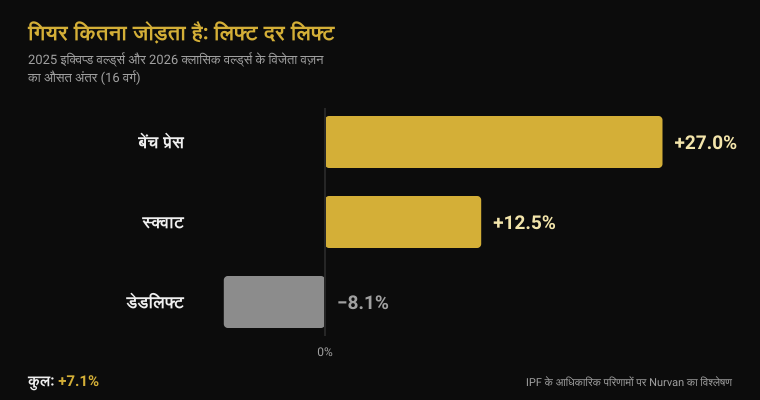
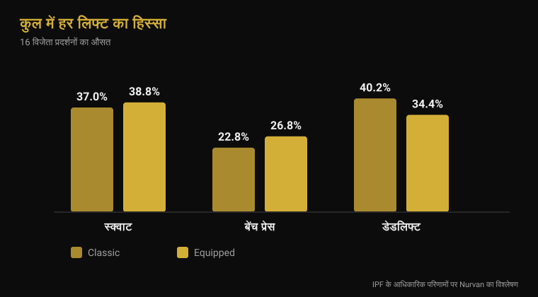

# इक्विप्ड वर्ल्ड चैंपियनशिप 2026: गियर कितना जोड़ता है

लेखक: [Giammaria Loi](/autore/giammaria-loi) · अपडेट 4 नवंबर 2026

सोमवार 9 से रविवार 15 नवंबर तक इस्तांबुल में IPF की इक्विप्ड वर्ल्ड चैंपियनशिप हो रही है: वह मुकाबला जिसमें स्क्वाट सूट, बेंच शर्ट और नी रैप्स की अनुमति है। पावरलिफ्टिंग के सबसे बड़े आंकड़े यहीं बनते हैं, और सबसे अस्पष्ट बातें भी यहीं चलती हैं — "सूट पहनकर 100 किलो ज़्यादा उठ जाता है", "वहाँ तो गियर ही उठाता है"। मैंने पिछली इक्विप्ड चैंपियनशिप और जून की क्लासिक चैंपियनशिप के IPF के आधिकारिक नतीजे लेकर वर्ग दर वर्ग तुलना की। नतीजा इन दोनों बातों से मेल नहीं खाता।

## संक्षेप में

- **इस्तांबुल, 9 से 15 नवंबर 2026।** यह IPF वर्ल्ड ओपन इक्विप्ड चैंपियनशिप है — एकमात्र ओपन विश्व खिताब जिसमें सपोर्टिव गियर की अनुमति है (IPF का आधिकारिक कैलेंडर)।
- **कुल योग में औसत बढ़त 7% है, 20% नहीं।** 2025 की इक्विप्ड और 2026 की क्लासिक चैंपियनशिप के सभी 16 वर्गों के विजेता वज़न मिलाने पर औसत अंतर **+7.1%** है। 16 में से 2 वर्गों में क्लासिक विजेता ने ज़्यादा उठाया।
- **गियर तीनों लिफ्टों की बराबर मदद नहीं करता।** बेंच **+27%**, स्क्वाट **+12.5%**, डेडलिफ्ट **−8.1%**: इलास्टिक कपड़ा वहीं काम करता है जहाँ उतरने का एक्सेंट्रिक चरण होता है, और डेडलिफ्ट रुकी हुई बार से शुरू होती है।
- **रैप्स काम करते हैं, पर मेहनत कहीं और खिसका देते हैं।** रैप्स के साथ स्क्वाट की पीक पावर **10%** बढ़ती है, उतरना **45% तेज़** होता है, और 90% अधिकतम पर वेस्टस लेटरालिस की सक्रियता **घट** जाती है (Lake 2012; Gomes 2015)।
- **नी स्लीव्स नरम रैप्स नहीं हैं।** 15 प्रशिक्षित पुरुषों में नियोप्रीन स्लीव्स ने स्क्वाट के अधिकतम में करीब **5 किलो** जोड़े (166 बनाम 161 किलो) और इसके अलावा कुछ नहीं — और अनुशंसित साइज़ तथा एक साइज़ छोटी, दोनों का असर एक जैसा रहा (Machek 2021)।

## 9 से 15 नवंबर, इस्तांबुल में क्या हो रहा है

इंटरनेशनल पावरलिफ्टिंग फेडरेशन के आधिकारिक कैलेंडर के अनुसार, 2026 की वर्ल्ड ओपन इक्विप्ड चैंपियनशिप तुर्किये के इस्तांबुल में **9 से 15 नवंबर** तक हो रही है। यह ओपन मुकाबला है — कोई आयु वर्ग नहीं — और इसमें पुरुषों के आठ भार वर्ग (59, 66, 74, 83, 93, 105, 120 और 120+ किलो) तथा महिलाओं के आठ वर्ग (47, 52, 57, 63, 69, 76, 84 और 84+ किलो) के खिताब तय होते हैं।

पिछला संस्करण 16 नवंबर 2025 को **क्लुज-नापोका, रोमानिया** में समाप्त हुआ था। IPF के आधिकारिक दस्तावेज़ों से इस्तांबुल के लिए दो बातें काम की हैं: **यूक्रेन** ने पुरुष और महिला, दोनों टीम खिताब जीते; और सर्वोच्च IPF GL अंक **वोलोदिमिर रिसियेव** (93 किलो, कुल 1050 किलो) तथा **टेलर लाशापेल** (63 किलो, 645 किलो) के रहे। पुरुषों का 74 किलो वर्ग **यारोस्वाव ओलेख** ने जीता, जिनका जन्म 1974 में हुआ: इक्यावन की उम्र में ओपन वर्ग में 850 किलो का कुल योग।

अमेरिका ने सोलह खिलाड़ियों की टीम घोषित की है — आठ पुरुष, आठ महिलाएँ, सभी ओपन वर्ग में — जिनमें क्लुज-नापोका में 1067.5 किलो के साथ 105 किलो वर्ग जीतने वाले **इयान बेल** और 652.5 किलो के साथ 69 किलो वर्ग जीतने वाली **केल्सी मैकार्थी** शामिल हैं।

## क्लासिक और इक्विप्ड: असल फ़र्क क्या है

1 मार्च 2026 से लागू IPF की तकनीकी नियमावली दोनों मुकाबलों को सिर्फ़ इस आधार पर अलग करती है कि आप क्या पहन सकते हैं।

**क्लासिक** (रॉ) में अनुमति है: बिना सपोर्ट वाला प्रतियोगिता सिंगलेट, उसके नीचे टी-शर्ट, चमड़े या बिना खिंचाव वाली सामग्री की बेल्ट जो अधिकतम 10 सेमी चौड़ी और 13 मिमी मोटी हो, अधिकतम 7 मिमी मोटी और 30 सेमी लंबी नियोप्रीन **नी स्लीव्स**, और अधिकतम 1 मीटर लंबे रिस्ट रैप्स।

**इक्विप्ड** में तीन चीज़ें और जुड़ती हैं जो क्लासिक में मना हैं: **स्क्वाट सूट** (एकहरी मोटाई का कपड़ा, पट्टियाँ हमेशा कंधों पर, पाँयचे क्रॉच से 3 से 15 सेमी), **बेंच शर्ट** (रबरयुक्त या खिंचाव वाली सामग्री नहीं, आस्तीन डेल्टॉइड के नीचे समाप्त और कोहनी तक नहीं) और **नी रैप्स** (अधिकतम 2 मीटर लंबे और 8 सेमी चौड़े, घुटने के केंद्र से 15 सेमी ऊपर और 15 सेमी नीचे से ज़्यादा नहीं)। नियमावली रैप्स और स्लीव्स को एक साथ पहनने पर साफ़ रोक लगाती है।

तकनीकी फ़र्क बस यही है: सूट, शर्ट और रैप्स ऐसे इलास्टिक कपड़े हैं जो उतरने का विरोध करते हैं, ऊर्जा जमा करते हैं और ऊपर उठते समय लौटा देते हैं। वे आपकी जगह उठाते नहीं — वे मूवमेंट का फ़ोर्स कर्व बदल देते हैं।

## गियर कितना जोड़ता है: आधिकारिक आंकड़े

आंकड़ों से जवाब देने के लिए मैंने उपलब्ध दो सबसे तुलनीय आधिकारिक नतीजे लिए: **2025 वर्ल्ड ओपन इक्विप्ड चैंपियनशिप** (क्लुज-नापोका) और **2026 वर्ल्ड ओपन क्लासिक चैंपियनशिप** (द्रुस्किनिन्काई, लिथुआनिया, 13-21 जून) के विजेता वज़न। एक ही फेडरेशन, वही सोलह भार वर्ग, वही स्तर।

**प्रतियोगिता के कुल योग** में, सोलह वर्गों का औसत अंतर इक्विप्ड के पक्ष में **+7.1%** है (मध्यमान +7.8%)। सोलह में से चौदह वर्गों में इक्विप्ड विजेता ने ज़्यादा उठाया। बाकी दो अपवाद सीखने लायक हैं: पुरुषों के 74 किलो में ऑस्टिन पर्किन्स ने **बिना किसी गियर के 891.5 किलो** बनाए, जबकि इक्विप्ड विजेता का योग 850 था; और महिलाओं के 84+ किलो में ब्रिटनी श्लेटर ने **756.5 किलो** पर समापन किया, बनाम 700।

| लिफ्ट | औसत अंतर: इक्विप्ड − क्लासिक |
|---|---|
| बेंच प्रेस | +27.0% |
| स्क्वाट | +12.5% |
| डेडलिफ्ट | −8.1% |
| **कुल योग** | **+7.1%** |

लिफ्ट दर लिफ्ट देखने पर तस्वीर पूरी तरह बदल जाती है। बेंच वह जगह है जहाँ शर्ट सबसे ज़्यादा मायने रखती है: विजेता वज़न औसतन **27% ज़्यादा** हैं। स्क्वाट में **12.5%** का फ़ायदा है। डेडलिफ्ट में, जहाँ बार ज़मीन पर रुकी हुई शुरू होती है और गियर के लिए कोई एक्सेंट्रिक चरण नहीं बचता, दिशा उलट जाती है: इक्विप्ड के विजेता डेडलिफ्ट औसतन क्लासिक से **8% हल्के** हैं।

यह कुल योग की बनावट में भी दिखता है। क्लासिक विजेताओं में डेडलिफ्ट कुल का **40.2%** और बेंच **22.8%** है; इक्विप्ड विजेताओं में डेडलिफ्ट गिरकर **34.4%** और बेंच बढ़कर **26.8%** हो जाती है। एक ही नाम वाले दो खेल, अलग आंतरिक संतुलन।

एक ईमानदार चेतावनी: ये अलग-अलग मुकाबलों के अलग-अलग खिलाड़ी हैं, इसलिए यह तुलना बताती है कि **दोनों प्रतियोगिताओं में कितना उठा**, न कि एक ही शरीर पर सूट का असर। लेकिन दिशा तंत्र से मेल खाती है — उतरते समय जितना ज़्यादा इलास्टिक कपड़ा लोड होता है, फ़ायदा उतना बड़ा — और प्रकाशित एकमात्र जनसंख्या-स्तरीय आंकड़े से भी: ओपन वर्ग के 26,472 पावरलिफ्टरों के विश्लेषण में फेरलां और सहयोगियों ने पाया कि एक ही भार वर्ग में इक्विप्ड खिलाड़ी क्लासिक खिलाड़ियों से सांख्यिकीय रूप से उल्लेखनीय रूप से ज़्यादा उठाते हैं (Ferland et al., 2020)।

## शोध असल में क्या कहता है

| आम दावा | नतीजा | स्रोत |
|---|---|---|
| "गियर से कुल योग 20-30% बढ़ता है" | खंडित: औसतन +7.1% | IPF के आधिकारिक नतीजे |
| "सूट तीनों लिफ्टों में मदद करता है" | खंडित: डेडलिफ्ट घटती है | IPF के आधिकारिक नतीजे |
| "रैप्स से ज़्यादा उठता है" | पुष्ट — पर वे व्यायाम ही बदल देते हैं | Lake et al., 2012; Gomes et al., 2015 |
| "स्लीव्स रैप्स जैसी ही हैं" | खंडित | Machek et al., 2021 |
| "बेल्ट पीठ की रक्षा करती है" | स्पष्टीकरण चाहिए | Siewe et al., 2011; Lynch et al., 2025 |
| "पावरलिफ्टिंग जोड़ बर्बाद कर देती है" | स्पष्टीकरण चाहिए: 1000 घंटे में 1 चोट | Siewe et al., 2011 |

### रैप्स काम करते हैं, पर जो आप सोचते हैं वह नहीं बनाते

रैप्स इक्विप्ड गियर का इकलौता हिस्सा हैं जिसे बहुत लोग आम जिम में भी इस्तेमाल करते हैं, इसलिए इन्हें नज़दीक से देखना बनता है। दस प्रशिक्षित पुरुषों ने 80% अधिकतम पर सिंगल स्क्वाट किए, रैप्स के साथ और बिना। रैप्स के साथ बार का क्षैतिज विस्थापन **39%** घटा, उतरने का चरण **45% तेज़** रहा, ऊपर उठते समय वर्टिकल इम्पल्स **10%** बढ़ा और पीक पावर **10%** (2121 बनाम 1841 वाट)। लेखक इसका श्रेय उतरते समय रैप में जमा इलास्टिक ऊर्जा को देते हैं और निष्कर्ष निकालते हैं कि रैप्स स्क्वाट की तकनीक इस तरह बदलते हैं कि संभवतः काम करने वाली मांसपेशियाँ भी बदल जाती हैं (Lake et al., 2012)।

दूसरा अध्ययन ठीक यही मापता है। चौदह प्रशिक्षित पुरुषों ने 60% और 90% अधिकतम पर स्क्वाट किए, रैप्स के साथ और बिना: 90% पर **वेस्टस लेटरालिस** की ईएमजी सक्रियता रैप्स के साथ कम रही। बिना रैप्स के दोनों तीव्रताओं पर घुटने का मुड़ाव ज़्यादा था (Gomes et al., 2015)।

सीधी भाषा में: रैप्स आपसे ज़्यादा उठवाते हैं और क्वाड्स से कम काम करवाते हैं। मुकाबले में यह फ़ायदा है; ट्रेनिंग में, अगर लक्ष्य टांग बनाना है, तो यह उन्हें बैग में छोड़ने की बढ़िया वजह है। यही तर्क उन तकनीकी बारीकियों पर भी लागू होता है जो काम करने वाली मांसपेशियाँ बदल देती हैं — इस पर मैंने [स्क्वाट में घुटने बाहर](/hi/blog/squat-mein-knees-out-cue) वाले लेख में लिखा है।

### स्लीव्स अलग चीज़ हैं

पंद्रह प्रशिक्षित पुरुष, जिन्होंने पहले कभी स्लीव्स नहीं पहनी थीं, तीन स्थितियों में परखे गए: बहुत कम सपोर्ट वाली कंट्रोल स्लीव, निर्माता की अनुशंसित साइज़ की नियोप्रीन स्लीव, और उससे एक साइज़ छोटी। दोनों असली स्लीव्स के साथ स्क्वाट का अधिकतम बढ़ा (166 किलो बनाम कंट्रोल के 161 किलो), **सामान्य और ज़्यादा कसी साइज़ के बीच कोई फ़र्क नहीं**, और कूद, पावर, गति या सहनशक्ति पर कोई असर नहीं। लेखक रैप्स से इस अंतर को रेखांकित करते हैं, जिनका असर कसावट के साथ सचमुच बढ़ता है (Machek et al., 2021)।

161 पर करीब 5 किलो, यानी 3%: मंच पर उपयोगी, शॉर्टकट के तौर पर बेमानी।

### बेल्ट: नारे से ज़्यादा उलझी हुई

दो आंकड़े, और कोई भी उस तरह आश्वस्त नहीं करता जैसी उम्मीद होती है। 245 प्रतिस्पर्धी और एलीट पावरलिफ्टरों के एक प्रश्नावली अध्ययन में बेल्ट का इस्तेमाल **कमर के हिस्से की चोटों की ऊँची दर से जुड़ा** पाया गया (Siewe et al., 2011)। यह स्व-कथन पर आधारित पूर्वव्यापी अध्ययन है, इसलिए यह साबित नहीं करता कि बेल्ट समस्या पैदा करती है: बेल्ट पहनने वाले भारी वज़न भी संभालते हैं, और कुछ इसे इसीलिए पहनते हैं क्योंकि पीठ परेशान करती है। पर यह वह बात भी नहीं है जो विज्ञापन सुझाते हैं।

दूसरा: अनुमानित अधिकतम के 75% पर स्क्वाट करते 28 पुरुषों में **अकेली बेल्ट ने धड़ और टांगों की मांसपेशियों की सक्रियता नहीं बदली**; पेट की सक्रियता तभी बढ़ी जब *ब्रेसिंग* किया गया, यानी पेट की दीवार का सक्रिय दबाव — बेल्ट के साथ भी और बिना भी (Lynch et al., 2025)। बेल्ट वह सतह है जिसके विरुद्ध दबाव बनाया जाता है, दबाव का विकल्प नहीं।

उसी Siewe अध्ययन में वह आंकड़ा भी है जो पावरलिफ्टिंग पर बहसों में अक्सर गायब रहता है: चोट की दर **प्रति खिलाड़ी प्रति वर्ष 0.3 चोट** है, यानी लगभग हर 1000 घंटे की ट्रेनिंग पर एक — कई खेलों की तुलना में कम, हालाँकि 43% ने सामान्य सत्रों में तकलीफ़ बताई।

## इसे कैसे लागू करें

1. **अगर आप रॉ में उतरते हैं तो रैप्स की ज़रूरत नहीं।** उनका फ़ायदा मंच पर है, और कीमत यह कि ठीक उन्हीं तीव्रताओं पर क्वाड्स कम काम करते हैं जहाँ आप उनसे सबसे ज़्यादा चाहते हैं।
2. **स्लीव्स: अनुशंसित साइज़ ही लें।** ज़्यादा कसी होने से कुछ और नहीं मिलता, तकलीफ़ ज़रूर होती है। कुछ किलो की उम्मीद रखें, एक भार वर्ग की नहीं।
3. **बेल्ट सीखनी होती है, सिर्फ़ पहननी नहीं।** पहले बिना बेल्ट ब्रेसिंग, फिर बेल्ट को दबाव बनाने की सतह की तरह। अगर पीठ दर्द करती है तो और कसना इलाज नहीं है।
4. **इक्विप्ड आज़माना है तो बेंच दोबारा सीखने को तैयार रहें।** गियर इसी लिफ्ट को सबसे ज़्यादा बदलता है, इसलिए यही सबसे ज़्यादा नई तकनीक माँगती है।
5. **डेडलिफ्ट डेडलिफ्ट ही रहती है।** इस्तांबुल इसकी पुष्टि करेगा: यही वह लिफ्ट है जहाँ सूट सबसे कम मदद करता है और ताक़त बिना फ़िल्टर दिखती है।
6. **हमेशा लिखें कि किस गियर के साथ उठाया।** रैप्स के साथ 180 किलो और बिना रैप्स 180 किलो दो अलग आंकड़े हैं: एक ही पंक्ति में डाल देने पर आपका रिकॉर्ड अर्थहीन हो जाता है।

**Nurvan आज़माएँ — वज़न संदर्भ के साथ, सिर्फ़ एक संख्या नहीं**

Nurvan में हर सेट वज़न, रेप्स और RIR के साथ दर्ज होता है, और नोट्स से आप वही लिफ्ट गियर के साथ और बिना अलग-अलग रख सकते हैं। वार्म-अप सेट उस दिन के सबसे भारी सेट से अपने आप सुझाए जाते हैं, इसलिए प्रतियोगिता का सेटअप बदलने पर भी प्रगति पढ़ने लायक रहती है। अगर कोच आपको देखता है, तो उसे अपनी प्रोफ़ाइल में यही रिकॉर्ड दिखता है। [Nurvan आज़माएँ](https://nurvan.app)

## अक्सर पूछे जाने वाले सवाल

**क्लासिक और इक्विप्ड पावरलिफ्टिंग में क्या अंतर है?**
क्लासिक (रॉ) में सिंगलेट, बेल्ट, नियोप्रीन नी स्लीव्स और रिस्ट रैप्स चलते हैं। इक्विप्ड में स्क्वाट सूट, बेंच शर्ट और इलास्टिक नी रैप्स जुड़ते हैं, जो उतरते समय ऊर्जा जमा करके ऊपर उठते समय लौटाते हैं। IPF में ये दो अलग मुकाबले हैं, अलग खिताबों के साथ।

**गियर से कितना ज़्यादा उठता है?**
2025 की इक्विप्ड और 2026 की क्लासिक चैंपियनशिप के उन्हीं 16 वर्गों के विजेता वज़न मिलाने पर इक्विप्ड का कुल योग औसतन 7.1% ज़्यादा है। पर औसत सब कुछ छिपा लेता है: बेंच 27% ऊपर, स्क्वाट 12.5% ऊपर, और डेडलिफ्ट 8% नीचे।

**क्या नी रैप्स घुटनों के लिए नुकसानदेह हैं?**
उपलब्ध अध्ययन यांत्रिकी और मांसपेशीय सक्रियता मापते हैं, दीर्घकालिक चोट का जोखिम नहीं — इसलिए ईमानदार जवाब यह है कि हम नहीं जानते। जो पता है वह यह कि रैप्स बार का क्षैतिज विस्थापन घटाते हैं, उतरना तेज़ करते हैं और ऊँची तीव्रताओं पर क्वाड्स की सक्रियता कम करते हैं।

**क्या स्लीव्स और रैप्स साथ पहन सकते हैं?**
नहीं। IPF की तकनीकी नियमावली प्रतियोगिता में इस पर साफ़ रोक लगाती है। जिम में नियमावली नहीं है, पर वजह भी नहीं: दोनों एक ही काम करते हैं, और रैप्स उसे कहीं ज़्यादा आक्रामक तरीके से करते हैं।

## यह भी पढ़ें

- [मास्टर्स वर्ल्ड चैंपियनशिप 2026: उम्र के साथ कितनी ताक़त जाती है](/hi/blog/masters-world-championship-2026-takat-aur-umra) — IPF के आधिकारिक नतीजों का यही विश्लेषण, आयु वर्गों पर लागू।
- [स्क्वाट में घुटने बाहर: नियम या क्यू?](/hi/blog/squat-mein-knees-out-cue) — एक तकनीकी बारीकी कैसे बदल देती है कि असल में कौन सी मांसपेशियाँ काम करती हैं।
- [बेंच प्रेस की ग्रिप: चौड़ी, मध्यम या संकरी?](/hi/blog/bench-press-grip-width-hindi) — ग्रिप की चौड़ाई क्या बदलती है, शर्ट के साथ या बिना।

## स्रोत

- Lake JP, Carden PJC, Shorter KA, 2012. Wearing knee wraps affects mechanical output and performance characteristics of back squat exercise. *Journal of Strength and Conditioning Research* 26(10):2844-9. PMID 22995993. [DOI](https://doi.org/10.1519/JSC.0b013e3182429840)
- Gomes WA, Brown LE, Soares EG, da Silva JJ, de O Silva FHD, Serpa ÉP, Corrêa DA, Vilela Junior GdeB, Lopes CR, Marchetti PH, 2015. Kinematic and sEMG Analysis of the Back Squat at Different Intensities With and Without Knee Wraps. *Journal of Strength and Conditioning Research* 29(9):2482-7. PMID 25763519. [DOI](https://doi.org/10.1519/JSC.0000000000000922)
- Machek SB, Cardaci TD, Wilburn DT, Cholewinski MC, Latt SL, Harris DR, Willoughby DS, 2021. Neoprene Knee Sleeves of Varying Tightness Augment Barbell Squat One Repetition Maximum Performance Without Improving Other Indices of Muscular Strength, Power, or Endurance. *Journal of Strength and Conditioning Research* 35(Suppl 1):S6-S15. PMID 33201154. [DOI](https://doi.org/10.1519/JSC.0000000000003869)
- Siewe J, Rudat J, Röllinghoff M, Schlegel UJ, Eysel P, Michael JW-P, 2011. Injuries and overuse syndromes in powerlifting. *International Journal of Sports Medicine* 32(9):703-11. PMID 21590644. [DOI](https://doi.org/10.1055/s-0031-1277207)
- Lynch DJ, Drusch AS, Hooper TL, James CR, Brooks TJ, Wilford KF, Seeber GH, Sizer PS, 2025. Changes in muscle activation in response to abdominal bracing and stabilization belt use during a loaded squat. *Journal of Sports Sciences* 43(20):2434-2446. PMID 40698971. [DOI](https://doi.org/10.1080/02640414.2025.2535048)
- Ferland PM, Allard MO, Comtois AS, 2020. Efficiency of the Wilks and IPF Formulas at Comparing Maximal Strength Regardless of Bodyweight through Analysis of the Open Powerlifting Database. *International Journal of Exercise Science* 13(4):567-582. PMID 33042369. [DOI](https://doi.org/10.70252/XGHM8852)

संदर्भ PubMed के ज़रिए लिए गए। प्रतियोगिता के आंकड़े IPF के आधिकारिक नतीजों (वर्ल्ड ओपन इक्विप्ड 2025, क्लुज-नापोका; वर्ल्ड ओपन क्लासिक 2026, द्रुस्किनिन्काई) और IPF के आधिकारिक कैलेंडर से; नियम 1 मार्च 2026 से लागू IPF Technical Rules Book से। अमेरिकी टीम की संरचना Powerlifting America के अनुसार।

---

Giammaria Loi, Nurvan के संस्थापक हैं। वे 2012 से वेट ट्रेनिंग कर रहे हैं, 2013 से FIPE-प्रमाणित पर्सनल ट्रेनर और कोच के रूप में काम करते हैं, और 2018 से राष्ट्रीय स्तर पर पावरलिफ्टिंग में प्रतिस्पर्धा करते हैं। उनके हर लेख की शुरुआत शोध से होती है और अंत इस पर कि जिम में असल में क्या काम करता है।

> नोट: यह जानकारीपरक सामग्री है, डॉक्टर या पेशेवर की राय का विकल्प नहीं।
