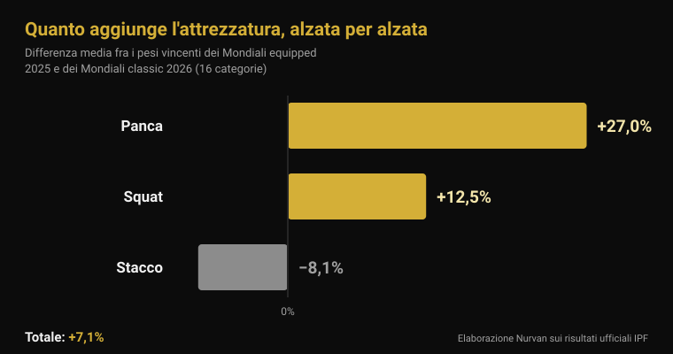
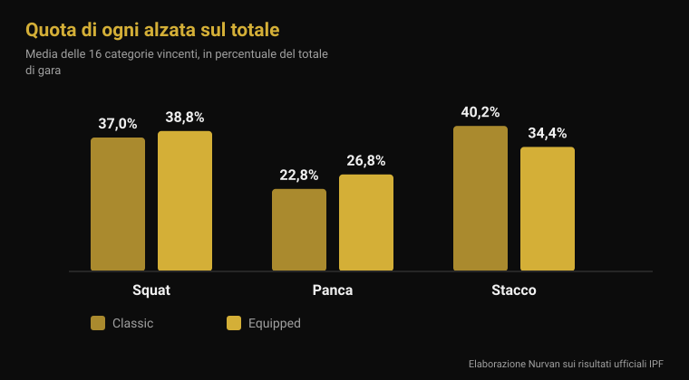

# Mondiali equipped 2026: quanto aggiunge l'attrezzatura

Di [Giammaria Loi](/autore/giammaria-loi) · aggiornato il 4 novembre 2026

Da lunedì 9 a domenica 15 novembre, a Istanbul, si assegnano i titoli mondiali IPF della categoria equipped: la gara in cui muta da squat, maglia da panca e fasce per le ginocchia sono ammesse. È la specialità che produce i numeri più grossi del powerlifting, e anche quella su cui circolano le frasi più vaghe — "con la muta alzi 100 kg in più", "tanto è tutta attrezzatura". Ho preso i risultati ufficiali IPF dell'ultima edizione equipped e quelli dei Mondiali classic di giugno e li ho confrontati categoria per categoria. Il risultato non assomiglia a nessuna delle due frasi.

## In breve

- **A Istanbul si gareggia dal 9 al 15 novembre 2026.** Sono i Mondiali IPF Open Equipped, l'unico titolo mondiale assoluto in cui l'attrezzatura di supporto è ammessa (calendario ufficiale IPF).
- **Il vantaggio medio sul totale è del 7%, non del 20%.** Confrontando i pesi vincenti delle 16 categorie dei Mondiali equipped 2025 con quelli dei Mondiali classic 2026, la differenza media è **+7,1%**. In 2 categorie su 16 ha vinto di più il classic.
- **L'attrezzatura non aiuta le tre alzate allo stesso modo.** Panca **+27%**, squat **+12,5%**, stacco **−8,1%**: la muta lavora dove c'è una fase eccentrica da caricare, non dove parti da fermo.
- **Le fasce per le ginocchia funzionano, ma spostano il lavoro.** Con le fasce la potenza di picco nello squat sale del **10%**, la discesa è **45% più veloce** e l'attivazione del vasto laterale al 90% del massimale **scende** (Lake 2012; Gomes 2015).
- **Le ginocchiere non sono fasce morbide.** In uno studio su 15 uomini le ginocchiere in neoprene hanno aggiunto circa **5 kg** al massimale di squat (166 contro 161 kg) e nient'altro, con lo stesso effetto a prescindere da quanto fossero strette (Machek 2021).

## Cosa succede a Istanbul dal 9 al 15 novembre

I Mondiali Open Equipped 2026 si tengono a Istanbul, in Turchia, dal **9 al 15 novembre**, come indica il calendario ufficiale della International Powerlifting Federation. È la gara assoluta — categoria Open, senza fasce d'età — e assegna i titoli nelle otto categorie di peso maschili (59, 66, 74, 83, 93, 105, 120 e oltre 120 kg) e nelle otto femminili (47, 52, 57, 63, 69, 76, 84 e oltre 84 kg).

L'edizione precedente si è chiusa il 16 novembre 2025 a **Cluj-Napoca, in Romania**. I documenti ufficiali IPF di quella gara dicono due cose utili per leggere quella di Istanbul: l'**Ucraina** ha vinto entrambe le classifiche a squadre, maschile e femminile; i migliori punteggi IPF GL sono stati di **Volodymyr Rysiyev** (93 kg, 1050 kg di totale) fra gli uomini e di **Taylor LaChapelle** (63 kg, 645 kg) fra le donne. Nella 74 kg maschile ha vinto **Jarosław Olech**, nato nel 1974: 850 kg di totale a cinquantun anni, in una categoria Open.

Gli Stati Uniti hanno annunciato una squadra di sedici atleti, otto uomini e otto donne, tutti in categoria Open: fra questi **Ian Bell**, vincitore della 105 kg a Cluj-Napoca con 1067,5 kg, e **Kelsey McCarthy**, vincitrice della 69 kg con 652,5 kg.

## Classic ed equipped: cosa cambia davvero

Il regolamento tecnico IPF in vigore dal 1° marzo 2026 separa le due gare in base a cosa si può indossare.

Nel **classic** (detto anche raw) sono ammessi: canotta da gara non elastica, maglietta sotto, cintura di cuoio o materiale non elastico larga al massimo 10 cm e spessa 13 mm, **ginocchiere** di neoprene fino a 7 mm di spessore e 30 cm di lunghezza, e fasce da polso lunghe al massimo 1 metro.

Nell'**equipped** si aggiungono tre capi che il classic vieta: la **muta da squat** (tessuto a spessore singolo, bretelle sempre sulle spalle, gambe fra 3 e 15 cm dal cavallo), la **maglia da panca** (tessuto non gommato, maniche che finiscono sotto il deltoide senza arrivare al gomito) e le **fasce per le ginocchia** (massimo 2 metri di lunghezza e 8 cm di larghezza, non oltre 15 cm sopra e 15 cm sotto il centro del ginocchio). Il regolamento vieta esplicitamente di combinare fasce e ginocchiere.

La differenza tecnica è tutta qui: muta, maglia e fasce sono tessuti elastici che si oppongono alla discesa, immagazzinano energia e la restituiscono nella risalita. Non spingono al posto tuo, ma cambiano la curva di forza del movimento.

## Quanto aggiunge l'attrezzatura: i numeri ufficiali

Per rispondere con dei numeri ho preso i due documenti di risultati più vicini e più confrontabili che esistano: i pesi dei vincitori dei **Mondiali Open Equipped 2025** (Cluj-Napoca) e quelli dei vincitori dei **Mondiali Open Classic 2026** (Druskininkai, Lituania, 13-21 giugno). Stessa federazione, stesse sedici categorie di peso, stesso livello di gara.

Sul **totale di gara** la differenza media fra le sedici categorie è **+7,1%** a favore dell'equipped (mediana +7,8%). In quattordici categorie su sedici il vincitore equipped ha alzato di più; nelle altre due no, e sono due casi istruttivi: nella 74 kg maschile Austin Perkins ha totalizzato **891,5 kg senza attrezzatura** contro gli 850 del vincitore equipped, e nella categoria femminile oltre 84 kg Brittany Schlater ha chiuso a **756,5 kg** contro 700.

| Alzata | Differenza media equipped − classic |
|---|---|
| Panca piana | +27,0% |
| Squat | +12,5% |
| Stacco | −8,1% |
| **Totale** | **+7,1%** |

Il quadro cambia completamente quando si guarda alzata per alzata. La panca è la prova dove la maglia pesa di più: i pesi vincenti sono in media **del 27% più alti**. Lo squat guadagna **il 12,5%**. Lo stacco, dove l'attrezzatura di fatto non ha una fase eccentrica da sfruttare perché il bilanciere parte fermo a terra, va nella direzione opposta: i pesi vincenti equipped sono in media **dell'8% più bassi** di quelli classic.

Si vede anche nella composizione del totale. Nei vincitori classic lo stacco vale il **40,2%** del totale e la panca il **22,8%**; nei vincitori equipped lo stacco scende al **34,4%** e la panca sale al **26,8%**. Sono due sport con lo stesso nome e un equilibrio interno diverso.

Una precisazione onesta: sono atleti diversi in gare diverse, quindi questo confronto misura **quanto si alza nelle due competizioni**, non l'effetto della muta sullo stesso corpo. Però la direzione è coerente con il meccanismo — tanto più dove c'è tessuto elastico da caricare in discesa — e con l'unico dato di popolazione pubblicato: analizzando 26.472 powerlifter della categoria Open, Ferland e colleghi hanno trovato che gli atleti equipped sollevano in modo statisticamente significativo più dei colleghi classic nella stessa categoria di peso (Ferland et al., 2020).

## Cosa dice davvero la ricerca

| Affermazione diffusa | Verdetto | Fonte |
|---|---|---|
| "Con l'attrezzatura alzi il 20-30% in più sul totale" | Smentito: in media +7,1% | Risultati ufficiali IPF |
| "La muta aiuta tutte e tre le alzate" | Smentito: lo stacco va peggio | Risultati ufficiali IPF |
| "Le fasce fanno alzare di più" | Confermato, ma cambiano l'esercizio | Lake et al., 2012; Gomes et al., 2015 |
| "Le ginocchiere sono come le fasce" | Smentito | Machek et al., 2021 |
| "La cintura protegge la schiena" | Da precisare | Siewe et al., 2011; Lynch et al., 2025 |
| "Il powerlifting rovina le articolazioni" | Da precisare: 1 infortunio ogni 1.000 ore | Siewe et al., 2011 |

### Le fasce funzionano, ma non allenano quello che pensi

È l'unico pezzo di attrezzatura equipped che molti usano anche in palestra, quindi vale la pena guardarlo da vicino. Dieci uomini allenati hanno eseguito singole di squat all'80% del massimale con e senza fasce. Con le fasce lo spostamento orizzontale del bilanciere è calato del **39%**, la fase di discesa è stata **45% più veloce**, l'impulso verticale nella risalita è aumentato del **10%** e la potenza di picco del **10%** (2.121 contro 1.841 W). Gli autori attribuiscono l'effetto all'energia elastica immagazzinata nelle fasce durante la discesa, e concludono che le fasce cambiano la tecnica dello squat in un modo che probabilmente modifica i muscoli coinvolti (Lake et al., 2012).

Il secondo studio misura proprio questo. Quattordici uomini allenati hanno squattato al 60% e al 90% del massimale con e senza fasce: al 90% l'attivazione elettromiografica del **vasto laterale** è risultata più bassa con le fasce. Senza fasce la flessione del ginocchio era maggiore a entrambe le intensità (Gomes et al., 2015).

Tradotto: le fasce ti fanno alzare di più e lavorare meno con i quadricipiti. In gara è un vantaggio; in allenamento, se l'obiettivo è costruire la gamba, è un'ottima ragione per non metterle quasi mai. Lo stesso discorso vale per i dettagli di tecnica che cambiano quali muscoli lavorano — ne ho scritto a proposito delle [ginocchia in fuori nello squat](/blog/ginocchia-in-fuori-squat).

### Le ginocchiere sono un'altra cosa

Quindici uomini allenati, mai usate prima: manica di controllo poco supportiva, ginocchiera neoprene della taglia consigliata, ginocchiera di una taglia più piccola. Il massimale di squat è salito con entrambe le ginocchiere vere (166 kg contro 161 kg del controllo), **senza nessuna differenza fra la taglia normale e quella stretta** e senza alcun effetto su salto verticale, potenza, velocità o resistenza. Gli autori sottolineano la differenza con le fasce, il cui effetto invece cresce con la costrizione (Machek et al., 2021).

Circa 5 kg su 161, cioè il 3%: utile in gara, irrilevante come scorciatoia.

### La cintura: più complicata di come la raccontano

Due dati, nessuno dei due rassicurante nel senso che ci si aspetta. In un questionario su 245 powerlifter agonisti e d'élite, l'uso della cintura risultava **associato a un tasso più alto di infortuni al tratto lombare** (Siewe et al., 2011). È uno studio retrospettivo su dichiarazioni, quindi non dimostra che la cintura causi il problema: può benissimo essere che chi usa la cintura alzi carichi più pesanti, o che la metta proprio perché la schiena gli dà fastidio. Ma non è il risultato che il marketing lascia immaginare.

Il secondo: in 28 uomini che squattavano al 75% del massimale previsto, la **cintura da sola non ha modificato l'attivazione** dei muscoli del tronco e degli arti inferiori; l'attivazione addominale è aumentata solo quando c'era il *bracing*, la spinta attiva della parete addominale, con o senza cintura (Lynch et al., 2025). La cintura è una superficie contro cui spingere, non un sostituto della spinta.

Lo stesso studio di Siewe contiene il dato che di solito manca nelle discussioni sul powerlifting: il tasso di infortuni è di **0,3 infortuni per atleta all'anno**, cioè circa uno ogni 1.000 ore di allenamento — basso rispetto a molti altri sport, anche se il 43% riferiva fastidi durante le sedute ordinarie.

## Come applicarlo

1. **Se ti alleni in classic, le fasce non ti servono.** Il loro vantaggio è in gara, e il prezzo è meno lavoro del quadricipite proprio alle intensità in cui ti serve di più.
2. **Ginocchiere: scegli la taglia consigliata.** Più strette non danno di più, e danno fastidio. Aspettati qualche chilo, non una categoria in più.
3. **La cintura si impara, non si indossa e basta.** Prima il bracing a corpo libero, poi la cintura come superficie contro cui spingere. Se la schiena fa male, il problema non si risolve stringendo di più.
4. **Se vuoi provare l'equipped, aspettati di ricominciare da capo sulla panca.** È l'alzata dove l'attrezzatura cambia di più il movimento, e quindi quella che richiede più tecnica nuova.
5. **Lo stacco resta lo stacco.** I numeri di Istanbul lo confermeranno: è l'alzata in cui la muta aiuta meno, e quella in cui si vede la forza senza filtri.
6. **Registra sempre con quale attrezzatura hai alzato.** Un 180 kg con le fasce e un 180 kg senza sono due dati diversi: se finiscono nella stessa riga, il tuo storico non significa niente.

**Prova Nurvan — i carichi con il contesto, non solo il numero**

In Nurvan ogni serie si registra con carico, ripetizioni e RIR, e le note ti permettono di distinguere la stessa alzata fatta con o senza attrezzatura. Le serie di riscaldamento vengono proposte in automatico sul massimale del giorno, così la progressione resta leggibile anche quando cambi assetto di gara. Se ti segue un coach, vede lo stesso storico dal suo profilo. [Prova Nurvan](https://nurvan.app)

## Domande frequenti

**Qual è la differenza fra powerlifting classic ed equipped?**
Classic (o raw) ammette canotta, cintura, ginocchiere di neoprene e fasce da polso. Equipped aggiunge muta da squat, maglia da panca e fasce elastiche per le ginocchia, che immagazzinano energia nella discesa e la restituiscono nella risalita. Nell'IPF sono due gare separate con titoli separati.

**Quanto si alza in più con l'attrezzatura?**
Confrontando i pesi vincenti dei Mondiali equipped 2025 e classic 2026 nelle stesse 16 categorie, il totale è in media del 7,1% più alto in equipped. Ma la media nasconde tutto: la panca sale del 27%, lo squat del 12,5%, lo stacco scende dell'8%.

**Le fasce per le ginocchia fanno male alle ginocchia?**
Gli studi disponibili misurano meccanica e attivazione muscolare, non il rischio di infortunio nel tempo, quindi la risposta onesta è che non lo sappiamo. Quello che si sa è che le fasce riducono lo spostamento orizzontale del bilanciere, accelerano la discesa e abbassano l'attivazione del quadricipite alle alte intensità.

**Posso usare ginocchiere e fasce insieme?**
No. Il regolamento tecnico IPF lo vieta esplicitamente in gara. In allenamento non c'è un regolamento, ma non c'è nemmeno un motivo: svolgono lo stesso compito e le fasce lo fanno in modo molto più aggressivo.

## Leggi anche

- [Mondiali Master 2026: quanta forza si perde con l'età](/blog/mondiali-master-powerlifting-2026-forza-eta) — la stessa analisi sui risultati ufficiali IPF, applicata alle fasce d'età.
- [Ginocchia in fuori nello squat: regola o cue?](/blog/ginocchia-in-fuori-squat) — come un dettaglio di tecnica cambia quali muscoli lavorano davvero.
- [Presa in panca piana: larga, media o stretta?](/blog/presa-panca-piana-larga-stretta) — cosa sposta l'ampiezza della presa, con o senza maglia.

## Fonti

- Lake JP, Carden PJC, Shorter KA, 2012. Wearing knee wraps affects mechanical output and performance characteristics of back squat exercise. *Journal of Strength and Conditioning Research* 26(10):2844-9. PMID 22995993. [DOI](https://doi.org/10.1519/JSC.0b013e3182429840)
- Gomes WA, Brown LE, Soares EG, da Silva JJ, de O Silva FHD, Serpa ÉP, Corrêa DA, Vilela Junior GdeB, Lopes CR, Marchetti PH, 2015. Kinematic and sEMG Analysis of the Back Squat at Different Intensities With and Without Knee Wraps. *Journal of Strength and Conditioning Research* 29(9):2482-7. PMID 25763519. [DOI](https://doi.org/10.1519/JSC.0000000000000922)
- Machek SB, Cardaci TD, Wilburn DT, Cholewinski MC, Latt SL, Harris DR, Willoughby DS, 2021. Neoprene Knee Sleeves of Varying Tightness Augment Barbell Squat One Repetition Maximum Performance Without Improving Other Indices of Muscular Strength, Power, or Endurance. *Journal of Strength and Conditioning Research* 35(Suppl 1):S6-S15. PMID 33201154. [DOI](https://doi.org/10.1519/JSC.0000000000003869)
- Siewe J, Rudat J, Röllinghoff M, Schlegel UJ, Eysel P, Michael JW-P, 2011. Injuries and overuse syndromes in powerlifting. *International Journal of Sports Medicine* 32(9):703-11. PMID 21590644. [DOI](https://doi.org/10.1055/s-0031-1277207)
- Lynch DJ, Drusch AS, Hooper TL, James CR, Brooks TJ, Wilford KF, Seeber GH, Sizer PS, 2025. Changes in muscle activation in response to abdominal bracing and stabilization belt use during a loaded squat. *Journal of Sports Sciences* 43(20):2434-2446. PMID 40698971. [DOI](https://doi.org/10.1080/02640414.2025.2535048)
- Ferland PM, Allard MO, Comtois AS, 2020. Efficiency of the Wilks and IPF Formulas at Comparing Maximal Strength Regardless of Bodyweight through Analysis of the Open Powerlifting Database. *International Journal of Exercise Science* 13(4):567-582. PMID 33042369. [DOI](https://doi.org/10.70252/XGHM8852)

Riferimenti bibliografici recuperati tramite PubMed. Dati di gara dai risultati ufficiali IPF (Mondiali Open Equipped 2025, Cluj-Napoca; Mondiali Open Classic 2026, Druskininkai) e dal calendario ufficiale IPF; regolamento dall'IPF Technical Rules Book in vigore dal 1° marzo 2026. Composizione della squadra statunitense da Powerlifting America.

---

Giammaria Loi è il fondatore di Nurvan. Si allena con i pesi dal 2012, lavora come personal trainer e coach certificato FIPE dal 2013 e gareggia nel powerlifting a livello nazionale dal 2018. Ogni articolo che firma parte dagli studi scientifici e arriva a ciò che funziona davvero in palestra.

> Nota: contenuto informativo, non sostituisce il parere di un medico o professionista.
