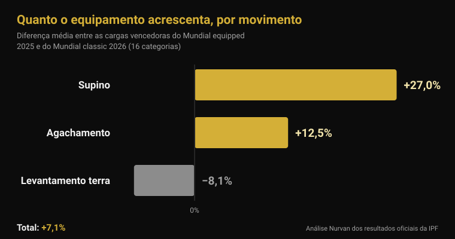
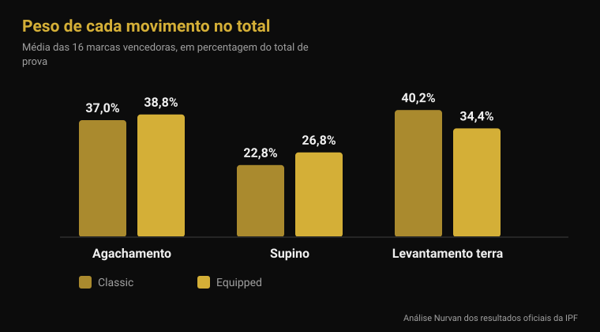

# Mundial equipped 2026: quanto soma o equipamento

Por [Giammaria Loi](/autore/giammaria-loi) · atualizado a 4 de novembro de 2026

De segunda-feira 9 a domingo 15 de novembro, Istambul decide os títulos mundiais da IPF na categoria equipped: a prova em que o macacão de agachamento, a camisa de supino e as joelheiras elásticas são permitidos. É a especialidade que produz os maiores números do powerlifting e também aquela sobre a qual circulam as frases mais vagas — "com o macacão levantas mais 100 kg", "no fim é tudo equipamento". Peguei nos resultados oficiais da IPF da última edição equipped e nos do Mundial raw de junho e comparei-os categoria a categoria. O resultado não se parece com nenhuma das duas frases.

## Em resumo

- **Istambul compete de 9 a 15 de novembro de 2026.** É o Mundial IPF Open Equipped, o único título mundial absoluto em que o equipamento de apoio é permitido (calendário oficial da IPF).
- **A vantagem média no total é de 7%, não de 20%.** Comparando as cargas vencedoras das 16 categorias do Mundial equipped 2025 com as do Mundial raw 2026, a diferença média é de **+7,1%**. Em 2 de 16 categorias venceu mais peso no raw.
- **O equipamento não ajuda os três movimentos da mesma forma.** Supino **+27%**, agachamento **+12,5%**, levantamento terra **−8,1%**: o tecido elástico trabalha onde há uma fase excêntrica para carregar, e o terra arranca parado.
- **As joelheiras elásticas funcionam, mas deslocam o trabalho.** Com elas a potência de pico no agachamento sobe **10%**, a descida é **45% mais rápida** e a ativação do vasto lateral a 90% do máximo **desce** (Lake 2012; Gomes 2015).
- **As joelheiras de neoprene não são joelheiras elásticas moles.** Em 15 homens treinados, as de neoprene acrescentaram cerca de **5 kg** ao máximo de agachamento (166 contra 161 kg) e nada mais, com o mesmo efeito no tamanho recomendado e num tamanho abaixo (Machek 2021).

## O que acontece em Istambul de 9 a 15 de novembro

O Mundial Open Equipped 2026 realiza-se em Istambul, na Turquia, de **9 a 15 de novembro**, segundo o calendário oficial da International Powerlifting Federation. É a prova absoluta — categoria Open, sem escalões etários — e atribui títulos nas oito categorias de peso masculinas (59, 66, 74, 83, 93, 105, 120 e mais de 120 kg) e nas oito femininas (47, 52, 57, 63, 69, 76, 84 e mais de 84 kg).

A edição anterior fechou a 16 de novembro de 2025 em **Cluj-Napoca, na Roménia**. Os documentos oficiais da IPF deixam duas notas úteis para ler a de Istambul: a **Ucrânia** venceu as duas classificações por equipas, masculina e feminina; as melhores pontuações IPF GL foram de **Volodymyr Rysiyev** (93 kg, 1050 kg de total) e de **Taylor LaChapelle** (63 kg, 645 kg). Nos 74 kg masculinos venceu **Jarosław Olech**, nascido em 1974: 850 kg de total aos cinquenta e um anos, em categoria Open.

Os Estados Unidos anunciaram uma equipa de dezasseis atletas, oito homens e oito mulheres, todos em Open, entre eles **Ian Bell**, vencedor dos 105 kg em Cluj-Napoca com 1067,5 kg, e **Kelsey McCarthy**, vencedora dos 69 kg com 652,5 kg.

## Raw e equipped: o que muda mesmo

O regulamento técnico da IPF em vigor desde 1 de março de 2026 separa as duas provas apenas pelo que se pode vestir.

No **raw** (classic) são permitidos: fato de competição não elástico, t-shirt por baixo, cinto de couro ou material não elástico com no máximo 10 cm de largura e 13 mm de espessura, **joelheiras de neoprene** até 7 mm de espessura e 30 cm de comprimento, e punheiras até 1 metro.

No **equipped** juntam-se três peças que o raw proíbe: o **macacão de agachamento** (tecido de espessura única, alças sempre sobre os ombros, pernas entre 3 e 15 cm a contar da virilha), a **camisa de supino** (tecido não emborrachado, mangas que acabam abaixo do deltoide sem chegar ao cotovelo) e as **joelheiras elásticas** (no máximo 2 metros de comprimento e 8 cm de largura, não além de 15 cm acima nem 15 cm abaixo do centro do joelho). O regulamento proíbe expressamente combinar joelheiras elásticas e de neoprene.

A diferença técnica é toda aí: macacão, camisa e joelheiras elásticas são tecidos que se opõem à descida, acumulam energia e devolvem-na na subida. Não levantam por ti: mudam a curva de força do movimento.

## Quanto soma o equipamento: os números oficiais

Para responder com números usei os dois documentos de resultados mais comparáveis que existem: as cargas dos vencedores do **Mundial Open Equipped 2025** (Cluj-Napoca) e as dos vencedores do **Mundial Open Classic 2026** (Druskininkai, Lituânia, 13-21 de junho). Mesma federação, mesmas dezasseis categorias de peso, mesmo nível.

No **total de prova**, a diferença média entre as dezasseis categorias é de **+7,1%** a favor do equipped (mediana +7,8%). Em catorze de dezasseis categorias o vencedor equipped levantou mais. As outras duas são instrutivas: nos 74 kg masculinos Austin Perkins totalizou **891,5 kg sem equipamento nenhum** contra os 850 do vencedor equipped, e nos mais de 84 kg femininos Brittany Schlater fechou em **756,5 kg** contra 700.

| Movimento | Diferença média equipped − raw |
|---|---|
| Supino | +27,0% |
| Agachamento | +12,5% |
| Levantamento terra | −8,1% |
| **Total** | **+7,1%** |

Movimento a movimento o quadro muda por completo. O supino é a prova onde a camisa pesa mais: as cargas vencedoras são em média **27% mais altas**. O agachamento ganha **12,5%**. O levantamento terra, onde o equipamento não tem fase excêntrica para aproveitar porque a barra parte parada no chão, vai no sentido contrário: as cargas vencedoras equipped são em média **8% mais baixas** do que as raw.

Vê-se também na composição do total. Nos vencedores raw o terra vale **40,2%** do total e o supino **22,8%**; nos equipped o terra desce para **34,4%** e o supino sobe para **26,8%**. Dois desportos com o mesmo nome e um equilíbrio interno diferente.

Uma ressalva honesta: são atletas diferentes em provas diferentes, por isso esta comparação mede **quanto se levanta nas duas competições**, não o efeito do macacão no mesmo corpo. Mas a direção bate certo com o mecanismo — mais ganho onde há mais tecido elástico para carregar na descida — e com o único dado populacional publicado: analisando 26 472 powerlifters da categoria Open, Ferland e colegas encontraram que os atletas equipped levantam de forma estatisticamente significativa mais do que os raw da mesma categoria de peso (Ferland et al., 2020).

## O que a investigação diz mesmo

| Afirmação comum | Veredicto | Fonte |
|---|---|---|
| "Com equipamento levantas 20-30% mais no total" | Desmentido: +7,1% em média | Resultados oficiais IPF |
| "O macacão ajuda nos três movimentos" | Desmentido: o terra piora | Resultados oficiais IPF |
| "As joelheiras elásticas fazem levantar mais" | Confirmado, mas mudam o exercício | Lake et al., 2012; Gomes et al., 2015 |
| "As de neoprene são iguais às elásticas" | Desmentido | Machek et al., 2021 |
| "O cinto protege as costas" | A precisar | Siewe et al., 2011; Lynch et al., 2025 |
| "O powerlifting destrói as articulações" | A precisar: 1 lesão por 1000 horas | Siewe et al., 2011 |

### As joelheiras elásticas funcionam, mas não treinam o que pensas

São a única peça do equipamento equipped que muita gente usa também no ginásio, por isso merecem um olhar de perto. Dez homens treinados fizeram agachamentos individuais a 80% do máximo com e sem joelheiras. Com elas, o deslocamento horizontal da barra caiu **39%**, a fase de descida foi **45% mais rápida**, o impulso vertical na subida aumentou **10%** e a potência de pico **10%** (2121 contra 1841 W). Os autores atribuem o efeito à energia elástica acumulada durante a descida e concluem que as joelheiras mudam a técnica do agachamento de uma forma que provavelmente altera os músculos envolvidos (Lake et al., 2012).

O segundo estudo mede exatamente isso. Catorze homens treinados agacharam a 60% e a 90% do máximo com e sem joelheiras: a 90%, a ativação eletromiográfica do **vasto lateral** foi menor com joelheiras. Sem elas a flexão do joelho foi maior nas duas intensidades (Gomes et al., 2015).

Traduzido: as joelheiras elásticas fazem-te levantar mais e trabalhar menos com o quadríceps. Em competição é vantagem; no treino, se o objetivo é construir perna, é uma excelente razão para as deixar no saco. O mesmo vale para detalhes de técnica que mudam que músculos trabalham — escrevi sobre isso a propósito dos [joelhos para fora no agachamento](/pt/blog/joelhos-para-fora-agachamento).

### As de neoprene são outra coisa

Quinze homens treinados que nunca as tinham usado testaram três condições: uma manga de controlo pouco firme, uma joelheira de neoprene do tamanho recomendado e outra um tamanho abaixo. O máximo de agachamento subiu com as duas joelheiras reais (166 kg contra 161 do controlo), **sem qualquer diferença entre o tamanho normal e o mais apertado** e sem efeito nenhum no salto, potência, velocidade ou resistência. Os autores sublinham o contraste com as elásticas, cujo efeito cresce mesmo com a compressão (Machek et al., 2021).

Cerca de 5 kg em 161, ou seja 3%: útil em competição, irrelevante como atalho.

### O cinto: mais complicado do que o contam

Dois dados, e nenhum tranquiliza no sentido esperado. Num questionário a 245 powerlifters de competição e de elite, o uso do cinto aparecia **associado a uma taxa mais alta de lesões lombares** (Siewe et al., 2011). É um estudo retrospetivo com dados declarados, por isso não prova que o cinto cause o problema: quem o usa também move cargas mais pesadas, e há quem o ponha precisamente porque as costas incomodam. Mas não é o que o marketing sugere.

O segundo: em 28 homens a agachar a 75% do máximo previsto, o **cinto sozinho não alterou a ativação** dos músculos do tronco nem dos membros inferiores; a atividade abdominal só subiu com o *bracing*, o empurrar ativo da parede abdominal, com ou sem cinto (Lynch et al., 2025). O cinto é uma superfície contra a qual empurrar, não um substituto do empurrar.

O mesmo trabalho de Siewe traz o número que costuma faltar nestas discussões: a taxa de lesões é de **0,3 lesões por atleta por ano**, cerca de uma por 1000 horas de treino — baixa face a muitos desportos, ainda que 43% relatassem queixas nos treinos normais.

## Como aplicar

1. **Se competes em raw, não precisas de joelheiras elásticas.** A vantagem delas é na plataforma, e o preço é menos trabalho de quadríceps precisamente nas intensidades em que mais o queres.
2. **Neoprene: compra o tamanho recomendado.** Mais apertado não dá mais e incomoda. Espera uns quilos, não uma categoria.
3. **O cinto aprende-se, não se veste e pronto.** Primeiro o bracing sem cinto, depois o cinto como superfície de apoio. Se as costas doem, apertar mais não resolve.
4. **Se queres experimentar equipped, conta com reaprender o supino.** É o movimento que o equipamento mais muda e, por isso, o que exige mais técnica nova.
5. **O levantamento terra continua a ser o levantamento terra.** Istambul vai confirmá-lo: é onde o macacão menos ajuda e onde a força aparece sem filtros.
6. **Regista sempre com que equipamento levantaste.** 180 kg com joelheiras elásticas e 180 kg sem são dois dados diferentes: na mesma linha, o teu histórico deixa de significar alguma coisa.

**Experimenta a Nurvan — as cargas com contexto, não só o número**

Na Nurvan cada série é registada com carga, repetições e RIR, e as notas permitem distinguir o mesmo movimento feito com ou sem equipamento. As séries de aquecimento são propostas automaticamente a partir da série mais pesada do dia, por isso a progressão continua legível mesmo quando mudas a montagem de competição. Se tens treinador, ele vê o mesmo histórico no seu perfil. [Experimenta a Nurvan](https://nurvan.app)

## Perguntas frequentes

**Qual é a diferença entre powerlifting raw e equipped?**
O raw (classic) permite fato, cinto, joelheiras de neoprene e punheiras. O equipped acrescenta macacão de agachamento, camisa de supino e joelheiras elásticas, que acumulam energia na descida e a devolvem na subida. Na IPF são duas competições separadas com títulos separados.

**Quanto mais se levanta com equipamento?**
Comparando as cargas vencedoras do Mundial equipped 2025 e do raw 2026 nas mesmas 16 categorias, o total é em média 7,1% mais alto em equipped. Mas a média esconde tudo: o supino sobe 27%, o agachamento 12,5% e o terra desce 8%.

**As joelheiras elásticas fazem mal aos joelhos?**
Os estudos disponíveis medem mecânica e ativação muscular, não o risco de lesão a longo prazo, por isso a resposta honesta é que não sabemos. O que se sabe é que reduzem o deslocamento horizontal da barra, aceleram a descida e baixam a ativação do quadríceps em intensidades altas.

**Posso usar joelheiras de neoprene e elásticas ao mesmo tempo?**
Não. O regulamento técnico da IPF proíbe-o expressamente em competição. No ginásio não há regulamento, mas também não há motivo: fazem o mesmo trabalho e as elásticas fazem-no de forma muito mais agressiva.

## Lê também

- [Mundial Master 2026: quanta força se perde com a idade](/pt/blog/mundial-master-powerlifting-2026-forca-idade) — a mesma análise dos resultados oficiais da IPF, aplicada aos escalões etários.
- [Joelhos para fora no agachamento: regra ou cue?](/pt/blog/joelhos-para-fora-agachamento) — como um detalhe técnico muda que músculos trabalham.
- [Pegada no supino: larga, média ou fechada?](/pt/blog/pegada-supino-larga-fechada) — o que a largura da pegada desloca, com ou sem camisa.

## Fontes

- Lake JP, Carden PJC, Shorter KA, 2012. Wearing knee wraps affects mechanical output and performance characteristics of back squat exercise. *Journal of Strength and Conditioning Research* 26(10):2844-9. PMID 22995993. [DOI](https://doi.org/10.1519/JSC.0b013e3182429840)
- Gomes WA, Brown LE, Soares EG, da Silva JJ, de O Silva FHD, Serpa ÉP, Corrêa DA, Vilela Junior GdeB, Lopes CR, Marchetti PH, 2015. Kinematic and sEMG Analysis of the Back Squat at Different Intensities With and Without Knee Wraps. *Journal of Strength and Conditioning Research* 29(9):2482-7. PMID 25763519. [DOI](https://doi.org/10.1519/JSC.0000000000000922)
- Machek SB, Cardaci TD, Wilburn DT, Cholewinski MC, Latt SL, Harris DR, Willoughby DS, 2021. Neoprene Knee Sleeves of Varying Tightness Augment Barbell Squat One Repetition Maximum Performance Without Improving Other Indices of Muscular Strength, Power, or Endurance. *Journal of Strength and Conditioning Research* 35(Suppl 1):S6-S15. PMID 33201154. [DOI](https://doi.org/10.1519/JSC.0000000000003869)
- Siewe J, Rudat J, Röllinghoff M, Schlegel UJ, Eysel P, Michael JW-P, 2011. Injuries and overuse syndromes in powerlifting. *International Journal of Sports Medicine* 32(9):703-11. PMID 21590644. [DOI](https://doi.org/10.1055/s-0031-1277207)
- Lynch DJ, Drusch AS, Hooper TL, James CR, Brooks TJ, Wilford KF, Seeber GH, Sizer PS, 2025. Changes in muscle activation in response to abdominal bracing and stabilization belt use during a loaded squat. *Journal of Sports Sciences* 43(20):2434-2446. PMID 40698971. [DOI](https://doi.org/10.1080/02640414.2025.2535048)
- Ferland PM, Allard MO, Comtois AS, 2020. Efficiency of the Wilks and IPF Formulas at Comparing Maximal Strength Regardless of Bodyweight through Analysis of the Open Powerlifting Database. *International Journal of Exercise Science* 13(4):567-582. PMID 33042369. [DOI](https://doi.org/10.70252/XGHM8852)

Referências bibliográficas obtidas através da PubMed. Dados de competição dos resultados oficiais da IPF (Mundial Open Equipped 2025, Cluj-Napoca; Mundial Open Classic 2026, Druskininkai) e do calendário oficial da IPF; regulamento do IPF Technical Rules Book em vigor desde 1 de março de 2026. Composição da equipa dos Estados Unidos segundo a Powerlifting America.

---

Giammaria Loi é o fundador da Nurvan. Treina com pesos desde 2012, trabalha como personal trainer e coach certificado FIPE desde 2013 e compete em powerlifting a nível nacional desde 2018. Cada artigo que assina parte dos estudos científicos e chega ao que funciona mesmo no ginásio.

> Nota: conteúdo informativo, não substitui a opinião de um médico ou profissional.
