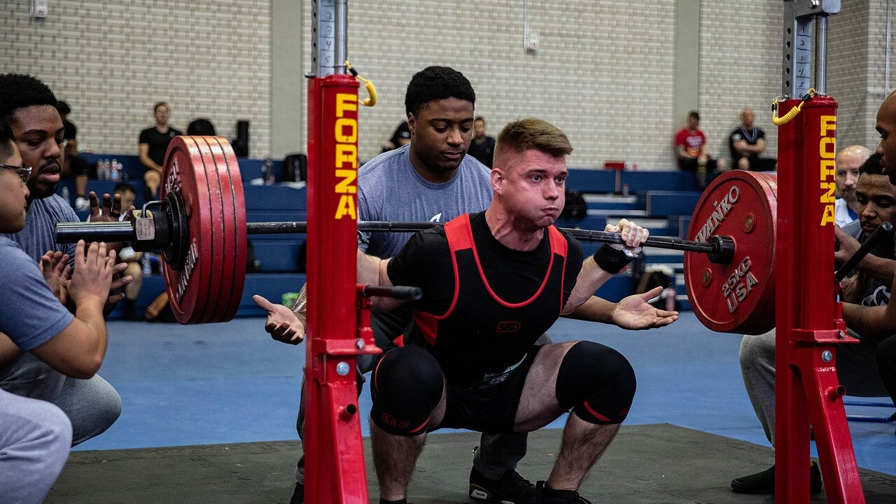
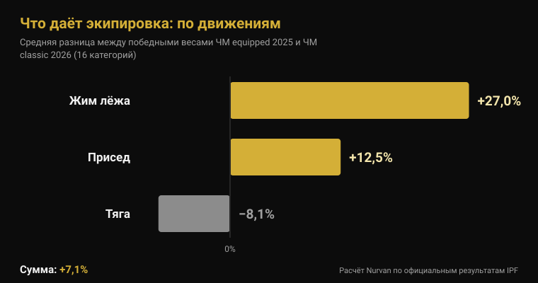
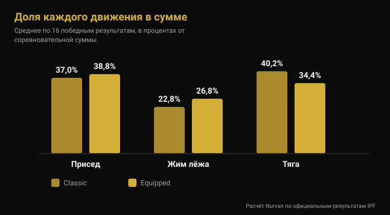
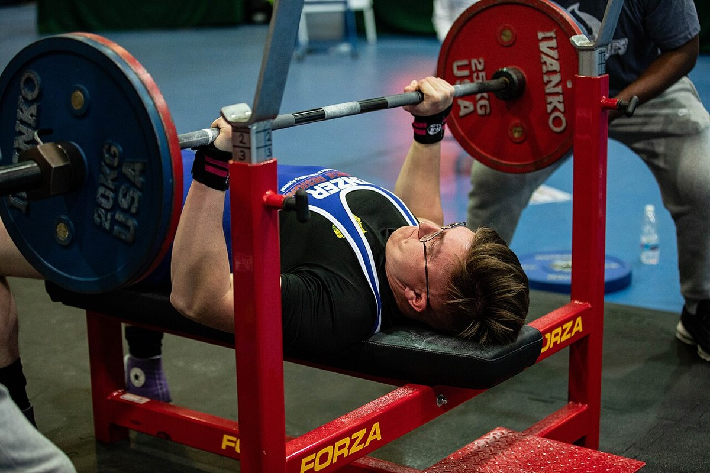

# ЧМ по экипировочному пауэрлифтингу 2026: что даёт форма

Автор: [Giammaria Loi](/autore/giammaria-loi) · обновлено 4 ноября 2026

С понедельника 9 по воскресенье 15 ноября в Стамбуле разыгрывают титулы чемпионата мира IPF в экипировке: это турнир, где разрешены комбинезон для приседа, жимовая майка и бинты на колени. Здесь показывают самые большие цифры в пауэрлифтинге — и здесь же ходят самые расплывчатые фразы: «в комбинезоне поднимаешь на 100 кг больше», «да там всё вытягивает экипировка». Я взял официальные протоколы IPF последнего экипировочного чемпионата и июньского классического и сравнил их по категориям. Результат не похож ни на одну из этих фраз.

## Коротко

- **Стамбул, 9-15 ноября 2026 года.** Это чемпионат мира IPF Open Equipped — единственный абсолютный мировой титул, где разрешена поддерживающая экипировка (официальный календарь IPF).
- **Средняя прибавка в сумме — 7%, а не 20%.** Если сравнить победные веса всех 16 категорий экипировочного ЧМ-2025 и классического ЧМ-2026, средняя разница составляет **+7,1%**. В 2 категориях из 16 победитель в классике поднял больше.
- **Экипировка помогает трём движениям по-разному.** Жим **+27%**, присед **+12,5%**, тяга **−8,1%**: эластичная ткань работает там, где есть эксцентрическая фаза, а тяга стартует из неподвижного положения.
- **Бинты работают, но смещают нагрузку.** С бинтами пиковая мощность в приседе растёт на **10%**, опускание идёт **на 45% быстрее**, а активность латеральной широкой мышцы на 90% от максимума **падает** (Lake 2012; Gomes 2015).
- **Наколенники — не мягкие бинты.** У 15 тренированных мужчин неопреновые наколенники добавили около **5 кг** к максимуму в приседе (166 против 161 кг) и больше ничего, причём одинаково в рекомендованном размере и на размер меньше (Machek 2021).

## Что происходит в Стамбуле с 9 по 15 ноября

Чемпионат мира Open Equipped 2026 проходит в Стамбуле (Турция) с **9 по 15 ноября** — так указано в официальном календаре International Powerlifting Federation. Это абсолютный турнир, без возрастных групп, с титулами в восьми мужских весовых категориях (59, 66, 74, 83, 93, 105, 120 и свыше 120 кг) и восьми женских (47, 52, 57, 63, 69, 76, 84 и свыше 84 кг).

Предыдущий чемпионат завершился 16 ноября 2025 года в **Клуж-Напоке (Румыния)**. Из официальных протоколов IPF полезны две вещи: командный зачёт у мужчин и у женщин выиграла **Украина**; лучшие баллы IPF GL набрали **Владимир Рысиев** (93 кг, сумма 1050 кг) и **Тейлор Лашапель** (63 кг, 645 кг). В мужской категории 74 кг победил **Ярослав Олех**, 1974 года рождения: сумма 850 кг в пятьдесят один год, в абсолютной категории.

США заявили команду из шестнадцати спортсменов — восемь мужчин и восемь женщин, все в абсолютной категории, — среди них **Иэн Белл**, победитель категории 105 кг в Клуж-Напоке с суммой 1067,5 кг, и **Келси Маккарти**, победительница категории 69 кг с суммой 652,5 кг.

## Классика и экипировка: в чём реальная разница

Технический регламент IPF, действующий с 1 марта 2026 года, разделяет два турнира исключительно по разрешённой одежде.

В **классике** (raw) допускаются: неподдерживающее трико, футболка под ним, пояс из кожи или нерастяжимого материала шириной не более 10 см и толщиной не более 13 мм, **неопреновые наколенники** толщиной до 7 мм и длиной до 30 см, а также кистевые бинты длиной до 1 метра.

В **экипировке** добавляются три предмета, запрещённые в классике: **комбинезон для приседа** (однослойная ткань, лямки всегда на плечах, штанины от 3 до 15 см от паха), **жимовая майка** (без прорезиненных и тянущихся материалов, рукава заканчиваются ниже дельтовидной мышцы и не доходят до локтя) и **бинты на колени** (не длиннее 2 метров и не шире 8 см, не более 15 см выше и 15 см ниже центра колена). Регламент прямо запрещает сочетать бинты и наколенники.

Техническая разница ровно в этом: комбинезон, майка и бинты — это эластичные ткани, которые сопротивляются опусканию, накапливают энергию и отдают её на подъёме. Они не поднимают за тебя: они меняют кривую силы движения.

## Что даёт экипировка: официальные цифры

Чтобы ответить цифрами, я взял два самых сопоставимых официальных протокола: победные веса **чемпионата мира Open Equipped 2025** (Клуж-Напока) и **чемпионата мира Open Classic 2026** (Друскининкай, Литва, 13-21 июня). Та же федерация, те же шестнадцать весовых категорий, тот же уровень.

По **соревновательной сумме** средняя разница по шестнадцати категориям составляет **+7,1%** в пользу экипировки (медиана +7,8%). В четырнадцати категориях из шестнадцати победитель в экипировке поднял больше. Два исключения показательны: в мужской категории 74 кг Остин Перкинс набрал **891,5 кг вообще без экипировки** против 850 у победителя в экипировке, а в женской свыше 84 кг Бриттани Шлейтер закончила на **756,5 кг** против 700.

| Движение | Средняя разница экипировка − классика |
|---|---|
| Жим лёжа | +27,0% |
| Присед | +12,5% |
| Становая тяга | −8,1% |
| **Сумма** | **+7,1%** |

По движениям картина меняется полностью. Жим — то упражнение, где майка весит больше всего: победные веса в среднем **на 27% выше**. Присед прибавляет **12,5%**. Тяга, где экипировке нечего нагружать в эксцентрической фазе, потому что штанга стартует неподвижно с помоста, идёт в обратную сторону: победные веса в экипировке в среднем **на 8% ниже**, чем в классике.

Это видно и по структуре суммы. У победителей в классике тяга — **40,2%** суммы, а жим — **22,8%**; у победителей в экипировке тяга падает до **34,4%**, а жим растёт до **26,8%**. Два вида спорта с одним названием и разным внутренним балансом.

Честная оговорка: это разные спортсмены на разных турнирах, поэтому сравнение измеряет **то, что поднимают на двух соревнованиях**, а не эффект комбинезона на одном и том же теле. Но направление совпадает с механизмом — чем больше эластичной ткани нагружается при опускании, тем больше прибавка — и с единственными опубликованными популяционными данными: проанализировав 26 472 пауэрлифтёра абсолютной категории, Ферланд с коллегами обнаружили, что атлеты в экипировке статистически значимо поднимают больше, чем атлеты в классике той же весовой категории (Ferland et al., 2020).

## Что на самом деле говорят исследования

| Расхожее утверждение | Вердикт | Источник |
|---|---|---|
| «В экипировке сумма выше на 20-30%» | Опровергнуто: в среднем +7,1% | Официальные протоколы IPF |
| «Комбинезон помогает всем трём движениям» | Опровергнуто: тяга хуже | Официальные протоколы IPF |
| «Бинты позволяют поднять больше» | Подтверждено, но они меняют упражнение | Lake et al., 2012; Gomes et al., 2015 |
| «Наколенники — то же, что бинты» | Опровергнуто | Machek et al., 2021 |
| «Пояс защищает спину» | Требует уточнения | Siewe et al., 2011; Lynch et al., 2025 |
| «Пауэрлифтинг убивает суставы» | Требует уточнения: 1 травма на 1000 часов | Siewe et al., 2011 |

### Бинты работают, но тренируют не то, что кажется

Это единственный предмет экипировки, который многие используют и в обычном зале, так что присмотримся. Десять тренированных мужчин выполняли одиночные приседы с 80% от максимума с бинтами и без. С бинтами горизонтальное смещение штанги уменьшилось на **39%**, фаза опускания стала **на 45% быстрее**, вертикальный импульс на подъёме вырос на **10%**, а пиковая мощность — на **10%** (2121 против 1841 Вт). Авторы объясняют это упругой энергией, накопленной в бинте при опускании, и заключают, что бинты меняют технику приседа так, что это, вероятно, меняет работающие мышцы (Lake et al., 2012).

Второе исследование измеряет именно это. Четырнадцать тренированных мужчин приседали с 60% и 90% от максимума с бинтами и без: на 90% ЭМГ-активность **латеральной широкой мышцы** была ниже с бинтами. Без бинтов сгибание в колене было больше на обеих интенсивностях (Gomes et al., 2015).

Перевод: бинты позволяют поднять больше и меньше загружают квадрицепс. На соревнованиях это преимущество; на тренировке, если цель — построить ногу, это отличный повод оставить их в сумке. То же касается технических деталей, которые меняют работающие мышцы, — я писал об этом применительно к [разведению коленей в приседе](/ru/blog/koleni-naruzhu-prised).

### Наколенники — другая история

Пятнадцать тренированных мужчин, никогда раньше не пользовавшихся наколенниками, тестировали три варианта: слабо поддерживающий контрольный рукав, неопреновый наколенник рекомендованного размера и на размер меньше. Максимум в приседе вырос с обоими настоящими наколенниками (166 кг против 161 кг в контроле), **без какой-либо разницы между обычным и более тугим размером** и без эффекта на прыжок, мощность, скорость или выносливость. Авторы подчёркивают контраст с бинтами, эффект которых действительно растёт с затяжкой (Machek et al., 2021).

Около 5 кг на 161, то есть 3%: полезно на помосте, бессмысленно как короткий путь.

### Пояс: сложнее, чем слоган

Два факта, и ни один не успокаивает в ожидаемом смысле. В опросе 245 соревнующихся и элитных пауэрлифтёров использование пояса оказалось **связано с более высокой частотой травм поясничного отдела** (Siewe et al., 2011). Это ретроспективное исследование по самоотчётам, поэтому оно не доказывает, что пояс вызывает проблему: те, кто носит пояс, работают и с большими весами, а некоторые надевают его именно потому, что спина беспокоит. Но это не то, что подразумевает реклама.

Второй: у 28 мужчин, приседавших с 75% от прогнозируемого максимума, **один лишь пояс не изменил активность** мышц корпуса и ног; активность брюшных мышц росла только при *брейсинге* — активном напряжении брюшной стенки — с поясом или без (Lynch et al., 2025). Пояс — это поверхность, в которую упираются, а не замена упора.

В той же работе Siewe есть цифра, которой обычно не хватает в спорах о пауэрлифтинге: частота травм — **0,3 травмы на атлета в год**, то есть примерно одна на 1000 часов тренировок, что мало по сравнению со многими видами спорта, хотя 43% сообщали о дискомфорте на обычных тренировках.

## Как это применить

1. **Если выступаете в классике, бинты вам не нужны.** Их выгода — на помосте, а цена — меньше работы квадрицепса именно на тех интенсивностях, где она нужнее всего.
2. **Наколенники: берите рекомендованный размер.** Туже не даст больше, зато будет мешать. Рассчитывайте на пару килограммов, а не на категорию.
3. **Пояс нужно освоить, а не просто надеть.** Сначала брейсинг без пояса, потом пояс как поверхность для упора. Если спина болит, затянуть сильнее — не решение.
4. **Решили попробовать экипировку — готовьтесь переучивать жим.** Это движение экипировка меняет сильнее всего, и именно оно требует больше всего новой техники.
5. **Тяга остаётся тягой.** Стамбул это подтвердит: движение, где комбинезон помогает меньше всего и где сила видна без фильтров.
6. **Всегда записывайте, в чём вы поднимали.** 180 кг в бинтах и 180 кг без — это два разных факта: в одной строке ваша история тренировок перестаёт что-либо значить.

**Попробуйте Nurvan — веса с контекстом, а не просто цифра**

В Nurvan каждый подход записывается с весом, повторениями и RIR, а заметки позволяют различать одно и то же движение с экипировкой и без. Разминочные подходы предлагаются автоматически от самого тяжёлого подхода дня, поэтому прогрессия остаётся читаемой, даже когда вы меняете соревновательную экипировку. Если с вами работает тренер, он видит ту же историю в своём профиле. [Попробуйте Nurvan](https://nurvan.app)

## Частые вопросы

**В чём разница между классическим и экипировочным пауэрлифтингом?**
В классике (raw) разрешены трико, пояс, неопреновые наколенники и кистевые бинты. В экипировке добавляются комбинезон для приседа, жимовая майка и эластичные бинты на колени, которые накапливают энергию при опускании и отдают её на подъёме. В IPF это два отдельных турнира с отдельными титулами.

**Насколько больше поднимают в экипировке?**
Если сравнить победные веса экипировочного ЧМ-2025 и классического ЧМ-2026 в тех же 16 категориях, сумма в экипировке в среднем выше на 7,1%. Но среднее скрывает всё: жим выше на 27%, присед на 12,5%, а тяга ниже на 8%.

**Вредны ли бинты для коленей?**
Доступные исследования измеряют механику и активность мышц, а не долгосрочный риск травм, поэтому честный ответ — мы не знаем. Известно другое: бинты уменьшают горизонтальное смещение штанги, ускоряют опускание и снижают активность квадрицепса на высоких интенсивностях.

**Можно ли надевать наколенники и бинты вместе?**
Нет. Технический регламент IPF прямо запрещает это на соревнованиях. В зале регламента нет, но нет и смысла: они выполняют одну задачу, а бинты делают это гораздо агрессивнее.

## Читайте также

- [ЧМ среди мастеров 2026: сколько силы теряется с возрастом](/ru/blog/chempionat-mastersov-2026-sila-i-vozrast) — тот же разбор официальных протоколов IPF, применённый к возрастным группам.
- [Колени наружу в приседе: правило или подсказка?](/ru/blog/koleni-naruzhu-prised) — как одна техническая деталь меняет работающие мышцы.
- [Хват в жиме лёжа: широкий, средний или узкий?](/ru/blog/khvat-zhim-lezha-shirokiy-uzkiy) — что меняет ширина хвата, с майкой или без.

## Источники

- Lake JP, Carden PJC, Shorter KA, 2012. Wearing knee wraps affects mechanical output and performance characteristics of back squat exercise. *Journal of Strength and Conditioning Research* 26(10):2844-9. PMID 22995993. [DOI](https://doi.org/10.1519/JSC.0b013e3182429840)
- Gomes WA, Brown LE, Soares EG, da Silva JJ, de O Silva FHD, Serpa ÉP, Corrêa DA, Vilela Junior GdeB, Lopes CR, Marchetti PH, 2015. Kinematic and sEMG Analysis of the Back Squat at Different Intensities With and Without Knee Wraps. *Journal of Strength and Conditioning Research* 29(9):2482-7. PMID 25763519. [DOI](https://doi.org/10.1519/JSC.0000000000000922)
- Machek SB, Cardaci TD, Wilburn DT, Cholewinski MC, Latt SL, Harris DR, Willoughby DS, 2021. Neoprene Knee Sleeves of Varying Tightness Augment Barbell Squat One Repetition Maximum Performance Without Improving Other Indices of Muscular Strength, Power, or Endurance. *Journal of Strength and Conditioning Research* 35(Suppl 1):S6-S15. PMID 33201154. [DOI](https://doi.org/10.1519/JSC.0000000000003869)
- Siewe J, Rudat J, Röllinghoff M, Schlegel UJ, Eysel P, Michael JW-P, 2011. Injuries and overuse syndromes in powerlifting. *International Journal of Sports Medicine* 32(9):703-11. PMID 21590644. [DOI](https://doi.org/10.1055/s-0031-1277207)
- Lynch DJ, Drusch AS, Hooper TL, James CR, Brooks TJ, Wilford KF, Seeber GH, Sizer PS, 2025. Changes in muscle activation in response to abdominal bracing and stabilization belt use during a loaded squat. *Journal of Sports Sciences* 43(20):2434-2446. PMID 40698971. [DOI](https://doi.org/10.1080/02640414.2025.2535048)
- Ferland PM, Allard MO, Comtois AS, 2020. Efficiency of the Wilks and IPF Formulas at Comparing Maximal Strength Regardless of Bodyweight through Analysis of the Open Powerlifting Database. *International Journal of Exercise Science* 13(4):567-582. PMID 33042369. [DOI](https://doi.org/10.70252/XGHM8852)

Библиографические ссылки найдены через PubMed. Соревновательные данные — из официальных протоколов IPF (ЧМ Open Equipped 2025, Клуж-Напока; ЧМ Open Classic 2026, Друскининкай) и официального календаря IPF; правила — из IPF Technical Rules Book, действующего с 1 марта 2026 года. Состав сборной США — по данным Powerlifting America.

---

Giammaria Loi — основатель Nurvan. Тренируется с отягощениями с 2012 года, работает персональным тренером и коучем с сертификацией FIPE с 2013 года и выступает в пауэрлифтинге на национальном уровне с 2018 года. Каждая его статья начинается с научных работ и заканчивается тем, что действительно работает в зале.

> Примечание: информационный материал, не заменяет консультацию врача или специалиста.
