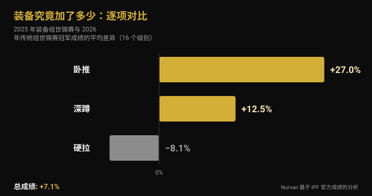
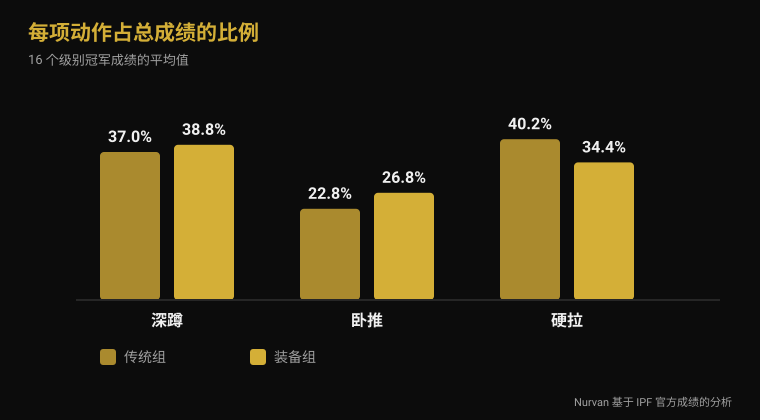

# 2026装备组世锦赛：装备究竟加了多少

作者 [Giammaria Loi](/autore/giammaria-loi) · 更新于 2026 年 11 月 4 日

11 月 9 日（周一）至 15 日（周日），伊斯坦布尔将决出 IPF 装备组世界冠军：这是唯一允许使用深蹲服、卧推衫和护膝绷带的比赛。它产出力量举最大的数字，也滋生最含糊的说法——"穿上深蹲服能多举 100 公斤"、"反正都是装备在举"。我把 IPF 上一届装备组世锦赛和今年 6 月传统组世锦赛的官方成绩单拿来，逐个级别做了对比。结果跟这两种说法都不一样。

## 要点速览

- **伊斯坦布尔，2026 年 11 月 9 日至 15 日。** 这是 IPF 装备组公开级世锦赛，唯一允许使用支撑性装备的公开级世界冠军赛（IPF 官方赛历）。
- **总成绩的平均优势是 7%，不是 20%。** 把 2025 年装备组世锦赛和 2026 年传统组世锦赛全部 16 个级别的冠军成绩相比，平均差异为 **+7.1%**。16 个级别里有 2 个是传统组冠军举得更多。
- **装备对三项的帮助完全不同。** 卧推 **+27%**，深蹲 **+12.5%**，硬拉 **−8.1%**：弹性面料只在有离心下放阶段的地方起作用，而硬拉从静止起杠。
- **绷带有效，但把工作转移走了。** 使用绷带后深蹲峰值功率提高 **10%**，下放速度快 **45%**，而在 90% 最大重量时股外侧肌的激活反而**下降**（Lake 2012；Gomes 2015）。
- **护膝不是"软绷带"。** 在 15 名训练者中，氯丁橡胶护膝让深蹲最大重量增加约 **5 公斤**（166 对 161 公斤），除此之外没有任何变化；推荐尺码和小一号的效果完全相同（Machek 2021）。

## 11 月 9 日至 15 日，伊斯坦布尔会发生什么

根据国际力量举联合会（IPF）官方赛历，2026 年装备组公开级世锦赛于 **11 月 9 日至 15 日**在土耳其伊斯坦布尔举行。这是公开级比赛，不分年龄段，设男子八个体重级别（59、66、74、83、93、105、120 及 120 公斤以上）和女子八个级别（47、52、57、63、69、76、84 及 84 公斤以上）。

上一届于 2025 年 11 月 16 日在**罗马尼亚克卢日-纳波卡**结束。IPF 官方文件里有两点值得带到伊斯坦布尔来看：**乌克兰**同时拿下男子与女子团体冠军；IPF GL 积分最高的是**弗拉基米尔·雷西耶夫**（93 公斤级，总成绩 1050 公斤）和**泰勒·拉夏佩尔**（63 公斤级，645 公斤）。男子 74 公斤级冠军是 1974 年出生的**雅罗斯瓦夫·奥莱赫**：五十一岁，在公开级拿下 850 公斤总成绩。

美国公布了十六人名单，男女各八人，全部参加公开级，其中包括在克卢日-纳波卡以 1067.5 公斤夺得 105 公斤级冠军的**伊恩·贝尔**，以及以 652.5 公斤夺得 69 公斤级冠军的**凯尔西·麦卡锡**。

## 传统组和装备组：真正的区别在哪

2026 年 3 月 1 日起生效的 IPF 技术规则，完全以"能穿什么"来区分这两项比赛。

**传统组**（raw）允许：无支撑性的比赛连体服、里面的短袖、皮革或不可拉伸材料的腰带（宽度不超过 10 厘米、厚度不超过 13 毫米）、厚度不超过 7 毫米且长度不超过 30 厘米的**氯丁橡胶护膝**，以及长度不超过 1 米的护腕。

**装备组**另外允许三件传统组禁止的装备：**深蹲服**（单层面料，肩带须始终在肩上，裤腿距裆部 3 至 15 厘米）、**卧推衫**（不得含橡胶或弹性材料，袖口止于三角肌下方且不到肘部）和**护膝绷带**（长度不超过 2 米、宽度不超过 8 厘米，缠绕范围不得超出膝关节中心上下各 15 厘米）。规则明确禁止护膝与绷带同时使用。

技术差异就在这里：深蹲服、卧推衫和绷带都是弹性面料，在下放时对抗动作、储存能量，并在上升时释放。它们不会替你举起杠铃，但会改变动作的力量曲线。

## 装备加了多少：官方数字

为了用数字回答，我取了现有最可比的两份官方成绩单：**2025 年装备组公开级世锦赛**（克卢日-纳波卡）与 **2026 年传统组公开级世锦赛**（立陶宛德鲁斯基宁凯，6 月 13 日至 21 日）的冠军成绩。同一联合会、同样十六个体重级别、同一竞技水平。

就**比赛总成绩**而言，十六个级别的平均差异是装备组高 **7.1%**（中位数 +7.8%）。十六个级别中有十四个是装备组冠军举得更多。另外两个很能说明问题：男子 74 公斤级，奥斯汀·珀金斯在**完全没有装备**的情况下举出 **891.5 公斤**，而装备组冠军是 850 公斤；女子 84 公斤以上级，布列塔尼·施莱特以 **756.5 公斤**对 700 公斤。

| 动作 | 装备组减传统组的平均差异 |
|---|---|
| 卧推 | +27.0% |
| 深蹲 | +12.5% |
| 硬拉 | −8.1% |
| **总成绩** | **+7.1%** |

但逐项来看，画面完全不同。卧推是卧推衫作用最大的项目：冠军成绩平均**高出 27%**。深蹲提高 **12.5%**。硬拉由于杠铃静止在地面起拉，装备没有离心阶段可以利用，结果反过来：装备组的冠军硬拉成绩平均**比传统组低 8%**。

总成绩的构成也随之改变。传统组冠军中，硬拉占总成绩的 **40.2%**，卧推占 **22.8%**；装备组冠军中，硬拉降到 **34.4%**，卧推升到 **26.8%**。名字相同的两个项目，内部结构并不一样。

需要诚实说明：这是不同运动员在不同比赛中的成绩，因此这个对比衡量的是**两项比赛各自举起了多少**，而不是同一个人穿上装备的效果。但方向与机制一致——下放时需要加载的弹性面料越多，增益越大——也与唯一已发表的群体数据一致：对 26,472 名公开级力量举运动员的分析发现，同一体重级别中装备组运动员举起的重量在统计上显著高于传统组（Ferland et al., 2020）。

## 研究到底怎么说

| 常见说法 | 结论 | 来源 |
|---|---|---|
| "装备让总成绩高 20-30%" | 被推翻：平均 +7.1% | IPF 官方成绩 |
| "深蹲服对三项都有帮助" | 被推翻：硬拉反而更差 | IPF 官方成绩 |
| "绷带能让你举更多" | 属实——但它改变了这个动作 | Lake et al., 2012；Gomes et al., 2015 |
| "护膝跟绷带差不多" | 被推翻 | Machek et al., 2021 |
| "腰带保护腰" | 需要澄清 | Siewe et al., 2011；Lynch et al., 2025 |
| "力量举毁关节" | 需要澄清：每 1000 小时 1 次伤病 | Siewe et al., 2011 |

### 绷带有效，但练的不是你以为的东西

绷带是装备组里许多人在普通健身房也会用的唯一一件，值得细看。十名训练有素的男性以 80% 最大重量进行单次深蹲，分有绷带和无绷带两种条件。使用绷带后，杠铃水平位移减少 **39%**，下放阶段快 **45%**，上升时的垂直冲量增加 **10%**，峰值功率增加 **10%**（2121 对 1841 瓦）。作者把这归因于下放过程中储存在绷带里的弹性能量，并指出绷带改变了深蹲技术，很可能也改变了参与工作的肌肉（Lake et al., 2012）。

第二项研究测的正是这一点。十四名训练者以 60% 和 90% 最大重量深蹲，有绷带和无绷带：在 90% 时，**股外侧肌**的肌电活动在使用绷带时更低。不用绷带时，两种强度下的膝关节屈曲幅度都更大（Gomes et al., 2015）。

翻译过来：绷带让你举得更多，而股四头肌干得更少。比赛中这是优势；训练中，如果目标是练腿，这正是把绷带留在包里的好理由。同样的道理也适用于那些改变发力肌群的技术细节——我在[深蹲时膝盖外展](/zh/blog/shenzun-xigai-waizhan)那篇里写过。

### 护膝是另一回事

十五名从未用过护膝的训练者测试了三种条件：支撑性极弱的对照袖套、厂商推荐尺码的氯丁橡胶护膝，以及小一号的同款。两种真护膝都提高了深蹲最大重量（166 公斤对对照组的 161 公斤），**正常尺码与更紧尺码之间没有任何差异**，对弹跳、功率、速度和耐力也没有任何影响。作者特别指出这与绷带形成对比：绷带的效果确实随缠紧程度增加（Machek et al., 2021）。

161 公斤上多出约 5 公斤，也就是 3%：比赛中有用，当捷径则毫无意义。

### 腰带：比广告语复杂得多

两个数据，没有一个是按预期让人安心的。在一项针对 245 名竞技及精英力量举运动员的问卷研究中，使用腰带与**更高的腰椎伤病率相关**（Siewe et al., 2011）。这是基于自我报告的回顾性研究，并不能证明腰带导致问题：戴腰带的人处理的重量也更大，有些人正是因为腰不舒服才戴上它。但这确实不是广告所暗示的那样。

第二个：28 名男性以预测最大重量的 75% 深蹲，**单独使用腰带并没有改变**躯干与下肢肌肉的激活；腹部活动只有在做 *bracing*（主动绷紧腹壁）时才升高，无论戴不戴腰带（Lynch et al., 2025）。腰带是用来顶住的面，而不是顶住本身的替代品。

Siewe 这篇研究里还有一个在力量举争论中通常缺席的数字：伤病率为**每名运动员每年 0.3 次**，约合每 1000 小时训练 1 次——相比许多项目都算低，尽管有 43% 的人表示在日常训练中有不适。

## 怎么用这些结论

1. **如果你打传统组，绷带对你没用。** 它的收益在赛台上，代价是在你最需要股四头肌出力的强度下让它少干活。
2. **护膝：买推荐尺码。** 更紧不会给你更多，只会更难受。预期是几公斤，不是一个级别。
3. **腰带是技术，不是买来戴上就行。** 先学会不戴腰带的 bracing，再把腰带当作顶住的面。如果腰疼，勒更紧解决不了。
4. **想尝试装备组，就要准备重新学卧推。** 这是装备改变最大的动作，也是最需要重建技术的动作。
5. **硬拉还是硬拉。** 伊斯坦布尔会再次证明：这是深蹲服帮助最小、力量最不加滤镜的一项。
6. **永远记录你当时穿了什么。** 戴绷带的 180 公斤和不戴的 180 公斤是两个不同的数据；写在同一行里，你的训练史就失去意义了。

**试试 Nurvan——有上下文的训练重量，而不只是一个数字**

在 Nurvan 里，每一组都记录重量、次数和 RIR，备注可以区分同一个动作在有装备和无装备下的表现。热身组会根据当天最重的一组自动推荐，所以即使你更换比赛装备配置，进步曲线依然清晰可读。如果有教练带你，他在自己的账号里看到的是同一份记录。[试试 Nurvan](https://nurvan.app)

## 常见问题

**传统组和装备组力量举有什么区别？**
传统组（raw）允许连体服、腰带、氯丁橡胶护膝和护腕。装备组另加深蹲服、卧推衫和弹性护膝绷带，它们在下放时储存能量、上升时释放。在 IPF，这是两项独立的比赛，设独立的冠军。

**用装备能多举多少？**
把 2025 年装备组世锦赛和 2026 年传统组世锦赛同样 16 个级别的冠军成绩相比，装备组总成绩平均高 7.1%。但平均值掩盖了一切：卧推高 27%，深蹲高 12.5%，硬拉低 8%。

**护膝绷带伤膝盖吗？**
现有研究测的是力学和肌肉激活，而不是长期伤病风险，所以诚实的回答是：我们不知道。已知的是绷带减少杠铃水平位移、加快下放速度，并在高强度下降低股四头肌激活。

**可以同时戴护膝和绷带吗？**
不可以。IPF 技术规则在比赛中明确禁止。健身房里没有规则，但也没有理由：两者做的是同一件事，而绷带做得激进得多。

## 延伸阅读

- [2026 大师世锦赛：随年龄到底会损失多少力量](/zh/blog/2026-dashi-shijinsai-liliang-nianling) —— 同样基于 IPF 官方成绩的分析，用在年龄段上。
- [深蹲时膝盖外展：规则还是提示？](/zh/blog/shenzun-xigai-waizhan) —— 一个技术细节如何改变真正发力的肌肉。
- [卧推握距：宽、中还是窄？](/zh/blog/wotui-woju-kuanzhai) —— 握距到底改变了什么，有没有卧推衫都一样。

## 参考文献

- Lake JP, Carden PJC, Shorter KA, 2012. Wearing knee wraps affects mechanical output and performance characteristics of back squat exercise. *Journal of Strength and Conditioning Research* 26(10):2844-9. PMID 22995993. [DOI](https://doi.org/10.1519/JSC.0b013e3182429840)
- Gomes WA, Brown LE, Soares EG, da Silva JJ, de O Silva FHD, Serpa ÉP, Corrêa DA, Vilela Junior GdeB, Lopes CR, Marchetti PH, 2015. Kinematic and sEMG Analysis of the Back Squat at Different Intensities With and Without Knee Wraps. *Journal of Strength and Conditioning Research* 29(9):2482-7. PMID 25763519. [DOI](https://doi.org/10.1519/JSC.0000000000000922)
- Machek SB, Cardaci TD, Wilburn DT, Cholewinski MC, Latt SL, Harris DR, Willoughby DS, 2021. Neoprene Knee Sleeves of Varying Tightness Augment Barbell Squat One Repetition Maximum Performance Without Improving Other Indices of Muscular Strength, Power, or Endurance. *Journal of Strength and Conditioning Research* 35(Suppl 1):S6-S15. PMID 33201154. [DOI](https://doi.org/10.1519/JSC.0000000000003869)
- Siewe J, Rudat J, Röllinghoff M, Schlegel UJ, Eysel P, Michael JW-P, 2011. Injuries and overuse syndromes in powerlifting. *International Journal of Sports Medicine* 32(9):703-11. PMID 21590644. [DOI](https://doi.org/10.1055/s-0031-1277207)
- Lynch DJ, Drusch AS, Hooper TL, James CR, Brooks TJ, Wilford KF, Seeber GH, Sizer PS, 2025. Changes in muscle activation in response to abdominal bracing and stabilization belt use during a loaded squat. *Journal of Sports Sciences* 43(20):2434-2446. PMID 40698971. [DOI](https://doi.org/10.1080/02640414.2025.2535048)
- Ferland PM, Allard MO, Comtois AS, 2020. Efficiency of the Wilks and IPF Formulas at Comparing Maximal Strength Regardless of Bodyweight through Analysis of the Open Powerlifting Database. *International Journal of Exercise Science* 13(4):567-582. PMID 33042369. [DOI](https://doi.org/10.70252/XGHM8852)

文献通过 PubMed 检索。比赛数据来自 IPF 官方成绩（2025 年装备组公开级世锦赛，克卢日-纳波卡；2026 年传统组公开级世锦赛，德鲁斯基宁凯）与 IPF 官方赛历；规则出自 2026 年 3 月 1 日起生效的 IPF Technical Rules Book。美国队名单来自 Powerlifting America。

---

Giammaria Loi 是 Nurvan 的创始人。他从 2012 年开始进行力量训练，自 2013 年起担任 FIPE 认证私人教练，并从 2018 年起参加全国级别的力量举比赛。他署名的每一篇文章都从科研文献出发，落在健身房里真正有效的做法上。

> 说明：本文为科普内容，不能替代医生或专业人士的意见。
