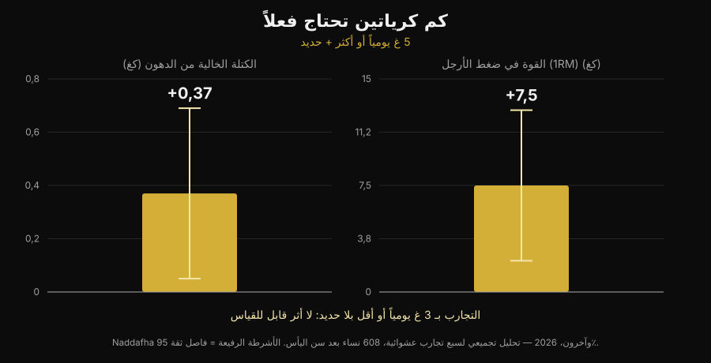
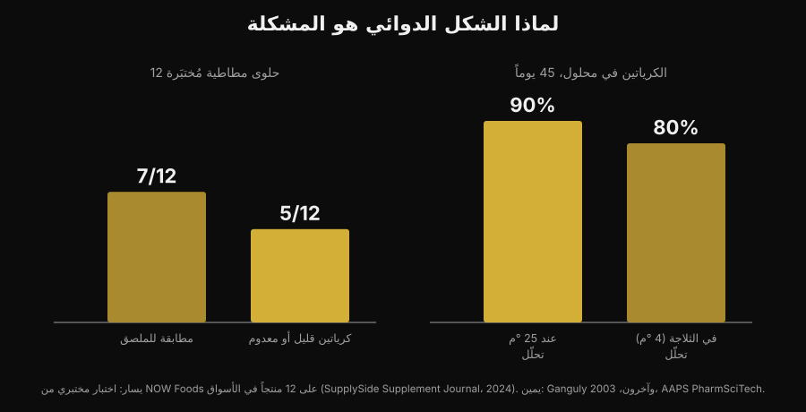

# هل تنفع حلوى الكرياتين المطاطية مثل البودرة؟

بقلم [Giammaria Loi](/autore/giammaria-loi) · حُدِّث في 5 نوفمبر 2026

تمضغ حبتين بدلاً من إذابة بودرة تبقى راسبة في قاع الكوب. وعدٌ مريح فعلاً، والبحث عن "creatine gummies" ارتفع بنسبة 279%. لكن السؤال الحقيقي ليس هل ينفع الكرياتين — هذا ملفٌ أغلقته الأبحاث منذ ثلاثين عاماً — بل هل يوجد داخل تلك الحلوى الكرياتين المكتوب على الملصق فعلاً. هنا توجد أرقام، وهي ليست مطمئنة.

## باختصار

- **توجد دراسة على الحلوى المطاطية، ونتيجتها إيجابية.** عشرة أسابيع، 5 g يومياً من كرياتين مونوهيدرات في صورة حلوى مطاطية: تحسّن الوثب العمودي وسرعة تغيير الاتجاه لدى 32 لاعبة كرة طائرة شاطئية مقارنة بمجموعة الضبط.
- **لكن تلك الدراسة استخدمت 5 g حقيقية.** أحدث تحليل تلوي يجد +0,37 kg في الكتلة الصافية و+7,5 kg في دفع الأرجل مع ≥5 g يومياً إلى جانب تدريب الأثقال، ولا أثر قابلاً للقياس في التجارب التي استخدمت ≤3 g يومياً دون تدريب.
- **كثير من الحلوى لا يحتوي ما تعلنه.** في فحص مختبري لـ 12 منتجاً متوفراً في السوق، احتوت 5 منتجات على كرياتين قليل أو معدوم — وجميعها الخمسة احتوت كرياتينين.
- **الكرياتينين ليس خطيراً، إنه بلا فائدة.** هو ناتج تحلّل الكرياتين: وجوده في العلبة يعني أن الكرياتين تلاشى قبل أن تشتريه.
- **الكيمياء تفسّر السبب.** الكرياتين كبودرة جافة مستقر؛ في المحلول لا. في الماء بحرارة الغرفة يتحلّل 90% منه خلال 45 يوماً.

## لماذا صارت الحلوى المطاطية في كل مكان

السبب ليس علمياً، بل عملياً. لبودرة الكرياتين ثلاث مشكلات: تحتاج قياساً، تحتاج إذابة، وإذا كان الماء بارداً تبقى حُبيبات في القاع. الحلوى المطاطية تحلّ الثلاث مشكلات معاً، تُحمل في الحقيبة، وتبدو كقطعة سكاكر لا كمكمّل. هي نفس الآلية التي نقلت فيتامين D وأوميغا 3 إلى الصيغة القابلة للمضغ.

النتيجة تظهر في البحث: "creatine gummies" اليوم استعلام بنحو 165 000 بحث شهرياً ونمو 279%، والصدارة على Google تكاد تكون كلها قوائم تصنيف لمواقع تبيع المنتج. ولا تكاد صفحة واحدة منها تذكر الرقمين المهمّين: كم كرياتين تحتاج، وكم يوجد فعلاً في المنتج.

## الخبر الجيد: الدراسة على الحلوى موجودة

حتى وقت قريب، من يسأل "هل تنفع؟" كان يحصل على جواب بالقياس: في داخلها كرياتين مونوهيدرات، والكرياتين مونوهيدرات ينفع، إذن هي تنفع. الآن توجد دراسة اختبرت هذه الصيغة بعينها.

اثنتان وثلاثون لاعبة كرة طائرة شاطئية، جامعيات ومحترفات، وُزِّعن على كرياتين مونوهيدرات في صورة حلوى مطاطية بجرعة 5 g يومياً أو على مجموعة ضبط، لمدة عشرة أسابيع. تحسّن في مجموعة الكرياتين الوثب العمودي بحركة معاكسة (p < 0,001) وسرعة تغيير الاتجاه (p = 0,009)، في حين لم تتحسّن مجموعة الضبط أو تراجعت؛ وظهرت فروق لصالح الكرياتين في كتلة الدهون ونسبة الدهون كذلك. ولم يظهر أي فرق في الكتلة الصافية وكتلة العضلات الهيكلية وزمن رد الفعل (Pereira et al., 2026).

نتيجة متوافقة مع كل أدبيات الكرياتين البودرة، وتقول شيئاً بسيطاً: **الصيغة المطاطية لا تُفسد الجزيء**. إذا كان الكرياتين موجوداً وبالكمية الصحيحة، فالناقل ليس المشكلة. وهذا ينقل القضية كلها إلى شرطين: أن يكون موجوداً، وأن يكون كافياً.

## الجرعة هي المباراة كلها

الرقم الذي يجب حفظه هو 5 g يومياً. هذه جرعة المحافظة التي يحدّدها الموقف الرسمي لـ International Society of Sports Nutrition، وهي نفسها المستخدمة في دراسة الحلوى المطاطية. مرحلة التحميل (نحو 0,3 g لكل كيلوغرام من وزن الجسم يومياً لمدة 5–7 أيام) تملأ المخازن أسرع، لكنها ليست إلزامية: تصل إلى النقطة نفسها بـ 3–5 g يومياً خلال بضعة أسابيع (Kreider et al., 2017).

تحت هذه العتبة تتغيّر الصورة. مراجعة منهجية مع تحليل تلوي لسبع تجارب معشّاة و608 نساء بعد سن انقطاع الطمث وجدت فوائد واضحة عندما تجاوز الكرياتين 5 g يومياً مع تدريب المقاومة: الكتلة الصافية +0,37 kg (فاصل ثقة 95% من +0,05 إلى +0,69) ودفع الأرجل +7,5 kg (فاصل ثقة 95% من +2,2 إلى +12,8). وفي التجارب التي استخدمت ≤3 g يومياً دون تدريب، لا أثر قابلاً للقياس (Naddafha et al., 2026).

*رسم Nurvan على بيانات Naddafha et al., 2026 (J Int Soc Sports Nutr). القيم مأخوذة من الملخّص الأصلي، لا مقروءة من الأشكال.*

نفس رتبة الحجم تتكرّر في تجربة ثلاثية التعمية على عشرين شخصاً بالغاً نباتياً: أربعة أسابيع بجرعة 0,1 g لكل كيلوغرام يومياً — نحو 7 g لشخص وزنه 70 kg — رفعت كتلة العضلات الهيكلية 0,3 kg وحسّنت الوثب، دون تغيّر في مؤشرات الكلى (López-Moreno et al., 2026).

الآن الحساب العملي، وهو سبب النظر إلى الحلوى المطاطية بعين دقيقة. هذا عدد الحبات اللازم يومياً للوصول إلى 5 g، بحسب ما تعلنه الحبة الواحدة:

| الكرياتين المعلن لكل حبة | عدد الحبات يومياً للوصول إلى 5 g |
|---|---|
| 0,5 g | 10 |
| 0,75 g | 7 |
| 1 g | 5 |
| 1,25 g | 4 |
| 1,5 g | 4 (3,3 مُقرَّباً للأعلى) |
| 2 g | 3 (2,5 مُقرَّباً للأعلى) |

*حساب Nurvan: 5 ÷ الغرامات المعلنة لكل حبة، مُقرَّباً للأعلى. الغرامات لكل حبة تُقرأ على ملصق المنتج الذي بين يديك.*

النقطة ليست في الرقم نفسه، بل في أن الحصة المعلنة على واجهة العلبة لا تساوي 5 g تقريباً أبداً. إذا اقترح منتج "حبتان يومياً" وكانت كل حبة تعلن 1 g، فأنت تتناول 2 g: وهو النطاق الذي لم يُنتج أثراً قابلاً للقياس في التحليل التلوي.

## المشكلة الحقيقية: ما يوجد فعلاً في الداخل

هنا نصل إلى الجزء الذي لا تحكيه قوائم التصنيف التابعة. اشترى مختبر صناعي 12 نوعاً من حلوى الكرياتين المطاطية من Amazon ومن مواقع المنتجين وحلّلها. سبعة منتجات التزمت بما على الملصق، وبعضها بهوامش سخيّة. أما الخمسة الأخرى فاحتوت كرياتين قليلاً أو معدوماً. وفي الخمسة جميعاً وُجد **كرياتينين**، بكميات من الصغيرة إلى المعتبرة (فحص NOW Foods كما نقله SupplySide Supplement Journal, 2024).

*رسم Nurvan. اللوحة اليسرى: فحص مختبري على 12 منتجاً في السوق (NOW Foods، كما نقله SupplySide Supplement Journal, 2024). اللوحة اليمنى: Ganguly et al., 2003, AAPS PharmSciTech.*

الكرياتينين هو الناتج النهائي لتحلّل الكرياتين. ليس سُمّاً — جسمك ينتجه ويطرحه كل يوم — لكن لا نشاط مُحسِّن للأداء له إطلاقاً. وجوده في مكمّل يعني شيئاً واحداً: ذلك الكرياتين تحلّل قبل أن يصل إلى فمك، وأنت تدفع ثمن قطعة سكاكر.

ولماذا الحلوى المطاطية تحديداً؟ لسبب كيميائي لا تجاري. الكرياتين مونوهيدرات كبودرة جافة مستقر جداً؛ في المحلول لا. دراسة استقرار أذابت تركيبات كرياتين في ماء بدرجة حموضة pH 6,2 وقاست المحتوى على مدى 45 يوماً: في حرارة الغرفة تحلّل 90% من الكرياتين، وفي الثلاجة 80% (Ganguly et al., 2003). الحلوى المطاطية هلام يولد ساخناً، يحتوي ماء، وغالباً يُحمَّض لأجل الطعم، ثم يبقى شهوراً على الرف في حرارة الغرفة: هذه بالضبط الظروف التي تُسرّع التحوّل. هذا لا يعني أن كل الحلوى بلا فائدة — سبعة من اثني عشر كانت سليمة — بل يعني أن هذه الصيغة أهشّ بطبيعتها من علبة البودرة، وأنك بدون تحليل مختبري لا تملك طريقة لمعرفة في أي نصف وقعت.

## ماذا تقول الأبحاث فعلاً

| ادعاء شائع | الحكم | المصدر |
|---|---|---|
| "الحلوى المطاطية لا تنفع، الكرياتين يتلف فيها" | يحتاج توضيحاً: في دراسة واحدة نفعت | Pereira et al., 2026 |
| "يكفي تناول العدد المكتوب على الملصق" | مَدحوض: المهم الوصول إلى 5 g | Naddafha et al., 2026; Kreider et al., 2017 |
| "إذا كُتب كرياتين، فالكرياتين موجود في الداخل" | مَدحوض: 5 منتجات من 12 فيها قليل أو معدوم | فحص NOW Foods, 2024 |
| "الكرياتينين في الحلوى يضرّ الكلى" | مَدحوض: هو خامل، والمشكلة في الجرعة الناقصة | Kreider et al., 2017; López-Moreno et al., 2026 |
| "مرحلة التحميل لا بد منها" | يحتاج توضيحاً: تُسرّع ولا تلزم | Kreider et al., 2017 |
| "الصيغ الأكثر ذوباناً أكثر فعالية" | لم يُثبَت في البشر | Alraddadi et al., 2018 |

يستحق السطر الأخير وقفة قصيرة، فهو الحجّة التي تصحب كل الصيغ البديلة تقريباً. صحيح أن كرياتين هيدروكلوريد أكثر ذوباناً من المونوهيدرات، ودراسة حركية دوائية في الجَرذ، مع نمذجة، قدّرت توافراً حيوياً فموياً أعلى لصيغة الهيدروكلوريد مقارنة بالمونوهيدرات (Alraddadi et al., 2018). لكنه نموذج حيواني: لم تُظهر أي تجربة على البشر أن هذا يُترجَم إلى قوة أكبر أو كتلة أكبر، ويبقى المونوهيدرات الصيغة التي تقوم عليها الأدبيات كلها عملياً، بما فيها أدبيات السلامة طويلة المدى (Kerksick et al., 2026). والمبدأ نفسه ينطبق على الحلوى المطاطية: هي ناقل، لا ميزة.

## كيف تطبّق هذا

1. **ابدأ من الغرامات، لا من عدد الحبات.** اقرأ كم غراماً من كرياتين مونوهيدرات تعلنه الحبة الواحدة، واحسب للوصول إلى 5 g يومياً. وإذا لم تعلن العلبة ذلك لكل حبة بل لكل "حصة" فقط، فهذه إشارة في حد ذاتها.
2. **احذر المنتجات التي لا تقول "مونوهيدرات".** هي الصيغة المستخدمة في الدراسات، بما فيها دراسة الحلوى المطاطية. التسميات العامة أو الصيغ "الحصرية" لا تقف على القاعدة نفسها من الأدلة.
3. **ابحث عن شهادة من طرف ثالث.** Informed Sport وNSF Certified for Sport وما شابهها تُخضع الدفعات للتحليل. وهذا للحلوى المطاطية أهم منه للبودرة، بالضبط لأن الصيغة أقل استقراراً.
4. **احسب التكلفة لكل غرام.** اقسم السعر على إجمالي غرامات الكرياتين في العلبة، لا على عدد الحبات. المقارنة مع علبة البودرة تنتهي عند هذه الخطوة عادةً.
5. **انظر إلى السكريات أيضاً.** خمس حبات يومياً هي خمس حلويات يومياً: راجع سطر السكريات في الملصق الغذائي واحسبه داخل يومك.
6. **التوقيت لا يساوي الاستمرارية.** ما يملأ المخازن هو تناوله كل يوم، لا التقاط النافذة الصحيحة: كتبت عن ذلك بالتفصيل في مقال [متى تتناول المكمّلات الغذائية](/ar/blog/mata-tatanawal-almukammilat-alghidhaiya).

**جرّب Nurvan — المكمّلات متابَعة إلى جانب الأحمال**

في Nurvan تسجّل ما تتناوله ومتى في قسم المكمّلات، وتراه بجانب سجل الأحمال والتكرارات وRIR لحصصك التدريبية. فإذا بدّلت صيغة الكرياتين أو علامته التجارية، تستطيع النظر في ما حدث لأرقامك في النادي خلال الأسابيع التالية بدلاً من الاعتماد على إحساس. وفي الملف نفسه تجد أيضاً التحاليل التي رفعتها. [جرّب Nurvan](https://nurvan.app)

## أسئلة شائعة

**هل تنفع حلوى الكرياتين المطاطية فعلاً؟**
يمكن أن تنفع، بشرطين. في الدراسة المتاحة، حسّنت عشرة أسابيع بجرعة 5 g يومياً في صورة حلوى مطاطية الوثب العمودي وتغيير الاتجاه لدى لاعبات كرة طائرة شاطئية (Pereira et al., 2026). والشرطان هما أن يحتوي المنتج فعلاً الكرياتين المعلن، وأن تصل أنت إلى نحو 5 g يومياً.

**كم حبة كرياتين مطاطية آخذ في اليوم؟**
يعتمد على الغرامات التي تعلنها كل حبة: الهدف نحو 5 g يومياً من كرياتين مونوهيدرات. مع 1 g للحبة تصبح 5 حبات، ومع 0,5 g تصبح 10. و"الحصة الموصى بها" المطبوعة على العلبة تبقى غالباً تحت 5 g.

**هل الكرياتينين الذي وُجد في بعض الحلوى خطير؟**
لا. الكرياتينين ناتج تحلّل الكرياتين، والجسم ينتجه ويطرحه بشكل طبيعي؛ وفي الدراسات لم يغيّر الكرياتين مؤشرات الكلى (Kreider et al., 2017؛ López-Moreno et al., 2026). المشكلة ليست السمّية بل الفعالية: حيث يوجد كرياتينين، ينقص كرياتين. وإذا كانت قيم تحاليلك خارج النطاق أو لديك مرض كلوي معروف، فالخطوة الصحيحة هي التحدث مع طبيبك، لا اختيار مكمّل بنفسك.

**الحلوى المطاطية أفضل أم البودرة؟**
على مستوى الجزيء لا فرق مُثبت. للبودرة ثلاث ميزات ملموسة: مستقرة لفترة طويلة، أرخص كثيراً للغرام، وتتيح لك قياس 5 g بدقة. والحلوى تتفوّق في الراحة وحدها. وعن موقع الكرياتين وغيره من المكمّلات في نسبة الأدلة إلى السعر، أعددت [قائمة تصنيف لمكمّلات القوة](/ar/blog/tasnif-mukammilat-alquwa).

## اقرأ أيضاً

- [تصنيف مكمّلات القوة: ماذا تقول الأبحاث](/ar/blog/tasnif-mukammilat-alquwa) — أين يقف الكرياتين مقارنة بالبقية، بالأدلة في اليد.
- [هل يسبّب الكرياتين تساقط الشعر؟](/ar/blog/creatine-hair-loss) — السؤال الثاني الأكثر بحثاً عن الكرياتين، مع الدراسة التي أنشأت الشك.
- [متى تتناول المكمّلات: هل الساعة مهمة؟](/ar/blog/mata-tatanawal-almukammilat-alghidhaiya) — لماذا تزن الاستمرارية أكثر من لحظة التناول.

## المصادر

- Pereira F, Forbes SC, Romano V, Christopher P, Santana JC, Antonio J, 2026. Effects of Creatine Monohydrate Gummies on Performance and Body Composition in Female Beach Volleyball Athletes. *Journal of Functional Morphology and Kinesiology* 11(1):105. PMID 41900512. [DOI](https://doi.org/10.3390/jfmk11010105)
- Naddafha S, Antonio J, Kreider RB, Stout JR, 2026. Creatine monohydrate for lean mass, strength, and bone density in postmenopausal women: a systematic review and meta-analysis. *Journal of the International Society of Sports Nutrition* 23(1):2668435. PMID 42141930. [DOI](https://doi.org/10.1080/15502783.2026.2668435)
- Kreider RB, Kalman DS, Antonio J, Ziegenfuss TN, Wildman R, Collins R, Candow DG, Kleiner SM, Almada AL, Lopez HL, 2017. International Society of Sports Nutrition position stand: safety and efficacy of creatine supplementation in exercise, sport, and medicine. *Journal of the International Society of Sports Nutrition* 14:18. PMID 28615996. [DOI](https://doi.org/10.1186/s12970-017-0173-z)
- Kerksick C, Gonzalez D, Stout J, Forbes S, Candow D, Ziegenfuss T, Marshall R, Schwesig R, Kreider R, 2026. The emerging and evolving evidence supporting creatine as an ergogenic aid: history and applications. *Journal of the International Society of Sports Nutrition* 23(1):2646627. PMID 41870601. [DOI](https://doi.org/10.1080/15502783.2026.2646627)
- López-Moreno M, Muñoz A, Aguilar-Navarro M, Gutiérrez-Hellín J, Franco-Andrés A, López-López P, Crespo-Cañizares A, Marrero-Fernández P, Forbes SC, 2026. Does creatine supplementation improve strength and power in physically active individuals on a vegan diet? A randomized, triple-blind, placebo-controlled trial. *European Journal of Applied Physiology* 126(10):5521-5532. PMID 42390589. [DOI](https://doi.org/10.1007/s00421-026-06323-5)
- Ganguly S, Jayappa S, Dash AK, 2003. Evaluation of the stability of creatine in solution prepared from effervescent creatine formulations. *AAPS PharmSciTech* 4(2):E25. PMID 12916907. [DOI](https://doi.org/10.1208/pt040225)
- Alraddadi EA, Lillico R, Vennerstrom JL, Lakowski TM, Miller DW, 2018. Absolute Oral Bioavailability of Creatine Monohydrate in Rats: Debunking a Myth. *Pharmaceutics* 10(1):31. PMID 29518030. [DOI](https://doi.org/10.3390/pharmaceutics10010031)

المراجع البِبليوغرافية مُستخرَجة عبر PubMed. البيانات المختبرية عن الحلوى الاثنتي عشرة: فحص NOW Foods كما نقله *SupplySide Supplement Journal*, 2024 — [المقال](https://www.supplysidesj.com/supplement-regulations/now-tests-creatine-gummies-finding-almost-half-to-be-severely-understrength-). اختير الموضوع ببحث الاتجاهات في 5 نوفمبر 2026: "creatine gummies" من أسرع الاستعلامات نمواً في قطاع المكمّلات، والصفحات التي تحتلّها تكاد تكون كلها لمن يبيع المنتج.

---

Giammaria Loi هو مؤسس Nurvan. يتدرّب بالأثقال منذ 2012، ويعمل مدرّباً شخصياً ومدرّباً معتمداً من FIPE منذ 2013، ويتنافس في رفع الأثقال القوي على المستوى الوطني منذ 2018.
كل مقال يحمل اسمه ينطلق من الأبحاث العلمية وينتهي عند ما ينفع فعلاً في النادي.

> ملاحظة: محتوى معلوماتي، لا يُغني عن رأي طبيب أو مختص.
