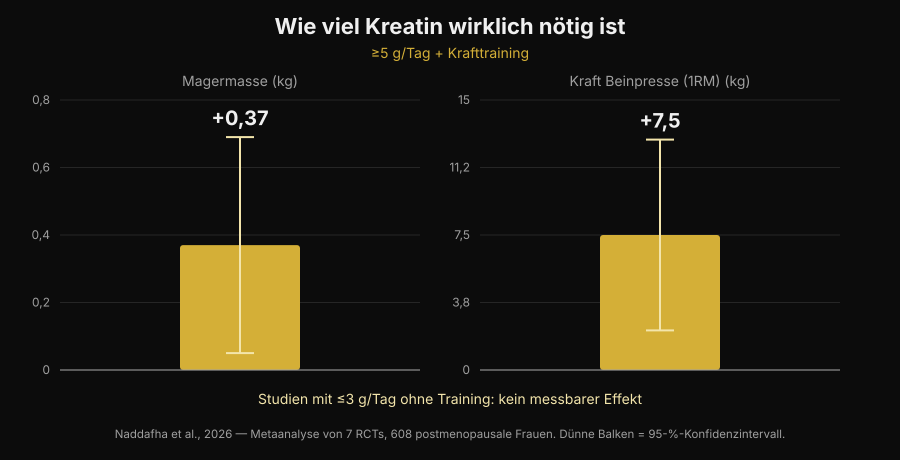
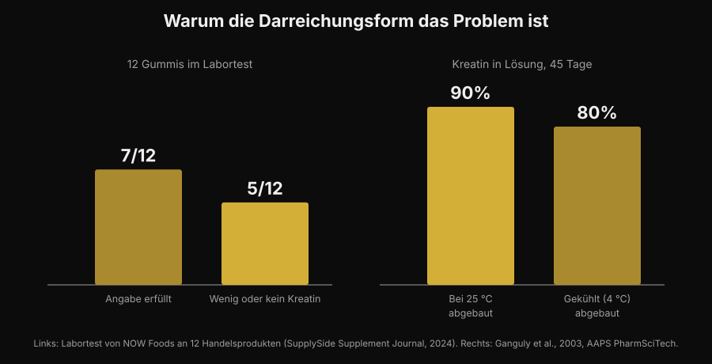

# Kreatin Gummies: wirken sie wie Pulver?

Von [Giammaria Loi](/autore/giammaria-loi) · aktualisiert am 5. November 2026

Zwei Gummis kauen statt ein Pulver aufzulösen, das unten im Glas liegen bleibt: ein bequemes Versprechen, und die Suchanfragen nach "creatine gummies" sind um 279% gewachsen. Die eigentliche Frage ist aber nicht, ob Kreatin wirkt — da ist die Studienlage seit dreißig Jahren klar —, sondern ob in diesen Gummies wirklich das Kreatin steckt, das auf dem Etikett steht. Dazu gibt es Zahlen, und sie beruhigen nicht.

## Kurz gefasst

- **Es gibt eine Studie zu Gummies, und sie ist positiv.** Zehn Wochen, 5 g Kreatin-Monohydrat pro Tag als Gummi: bei 32 Beachvolleyball-Spielerinnen verbesserten sich Sprunghöhe und Richtungswechsel gegenüber der Kontrollgruppe.
- **Diese Studie nutzte aber echte 5 g.** Die aktuellste Meta-Analyse findet +0,37 kg fettfreie Masse und +7,5 kg an der Beinpresse bei ≥5 g pro Tag zusammen mit Krafttraining — und keinen messbaren Effekt in Studien mit ≤3 g pro Tag ohne Training.
- **Viele Gummies enthalten nicht, was sie angeben.** In einem Labortest von 12 Produkten aus dem Handel hatten 5 wenig oder kein Kreatin — und alle 5 enthielten Kreatinin.
- **Kreatinin ist nicht gefährlich, sondern nutzlos.** Es ist das Abbauprodukt von Kreatin: steckt es in der Dose, war das Kreatin schon weg, bevor du sie gekauft hast.
- **Die Chemie erklärt, warum.** Trockenes Kreatinpulver ist sehr stabil, in Lösung nicht. In Wasser bei Raumtemperatur bauen sich 90% in 45 Tagen ab.

## Warum Gummies gerade überall sind

Der Grund ist nicht wissenschaftlich, sondern praktisch. Kreatinpulver hat drei Nachteile im Alltag: es muss abgewogen werden, es muss sich lösen, und in kaltem Wasser bleibt es körnig am Boden. Der Gummi räumt alle drei Probleme in einem Zug ab, passt in die Sporttasche und sieht aus wie eine Süßigkeit statt wie ein Supplement. Genau dieser Mechanismus hat schon Vitamin D und Omega-3 in Richtung Kauform verschoben.

Das Ergebnis siehst du in der Suche: "creatine gummies" liegt heute bei rund 165.000 Suchanfragen pro Monat mit +279% Wachstum, und die ersten Google-Plätze sind fast nur Ranglisten von Seiten, die das Produkt verkaufen. Kaum eine dieser Seiten nennt die zwei Zahlen, auf die es ankommt: wie viel Kreatin du brauchst, und wie viel wirklich drin ist.

## Die gute Nachricht: es gibt eine Studie zu Gummies

Bis vor kurzem bekam man auf "wirken die?" eine Antwort per Analogie: drin ist Kreatin-Monohydrat, Kreatin-Monohydrat wirkt, also wirken sie. Jetzt gibt es eine Studie, die genau dieses Format getestet hat.

Zweiunddreißig Beachvolleyball-Spielerinnen, Studentinnen und Profis, wurden über zehn Wochen auf Kreatin-Monohydrat als Gummi mit 5 g pro Tag oder auf eine Kontrollgruppe verteilt. Die Kreatin-Gruppe verbesserte den Sprung aus der Gegenbewegung (p < 0,001) und das Tempo bei Richtungswechseln (p = 0,009), während die Kontrollgruppe nicht besser oder schlechter wurde; auch bei Fettmasse und Körperfettanteil zeigten sich Unterschiede zugunsten von Kreatin. Kein Unterschied dagegen bei fettfreier Masse, Skelettmuskelmasse und Reaktionszeit (Pereira et al., 2026).

Das passt zur gesamten Literatur über Kreatinpulver und sagt eine einfache Sache: **der Gummi ruiniert das Molekül nicht**. Wenn das Kreatin drin ist und die Menge stimmt, ist das Transportmittel nicht das Problem. Damit hängt alles an diesen zwei Bedingungen: ob es drin ist, und ob es genug ist.

## Die Dosis ist das ganze Spiel

Die Zahl, die du dir merken musst, ist 5 g pro Tag. Das ist die Erhaltungsdosis aus dem offiziellen Positionspapier der International Society of Sports Nutrition, und genau diese Dosis wurde in der Gummi-Studie verwendet. Eine Ladephase (etwa 0,3 g pro kg Körpergewicht pro Tag für 5-7 Tage) füllt die Speicher schneller, ist aber nicht zwingend: mit 3-5 g pro Tag landest du nach einigen Wochen am selben Punkt (Kreider et al., 2017).

Unter dieser Schwelle sieht es anders aus. Eine systematische Übersichtsarbeit mit Meta-Analyse über sieben randomisierte Studien und 608 Frauen nach der Menopause fand klare Vorteile, wenn Kreatin über 5 g pro Tag lag und mit Krafttraining kombiniert wurde: fettfreie Masse +0,37 kg (95%-KI +0,05 bis +0,69) und Beinpresse +7,5 kg (95%-KI +2,2 bis +12,8). In den Studien mit ≤3 g pro Tag ohne Training kein messbarer Effekt (Naddafha et al., 2026).

*Nurvan-Grafik mit den Daten von Naddafha et al., 2026 (J Int Soc Sports Nutr). Werte aus dem Original-Abstract, nicht aus Abbildungen abgelesen.*

Die gleiche Größenordnung kommt in einer dreifach verblindeten Studie an zwanzig vegan lebenden Erwachsenen zurück: vier Wochen mit 0,1 g pro kg pro Tag — etwa 7 g bei 70 kg Körpergewicht — erhöhten die Skelettmuskelmasse um 0,3 kg und verbesserten den Sprung, ohne Veränderung der Nierenmarker (López-Moreno et al., 2026).

Jetzt die praktische Rechnung, und sie ist der Grund, warum man Gummies genau anschauen sollte. So viele Gummies brauchst du pro Tag für 5 g, je nachdem was ein einzelner Gummi angibt:

| Angegebenes Kreatin pro Gummi | Gummies pro Tag für 5 g |
|---|---|
| 0,5 g | 10 |
| 0,75 g | 7 |
| 1 g | 5 |
| 1,25 g | 4 |
| 1,5 g | 4 (3,3 aufgerundet) |
| 2 g | 3 (2,5 aufgerundet) |

*Nurvan-Rechnung: 5 ÷ angegebene Gramm pro Gummi, aufgerundet. Die Gramm pro Gummi liest du auf dem Etikett des Produkts, das du in der Hand hast.*

Entscheidend ist nicht die Zahl selbst, sondern dass die auf der Vorderseite empfohlene Portion fast nie 5 g ergibt. Wenn ein Produkt "2 Gummies pro Tag" vorschlägt und jeder Gummi 1 g angibt, nimmst du 2 g — genau den Bereich, der in der Meta-Analyse keinen messbaren Effekt gebracht hat.

## Das echte Problem: was wirklich drin ist

Hier kommt der Teil, den Affiliate-Ranglisten nicht erzählen. Ein Industrielabor hat 12 Kreatin-Gummies bei Amazon und auf Herstellerseiten gekauft und analysiert. Sieben Produkte hielten die Etikettangabe ein, teilweise mit großzügigem Puffer. Die anderen fünf enthielten wenig oder kein Kreatin. Und in allen fünf wurde **Kreatinin** gefunden, in kleinen bis relevanten Mengen (Test von NOW Foods, berichtet von SupplySide Supplement Journal, 2024).

*Nurvan-Grafik. Links: Labortest an 12 Produkten aus dem Handel (NOW Foods, berichtet von SupplySide Supplement Journal, 2024). Rechts: Ganguly et al., 2003, AAPS PharmSciTech.*

Kreatinin ist das Endprodukt des Kreatinabbaus. Es ist kein Gift — dein Körper bildet und scheidet täglich welches aus —, aber es hat keine ergogene Wirkung. Wenn du es in einem Supplement findest, bedeutet das nur eine Sache: dieses Kreatin ist zerfallen, bevor es in deinem Mund war, und du bezahlst für eine Süßigkeit.

Warum gerade Gummies? Aus einem chemischen, nicht aus einem kommerziellen Grund. Trockenes Kreatin-Monohydrat-Pulver ist sehr stabil, in Lösung nicht. Eine Stabilitätsstudie löste Kreatinformulierungen in Wasser bei pH 6,2 und maß den Gehalt über 45 Tage: bei Raumtemperatur baute sich 90% des Kreatins ab, im Kühlschrank 80% (Ganguly et al., 2003). Ein Gummi ist ein Gel, das heiß entsteht, Wasser enthält und für den Geschmack oft angesäuert wird, und der dann Monate bei Raumtemperatur im Regal steht: genau die Bedingungen, die die Umwandlung beschleunigen. Das heißt nicht, dass alle Gummies nutzlos sind — sieben von zwölf waren in Ordnung —, sondern dass das Format grundsätzlich fragiler ist als die Pulverdose, und dass du ohne Laboranalyse nicht wissen kannst, in welcher Hälfte du gelandet bist.

## Was die Forschung wirklich sagt

| Verbreitete Behauptung | Urteil | Quelle |
|---|---|---|
| "Gummies wirken nicht, Kreatin zerfällt darin" | Zu präzisieren: in einer Studie haben sie gewirkt | Pereira et al., 2026 |
| "Es reicht, die auf dem Etikett genannte Menge zu nehmen" | Widerlegt: es zählt, auf 5 g zu kommen | Naddafha et al., 2026; Kreider et al., 2017 |
| "Wo Kreatin draufsteht, ist auch Kreatin drin" | Widerlegt: 5 von 12 Produkten hatten wenig oder keins | NOW-Foods-Test, 2024 |
| "Das Kreatinin in Gummies schadet den Nieren" | Widerlegt: es ist inert, das Problem ist die fehlende Dosis | Kreider et al., 2017; López-Moreno et al., 2026 |
| "Eine Ladephase ist zwingend nötig" | Zu präzisieren: sie beschleunigt, sie ist nicht Pflicht | Kreider et al., 2017 |
| "Besser lösliche Formen wirken stärker" | Beim Menschen nicht belegt | Alraddadi et al., 2018 |

Bei der letzten Zeile lohnt ein kurzer Halt, denn das ist das Argument, das fast alle Alternativformen begleitet. Es stimmt, dass Kreatin-Hydrochlorid besser löslich ist als Monohydrat, und eine Pharmakokinetik-Studie an Ratten schätzte mit Modellierung eine höhere orale Bioverfügbarkeit für die Hydrochlorid-Form (Alraddadi et al., 2018). Aber das ist ein Tiermodell: keine Studie am Menschen hat gezeigt, dass daraus mehr Kraft oder mehr Masse wird, und Monohydrat bleibt die Form, auf der praktisch die gesamte Literatur beruht, auch die zur Langzeitsicherheit (Kerksick et al., 2026). Für den Gummi gilt dasselbe Prinzip: er ist ein Transportmittel, kein Vorteil.

## So setzt du es um

1. **Rechne in Gramm, nicht in Gummis.** Lies, wie viele Gramm Kreatin-Monohydrat ein einzelner Gummi angibt, und rechne hoch auf 5 g pro Tag. Wenn die Packung das nur pro "Portion" und nicht pro Stück angibt, ist das schon ein Signal.
2. **Sei skeptisch, wenn "Monohydrat" nicht dasteht.** Das ist die Form, die in den Studien verwendet wurde, auch in der Gummi-Studie. Allgemeine Bezeichnungen oder "proprietäre" Formen haben nicht die gleiche Evidenzbasis.
3. **Such nach einer Drittanbieter-Zertifizierung.** Informed Sport, NSF Certified for Sport und Vergleichbares lassen Chargen analysieren. Bei Gummies zählt das mehr als beim Pulver, gerade weil das Format instabiler ist.
4. **Rechne den Preis pro Gramm.** Teile den Preis durch die gesamten Gramm Kreatin in der Packung, nicht durch die Anzahl der Gummis. Der Vergleich mit der Pulverdose endet meistens genau hier.
5. **Schau auch auf den Zucker.** Fünf Gummies pro Tag sind fünf Süßigkeiten pro Tag: prüf die Zuckerzeile in der Nährwerttabelle und rechne sie in den Tag ein.
6. **Der Zeitpunkt zählt weniger als die Regelmäßigkeit.** Die Speicher füllt die tägliche Einnahme, nicht das richtige Zeitfenster: dazu habe ich ausführlich im Artikel über [wann du Nahrungsergänzungsmittel einnehmen solltest](/de/blog/wann-nahrungsergaenzungsmittel-einnehmen) geschrieben.

**Nurvan testen — Supplemente zusammen mit den Gewichten getrackt**

In Nurvan trägst du im Supplement-Bereich ein, was du nimmst und wann, und siehst es neben dem Verlauf von Gewichten, Wiederholungen und RIR deiner Einheiten. Wenn du also Format oder Marke deines Kreatins wechselst, kannst du nachsehen, was in den Wochen danach mit den Zahlen im Gym passiert ist, statt dich auf ein Gefühl zu verlassen. Im selben Profil liegen auch die Blutwerte, die du hochgeladen hast. [Nurvan testen](https://nurvan.app)

## Häufige Fragen

**Wirken Kreatin Gummies wirklich?**
Sie können wirken, unter zwei Bedingungen. In der verfügbaren Studie verbesserten zehn Wochen mit 5 g pro Tag als Gummi Sprunghöhe und Richtungswechsel bei Beachvolleyball-Spielerinnen (Pereira et al., 2026). Die Bedingungen sind, dass das Produkt das angegebene Kreatin wirklich enthält und dass du auf rund 5 g pro Tag kommst.

**Wie viele Kreatin Gummies pro Tag soll ich nehmen?**
Das hängt davon ab, wie viele Gramm jeder einzelne angibt: das Ziel sind etwa 5 g Kreatin-Monohydrat pro Tag. Bei 1 g pro Gummi sind das 5 Gummies, bei 0,5 g sind es 10. Die auf der Packung empfohlene Portion bleibt oft unter 5 g.

**Ist das Kreatinin, das in manchen Gummies gefunden wurde, gefährlich?**
Nein. Kreatinin ist das Abbauprodukt von Kreatin, und der Körper bildet und scheidet es normal aus; in den Studien hat Kreatin die Nierenmarker nicht verändert (Kreider et al., 2017; López-Moreno et al., 2026). Das Problem ist nicht Toxizität, sondern Wirksamkeit: wo Kreatinin ist, fehlt Kreatin. Wenn deine Blutwerte außerhalb des Referenzbereichs liegen oder eine Nierenerkrankung bekannt ist, sprich darüber mit deiner Ärztin oder deinem Arzt, statt allein ein Supplement auszuwählen.

**Gummies oder Pulver — was ist besser?**
Beim Molekül ist kein Unterschied belegt. Das Pulver hat drei konkrete Vorteile: es ist lange stabil, kostet pro Gramm deutlich weniger und lässt dich die 5 g genau abmessen. Der Gummi gewinnt nur bei der Bequemlichkeit. Wo Kreatin und andere Supplemente beim Verhältnis Evidenz zu Preis stehen, habe ich in einer [Tier List der Supplemente für Kraftsport](/de/blog/kraftsport-supplemente-tier-list) sortiert.

## Lies auch

- [Tier List Supplemente Kraftsport: was die Forschung sagt](/de/blog/kraftsport-supplemente-tier-list) — wo Kreatin im Vergleich zu allem anderen steht, mit der Evidenz auf dem Tisch.
- [Führt Kreatin zu Haarausfall?](/de/blog/kreatin-haarausfall) — die andere meistgesuchte Frage zu Kreatin, mit der Studie, die den Zweifel ausgelöst hat.
- [Wann Nahrungsergänzungsmittel einnehmen: zählt die Uhrzeit?](/de/blog/wann-nahrungsergaenzungsmittel-einnehmen) — warum Regelmäßigkeit mehr wiegt als der Einnahmezeitpunkt.

## Quellen

- Pereira F, Forbes SC, Romano V, Christopher P, Santana JC, Antonio J, 2026. Effects of Creatine Monohydrate Gummies on Performance and Body Composition in Female Beach Volleyball Athletes. *Journal of Functional Morphology and Kinesiology* 11(1):105. PMID 41900512. [DOI](https://doi.org/10.3390/jfmk11010105)
- Naddafha S, Antonio J, Kreider RB, Stout JR, 2026. Creatine monohydrate for lean mass, strength, and bone density in postmenopausal women: a systematic review and meta-analysis. *Journal of the International Society of Sports Nutrition* 23(1):2668435. PMID 42141930. [DOI](https://doi.org/10.1080/15502783.2026.2668435)
- Kreider RB, Kalman DS, Antonio J, Ziegenfuss TN, Wildman R, Collins R, Candow DG, Kleiner SM, Almada AL, Lopez HL, 2017. International Society of Sports Nutrition position stand: safety and efficacy of creatine supplementation in exercise, sport, and medicine. *Journal of the International Society of Sports Nutrition* 14:18. PMID 28615996. [DOI](https://doi.org/10.1186/s12970-017-0173-z)
- Kerksick C, Gonzalez D, Stout J, Forbes S, Candow D, Ziegenfuss T, Marshall R, Schwesig R, Kreider R, 2026. The emerging and evolving evidence supporting creatine as an ergogenic aid: history and applications. *Journal of the International Society of Sports Nutrition* 23(1):2646627. PMID 41870601. [DOI](https://doi.org/10.1080/15502783.2026.2646627)
- López-Moreno M, Muñoz A, Aguilar-Navarro M, Gutiérrez-Hellín J, Franco-Andrés A, López-López P, Crespo-Cañizares A, Marrero-Fernández P, Forbes SC, 2026. Does creatine supplementation improve strength and power in physically active individuals on a vegan diet? A randomized, triple-blind, placebo-controlled trial. *European Journal of Applied Physiology* 126(10):5521-5532. PMID 42390589. [DOI](https://doi.org/10.1007/s00421-026-06323-5)
- Ganguly S, Jayappa S, Dash AK, 2003. Evaluation of the stability of creatine in solution prepared from effervescent creatine formulations. *AAPS PharmSciTech* 4(2):E25. PMID 12916907. [DOI](https://doi.org/10.1208/pt040225)
- Alraddadi EA, Lillico R, Vennerstrom JL, Lakowski TM, Miller DW, 2018. Absolute Oral Bioavailability of Creatine Monohydrate in Rats: Debunking a Myth. *Pharmaceutics* 10(1):31. PMID 29518030. [DOI](https://doi.org/10.3390/pharmaceutics10010031)

Die bibliografischen Angaben wurden über PubMed abgerufen. Labordaten zu den 12 Gummies: Test von NOW Foods, berichtet von *SupplySide Supplement Journal*, 2024 — [Artikel](https://www.supplysidesj.com/supplement-regulations/now-tests-creatine-gummies-finding-almost-half-to-be-severely-understrength-). Thema ausgewählt mit der Trendrecherche vom 5. November 2026: "creatine gummies" gehört zu den am stärksten wachsenden Suchanfragen im Supplement-Bereich, und die Seiten, die sie besetzen, stammen fast alle von denen, die das Produkt verkaufen.

---

Giammaria Loi ist der Gründer von Nurvan. Er trainiert seit 2012 mit Gewichten, arbeitet seit 2013 als FIPE-zertifizierter Personal Trainer und Coach und startet seit 2018 im Powerlifting auf nationalem Niveau.
Jeder Artikel, den er unterschreibt, beginnt bei den Studien und endet bei dem, was im Gym wirklich funktioniert.

> Hinweis: informativer Inhalt, er ersetzt nicht die Beurteilung einer Ärztin, eines Arztes oder einer Fachperson.
