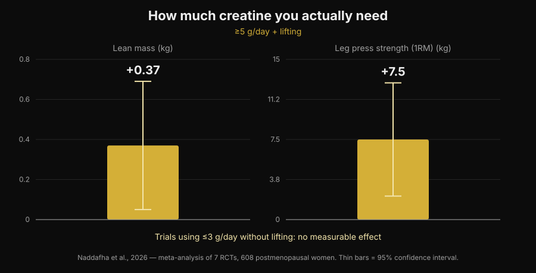
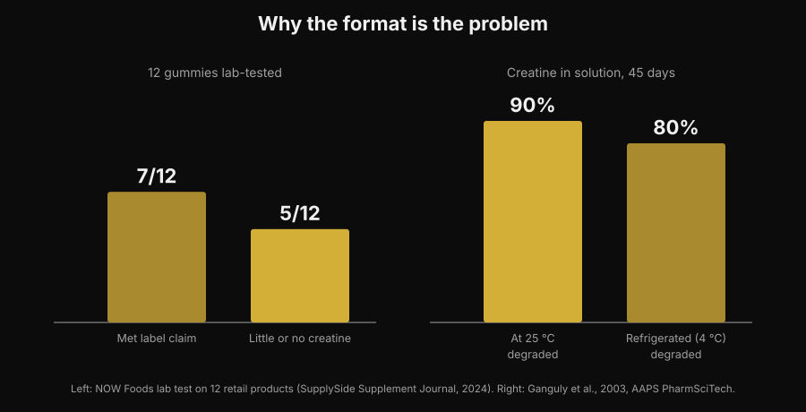

# Creatine gummies: do they work as well as powder?

By [Giammaria Loi](/autore/giammaria-loi) · updated 5 November 2026

Chewing two candies instead of stirring a powder that settles at the bottom of the glass: that is a convenient promise, and searches for "creatine gummies" have grown by 279%. The real question is not whether creatine works — the literature settled that thirty years ago — but whether those gummies actually contain the creatine printed on the label. On that, numbers exist, and they are not reassuring.

## The short version

- **A study on gummies exists, and it is positive.** Ten weeks, 5 g a day of creatine monohydrate in gummy form: in 32 female beach volleyball athletes, vertical jump and change of direction improved compared with the control group.
- **But that study used a real 5 g.** The most recent meta-analysis finds +0.37 kg of lean mass and +7.5 kg on the leg press with at least 5 g a day combined with lifting, and no measurable effect in trials using 3 g a day or less without training.
- **Many gummies do not contain what they claim.** In a lab test on 12 products bought off the shelf, 5 had little or no creatine — and all 5 contained creatinine.
- **Creatinine is not dangerous, it is useless.** It is creatine's breakdown product: finding it in the jar means the creatine left before you bought it.
- **The chemistry explains why.** Dry creatine powder is stable; creatine in solution is not. In water at room temperature, 90% degrades in 45 days.

## Why gummies are everywhere

The reason is not scientific, it is logistical. Creatine powder has three practical flaws: you have to measure it, you have to dissolve it, and if the water is cold it stays gritty at the bottom. The gummy removes all three at once, travels in a gym bag and looks like a sweet instead of a supplement. It is the same mechanism that pushed vitamin D and omega-3 towards chewable formats.

You can see the result in search: "creatine gummies" is now a query worth roughly 165,000 searches a month with 279% growth, and the top Google positions are almost all rankings from sites that sell the product. Almost none of those pages report the two numbers that matter: how much creatine you need, and how much is really in the product.

## The good news: a study on gummies does exist

Until recently, anyone asking "do they work?" got an answer by analogy: there is creatine monohydrate inside, creatine monohydrate works, therefore they work. Now there is a study that tested the format itself.

Thirty-two female beach volleyball athletes, college and professional, were assigned either to creatine monohydrate gummies at 5 g a day or to a control group, for ten weeks. The creatine group improved countermovement vertical jump (p < 0.001) and change-of-direction speed (p = 0.009), while the control group did not improve or got worse; favourable differences also appeared for fat mass and body fat percentage. There was no difference in lean mass, skeletal muscle mass or reaction time (Pereira et al., 2026).

That result fits everything we know about creatine powder, and it says something simple: **the gummy does not ruin the molecule**. If the creatine is there and in the right amount, the vehicle is not the problem. Which moves the whole question onto those two conditions: is it there, and is it enough.

## The dose is the whole game

The number to remember is 5 g a day. That is the maintenance dose set out in the official position stand of the International Society of Sports Nutrition, and it is exactly the dose used in the gummy study. A loading phase (around 0.3 g per kg of body weight a day for 5-7 days) fills the stores faster, but it is not mandatory: you reach the same point with 3-5 g a day over a few weeks (Kreider et al., 2017).

Below that threshold things change. A systematic review with meta-analysis of seven randomised trials and 608 postmenopausal women found clear benefits when creatine exceeded 5 g a day and was combined with resistance training: lean mass +0.37 kg (95% CI +0.05 to +0.69) and leg press +7.5 kg (95% CI +2.2 to +12.8). In trials using 3 g a day or less without training, there was no measurable effect (Naddafha et al., 2026).

*Nurvan chart based on data from Naddafha et al., 2026 (J Int Soc Sports Nutr). Values taken from the original abstract, not read off the figures.*

The same order of magnitude shows up in a triple-blind trial on twenty vegan adults: four weeks at 0.1 g per kg a day — roughly 7 g for a 70 kg person — increased skeletal muscle mass by 0.3 kg and improved jump performance, with no change in kidney markers (López-Moreno et al., 2026).

Now the practical arithmetic, which is exactly why gummies deserve a closer look. Here is how many gummies a day you need to reach 5 g, depending on what a single gummy declares:

| Creatine declared per gummy | Gummies per day to reach 5 g |
|---|---|
| 0.5 g | 10 |
| 0.75 g | 7 |
| 1 g | 5 |
| 1.25 g | 4 |
| 1.5 g | 4 (3.3 rounded up) |
| 2 g | 3 (2.5 rounded up) |

*Nurvan calculation: 5 ÷ grams declared per gummy, rounded up. Grams per gummy must be read on the label of the product in your hand.*

The point is not the number itself, it is that the serving printed on the front of the pack almost never adds up to 5 g. If a product suggests "2 gummies a day" and each gummy declares 1 g, you are taking 2 g: the range that produced no measurable effect in the meta-analysis.

## The real problem: what is actually inside

Here we get to the part the affiliate rankings leave out. An industry lab bought 12 creatine gummy products on Amazon and from manufacturer websites and analysed them. Seven products met their label claim, some with generous margins. The other five contained little or no creatine. And in all five, **creatinine** was found, in amounts ranging from small to substantial (NOW Foods test reported by SupplySide Supplement Journal, 2024).

*Nurvan chart. Left panel: lab test on 12 commercial products (NOW Foods, reported by SupplySide Supplement Journal, 2024). Right panel: Ganguly et al., 2003, AAPS PharmSciTech.*

Creatinine is the end product of creatine breakdown. It is not a poison — your body makes it and clears it every day — but it has no ergogenic activity at all. Finding it in a supplement means one thing: that creatine degraded before it reached your mouth, and you are paying for a sweet.

Why gummies specifically? For a chemical reason, not a commercial one. Dry creatine monohydrate powder is very stable; in solution it is not. A stability study dissolved creatine formulations in water at pH 6.2 and measured the content over 45 days: at room temperature 90% of the creatine degraded, refrigerated 80% (Ganguly et al., 2003). A gummy is a gel that starts out hot, contains water and is often acidified for taste, and then sits on a shelf for months at room temperature: those are exactly the conditions that speed up the conversion. It does not mean every gummy is useless — seven out of twelve were fine — but the format is inherently more fragile than a tub of powder, and without a lab analysis you have no way of knowing which half you ended up in.

## What the research actually says

| Common claim | Verdict | Source |
|---|---|---|
| "Gummies don't work, the creatine degrades" | Needs nuance: in one study they worked | Pereira et al., 2026 |
| "Just take the number of gummies on the label" | Debunked: what counts is reaching 5 g | Naddafha et al., 2026; Kreider et al., 2017 |
| "If it says creatine, there's creatine inside" | Debunked: 5 of 12 products had little or none | NOW Foods test, 2024 |
| "The creatinine in gummies damages your kidneys" | Debunked: it is inert, the problem is the missing dose | Kreider et al., 2017; López-Moreno et al., 2026 |
| "You absolutely need a loading phase" | Needs nuance: it speeds things up, it is not mandatory | Kreider et al., 2017 |
| "More soluble forms are more effective" | Not demonstrated in humans | Alraddadi et al., 2018 |

That last row is worth a pause, because it is the argument behind almost every alternative form. It is true that creatine hydrochloride is more soluble than monohydrate, and a pharmacokinetic study in rats, with modelling, estimated higher oral bioavailability for the hydrochloride form than for monohydrate (Alraddadi et al., 2018). But that is an animal model: no human trial has shown it translates into more strength or more mass, and monohydrate remains the form that practically the whole literature rests on, including the long-term safety data (Kerksick et al., 2026). The same principle applies to the gummy: it is a vehicle, not an advantage.

## How to apply it

1. **Start from grams, not candies.** Read how many grams of creatine monohydrate a single gummy declares and do the maths to reach 5 g a day. If the pack declares it only per "serving" and not per unit, that is already a signal.
2. **Be wary of products that don't say "monohydrate".** That is the form used in the studies, gummies included. Generic wording or "proprietary" forms do not have the same evidence base.
3. **Look for third-party certification.** Informed Sport, NSF Certified for Sport and similar programmes test the batches. For gummies it matters more than for powder, precisely because the format is less stable.
4. **Work out the cost per gram.** Divide the price by the total grams of creatine in the pack, not by the number of gummies. The comparison with a tub of powder usually ends right there.
5. **Check the sugar too.** Five gummies a day are five sweets a day: look at the sugar line on the nutrition label and fit it into your day.
6. **Timing matters less than consistency.** What fills the stores is taking it every day, not hitting the right window: I covered that in detail in the article on [when to take supplements](/en/blog/when-to-take-supplements-timing).

**Try Nurvan — supplements tracked next to your loads**

In Nurvan you log what you take and when in the supplement section, and you see it next to the history of load, reps and RIR from your sessions. So if you switch creatine format or brand, you can look at what happened to your gym numbers in the following weeks instead of trusting a feeling. The same profile also holds the blood work you have uploaded. [Try Nurvan](https://nurvan.app)

## Frequently asked questions

**Do creatine gummies really work?**
They can, on two conditions. In the available study, ten weeks at 5 g a day in gummy form improved vertical jump and change of direction in female beach volleyball athletes (Pereira et al., 2026). The conditions are that the product really contains the creatine it claims, and that you get to around 5 g a day.

**How many creatine gummies should I take per day?**
It depends on how many grams each one declares: the target is around 5 g a day of creatine monohydrate. At 1 g per gummy that is 5 gummies, at 0.5 g it is 10. The "recommended serving" printed on the pack often stays below 5 g.

**Is the creatinine found in some gummies dangerous?**
No. Creatinine is creatine's breakdown product and your body produces and clears it normally; in the studies, creatine did not alter kidney markers (Kreider et al., 2017; López-Moreno et al., 2026). The problem is not toxicity but effectiveness: where there is creatinine, creatine is missing. If your blood work is out of range or you have a known kidney condition, the thing to do is talk to your doctor, not pick a supplement on your own.

**Gummies or powder: which is better?**
On the molecule there is no demonstrated difference. Powder has three concrete advantages: it stays stable for a long time, it costs far less per gram and it lets you dose exactly 5 g. The gummy only wins on convenience. For where creatine and other supplements sit on evidence versus price, I put together a [tier list of strength supplements](/en/blog/strength-supplements-tier-list-evidence).

## Read next

- [Strength supplements tier list: what the research says](/en/blog/strength-supplements-tier-list-evidence) — where creatine sits compared with everything else, evidence in hand.
- [Does creatine cause hair loss?](/en/blog/creatine-hair-loss) — the other most searched question about creatine, with the study that started the doubt.
- [When to take supplements: does timing matter?](/en/blog/when-to-take-supplements-timing) — why consistency weighs more than the moment you take them.

## Sources

- Pereira F, Forbes SC, Romano V, Christopher P, Santana JC, Antonio J, 2026. Effects of Creatine Monohydrate Gummies on Performance and Body Composition in Female Beach Volleyball Athletes. *Journal of Functional Morphology and Kinesiology* 11(1):105. PMID 41900512. [DOI](https://doi.org/10.3390/jfmk11010105)
- Naddafha S, Antonio J, Kreider RB, Stout JR, 2026. Creatine monohydrate for lean mass, strength, and bone density in postmenopausal women: a systematic review and meta-analysis. *Journal of the International Society of Sports Nutrition* 23(1):2668435. PMID 42141930. [DOI](https://doi.org/10.1080/15502783.2026.2668435)
- Kreider RB, Kalman DS, Antonio J, Ziegenfuss TN, Wildman R, Collins R, Candow DG, Kleiner SM, Almada AL, Lopez HL, 2017. International Society of Sports Nutrition position stand: safety and efficacy of creatine supplementation in exercise, sport, and medicine. *Journal of the International Society of Sports Nutrition* 14:18. PMID 28615996. [DOI](https://doi.org/10.1186/s12970-017-0173-z)
- Kerksick C, Gonzalez D, Stout J, Forbes S, Candow D, Ziegenfuss T, Marshall R, Schwesig R, Kreider R, 2026. The emerging and evolving evidence supporting creatine as an ergogenic aid: history and applications. *Journal of the International Society of Sports Nutrition* 23(1):2646627. PMID 41870601. [DOI](https://doi.org/10.1080/15502783.2026.2646627)
- López-Moreno M, Muñoz A, Aguilar-Navarro M, Gutiérrez-Hellín J, Franco-Andrés A, López-López P, Crespo-Cañizares A, Marrero-Fernández P, Forbes SC, 2026. Does creatine supplementation improve strength and power in physically active individuals on a vegan diet? A randomized, triple-blind, placebo-controlled trial. *European Journal of Applied Physiology* 126(10):5521-5532. PMID 42390589. [DOI](https://doi.org/10.1007/s00421-026-06323-5)
- Ganguly S, Jayappa S, Dash AK, 2003. Evaluation of the stability of creatine in solution prepared from effervescent creatine formulations. *AAPS PharmSciTech* 4(2):E25. PMID 12916907. [DOI](https://doi.org/10.1208/pt040225)
- Alraddadi EA, Lillico R, Vennerstrom JL, Lakowski TM, Miller DW, 2018. Absolute Oral Bioavailability of Creatine Monohydrate in Rats: Debunking a Myth. *Pharmaceutics* 10(1):31. PMID 29518030. [DOI](https://doi.org/10.3390/pharmaceutics10010031)

Bibliographic references retrieved through PubMed. Lab data on the 12 gummy products: NOW Foods test reported by *SupplySide Supplement Journal*, 2024 — [article](https://www.supplysidesj.com/supplement-regulations/now-tests-creatine-gummies-finding-almost-half-to-be-severely-understrength-). Topic chosen from trend research on 5 November 2026: "creatine gummies" is among the fastest-growing queries in the supplement space, and the pages holding those positions are almost all from people selling the product.

---

Giammaria Loi is the founder of Nurvan. He has been lifting since 2012, has worked as a FIPE-certified personal trainer and coach since 2013, and has competed in powerlifting at national level since 2018. Every article he writes starts from the research and ends with what actually works in the gym.

> Note: this content is informational and does not replace the advice of a doctor or qualified health professional.
