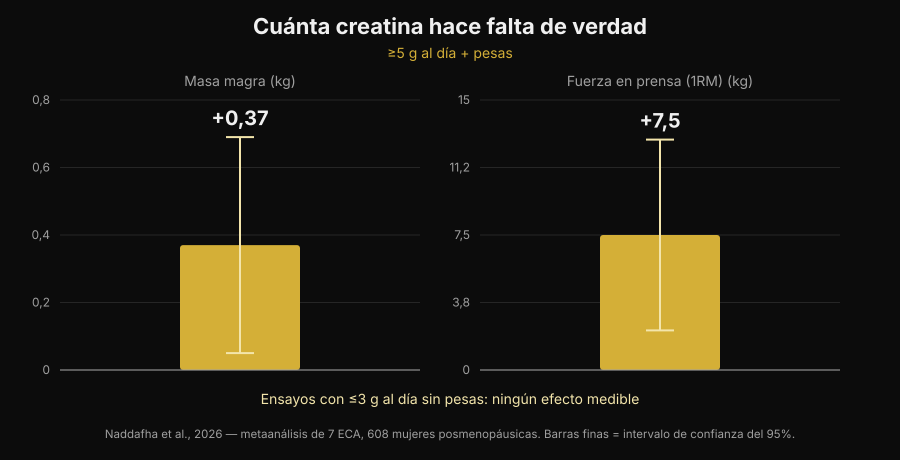
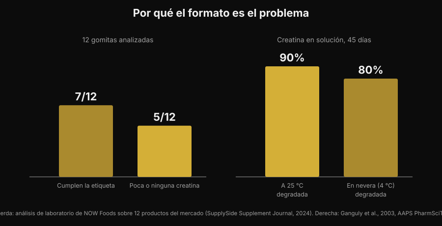

# Gomitas de creatina: ¿funcionan como el polvo?

Por [Giammaria Loi](/autore/giammaria-loi) · actualizado el 5 de noviembre de 2026

Masticar dos caramelos en vez de disolver un polvo que se queda en el fondo del vaso: es una promesa cómoda, y las búsquedas de "creatine gummies" han crecido un 279%. Pero la pregunta de verdad no es si la creatina funciona — eso la literatura lo cerró hace treinta años — sino si dentro de esas gomitas hay de verdad la creatina que dice la etiqueta. Sobre eso hay números, y no son tranquilizadores.

## En resumen

- **Hay un estudio sobre las gomitas, y es positivo.** Diez semanas, 5 g al día de creatina monohidrato en forma de gomita: en 32 jugadoras de vóley playa mejoraron el salto vertical y el cambio de dirección frente al grupo de control.
- **Pero ese estudio usaba 5 g reales.** El metaanálisis más reciente encuentra +0,37 kg de masa magra y +7,5 kg en prensa de piernas con 5 g al día o más junto a las pesas, y ningún efecto medible en los ensayos con 3 g al día o menos sin entrenamiento.
- **Muchas gomitas no contienen lo que declaran.** En un test de laboratorio sobre 12 productos del mercado, 5 tenían poca o ninguna creatina — y las 5 contenían creatinina.
- **La creatinina no es peligrosa, es inútil.** Es el producto de degradación de la creatina: encontrarla en el bote significa que la creatina se fue antes de que tú lo compraras.
- **La química explica por qué.** La creatina en polvo seco es estable; en solución no. En agua a temperatura ambiente, el 90% se degrada en 45 días.

## Por qué las gomitas están en todas partes

El motivo no es científico, es logístico. El polvo de creatina tiene tres defectos prácticos: hay que dosificarlo, hay que disolverlo y, si el agua está fría, se queda granuloso en el fondo. La gomita elimina los tres de golpe, se lleva en la bolsa y parece un caramelo en vez de un suplemento. Es el mismo mecanismo que movió la vitamina D y los omega-3 hacia el formato masticable.

El resultado se ve en las búsquedas: "creatine gummies" es hoy una consulta de unas 165.000 búsquedas mensuales con un crecimiento del 279%, y las primeras posiciones de Google son casi todas rankings de webs que venden el producto. Casi ninguna de esas páginas da los dos datos que importan: cuánta creatina hace falta y cuánta hay de verdad en el producto.

## La buena noticia: ya existe un estudio sobre las gomitas

Hasta hace poco, quien preguntaba "¿funcionan?" recibía una respuesta por analogía: dentro hay creatina monohidrato, la creatina monohidrato funciona, así que funcionan. Ahora hay un estudio que probó precisamente el formato.

Treinta y dos jugadoras de vóley playa, universitarias y profesionales, fueron asignadas a creatina monohidrato en gomitas a 5 g al día o a un grupo de control, durante diez semanas. El grupo de creatina mejoró el salto vertical con contramovimiento (p < 0,001) y la velocidad en los cambios de dirección (p = 0,009), mientras el control no mejoró o empeoró; también aparecieron diferencias favorables en masa grasa y porcentaje de grasa. En cambio, no hubo diferencias en masa magra, masa muscular esquelética ni tiempo de reacción (Pereira et al., 2026).

Es un resultado coherente con toda la literatura sobre la creatina en polvo, y dice algo sencillo: **la gomita no estropea la molécula**. Si la creatina está y está en la cantidad adecuada, el vehículo no es el problema. Lo que traslada toda la cuestión a esas dos condiciones: si está, y si es suficiente.

## La dosis lo decide todo

El número que hay que recordar es 5 g al día. Es la dosis de mantenimiento que indica el posicionamiento oficial de la International Society of Sports Nutrition, y es exactamente la que se usó en el estudio sobre las gomitas. La fase de carga (unos 0,3 g por kg de peso al día durante 5-7 días) llena los depósitos más rápido, pero no es obligatoria: se llega al mismo punto también con 3-5 g al día en unas semanas (Kreider et al., 2017).

Por debajo de ese umbral las cosas cambian. Una revisión sistemática con metaanálisis de siete ensayos aleatorizados y 608 mujeres posmenopáusicas encontró beneficios claros cuando la creatina superaba los 5 g al día y se combinaba con entrenamiento de fuerza: masa magra +0,37 kg (IC 95% de +0,05 a +0,69) y prensa de piernas +7,5 kg (IC 95% de +2,2 a +12,8). En los ensayos con 3 g al día o menos sin entrenamiento, ningún efecto medible (Naddafha et al., 2026).

*Gráfico de Nurvan con los datos de Naddafha et al., 2026 (J Int Soc Sports Nutr). Valores tomados del abstract original, no leídos de las figuras.*

El mismo orden de magnitud reaparece en un ensayo triple ciego con veinte adultos veganos: cuatro semanas a 0,1 g por kg al día — unos 7 g para una persona de 70 kg — aumentaron la masa muscular esquelética en 0,3 kg y mejoraron el salto, sin alteraciones de los marcadores renales (López-Moreno et al., 2026).

Ahora la cuenta práctica, que es el motivo por el que las gomitas hay que mirarlas con atención. Estas son las gomitas que necesitas al día para llegar a 5 g, según lo que declara cada gomita:

| Creatina declarada por gomita | Gomitas al día para llegar a 5 g |
|---|---|
| 0,5 g | 10 |
| 0,75 g | 7 |
| 1 g | 5 |
| 1,25 g | 4 |
| 1,5 g | 4 (3,3 redondeado) |
| 2 g | 3 (2,5 redondeado) |

*Cálculo de Nurvan: 5 ÷ gramos declarados por gomita, redondeado hacia arriba. Los gramos por gomita hay que leerlos en la etiqueta del producto que tienes en la mano.*

El punto no es el número en sí, es que la porción que aparece en la parte delantera del envase casi nunca llega a 5 g. Si un producto recomienda "2 gomitas al día" y cada gomita declara 1 g, estás tomando 2 g: la franja que en el metaanálisis no produjo efectos medibles.

## El problema real: qué hay de verdad dentro

Aquí llegamos a la parte que los rankings de afiliación no cuentan. Un laboratorio industrial compró 12 gomitas de creatina en Amazon y en las webs de los fabricantes y las analizó. Siete productos cumplían lo declarado en la etiqueta, con márgenes incluso generosos. Los otros cinco contenían poca o ninguna creatina. Y en los cinco se encontró **creatinina**, en cantidades de pequeñas a relevantes (test de NOW Foods publicado por SupplySide Supplement Journal, 2024).

*Gráfico de Nurvan. Panel izquierdo: test de laboratorio sobre 12 productos del mercado (NOW Foods, publicado por SupplySide Supplement Journal, 2024). Panel derecho: Ganguly et al., 2003, AAPS PharmSciTech.*

La creatinina es el producto final de la degradación de la creatina. No es un veneno — tu cuerpo la produce y la elimina cada día — pero no tiene ninguna actividad ergogénica. Encontrarla en un suplemento significa una sola cosa: esa creatina se degradó antes de llegar a tu boca, y estás pagando un caramelo.

¿Por qué justo las gomitas? Por un motivo químico, no comercial. La creatina monohidrato en polvo seco es muy estable; en solución no. Un estudio de estabilidad disolvió formulaciones de creatina en agua a pH 6,2 y midió el contenido durante 45 días: a temperatura ambiente se degradó el 90% de la creatina, en nevera el 80% (Ganguly et al., 2003). Una gomita es un gel que nace caliente, contiene agua y a menudo está acidificado para el sabor, y luego pasa meses en el estante a temperatura ambiente: son exactamente las condiciones que aceleran la conversión. No quiere decir que todas las gomitas sean inútiles — siete de doce estaban bien — sino que el formato es intrínsecamente más frágil que el bote de polvo, y que sin un análisis de laboratorio no tienes forma de saber en qué mitad has caído.

## Qué dice de verdad la investigación

| Afirmación habitual | Veredicto | Fuente |
|---|---|---|
| "Las gomitas no funcionan, la creatina se estropea" | Con matices: en un estudio funcionaron | Pereira et al., 2026 |
| "Basta con tomar las gomitas que dice la etiqueta" | Desmentido: lo que cuenta es llegar a 5 g | Naddafha et al., 2026; Kreider et al., 2017 |
| "Si dice creatina, dentro hay creatina" | Desmentido: 5 de 12 productos tenían poca o ninguna | Test de NOW Foods, 2024 |
| "La creatinina de las gomitas daña los riñones" | Desmentido: es inerte, el problema es la dosis que falta | Kreider et al., 2017; López-Moreno et al., 2026 |
| "Hace falta obligatoriamente la fase de carga" | Con matices: acelera, no es obligatoria | Kreider et al., 2017 |
| "Las formas más solubles son más eficaces" | No demostrado en humanos | Alraddadi et al., 2018 |

En la última fila vale la pena pararse un momento, porque es el argumento que acompaña a casi todas las formas alternativas. Es cierto que la creatina clorhidrato es más soluble que la monohidrato, y un estudio de farmacocinética en rata, con modelización, estimó una biodisponibilidad oral más alta para la forma clorhidrato que para la monohidrato (Alraddadi et al., 2018). Pero es un modelo animal: ningún ensayo en humanos ha demostrado que eso se traduzca en más fuerza o más masa, y la monohidrato sigue siendo la forma sobre la que se apoya prácticamente toda la literatura, incluida la de seguridad a largo plazo (Kerksick et al., 2026). El mismo principio vale para la gomita: es un vehículo, no una ventaja.

## Cómo aplicarlo

1. **Parte de los gramos, no de los caramelos.** Lee cuántos gramos de creatina monohidrato declara cada gomita y haz la cuenta para llegar a 5 g al día. Si el envase no lo declara por unidad sino solo por "porción", ya es una señal.
2. **Desconfía de los productos que no dicen "monohidrato".** Es la forma usada en los estudios, gomitas incluidas. Las denominaciones genéricas o las formas "propietarias" no tienen la misma base de evidencia.
3. **Busca una certificación de tercera parte.** Informed Sport, NSF Certified for Sport y similares analizan los lotes. En las gomitas cuenta más que en el polvo, justo porque el formato es más inestable.
4. **Haz la cuenta del coste por gramo.** Divide el precio por los gramos totales de creatina del envase, no por el número de gomitas. La comparación con el bote de polvo suele acabar ahí.
5. **Mira también los azúcares.** Cinco gomitas al día son cinco dulces al día: revisa la línea de azúcares en la etiqueta nutricional y métela en la cuenta del día.
6. **El horario cuenta menos que la constancia.** Lo que llena los depósitos es tomarla todos los días, no acertar con la ventana: lo he contado en detalle en el artículo sobre [cuándo tomar los suplementos](/es/blog/cuando-tomar-los-suplementos-horario).

**Prueba Nurvan — la suplementación registrada junto a las cargas**

En Nurvan registras qué tomas y cuándo en la sección de suplementación, y lo ves al lado del historial de cargas, repeticiones y RIR de tus sesiones. Así, si cambias de formato o de marca de creatina, puedes mirar qué pasó con tus números en el gimnasio en las semanas siguientes en vez de fiarte de una sensación. En el mismo perfil están también los análisis que has subido. [Prueba Nurvan](https://nurvan.app)

## Preguntas frecuentes

**¿Las gomitas de creatina funcionan de verdad?**
Pueden funcionar, con dos condiciones. En el estudio disponible, diez semanas a 5 g al día en forma de gomita mejoraron el salto vertical y los cambios de dirección en jugadoras de vóley playa (Pereira et al., 2026). Las condiciones son que el producto contenga de verdad la creatina declarada y que tú llegues a unos 5 g al día.

**¿Cuántas gomitas de creatina hay que tomar al día?**
Depende de cuántos gramos declare cada una: el objetivo son unos 5 g al día de creatina monohidrato. Con 1 g por gomita son 5 gomitas, con 0,5 g son 10. La "porción recomendada" impresa en el envase suele quedarse por debajo de los 5 g.

**¿Es peligrosa la creatinina encontrada en algunas gomitas?**
No. La creatinina es el producto de degradación de la creatina y el cuerpo la produce y la elimina con normalidad; en los estudios la creatina no alteró los marcadores renales (Kreider et al., 2017; López-Moreno et al., 2026). El problema no es la toxicidad sino la eficacia: donde hay creatinina, falta creatina. Si tienes valores de análisis fuera de rango o una enfermedad renal conocida, lo que hay que hacer es hablarlo con tu médico, no elegir un suplemento por tu cuenta.

**¿Mejor gomitas o polvo?**
Sobre la molécula no hay diferencia demostrada. El polvo tiene tres ventajas concretas: es estable mucho tiempo, cuesta bastante menos por gramo y te permite dosificar los 5 g exactos. La gomita solo gana en comodidad. Sobre dónde se colocan la creatina y otros suplementos por relación evidencia/precio, hice una [tier list de los suplementos para la fuerza](/es/blog/clasificacion-suplementos-fuerza-tier-list).

## Lee también

- [Tier list de suplementos para la fuerza: qué dice la investigación](/es/blog/clasificacion-suplementos-fuerza-tier-list) — dónde está la creatina respecto a todo lo demás, con la evidencia en la mano.
- [¿La creatina provoca caída del cabello?](/es/blog/creatina-caida-cabello) — la otra pregunta más buscada sobre la creatina, con el estudio que hizo nacer la duda.
- [Cuándo tomar los suplementos: ¿importa la hora?](/es/blog/cuando-tomar-los-suplementos-horario) — por qué la constancia pesa más que el momento de la toma.

## Fuentes

- Pereira F, Forbes SC, Romano V, Christopher P, Santana JC, Antonio J, 2026. Effects of Creatine Monohydrate Gummies on Performance and Body Composition in Female Beach Volleyball Athletes. *Journal of Functional Morphology and Kinesiology* 11(1):105. PMID 41900512. [DOI](https://doi.org/10.3390/jfmk11010105)
- Naddafha S, Antonio J, Kreider RB, Stout JR, 2026. Creatine monohydrate for lean mass, strength, and bone density in postmenopausal women: a systematic review and meta-analysis. *Journal of the International Society of Sports Nutrition* 23(1):2668435. PMID 42141930. [DOI](https://doi.org/10.1080/15502783.2026.2668435)
- Kreider RB, Kalman DS, Antonio J, Ziegenfuss TN, Wildman R, Collins R, Candow DG, Kleiner SM, Almada AL, Lopez HL, 2017. International Society of Sports Nutrition position stand: safety and efficacy of creatine supplementation in exercise, sport, and medicine. *Journal of the International Society of Sports Nutrition* 14:18. PMID 28615996. [DOI](https://doi.org/10.1186/s12970-017-0173-z)
- Kerksick C, Gonzalez D, Stout J, Forbes S, Candow D, Ziegenfuss T, Marshall R, Schwesig R, Kreider R, 2026. The emerging and evolving evidence supporting creatine as an ergogenic aid: history and applications. *Journal of the International Society of Sports Nutrition* 23(1):2646627. PMID 41870601. [DOI](https://doi.org/10.1080/15502783.2026.2646627)
- López-Moreno M, Muñoz A, Aguilar-Navarro M, Gutiérrez-Hellín J, Franco-Andrés A, López-López P, Crespo-Cañizares A, Marrero-Fernández P, Forbes SC, 2026. Does creatine supplementation improve strength and power in physically active individuals on a vegan diet? A randomized, triple-blind, placebo-controlled trial. *European Journal of Applied Physiology* 126(10):5521-5532. PMID 42390589. [DOI](https://doi.org/10.1007/s00421-026-06323-5)
- Ganguly S, Jayappa S, Dash AK, 2003. Evaluation of the stability of creatine in solution prepared from effervescent creatine formulations. *AAPS PharmSciTech* 4(2):E25. PMID 12916907. [DOI](https://doi.org/10.1208/pt040225)
- Alraddadi EA, Lillico R, Vennerstrom JL, Lakowski TM, Miller DW, 2018. Absolute Oral Bioavailability of Creatine Monohydrate in Rats: Debunking a Myth. *Pharmaceutics* 10(1):31. PMID 29518030. [DOI](https://doi.org/10.3390/pharmaceutics10010031)

Referencias bibliográficas recuperadas a través de PubMed. Dato de laboratorio sobre las 12 gomitas: test de NOW Foods publicado por *SupplySide Supplement Journal*, 2024 — [artículo](https://www.supplysidesj.com/supplement-regulations/now-tests-creatine-gummies-finding-almost-half-to-be-severely-understrength-). Tema elegido con la investigación de tendencias del 5 de noviembre de 2026: "creatine gummies" está entre las consultas que más crecen en el sector de los suplementos y las páginas que la ocupan son casi todas de quien vende el producto.

---

Giammaria Loi es el fundador de Nurvan. Entrena con pesas desde 2012, trabaja como entrenador personal y coach certificado por la FIPE desde 2013 y compite en powerlifting a nivel nacional desde 2018. Cada artículo que firma parte de los estudios científicos y llega a lo que funciona de verdad en el gimnasio.

> Nota: contenido informativo, no sustituye el consejo de un médico o de un profesional sanitario.
