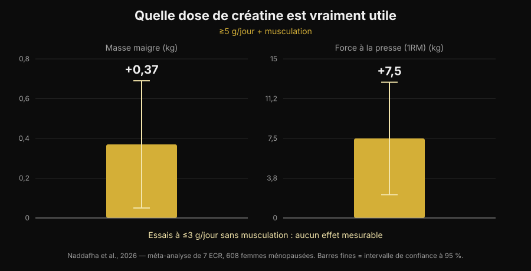
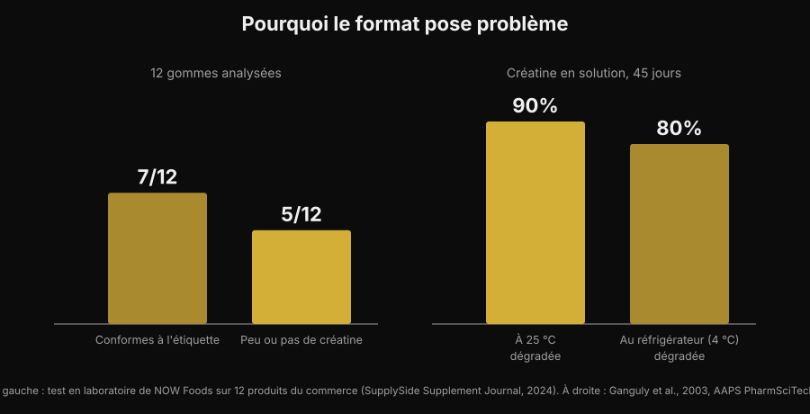

# Gommes de créatine : efficaces comme la poudre ?

Par [Giammaria Loi](/autore/giammaria-loi) · mis à jour le 5 novembre 2026

Mâcher deux bonbons au lieu de diluer une poudre qui reste au fond du verre : la promesse est pratique, et les recherches sur "creatine gummies" ont progressé de 279 %. La vraie question n'est pourtant pas de savoir si la créatine fonctionne — la littérature a tranché il y a trente ans — mais s'il y a vraiment, dans ces gommes, la créatine annoncée sur l'étiquette. Là-dessus, les chiffres existent, et ils ne rassurent pas.

## En bref

- **Une étude sur les gommes existe, et elle est positive.** Dix semaines, 5 g par jour de créatine monohydrate en gommes : chez 32 joueuses de beach-volley, le saut vertical et le changement de direction se sont améliorés par rapport au groupe témoin.
- **Mais cette étude utilisait 5 g réels.** La méta-analyse la plus récente trouve +0,37 kg de masse maigre et +7,5 kg à la presse à cuisses avec au moins 5 g par jour associés à la musculation, et aucun effet mesurable dans les essais à 3 g par jour ou moins sans entraînement.
- **Beaucoup de gommes ne contiennent pas ce qu'elles annoncent.** Lors d'un test en laboratoire sur 12 produits du commerce, 5 contenaient peu ou pas de créatine — et les 5 contenaient de la créatinine.
- **La créatinine n'est pas dangereuse, elle est inutile.** C'est le produit de dégradation de la créatine : la trouver dans le pot signifie que la créatine est partie avant ton achat.
- **La chimie explique pourquoi.** La créatine en poudre sèche est stable ; en solution, non. Dans l'eau à température ambiante, 90 % se dégrade en 45 jours.

## Pourquoi les gommes sont partout

La raison n'est pas scientifique, elle est logistique. La poudre de créatine a trois défauts pratiques : il faut la doser, il faut la dissoudre, et si l'eau est froide elle reste granuleuse au fond. La gomme règle les trois d'un coup, se glisse dans un sac de sport et ressemble à un bonbon plutôt qu'à un complément. C'est le même mécanisme qui a fait basculer la vitamine D et les oméga-3 vers le format à mâcher.

Le résultat se lit dans les recherches : "creatine gummies" représente aujourd'hui environ 165 000 recherches par mois avec une croissance de 279 %, et les premières positions sur Google sont presque toutes des classements de sites qui vendent le produit. Presque aucune de ces pages ne donne les deux chiffres qui comptent : combien de créatine il faut, et combien il y en a vraiment dans le produit.

## La bonne nouvelle : une étude sur les gommes existe

Il y a peu encore, à la question « est-ce que ça marche ? » on répondait par analogie : il y a de la créatine monohydrate dedans, la créatine monohydrate fonctionne, donc ça fonctionne. Il existe maintenant une étude qui a testé le format lui-même.

Trente-deux joueuses de beach-volley, universitaires et professionnelles, ont été réparties entre créatine monohydrate en gommes à 5 g par jour et un groupe témoin, pendant dix semaines. Le groupe créatine a amélioré le saut vertical avec contre-mouvement (p < 0,001) et la vitesse dans les changements de direction (p = 0,009), alors que le groupe témoin n'a pas progressé ou a régressé ; des différences favorables sont aussi apparues sur la masse grasse et le pourcentage de graisse. En revanche, aucune différence sur la masse maigre, la masse musculaire squelettique et le temps de réaction (Pereira et al., 2026).

C'est un résultat cohérent avec toute la littérature sur la créatine en poudre, et il dit une chose simple : **la gomme n'abîme pas la molécule**. Si la créatine est présente et en quantité suffisante, le véhicule n'est pas le problème. Ce qui déplace toute la question sur ces deux conditions : est-elle là, et y en a-t-il assez.

## La dose fait tout

Le chiffre à retenir, c'est 5 g par jour. C'est la dose d'entretien indiquée par la position officielle de l'International Society of Sports Nutrition, et c'est exactement celle utilisée dans l'étude sur les gommes. La phase de charge (environ 0,3 g par kg de poids et par jour pendant 5 à 7 jours) remplit les stocks plus vite, mais elle n'est pas obligatoire : on arrive au même point avec 3-5 g par jour en quelques semaines (Kreider et al., 2017).

Sous ce seuil, les choses changent. Une revue systématique avec méta-analyse portant sur sept essais randomisés et 608 femmes ménopausées a trouvé des bénéfices nets quand la créatine dépassait 5 g par jour et était associée à l'entraînement contre résistance : masse maigre +0,37 kg (IC 95 % de +0,05 à +0,69) et presse à cuisses +7,5 kg (IC 95 % de +2,2 à +12,8). Dans les essais à 3 g par jour ou moins sans entraînement, aucun effet mesurable (Naddafha et al., 2026).

*Graphique Nurvan d'après les données de Naddafha et al., 2026 (J Int Soc Sports Nutr). Valeurs issues du résumé original, non relevées sur les figures.*

Le même ordre de grandeur revient dans un essai en triple aveugle sur vingt adultes végans : quatre semaines à 0,1 g par kg et par jour — environ 7 g pour une personne de 70 kg — ont augmenté la masse musculaire squelettique de 0,3 kg et amélioré le saut, sans modification des marqueurs rénaux (López-Moreno et al., 2026).

Passons au calcul pratique, qui explique pourquoi les gommes méritent un examen attentif. Voici combien de gommes il faut par jour pour atteindre 5 g, selon ce que déclare une gomme :

| Créatine déclarée par gomme | Gommes par jour pour atteindre 5 g |
|---|---|
| 0,5 g | 10 |
| 0,75 g | 7 |
| 1 g | 5 |
| 1,25 g | 4 |
| 1,5 g | 4 (3,3 arrondi) |
| 2 g | 3 (2,5 arrondi) |

*Calcul Nurvan : 5 ÷ grammes déclarés par gomme, arrondi à l'unité supérieure. Les grammes par gomme se lisent sur l'étiquette du produit que tu as en main.*

Le problème n'est pas le chiffre en soi, c'est que la portion affichée sur le devant de la boîte n'atteint presque jamais 5 g. Si un produit conseille « 2 gommes par jour » et que chaque gomme déclare 1 g, tu prends 2 g : la plage qui, dans la méta-analyse, n'a produit aucun effet mesurable.

## Le vrai problème : ce qu'il y a vraiment dedans

On arrive ici à la partie que les classements d'affiliation passent sous silence. Un laboratoire industriel a acheté 12 gommes de créatine sur Amazon et sur les sites des fabricants, puis les a analysées. Sept produits respectaient l'étiquetage, parfois avec des marges généreuses. Les cinq autres contenaient peu ou pas de créatine. Et dans les cinq, de la **créatinine** a été retrouvée, en quantités allant de faibles à notables (test NOW Foods rapporté par SupplySide Supplement Journal, 2024).

*Graphique Nurvan. Panneau de gauche : test en laboratoire sur 12 produits du commerce (NOW Foods, rapporté par SupplySide Supplement Journal, 2024). Panneau de droite : Ganguly et al., 2003, AAPS PharmSciTech.*

La créatinine est le produit final de la dégradation de la créatine. Ce n'est pas un poison — ton corps en fabrique et en élimine chaque jour — mais elle n'a aucune activité ergogénique. En trouver dans un complément signifie une seule chose : cette créatine s'est dégradée avant d'arriver dans ta bouche, et tu paies un bonbon.

Pourquoi les gommes en particulier ? Pour une raison chimique, pas commerciale. La créatine monohydrate en poudre sèche est très stable ; en solution, non. Une étude de stabilité a dissous des formulations de créatine dans de l'eau à pH 6,2 et mesuré la teneur pendant 45 jours : à température ambiante, 90 % de la créatine s'est dégradée, au réfrigérateur 80 % (Ganguly et al., 2003). Une gomme est un gel fabriqué à chaud, qui contient de l'eau et qui est souvent acidifié pour le goût, puis reste des mois en rayon à température ambiante : ce sont exactement les conditions qui accélèrent la conversion. Cela ne veut pas dire que toutes les gommes sont inutiles — sept sur douze étaient correctes — mais que le format est par nature plus fragile que le pot de poudre, et que sans analyse en laboratoire tu n'as aucun moyen de savoir dans quelle moitié tu es tombé.

## Ce que dit vraiment la recherche

| Affirmation courante | Verdict | Source |
|---|---|---|
| « Les gommes ne marchent pas, la créatine s'abîme » | À nuancer : dans une étude, elles ont marché | Pereira et al., 2026 |
| « Il suffit de prendre les gommes indiquées sur l'étiquette » | Démenti : ce qui compte, c'est d'atteindre 5 g | Naddafha et al., 2026 ; Kreider et al., 2017 |
| « S'il est écrit créatine, il y a de la créatine » | Démenti : 5 produits sur 12 en avaient peu ou pas | Test NOW Foods, 2024 |
| « La créatinine des gommes abîme les reins » | Démenti : elle est inerte, le problème est la dose manquante | Kreider et al., 2017 ; López-Moreno et al., 2026 |
| « La phase de charge est indispensable » | À nuancer : elle accélère, elle n'est pas obligatoire | Kreider et al., 2017 |
| « Les formes plus solubles sont plus efficaces » | Non démontré chez l'humain | Alraddadi et al., 2018 |

La dernière ligne mérite un arrêt, parce que c'est l'argument qui accompagne presque toutes les formes alternatives. Il est vrai que la créatine chlorhydrate est plus soluble que la monohydrate, et une étude de pharmacocinétique chez le rat, avec modélisation, a estimé une biodisponibilité orale plus élevée pour la forme chlorhydrate que pour la monohydrate (Alraddadi et al., 2018). Mais c'est un modèle animal : aucun essai chez l'humain n'a montré que cela se traduise par plus de force ou plus de masse, et la monohydrate reste la forme sur laquelle repose pratiquement toute la littérature, y compris celle sur la sécurité à long terme (Kerksick et al., 2026). Le même principe vaut pour la gomme : c'est un véhicule, pas un avantage.

## Comment l'appliquer

1. **Pars des grammes, pas des bonbons.** Lis combien de grammes de créatine monohydrate déclare une gomme et fais le calcul pour atteindre 5 g par jour. Si la boîte ne l'indique pas à l'unité mais seulement par « portion », c'est déjà un signal.
2. **Méfie-toi des produits qui ne disent pas « monohydrate ».** C'est la forme utilisée dans les études, gommes comprises. Les mentions génériques ou les formes « propriétaires » n'ont pas la même base de preuves.
3. **Cherche une certification indépendante.** Informed Sport, NSF Certified for Sport et équivalents font analyser les lots. Pour les gommes, cela compte plus que pour la poudre, justement parce que le format est moins stable.
4. **Fais le calcul du coût au gramme.** Divise le prix par les grammes totaux de créatine de la boîte, pas par le nombre de gommes. La comparaison avec le pot de poudre s'arrête généralement là.
5. **Regarde aussi les sucres.** Cinq gommes par jour, ce sont cinq sucreries par jour : vérifie la ligne des sucres sur l'étiquette nutritionnelle et intègre-la à ta journée.
6. **L'horaire compte moins que la régularité.** Ce qui remplit les stocks, c'est d'en prendre tous les jours, pas de viser la bonne fenêtre : j'en ai parlé en détail dans l'article sur [quand prendre les compléments](/fr/blog/quand-prendre-les-complements-horaire).

**Essaie Nurvan — la supplémentation suivie à côté des charges**

Dans Nurvan, tu notes ce que tu prends et quand dans la section supplémentation, et tu le vois à côté de l'historique des charges, des répétitions et du RIR de tes séances. Ainsi, si tu changes de format ou de marque de créatine, tu peux regarder ce qui est arrivé à tes chiffres en salle dans les semaines suivantes au lieu de te fier à une impression. Le même profil contient aussi les analyses que tu as importées. [Essaie Nurvan](https://nurvan.app)

## Questions fréquentes

**Les gommes de créatine sont-elles vraiment efficaces ?**
Elles peuvent l'être, à deux conditions. Dans l'étude disponible, dix semaines à 5 g par jour sous forme de gommes ont amélioré le saut vertical et les changements de direction chez des joueuses de beach-volley (Pereira et al., 2026). Les conditions : que le produit contienne vraiment la créatine annoncée, et que tu atteignes environ 5 g par jour.

**Combien de gommes de créatine faut-il prendre par jour ?**
Cela dépend du nombre de grammes déclaré par gomme : l'objectif est d'environ 5 g par jour de créatine monohydrate. À 1 g par gomme, cela fait 5 gommes ; à 0,5 g, 10. La « portion conseillée » imprimée sur la boîte reste souvent sous les 5 g.

**La créatinine retrouvée dans certaines gommes est-elle dangereuse ?**
Non. La créatinine est le produit de dégradation de la créatine et le corps la produit et l'élimine normalement ; dans les études, la créatine n'a pas modifié les marqueurs rénaux (Kreider et al., 2017 ; López-Moreno et al., 2026). Le problème n'est pas la toxicité mais l'efficacité : là où il y a de la créatinine, il manque de la créatine. Si tes analyses sont hors norme ou si tu as une maladie rénale connue, la bonne démarche est d'en parler à ton médecin, pas de choisir un complément seul.

**Gommes ou poudre : que choisir ?**
Sur la molécule, aucune différence démontrée. La poudre a trois avantages concrets : elle reste stable longtemps, elle coûte bien moins cher au gramme et elle permet de doser exactement 5 g. La gomme ne gagne que sur la commodité. Sur la place de la créatine et des autres compléments en rapport preuves/prix, j'ai fait un [classement des compléments pour la force](/fr/blog/classement-complements-force-tier-list).

## À lire aussi

- [Classement des compléments pour la force : ce que dit la recherche](/fr/blog/classement-complements-force-tier-list) — où se situe la créatine par rapport au reste, preuves en main.
- [La créatine fait-elle tomber les cheveux ?](/fr/blog/creatine-chute-cheveux) — l'autre question la plus recherchée sur la créatine, avec l'étude qui a fait naître le doute.
- [Quand prendre les compléments : l'heure compte-t-elle ?](/fr/blog/quand-prendre-les-complements-horaire) — pourquoi la régularité pèse plus que le moment de la prise.

## Sources

- Pereira F, Forbes SC, Romano V, Christopher P, Santana JC, Antonio J, 2026. Effects of Creatine Monohydrate Gummies on Performance and Body Composition in Female Beach Volleyball Athletes. *Journal of Functional Morphology and Kinesiology* 11(1):105. PMID 41900512. [DOI](https://doi.org/10.3390/jfmk11010105)
- Naddafha S, Antonio J, Kreider RB, Stout JR, 2026. Creatine monohydrate for lean mass, strength, and bone density in postmenopausal women: a systematic review and meta-analysis. *Journal of the International Society of Sports Nutrition* 23(1):2668435. PMID 42141930. [DOI](https://doi.org/10.1080/15502783.2026.2668435)
- Kreider RB, Kalman DS, Antonio J, Ziegenfuss TN, Wildman R, Collins R, Candow DG, Kleiner SM, Almada AL, Lopez HL, 2017. International Society of Sports Nutrition position stand: safety and efficacy of creatine supplementation in exercise, sport, and medicine. *Journal of the International Society of Sports Nutrition* 14:18. PMID 28615996. [DOI](https://doi.org/10.1186/s12970-017-0173-z)
- Kerksick C, Gonzalez D, Stout J, Forbes S, Candow D, Ziegenfuss T, Marshall R, Schwesig R, Kreider R, 2026. The emerging and evolving evidence supporting creatine as an ergogenic aid: history and applications. *Journal of the International Society of Sports Nutrition* 23(1):2646627. PMID 41870601. [DOI](https://doi.org/10.1080/15502783.2026.2646627)
- López-Moreno M, Muñoz A, Aguilar-Navarro M, Gutiérrez-Hellín J, Franco-Andrés A, López-López P, Crespo-Cañizares A, Marrero-Fernández P, Forbes SC, 2026. Does creatine supplementation improve strength and power in physically active individuals on a vegan diet? A randomized, triple-blind, placebo-controlled trial. *European Journal of Applied Physiology* 126(10):5521-5532. PMID 42390589. [DOI](https://doi.org/10.1007/s00421-026-06323-5)
- Ganguly S, Jayappa S, Dash AK, 2003. Evaluation of the stability of creatine in solution prepared from effervescent creatine formulations. *AAPS PharmSciTech* 4(2):E25. PMID 12916907. [DOI](https://doi.org/10.1208/pt040225)
- Alraddadi EA, Lillico R, Vennerstrom JL, Lakowski TM, Miller DW, 2018. Absolute Oral Bioavailability of Creatine Monohydrate in Rats: Debunking a Myth. *Pharmaceutics* 10(1):31. PMID 29518030. [DOI](https://doi.org/10.3390/pharmaceutics10010031)

Références bibliographiques récupérées via PubMed. Donnée de laboratoire sur les 12 gommes : test NOW Foods rapporté par *SupplySide Supplement Journal*, 2024 — [article](https://www.supplysidesj.com/supplement-regulations/now-tests-creatine-gummies-finding-almost-half-to-be-severely-understrength-). Sujet choisi à partir de la recherche de tendance du 5 novembre 2026 : "creatine gummies" fait partie des requêtes à la plus forte croissance du secteur des compléments et les pages qui l'occupent sont presque toutes celles de vendeurs du produit.

---

Giammaria Loi est le fondateur de Nurvan. Il s'entraîne avec des charges depuis 2012, travaille comme coach et préparateur certifié FIPE depuis 2013 et participe à des compétitions de force athlétique au niveau national depuis 2018. Chaque article qu'il signe part des études scientifiques pour arriver à ce qui fonctionne vraiment en salle.

> Note : contenu informatif, il ne remplace pas l'avis d'un médecin ou d'un professionnel de santé.
